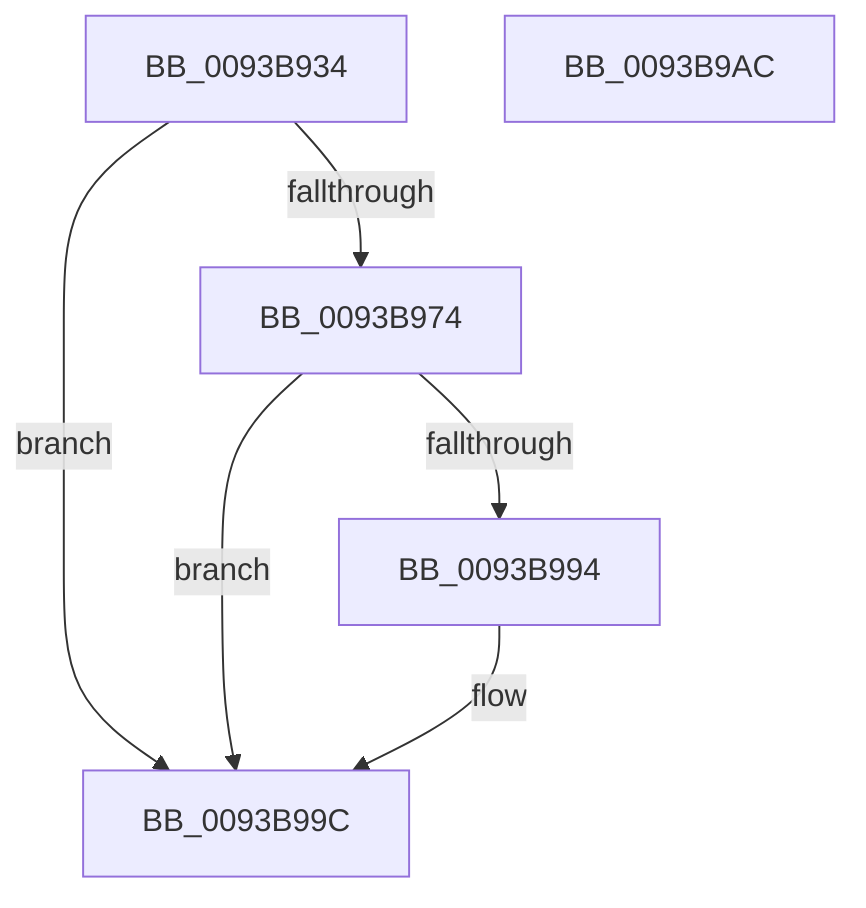

# PfSnAsyncPrefetchStep

- RVA: `0x0093B934`–`0x0093B9AD` (길이 `121` bytes)
- VA: `0x000000014093B934`
- 실행 섹션: `PAGE`
- PDB 이름 있음: `예`; PDB Function 태그: `아니요`
- unwind 정보 RVA: `0x000794E0`
- 디코드: `34`개 명령, `121/121` bytes 표시
- 미해석 바이트: `0` (있으면 어셈블리에 `.byte`로 보존)

> 이 문서는 커널 이미지의 기계어와 PDB 기호를 분석해 생성했습니다. 4번과 5번은 함수 원형과 자료형을 바이너리 사용 방식에서 추정한 C 해석이며 원본 소스 복구 결과는 아닙니다.

## 1. Dependencies

- 직접 호출 지점: **3**; 고유 호출 대상: **2**
- 직접 호출자로 확인된 함수: **1**
- RIP 상대 이미지 참조: **0**

### Outgoing calls
- `0x0093B952` → [PfSnPrefetchMetadata](PfSnPrefetchMetadata_function_0093B9B4.md) (function, `0x0093B9B4`)
- `0x0093B96B` → [PfSnPrefetchSections](PfSnPrefetchSections_function_0093BCF4.md) (function, `0x0093BCF4`)
- `0x0093B98B` → [PfSnPrefetchSections](PfSnPrefetchSections_function_0093BCF4.md) (function, `0x0093BCF4`)

### Direct callers
- [PfSnAsyncPrefetchWorker](PfSnAsyncPrefetchWorker_function_009394B0.md) at `0x00939663`
- [PfSnAsyncPrefetchWorker](PfSnAsyncPrefetchWorker_function_009394B0.md) at `0x0093977F`

### Static image references
- 디코드된 RIP-relative 메모리 참조가 없습니다.

## 2. Other-region calls and transfers

- 다른 실행 섹션으로 향하는 call: **0**
- 별도 외부 분기/꼬리 이동을 확인하지 못했습니다.

## 3. Assembly (complete function range)

```asm
0093B934  48 89 5C 24 08                  mov qword ptr [rsp + 8], rbx
0093B939  48 89 74 24 10                  mov qword ptr [rsp + 0x10], rsi
0093B93E  57                              push rdi
0093B93F  48 83 EC 30                     sub rsp, 0x30
0093B943  48 8B F2                        mov rsi, rdx
0093B946  48 8B D9                        mov rbx, rcx
0093B949  48 8B CE                        mov rcx, rsi
0093B94C  41 8B D0                        mov edx, r8d
0093B94F  41 8B F8                        mov edi, r8d
0093B952  E8 5D 00 00 00                  call 0x14093b9b4
0093B957  48 8B 83 D8 00 00 00            mov rax, qword ptr [rbx + 0xd8]
0093B95E  44 8B C7                        mov r8d, edi
0093B961  33 D2                           xor edx, edx
0093B963  48 89 44 24 20                  mov qword ptr [rsp + 0x20], rax
0093B968  48 8B CE                        mov rcx, rsi
0093B96B  E8 84 03 00 00                  call 0x14093bcf4
0093B970  85 C0                           test eax, eax
0093B972  78 28                           js 0x14093b99c
0093B974  48 8B 83 D8 00 00 00            mov rax, qword ptr [rbx + 0xd8]
0093B97B  44 8B C7                        mov r8d, edi
0093B97E  BA 01 00 00 00                  mov edx, 1
0093B983  48 89 44 24 20                  mov qword ptr [rsp + 0x20], rax
0093B988  48 8B CE                        mov rcx, rsi
0093B98B  E8 64 03 00 00                  call 0x14093bcf4
0093B990  85 C0                           test eax, eax
0093B992  78 08                           js 0x14093b99c
0093B994  09 BB E8 00 00 00               or dword ptr [rbx + 0xe8], edi
0093B99A  33 C0                           xor eax, eax
0093B99C  48 8B 5C 24 40                  mov rbx, qword ptr [rsp + 0x40]
0093B9A1  48 8B 74 24 48                  mov rsi, qword ptr [rsp + 0x48]
0093B9A6  48 83 C4 30                     add rsp, 0x30
0093B9AA  5F                              pop rdi
0093B9AB  C3                              ret
0093B9AC  CC                              int3
```

## 4. C-style interpretation (structured pseudocode)

```c
__int64 __fastcall PfSnAsyncPrefetchStep(__int64 a1, __int64 a2, int a3)
{
    __int64 result;
    __int64 v_rsp;
    unsigned __int64 v_stack_m18;
    unsigned __int64 v_stack_p10;
    unsigned __int64 v_stack_p8;

    v_stack_p8 = v_rbx;
    v_stack_p10 = v_rsi;
    v_rsp = (v_rsp) - (48);
    result = PfSnPrefetchMetadata(a2, (unsigned int)(a3), a3, a4);
    a2 = 0;
    v_stack_m18 = *(unsigned __int64 *)(a1 + 216);
    result = PfSnPrefetchSections(0, a2, (unsigned int)((unsigned int)((unsigned int)(a3))), a4);
    if (sign_flag) goto loc_0093B99C;
    v_stack_m18 = *(unsigned __int64 *)(a1 + 216);
    result = PfSnPrefetchSections(0, 1, (unsigned int)((unsigned int)((unsigned int)(a3))), a4);
    if (!(sign_flag)) {
        result = 0;
    }
    v_rsp = (v_rsp) + (48);
    return result;
}
```

## 5. (Beta) C Style

```c
int64_t PfSnAsyncPrefetchStep(void *Arg1, int64_t Arg2, int32_t Arg3)
{
    uint8_t *arg1 = (uint8_t *)Arg1;

    int64_t result;
    int64_t local_rsp;
    uint64_t v_stack_m18;
    uint64_t v_stack_p10;
    uint64_t v_stack_p8;

    v_stack_p8 = local_rbx;
    v_stack_p10 = local_rsi;
    local_rsp = (local_rsp) - (48);
    result = PfSnPrefetchMetadata(Arg2, (uint32_t)(Arg3), Arg3, a4);
    Arg2 = 0;
    v_stack_m18 = *(uint64_t *)(arg1 + 0xD8);
    result = PfSnPrefetchSections(0, Arg2, (uint32_t)((uint32_t)((uint32_t)(Arg3))), a4);
    if (sign_flag) goto loc_0093B99C;
    v_stack_m18 = *(uint64_t *)(arg1 + 0xD8);
    result = PfSnPrefetchSections(0, 1, (uint32_t)((uint32_t)((uint32_t)(Arg3))), a4);
    if (!(sign_flag)) {
        result = 0;
    }
    local_rsp = (local_rsp) + (48);
    return result;
}
```

### 관측된 메모리 오프셋

구조체 형식이 확인되지 않은 접근은 인자 기준의 오프셋으로만 기록했습니다.

| 기준 인자 | 오프셋 표현 | 폭 (bit) | 접근 |
|---|---:|---:|---|
| `Arg1` | `+ 0xD8` | `64` | `R` |
| `Arg1` | `+ 0xE8` | `32` | `R/W` |

## 6. Execution-region graph

[열기: 2D/3D 그래프와 함수 탐색 컨트롤 패널](../../../control-panel.html?section=page&rva=0x0093B934&view=graph)

- 2D 그래프는 위에서 아래로 흐르고, 3D 그래프는 빈 공간을 드래그해 회전합니다. Shift+드래그는 이동, 휠은 확대·축소, 함수 노드 선택은 대상 보고서 이동입니다.

### Static fallback


