# PfSnAsyncPrefetchWorker

- RVA: `0x009394B0`–`0x0093983E` (길이 `910` bytes)
- VA: `0x00000001409394B0`
- 실행 섹션: `PAGE`
- PDB 이름 있음: `예`; PDB Function 태그: `아니요`
- unwind 정보 RVA: `0x0008FC60`
- 디코드: `215`개 명령, `910/910` bytes 표시
- 미해석 바이트: `0` (있으면 어셈블리에 `.byte`로 보존)

> 이 문서는 커널 이미지의 기계어와 PDB 기호를 분석해 생성했습니다. 4번과 5번은 함수 원형과 자료형을 바이너리 사용 방식에서 추정한 C 해석이며 원본 소스 복구 결과는 아닙니다.

## 1. Dependencies

- 직접 호출 지점: **25**; 고유 호출 대상: **19**
- 직접 호출자로 확인된 함수: **0**
- RIP 상대 이미지 참조: **6**

### Outgoing calls
- `0x0093950D` → [memset](../../text/6C/memset_function_006C6C40.md) (function, `0x006C6C40`)
- `0x00939547` → [PfSnLogAsyncWorker](PfSnLogAsyncWorker_function_00939B0C.md) (function, `0x00939B0C`)
- `0x0093956D` → [KiStackAttachProcess](../../text/21/KiStackAttachProcess_function_00216820.md) (function, `0x00216820`)
- `0x00939572` → [KeQueryHeteroCpuPolicyThread](../../text/48/KeQueryHeteroCpuPolicyThread_function_00488A70.md) (function, `0x00488A70`)
- `0x0093958D` → [PfSnPreallocatePrefetchHeader](PfSnPreallocatePrefetchHeader_function_009399C8.md) (function, `0x009399C8`)
- `0x0093959F` → [MmGetAvailablePagesBelowPriority](../../text/4A/MmGetAvailablePagesBelowPriority_function_004ACEAC.md) (function, `0x004ACEAC`)
- `0x009395D1` → [ExAllocatePool2](../../poolcode/B8/ExAllocatePool2_function_00B820F0.md) (function, `0x00B820F0`)
- `0x009395E7` → [PfpPrefetchSharedInitialize](PfpPrefetchSharedInitialize_function_00939E30.md) (function, `0x00939E30`)
- `0x00939617` → [PfpPrefetchSharedStart](PfpPrefetchSharedStart_function_00939D24.md) (function, `0x00939D24`)
- `0x0093962A` → [PfSnOpenVolumesForPrefetch](../8A/PfSnOpenVolumesForPrefetch_function_008AA4AC.md) (function, `0x008AA4AC`)
- `0x00939663` → [PfSnAsyncPrefetchStep](PfSnAsyncPrefetchStep_function_0093B934.md) (function, `0x0093B934`)
- `0x00939670` → [ExReleaseRundownProtection](../../text/34/ExReleaseRundownProtection_function_00349E80.md) (function, `0x00349E80`)
- `0x00939685` → [PfSnLogAsyncWorker](PfSnLogAsyncWorker_function_00939B0C.md) (function, `0x00939B0C`)
- `0x009396C2` → [PfSnCleanupPrefetchHeader](PfSnCleanupPrefetchHeader_function_00939898.md) (function, `0x00939898`)
- `0x009396D9` → [PfSnPowerBoost](PfSnPowerBoost_function_00939C14.md) (function, `0x00939C14`)
- `0x009396E4` → [KiUnstackDetachProcess](../../text/21/KiUnstackDetachProcess_function_00217D30.md) (function, `0x00217D30`)
- `0x009396FC` → [PfSnLogAsyncWorker](PfSnLogAsyncWorker_function_00939B0C.md) (function, `0x00939B0C`)
- `0x00939704` → [PfSnAsyncContextCleanup](PfSnAsyncContextCleanup_function_00939844.md) (function, `0x00939844`)
- `0x0093970E` → [ExFreePoolWithTag](../../poolcode/B8/ExFreePoolWithTag_function_00B82870.md) (function, `0x00B82870`)
- `0x0093971A` → [_security_check_cookie](../../text/6A/_security_check_cookie_function_006AC640.md) (function, `0x006AC640`)
- `0x0093977F` → [PfSnAsyncPrefetchStep](PfSnAsyncPrefetchStep_function_0093B934.md) (function, `0x0093B934`)
- `0x0093979E` → [memcmp](../../text/6C/memcmp_function_006C6B10.md) (function, `0x006C6B10`)
- `0x009397EB` → [PfSnPowerBoost](PfSnPowerBoost_function_00939C14.md) (function, `0x00939C14`)
- `0x00939825` → [ExReleaseRundownProtection](../../text/34/ExReleaseRundownProtection_function_00349E80.md) (function, `0x00349E80`)
- `0x00939834` → [PfSnLogAsyncWorker](PfSnLogAsyncWorker_function_00939B0C.md) (function, `0x00939B0C`)

### Direct callers
- 이 함수 시작 RVA로 연결되는 직접 call은 확인되지 않았습니다. 간접 호출은 완전히 역산할 수 없습니다.

### Static image references
- `0x009394CE` → RVA `0x00E0A740` (`.data`; read)
- `0x00939520` → RVA `0x000121B8` (`.rdata`; read)
- `0x00939641` → RVA `0x00E670A0` (`.data`; read)
- `0x00939675` → RVA `0x000121D8` (`.rdata`; read)
- `0x009396C7` → RVA `0x00E672C0` (`.data`; read/write)
- `0x009396F2` → RVA `0x000121C8` (`.rdata`; read)

## 2. Other-region calls and transfers

- 다른 실행 섹션으로 향하는 call: **11**
  - `0x0093950D` → [memset](../../text/6C/memset_function_006C6C40.md) (`PAGE` → `.text`)
  - `0x0093956D` → [KiStackAttachProcess](../../text/21/KiStackAttachProcess_function_00216820.md) (`PAGE` → `.text`)
  - `0x00939572` → [KeQueryHeteroCpuPolicyThread](../../text/48/KeQueryHeteroCpuPolicyThread_function_00488A70.md) (`PAGE` → `.text`)
  - `0x0093959F` → [MmGetAvailablePagesBelowPriority](../../text/4A/MmGetAvailablePagesBelowPriority_function_004ACEAC.md) (`PAGE` → `.text`)
  - `0x009395D1` → [ExAllocatePool2](../../poolcode/B8/ExAllocatePool2_function_00B820F0.md) (`PAGE` → `POOLCODE`)
  - `0x00939670` → [ExReleaseRundownProtection](../../text/34/ExReleaseRundownProtection_function_00349E80.md) (`PAGE` → `.text`)
  - `0x009396E4` → [KiUnstackDetachProcess](../../text/21/KiUnstackDetachProcess_function_00217D30.md) (`PAGE` → `.text`)
  - `0x0093970E` → [ExFreePoolWithTag](../../poolcode/B8/ExFreePoolWithTag_function_00B82870.md) (`PAGE` → `POOLCODE`)
  - `0x0093971A` → [_security_check_cookie](../../text/6A/_security_check_cookie_function_006AC640.md) (`PAGE` → `.text`)
  - `0x0093979E` → [memcmp](../../text/6C/memcmp_function_006C6B10.md) (`PAGE` → `.text`)
  - `0x00939825` → [ExReleaseRundownProtection](../../text/34/ExReleaseRundownProtection_function_00349E80.md) (`PAGE` → `.text`)
- 별도 외부 분기/꼬리 이동을 확인하지 못했습니다.

## 3. Assembly (complete function range)

```asm
009394B0  48 89 5C 24 10                  mov qword ptr [rsp + 0x10], rbx
009394B5  48 89 74 24 18                  mov qword ptr [rsp + 0x18], rsi
009394BA  55                              push rbp
009394BB  57                              push rdi
009394BC  41 54                           push r12
009394BE  41 56                           push r14
009394C0  41 57                           push r15
009394C2  48 8D 6C 24 C9                  lea rbp, [rsp - 0x37]
009394C7  48 81 EC F0 00 00 00            sub rsp, 0xf0
009394CE  48 8B 05 6B 12 4D 00            mov rax, qword ptr [rip + 0x4d126b]
009394D5  48 33 C4                        xor rax, rsp
009394D8  48 89 45 27                     mov qword ptr [rbp + 0x27], rax
009394DC  4C 8B B1 D0 00 00 00            mov r14, qword ptr [rcx + 0xd0]
009394E3  0F 57 C0                        xorps xmm0, xmm0
009394E6  83 64 24 20 00                  and dword ptr [rsp + 0x20], 0
009394EB  48 8B F9                        mov rdi, rcx
009394EE  48 8D 4C 24 30                  lea rcx, [rsp + 0x30]
009394F3  33 D2                           xor edx, edx
009394F5  41 B8 80 00 00 00               mov r8d, 0x80
009394FB  45 33 E4                        xor r12d, r12d
009394FE  0F 11 45 F7                     movups xmmword ptr [rbp - 9], xmm0
00939502  45 33 FF                        xor r15d, r15d
00939505  0F 11 45 07                     movups xmmword ptr [rbp + 7], xmm0
00939509  0F 11 45 17                     movups xmmword ptr [rbp + 0x17], xmm0
0093950D  E8 2E D7 D8 FF                  call 0x1406c6c40
00939512  8B 9F EC 00 00 00               mov ebx, dword ptr [rdi + 0xec]
00939518  48 8D 45 8F                     lea rax, [rbp - 0x71]
0093951C  48 89 45 97                     mov qword ptr [rbp - 0x69], rax
00939520  48 8D 15 91 8C 6D FF            lea rdx, [rip - 0x92736f]
00939527  48 8D 45 8F                     lea rax, [rbp - 0x71]
0093952B  4C 89 74 24 30                  mov qword ptr [rsp + 0x30], r14
00939530  48 89 45 8F                     mov qword ptr [rbp - 0x71], rax
00939534  49 8B CE                        mov rcx, r14
00939537  48 8D 45 9F                     lea rax, [rbp - 0x61]
0093953B  48 89 45 A7                     mov qword ptr [rbp - 0x59], rax
0093953F  48 8D 45 9F                     lea rax, [rbp - 0x61]
00939543  48 89 45 9F                     mov qword ptr [rbp - 0x61], rax
00939547  E8 C0 05 00 00                  call 0x140939b0c
0093954C  8B 87 F0 00 00 00               mov eax, dword ptr [rdi + 0xf0]
00939552  41 8D 74 24 01                  lea esi, [r12 + 1]
00939557  40 84 C6                        test sil, al
0093955A  0F 85 85 02 00 00               jne 0x1409397e5
00939560  48 8B 8F D8 00 00 00            mov rcx, qword ptr [rdi + 0xd8]
00939567  4C 8D 45 F7                     lea r8, [rbp - 9]
0093956B  33 D2                           xor edx, edx
0093956D  E8 AE D2 8D FF                  call 0x140216820
00939572  E8 F9 F4 B4 FF                  call 0x140488a70
00939577  8D 48 FF                        lea ecx, [rax - 1]
0093957A  3B D9                           cmp ebx, ecx
0093957C  0F 86 BA 01 00 00               jbe 0x14093973c
00939582  89 4D D7                        mov dword ptr [rbp - 0x29], ecx
00939585  89 45 DB                        mov dword ptr [rbp - 0x25], eax
00939588  48 8D 4C 24 30                  lea rcx, [rsp + 0x30]
0093958D  E8 36 04 00 00                  call 0x1409399c8
00939592  85 C0                           test eax, eax
00939594  0F 88 FA 00 00 00               js 0x140939694
0093959A  8B 4D DB                        mov ecx, dword ptr [rbp - 0x25]
0093959D  FF C1                           inc ecx
0093959F  E8 08 39 B7 FF                  call 0x1404aceac
009395A4  48 3D 00 0F 00 00               cmp rax, 0xf00
009395AA  0F 82 20 02 00 00               jb 0x1409397d0
009395B0  48 05 00 F1 FF FF               add rax, -0xf00
009395B6  48 89 45 DF                     mov qword ptr [rbp - 0x21], rax
009395BA  48 85 C0                        test rax, rax
009395BD  0F 84 D1 00 00 00               je 0x140939694
009395C3  BA 90 00 00 00                  mov edx, 0x90
009395C8  41 B8 50 66 53 43               mov r8d, 0x43536650
009395CE  8D 4A B0                        lea ecx, [rdx - 0x50]
009395D1  E8 1A 8B 24 00                  call 0x140b820f0
009395D6  48 89 44 24 38                  mov qword ptr [rsp + 0x38], rax
009395DB  48 85 C0                        test rax, rax
009395DE  0F 84 B0 00 00 00               je 0x140939694
009395E4  48 8B C8                        mov rcx, rax
009395E7  E8 44 08 00 00                  call 0x140939e30
009395EC  48 8B 44 24 38                  mov rax, qword ptr [rsp + 0x38]
009395F1  48 8D 4C 24 30                  lea rcx, [rsp + 0x30]
009395F6  48 89 48 20                     mov qword ptr [rax + 0x20], rcx
009395FA  48 8B 44 24 38                  mov rax, qword ptr [rsp + 0x38]
009395FF  C7 40 3C FA 00 00 00            mov dword ptr [rax + 0x3c], 0xfa
00939606  48 8B 44 24 38                  mov rax, qword ptr [rsp + 0x38]
0093960B  C7 40 38 0F 00 00 00            mov dword ptr [rax + 0x38], 0xf
00939612  48 8B 4C 24 38                  mov rcx, qword ptr [rsp + 0x38]
00939617  E8 08 07 00 00                  call 0x140939d24
0093961C  85 C0                           test eax, eax
0093961E  78 74                           js 0x140939694
00939620  48 8D 54 24 20                  lea rdx, [rsp + 0x20]
00939625  48 8D 4C 24 30                  lea rcx, [rsp + 0x30]
0093962A  E8 7D 0E F7 FF                  call 0x1408aa4ac
0093962F  85 C0                           test eax, eax
00939631  78 61                           js 0x140939694
00939633  8B 5C 24 20                     mov ebx, dword ptr [rsp + 0x20]
00939637  41 39 76 50                     cmp dword ptr [r14 + 0x50], esi
0093963B  0F 84 D5 01 00 00               je 0x140939816
00939641  8B 05 59 DA 52 00               mov eax, dword ptr [rip + 0x52da59]
00939647  A8 04                           test al, 4
00939649  0F 85 88 01 00 00               jne 0x1409397d7
0093964F  40 84 DE                        test sil, bl
00939652  0F 85 A0 01 00 00               jne 0x1409397f8
00939658  44 8B C6                        mov r8d, esi
0093965B  48 8D 54 24 30                  lea rdx, [rsp + 0x30]
00939660  48 8B CF                        mov rcx, rdi
00939663  E8 CC 22 00 00                  call 0x14093b934
00939668  85 C0                           test eax, eax
0093966A  78 28                           js 0x140939694
0093966C  48 8B 4F 20                     mov rcx, qword ptr [rdi + 0x20]
00939670  E8 0B 08 A1 FF                  call 0x140349e80
00939675  48 8D 15 5C 8B 6D FF            lea rdx, [rip - 0x9274a4]
0093967C  49 8B CE                        mov rcx, r14
0093967F  41 BC 01 00 00 00               mov r12d, 1
00939685  E8 82 04 00 00                  call 0x140939b0c
0093968A  41 3B 76 7C                     cmp esi, dword ptr [r14 + 0x7c]
0093968E  0F 82 B3 00 00 00               jb 0x140939747
00939694  48 8B 8F D8 00 00 00            mov rcx, qword ptr [rdi + 0xd8]
0093969B  33 C0                           xor eax, eax
0093969D  87 81 60 06 00 00               xchg dword ptr [rcx + 0x660], eax
009396A3  48 8B 9F E0 00 00 00            mov rbx, qword ptr [rdi + 0xe0]
009396AA  48 85 DB                        test rbx, rbx
009396AD  74 0E                           je 0x1409396bd
009396AF  48 83 BB D8 01 00 00 00         cmp qword ptr [rbx + 0x1d8], 0
009396B7  0F 84 D3 00 00 00               je 0x140939790
009396BD  48 8D 4C 24 30                  lea rcx, [rsp + 0x30]
009396C2  E8 D1 01 00 00                  call 0x140939898
009396C7  F0 FF 0D F2 DB 52 00            lock dec dword ptr [rip + 0x52dbf2]
009396CE  45 85 FF                        test r15d, r15d
009396D1  74 0B                           je 0x1409396de
009396D3  48 8D 4F 28                     lea rcx, [rdi + 0x28]
009396D7  33 D2                           xor edx, edx
009396D9  E8 36 05 00 00                  call 0x140939c14
009396DE  33 D2                           xor edx, edx
009396E0  48 8D 4D F7                     lea rcx, [rbp - 9]
009396E4  E8 47 E6 8D FF                  call 0x140217d30
009396E9  45 85 E4                        test r12d, r12d
009396EC  0F 84 2F 01 00 00               je 0x140939821
009396F2  48 8D 15 CF 8A 6D FF            lea rdx, [rip - 0x927531]
009396F9  49 8B CE                        mov rcx, r14
009396FC  E8 0B 04 00 00                  call 0x140939b0c
00939701  48 8B CF                        mov rcx, rdi
00939704  E8 3B 01 00 00                  call 0x140939844
00939709  33 D2                           xor edx, edx
0093970B  48 8B CF                        mov rcx, rdi
0093970E  E8 5D 91 24 00                  call 0x140b82870
00939713  48 8B 4D 27                     mov rcx, qword ptr [rbp + 0x27]
00939717  48 33 CC                        xor rcx, rsp
0093971A  E8 21 2F D7 FF                  call 0x1406ac640
0093971F  4C 8D 9C 24 F0 00 00 00         lea r11, [rsp + 0xf0]
00939727  49 8B 5B 38                     mov rbx, qword ptr [r11 + 0x38]
0093972B  49 8B 73 40                     mov rsi, qword ptr [r11 + 0x40]
0093972F  49 8B E3                        mov rsp, r11
00939732  41 5F                           pop r15
00939734  41 5E                           pop r14
00939736  41 5C                           pop r12
00939738  5F                              pop rdi
00939739  5D                              pop rbp
0093973A  C3                              ret
0093973B  CC                              int3
0093973C  89 5D D7                        mov dword ptr [rbp - 0x29], ebx
0093973F  89 5D DB                        mov dword ptr [rbp - 0x25], ebx
00939742  E9 41 FE FF FF                  jmp 0x140939588
00939747  F6 C3 02                        test bl, 2
0093974A  0F 85 44 FF FF FF               jne 0x140939694
00939750  48 8B 8F D8 00 00 00            mov rcx, qword ptr [rdi + 0xd8]
00939757  B8 88 13 00 00                  mov eax, 0x1388
0093975C  87 81 60 06 00 00               xchg dword ptr [rcx + 0x660], eax
00939762  41 3B 76 7C                     cmp esi, dword ptr [r14 + 0x7c]
00939766  0F 83 28 FF FF FF               jae 0x140939694
0093976C  8B CE                           mov ecx, esi
0093976E  48 8D 54 24 30                  lea rdx, [rsp + 0x30]
00939773  41 B8 01 00 00 00               mov r8d, 1
00939779  41 D3 E0                        shl r8d, cl
0093977C  48 8B CF                        mov rcx, rdi
0093977F  E8 B0 21 00 00                  call 0x14093b934
00939784  85 C0                           test eax, eax
00939786  0F 88 08 FF FF FF               js 0x140939694
0093978C  FF C6                           inc esi
0093978E  EB D2                           jmp 0x140939762
00939790  49 8D 56 10                     lea rdx, [r14 + 0x10]
00939794  41 B8 40 00 00 00               mov r8d, 0x40
0093979A  48 8D 4B 18                     lea rcx, [rbx + 0x18]
0093979E  E8 6D D3 D8 FF                  call 0x1406c6b10
009397A3  85 C0                           test eax, eax
009397A5  0F 85 12 FF FF FF               jne 0x1409396bd
009397AB  48 8B 45 E7                     mov rax, qword ptr [rbp - 0x19]
009397AF  48 89 83 D8 01 00 00            mov qword ptr [rbx + 0x1d8], rax
009397B6  8B 4D EF                        mov ecx, dword ptr [rbp - 0x11]
009397B9  48 8B 87 E0 00 00 00            mov rax, qword ptr [rdi + 0xe0]
009397C0  48 83 65 E7 00                  and qword ptr [rbp - 0x19], 0
009397C5  89 88 E0 01 00 00               mov dword ptr [rax + 0x1e0], ecx
009397CB  E9 ED FE FF FF                  jmp 0x1409396bd
009397D0  33 C0                           xor eax, eax
009397D2  E9 DF FD FF FF                  jmp 0x1409395b6
009397D7  33 F6                           xor esi, esi
009397D9  83 E3 FD                        and ebx, 0xfffffffd
009397DC  89 5C 24 20                     mov dword ptr [rsp + 0x20], ebx
009397E0  E9 A5 FE FF FF                  jmp 0x14093968a
009397E5  48 8D 4F 28                     lea rcx, [rdi + 0x28]
009397E9  8B D6                           mov edx, esi
009397EB  E8 24 04 00 00                  call 0x140939c14
009397F0  44 8B FE                        mov r15d, esi
009397F3  E9 68 FD FF FF                  jmp 0x140939560
009397F8  41 8B 76 7C                     mov esi, dword ptr [r14 + 0x7c]
009397FC  41 B8 01 00 00 00               mov r8d, 1
00939802  8B CE                           mov ecx, esi
00939804  41 D3 E0                        shl r8d, cl
00939807  41 83 E8 01                     sub r8d, 1
0093980B  0F 85 4A FE FF FF               jne 0x14093965b
00939811  E9 56 FE FF FF                  jmp 0x14093966c
00939816  0B DE                           or ebx, esi
00939818  89 5C 24 20                     mov dword ptr [rsp + 0x20], ebx
0093981C  E9 20 FE FF FF                  jmp 0x140939641
00939821  48 8B 4F 20                     mov rcx, qword ptr [rdi + 0x20]
00939825  E8 56 06 A1 FF                  call 0x140349e80
0093982A  48 8D 15 A7 89 6D FF            lea rdx, [rip - 0x927659]
00939831  49 8B CE                        mov rcx, r14
00939834  E8 D3 02 00 00                  call 0x140939b0c
00939839  E9 B4 FE FF FF                  jmp 0x1409396f2
```

## 4. C-style interpretation (structured pseudocode)

```c
__int64 __fastcall PfSnAsyncPrefetchWorker(__int64 a1, int a2)
{
    __int64 result;
    __int64 v_r12;
    __int64 v_r15;
    __int64 v_rbx;
    __int64 v_rsi;
    __int64 v_rsp;
    unsigned __int64 v_stack_m28;
    unsigned __int64 v_stack_m38;
    unsigned __int64 v_stack_m48;
    unsigned __int64 v_stack_m58;
    unsigned __int64 v_stack_m5F;
    unsigned __int64 v_stack_m68;
    unsigned int v_stack_m70;
    unsigned __int64 v_stack_m78;
    unsigned __int64 v_stack_m80;
    unsigned int v_stack_m84;
    unsigned int v_stack_m88;
    unsigned __int64 v_stack_mB8;
    unsigned __int64 v_stack_mC0;
    unsigned __int64 v_stack_mC8;
    unsigned __int64 v_stack_mD0;
    unsigned __int64 v_stack_mE0;
    unsigned __int64 v_stack_mE8;
    unsigned int v_stack_mF8;
    unsigned __int64 v_stack_p10;
    unsigned __int64 v_stack_p18;

    v_stack_p10 = v_rbx;
    v_stack_p18 = v_rsi;
    v_rsp = (v_rsp) - (240);
    result = (*(unsigned __int64 *)(v_rip + 5050987)) ^ (v_rsp);
    v_stack_m38 = result;
    a2 = 0;
    v_r12 = 0;
    v_stack_m68 = v_xmm0;
    v_r15 = 0;
    v_stack_m58 = v_xmm0;
    v_stack_m48 = v_xmm0;
    result = memset(v_stack_mE8, a2, 128, a4);
    v_stack_mC8 = v_stack_mD0;
    v_stack_mE8 = *(unsigned __int64 *)(a1 + 208);
    v_stack_mD0 = v_stack_mD0;
    v_stack_mB8 = v_stack_mC0;
    v_stack_mC0 = v_stack_mC0;
    result = PfSnLogAsyncWorker(*(unsigned __int64 *)(a1 + 208), v_rip - 9597807, 128, a4);
    if ((((unsigned __int8)(v_r12 + 1)) & ((unsigned __int8)((unsigned int)(*(unsigned int *)(a1 + 240))))) != 0) goto loc_009397E5;
loc_00939560:
    a2 = 0;
    result = KiStackAttachProcess(*(unsigned __int64 *)(a1 + 216), a2, v_stack_m68, a4);
    result = KeQueryHeteroCpuPolicyThread(*(unsigned __int64 *)(a1 + 216), a2, v_stack_m68, a4);
    if (((unsigned int)((unsigned int)(*(unsigned int *)(a1 + 236)))) <= ((unsigned int)(result - 1))) goto loc_0093973C;
    v_stack_m88 = (unsigned int)(result - 1);
    v_stack_m84 = (unsigned int)(result);
loc_00939588:
    result = PfSnPreallocatePrefetchHeader(v_stack_mE8, a2, v_stack_m68, a4);
    if (sign_flag) goto loc_00939694;
    a1 = (unsigned int)(((unsigned int)(v_stack_m84)) + 1);
    result = MmGetAvailablePagesBelowPriority(a1, a2, v_stack_m68, a4);
    if (result < 0xF00ULL) goto loc_009397D0;
    result = (result) + (0xFFFFFFFFFFFFF100ULL);
loc_009395B6:
    v_stack_m80 = result;
    if (result == 0) goto loc_00939694;
    result = ExAllocatePool2(144 - 80, 144, (unsigned int)(0x43536650ULL), a4);
    v_stack_mE0 = result;
    if (result == 0) goto loc_00939694;
    result = PfpPrefetchSharedInitialize(result, 144, (unsigned int)(0x43536650ULL), a4);
    *(unsigned __int64 *)(v_stack_mE0 + 32) = v_stack_mE8;
    *(unsigned int *)(v_stack_mE0 + 60) = 250;
    *(unsigned int *)(v_stack_mE0 + 56) = 15;
    result = PfpPrefetchSharedStart(v_stack_mE0, 144, (unsigned int)(0x43536650ULL), a4);
    if (sign_flag) goto loc_00939694;
    result = PfSnOpenVolumesForPrefetch(v_stack_mE8, v_stack_mF8, (unsigned int)(0x43536650ULL), a4);
    if (sign_flag) goto loc_00939694;
    if ((*(unsigned int *)(*(unsigned __int64 *)(a1 + 208) + 80)) == ((unsigned int)(v_r12 + 1))) goto loc_00939816;
loc_00939641:
    if ((((unsigned __int8)((unsigned int)(*(unsigned int *)(v_rip + 5429849)))) & (4)) != 0) goto loc_009397D7;
    if ((((unsigned __int8)(v_r12 + 1)) & ((unsigned __int8)((unsigned int)(v_stack_mF8)))) != 0) goto loc_009397F8;
loc_0093965B:
    result = PfSnAsyncPrefetchStep(a1, v_stack_mE8, (unsigned int)((unsigned int)(v_r12 + 1)), a4);
    if (sign_flag) goto loc_00939694;
loc_0093966C:
    result = ExReleaseRundownProtection(*(unsigned __int64 *)(a1 + 32), v_stack_mE8, (unsigned int)((unsigned int)(v_r12 + 1)), a4);
    result = PfSnLogAsyncWorker(*(unsigned __int64 *)(a1 + 208), v_rip - 9598116, (unsigned int)((unsigned int)(v_r12 + 1)), a4);
loc_0093968A:
    if (((unsigned int)(v_r12 + 1)) < (*(unsigned int *)(*(unsigned __int64 *)(a1 + 208) + 124))) goto loc_00939747;
loc_00939694:
    result = 0;
    if (*(unsigned __int64 *)(a1 + 224) == 0) goto loc_009396BD;
    if ((*(unsigned __int64 *)(*(unsigned __int64 *)(a1 + 224) + 472)) == 0) goto loc_00939790;
loc_009396BD:
    result = PfSnCleanupPrefetchHeader(v_stack_mE8, v_rip - 9598116, (unsigned int)((unsigned int)(v_r12 + 1)), a4);
    if (0 != 0) {
        a1 = a1 + 40;
        a2 = 0;
        result = PfSnPowerBoost(a1, a2, (unsigned int)((unsigned int)(v_r12 + 1)), a4);
    }
    a2 = 0;
    result = KiUnstackDetachProcess(v_stack_m68, a2, (unsigned int)((unsigned int)(v_r12 + 1)), a4);
    if (1 == 0) goto loc_00939821;
loc_009396F2:
    result = PfSnLogAsyncWorker(*(unsigned __int64 *)(a1 + 208), v_rip - 9598257, (unsigned int)((unsigned int)(v_r12 + 1)), a4);
    result = PfSnAsyncContextCleanup(a1, v_rip - 9598257, (unsigned int)((unsigned int)(v_r12 + 1)), a4);
    a2 = 0;
    result = ExFreePoolWithTag(a1, a2, (unsigned int)((unsigned int)(v_r12 + 1)), a4);
    a1 = (v_stack_m38) ^ (v_rsp);
    result = _security_check_cookie(a1, a2, (unsigned int)((unsigned int)(v_r12 + 1)), a4);
    return result;
loc_0093973C:
    v_stack_m88 = (unsigned int)(*(unsigned __int64 *)(v_stack_m28 + 56));
    v_stack_m84 = (unsigned int)(*(unsigned __int64 *)(v_stack_m28 + 56));
    goto loc_00939588;
loc_00939747:
    if ((((unsigned __int8)(*(unsigned __int64 *)(v_stack_m28 + 56))) & (2)) != 0) goto loc_00939694;
loc_00939762:
    if (((unsigned int)(*(unsigned __int64 *)(v_stack_m28 + 64))) >= (*(unsigned int *)(*(unsigned __int64 *)(a1 + 208) + 124))) goto loc_00939694;
    a3 = (unsigned int)((1) << ((unsigned __int8)((unsigned int)((unsigned int)(*(unsigned __int64 *)(v_stack_m28 + 64))))));
    result = PfSnAsyncPrefetchStep(a1, v_stack_mC0, a3, a4);
    if (sign_flag) goto loc_00939694;
    v_rsi = (unsigned int)((*(unsigned __int64 *)(v_stack_m28 + 64)) + 1);
    goto loc_00939762;
loc_00939790:
    result = memcmp(*(unsigned __int64 *)(v_stack_m28 + 56) + 24, *(unsigned __int64 *)(a1 + 208) + 16, 64, a4);
    if ((unsigned int)(result) != 0) goto loc_009396BD;
    *(unsigned __int64 *)(*(unsigned __int64 *)(v_stack_m28 + 56) + 472) = v_stack_m78;
    *(unsigned int *)(*(unsigned __int64 *)(a1 + 224) + 480) = (unsigned int)((unsigned int)(v_stack_m70));
    goto loc_009396BD;
loc_009397D0:
    result = 0;
    goto loc_009395B6;
loc_009397D7:
    v_rsi = 0;
    v_rbx = (unsigned int)((*(unsigned __int64 *)(v_stack_m28 + 56)) & (0xFFFFFFFDULL));
    v_stack_mD0 = (unsigned int)(v_rbx);
    goto loc_0093968A;
loc_009397E5:
    result = PfSnPowerBoost(a1 + 40, 0, 64, a4);
    goto loc_00939560;
loc_009397F8:
    a3 = (unsigned int)((1) << ((unsigned __int8)((unsigned int)((unsigned int)((unsigned int)(*(unsigned int *)(*(unsigned __int64 *)(a1 + 208) + 124)))))));
    a3 = (unsigned int)((a3) - (1));
    if (condition_is_not_equal) goto loc_0093965B;
    goto loc_0093966C;
loc_00939816:
    v_rbx = (unsigned int)((v_rbx) | ((unsigned int)((unsigned int)(*(unsigned int *)(*(unsigned __int64 *)(a1 + 208) + 124)))));
    v_stack_mD0 = (unsigned int)(v_rbx);
    goto loc_00939641;
loc_00939821:
    result = ExReleaseRundownProtection(*(unsigned __int64 *)(a1 + 32), 0, a3, a4);
    result = PfSnLogAsyncWorker(*(unsigned __int64 *)(a1 + 208), v_rip - 9598553, a3, a4);
    goto loc_009396F2;
}
```

## 5. (Beta) C Style

```c
int64_t PfSnAsyncPrefetchWorker(void *Arg1, int32_t Arg2)
{
    uint8_t *arg1 = (uint8_t *)Arg1;

    int64_t result;
    int64_t local_r12;
    int64_t local_r15;
    int64_t local_rbx;
    int64_t local_rsi;
    int64_t local_rsp;
    uint64_t v_stack_m28;
    uint64_t v_stack_m38;
    uint64_t v_stack_m48;
    uint64_t v_stack_m58;
    uint64_t v_stack_m5F;
    uint64_t v_stack_m68;
    uint32_t v_stack_m70;
    uint64_t v_stack_m78;
    uint64_t v_stack_m80;
    uint32_t v_stack_m84;
    uint32_t v_stack_m88;
    uint64_t v_stack_mB8;
    uint64_t v_stack_mC0;
    uint64_t v_stack_mC8;
    uint64_t v_stack_mD0;
    uint64_t v_stack_mE0;
    uint64_t v_stack_mE8;
    uint32_t v_stack_mF8;
    uint64_t v_stack_p10;
    uint64_t v_stack_p18;

    v_stack_p10 = local_rbx;
    v_stack_p18 = local_rsi;
    local_rsp = (local_rsp) - (240);
    result = (*(uint64_t *)(v_rip + 0x4D126B)) ^ (local_rsp);
    v_stack_m38 = result;
    Arg2 = 0;
    local_r12 = 0;
    v_stack_m68 = v_xmm0;
    local_r15 = 0;
    v_stack_m58 = v_xmm0;
    v_stack_m48 = v_xmm0;
    result = memset(v_stack_mE8, Arg2, 128, a4);
    v_stack_mC8 = v_stack_mD0;
    v_stack_mE8 = *(uint64_t *)(arg1 + 0xD0);
    v_stack_mD0 = v_stack_mD0;
    v_stack_mB8 = v_stack_mC0;
    v_stack_mC0 = v_stack_mC0;
    result = PfSnLogAsyncWorker(*(uint64_t *)(arg1 + 0xD0), v_rip - 9597807, 128, a4);
    if ((((uint8_t)(local_r12 + 1)) & ((uint8_t)((uint32_t)(*(uint32_t *)(arg1 + 0xF0))))) != 0) goto loc_009397E5;
loc_00939560:
    Arg2 = 0;
    result = KiStackAttachProcess(*(uint64_t *)(arg1 + 0xD8), Arg2, v_stack_m68, a4);
    result = KeQueryHeteroCpuPolicyThread(*(uint64_t *)(arg1 + 0xD8), Arg2, v_stack_m68, a4);
    if (((uint32_t)((uint32_t)(*(uint32_t *)(arg1 + 0xEC)))) <= ((uint32_t)(result - 1))) goto loc_0093973C;
    v_stack_m88 = (uint32_t)(result - 1);
    v_stack_m84 = (uint32_t)(result);
loc_00939588:
    result = PfSnPreallocatePrefetchHeader(v_stack_mE8, Arg2, v_stack_m68, a4);
    if (sign_flag) goto loc_00939694;
    Arg1 = (uint32_t)(((uint32_t)(v_stack_m84)) + 1);
    result = MmGetAvailablePagesBelowPriority(Arg1, Arg2, v_stack_m68, a4);
    if (result < 0xF00ULL) goto loc_009397D0;
    result = (result) + (0xFFFFFFFFFFFFF100ULL);
loc_009395B6:
    v_stack_m80 = result;
    if (result == 0) goto loc_00939694;
    result = ExAllocatePool2(144 - 80, 144, (uint32_t)(0x43536650ULL), a4);
    v_stack_mE0 = result;
    if (result == 0) goto loc_00939694;
    result = PfpPrefetchSharedInitialize(result, 144, (uint32_t)(0x43536650ULL), a4);
    *(uint64_t *)(v_stack_mE0 + 0x20) = v_stack_mE8;
    *(uint32_t *)(v_stack_mE0 + 0x3C) = 250;
    *(uint32_t *)(v_stack_mE0 + 0x38) = 15;
    result = PfpPrefetchSharedStart(v_stack_mE0, 144, (uint32_t)(0x43536650ULL), a4);
    if (sign_flag) goto loc_00939694;
    result = PfSnOpenVolumesForPrefetch(v_stack_mE8, v_stack_mF8, (uint32_t)(0x43536650ULL), a4);
    if (sign_flag) goto loc_00939694;
    if ((*(uint32_t *)(*(uint64_t *)(arg1 + 0xD0) + 0x50)) == ((uint32_t)(local_r12 + 1))) goto loc_00939816;
loc_00939641:
    if ((((uint8_t)((uint32_t)(*(uint32_t *)(v_rip + 0x52DA59)))) & (4)) != 0) goto loc_009397D7;
    if ((((uint8_t)(local_r12 + 1)) & ((uint8_t)((uint32_t)(v_stack_mF8)))) != 0) goto loc_009397F8;
loc_0093965B:
    result = PfSnAsyncPrefetchStep(Arg1, v_stack_mE8, (uint32_t)((uint32_t)(local_r12 + 1)), a4);
    if (sign_flag) goto loc_00939694;
loc_0093966C:
    result = ExReleaseRundownProtection(*(uint64_t *)(arg1 + 0x20), v_stack_mE8, (uint32_t)((uint32_t)(local_r12 + 1)), a4);
    result = PfSnLogAsyncWorker(*(uint64_t *)(arg1 + 0xD0), v_rip - 9598116, (uint32_t)((uint32_t)(local_r12 + 1)), a4);
loc_0093968A:
    if (((uint32_t)(local_r12 + 1)) < (*(uint32_t *)(*(uint64_t *)(arg1 + 0xD0) + 0x7C))) goto loc_00939747;
loc_00939694:
    result = 0;
    if (*(uint64_t *)(arg1 + 0xE0) == 0) goto loc_009396BD;
    if ((*(uint64_t *)(*(uint64_t *)(arg1 + 0xE0) + 0x1D8)) == 0) goto loc_00939790;
loc_009396BD:
    result = PfSnCleanupPrefetchHeader(v_stack_mE8, v_rip - 9598116, (uint32_t)((uint32_t)(local_r12 + 1)), a4);
    if (0 != 0) {
        Arg1 = Arg1 + 40;
        Arg2 = 0;
        result = PfSnPowerBoost(Arg1, Arg2, (uint32_t)((uint32_t)(local_r12 + 1)), a4);
    }
    Arg2 = 0;
    result = KiUnstackDetachProcess(v_stack_m68, Arg2, (uint32_t)((uint32_t)(local_r12 + 1)), a4);
    if (1 == 0) goto loc_00939821;
loc_009396F2:
    result = PfSnLogAsyncWorker(*(uint64_t *)(arg1 + 0xD0), v_rip - 9598257, (uint32_t)((uint32_t)(local_r12 + 1)), a4);
    result = PfSnAsyncContextCleanup(Arg1, v_rip - 9598257, (uint32_t)((uint32_t)(local_r12 + 1)), a4);
    Arg2 = 0;
    result = ExFreePoolWithTag(Arg1, Arg2, (uint32_t)((uint32_t)(local_r12 + 1)), a4);
    Arg1 = (v_stack_m38) ^ (local_rsp);
    result = _security_check_cookie(Arg1, Arg2, (uint32_t)((uint32_t)(local_r12 + 1)), a4);
    return result;
loc_0093973C:
    v_stack_m88 = (uint32_t)(*(uint64_t *)(v_stack_m28 + 0x38));
    v_stack_m84 = (uint32_t)(*(uint64_t *)(v_stack_m28 + 0x38));
    goto loc_00939588;
loc_00939747:
    if ((((uint8_t)(*(uint64_t *)(v_stack_m28 + 0x38))) & (2)) != 0) goto loc_00939694;
loc_00939762:
    if (((uint32_t)(*(uint64_t *)(v_stack_m28 + 0x40))) >= (*(uint32_t *)(*(uint64_t *)(arg1 + 0xD0) + 0x7C))) goto loc_00939694;
    a3 = (uint32_t)((1) << ((uint8_t)((uint32_t)((uint32_t)(*(uint64_t *)(v_stack_m28 + 0x40))))));
    result = PfSnAsyncPrefetchStep(Arg1, v_stack_mC0, a3, a4);
    if (sign_flag) goto loc_00939694;
    local_rsi = (uint32_t)((*(uint64_t *)(v_stack_m28 + 0x40)) + 1);
    goto loc_00939762;
loc_00939790:
    result = memcmp(*(uint64_t *)(v_stack_m28 + 0x38) + 24, *(uint64_t *)(arg1 + 0xD0) + 16, 64, a4);
    if ((uint32_t)(result) != 0) goto loc_009396BD;
    *(uint64_t *)(*(uint64_t *)(v_stack_m28 + 0x38) + 0x1D8) = v_stack_m78;
    *(uint32_t *)(*(uint64_t *)(arg1 + 0xE0) + 0x1E0) = (uint32_t)((uint32_t)(v_stack_m70));
    goto loc_009396BD;
loc_009397D0:
    result = 0;
    goto loc_009395B6;
loc_009397D7:
    local_rsi = 0;
    local_rbx = (uint32_t)((*(uint64_t *)(v_stack_m28 + 0x38)) & (0xFFFFFFFDULL));
    v_stack_mD0 = (uint32_t)(local_rbx);
    goto loc_0093968A;
loc_009397E5:
    result = PfSnPowerBoost(Arg1 + 40, 0, 64, a4);
    goto loc_00939560;
loc_009397F8:
    a3 = (uint32_t)((1) << ((uint8_t)((uint32_t)((uint32_t)((uint32_t)(*(uint32_t *)(*(uint64_t *)(arg1 + 0xD0) + 0x7C)))))));
    a3 = (uint32_t)((a3) - (1));
    if (condition_is_not_equal) goto loc_0093965B;
    goto loc_0093966C;
loc_00939816:
    local_rbx = (uint32_t)((local_rbx) | ((uint32_t)((uint32_t)(*(uint32_t *)(*(uint64_t *)(arg1 + 0xD0) + 0x7C)))));
    v_stack_mD0 = (uint32_t)(local_rbx);
    goto loc_00939641;
loc_00939821:
    result = ExReleaseRundownProtection(*(uint64_t *)(arg1 + 0x20), 0, a3, a4);
    result = PfSnLogAsyncWorker(*(uint64_t *)(arg1 + 0xD0), v_rip - 9598553, a3, a4);
    goto loc_009396F2;
}
```

### 관측된 메모리 오프셋

구조체 형식이 확인되지 않은 접근은 인자 기준의 오프셋으로만 기록했습니다.

| 기준 인자 | 오프셋 표현 | 폭 (bit) | 접근 |
|---|---:|---:|---|
| `Arg1` | `+ 0x20` | `64` | `R` |
| `Arg1` | `+ 0x28` | `64` | `R` |
| `Arg1` | `+ 0xD0` | `64` | `R` |
| `Arg1` | `+ 0xD8` | `64` | `R` |
| `Arg1` | `+ 0xE0` | `64` | `R` |
| `Arg1` | `+ 0xEC` | `32` | `R` |
| `Arg1` | `+ 0xF0` | `32` | `R` |

## 6. Execution-region graph

[열기: 2D/3D 그래프와 함수 탐색 컨트롤 패널](../../../control-panel.html?section=page&rva=0x009394B0&view=graph)

- 2D 그래프는 위에서 아래로 흐르고, 3D 그래프는 빈 공간을 드래그해 회전합니다. Shift+드래그는 이동, 휠은 확대·축소, 함수 노드 선택은 대상 보고서 이동입니다.

### Static fallback

```mermaid
flowchart TD
  bb_009394B0[BB_009394B0]
  bb_00939560[BB_00939560]
  bb_00939582[BB_00939582]
  bb_00939588[BB_00939588]
  bb_0093959A[BB_0093959A]
  bb_009395B0[BB_009395B0]
  bb_009395B6[BB_009395B6]
  bb_009395C3[BB_009395C3]
  bb_009395E4[BB_009395E4]
  bb_00939620[BB_00939620]
  bb_00939633[BB_00939633]
  bb_00939641[BB_00939641]
  bb_0093964F[BB_0093964F]
  bb_00939658[BB_00939658]
  bb_0093965B[BB_0093965B]
  bb_0093966C[BB_0093966C]
  bb_0093968A[BB_0093968A]
  bb_00939694[BB_00939694]
  bb_009396AF[BB_009396AF]
  bb_009396BD[BB_009396BD]
  bb_009396D3[BB_009396D3]
  bb_009396DE[BB_009396DE]
  bb_009396F2[BB_009396F2]
  bb_0093973B[BB_0093973B]
  bb_0093973C[BB_0093973C]
  bb_00939747[BB_00939747]
  bb_00939750[BB_00939750]
  bb_00939762[BB_00939762]
  bb_0093976C[BB_0093976C]
  bb_0093978C[BB_0093978C]
  bb_00939790[BB_00939790]
  bb_009397AB[BB_009397AB]
  bb_009397D0[BB_009397D0]
  bb_009397D7[BB_009397D7]
  bb_009397E5[BB_009397E5]
  bb_009397F8[BB_009397F8]
  bb_00939811[BB_00939811]
  bb_00939816[BB_00939816]
  bb_00939821[BB_00939821]
  bb_009394B0 -->|branch| bb_009397E5
  bb_009394B0 -->|fallthrough| bb_00939560
  bb_00939560 -->|branch| bb_0093973C
  bb_00939560 -->|fallthrough| bb_00939582
  bb_00939582 -->|flow| bb_00939588
  bb_00939588 -->|branch| bb_00939694
  bb_00939588 -->|fallthrough| bb_0093959A
  bb_0093959A -->|branch| bb_009397D0
  bb_0093959A -->|fallthrough| bb_009395B0
  bb_009395B0 -->|flow| bb_009395B6
  bb_009395B6 -->|branch| bb_00939694
  bb_009395B6 -->|fallthrough| bb_009395C3
  bb_009395C3 -->|branch| bb_00939694
  bb_009395C3 -->|fallthrough| bb_009395E4
  bb_009395E4 -->|branch| bb_00939694
  bb_009395E4 -->|fallthrough| bb_00939620
  bb_00939620 -->|branch| bb_00939694
  bb_00939620 -->|fallthrough| bb_00939633
  bb_00939633 -->|branch| bb_00939816
  bb_00939633 -->|fallthrough| bb_00939641
  bb_00939641 -->|branch| bb_009397D7
  bb_00939641 -->|fallthrough| bb_0093964F
  bb_0093964F -->|branch| bb_009397F8
  bb_0093964F -->|fallthrough| bb_00939658
  bb_00939658 -->|flow| bb_0093965B
  bb_0093965B -->|branch| bb_00939694
  bb_0093965B -->|fallthrough| bb_0093966C
  bb_0093966C -->|flow| bb_0093968A
  bb_0093968A -->|branch| bb_00939747
  bb_0093968A -->|fallthrough| bb_00939694
  bb_00939694 -->|branch| bb_009396BD
  bb_00939694 -->|fallthrough| bb_009396AF
  bb_009396AF -->|branch| bb_00939790
  bb_009396AF -->|fallthrough| bb_009396BD
  bb_009396BD -->|branch| bb_009396DE
  bb_009396BD -->|fallthrough| bb_009396D3
  bb_009396D3 -->|flow| bb_009396DE
  bb_009396DE -->|branch| bb_00939821
  bb_009396DE -->|fallthrough| bb_009396F2
  bb_0093973B -->|flow| bb_0093973C
  bb_0093973C -->|branch| bb_00939588
  bb_00939747 -->|branch| bb_00939694
  bb_00939747 -->|fallthrough| bb_00939750
  bb_00939750 -->|flow| bb_00939762
  bb_00939762 -->|branch| bb_00939694
  bb_00939762 -->|fallthrough| bb_0093976C
  bb_0093976C -->|branch| bb_00939694
  bb_0093976C -->|fallthrough| bb_0093978C
  bb_0093978C -->|branch| bb_00939762
  bb_00939790 -->|branch| bb_009396BD
  bb_00939790 -->|fallthrough| bb_009397AB
  bb_009397AB -->|branch| bb_009396BD
  bb_009397D0 -->|branch| bb_009395B6
  bb_009397D7 -->|branch| bb_0093968A
  bb_009397E5 -->|branch| bb_00939560
  bb_009397F8 -->|branch| bb_0093965B
  bb_009397F8 -->|fallthrough| bb_00939811
  bb_00939811 -->|branch| bb_0093966C
  bb_00939816 -->|branch| bb_00939641
  bb_00939821 -->|branch| bb_009396F2
```


