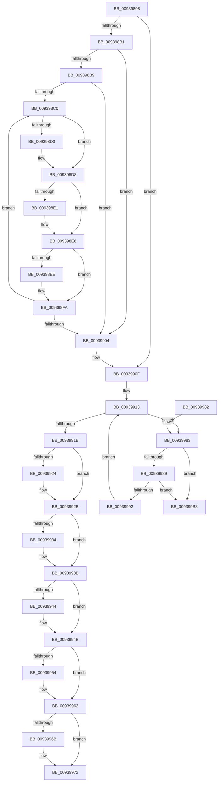

# PfSnCleanupPrefetchHeader

- RVA: `0x00939898`–`0x009399BF` (길이 `295` bytes)
- VA: `0x0000000140939898`
- 실행 섹션: `PAGE`
- PDB 이름 있음: `예`; PDB Function 태그: `아니요`
- unwind 정보 RVA: `0x0008FC88`
- 디코드: `88`개 명령, `295/295` bytes 표시
- 미해석 바이트: `0` (있으면 어셈블리에 `.byte`로 보존)

> 이 문서는 커널 이미지의 기계어와 PDB 기호를 분석해 생성했습니다. 4번과 5번은 함수 원형과 자료형을 바이너리 사용 방식에서 추정한 C 해석이며 원본 소스 복구 결과는 아닙니다.

## 1. Dependencies

- 직접 호출 지점: **12**; 고유 호출 대상: **5**
- 직접 호출자로 확인된 함수: **1**
- RIP 상대 이미지 참조: **0**

### Outgoing calls
- `0x009398D3` → [ObfDereferenceObject](../../text/2F/ObfDereferenceObject_function_002F9350.md) (function, `0x002F9350`)
- `0x009398E1` → [ObfDereferenceObject](../../text/2F/ObfDereferenceObject_function_002F9350.md) (function, `0x002F9350`)
- `0x009398F5` → [PfpOpenHandleClose](../8A/PfpOpenHandleClose_function_008A9E74.md) (function, `0x008A9E74`)
- `0x0093990A` → [ExFreePoolWithTag](../../poolcode/B8/ExFreePoolWithTag_function_00B82870.md) (function, `0x00B82870`)
- `0x00939926` → [ExFreePoolWithTag](../../poolcode/B8/ExFreePoolWithTag_function_00B82870.md) (function, `0x00B82870`)
- `0x00939936` → [ExFreePoolWithTag](../../poolcode/B8/ExFreePoolWithTag_function_00B82870.md) (function, `0x00B82870`)
- `0x00939946` → [ExFreePoolWithTag](../../poolcode/B8/ExFreePoolWithTag_function_00B82870.md) (function, `0x00B82870`)
- `0x00939954` → [PfpPrefetchSharedCleanup](PfpPrefetchSharedCleanup_function_00939EB0.md) (function, `0x00939EB0`)
- `0x0093995D` → [PfpPrefetchSharedDeref](PfpPrefetchSharedDeref_function_00939E78.md) (function, `0x00939E78`)
- `0x0093996D` → [ExFreePoolWithTag](../../poolcode/B8/ExFreePoolWithTag_function_00B82870.md) (function, `0x00B82870`)
- `0x009399A1` → [PfpOpenHandleClose](../8A/PfpOpenHandleClose_function_008A9E74.md) (function, `0x008A9E74`)
- `0x009399AE` → [PfpOpenHandleClose](../8A/PfpOpenHandleClose_function_008A9E74.md) (function, `0x008A9E74`)

### Direct callers
- [PfSnAsyncPrefetchWorker](PfSnAsyncPrefetchWorker_function_009394B0.md) at `0x009396C2`

### Static image references
- 디코드된 RIP-relative 메모리 참조가 없습니다.

## 2. Other-region calls and transfers

- 다른 실행 섹션으로 향하는 call: **7**
  - `0x009398D3` → [ObfDereferenceObject](../../text/2F/ObfDereferenceObject_function_002F9350.md) (`PAGE` → `.text`)
  - `0x009398E1` → [ObfDereferenceObject](../../text/2F/ObfDereferenceObject_function_002F9350.md) (`PAGE` → `.text`)
  - `0x0093990A` → [ExFreePoolWithTag](../../poolcode/B8/ExFreePoolWithTag_function_00B82870.md) (`PAGE` → `POOLCODE`)
  - `0x00939926` → [ExFreePoolWithTag](../../poolcode/B8/ExFreePoolWithTag_function_00B82870.md) (`PAGE` → `POOLCODE`)
  - `0x00939936` → [ExFreePoolWithTag](../../poolcode/B8/ExFreePoolWithTag_function_00B82870.md) (`PAGE` → `POOLCODE`)
  - `0x00939946` → [ExFreePoolWithTag](../../poolcode/B8/ExFreePoolWithTag_function_00B82870.md) (`PAGE` → `POOLCODE`)
  - `0x0093996D` → [ExFreePoolWithTag](../../poolcode/B8/ExFreePoolWithTag_function_00B82870.md) (`PAGE` → `POOLCODE`)
- 별도 외부 분기/꼬리 이동을 확인하지 못했습니다.

## 3. Assembly (complete function range)

```asm
00939898  48 89 5C 24 08                  mov qword ptr [rsp + 8], rbx
0093989D  48 89 74 24 10                  mov qword ptr [rsp + 0x10], rsi
009398A2  57                              push rdi
009398A3  48 83 EC 20                     sub rsp, 0x20
009398A7  48 83 79 38 00                  cmp qword ptr [rcx + 0x38], 0
009398AC  48 8B D9                        mov rbx, rcx
009398AF  74 5E                           je 0x14093990f
009398B1  48 8B 01                        mov rax, qword ptr [rcx]
009398B4  48 85 C0                        test rax, rax
009398B7  74 4B                           je 0x140939904
009398B9  33 F6                           xor esi, esi
009398BB  39 70 58                        cmp dword ptr [rax + 0x58], esi
009398BE  76 44                           jbe 0x140939904
009398C0  8B C6                           mov eax, esi
009398C2  48 6B F8 38                     imul rdi, rax, 0x38
009398C6  48 03 7B 38                     add rdi, qword ptr [rbx + 0x38]
009398CA  48 8B 4F 20                     mov rcx, qword ptr [rdi + 0x20]
009398CE  48 85 C9                        test rcx, rcx
009398D1  74 05                           je 0x1409398d8
009398D3  E8 78 FA 9B FF                  call 0x1402f9350
009398D8  48 8B 4F 28                     mov rcx, qword ptr [rdi + 0x28]
009398DC  48 85 C9                        test rcx, rcx
009398DF  74 05                           je 0x1409398e6
009398E1  E8 6A FA 9B FF                  call 0x1402f9350
009398E6  48 0F BA 67 18 22               bt qword ptr [rdi + 0x18], 0x22
009398EC  73 0C                           jae 0x1409398fa
009398EE  48 8B 53 08                     mov rdx, qword ptr [rbx + 8]
009398F2  48 8B CF                        mov rcx, rdi
009398F5  E8 7A 05 F7 FF                  call 0x1408a9e74
009398FA  48 8B 03                        mov rax, qword ptr [rbx]
009398FD  FF C6                           inc esi
009398FF  3B 70 58                        cmp esi, dword ptr [rax + 0x58]
00939902  72 BC                           jb 0x1409398c0
00939904  48 8B 4B 38                     mov rcx, qword ptr [rbx + 0x38]
00939908  33 D2                           xor edx, edx
0093990A  E8 61 8F 24 00                  call 0x140b82870
0093990F  48 8D 73 28                     lea rsi, [rbx + 0x28]
00939913  48 8B 3E                        mov rdi, qword ptr [rsi]
00939916  48 3B FE                        cmp rdi, rsi
00939919  75 68                           jne 0x140939983
0093991B  48 8B 4B 10                     mov rcx, qword ptr [rbx + 0x10]
0093991F  48 85 C9                        test rcx, rcx
00939922  74 07                           je 0x14093992b
00939924  33 D2                           xor edx, edx
00939926  E8 45 8F 24 00                  call 0x140b82870
0093992B  48 8B 4B 50                     mov rcx, qword ptr [rbx + 0x50]
0093992F  48 85 C9                        test rcx, rcx
00939932  74 07                           je 0x14093993b
00939934  33 D2                           xor edx, edx
00939936  E8 35 8F 24 00                  call 0x140b82870
0093993B  48 8B 4B 58                     mov rcx, qword ptr [rbx + 0x58]
0093993F  48 85 C9                        test rcx, rcx
00939942  74 07                           je 0x14093994b
00939944  33 D2                           xor edx, edx
00939946  E8 25 8F 24 00                  call 0x140b82870
0093994B  48 8B 4B 08                     mov rcx, qword ptr [rbx + 8]
0093994F  48 85 C9                        test rcx, rcx
00939952  74 0E                           je 0x140939962
00939954  E8 57 05 00 00                  call 0x140939eb0
00939959  48 8B 4B 08                     mov rcx, qword ptr [rbx + 8]
0093995D  E8 16 05 00 00                  call 0x140939e78
00939962  48 8B 4B 70                     mov rcx, qword ptr [rbx + 0x70]
00939966  48 85 C9                        test rcx, rcx
00939969  74 07                           je 0x140939972
0093996B  33 D2                           xor edx, edx
0093996D  E8 FE 8E 24 00                  call 0x140b82870
00939972  48 8B 5C 24 30                  mov rbx, qword ptr [rsp + 0x30]
00939977  48 8B 74 24 38                  mov rsi, qword ptr [rsp + 0x38]
0093997C  48 83 C4 20                     add rsp, 0x20
00939980  5F                              pop rdi
00939981  C3                              ret
00939982  CC                              int3
00939983  48 39 77 08                     cmp qword ptr [rdi + 8], rsi
00939987  75 2F                           jne 0x1409399b8
00939989  48 8B 07                        mov rax, qword ptr [rdi]
0093998C  48 39 78 08                     cmp qword ptr [rax + 8], rdi
00939990  75 26                           jne 0x1409399b8
00939992  48 89 06                        mov qword ptr [rsi], rax
00939995  48 8D 4F 40                     lea rcx, [rdi + 0x40]
00939999  48 89 70 08                     mov qword ptr [rax + 8], rsi
0093999D  48 8B 53 08                     mov rdx, qword ptr [rbx + 8]
009399A1  E8 CE 04 F7 FF                  call 0x1408a9e74
009399A6  48 8B 53 08                     mov rdx, qword ptr [rbx + 8]
009399AA  48 8D 4F 20                     lea rcx, [rdi + 0x20]
009399AE  E8 C1 04 F7 FF                  call 0x1408a9e74
009399B3  E9 5B FF FF FF                  jmp 0x140939913
009399B8  B9 03 00 00 00                  mov ecx, 3
009399BD  CD 29                           int 0x29
```

## 4. C-style interpretation (structured pseudocode)

```c
__int64 __fastcall PfSnCleanupPrefetchHeader(__int64 a1)
{
    __int64 result;
    __int64 v_rdi;
    __int64 v_rsi;
    __int64 v_rsp;
    unsigned __int64 v_stack_p10;
    unsigned __int64 v_stack_p8;

    v_stack_p8 = v_rbx;
    v_stack_p10 = v_rsi;
    v_rsp = (v_rsp) - (32);
    if ((*(unsigned __int64 *)(a1 + 56)) == 0) goto loc_0093990F;
    if (*(unsigned __int64 *)(a1) == 0) goto loc_00939904;
    v_rsi = 0;
    if ((*(unsigned int *)(*(unsigned __int64 *)(a1) + 88)) <= 0) goto loc_00939904;
loc_009398C0:
    v_rdi = (v_rdi) * (0);
    v_rdi = (v_rdi) + (*(unsigned __int64 *)(a1 + 56));
    result = 0;
    if (*(unsigned __int64 *)(v_rdi + 32) != 0) {
        result = ObfDereferenceObject(*(unsigned __int64 *)(v_rdi + 32), a2, a3, a4);
    }
    if (*(unsigned __int64 *)(v_rdi + 40) != 0) {
        result = ObfDereferenceObject(*(unsigned __int64 *)(v_rdi + 40), a2, a3, a4);
    }
    if (!(condition_is_above_or_equal)) {
        a2 = *(unsigned __int64 *)(a1 + 8);
        a1 = v_rdi;
        result = PfpOpenHandleClose(a1, a2, a3, a4);
    }
    v_rsi = (unsigned int)((v_rsi) + 1);
    if (((unsigned int)(v_rsi)) < (*(unsigned int *)(*(unsigned __int64 *)(a1) + 88))) goto loc_009398C0;
loc_00939904:
    a2 = 0;
    result = ExFreePoolWithTag(*(unsigned __int64 *)(a1 + 56), a2, a3, a4);
loc_0093990F:
loc_00939913:
    if ((*(unsigned __int64 *)(a1 + 40)) != (a1 + 40)) goto loc_00939983;
    if (*(unsigned __int64 *)(a1 + 16) != 0) {
        a2 = 0;
        result = ExFreePoolWithTag(*(unsigned __int64 *)(a1 + 16), a2, a3, a4);
    }
    if (*(unsigned __int64 *)(a1 + 80) != 0) {
        a2 = 0;
        result = ExFreePoolWithTag(*(unsigned __int64 *)(a1 + 80), a2, a3, a4);
    }
    if (*(unsigned __int64 *)(a1 + 88) != 0) {
        a2 = 0;
        result = ExFreePoolWithTag(*(unsigned __int64 *)(a1 + 88), a2, a3, a4);
    }
    if (*(unsigned __int64 *)(a1 + 8) != 0) {
        result = PfpPrefetchSharedCleanup(*(unsigned __int64 *)(a1 + 8), a2, a3, a4);
        a1 = *(unsigned __int64 *)(a1 + 8);
        result = PfpPrefetchSharedDeref(a1, a2, a3, a4);
    }
    if (*(unsigned __int64 *)(a1 + 112) != 0) {
        a2 = 0;
        result = ExFreePoolWithTag(*(unsigned __int64 *)(a1 + 112), a2, a3, a4);
    }
    v_rsp = (v_rsp) + (32);
    return result;
loc_00939983:
    if ((*(unsigned __int64 *)(*(unsigned __int64 *)(a1 + 40) + 8)) != v_stack_p10) goto loc_009399B8;
    if ((*(unsigned __int64 *)(*(unsigned __int64 *)(*(unsigned __int64 *)(a1 + 40)) + 8)) != (*(unsigned __int64 *)(a1 + 40))) goto loc_009399B8;
    *(unsigned __int64 *)(v_stack_p10) = *(unsigned __int64 *)(*(unsigned __int64 *)(a1 + 40));
    *(unsigned __int64 *)(*(unsigned __int64 *)(*(unsigned __int64 *)(a1 + 40)) + 8) = v_stack_p10;
    result = PfpOpenHandleClose(*(unsigned __int64 *)(a1 + 40) + 64, *(unsigned __int64 *)(v_stack_p8 + 8), a3, a4);
    result = PfpOpenHandleClose(*(unsigned __int64 *)(a1 + 40) + 32, *(unsigned __int64 *)(v_stack_p8 + 8), a3, a4);
    goto loc_00939913;
loc_009399B8:
    return result;
}
```

## 5. (Beta) C Style

```c
int64_t PfSnCleanupPrefetchHeader(void *Arg1)
{
    uint8_t *arg1 = (uint8_t *)Arg1;

    int64_t result;
    int64_t local_rdi;
    int64_t local_rsi;
    int64_t local_rsp;
    uint64_t v_stack_p10;
    uint64_t v_stack_p8;

    v_stack_p8 = local_rbx;
    v_stack_p10 = local_rsi;
    local_rsp = (local_rsp) - (32);
    if ((*(uint64_t *)(arg1 + 0x38)) == 0) goto loc_0093990F;
    if (*(uint64_t *)(arg1) == 0) goto loc_00939904;
    local_rsi = 0;
    if ((*(uint32_t *)(*(uint64_t *)(arg1) + 0x58)) <= 0) goto loc_00939904;
loc_009398C0:
    local_rdi = (local_rdi) * (0);
    local_rdi = (local_rdi) + (*(uint64_t *)(arg1 + 0x38));
    result = 0;
    if (*(uint64_t *)(local_rdi + 0x20) != 0) {
        result = ObfDereferenceObject(*(uint64_t *)(local_rdi + 0x20), a2, a3, a4);
    }
    if (*(uint64_t *)(local_rdi + 0x28) != 0) {
        result = ObfDereferenceObject(*(uint64_t *)(local_rdi + 0x28), a2, a3, a4);
    }
    if (!(condition_is_above_or_equal)) {
        a2 = *(uint64_t *)(arg1 + 0x8);
        Arg1 = local_rdi;
        result = PfpOpenHandleClose(Arg1, a2, a3, a4);
    }
    local_rsi = (uint32_t)((local_rsi) + 1);
    if (((uint32_t)(local_rsi)) < (*(uint32_t *)(*(uint64_t *)(arg1) + 0x58))) goto loc_009398C0;
loc_00939904:
    a2 = 0;
    result = ExFreePoolWithTag(*(uint64_t *)(arg1 + 0x38), a2, a3, a4);
loc_0093990F:
loc_00939913:
    if ((*(uint64_t *)(arg1 + 0x28)) != (Arg1 + 40)) goto loc_00939983;
    if (*(uint64_t *)(arg1 + 0x10) != 0) {
        a2 = 0;
        result = ExFreePoolWithTag(*(uint64_t *)(arg1 + 0x10), a2, a3, a4);
    }
    if (*(uint64_t *)(arg1 + 0x50) != 0) {
        a2 = 0;
        result = ExFreePoolWithTag(*(uint64_t *)(arg1 + 0x50), a2, a3, a4);
    }
    if (*(uint64_t *)(arg1 + 0x58) != 0) {
        a2 = 0;
        result = ExFreePoolWithTag(*(uint64_t *)(arg1 + 0x58), a2, a3, a4);
    }
    if (*(uint64_t *)(arg1 + 0x8) != 0) {
        result = PfpPrefetchSharedCleanup(*(uint64_t *)(arg1 + 0x8), a2, a3, a4);
        Arg1 = *(uint64_t *)(arg1 + 0x8);
        result = PfpPrefetchSharedDeref(Arg1, a2, a3, a4);
    }
    if (*(uint64_t *)(arg1 + 0x70) != 0) {
        a2 = 0;
        result = ExFreePoolWithTag(*(uint64_t *)(arg1 + 0x70), a2, a3, a4);
    }
    local_rsp = (local_rsp) + (32);
    return result;
loc_00939983:
    if ((*(uint64_t *)(*(uint64_t *)(arg1 + 0x28) + 0x8)) != v_stack_p10) goto loc_009399B8;
    if ((*(uint64_t *)(*(uint64_t *)(*(uint64_t *)(arg1 + 0x28)) + 0x8)) != (*(uint64_t *)(arg1 + 0x28))) goto loc_009399B8;
    *(uint64_t *)(v_stack_p10) = *(uint64_t *)(*(uint64_t *)(arg1 + 0x28));
    *(uint64_t *)(*(uint64_t *)(*(uint64_t *)(arg1 + 0x28)) + 0x8) = v_stack_p10;
    result = PfpOpenHandleClose(*(uint64_t *)(arg1 + 0x28) + 64, *(uint64_t *)(v_stack_p8 + 0x8), a3, a4);
    result = PfpOpenHandleClose(*(uint64_t *)(arg1 + 0x28) + 32, *(uint64_t *)(v_stack_p8 + 0x8), a3, a4);
    goto loc_00939913;
loc_009399B8:
    return result;
}
```

### 관측된 메모리 오프셋

구조체 형식이 확인되지 않은 접근은 인자 기준의 오프셋으로만 기록했습니다.

| 기준 인자 | 오프셋 표현 | 폭 (bit) | 접근 |
|---|---:|---:|---|
| `Arg1` | `+ 0x0` | `64` | `R` |
| `Arg1` | `+ 0x0` | `64` | `W` |
| `Arg1` | `+ 0x8` | `64` | `R` |
| `Arg1` | `+ 0x10` | `64` | `R` |
| `Arg1` | `+ 0x28` | `64` | `R` |
| `Arg1` | `+ 0x38` | `64` | `R` |
| `Arg1` | `+ 0x50` | `64` | `R` |
| `Arg1` | `+ 0x58` | `64` | `R` |
| `Arg1` | `+ 0x70` | `64` | `R` |

## 6. Execution-region graph

[열기: 2D/3D 그래프와 함수 탐색 컨트롤 패널](../../../control-panel.html?section=page&rva=0x00939898&view=graph)

- 2D 그래프는 위에서 아래로 흐르고, 3D 그래프는 빈 공간을 드래그해 회전합니다. Shift+드래그는 이동, 휠은 확대·축소, 함수 노드 선택은 대상 보고서 이동입니다.

### Static fallback


