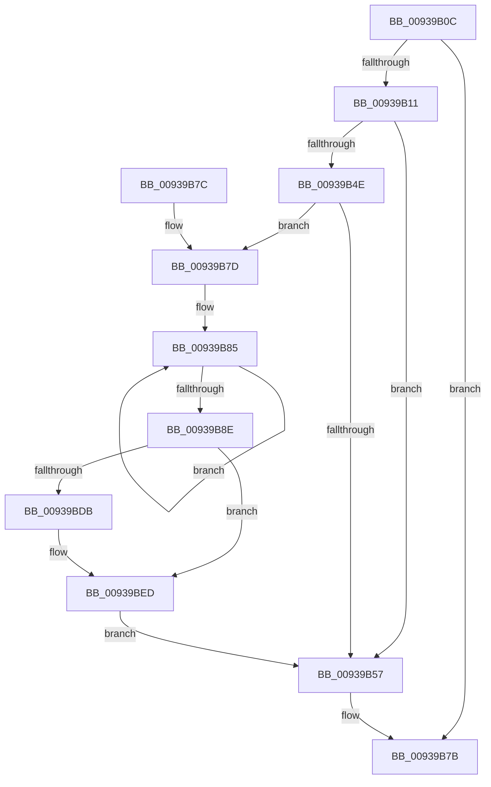

# PfSnLogAsyncWorker

- RVA: `0x00939B0C`–`0x00939C0D` (길이 `257` bytes)
- VA: `0x0000000140939B0C`
- 실행 섹션: `PAGE`
- PDB 이름 있음: `예`; PDB Function 태그: `아니요`
- unwind 정보 RVA: `0x0008FC9C`
- 디코드: `67`개 명령, `257/257` bytes 표시
- 미해석 바이트: `0` (있으면 어셈블리에 `.byte`로 보존)

> 이 문서는 커널 이미지의 기계어와 PDB 기호를 분석해 생성했습니다. 4번과 5번은 함수 원형과 자료형을 바이너리 사용 방식에서 추정한 C 해석이며 원본 소스 복구 결과는 아닙니다.

## 1. Dependencies

- 직접 호출 지점: **3**; 고유 호출 대상: **3**
- 직접 호출자로 확인된 함수: **1**
- RIP 상대 이미지 참조: **3**

### Outgoing calls
- `0x00939B4E` → [EtwEventEnabled](../../text/39/EtwEventEnabled_function_00392450.md) (function, `0x00392450`)
- `0x00939B5E` → [_security_check_cookie](../../text/6A/_security_check_cookie_function_006AC640.md) (function, `0x006AC640`)
- `0x00939C03` → [EtwWrite](../../text/41/EtwWrite_function_0041C720.md) (function, `0x0041C720`)

### Direct callers
- [PfSnAsyncPrefetchWorker](PfSnAsyncPrefetchWorker_function_009394B0.md) at `0x00939547`
- [PfSnAsyncPrefetchWorker](PfSnAsyncPrefetchWorker_function_009394B0.md) at `0x00939685`
- [PfSnAsyncPrefetchWorker](PfSnAsyncPrefetchWorker_function_009394B0.md) at `0x009396FC`
- [PfSnAsyncPrefetchWorker](PfSnAsyncPrefetchWorker_function_009394B0.md) at `0x00939834`

### Static image references
- `0x00939B2C` → RVA `0x00E0A740` (`.data`; read)
- `0x00939B3F` → RVA `0x00E67358` (`.data`; read)
- `0x00939BB8` → RVA `0x000121B8` (`.rdata`; read)

## 2. Other-region calls and transfers

- 다른 실행 섹션으로 향하는 call: **3**
  - `0x00939B4E` → [EtwEventEnabled](../../text/39/EtwEventEnabled_function_00392450.md) (`PAGE` → `.text`)
  - `0x00939B5E` → [_security_check_cookie](../../text/6A/_security_check_cookie_function_006AC640.md) (`PAGE` → `.text`)
  - `0x00939C03` → [EtwWrite](../../text/41/EtwWrite_function_0041C720.md) (`PAGE` → `.text`)
- 별도 외부 분기/꼬리 이동을 확인하지 못했습니다.

## 3. Assembly (complete function range)

```asm
00939B0C  48 85 C9                        test rcx, rcx
00939B0F  74 6A                           je 0x140939b7b
00939B11  48 8B C4                        mov rax, rsp
00939B14  48 89 58 08                     mov qword ptr [rax + 8], rbx
00939B18  48 89 70 18                     mov qword ptr [rax + 0x18], rsi
00939B1C  48 89 78 20                     mov qword ptr [rax + 0x20], rdi
00939B20  55                              push rbp
00939B21  48 8D 68 A1                     lea rbp, [rax - 0x5f]
00939B25  48 81 EC A0 00 00 00            sub rsp, 0xa0
00939B2C  48 8B 05 0D 0C 4D 00            mov rax, qword ptr [rip + 0x4d0c0d]
00939B33  48 33 C4                        xor rax, rsp
00939B36  48 89 45 47                     mov qword ptr [rbp + 0x47], rax
00939B3A  48 8B D9                        mov rbx, rcx
00939B3D  33 F6                           xor esi, esi
00939B3F  48 8B 0D 12 D8 52 00            mov rcx, qword ptr [rip + 0x52d812]
00939B46  48 8B FA                        mov rdi, rdx
00939B49  48 85 C9                        test rcx, rcx
00939B4C  74 09                           je 0x140939b57
00939B4E  E8 FD 88 A5 FF                  call 0x140392450
00939B53  84 C0                           test al, al
00939B55  75 26                           jne 0x140939b7d
00939B57  48 8B 4D 47                     mov rcx, qword ptr [rbp + 0x47]
00939B5B  48 33 CC                        xor rcx, rsp
00939B5E  E8 DD 2A D7 FF                  call 0x1406ac640
00939B63  4C 8D 9C 24 A0 00 00 00         lea r11, [rsp + 0xa0]
00939B6B  49 8B 5B 10                     mov rbx, qword ptr [r11 + 0x10]
00939B6F  49 8B 73 20                     mov rsi, qword ptr [r11 + 0x20]
00939B73  49 8B 7B 28                     mov rdi, qword ptr [r11 + 0x28]
00939B77  49 8B E3                        mov rsp, r11
00939B7A  5D                              pop rbp
00939B7B  C3                              ret
00939B7C  CC                              int3
00939B7D  48 8D 4B 10                     lea rcx, [rbx + 0x10]
00939B81  48 83 C8 FF                     or rax, 0xffffffffffffffff
00939B85  48 FF C0                        inc rax
00939B88  66 39 34 41                     cmp word ptr [rcx + rax*2], si
00939B8C  75 F7                           jne 0x140939b85
00939B8E  66 89 45 E7                     mov word ptr [rbp - 0x19], ax
00939B92  48 8D 55 E7                     lea rdx, [rbp - 0x19]
00939B96  0F B7 C0                        movzx eax, ax
00939B99  41 B9 04 00 00 00               mov r9d, 4
00939B9F  03 C0                           add eax, eax
00939BA1  48 89 55 F7                     mov qword ptr [rbp - 9], rdx
00939BA5  89 45 0F                        mov dword ptr [rbp + 0xf], eax
00939BA8  48 8D 41 3C                     lea rax, [rcx + 0x3c]
00939BAC  48 89 45 17                     mov qword ptr [rbp + 0x17], rax
00939BB0  48 8D 43 50                     lea rax, [rbx + 0x50]
00939BB4  48 89 45 27                     mov qword ptr [rbp + 0x27], rax
00939BB8  48 8D 05 F9 85 6D FF            lea rax, [rip - 0x927a07]
00939BBF  48 C7 45 FF 02 00 00 00         mov qword ptr [rbp - 1], 2
00939BC7  48 89 4D 07                     mov qword ptr [rbp + 7], rcx
00939BCB  89 75 13                        mov dword ptr [rbp + 0x13], esi
00939BCE  4C 89 4D 1F                     mov qword ptr [rbp + 0x1f], r9
00939BD2  4C 89 4D 2F                     mov qword ptr [rbp + 0x2f], r9
00939BD6  48 3B F8                        cmp rdi, rax
00939BD9  75 12                           jne 0x140939bed
00939BDB  48 8D 43 7C                     lea rax, [rbx + 0x7c]
00939BDF  4C 89 4D 3F                     mov qword ptr [rbp + 0x3f], r9
00939BE3  48 89 45 37                     mov qword ptr [rbp + 0x37], rax
00939BE7  41 B9 05 00 00 00               mov r9d, 5
00939BED  48 8B 0D 64 D7 52 00            mov rcx, qword ptr [rip + 0x52d764]
00939BF4  48 8D 45 F7                     lea rax, [rbp - 9]
00939BF8  45 33 C0                        xor r8d, r8d
00939BFB  48 89 44 24 20                  mov qword ptr [rsp + 0x20], rax
00939C00  48 8B D7                        mov rdx, rdi
00939C03  E8 18 2B AE FF                  call 0x14041c720
00939C08  E9 4A FF FF FF                  jmp 0x140939b57
```

## 4. C-style interpretation (structured pseudocode)

```c
__int64 __fastcall PfSnLogAsyncWorker(__int64 a1, __int64 a2, int a3)
{
    __int64 result;
    __int64 v_rsi;
    __int64 v_rsp;
    unsigned __int64 v_stack_m8;
    unsigned __int64 v_stack_m80;

    if (a1 == 0) goto loc_00939B7B;
    *(unsigned __int64 *)(v_rsp + 8) = v_rbx;
    *(unsigned __int64 *)(v_rsp + 24) = v_rsi;
    *(unsigned __int64 *)(v_rsp + 32) = v_rdi;
    v_rsp = (v_rsp) - (160);
    result = (*(unsigned __int64 *)(v_rip + 5049357)) ^ (v_rsp);
    *(unsigned __int64 *)(v_rsp - 95 + 71) = result;
    v_rsi = 0;
    if (*(unsigned __int64 *)(v_rip + 5429266) == 0) goto loc_00939B57;
    result = EtwEventEnabled(*(unsigned __int64 *)(v_rip + 5429266), a2, a3, a4);
    if ((unsigned __int8)(result) != 0) goto loc_00939B7D;
loc_00939B57:
    a1 = (*(unsigned __int64 *)(v_rsp - 95 + 71)) ^ (v_rsp);
    result = _security_check_cookie(a1, a2, a3, a4);
loc_00939B7B:
    return result;
loc_00939B7D:
    result = (result) | (-1);
loc_00939B85:
    result = (result) + 1;
    if ((*(unsigned __int16 *)(*(unsigned __int64 *)(v_stack_m8 + 16) + 16 + result * 2)) != ((unsigned __int16)(*(unsigned __int64 *)(v_stack_m8 + 32)))) goto loc_00939B85;
    *(unsigned __int16 *)(v_rsp - 95 - 25) = (unsigned __int16)(result);
    result = (unsigned int)(((unsigned __int16)(result)) + ((unsigned int)((unsigned __int16)(result))));
    *(unsigned __int64 *)(v_rsp - 95 - 9) = v_rsp - 95 - 25;
    *(unsigned int *)(v_rsp - 95 + 15) = (unsigned int)(result);
    *(unsigned __int64 *)(v_rsp - 95 + 23) = *(unsigned __int64 *)(v_stack_m8 + 16) + 16 + 60;
    *(unsigned __int64 *)(v_rsp - 95 + 39) = *(unsigned __int64 *)(v_stack_m8 + 16) + 80;
    *(unsigned __int64 *)(v_rsp - 95 - 1) = 2;
    *(unsigned __int64 *)(v_rsp - 95 + 7) = *(unsigned __int64 *)(v_stack_m8 + 16) + 16;
    *(unsigned int *)(v_rsp - 95 + 19) = (unsigned int)(*(unsigned __int64 *)(v_stack_m8 + 32));
    *(unsigned __int64 *)(v_rsp - 95 + 31) = 4;
    *(unsigned __int64 *)(v_rsp - 95 + 47) = 4;
    result = v_rip - 9599495;
    if ((*(unsigned __int64 *)(v_stack_m8 + 40)) == (v_rip - 9599495)) {
        result = *(unsigned __int64 *)(v_stack_m8 + 16) + 124;
        *(unsigned __int64 *)(v_rsp - 95 + 63) = 4;
        *(unsigned __int64 *)(v_rsp - 95 + 55) = result;
        a4 = 5;
    }
    a3 = 0;
    v_stack_m80 = v_rsp - 95 - 9;
    result = EtwWrite(*(unsigned __int64 *)(v_rip + 5429092), *(unsigned __int64 *)(v_stack_m8 + 40), a3, a4);
    goto loc_00939B57;
}
```

## 5. (Beta) C Style

```c
int64_t PfSnLogAsyncWorker(int64_t Arg1, int64_t Arg2, int32_t Arg3)
{
    int64_t result;
    int64_t local_rsi;
    int64_t local_rsp;
    uint64_t v_stack_m8;
    uint64_t v_stack_m80;

    if (Arg1 == 0) goto loc_00939B7B;
    *(uint64_t *)(local_rsp + 0x8) = local_rbx;
    *(uint64_t *)(local_rsp + 0x18) = local_rsi;
    *(uint64_t *)(local_rsp + 0x20) = local_rdi;
    local_rsp = (local_rsp) - (160);
    result = (*(uint64_t *)(v_rip + 0x4D0C0D)) ^ (local_rsp);
    *(uint64_t *)(local_rsp - 0x5F + 0x47) = result;
    local_rsi = 0;
    if (*(uint64_t *)(v_rip + 0x52D812) == 0) goto loc_00939B57;
    result = EtwEventEnabled(*(uint64_t *)(v_rip + 0x52D812), Arg2, Arg3, a4);
    if ((uint8_t)(result) != 0) goto loc_00939B7D;
loc_00939B57:
    Arg1 = (*(uint64_t *)(local_rsp - 0x5F + 0x47)) ^ (local_rsp);
    result = _security_check_cookie(Arg1, Arg2, Arg3, a4);
loc_00939B7B:
    return result;
loc_00939B7D:
    result = (result) | (-1);
loc_00939B85:
    result = (result) + 1;
    if ((*(uint16_t *)(*(uint64_t *)(v_stack_m8 + 0x10) + 0x10 + result * 2)) != ((uint16_t)(*(uint64_t *)(v_stack_m8 + 0x20)))) goto loc_00939B85;
    *(uint16_t *)(local_rsp - 0x5F - 0x19) = (uint16_t)(result);
    result = (uint32_t)(((uint16_t)(result)) + ((uint32_t)((uint16_t)(result))));
    *(uint64_t *)(local_rsp - 0x5F - 0x9) = local_rsp - 95 - 25;
    *(uint32_t *)(local_rsp - 0x5F + 0xF) = (uint32_t)(result);
    *(uint64_t *)(local_rsp - 0x5F + 0x17) = *(uint64_t *)(v_stack_m8 + 0x10) + 16 + 60;
    *(uint64_t *)(local_rsp - 0x5F + 0x27) = *(uint64_t *)(v_stack_m8 + 0x10) + 80;
    *(uint64_t *)(local_rsp - 0x5F - 0x1) = 2;
    *(uint64_t *)(local_rsp - 0x5F + 0x7) = *(uint64_t *)(v_stack_m8 + 0x10) + 16;
    *(uint32_t *)(local_rsp - 0x5F + 0x13) = (uint32_t)(*(uint64_t *)(v_stack_m8 + 0x20));
    *(uint64_t *)(local_rsp - 0x5F + 0x1F) = 4;
    *(uint64_t *)(local_rsp - 0x5F + 0x2F) = 4;
    result = v_rip - 9599495;
    if ((*(uint64_t *)(v_stack_m8 + 0x28)) == (v_rip - 9599495)) {
        result = *(uint64_t *)(v_stack_m8 + 0x10) + 124;
        *(uint64_t *)(local_rsp - 0x5F + 0x3F) = 4;
        *(uint64_t *)(local_rsp - 0x5F + 0x37) = result;
        a4 = 5;
    }
    Arg3 = 0;
    v_stack_m80 = local_rsp - 95 - 9;
    result = EtwWrite(*(uint64_t *)(v_rip + 0x52D764), *(uint64_t *)(v_stack_m8 + 0x28), Arg3, a4);
    goto loc_00939B57;
}
```

## 6. Execution-region graph

[열기: 2D/3D 그래프와 함수 탐색 컨트롤 패널](../../../control-panel.html?section=page&rva=0x00939B0C&view=graph)

- 2D 그래프는 위에서 아래로 흐르고, 3D 그래프는 빈 공간을 드래그해 회전합니다. Shift+드래그는 이동, 휠은 확대·축소, 함수 노드 선택은 대상 보고서 이동입니다.

### Static fallback


