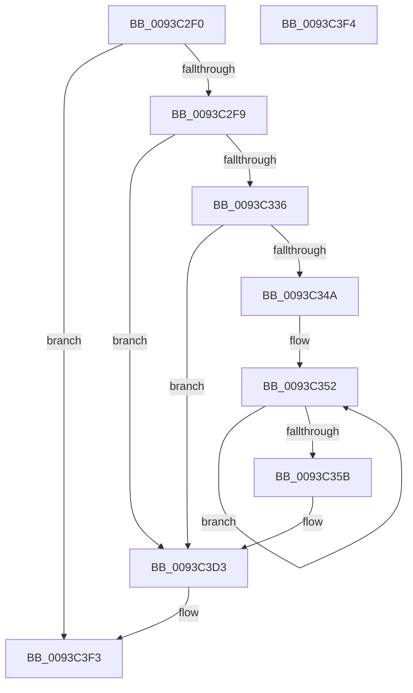

# PfSnLogGetReadListsStart

- RVA: `0x0093C2F0`–`0x0093C3F5` (길이 `261` bytes)
- VA: `0x000000014093C2F0`
- 실행 섹션: `PAGE`
- PDB 이름 있음: `예`; PDB Function 태그: `아니요`
- unwind 정보 RVA: `0x0008FEC8`
- 디코드: `61`개 명령, `261/261` bytes 표시
- 미해석 바이트: `0` (있으면 어셈블리에 `.byte`로 보존)

> 이 문서는 커널 이미지의 기계어와 PDB 기호를 분석해 생성했습니다. 4번과 5번은 함수 원형과 자료형을 바이너리 사용 방식에서 추정한 C 해석이며 원본 소스 복구 결과는 아닙니다.

## 1. Dependencies

- 직접 호출 지점: **3**; 고유 호출 대상: **3**
- 직접 호출자로 확인된 함수: **1**
- RIP 상대 이미지 참조: **3**

### Outgoing calls
- `0x0093C33D` → [EtwEventEnabled](../../text/39/EtwEventEnabled_function_00392450.md) (function, `0x00392450`)
- `0x0093C3CE` → [EtwWrite](../../text/41/EtwWrite_function_0041C720.md) (function, `0x0041C720`)
- `0x0093C3DA` → [_security_check_cookie](../../text/6A/_security_check_cookie_function_006AC640.md) (function, `0x006AC640`)

### Direct callers
- [PfSnPrefetchSections](PfSnPrefetchSections_function_0093BCF4.md) at `0x0093BDDE`

### Static image references
- `0x0093C313` → RVA `0x00E0A740` (`.data`; read)
- `0x0093C326` → RVA `0x00E67358` (`.data`; read)
- `0x0093C336` → RVA `0x00012218` (`.rdata`; read)

## 2. Other-region calls and transfers

- 다른 실행 섹션으로 향하는 call: **3**
  - `0x0093C33D` → [EtwEventEnabled](../../text/39/EtwEventEnabled_function_00392450.md) (`PAGE` → `.text`)
  - `0x0093C3CE` → [EtwWrite](../../text/41/EtwWrite_function_0041C720.md) (`PAGE` → `.text`)
  - `0x0093C3DA` → [_security_check_cookie](../../text/6A/_security_check_cookie_function_006AC640.md) (`PAGE` → `.text`)
- 별도 외부 분기/꼬리 이동을 확인하지 못했습니다.

## 3. Assembly (complete function range)

```asm
0093C2F0  48 85 C9                        test rcx, rcx
0093C2F3  0F 84 FA 00 00 00               je 0x14093c3f3
0093C2F9  48 8B C4                        mov rax, rsp
0093C2FC  48 89 58 08                     mov qword ptr [rax + 8], rbx
0093C300  48 89 78 18                     mov qword ptr [rax + 0x18], rdi
0093C304  89 50 10                        mov dword ptr [rax + 0x10], edx
0093C307  55                              push rbp
0093C308  48 8D 68 A1                     lea rbp, [rax - 0x5f]
0093C30C  48 81 EC A0 00 00 00            sub rsp, 0xa0
0093C313  48 8B 05 26 E4 4C 00            mov rax, qword ptr [rip + 0x4ce426]
0093C31A  48 33 C4                        xor rax, rsp
0093C31D  48 89 45 47                     mov qword ptr [rbp + 0x47], rax
0093C321  48 8B D9                        mov rbx, rcx
0093C324  33 FF                           xor edi, edi
0093C326  48 8B 0D 2B B0 52 00            mov rcx, qword ptr [rip + 0x52b02b]
0093C32D  48 85 C9                        test rcx, rcx
0093C330  0F 84 9D 00 00 00               je 0x14093c3d3
0093C336  48 8D 15 DB 5E 6D FF            lea rdx, [rip - 0x92a125]
0093C33D  E8 0E 61 A5 FF                  call 0x140392450
0093C342  84 C0                           test al, al
0093C344  0F 84 89 00 00 00               je 0x14093c3d3
0093C34A  48 8D 4B 10                     lea rcx, [rbx + 0x10]
0093C34E  48 83 C8 FF                     or rax, 0xffffffffffffffff
0093C352  48 FF C0                        inc rax
0093C355  66 39 3C 41                     cmp word ptr [rcx + rax*2], di
0093C359  75 F7                           jne 0x14093c352
0093C35B  66 89 45 E7                     mov word ptr [rbp - 0x19], ax
0093C35F  48 8D 55 E7                     lea rdx, [rbp - 0x19]
0093C363  0F B7 C0                        movzx eax, ax
0093C366  41 B9 05 00 00 00               mov r9d, 5
0093C36C  03 C0                           add eax, eax
0093C36E  48 89 55 F7                     mov qword ptr [rbp - 9], rdx
0093C372  89 45 0F                        mov dword ptr [rbp + 0xf], eax
0093C375  48 8D 15 9C 5E 6D FF            lea rdx, [rip - 0x92a164]
0093C37C  48 8D 41 3C                     lea rax, [rcx + 0x3c]
0093C380  48 89 4D 07                     mov qword ptr [rbp + 7], rcx
0093C384  48 8B 0D CD AF 52 00            mov rcx, qword ptr [rip + 0x52afcd]
0093C38B  45 33 C0                        xor r8d, r8d
0093C38E  48 89 45 17                     mov qword ptr [rbp + 0x17], rax
0093C392  48 8D 43 50                     lea rax, [rbx + 0x50]
0093C396  48 89 45 27                     mov qword ptr [rbp + 0x27], rax
0093C39A  48 8D 45 6F                     lea rax, [rbp + 0x6f]
0093C39E  48 89 45 37                     mov qword ptr [rbp + 0x37], rax
0093C3A2  48 8D 45 F7                     lea rax, [rbp - 9]
0093C3A6  48 89 44 24 20                  mov qword ptr [rsp + 0x20], rax
0093C3AB  48 C7 45 FF 02 00 00 00         mov qword ptr [rbp - 1], 2
0093C3B3  89 7D 13                        mov dword ptr [rbp + 0x13], edi
0093C3B6  48 C7 45 1F 04 00 00 00         mov qword ptr [rbp + 0x1f], 4
0093C3BE  48 C7 45 2F 04 00 00 00         mov qword ptr [rbp + 0x2f], 4
0093C3C6  48 C7 45 3F 04 00 00 00         mov qword ptr [rbp + 0x3f], 4
0093C3CE  E8 4D 03 AE FF                  call 0x14041c720
0093C3D3  48 8B 4D 47                     mov rcx, qword ptr [rbp + 0x47]
0093C3D7  48 33 CC                        xor rcx, rsp
0093C3DA  E8 61 02 D7 FF                  call 0x1406ac640
0093C3DF  4C 8D 9C 24 A0 00 00 00         lea r11, [rsp + 0xa0]
0093C3E7  49 8B 5B 10                     mov rbx, qword ptr [r11 + 0x10]
0093C3EB  49 8B 7B 20                     mov rdi, qword ptr [r11 + 0x20]
0093C3EF  49 8B E3                        mov rsp, r11
0093C3F2  5D                              pop rbp
0093C3F3  C3                              ret
0093C3F4  CC                              int3
```

## 4. C-style interpretation (structured pseudocode)

```c
__int64 __fastcall PfSnLogGetReadListsStart(__int64 a1, int a2, int a3)
{
    __int64 result;
    __int64 v_rdi;
    __int64 v_rsp;
    unsigned __int64 v_stack_m8;
    unsigned __int64 v_stack_m88;

    if (a1 == 0) goto loc_0093C3F3;
    *(unsigned __int64 *)(v_rsp + 8) = v_rbx;
    *(unsigned __int64 *)(v_rsp + 24) = v_rdi;
    *(unsigned int *)(v_rsp + 16) = a2;
    v_rsp = (v_rsp) - (160);
    result = (*(unsigned __int64 *)(v_rip + 5039142)) ^ (v_rsp);
    *(unsigned __int64 *)(v_rsp - 95 + 71) = result;
    v_rdi = 0;
    if (*(unsigned __int64 *)(v_rip + 5419051) == 0) goto loc_0093C3D3;
    result = EtwEventEnabled(*(unsigned __int64 *)(v_rip + 5419051), v_rip - 9609509, a3, a4);
    if ((unsigned __int8)(result) == 0) goto loc_0093C3D3;
    result = (result) | (-1);
loc_0093C352:
    result = (result) + 1;
    if ((*(unsigned __int16 *)(a1 + 16 + result * 2)) != 0) goto loc_0093C352;
    *(unsigned __int16 *)(v_rsp - 95 - 25) = (unsigned __int16)(result);
    result = (unsigned int)(((unsigned __int16)(result)) + ((unsigned int)((unsigned __int16)(result))));
    *(unsigned __int64 *)(v_rsp - 95 - 9) = v_rsp - 95 - 25;
    *(unsigned int *)(v_rsp - 95 + 15) = (unsigned int)(result);
    *(unsigned __int64 *)(v_rsp - 95 + 7) = a1 + 16;
    a3 = 0;
    *(unsigned __int64 *)(v_rsp - 95 + 23) = a1 + 16 + 60;
    *(unsigned __int64 *)(v_rsp - 95 + 39) = a1 + 80;
    *(unsigned __int64 *)(v_rsp - 95 + 55) = v_rsp - 95 + 111;
    v_stack_m88 = v_rsp - 95 - 9;
    *(unsigned __int64 *)(v_rsp - 95 - 1) = 2;
    *(unsigned int *)(v_rsp - 95 + 19) = 0;
    *(unsigned __int64 *)(v_rsp - 95 + 31) = 4;
    *(unsigned __int64 *)(v_rsp - 95 + 47) = 4;
    *(unsigned __int64 *)(v_rsp - 95 + 63) = 4;
    result = EtwWrite(*(unsigned __int64 *)(v_rip + 5418957), v_rip - 9609572, a3, 5);
loc_0093C3D3:
    a1 = (*(unsigned __int64 *)(v_rsp - 95 + 71)) ^ (v_rsp);
    result = _security_check_cookie(a1, v_rip - 9609572, a3, 5);
loc_0093C3F3:
    return result;
}
```

## 5. (Beta) C Style

```c
int64_t PfSnLogGetReadListsStart(int64_t Arg1, int32_t Arg2, int32_t Arg3)
{
    int64_t result;
    int64_t local_rdi;
    int64_t local_rsp;
    uint64_t v_stack_m8;
    uint64_t v_stack_m88;

    if (Arg1 == 0) goto loc_0093C3F3;
    *(uint64_t *)(local_rsp + 0x8) = local_rbx;
    *(uint64_t *)(local_rsp + 0x18) = local_rdi;
    *(uint32_t *)(local_rsp + 0x10) = Arg2;
    local_rsp = (local_rsp) - (160);
    result = (*(uint64_t *)(v_rip + 0x4CE426)) ^ (local_rsp);
    *(uint64_t *)(local_rsp - 0x5F + 0x47) = result;
    local_rdi = 0;
    if (*(uint64_t *)(v_rip + 0x52B02B) == 0) goto loc_0093C3D3;
    result = EtwEventEnabled(*(uint64_t *)(v_rip + 0x52B02B), v_rip - 9609509, Arg3, a4);
    if ((uint8_t)(result) == 0) goto loc_0093C3D3;
    result = (result) | (-1);
loc_0093C352:
    result = (result) + 1;
    if ((*(uint16_t *)(Arg1 + 0x10 + result * 2)) != 0) goto loc_0093C352;
    *(uint16_t *)(local_rsp - 0x5F - 0x19) = (uint16_t)(result);
    result = (uint32_t)(((uint16_t)(result)) + ((uint32_t)((uint16_t)(result))));
    *(uint64_t *)(local_rsp - 0x5F - 0x9) = local_rsp - 95 - 25;
    *(uint32_t *)(local_rsp - 0x5F + 0xF) = (uint32_t)(result);
    *(uint64_t *)(local_rsp - 0x5F + 0x7) = Arg1 + 16;
    Arg3 = 0;
    *(uint64_t *)(local_rsp - 0x5F + 0x17) = Arg1 + 16 + 60;
    *(uint64_t *)(local_rsp - 0x5F + 0x27) = Arg1 + 80;
    *(uint64_t *)(local_rsp - 0x5F + 0x37) = local_rsp - 95 + 111;
    v_stack_m88 = local_rsp - 95 - 9;
    *(uint64_t *)(local_rsp - 0x5F - 0x1) = 2;
    *(uint32_t *)(local_rsp - 0x5F + 0x13) = 0;
    *(uint64_t *)(local_rsp - 0x5F + 0x1F) = 4;
    *(uint64_t *)(local_rsp - 0x5F + 0x2F) = 4;
    *(uint64_t *)(local_rsp - 0x5F + 0x3F) = 4;
    result = EtwWrite(*(uint64_t *)(v_rip + 0x52AFCD), v_rip - 9609572, Arg3, 5);
loc_0093C3D3:
    Arg1 = (*(uint64_t *)(local_rsp - 0x5F + 0x47)) ^ (local_rsp);
    result = _security_check_cookie(Arg1, v_rip - 9609572, Arg3, 5);
loc_0093C3F3:
    return result;
}
```

## 6. Execution-region graph

[열기: 2D/3D 그래프와 함수 탐색 컨트롤 패널](../../../control-panel.html?section=page&rva=0x0093C2F0&view=graph)

- 2D 그래프는 위에서 아래로 흐르고, 3D 그래프는 빈 공간을 드래그해 회전합니다. Shift+드래그는 이동, 휠은 확대·축소, 함수 노드 선택은 대상 보고서 이동입니다.

### Static fallback


