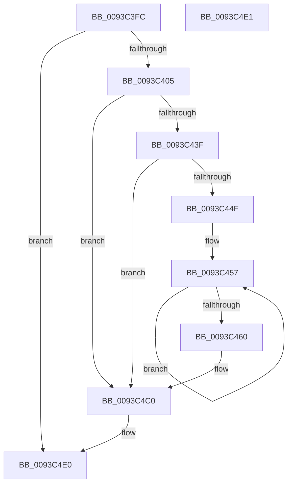

# PfSnLogGetReadListsStop

- RVA: `0x0093C3FC`–`0x0093C4E2` (길이 `230` bytes)
- VA: `0x000000014093C3FC`
- 실행 섹션: `PAGE`
- PDB 이름 있음: `예`; PDB Function 태그: `아니요`
- unwind 정보 RVA: `0x0008FEE8`
- 디코드: `56`개 명령, `230/230` bytes 표시
- 미해석 바이트: `0` (있으면 어셈블리에 `.byte`로 보존)

> 이 문서는 커널 이미지의 기계어와 PDB 기호를 분석해 생성했습니다. 4번과 5번은 함수 원형과 자료형을 바이너리 사용 방식에서 추정한 C 해석이며 원본 소스 복구 결과는 아닙니다.

## 1. Dependencies

- 직접 호출 지점: **3**; 고유 호출 대상: **3**
- 직접 호출자로 확인된 함수: **1**
- RIP 상대 이미지 참조: **3**

### Outgoing calls
- `0x0093C446` → [EtwEventEnabled](../../text/39/EtwEventEnabled_function_00392450.md) (function, `0x00392450`)
- `0x0093C4BB` → [EtwWrite](../../text/41/EtwWrite_function_0041C720.md) (function, `0x0041C720`)
- `0x0093C4C7` → [_security_check_cookie](../../text/6A/_security_check_cookie_function_006AC640.md) (function, `0x006AC640`)

### Direct callers
- [PfSnPrefetchSections](PfSnPrefetchSections_function_0093BCF4.md) at `0x0093BE72`

### Static image references
- `0x0093C41C` → RVA `0x00E0A740` (`.data`; read)
- `0x0093C42F` → RVA `0x00E67358` (`.data`; read)
- `0x0093C43F` → RVA `0x00012238` (`.rdata`; read)

## 2. Other-region calls and transfers

- 다른 실행 섹션으로 향하는 call: **3**
  - `0x0093C446` → [EtwEventEnabled](../../text/39/EtwEventEnabled_function_00392450.md) (`PAGE` → `.text`)
  - `0x0093C4BB` → [EtwWrite](../../text/41/EtwWrite_function_0041C720.md) (`PAGE` → `.text`)
  - `0x0093C4C7` → [_security_check_cookie](../../text/6A/_security_check_cookie_function_006AC640.md) (`PAGE` → `.text`)
- 별도 외부 분기/꼬리 이동을 확인하지 못했습니다.

## 3. Assembly (complete function range)

```asm
0093C3FC  48 85 C9                        test rcx, rcx
0093C3FF  0F 84 DB 00 00 00               je 0x14093c4e0
0093C405  48 89 5C 24 08                  mov qword ptr [rsp + 8], rbx
0093C40A  48 89 7C 24 10                  mov qword ptr [rsp + 0x10], rdi
0093C40F  55                              push rbp
0093C410  48 8D 6C 24 A9                  lea rbp, [rsp - 0x57]
0093C415  48 81 EC 90 00 00 00            sub rsp, 0x90
0093C41C  48 8B 05 1D E3 4C 00            mov rax, qword ptr [rip + 0x4ce31d]
0093C423  48 33 C4                        xor rax, rsp
0093C426  48 89 45 47                     mov qword ptr [rbp + 0x47], rax
0093C42A  48 8B D9                        mov rbx, rcx
0093C42D  33 FF                           xor edi, edi
0093C42F  48 8B 0D 22 AF 52 00            mov rcx, qword ptr [rip + 0x52af22]
0093C436  48 85 C9                        test rcx, rcx
0093C439  0F 84 81 00 00 00               je 0x14093c4c0
0093C43F  48 8D 15 F2 5D 6D FF            lea rdx, [rip - 0x92a20e]
0093C446  E8 05 60 A5 FF                  call 0x140392450
0093C44B  84 C0                           test al, al
0093C44D  74 71                           je 0x14093c4c0
0093C44F  48 8D 4B 10                     lea rcx, [rbx + 0x10]
0093C453  48 83 C8 FF                     or rax, 0xffffffffffffffff
0093C457  48 FF C0                        inc rax
0093C45A  66 39 3C 41                     cmp word ptr [rcx + rax*2], di
0093C45E  75 F7                           jne 0x14093c457
0093C460  66 89 45 F7                     mov word ptr [rbp - 9], ax
0093C464  48 8D 55 F7                     lea rdx, [rbp - 9]
0093C468  0F B7 C0                        movzx eax, ax
0093C46B  41 B9 04 00 00 00               mov r9d, 4
0093C471  03 C0                           add eax, eax
0093C473  48 89 55 07                     mov qword ptr [rbp + 7], rdx
0093C477  89 45 1F                        mov dword ptr [rbp + 0x1f], eax
0093C47A  48 8D 15 B7 5D 6D FF            lea rdx, [rip - 0x92a249]
0093C481  48 8D 41 3C                     lea rax, [rcx + 0x3c]
0093C485  48 89 4D 17                     mov qword ptr [rbp + 0x17], rcx
0093C489  48 8B 0D C8 AE 52 00            mov rcx, qword ptr [rip + 0x52aec8]
0093C490  45 33 C0                        xor r8d, r8d
0093C493  48 89 45 27                     mov qword ptr [rbp + 0x27], rax
0093C497  48 8D 43 50                     lea rax, [rbx + 0x50]
0093C49B  48 89 45 37                     mov qword ptr [rbp + 0x37], rax
0093C49F  48 8D 45 07                     lea rax, [rbp + 7]
0093C4A3  48 89 44 24 20                  mov qword ptr [rsp + 0x20], rax
0093C4A8  48 C7 45 0F 02 00 00 00         mov qword ptr [rbp + 0xf], 2
0093C4B0  89 7D 23                        mov dword ptr [rbp + 0x23], edi
0093C4B3  4C 89 4D 2F                     mov qword ptr [rbp + 0x2f], r9
0093C4B7  4C 89 4D 3F                     mov qword ptr [rbp + 0x3f], r9
0093C4BB  E8 60 02 AE FF                  call 0x14041c720
0093C4C0  48 8B 4D 47                     mov rcx, qword ptr [rbp + 0x47]
0093C4C4  48 33 CC                        xor rcx, rsp
0093C4C7  E8 74 01 D7 FF                  call 0x1406ac640
0093C4CC  4C 8D 9C 24 90 00 00 00         lea r11, [rsp + 0x90]
0093C4D4  49 8B 5B 10                     mov rbx, qword ptr [r11 + 0x10]
0093C4D8  49 8B 7B 18                     mov rdi, qword ptr [r11 + 0x18]
0093C4DC  49 8B E3                        mov rsp, r11
0093C4DF  5D                              pop rbp
0093C4E0  C3                              ret
0093C4E1  CC                              int3
```

## 4. C-style interpretation (structured pseudocode)

```c
__int64 __fastcall PfSnLogGetReadListsStop(__int64 a1, __int64 a2, int a3)
{
    __int64 result;
    __int64 v_rdi;
    __int64 v_rsp;
    unsigned __int64 v_stack_m18;
    unsigned __int64 v_stack_m20;
    unsigned __int64 v_stack_m28;
    unsigned __int64 v_stack_m30;
    unsigned __int64 v_stack_m38;
    unsigned int v_stack_m3C;
    unsigned int v_stack_m40;
    unsigned __int64 v_stack_m48;
    unsigned __int64 v_stack_m50;
    unsigned __int64 v_stack_m58;
    unsigned __int64 v_stack_m5F;
    unsigned __int16 v_stack_m68;
    unsigned __int64 v_stack_m78;
    unsigned __int64 v_stack_m8;
    unsigned __int64 v_stack_p10;
    unsigned __int64 v_stack_p8;

    if (a1 == 0) goto loc_0093C4E0;
    v_stack_p8 = v_rbx;
    v_stack_p10 = v_rdi;
    v_rsp = (v_rsp) - (144);
    result = (*(unsigned __int64 *)(v_rip + 5038877)) ^ (v_rsp);
    v_stack_m18 = result;
    v_rdi = 0;
    if (*(unsigned __int64 *)(v_rip + 5418786) == 0) goto loc_0093C4C0;
    result = EtwEventEnabled(*(unsigned __int64 *)(v_rip + 5418786), v_rip - 9609742, a3, a4);
    if ((unsigned __int8)(result) == 0) goto loc_0093C4C0;
    result = (result) | (-1);
loc_0093C457:
    result = (result) + 1;
    if ((*(unsigned __int16 *)(a1 + 16 + result * 2)) != 0) goto loc_0093C457;
    v_stack_m68 = (unsigned __int16)(result);
    result = (unsigned int)(((unsigned __int16)(result)) + ((unsigned int)((unsigned __int16)(result))));
    v_stack_m58 = v_stack_m68;
    v_stack_m40 = (unsigned int)(result);
    v_stack_m48 = a1 + 16;
    a3 = 0;
    v_stack_m38 = a1 + 16 + 60;
    v_stack_m28 = a1 + 80;
    v_stack_m78 = v_stack_m58;
    v_stack_m50 = 2;
    v_stack_m3C = 0;
    v_stack_m30 = 4;
    v_stack_m20 = 4;
    result = EtwWrite(*(unsigned __int64 *)(v_rip + 5418696), v_rip - 9609801, a3, 4);
loc_0093C4C0:
    a1 = (v_stack_m18) ^ (v_rsp);
    result = _security_check_cookie(a1, v_rip - 9609801, a3, 4);
loc_0093C4E0:
    return result;
}
```

## 5. (Beta) C Style

```c
int64_t PfSnLogGetReadListsStop(int64_t Arg1, int64_t Arg2, int32_t Arg3)
{
    int64_t result;
    int64_t local_rdi;
    int64_t local_rsp;
    uint64_t v_stack_m18;
    uint64_t v_stack_m20;
    uint64_t v_stack_m28;
    uint64_t v_stack_m30;
    uint64_t v_stack_m38;
    uint32_t v_stack_m3C;
    uint32_t v_stack_m40;
    uint64_t v_stack_m48;
    uint64_t v_stack_m50;
    uint64_t v_stack_m58;
    uint64_t v_stack_m5F;
    uint16_t v_stack_m68;
    uint64_t v_stack_m78;
    uint64_t v_stack_m8;
    uint64_t v_stack_p10;
    uint64_t v_stack_p8;

    if (Arg1 == 0) goto loc_0093C4E0;
    v_stack_p8 = local_rbx;
    v_stack_p10 = local_rdi;
    local_rsp = (local_rsp) - (144);
    result = (*(uint64_t *)(v_rip + 0x4CE31D)) ^ (local_rsp);
    v_stack_m18 = result;
    local_rdi = 0;
    if (*(uint64_t *)(v_rip + 0x52AF22) == 0) goto loc_0093C4C0;
    result = EtwEventEnabled(*(uint64_t *)(v_rip + 0x52AF22), v_rip - 9609742, Arg3, a4);
    if ((uint8_t)(result) == 0) goto loc_0093C4C0;
    result = (result) | (-1);
loc_0093C457:
    result = (result) + 1;
    if ((*(uint16_t *)(Arg1 + 0x10 + result * 2)) != 0) goto loc_0093C457;
    v_stack_m68 = (uint16_t)(result);
    result = (uint32_t)(((uint16_t)(result)) + ((uint32_t)((uint16_t)(result))));
    v_stack_m58 = v_stack_m68;
    v_stack_m40 = (uint32_t)(result);
    v_stack_m48 = Arg1 + 16;
    Arg3 = 0;
    v_stack_m38 = Arg1 + 16 + 60;
    v_stack_m28 = Arg1 + 80;
    v_stack_m78 = v_stack_m58;
    v_stack_m50 = 2;
    v_stack_m3C = 0;
    v_stack_m30 = 4;
    v_stack_m20 = 4;
    result = EtwWrite(*(uint64_t *)(v_rip + 0x52AEC8), v_rip - 9609801, Arg3, 4);
loc_0093C4C0:
    Arg1 = (v_stack_m18) ^ (local_rsp);
    result = _security_check_cookie(Arg1, v_rip - 9609801, Arg3, 4);
loc_0093C4E0:
    return result;
}
```

## 6. Execution-region graph

[열기: 2D/3D 그래프와 함수 탐색 컨트롤 패널](../../../control-panel.html?section=page&rva=0x0093C3FC&view=graph)

- 2D 그래프는 위에서 아래로 흐르고, 3D 그래프는 빈 공간을 드래그해 회전합니다. Shift+드래그는 이동, 휠은 확대·축소, 함수 노드 선택은 대상 보고서 이동입니다.

### Static fallback


