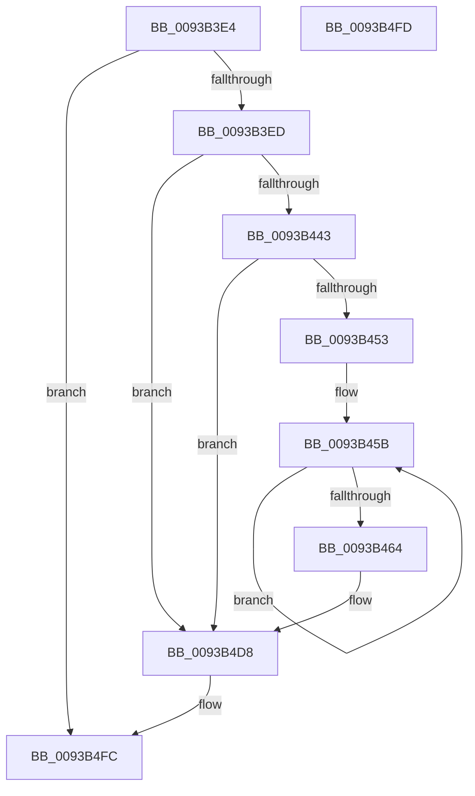

# PfSnLogPrefetchMetadata

- RVA: `0x0093B3E4`–`0x0093B4FE` (길이 `282` bytes)
- VA: `0x000000014093B3E4`
- 실행 섹션: `PAGE`
- PDB 이름 있음: `예`; PDB Function 태그: `아니요`
- unwind 정보 RVA: `0x0008FDE0`
- 디코드: `67`개 명령, `282/282` bytes 표시
- 미해석 바이트: `0` (있으면 어셈블리에 `.byte`로 보존)

> 이 문서는 커널 이미지의 기계어와 PDB 기호를 분석해 생성했습니다. 4번과 5번은 함수 원형과 자료형을 바이너리 사용 방식에서 추정한 C 해석이며 원본 소스 복구 결과는 아닙니다.

## 1. Dependencies

- 직접 호출 지점: **3**; 고유 호출 대상: **3**
- 직접 호출자로 확인된 함수: **1**
- RIP 상대 이미지 참조: **4**

### Outgoing calls
- `0x0093B446` → [EtwEventEnabled](../../text/39/EtwEventEnabled_function_00392450.md) (function, `0x00392450`)
- `0x0093B4D3` → [EtwWrite](../../text/41/EtwWrite_function_0041C720.md) (function, `0x0041C720`)
- `0x0093B4DF` → [_security_check_cookie](../../text/6A/_security_check_cookie_function_006AC640.md) (function, `0x006AC640`)

### Direct callers
- [PfSnPrefetchMetadata](PfSnPrefetchMetadata_function_0093B9B4.md) at `0x0093BA06`
- [PfSnPrefetchMetadata](PfSnPrefetchMetadata_function_0093B9B4.md) at `0x0093BC60`

### Static image references
- `0x0093B40B` → RVA `0x00E0A740` (`.data`; read)
- `0x0093B41B` → RVA `0x000121F8` (`.rdata`; read)
- `0x0093B425` → RVA `0x000121E8` (`.rdata`; read)
- `0x0093B42F` → RVA `0x00E67358` (`.data`; read)

## 2. Other-region calls and transfers

- 다른 실행 섹션으로 향하는 call: **3**
  - `0x0093B446` → [EtwEventEnabled](../../text/39/EtwEventEnabled_function_00392450.md) (`PAGE` → `.text`)
  - `0x0093B4D3` → [EtwWrite](../../text/41/EtwWrite_function_0041C720.md) (`PAGE` → `.text`)
  - `0x0093B4DF` → [_security_check_cookie](../../text/6A/_security_check_cookie_function_006AC640.md) (`PAGE` → `.text`)
- 별도 외부 분기/꼬리 이동을 확인하지 못했습니다.

## 3. Assembly (complete function range)

```asm
0093B3E4  48 85 C9                        test rcx, rcx
0093B3E7  0F 84 0F 01 00 00               je 0x14093b4fc
0093B3ED  48 8B C4                        mov rax, rsp
0093B3F0  48 89 58 08                     mov qword ptr [rax + 8], rbx
0093B3F4  48 89 70 18                     mov qword ptr [rax + 0x18], rsi
0093B3F8  48 89 78 20                     mov qword ptr [rax + 0x20], rdi
0093B3FC  89 50 10                        mov dword ptr [rax + 0x10], edx
0093B3FF  55                              push rbp
0093B400  48 8D 68 A1                     lea rbp, [rax - 0x5f]
0093B404  48 81 EC A0 00 00 00            sub rsp, 0xa0
0093B40B  48 8B 05 2E F3 4C 00            mov rax, qword ptr [rip + 0x4cf32e]
0093B412  48 33 C4                        xor rax, rsp
0093B415  48 89 45 47                     mov qword ptr [rbp + 0x47], rax
0093B419  33 F6                           xor esi, esi
0093B41B  48 8D 05 D6 6D 6D FF            lea rax, [rip - 0x92922a]
0093B422  45 84 C0                        test r8b, r8b
0093B425  48 8D 1D BC 6D 6D FF            lea rbx, [rip - 0x929244]
0093B42C  48 8B F9                        mov rdi, rcx
0093B42F  48 8B 0D 22 BF 52 00            mov rcx, qword ptr [rip + 0x52bf22]
0093B436  48 0F 44 D8                     cmove rbx, rax
0093B43A  48 85 C9                        test rcx, rcx
0093B43D  0F 84 95 00 00 00               je 0x14093b4d8
0093B443  48 8B D3                        mov rdx, rbx
0093B446  E8 05 70 A5 FF                  call 0x140392450
0093B44B  84 C0                           test al, al
0093B44D  0F 84 85 00 00 00               je 0x14093b4d8
0093B453  48 8D 4F 10                     lea rcx, [rdi + 0x10]
0093B457  48 83 C8 FF                     or rax, 0xffffffffffffffff
0093B45B  48 FF C0                        inc rax
0093B45E  66 39 34 41                     cmp word ptr [rcx + rax*2], si
0093B462  75 F7                           jne 0x14093b45b
0093B464  66 89 45 E7                     mov word ptr [rbp - 0x19], ax
0093B468  48 8D 55 E7                     lea rdx, [rbp - 0x19]
0093B46C  0F B7 C0                        movzx eax, ax
0093B46F  41 B9 05 00 00 00               mov r9d, 5
0093B475  03 C0                           add eax, eax
0093B477  48 89 55 F7                     mov qword ptr [rbp - 9], rdx
0093B47B  89 45 0F                        mov dword ptr [rbp + 0xf], eax
0093B47E  45 33 C0                        xor r8d, r8d
0093B481  48 8D 41 3C                     lea rax, [rcx + 0x3c]
0093B485  48 89 4D 07                     mov qword ptr [rbp + 7], rcx
0093B489  48 8B 0D C8 BE 52 00            mov rcx, qword ptr [rip + 0x52bec8]
0093B490  48 8B D3                        mov rdx, rbx
0093B493  48 89 45 17                     mov qword ptr [rbp + 0x17], rax
0093B497  48 8D 47 50                     lea rax, [rdi + 0x50]
0093B49B  48 89 45 27                     mov qword ptr [rbp + 0x27], rax
0093B49F  48 8D 45 6F                     lea rax, [rbp + 0x6f]
0093B4A3  48 89 45 37                     mov qword ptr [rbp + 0x37], rax
0093B4A7  48 8D 45 F7                     lea rax, [rbp - 9]
0093B4AB  48 89 44 24 20                  mov qword ptr [rsp + 0x20], rax
0093B4B0  48 C7 45 FF 02 00 00 00         mov qword ptr [rbp - 1], 2
0093B4B8  89 75 13                        mov dword ptr [rbp + 0x13], esi
0093B4BB  48 C7 45 1F 04 00 00 00         mov qword ptr [rbp + 0x1f], 4
0093B4C3  48 C7 45 2F 04 00 00 00         mov qword ptr [rbp + 0x2f], 4
0093B4CB  48 C7 45 3F 04 00 00 00         mov qword ptr [rbp + 0x3f], 4
0093B4D3  E8 48 12 AE FF                  call 0x14041c720
0093B4D8  48 8B 4D 47                     mov rcx, qword ptr [rbp + 0x47]
0093B4DC  48 33 CC                        xor rcx, rsp
0093B4DF  E8 5C 11 D7 FF                  call 0x1406ac640
0093B4E4  4C 8D 9C 24 A0 00 00 00         lea r11, [rsp + 0xa0]
0093B4EC  49 8B 5B 10                     mov rbx, qword ptr [r11 + 0x10]
0093B4F0  49 8B 73 20                     mov rsi, qword ptr [r11 + 0x20]
0093B4F4  49 8B 7B 28                     mov rdi, qword ptr [r11 + 0x28]
0093B4F8  49 8B E3                        mov rsp, r11
0093B4FB  5D                              pop rbp
0093B4FC  C3                              ret
0093B4FD  CC                              int3
```

## 4. C-style interpretation (structured pseudocode)

```c
__int64 __fastcall PfSnLogPrefetchMetadata(__int64 a1, int a2, int a3)
{
    __int64 result;
    __int64 v_rbx;
    __int64 v_rsi;
    __int64 v_rsp;
    unsigned __int64 v_stack_m8;
    unsigned __int64 v_stack_m88;

    if (a1 == 0) goto loc_0093B4FC;
    *(unsigned __int64 *)(v_rsp + 8) = v_rbx;
    *(unsigned __int64 *)(v_rsp + 24) = v_rsi;
    *(unsigned __int64 *)(v_rsp + 32) = v_rdi;
    *(unsigned int *)(v_rsp + 16) = a2;
    v_rsp = (v_rsp) - (160);
    result = (*(unsigned __int64 *)(v_rip + 5042990)) ^ (v_rsp);
    *(unsigned __int64 *)(v_rsp - 95 + 71) = result;
    v_rsi = 0;
    v_rbx = v_rip - 9605700;
    if ((unsigned __int8)(a3) == 0) { v_rbx = v_rip - 9605674; }
    if (*(unsigned __int64 *)(v_rip + 5422882) == 0) goto loc_0093B4D8;
    result = EtwEventEnabled(*(unsigned __int64 *)(v_rip + 5422882), v_rbx, a3, a4);
    if ((unsigned __int8)(result) == 0) goto loc_0093B4D8;
    result = (result) | (-1);
loc_0093B45B:
    result = (result) + 1;
    if ((*(unsigned __int16 *)(a1 + 16 + result * 2)) != 0) goto loc_0093B45B;
    *(unsigned __int16 *)(v_rsp - 95 - 25) = (unsigned __int16)(result);
    result = (unsigned int)(((unsigned __int16)(result)) + ((unsigned int)((unsigned __int16)(result))));
    *(unsigned __int64 *)(v_rsp - 95 - 9) = v_rsp - 95 - 25;
    *(unsigned int *)(v_rsp - 95 + 15) = (unsigned int)(result);
    a3 = 0;
    *(unsigned __int64 *)(v_rsp - 95 + 7) = a1 + 16;
    *(unsigned __int64 *)(v_rsp - 95 + 23) = a1 + 16 + 60;
    *(unsigned __int64 *)(v_rsp - 95 + 39) = a1 + 80;
    *(unsigned __int64 *)(v_rsp - 95 + 55) = v_rsp - 95 + 111;
    v_stack_m88 = v_rsp - 95 - 9;
    *(unsigned __int64 *)(v_rsp - 95 - 1) = 2;
    *(unsigned int *)(v_rsp - 95 + 19) = 0;
    *(unsigned __int64 *)(v_rsp - 95 + 31) = 4;
    *(unsigned __int64 *)(v_rsp - 95 + 47) = 4;
    *(unsigned __int64 *)(v_rsp - 95 + 63) = 4;
    result = EtwWrite(*(unsigned __int64 *)(v_rip + 5422792), v_rbx, a3, 5);
loc_0093B4D8:
    a1 = (*(unsigned __int64 *)(v_rsp - 95 + 71)) ^ (v_rsp);
    result = _security_check_cookie(a1, v_rbx, a3, 5);
loc_0093B4FC:
    return result;
}
```

## 5. (Beta) C Style

```c
int64_t PfSnLogPrefetchMetadata(int64_t Arg1, int32_t Arg2, int32_t Arg3)
{
    int64_t result;
    int64_t local_rbx;
    int64_t local_rsi;
    int64_t local_rsp;
    uint64_t v_stack_m8;
    uint64_t v_stack_m88;

    if (Arg1 == 0) goto loc_0093B4FC;
    *(uint64_t *)(local_rsp + 0x8) = local_rbx;
    *(uint64_t *)(local_rsp + 0x18) = local_rsi;
    *(uint64_t *)(local_rsp + 0x20) = local_rdi;
    *(uint32_t *)(local_rsp + 0x10) = Arg2;
    local_rsp = (local_rsp) - (160);
    result = (*(uint64_t *)(v_rip + 0x4CF32E)) ^ (local_rsp);
    *(uint64_t *)(local_rsp - 0x5F + 0x47) = result;
    local_rsi = 0;
    local_rbx = v_rip - 9605700;
    if ((uint8_t)(Arg3) == 0) { local_rbx = v_rip - 9605674; }
    if (*(uint64_t *)(v_rip + 0x52BF22) == 0) goto loc_0093B4D8;
    result = EtwEventEnabled(*(uint64_t *)(v_rip + 0x52BF22), local_rbx, Arg3, a4);
    if ((uint8_t)(result) == 0) goto loc_0093B4D8;
    result = (result) | (-1);
loc_0093B45B:
    result = (result) + 1;
    if ((*(uint16_t *)(Arg1 + 0x10 + result * 2)) != 0) goto loc_0093B45B;
    *(uint16_t *)(local_rsp - 0x5F - 0x19) = (uint16_t)(result);
    result = (uint32_t)(((uint16_t)(result)) + ((uint32_t)((uint16_t)(result))));
    *(uint64_t *)(local_rsp - 0x5F - 0x9) = local_rsp - 95 - 25;
    *(uint32_t *)(local_rsp - 0x5F + 0xF) = (uint32_t)(result);
    Arg3 = 0;
    *(uint64_t *)(local_rsp - 0x5F + 0x7) = Arg1 + 16;
    *(uint64_t *)(local_rsp - 0x5F + 0x17) = Arg1 + 16 + 60;
    *(uint64_t *)(local_rsp - 0x5F + 0x27) = Arg1 + 80;
    *(uint64_t *)(local_rsp - 0x5F + 0x37) = local_rsp - 95 + 111;
    v_stack_m88 = local_rsp - 95 - 9;
    *(uint64_t *)(local_rsp - 0x5F - 0x1) = 2;
    *(uint32_t *)(local_rsp - 0x5F + 0x13) = 0;
    *(uint64_t *)(local_rsp - 0x5F + 0x1F) = 4;
    *(uint64_t *)(local_rsp - 0x5F + 0x2F) = 4;
    *(uint64_t *)(local_rsp - 0x5F + 0x3F) = 4;
    result = EtwWrite(*(uint64_t *)(v_rip + 0x52BEC8), local_rbx, Arg3, 5);
loc_0093B4D8:
    Arg1 = (*(uint64_t *)(local_rsp - 0x5F + 0x47)) ^ (local_rsp);
    result = _security_check_cookie(Arg1, local_rbx, Arg3, 5);
loc_0093B4FC:
    return result;
}
```

## 6. Execution-region graph

[열기: 2D/3D 그래프와 함수 탐색 컨트롤 패널](../../../control-panel.html?section=page&rva=0x0093B3E4&view=graph)

- 2D 그래프는 위에서 아래로 흐르고, 3D 그래프는 빈 공간을 드래그해 회전합니다. Shift+드래그는 이동, 휠은 확대·축소, 함수 노드 선택은 대상 보고서 이동입니다.

### Static fallback


