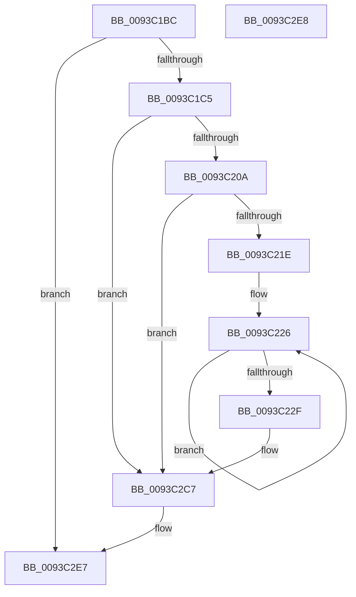

# PfSnLogPrefetchSectionsStart

- RVA: `0x0093C1BC`–`0x0093C2E9` (길이 `301` bytes)
- VA: `0x000000014093C1BC`
- 실행 섹션: `PAGE`
- PDB 이름 있음: `예`; PDB Function 태그: `아니요`
- unwind 정보 RVA: `0x0008FEA8`
- 디코드: `69`개 명령, `301/301` bytes 표시
- 미해석 바이트: `0` (있으면 어셈블리에 `.byte`로 보존)

> 이 문서는 커널 이미지의 기계어와 PDB 기호를 분석해 생성했습니다. 4번과 5번은 함수 원형과 자료형을 바이너리 사용 방식에서 추정한 C 해석이며 원본 소스 복구 결과는 아닙니다.

## 1. Dependencies

- 직접 호출 지점: **3**; 고유 호출 대상: **3**
- 직접 호출자로 확인된 함수: **1**
- RIP 상대 이미지 참조: **3**

### Outgoing calls
- `0x0093C211` → [EtwEventEnabled](../../text/39/EtwEventEnabled_function_00392450.md) (function, `0x00392450`)
- `0x0093C2C2` → [EtwWrite](../../text/41/EtwWrite_function_0041C720.md) (function, `0x0041C720`)
- `0x0093C2CE` → [_security_check_cookie](../../text/6A/_security_check_cookie_function_006AC640.md) (function, `0x006AC640`)

### Direct callers
- [PfSnPrefetchSections](PfSnPrefetchSections_function_0093BCF4.md) at `0x0093BD40`

### Static image references
- `0x0093C1E3` → RVA `0x00E0A740` (`.data`; read)
- `0x0093C1F6` → RVA `0x00E67358` (`.data`; read)
- `0x0093C20A` → RVA `0x00012228` (`.rdata`; read)

## 2. Other-region calls and transfers

- 다른 실행 섹션으로 향하는 call: **3**
  - `0x0093C211` → [EtwEventEnabled](../../text/39/EtwEventEnabled_function_00392450.md) (`PAGE` → `.text`)
  - `0x0093C2C2` → [EtwWrite](../../text/41/EtwWrite_function_0041C720.md) (`PAGE` → `.text`)
  - `0x0093C2CE` → [_security_check_cookie](../../text/6A/_security_check_cookie_function_006AC640.md) (`PAGE` → `.text`)
- 별도 외부 분기/꼬리 이동을 확인하지 못했습니다.

## 3. Assembly (complete function range)

```asm
0093C1BC  48 85 C9                        test rcx, rcx
0093C1BF  0F 84 22 01 00 00               je 0x14093c2e7
0093C1C5  48 8B C4                        mov rax, rsp
0093C1C8  48 89 58 08                     mov qword ptr [rax + 8], rbx
0093C1CC  48 89 78 20                     mov qword ptr [rax + 0x20], rdi
0093C1D0  44 89 40 18                     mov dword ptr [rax + 0x18], r8d
0093C1D4  89 50 10                        mov dword ptr [rax + 0x10], edx
0093C1D7  55                              push rbp
0093C1D8  48 8D 68 A1                     lea rbp, [rax - 0x5f]
0093C1DC  48 81 EC C0 00 00 00            sub rsp, 0xc0
0093C1E3  48 8B 05 56 E5 4C 00            mov rax, qword ptr [rip + 0x4ce556]
0093C1EA  48 33 C4                        xor rax, rsp
0093C1ED  48 89 45 47                     mov qword ptr [rbp + 0x47], rax
0093C1F1  33 FF                           xor edi, edi
0093C1F3  48 8B D9                        mov rbx, rcx
0093C1F6  48 8B 0D 5B B1 52 00            mov rcx, qword ptr [rip + 0x52b15b]
0093C1FD  40 88 7D C7                     mov byte ptr [rbp - 0x39], dil
0093C201  48 85 C9                        test rcx, rcx
0093C204  0F 84 BD 00 00 00               je 0x14093c2c7
0093C20A  48 8D 15 17 60 6D FF            lea rdx, [rip - 0x929fe9]
0093C211  E8 3A 62 A5 FF                  call 0x140392450
0093C216  84 C0                           test al, al
0093C218  0F 84 A9 00 00 00               je 0x14093c2c7
0093C21E  48 8D 4B 10                     lea rcx, [rbx + 0x10]
0093C222  48 83 C8 FF                     or rax, 0xffffffffffffffff
0093C226  48 FF C0                        inc rax
0093C229  66 39 3C 41                     cmp word ptr [rcx + rax*2], di
0093C22D  75 F7                           jne 0x14093c226
0093C22F  66 89 45 CF                     mov word ptr [rbp - 0x31], ax
0093C233  48 8D 55 CF                     lea rdx, [rbp - 0x31]
0093C237  0F B7 C0                        movzx eax, ax
0093C23A  41 B9 07 00 00 00               mov r9d, 7
0093C240  03 C0                           add eax, eax
0093C242  48 89 55 D7                     mov qword ptr [rbp - 0x29], rdx
0093C246  89 45 EF                        mov dword ptr [rbp - 0x11], eax
0093C249  48 8D 15 D8 5F 6D FF            lea rdx, [rip - 0x92a028]
0093C250  48 8D 41 3C                     lea rax, [rcx + 0x3c]
0093C254  48 89 4D E7                     mov qword ptr [rbp - 0x19], rcx
0093C258  48 8B 0D F9 B0 52 00            mov rcx, qword ptr [rip + 0x52b0f9]
0093C25F  45 33 C0                        xor r8d, r8d
0093C262  48 89 45 F7                     mov qword ptr [rbp - 9], rax
0093C266  48 8D 43 50                     lea rax, [rbx + 0x50]
0093C26A  48 89 45 07                     mov qword ptr [rbp + 7], rax
0093C26E  48 8D 45 6F                     lea rax, [rbp + 0x6f]
0093C272  48 89 45 17                     mov qword ptr [rbp + 0x17], rax
0093C276  48 8D 45 77                     lea rax, [rbp + 0x77]
0093C27A  48 89 45 27                     mov qword ptr [rbp + 0x27], rax
0093C27E  48 8D 45 C7                     lea rax, [rbp - 0x39]
0093C282  48 89 45 37                     mov qword ptr [rbp + 0x37], rax
0093C286  48 8D 45 D7                     lea rax, [rbp - 0x29]
0093C28A  48 89 44 24 20                  mov qword ptr [rsp + 0x20], rax
0093C28F  48 C7 45 DF 02 00 00 00         mov qword ptr [rbp - 0x21], 2
0093C297  89 7D F3                        mov dword ptr [rbp - 0xd], edi
0093C29A  48 C7 45 FF 04 00 00 00         mov qword ptr [rbp - 1], 4
0093C2A2  48 C7 45 0F 04 00 00 00         mov qword ptr [rbp + 0xf], 4
0093C2AA  48 C7 45 1F 04 00 00 00         mov qword ptr [rbp + 0x1f], 4
0093C2B2  48 C7 45 2F 04 00 00 00         mov qword ptr [rbp + 0x2f], 4
0093C2BA  48 C7 45 3F 01 00 00 00         mov qword ptr [rbp + 0x3f], 1
0093C2C2  E8 59 04 AE FF                  call 0x14041c720
0093C2C7  48 8B 4D 47                     mov rcx, qword ptr [rbp + 0x47]
0093C2CB  48 33 CC                        xor rcx, rsp
0093C2CE  E8 6D 03 D7 FF                  call 0x1406ac640
0093C2D3  4C 8D 9C 24 C0 00 00 00         lea r11, [rsp + 0xc0]
0093C2DB  49 8B 5B 10                     mov rbx, qword ptr [r11 + 0x10]
0093C2DF  49 8B 7B 28                     mov rdi, qword ptr [r11 + 0x28]
0093C2E3  49 8B E3                        mov rsp, r11
0093C2E6  5D                              pop rbp
0093C2E7  C3                              ret
0093C2E8  CC                              int3
```

## 4. C-style interpretation (structured pseudocode)

```c
__int64 __fastcall PfSnLogPrefetchSectionsStart(__int64 a1, int a2, int a3)
{
    __int64 result;
    __int64 v_rdi;
    __int64 v_rsp;
    unsigned __int64 v_stack_m8;
    unsigned __int64 v_stack_mA8;

    if (a1 == 0) goto loc_0093C2E7;
    *(unsigned __int64 *)(v_rsp + 8) = v_rbx;
    *(unsigned __int64 *)(v_rsp + 32) = v_rdi;
    *(unsigned int *)(v_rsp + 24) = a3;
    *(unsigned int *)(v_rsp + 16) = a2;
    v_rsp = (v_rsp) - (192);
    result = (*(unsigned __int64 *)(v_rip + 5039446)) ^ (v_rsp);
    *(unsigned __int64 *)(v_rsp - 95 + 71) = result;
    v_rdi = 0;
    *(unsigned __int8 *)(v_rsp - 95 - 57) = 0;
    if (*(unsigned __int64 *)(v_rip + 5419355) == 0) goto loc_0093C2C7;
    result = EtwEventEnabled(*(unsigned __int64 *)(v_rip + 5419355), v_rip - 9609193, a3, a4);
    if ((unsigned __int8)(result) == 0) goto loc_0093C2C7;
    result = (result) | (-1);
loc_0093C226:
    result = (result) + 1;
    if ((*(unsigned __int16 *)(a1 + 16 + result * 2)) != 0) goto loc_0093C226;
    *(unsigned __int16 *)(v_rsp - 95 - 49) = (unsigned __int16)(result);
    result = (unsigned int)(((unsigned __int16)(result)) + ((unsigned int)((unsigned __int16)(result))));
    *(unsigned __int64 *)(v_rsp - 95 - 41) = v_rsp - 95 - 49;
    *(unsigned int *)(v_rsp - 95 - 17) = (unsigned int)(result);
    *(unsigned __int64 *)(v_rsp - 95 - 25) = a1 + 16;
    a3 = 0;
    *(unsigned __int64 *)(v_rsp - 95 - 9) = a1 + 16 + 60;
    *(unsigned __int64 *)(v_rsp - 95 + 7) = a1 + 80;
    *(unsigned __int64 *)(v_rsp - 95 + 23) = v_rsp - 95 + 111;
    *(unsigned __int64 *)(v_rsp - 95 + 39) = v_rsp - 95 + 119;
    *(unsigned __int64 *)(v_rsp - 95 + 55) = v_rsp - 95 - 57;
    v_stack_mA8 = v_rsp - 95 - 41;
    *(unsigned __int64 *)(v_rsp - 95 - 33) = 2;
    *(unsigned int *)(v_rsp - 95 - 13) = 0;
    *(unsigned __int64 *)(v_rsp - 95 - 1) = 4;
    *(unsigned __int64 *)(v_rsp - 95 + 15) = 4;
    *(unsigned __int64 *)(v_rsp - 95 + 31) = 4;
    *(unsigned __int64 *)(v_rsp - 95 + 47) = 4;
    *(unsigned __int64 *)(v_rsp - 95 + 63) = 1;
    result = EtwWrite(*(unsigned __int64 *)(v_rip + 5419257), v_rip - 9609256, a3, 7);
loc_0093C2C7:
    a1 = (*(unsigned __int64 *)(v_rsp - 95 + 71)) ^ (v_rsp);
    result = _security_check_cookie(a1, v_rip - 9609256, a3, 7);
loc_0093C2E7:
    return result;
}
```

## 5. (Beta) C Style

```c
int64_t PfSnLogPrefetchSectionsStart(int64_t Arg1, int32_t Arg2, int32_t Arg3)
{
    int64_t result;
    int64_t local_rdi;
    int64_t local_rsp;
    uint64_t v_stack_m8;
    uint64_t v_stack_mA8;

    if (Arg1 == 0) goto loc_0093C2E7;
    *(uint64_t *)(local_rsp + 0x8) = local_rbx;
    *(uint64_t *)(local_rsp + 0x20) = local_rdi;
    *(uint32_t *)(local_rsp + 0x18) = Arg3;
    *(uint32_t *)(local_rsp + 0x10) = Arg2;
    local_rsp = (local_rsp) - (192);
    result = (*(uint64_t *)(v_rip + 0x4CE556)) ^ (local_rsp);
    *(uint64_t *)(local_rsp - 0x5F + 0x47) = result;
    local_rdi = 0;
    *(uint8_t *)(local_rsp - 0x5F - 0x39) = 0;
    if (*(uint64_t *)(v_rip + 0x52B15B) == 0) goto loc_0093C2C7;
    result = EtwEventEnabled(*(uint64_t *)(v_rip + 0x52B15B), v_rip - 9609193, Arg3, a4);
    if ((uint8_t)(result) == 0) goto loc_0093C2C7;
    result = (result) | (-1);
loc_0093C226:
    result = (result) + 1;
    if ((*(uint16_t *)(Arg1 + 0x10 + result * 2)) != 0) goto loc_0093C226;
    *(uint16_t *)(local_rsp - 0x5F - 0x31) = (uint16_t)(result);
    result = (uint32_t)(((uint16_t)(result)) + ((uint32_t)((uint16_t)(result))));
    *(uint64_t *)(local_rsp - 0x5F - 0x29) = local_rsp - 95 - 49;
    *(uint32_t *)(local_rsp - 0x5F - 0x11) = (uint32_t)(result);
    *(uint64_t *)(local_rsp - 0x5F - 0x19) = Arg1 + 16;
    Arg3 = 0;
    *(uint64_t *)(local_rsp - 0x5F - 0x9) = Arg1 + 16 + 60;
    *(uint64_t *)(local_rsp - 0x5F + 0x7) = Arg1 + 80;
    *(uint64_t *)(local_rsp - 0x5F + 0x17) = local_rsp - 95 + 111;
    *(uint64_t *)(local_rsp - 0x5F + 0x27) = local_rsp - 95 + 119;
    *(uint64_t *)(local_rsp - 0x5F + 0x37) = local_rsp - 95 - 57;
    v_stack_mA8 = local_rsp - 95 - 41;
    *(uint64_t *)(local_rsp - 0x5F - 0x21) = 2;
    *(uint32_t *)(local_rsp - 0x5F - 0xD) = 0;
    *(uint64_t *)(local_rsp - 0x5F - 0x1) = 4;
    *(uint64_t *)(local_rsp - 0x5F + 0xF) = 4;
    *(uint64_t *)(local_rsp - 0x5F + 0x1F) = 4;
    *(uint64_t *)(local_rsp - 0x5F + 0x2F) = 4;
    *(uint64_t *)(local_rsp - 0x5F + 0x3F) = 1;
    result = EtwWrite(*(uint64_t *)(v_rip + 0x52B0F9), v_rip - 9609256, Arg3, 7);
loc_0093C2C7:
    Arg1 = (*(uint64_t *)(local_rsp - 0x5F + 0x47)) ^ (local_rsp);
    result = _security_check_cookie(Arg1, v_rip - 9609256, Arg3, 7);
loc_0093C2E7:
    return result;
}
```

## 6. Execution-region graph

[열기: 2D/3D 그래프와 함수 탐색 컨트롤 패널](../../../control-panel.html?section=page&rva=0x0093C1BC&view=graph)

- 2D 그래프는 위에서 아래로 흐르고, 3D 그래프는 빈 공간을 드래그해 회전합니다. Shift+드래그는 이동, 휠은 확대·축소, 함수 노드 선택은 대상 보고서 이동입니다.

### Static fallback


