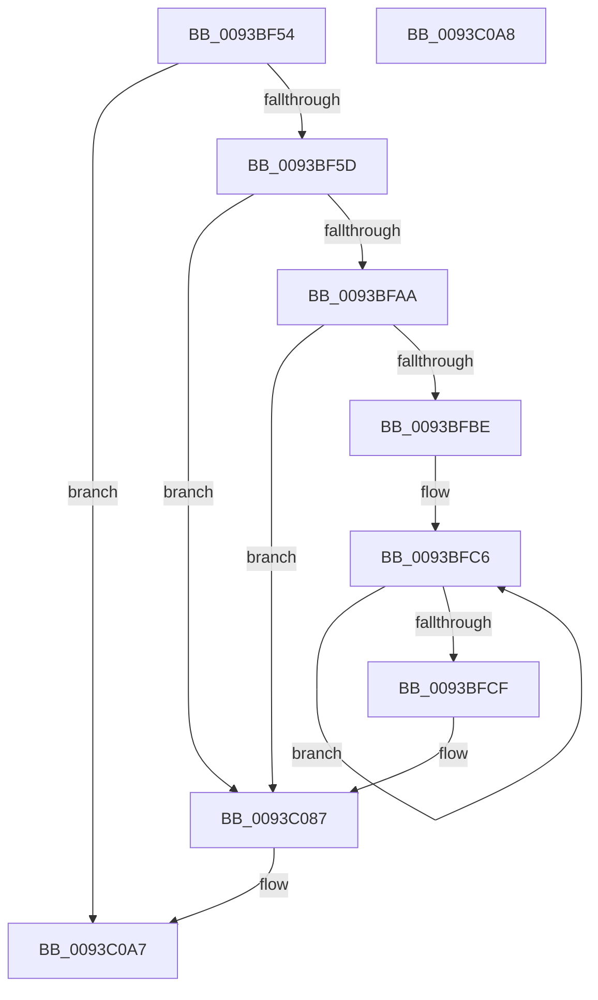

# PfSnLogPrefetchSectionsStop

- RVA: `0x0093BF54`–`0x0093C0A9` (길이 `341` bytes)
- VA: `0x000000014093BF54`
- 실행 섹션: `PAGE`
- PDB 이름 있음: `예`; PDB Function 태그: `아니요`
- unwind 정보 RVA: `0x0008FE6C`
- 디코드: `77`개 명령, `341/341` bytes 표시
- 미해석 바이트: `0` (있으면 어셈블리에 `.byte`로 보존)

> 이 문서는 커널 이미지의 기계어와 PDB 기호를 분석해 생성했습니다. 4번과 5번은 함수 원형과 자료형을 바이너리 사용 방식에서 추정한 C 해석이며 원본 소스 복구 결과는 아닙니다.

## 1. Dependencies

- 직접 호출 지점: **3**; 고유 호출 대상: **3**
- 직접 호출자로 확인된 함수: **1**
- RIP 상대 이미지 참조: **3**

### Outgoing calls
- `0x0093BFB1` → [EtwEventEnabled](../../text/39/EtwEventEnabled_function_00392450.md) (function, `0x00392450`)
- `0x0093C082` → [EtwWrite](../../text/41/EtwWrite_function_0041C720.md) (function, `0x0041C720`)
- `0x0093C08E` → [_security_check_cookie](../../text/6A/_security_check_cookie_function_006AC640.md) (function, `0x006AC640`)

### Direct callers
- [PfSnPrefetchSections](PfSnPrefetchSections_function_0093BCF4.md) at `0x0093BEF1`

### Static image references
- `0x0093BF7B` → RVA `0x00E0A740` (`.data`; read)
- `0x0093BF96` → RVA `0x00E67358` (`.data`; read)
- `0x0093BFAA` → RVA `0x00012208` (`.rdata`; read)

## 2. Other-region calls and transfers

- 다른 실행 섹션으로 향하는 call: **3**
  - `0x0093BFB1` → [EtwEventEnabled](../../text/39/EtwEventEnabled_function_00392450.md) (`PAGE` → `.text`)
  - `0x0093C082` → [EtwWrite](../../text/41/EtwWrite_function_0041C720.md) (`PAGE` → `.text`)
  - `0x0093C08E` → [_security_check_cookie](../../text/6A/_security_check_cookie_function_006AC640.md) (`PAGE` → `.text`)
- 별도 외부 분기/꼬리 이동을 확인하지 못했습니다.

## 3. Assembly (complete function range)

```asm
0093BF54  48 85 C9                        test rcx, rcx
0093BF57  0F 84 4A 01 00 00               je 0x14093c0a7
0093BF5D  48 8B C4                        mov rax, rsp
0093BF60  48 89 58 08                     mov qword ptr [rax + 8], rbx
0093BF64  48 89 78 20                     mov qword ptr [rax + 0x20], rdi
0093BF68  44 89 40 18                     mov dword ptr [rax + 0x18], r8d
0093BF6C  89 50 10                        mov dword ptr [rax + 0x10], edx
0093BF6F  55                              push rbp
0093BF70  48 8D 68 B1                     lea rbp, [rax - 0x4f]
0093BF74  48 81 EC F0 00 00 00            sub rsp, 0xf0
0093BF7B  48 8B 05 BE E7 4C 00            mov rax, qword ptr [rip + 0x4ce7be]
0093BF82  48 33 C4                        xor rax, rsp
0093BF85  48 89 45 37                     mov qword ptr [rbp + 0x37], rax
0093BF89  48 8B 45 77                     mov rax, qword ptr [rbp + 0x77]
0093BF8D  33 FF                           xor edi, edi
0093BF8F  48 8B D9                        mov rbx, rcx
0093BF92  40 88 7D 87                     mov byte ptr [rbp - 0x79], dil
0093BF96  48 8B 0D BB B3 52 00            mov rcx, qword ptr [rip + 0x52b3bb]
0093BF9D  48 89 45 97                     mov qword ptr [rbp - 0x69], rax
0093BFA1  48 85 C9                        test rcx, rcx
0093BFA4  0F 84 DD 00 00 00               je 0x14093c087
0093BFAA  48 8D 15 57 62 6D FF            lea rdx, [rip - 0x929da9]
0093BFB1  E8 9A 64 A5 FF                  call 0x140392450
0093BFB6  84 C0                           test al, al
0093BFB8  0F 84 C9 00 00 00               je 0x14093c087
0093BFBE  48 8D 4B 10                     lea rcx, [rbx + 0x10]
0093BFC2  48 83 C8 FF                     or rax, 0xffffffffffffffff
0093BFC6  48 FF C0                        inc rax
0093BFC9  66 39 3C 41                     cmp word ptr [rcx + rax*2], di
0093BFCD  75 F7                           jne 0x14093bfc6
0093BFCF  66 89 45 8F                     mov word ptr [rbp - 0x71], ax
0093BFD3  48 8D 55 8F                     lea rdx, [rbp - 0x71]
0093BFD7  0F B7 C0                        movzx eax, ax
0093BFDA  41 B9 09 00 00 00               mov r9d, 9
0093BFE0  03 C0                           add eax, eax
0093BFE2  48 89 55 A7                     mov qword ptr [rbp - 0x59], rdx
0093BFE6  89 45 BF                        mov dword ptr [rbp - 0x41], eax
0093BFE9  48 8D 15 18 62 6D FF            lea rdx, [rip - 0x929de8]
0093BFF0  48 8D 41 3C                     lea rax, [rcx + 0x3c]
0093BFF4  48 89 4D B7                     mov qword ptr [rbp - 0x49], rcx
0093BFF8  48 8B 0D 59 B3 52 00            mov rcx, qword ptr [rip + 0x52b359]
0093BFFF  45 33 C0                        xor r8d, r8d
0093C002  48 89 45 C7                     mov qword ptr [rbp - 0x39], rax
0093C006  48 8D 43 50                     lea rax, [rbx + 0x50]
0093C00A  48 89 45 D7                     mov qword ptr [rbp - 0x29], rax
0093C00E  48 8D 45 5F                     lea rax, [rbp + 0x5f]
0093C012  48 89 45 E7                     mov qword ptr [rbp - 0x19], rax
0093C016  48 8D 45 67                     lea rax, [rbp + 0x67]
0093C01A  48 89 45 F7                     mov qword ptr [rbp - 9], rax
0093C01E  48 8D 45 87                     lea rax, [rbp - 0x79]
0093C022  48 89 45 07                     mov qword ptr [rbp + 7], rax
0093C026  48 8D 45 97                     lea rax, [rbp - 0x69]
0093C02A  48 89 45 17                     mov qword ptr [rbp + 0x17], rax
0093C02E  48 8D 45 7F                     lea rax, [rbp + 0x7f]
0093C032  48 89 45 27                     mov qword ptr [rbp + 0x27], rax
0093C036  48 8D 45 A7                     lea rax, [rbp - 0x59]
0093C03A  48 89 44 24 20                  mov qword ptr [rsp + 0x20], rax
0093C03F  48 C7 45 AF 02 00 00 00         mov qword ptr [rbp - 0x51], 2
0093C047  89 7D C3                        mov dword ptr [rbp - 0x3d], edi
0093C04A  48 C7 45 CF 04 00 00 00         mov qword ptr [rbp - 0x31], 4
0093C052  48 C7 45 DF 04 00 00 00         mov qword ptr [rbp - 0x21], 4
0093C05A  48 C7 45 EF 04 00 00 00         mov qword ptr [rbp - 0x11], 4
0093C062  48 C7 45 FF 04 00 00 00         mov qword ptr [rbp - 1], 4
0093C06A  48 C7 45 0F 01 00 00 00         mov qword ptr [rbp + 0xf], 1
0093C072  48 C7 45 1F 08 00 00 00         mov qword ptr [rbp + 0x1f], 8
0093C07A  48 C7 45 2F 04 00 00 00         mov qword ptr [rbp + 0x2f], 4
0093C082  E8 99 06 AE FF                  call 0x14041c720
0093C087  48 8B 4D 37                     mov rcx, qword ptr [rbp + 0x37]
0093C08B  48 33 CC                        xor rcx, rsp
0093C08E  E8 AD 05 D7 FF                  call 0x1406ac640
0093C093  4C 8D 9C 24 F0 00 00 00         lea r11, [rsp + 0xf0]
0093C09B  49 8B 5B 10                     mov rbx, qword ptr [r11 + 0x10]
0093C09F  49 8B 7B 28                     mov rdi, qword ptr [r11 + 0x28]
0093C0A3  49 8B E3                        mov rsp, r11
0093C0A6  5D                              pop rbp
0093C0A7  C3                              ret
0093C0A8  CC                              int3
```

## 4. C-style interpretation (structured pseudocode)

```c
__int64 __fastcall PfSnLogPrefetchSectionsStop(__int64 a1, int a2, int a3)
{
    __int64 result;
    __int64 v_rdi;
    __int64 v_rsp;
    unsigned __int64 v_stack_m8;
    unsigned __int64 v_stack_mD8;

    if (a1 == 0) goto loc_0093C0A7;
    *(unsigned __int64 *)(v_rsp + 8) = v_rbx;
    *(unsigned __int64 *)(v_rsp + 32) = v_rdi;
    *(unsigned int *)(v_rsp + 24) = a3;
    *(unsigned int *)(v_rsp + 16) = a2;
    v_rsp = (v_rsp) - (240);
    result = (*(unsigned __int64 *)(v_rip + 5040062)) ^ (v_rsp);
    *(unsigned __int64 *)(v_rsp - 79 + 55) = result;
    v_rdi = 0;
    *(unsigned __int8 *)(v_rsp - 79 - 121) = 0;
    *(unsigned __int64 *)(v_rsp - 79 - 105) = *(unsigned __int64 *)(v_rsp - 79 + 119);
    if (*(unsigned __int64 *)(v_rip + 5419963) == 0) goto loc_0093C087;
    result = EtwEventEnabled(*(unsigned __int64 *)(v_rip + 5419963), v_rip - 9608617, a3, a4);
    if ((unsigned __int8)(result) == 0) goto loc_0093C087;
    result = (result) | (-1);
loc_0093BFC6:
    result = (result) + 1;
    if ((*(unsigned __int16 *)(a1 + 16 + result * 2)) != 0) goto loc_0093BFC6;
    *(unsigned __int16 *)(v_rsp - 79 - 113) = (unsigned __int16)(result);
    result = (unsigned int)(((unsigned __int16)(result)) + ((unsigned int)((unsigned __int16)(result))));
    *(unsigned __int64 *)(v_rsp - 79 - 89) = v_rsp - 79 - 113;
    *(unsigned int *)(v_rsp - 79 - 65) = (unsigned int)(result);
    *(unsigned __int64 *)(v_rsp - 79 - 73) = a1 + 16;
    a3 = 0;
    *(unsigned __int64 *)(v_rsp - 79 - 57) = a1 + 16 + 60;
    *(unsigned __int64 *)(v_rsp - 79 - 41) = a1 + 80;
    *(unsigned __int64 *)(v_rsp - 79 - 25) = v_rsp - 79 + 95;
    *(unsigned __int64 *)(v_rsp - 79 - 9) = v_rsp - 79 + 103;
    *(unsigned __int64 *)(v_rsp - 79 + 7) = v_rsp - 79 - 121;
    *(unsigned __int64 *)(v_rsp - 79 + 23) = v_rsp - 79 - 105;
    *(unsigned __int64 *)(v_rsp - 79 + 39) = v_rsp - 79 + 127;
    v_stack_mD8 = v_rsp - 79 - 89;
    *(unsigned __int64 *)(v_rsp - 79 - 81) = 2;
    *(unsigned int *)(v_rsp - 79 - 61) = 0;
    *(unsigned __int64 *)(v_rsp - 79 - 49) = 4;
    *(unsigned __int64 *)(v_rsp - 79 - 33) = 4;
    *(unsigned __int64 *)(v_rsp - 79 - 17) = 4;
    *(unsigned __int64 *)(v_rsp - 79 - 1) = 4;
    *(unsigned __int64 *)(v_rsp - 79 + 15) = 1;
    *(unsigned __int64 *)(v_rsp - 79 + 31) = 8;
    *(unsigned __int64 *)(v_rsp - 79 + 47) = 4;
    result = EtwWrite(*(unsigned __int64 *)(v_rip + 5419865), v_rip - 9608680, a3, 9);
loc_0093C087:
    a1 = (*(unsigned __int64 *)(v_rsp - 79 + 55)) ^ (v_rsp);
    result = _security_check_cookie(a1, v_rip - 9608680, a3, 9);
loc_0093C0A7:
    return result;
}
```

## 5. (Beta) C Style

```c
int64_t PfSnLogPrefetchSectionsStop(int64_t Arg1, int32_t Arg2, int32_t Arg3)
{
    int64_t result;
    int64_t local_rdi;
    int64_t local_rsp;
    uint64_t v_stack_m8;
    uint64_t v_stack_mD8;

    if (Arg1 == 0) goto loc_0093C0A7;
    *(uint64_t *)(local_rsp + 0x8) = local_rbx;
    *(uint64_t *)(local_rsp + 0x20) = local_rdi;
    *(uint32_t *)(local_rsp + 0x18) = Arg3;
    *(uint32_t *)(local_rsp + 0x10) = Arg2;
    local_rsp = (local_rsp) - (240);
    result = (*(uint64_t *)(v_rip + 0x4CE7BE)) ^ (local_rsp);
    *(uint64_t *)(local_rsp - 0x4F + 0x37) = result;
    local_rdi = 0;
    *(uint8_t *)(local_rsp - 0x4F - 0x79) = 0;
    *(uint64_t *)(local_rsp - 0x4F - 0x69) = *(uint64_t *)(local_rsp - 0x4F + 0x77);
    if (*(uint64_t *)(v_rip + 0x52B3BB) == 0) goto loc_0093C087;
    result = EtwEventEnabled(*(uint64_t *)(v_rip + 0x52B3BB), v_rip - 9608617, Arg3, a4);
    if ((uint8_t)(result) == 0) goto loc_0093C087;
    result = (result) | (-1);
loc_0093BFC6:
    result = (result) + 1;
    if ((*(uint16_t *)(Arg1 + 0x10 + result * 2)) != 0) goto loc_0093BFC6;
    *(uint16_t *)(local_rsp - 0x4F - 0x71) = (uint16_t)(result);
    result = (uint32_t)(((uint16_t)(result)) + ((uint32_t)((uint16_t)(result))));
    *(uint64_t *)(local_rsp - 0x4F - 0x59) = local_rsp - 79 - 113;
    *(uint32_t *)(local_rsp - 0x4F - 0x41) = (uint32_t)(result);
    *(uint64_t *)(local_rsp - 0x4F - 0x49) = Arg1 + 16;
    Arg3 = 0;
    *(uint64_t *)(local_rsp - 0x4F - 0x39) = Arg1 + 16 + 60;
    *(uint64_t *)(local_rsp - 0x4F - 0x29) = Arg1 + 80;
    *(uint64_t *)(local_rsp - 0x4F - 0x19) = local_rsp - 79 + 95;
    *(uint64_t *)(local_rsp - 0x4F - 0x9) = local_rsp - 79 + 103;
    *(uint64_t *)(local_rsp - 0x4F + 0x7) = local_rsp - 79 - 121;
    *(uint64_t *)(local_rsp - 0x4F + 0x17) = local_rsp - 79 - 105;
    *(uint64_t *)(local_rsp - 0x4F + 0x27) = local_rsp - 79 + 127;
    v_stack_mD8 = local_rsp - 79 - 89;
    *(uint64_t *)(local_rsp - 0x4F - 0x51) = 2;
    *(uint32_t *)(local_rsp - 0x4F - 0x3D) = 0;
    *(uint64_t *)(local_rsp - 0x4F - 0x31) = 4;
    *(uint64_t *)(local_rsp - 0x4F - 0x21) = 4;
    *(uint64_t *)(local_rsp - 0x4F - 0x11) = 4;
    *(uint64_t *)(local_rsp - 0x4F - 0x1) = 4;
    *(uint64_t *)(local_rsp - 0x4F + 0xF) = 1;
    *(uint64_t *)(local_rsp - 0x4F + 0x1F) = 8;
    *(uint64_t *)(local_rsp - 0x4F + 0x2F) = 4;
    result = EtwWrite(*(uint64_t *)(v_rip + 0x52B359), v_rip - 9608680, Arg3, 9);
loc_0093C087:
    Arg1 = (*(uint64_t *)(local_rsp - 0x4F + 0x37)) ^ (local_rsp);
    result = _security_check_cookie(Arg1, v_rip - 9608680, Arg3, 9);
loc_0093C0A7:
    return result;
}
```

## 6. Execution-region graph

[열기: 2D/3D 그래프와 함수 탐색 컨트롤 패널](../../../control-panel.html?section=page&rva=0x0093BF54&view=graph)

- 2D 그래프는 위에서 아래로 흐르고, 3D 그래프는 빈 공간을 드래그해 회전합니다. Shift+드래그는 이동, 휠은 확대·축소, 함수 노드 선택은 대상 보고서 이동입니다.

### Static fallback


