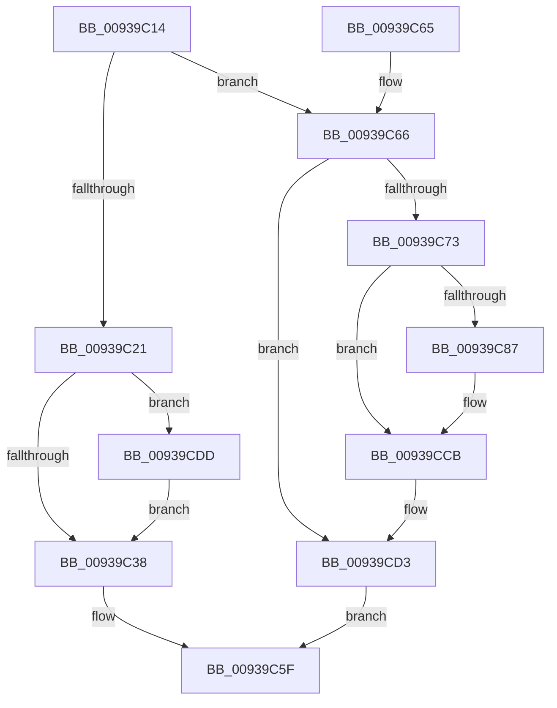

# PfSnPowerBoost

- RVA: `0x00939C14`–`0x00939D1E` (길이 `266` bytes)
- VA: `0x0000000140939C14`
- 실행 섹션: `PAGE`
- PDB 이름 있음: `예`; PDB Function 태그: `아니요`
- unwind 정보 RVA: `0x0008FCC0`
- 디코드: `65`개 명령, `266/266` bytes 표시
- 미해석 바이트: `0` (있으면 어셈블리에 `.byte`로 보존)

> 이 문서는 커널 이미지의 기계어와 PDB 기호를 분석해 생성했습니다. 4번과 5번은 함수 원형과 자료형을 바이너리 사용 방식에서 추정한 C 해석이며 원본 소스 복구 결과는 아닙니다.

## 1. Dependencies

- 직접 호출 지점: **7**; 고유 호출 대상: **6**
- 직접 호출자로 확인된 함수: **1**
- RIP 상대 이미지 참조: **2**

### Outgoing calls
- `0x00939C3B` → [ExAcquireRundownProtection](../../text/21/ExAcquireRundownProtection_function_00216620.md) (function, `0x00216620`)
- `0x00939C5A` → [KiSetTimerEx](../../text/23/KiSetTimerEx_function_00232CB0.md) (function, `0x00232CB0`)
- `0x00939C6A` → [KeCancelTimer](../../text/23/KeCancelTimer_function_002327E0.md) (function, `0x002327E0`)
- `0x00939CC6` → [ExpNtUpdateWnfStateData](../90/ExpNtUpdateWnfStateData_function_0090A7A0.md) (function, `0x0090A7A0`)
- `0x00939CCE` → [ExReleaseRundownProtection](../../text/34/ExReleaseRundownProtection_function_00349E80.md) (function, `0x00349E80`)
- `0x00939CD6` → [ExWaitForRundownProtectionRelease](../../text/2A/ExWaitForRundownProtectionRelease_function_002A4CB0.md) (function, `0x002A4CB0`)
- `0x00939D14` → [ExpNtUpdateWnfStateData](../90/ExpNtUpdateWnfStateData_function_0090A7A0.md) (function, `0x0090A7A0`)

### Direct callers
- [PfSnAsyncPrefetchWorker](PfSnAsyncPrefetchWorker_function_009394B0.md) at `0x009396D9`
- [PfSnAsyncPrefetchWorker](PfSnAsyncPrefetchWorker_function_009394B0.md) at `0x009397EB`

### Static image references
- `0x00939C28` → RVA `0x00E67364` (`.data`; read/write)
- `0x00939CAD` → RVA `0x0001C330` (`.rdata`; read)

## 2. Other-region calls and transfers

- 다른 실행 섹션으로 향하는 call: **5**
  - `0x00939C3B` → [ExAcquireRundownProtection](../../text/21/ExAcquireRundownProtection_function_00216620.md) (`PAGE` → `.text`)
  - `0x00939C5A` → [KiSetTimerEx](../../text/23/KiSetTimerEx_function_00232CB0.md) (`PAGE` → `.text`)
  - `0x00939C6A` → [KeCancelTimer](../../text/23/KeCancelTimer_function_002327E0.md) (`PAGE` → `.text`)
  - `0x00939CCE` → [ExReleaseRundownProtection](../../text/34/ExReleaseRundownProtection_function_00349E80.md) (`PAGE` → `.text`)
  - `0x00939CD6` → [ExWaitForRundownProtectionRelease](../../text/2A/ExWaitForRundownProtectionRelease_function_002A4CB0.md) (`PAGE` → `.text`)
- 별도 외부 분기/꼬리 이동을 확인하지 못했습니다.

## 3. Assembly (complete function range)

```asm
00939C14  40 53                           push rbx
00939C16  48 83 EC 40                     sub rsp, 0x40
00939C1A  48 8B D9                        mov rbx, rcx
00939C1D  85 D2                           test edx, edx
00939C1F  74 45                           je 0x140939c66
00939C21  B9 01 00 00 00                  mov ecx, 1
00939C26  8B C1                           mov eax, ecx
00939C28  F0 0F C1 05 34 D7 52 00         lock xadd dword ptr [rip + 0x52d734], eax
00939C30  85 C0                           test eax, eax
00939C32  0F 84 A5 00 00 00               je 0x140939cdd
00939C38  48 8B CB                        mov rcx, rbx
00939C3B  E8 E0 C9 8D FF                  call 0x140216620
00939C40  48 8D 43 48                     lea rax, [rbx + 0x48]
00939C44  45 33 C9                        xor r9d, r9d
00939C47  48 8D 4B 08                     lea rcx, [rbx + 8]
00939C4B  48 89 44 24 20                  mov qword ptr [rsp + 0x20], rax
00939C50  45 33 C0                        xor r8d, r8d
00939C53  48 C7 C2 80 3C 36 FE            mov rdx, 0xfffffffffe363c80
00939C5A  E8 51 90 8F FF                  call 0x140232cb0
00939C5F  48 83 C4 40                     add rsp, 0x40
00939C63  5B                              pop rbx
00939C64  C3                              ret
00939C65  CC                              int3
00939C66  48 83 C1 08                     add rcx, 8
00939C6A  E8 71 8B 8F FF                  call 0x1402327e0
00939C6F  84 C0                           test al, al
00939C71  74 60                           je 0x140939cd3
00939C73  83 C8 FF                        or eax, 0xffffffff
00939C76  F0 0F C1 05 E6 D6 52 00         lock xadd dword ptr [rip + 0x52d6e6], eax
00939C7E  B9 01 00 00 00                  mov ecx, 1
00939C83  3B C1                           cmp eax, ecx
00939C85  75 44                           jne 0x140939ccb
00939C87  48 83 64 24 60 00               and qword ptr [rsp + 0x60], 0
00939C8D  44 8D 41 07                     lea r8d, [rcx + 7]
00939C91  8B 44 24 60                     mov eax, dword ptr [rsp + 0x60]
00939C95  48 8D 54 24 60                  lea rdx, [rsp + 0x60]
00939C9A  83 4C 24 64 FF                  or dword ptr [rsp + 0x64], 0xffffffff
00939C9F  83 E0 FD                        and eax, 0xfffffffd
00939CA2  89 4C 24 38                     mov dword ptr [rsp + 0x38], ecx
00939CA6  0B C1                           or eax, ecx
00939CA8  83 64 24 30 00                  and dword ptr [rsp + 0x30], 0
00939CAD  48 8D 0D 7C 26 6E FF            lea rcx, [rip - 0x91d984]
00939CB4  83 64 24 28 00                  and dword ptr [rsp + 0x28], 0
00939CB9  45 33 C9                        xor r9d, r9d
00939CBC  48 83 64 24 20 00               and qword ptr [rsp + 0x20], 0
00939CC2  89 44 24 60                     mov dword ptr [rsp + 0x60], eax
00939CC6  E8 D5 0A FD FF                  call 0x14090a7a0
00939CCB  48 8B CB                        mov rcx, rbx
00939CCE  E8 AD 01 A1 FF                  call 0x140349e80
00939CD3  48 8B CB                        mov rcx, rbx
00939CD6  E8 D5 AF 96 FF                  call 0x1402a4cb0
00939CDB  EB 82                           jmp 0x140939c5f
00939CDD  48 83 64 24 60 00               and qword ptr [rsp + 0x60], 0
00939CE3  48 8D 54 24 60                  lea rdx, [rsp + 0x60]
00939CE8  83 4C 24 64 FF                  or dword ptr [rsp + 0x64], 0xffffffff
00939CED  45 33 C9                        xor r9d, r9d
00939CF0  83 4C 24 60 03                  or dword ptr [rsp + 0x60], 3
00939CF5  89 4C 24 38                     mov dword ptr [rsp + 0x38], ecx
00939CF9  48 8D 0D 30 26 6E FF            lea rcx, [rip - 0x91d9d0]
00939D00  83 64 24 30 00                  and dword ptr [rsp + 0x30], 0
00939D05  83 64 24 28 00                  and dword ptr [rsp + 0x28], 0
00939D0A  45 8D 41 08                     lea r8d, [r9 + 8]
00939D0E  48 83 64 24 20 00               and qword ptr [rsp + 0x20], 0
00939D14  E8 87 0A FD FF                  call 0x14090a7a0
00939D19  E9 1A FF FF FF                  jmp 0x140939c38
```

## 4. C-style interpretation (structured pseudocode)

```c
__int64 __fastcall PfSnPowerBoost(__int64 a1, int a2, int a3, int a4)
{
    __int64 result;
    __int64 v_rsp;
    unsigned __int64 v_stack_m28;
    unsigned __int64 v_stack_p20;
    unsigned int v_stack_p28;
    unsigned int v_stack_p30;
    unsigned int v_stack_p38;
    unsigned __int64 v_stack_p60;
    unsigned int v_stack_p64;

    v_rsp = (v_rsp) - (64);
    if (a2 == 0) goto loc_00939C66;
    if (1 == 0) goto loc_00939CDD;
loc_00939C38:
    result = ExAcquireRundownProtection(a1, a2, a3, a4);
    a4 = 0;
    v_stack_m28 = a1 + 72;
    a3 = 0;
    result = KiSetTimerEx(a1 + 8, 0xFFFFFFFFFE363C80ULL, a3, a4);
loc_00939C5F:
    v_rsp = (v_rsp) + (64);
    return result;
loc_00939C66:
    a1 = (a1 + 8) + (8);
    result = KeCancelTimer(a1, 0xFFFFFFFFFE363C80ULL, a3, a4);
    if ((unsigned __int8)(result) == 0) goto loc_00939CD3;
    result = (unsigned int)((result) | (0xFFFFFFFFULL));
    if (((unsigned int)(result)) == 1) {
        a3 = 1 + 7;
        result = v_stack_p60;
        a2 = v_stack_p60;
        result = (unsigned int)((result) & (0xFFFFFFFDULL));
        v_stack_p38 = 1;
        result = (unsigned int)((result) | (1));
        a1 = v_rip - 9558404;
        a4 = 0;
        v_stack_p60 = (unsigned int)(result);
        result = ExpNtUpdateWnfStateData(a1, a2, a3, a4);
    }
    result = ExReleaseRundownProtection(a1, a2, a3, a4);
loc_00939CD3:
    result = ExWaitForRundownProtectionRelease(a1, a2, a3, a4);
    goto loc_00939C5F;
loc_00939CDD:
    a4 = 0;
    v_stack_p38 = (unsigned int)(a1);
    result = ExpNtUpdateWnfStateData(v_rip - 9558480, v_stack_p60, a4 + 8, a4);
    goto loc_00939C38;
}
```

## 5. (Beta) C Style

```c
int64_t PfSnPowerBoost(void *Arg1, int32_t Arg2, int32_t Arg3, int32_t Arg4)
{
    uint8_t *arg1 = (uint8_t *)Arg1;

    int64_t result;
    int64_t local_rsp;
    uint64_t v_stack_m28;
    uint64_t v_stack_p20;
    uint32_t v_stack_p28;
    uint32_t v_stack_p30;
    uint32_t v_stack_p38;
    uint64_t v_stack_p60;
    uint32_t v_stack_p64;

    local_rsp = (local_rsp) - (64);
    if (Arg2 == 0) goto loc_00939C66;
    if (1 == 0) goto loc_00939CDD;
loc_00939C38:
    result = ExAcquireRundownProtection(Arg1, Arg2, Arg3, Arg4);
    Arg4 = 0;
    v_stack_m28 = Arg1 + 72;
    Arg3 = 0;
    result = KiSetTimerEx(Arg1 + 8, 0xFFFFFFFFFE363C80ULL, Arg3, Arg4);
loc_00939C5F:
    local_rsp = (local_rsp) + (64);
    return result;
loc_00939C66:
    Arg1 = (Arg1 + 8) + (8);
    result = KeCancelTimer(Arg1, 0xFFFFFFFFFE363C80ULL, Arg3, Arg4);
    if ((uint8_t)(result) == 0) goto loc_00939CD3;
    result = (uint32_t)((result) | (0xFFFFFFFFULL));
    if (((uint32_t)(result)) == 1) {
        Arg3 = 1 + 7;
        result = v_stack_p60;
        Arg2 = v_stack_p60;
        result = (uint32_t)((result) & (0xFFFFFFFDULL));
        v_stack_p38 = 1;
        result = (uint32_t)((result) | (1));
        Arg1 = v_rip - 9558404;
        Arg4 = 0;
        v_stack_p60 = (uint32_t)(result);
        result = ExpNtUpdateWnfStateData(Arg1, Arg2, Arg3, Arg4);
    }
    result = ExReleaseRundownProtection(Arg1, Arg2, Arg3, Arg4);
loc_00939CD3:
    result = ExWaitForRundownProtectionRelease(Arg1, Arg2, Arg3, Arg4);
    goto loc_00939C5F;
loc_00939CDD:
    Arg4 = 0;
    v_stack_p38 = (uint32_t)(Arg1);
    result = ExpNtUpdateWnfStateData(v_rip - 9558480, v_stack_p60, Arg4 + 8, Arg4);
    goto loc_00939C38;
}
```

### 관측된 메모리 오프셋

구조체 형식이 확인되지 않은 접근은 인자 기준의 오프셋으로만 기록했습니다.

| 기준 인자 | 오프셋 표현 | 폭 (bit) | 접근 |
|---|---:|---:|---|
| `Arg1` | `+ 0x8` | `64` | `R` |
| `Arg1` | `+ 0x48` | `64` | `R` |

## 6. Execution-region graph

[열기: 2D/3D 그래프와 함수 탐색 컨트롤 패널](../../../control-panel.html?section=page&rva=0x00939C14&view=graph)

- 2D 그래프는 위에서 아래로 흐르고, 3D 그래프는 빈 공간을 드래그해 회전합니다. Shift+드래그는 이동, 휠은 확대·축소, 함수 노드 선택은 대상 보고서 이동입니다.

### Static fallback


