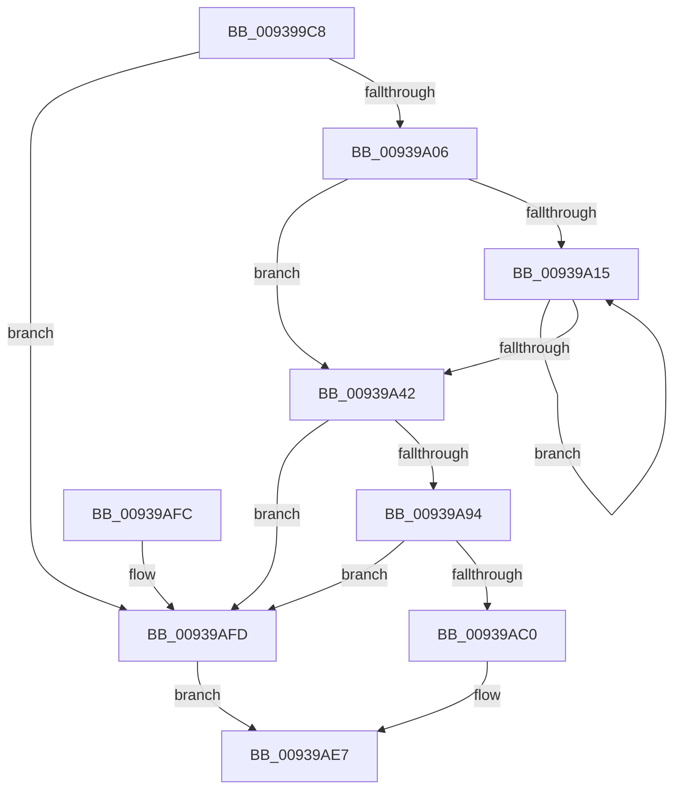

# PfSnPreallocatePrefetchHeader

- RVA: `0x009399C8`–`0x00939B04` (길이 `316` bytes)
- VA: `0x00000001409399C8`
- 실행 섹션: `PAGE`
- PDB 이름 있음: `예`; PDB Function 태그: `아니요`
- unwind 정보 RVA: `0x00069AD0`
- 디코드: `88`개 명령, `316/316` bytes 표시
- 미해석 바이트: `0` (있으면 어셈블리에 `.byte`로 보존)

> 이 문서는 커널 이미지의 기계어와 PDB 기호를 분석해 생성했습니다. 4번과 5번은 함수 원형과 자료형을 바이너리 사용 방식에서 추정한 C 해석이며 원본 소스 복구 결과는 아닙니다.

## 1. Dependencies

- 직접 호출 지점: **6**; 고유 호출 대상: **2**
- 직접 호출자로 확인된 함수: **1**
- RIP 상대 이미지 참조: **0**

### Outgoing calls
- `0x009399F5` → [ExAllocatePool2](../../poolcode/B8/ExAllocatePool2_function_00B820F0.md) (function, `0x00B820F0`)
- `0x00939A65` → [memset](../../text/6C/memset_function_006C6C40.md) (function, `0x006C6C40`)
- `0x00939A86` → [ExAllocatePool2](../../poolcode/B8/ExAllocatePool2_function_00B820F0.md) (function, `0x00B820F0`)
- `0x00939A9C` → [memset](../../text/6C/memset_function_006C6C40.md) (function, `0x006C6C40`)
- `0x00939AB2` → [ExAllocatePool2](../../poolcode/B8/ExAllocatePool2_function_00B820F0.md) (function, `0x00B820F0`)
- `0x00939AD0` → [ExAllocatePool2](../../poolcode/B8/ExAllocatePool2_function_00B820F0.md) (function, `0x00B820F0`)

### Direct callers
- [PfSnAsyncPrefetchWorker](PfSnAsyncPrefetchWorker_function_009394B0.md) at `0x0093958D`

### Static image references
- 디코드된 RIP-relative 메모리 참조가 없습니다.

## 2. Other-region calls and transfers

- 다른 실행 섹션으로 향하는 call: **6**
  - `0x009399F5` → [ExAllocatePool2](../../poolcode/B8/ExAllocatePool2_function_00B820F0.md) (`PAGE` → `POOLCODE`)
  - `0x00939A65` → [memset](../../text/6C/memset_function_006C6C40.md) (`PAGE` → `.text`)
  - `0x00939A86` → [ExAllocatePool2](../../poolcode/B8/ExAllocatePool2_function_00B820F0.md) (`PAGE` → `POOLCODE`)
  - `0x00939A9C` → [memset](../../text/6C/memset_function_006C6C40.md) (`PAGE` → `.text`)
  - `0x00939AB2` → [ExAllocatePool2](../../poolcode/B8/ExAllocatePool2_function_00B820F0.md) (`PAGE` → `POOLCODE`)
  - `0x00939AD0` → [ExAllocatePool2](../../poolcode/B8/ExAllocatePool2_function_00B820F0.md) (`PAGE` → `POOLCODE`)
- 별도 외부 분기/꼬리 이동을 확인하지 못했습니다.

## 3. Assembly (complete function range)

```asm
009399C8  48 89 5C 24 08                  mov qword ptr [rsp + 8], rbx
009399CD  48 89 6C 24 10                  mov qword ptr [rsp + 0x10], rbp
009399D2  48 89 74 24 18                  mov qword ptr [rsp + 0x18], rsi
009399D7  57                              push rdi
009399D8  48 83 EC 20                     sub rsp, 0x20
009399DC  48 8B 01                        mov rax, qword ptr [rcx]
009399DF  48 8B D9                        mov rbx, rcx
009399E2  BD 00 01 00 00                  mov ebp, 0x100
009399E7  41 B8 43 63 50 68               mov r8d, 0x68506343
009399ED  8B CD                           mov ecx, ebp
009399EF  6B 50 58 44                     imul edx, dword ptr [rax + 0x58], 0x44
009399F3  8B FA                           mov edi, edx
009399F5  E8 F6 86 24 00                  call 0x140b820f0
009399FA  4C 8B C8                        mov r9, rax
009399FD  48 85 C0                        test rax, rax
00939A00  0F 84 F7 00 00 00               je 0x140939afd
00939A06  4C 8B 03                        mov r8, qword ptr [rbx]
00939A09  33 D2                           xor edx, edx
00939A0B  48 89 43 38                     mov qword ptr [rbx + 0x38], rax
00939A0F  41 39 50 58                     cmp dword ptr [r8 + 0x58], edx
00939A13  76 2D                           jbe 0x140939a42
00939A15  8B C2                           mov eax, edx
00939A17  0F 57 C0                        xorps xmm0, xmm0
00939A1A  48 6B C8 38                     imul rcx, rax, 0x38
00939A1E  48 B8 00 00 00 00 02 00 00 00   movabs rax, 0x200000000
00939A28  FF C2                           inc edx
00939A2A  48 03 4B 38                     add rcx, qword ptr [rbx + 0x38]
00939A2E  0F 11 01                        movups xmmword ptr [rcx], xmm0
00939A31  0F 11 41 10                     movups xmmword ptr [rcx + 0x10], xmm0
00939A35  48 09 41 18                     or qword ptr [rcx + 0x18], rax
00939A39  4C 8B 03                        mov r8, qword ptr [rbx]
00939A3C  41 3B 50 58                     cmp edx, dword ptr [r8 + 0x58]
00939A40  72 D3                           jb 0x140939a15
00939A42  41 8B 40 58                     mov eax, dword ptr [r8 + 0x58]
00939A46  48 6B D0 38                     imul rdx, rax, 0x38
00939A4A  49 03 D1                        add rdx, r9
00939A4D  48 89 53 40                     mov qword ptr [rbx + 0x40], rdx
00939A51  41 8B 40 58                     mov eax, dword ptr [r8 + 0x58]
00939A55  4C 8B C7                        mov r8, rdi
00939A58  48 8D 0C C2                     lea rcx, [rdx + rax*8]
00939A5C  33 D2                           xor edx, edx
00939A5E  48 89 4B 48                     mov qword ptr [rbx + 0x48], rcx
00939A62  49 8B C9                        mov rcx, r9
00939A65  E8 D6 D1 D8 FF                  call 0x1406c6c40
00939A6A  48 8B 03                        mov rax, qword ptr [rbx]
00939A6D  41 B8 43 63 50 68               mov r8d, 0x68506343
00939A73  48 8B CD                        mov rcx, rbp
00939A76  8B 78 78                        mov edi, dword ptr [rax + 0x78]
00939A79  03 78 58                        add edi, dword ptr [rax + 0x58]
00939A7C  8D 04 7F                        lea eax, [rdi + rdi*2]
00939A7F  C1 E0 03                        shl eax, 3
00939A82  8B D0                           mov edx, eax
00939A84  8B F0                           mov esi, eax
00939A86  E8 65 86 24 00                  call 0x140b820f0
00939A8B  48 89 43 70                     mov qword ptr [rbx + 0x70], rax
00939A8F  48 85 C0                        test rax, rax
00939A92  74 69                           je 0x140939afd
00939A94  44 8B C6                        mov r8d, esi
00939A97  33 D2                           xor edx, edx
00939A99  48 8B C8                        mov rcx, rax
00939A9C  E8 9F D1 D8 FF                  call 0x1406c6c40
00939AA1  BA 10 18 00 00                  mov edx, 0x1810
00939AA6  89 7B 7C                        mov dword ptr [rbx + 0x7c], edi
00939AA9  41 B8 43 63 50 4D               mov r8d, 0x4d506343
00939AAF  48 8B CD                        mov rcx, rbp
00939AB2  E8 39 86 24 00                  call 0x140b820f0
00939AB7  48 89 43 50                     mov qword ptr [rbx + 0x50], rax
00939ABB  48 85 C0                        test rax, rax
00939ABE  74 3D                           je 0x140939afd
00939AC0  BA 00 06 00 00                  mov edx, 0x600
00939AC5  B9 40 00 00 00                  mov ecx, 0x40
00939ACA  41 B8 43 63 50 57               mov r8d, 0x57506343
00939AD0  E8 1B 86 24 00                  call 0x140b820f0
00939AD5  48 89 43 58                     mov qword ptr [rbx + 0x58], rax
00939AD9  48 F7 D8                        neg rax
00939ADC  B8 9A 00 00 C0                  mov eax, 0xc000009a
00939AE1  1B C9                           sbb ecx, ecx
00939AE3  F7 D1                           not ecx
00939AE5  23 C1                           and eax, ecx
00939AE7  48 8B 5C 24 30                  mov rbx, qword ptr [rsp + 0x30]
00939AEC  48 8B 6C 24 38                  mov rbp, qword ptr [rsp + 0x38]
00939AF1  48 8B 74 24 40                  mov rsi, qword ptr [rsp + 0x40]
00939AF6  48 83 C4 20                     add rsp, 0x20
00939AFA  5F                              pop rdi
00939AFB  C3                              ret
00939AFC  CC                              int3
00939AFD  B8 9A 00 00 C0                  mov eax, 0xc000009a
00939B02  EB E3                           jmp 0x140939ae7
```

## 4. C-style interpretation (structured pseudocode)

```c
__int64 __fastcall PfSnPreallocatePrefetchHeader(__int64 a1)
{
    __int64 result;
    __int64 v_rdi;
    __int64 v_rsp;
    unsigned __int64 v_stack_p10;
    unsigned __int64 v_stack_p18;
    unsigned __int64 v_stack_p8;

    v_stack_p8 = v_rbx;
    v_stack_p10 = v_rbp;
    v_stack_p18 = v_rsi;
    v_rsp = (v_rsp) - (32);
    a2 = (unsigned int)((a2) * (*(unsigned int *)(*(unsigned __int64 *)(a1) + 88)));
    result = ExAllocatePool2(256, a2, (unsigned int)(0x68506343ULL), a4);
    if (result == 0) goto loc_00939AFD;
    a2 = 0;
    *(unsigned __int64 *)(a1 + 56) = result;
    if ((*(unsigned int *)(*(unsigned __int64 *)(a1) + 88)) <= 0) goto loc_00939A42;
loc_00939A15:
    a1 = (256) * (0);
    a2 = (unsigned int)((a2) + 1);
    a1 = (a1) + (*(unsigned __int64 *)(a1 + 56));
    *(unsigned __int64 *)(a1) = v_xmm0;
    *(unsigned __int64 *)(a1 + 16) = v_xmm0;
    if (((unsigned int)(a2)) < (*(unsigned int *)(*(unsigned __int64 *)(a1) + 88))) goto loc_00939A15;
loc_00939A42:
    a2 = (a2) * ((unsigned int)(*(unsigned int *)(*(unsigned __int64 *)(a1) + 88)));
    a2 = (a2) + (result);
    *(unsigned __int64 *)(a1 + 64) = a2;
    a2 = 0;
    *(unsigned __int64 *)(a1 + 72) = a2 + (unsigned int)(*(unsigned int *)(*(unsigned __int64 *)(a1) + 88)) * 8;
    result = memset(result, a2, (unsigned int)((unsigned int)(a2)), result);
    v_rdi = (unsigned int)(((unsigned int)(*(unsigned int *)(*(unsigned __int64 *)(a1) + 120))) + (*(unsigned int *)(*(unsigned __int64 *)(a1) + 88)));
    result = (unsigned int)((v_rdi + v_rdi * 2) << (3));
    result = ExAllocatePool2(256, (unsigned int)((unsigned int)(result)), (unsigned int)(0x68506343ULL), result);
    *(unsigned __int64 *)(a1 + 112) = result;
    if (result == 0) goto loc_00939AFD;
    a2 = 0;
    result = memset(result, a2, (unsigned int)((unsigned int)((unsigned int)((unsigned int)(result)))), result);
    *(unsigned int *)(a1 + 124) = (unsigned int)(v_rdi);
    result = ExAllocatePool2(256, (unsigned int)(0x1810ULL), (unsigned int)(0x4D506343ULL), result);
    *(unsigned __int64 *)(a1 + 80) = result;
    if (result == 0) goto loc_00939AFD;
    result = ExAllocatePool2(64, (unsigned int)(0x600ULL), (unsigned int)(0x57506343ULL), result);
    *(unsigned __int64 *)(a1 + 88) = result;
    result = -(result);
    a1 = (unsigned int)(~(64));
    result = (unsigned int)(((unsigned int)(0xC000009AULL)) & ((unsigned int)(a1)));
loc_00939AE7:
    v_rsp = (v_rsp) + (32);
    return result;
loc_00939AFD:
    goto loc_00939AE7;
}
```

## 5. (Beta) C Style

```c
int64_t PfSnPreallocatePrefetchHeader(void *Arg1)
{
    uint8_t *arg1 = (uint8_t *)Arg1;

    int64_t result;
    int64_t local_rdi;
    int64_t local_rsp;
    uint64_t v_stack_p10;
    uint64_t v_stack_p18;
    uint64_t v_stack_p8;

    v_stack_p8 = local_rbx;
    v_stack_p10 = local_rbp;
    v_stack_p18 = local_rsi;
    local_rsp = (local_rsp) - (32);
    a2 = (uint32_t)((a2) * (*(uint32_t *)(*(uint64_t *)(arg1) + 0x58)));
    result = ExAllocatePool2(256, a2, (uint32_t)(0x68506343ULL), a4);
    if (result == 0) goto loc_00939AFD;
    a2 = 0;
    *(uint64_t *)(arg1 + 0x38) = result;
    if ((*(uint32_t *)(*(uint64_t *)(arg1) + 0x58)) <= 0) goto loc_00939A42;
loc_00939A15:
    Arg1 = (256) * (0);
    a2 = (uint32_t)((a2) + 1);
    Arg1 = (Arg1) + (*(uint64_t *)(arg1 + 0x38));
    *(uint64_t *)(arg1) = v_xmm0;
    *(uint64_t *)(arg1 + 0x10) = v_xmm0;
    if (((uint32_t)(a2)) < (*(uint32_t *)(*(uint64_t *)(arg1) + 0x58))) goto loc_00939A15;
loc_00939A42:
    a2 = (a2) * ((uint32_t)(*(uint32_t *)(*(uint64_t *)(arg1) + 0x58)));
    a2 = (a2) + (result);
    *(uint64_t *)(arg1 + 0x40) = a2;
    a2 = 0;
    *(uint64_t *)(arg1 + 0x48) = a2 + (uint32_t)(*(uint32_t *)(*(uint64_t *)(arg1) + 0x58)) * 8;
    result = memset(result, a2, (uint32_t)((uint32_t)(a2)), result);
    local_rdi = (uint32_t)(((uint32_t)(*(uint32_t *)(*(uint64_t *)(arg1) + 0x78))) + (*(uint32_t *)(*(uint64_t *)(arg1) + 0x58)));
    result = (uint32_t)((local_rdi + local_rdi * 2) << (3));
    result = ExAllocatePool2(256, (uint32_t)((uint32_t)(result)), (uint32_t)(0x68506343ULL), result);
    *(uint64_t *)(arg1 + 0x70) = result;
    if (result == 0) goto loc_00939AFD;
    a2 = 0;
    result = memset(result, a2, (uint32_t)((uint32_t)((uint32_t)((uint32_t)(result)))), result);
    *(uint32_t *)(arg1 + 0x7C) = (uint32_t)(local_rdi);
    result = ExAllocatePool2(256, (uint32_t)(0x1810ULL), (uint32_t)(0x4D506343ULL), result);
    *(uint64_t *)(arg1 + 0x50) = result;
    if (result == 0) goto loc_00939AFD;
    result = ExAllocatePool2(64, (uint32_t)(0x600ULL), (uint32_t)(0x57506343ULL), result);
    *(uint64_t *)(arg1 + 0x58) = result;
    result = -(result);
    Arg1 = (uint32_t)(~(64));
    result = (uint32_t)(((uint32_t)(0xC000009AULL)) & ((uint32_t)(Arg1)));
loc_00939AE7:
    local_rsp = (local_rsp) + (32);
    return result;
loc_00939AFD:
    goto loc_00939AE7;
}
```

### 관측된 메모리 오프셋

구조체 형식이 확인되지 않은 접근은 인자 기준의 오프셋으로만 기록했습니다.

| 기준 인자 | 오프셋 표현 | 폭 (bit) | 접근 |
|---|---:|---:|---|
| `Arg1` | `+ 0x0` | `64` | `R` |
| `Arg1` | `+ 0x38` | `64` | `R` |
| `Arg1` | `+ 0x38` | `64` | `W` |
| `Arg1` | `+ 0x40` | `64` | `W` |
| `Arg1` | `+ 0x48` | `64` | `W` |
| `Arg1` | `+ 0x50` | `64` | `W` |
| `Arg1` | `+ 0x58` | `64` | `W` |
| `Arg1` | `+ 0x70` | `64` | `W` |
| `Arg1` | `+ 0x7C` | `32` | `W` |

## 6. Execution-region graph

[열기: 2D/3D 그래프와 함수 탐색 컨트롤 패널](../../../control-panel.html?section=page&rva=0x009399C8&view=graph)

- 2D 그래프는 위에서 아래로 흐르고, 3D 그래프는 빈 공간을 드래그해 회전합니다. Shift+드래그는 이동, 휠은 확대·축소, 함수 노드 선택은 대상 보고서 이동입니다.

### Static fallback


