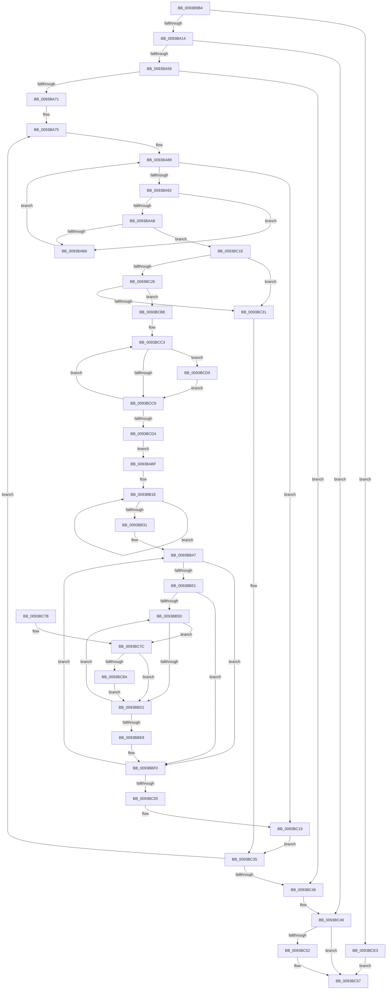

# PfSnPrefetchMetadata

- RVA: `0x0093B9B4`–`0x0093BCED` (길이 `825` bytes)
- VA: `0x000000014093B9B4`
- 실행 섹션: `PAGE`
- PDB 이름 있음: `예`; PDB Function 태그: `아니요`
- unwind 정보 RVA: `0x0008FE34`
- 디코드: `226`개 명령, `825/825` bytes 표시
- 미해석 바이트: `0` (있으면 어셈블리에 `.byte`로 보존)

> 이 문서는 커널 이미지의 기계어와 PDB 기호를 분석해 생성했습니다. 4번과 5번은 함수 원형과 자료형을 바이너리 사용 방식에서 추정한 C 해석이며 원본 소스 복구 결과는 아닙니다.

## 1. Dependencies

- 직접 호출 지점: **8**; 고유 호출 대상: **7**
- 직접 호출자로 확인된 함수: **1**
- RIP 상대 이미지 참조: **0**

### Outgoing calls
- `0x0093BA06` → [PfSnLogPrefetchMetadata](PfSnLogPrefetchMetadata_function_0093B3E4.md) (function, `0x0093B3E4`)
- `0x0093BA47` → [NtCreateEvent](../8B/NtCreateEvent_function_008B9140.md) (function, `0x008B9140`)
- `0x0093BA9D` → [wcsncmp](../../text/50/wcsncmp_function_00501CA0.md) (function, `0x00501CA0`)
- `0x0093BAD8` → [PfSnPrefetchFileMetadata](../8A/PfSnPrefetchFileMetadata_function_008AA178.md) (function, `0x008AA178`)
- `0x0093BB6F` → [RtlInitUnicodeString](../../text/42/RtlInitUnicodeString_function_0042A780.md) (function, `0x0042A780`)
- `0x0093BBBF` → [PfpPrefetchEntireDirectory](PfpPrefetchEntireDirectory_function_0093B0FC.md) (function, `0x0093B0FC`)
- `0x0093BC52` → [NtClose](../86/NtClose_function_00868870.md) (function, `0x00868870`)
- `0x0093BC60` → [PfSnLogPrefetchMetadata](PfSnLogPrefetchMetadata_function_0093B3E4.md) (function, `0x0093B3E4`)

### Direct callers
- [PfSnAsyncPrefetchStep](PfSnAsyncPrefetchStep_function_0093B934.md) at `0x0093B952`

### Static image references
- 디코드된 RIP-relative 메모리 참조가 없습니다.

## 2. Other-region calls and transfers

- 다른 실행 섹션으로 향하는 call: **2**
  - `0x0093BA9D` → [wcsncmp](../../text/50/wcsncmp_function_00501CA0.md) (`PAGE` → `.text`)
  - `0x0093BB6F` → [RtlInitUnicodeString](../../text/42/RtlInitUnicodeString_function_0042A780.md) (`PAGE` → `.text`)
- 별도 외부 분기/꼬리 이동을 확인하지 못했습니다.

## 3. Assembly (complete function range)

```asm
0093B9B4  89 54 24 10                     mov dword ptr [rsp + 0x10], edx
0093B9B8  55                              push rbp
0093B9B9  53                              push rbx
0093B9BA  56                              push rsi
0093B9BB  57                              push rdi
0093B9BC  41 54                           push r12
0093B9BE  41 55                           push r13
0093B9C0  41 56                           push r14
0093B9C2  41 57                           push r15
0093B9C4  48 8D 6C 24 E1                  lea rbp, [rsp - 0x1f]
0093B9C9  48 81 EC A8 00 00 00            sub rsp, 0xa8
0093B9D0  48 8B 31                        mov rsi, qword ptr [rcx]
0093B9D3  45 33 FF                        xor r15d, r15d
0093B9D6  4C 8B F1                        mov r14, rcx
0093B9D9  44 89 7D C3                     mov dword ptr [rbp - 0x3d], r15d
0093B9DD  33 C0                           xor eax, eax
0093B9DF  44 89 7D DB                     mov dword ptr [rbp - 0x25], r15d
0093B9E3  0F 57 C0                        xorps xmm0, xmm0
0093B9E6  48 89 45 B7                     mov qword ptr [rbp - 0x49], rax
0093B9EA  0F 57 C9                        xorps xmm1, xmm1
0093B9ED  48 89 75 F7                     mov qword ptr [rbp - 9], rsi
0093B9F1  48 8B CE                        mov rcx, rsi
0093B9F4  4C 89 7D 7F                     mov qword ptr [rbp + 0x7f], r15
0093B9F8  41 B0 01                        mov r8b, 1
0093B9FB  44 8B EA                        mov r13d, edx
0093B9FE  0F 11 45 07                     movups xmmword ptr [rbp + 7], xmm0
0093BA02  0F 11 4D A7                     movups xmmword ptr [rbp - 0x59], xmm1
0093BA06  E8 D9 F9 FF FF                  call 0x14093b3e4
0093BA0B  48 85 F6                        test rsi, rsi
0093BA0E  0F 84 CF 02 00 00               je 0x14093bce3
0093BA14  0F 57 C0                        xorps xmm0, xmm0
0093BA17  C7 45 BF 30 00 00 00            mov dword ptr [rbp - 0x41], 0x30
0093BA1E  45 33 C9                        xor r9d, r9d
0093BA21  4C 89 7D C7                     mov qword ptr [rbp - 0x39], r15
0093BA25  4C 8D 45 BF                     lea r8, [rbp - 0x41]
0093BA29  C7 45 D7 00 02 00 00            mov dword ptr [rbp - 0x29], 0x200
0093BA30  BA 03 00 1F 00                  mov edx, 0x1f0003
0093BA35  4C 89 7D CF                     mov qword ptr [rbp - 0x31], r15
0093BA39  48 8D 4D 7F                     lea rcx, [rbp + 0x7f]
0093BA3D  44 88 7C 24 20                  mov byte ptr [rsp + 0x20], r15b
0093BA42  F3 0F 7F 45 DF                  movdqu xmmword ptr [rbp - 0x21], xmm0
0093BA47  E8 F4 D6 F7 FF                  call 0x1408b9140
0093BA4C  8B D8                           mov ebx, eax
0093BA4E  85 C0                           test eax, eax
0093BA50  0F 88 F3 01 00 00               js 0x14093bc49
0093BA56  44 8B 66 6C                     mov r12d, dword ptr [rsi + 0x6c]
0093BA5A  4C 03 E6                        add r12, rsi
0093BA5D  41 8B C7                        mov eax, r15d
0093BA60  4C 89 65 FF                     mov qword ptr [rbp - 1], r12
0093BA64  89 45 77                        mov dword ptr [rbp + 0x77], eax
0093BA67  44 39 7E 70                     cmp dword ptr [rsi + 0x70], r15d
0093BA6B  0F 86 D5 01 00 00               jbe 0x14093bc46
0093BA71  49 8D 4E 28                     lea rcx, [r14 + 0x28]
0093BA75  48 8B 19                        mov rbx, qword ptr [rcx]
0093BA78  48 8D 3C 40                     lea rdi, [rax + rax*2]
0093BA7C  48 C1 E7 05                     shl rdi, 5
0093BA80  49 03 FC                        add rdi, r12
0093BA83  44 8B 3F                        mov r15d, dword ptr [rdi]
0093BA86  4D 03 FC                        add r15, r12
0093BA89  48 3B D9                        cmp rbx, rcx
0093BA8C  0F 84 87 01 00 00               je 0x14093bc19
0093BA92  44 8B 43 18                     mov r8d, dword ptr [rbx + 0x18]
0093BA96  49 8B CF                        mov rcx, r15
0093BA99  48 8B 53 10                     mov rdx, qword ptr [rbx + 0x10]
0093BA9D  E8 FE 61 BC FF                  call 0x140501ca0
0093BAA2  33 C9                           xor ecx, ecx
0093BAA4  85 C0                           test eax, eax
0093BAA6  75 0E                           jne 0x14093bab6
0093BAA8  8B 43 18                        mov eax, dword ptr [rbx + 0x18]
0093BAAB  66 41 39 0C 47                  cmp word ptr [r15 + rax*2], cx
0093BAB0  0F 84 68 01 00 00               je 0x14093bc1e
0093BAB6  48 8B 1B                        mov rbx, qword ptr [rbx]
0093BAB9  49 8D 4E 28                     lea rcx, [r14 + 0x28]
0093BABD  EB CA                           jmp 0x14093ba89
0093BABF  48 8B 45 7F                     mov rax, qword ptr [rbp + 0x7f]
0093BAC3  49 8B CE                        mov rcx, r14
0093BAC6  44 8B 4B 68                     mov r9d, dword ptr [rbx + 0x68]
0093BACA  48 8B 53 20                     mov rdx, qword ptr [rbx + 0x20]
0093BACE  48 89 44 24 28                  mov qword ptr [rsp + 0x28], rax
0093BAD3  44 89 7C 24 20                  mov dword ptr [rsp + 0x20], r15d
0093BAD8  E8 9B E6 F6 FF                  call 0x1408aa178
0093BADD  44 01 7B 68                     add dword ptr [rbx + 0x68], r15d
0093BAE1  45 33 C0                        xor r8d, r8d
0093BAE4  49 8B 56 50                     mov rdx, qword ptr [r14 + 0x50]
0093BAE8  41 B9 00 03 00 00               mov r9d, 0x300
0093BAEE  48 89 55 EF                     mov qword ptr [rbp - 0x11], rdx
0093BAF2  C7 02 04 00 00 00               mov dword ptr [rdx], 4
0093BAF8  41 8B 4E 64                     mov ecx, dword ptr [r14 + 0x64]
0093BAFC  41 8B 46 60                     mov eax, dword ptr [r14 + 0x60]
0093BB00  83 E1 07                        and ecx, 7
0093BB03  83 C9 08                        or ecx, 8
0093BB06  44 89 4A 04                     mov dword ptr [rdx + 4], r9d
0093BB0A  C1 E1 03                        shl ecx, 3
0093BB0D  83 E0 07                        and eax, 7
0093BB10  48 0B C8                        or rcx, rax
0093BB13  48 89 4A 08                     mov qword ptr [rdx + 8], rcx
0093BB17  41 8B C8                        mov ecx, r8d
0093BB1A  48 83 C2 10                     add rdx, 0x10
0093BB1E  8B C1                           mov eax, ecx
0093BB20  FF C1                           inc ecx
0093BB22  C1 E0 0C                        shl eax, 0xc
0093BB25  48 89 02                        mov qword ptr [rdx], rax
0093BB28  48 8D 52 08                     lea rdx, [rdx + 8]
0093BB2C  41 3B C9                        cmp ecx, r9d
0093BB2F  72 ED                           jb 0x14093bb1e
0093BB31  4C 8B 6B 60                     mov r13, qword ptr [rbx + 0x60]
0093BB35  45 8B F8                        mov r15d, r8d
0093BB38  8B 45 6F                        mov eax, dword ptr [rbp + 0x6f]
0093BB3B  48 83 C7 40                     add rdi, 0x40
0093BB3F  4C 8B 65 EF                     mov r12, qword ptr [rbp - 0x11]
0093BB43  44 89 45 67                     mov dword ptr [rbp + 0x67], r8d
0093BB47  44 0F A3 F8                     bt eax, r15d
0093BB4B  0F 83 9F 00 00 00               jae 0x14093bbf0
0093BB51  41 8B F0                        mov esi, r8d
0093BB54  44 39 07                        cmp dword ptr [rdi], r8d
0093BB57  0F 86 93 00 00 00               jbe 0x14093bbf0
0093BB5D  8B 43 18                        mov eax, dword ptr [rbx + 0x18]
0093BB60  48 8D 4D 07                     lea rcx, [rbp + 7]
0093BB64  48 8D 14 45 04 00 00 00         lea rdx, [rax*2 + 4]
0093BB6C  49 03 D5                        add rdx, r13
0093BB6F  E8 0C EC AE FF                  call 0x14042a780
0093BB74  48 8B 43 40                     mov rax, qword ptr [rbx + 0x40]
0093BB78  4C 8D 4D A7                     lea r9, [rbp - 0x59]
0093BB7C  49 8B 4E 08                     mov rcx, qword ptr [r14 + 8]
0093BB80  48 8D 53 20                     lea rdx, [rbx + 0x20]
0093BB84  48 89 45 C7                     mov qword ptr [rbp - 0x39], rax
0093BB88  0F 57 C0                        xorps xmm0, xmm0
0093BB8B  48 8D 45 07                     lea rax, [rbp + 7]
0093BB8F  C7 45 BF 30 00 00 00            mov dword ptr [rbp - 0x41], 0x30
0093BB96  48 89 45 CF                     mov qword ptr [rbp - 0x31], rax
0093BB9A  0F 57 C9                        xorps xmm1, xmm1
0093BB9D  33 C0                           xor eax, eax
0093BB9F  C7 45 D7 40 02 00 00            mov dword ptr [rbp - 0x29], 0x240
0093BBA6  48 89 45 B7                     mov qword ptr [rbp - 0x49], rax
0093BBAA  4D 8B C4                        mov r8, r12
0093BBAD  48 8D 45 BF                     lea rax, [rbp - 0x41]
0093BBB1  48 89 44 24 20                  mov qword ptr [rsp + 0x20], rax
0093BBB6  F3 0F 7F 45 DF                  movdqu xmmword ptr [rbp - 0x21], xmm0
0093BBBB  0F 11 4D A7                     movups xmmword ptr [rbp - 0x59], xmm1
0093BBBF  E8 38 F5 FF FF                  call 0x14093b0fc
0093BBC4  45 33 C0                        xor r8d, r8d
0093BBC7  4C 39 45 A7                     cmp qword ptr [rbp - 0x59], r8
0093BBCB  0F 85 AB 00 00 00               jne 0x14093bc7c
0093BBD1  41 0F B7 45 00                  movzx eax, word ptr [r13]
0093BBD6  FF C6                           inc esi
0093BBD8  4D 8D 6C 45 00                  lea r13, [r13 + rax*2]
0093BBDD  49 83 C5 04                     add r13, 4
0093BBE1  3B 37                           cmp esi, dword ptr [rdi]
0093BBE3  0F 82 74 FF FF FF               jb 0x14093bb5d
0093BBE9  44 8B 7D 67                     mov r15d, dword ptr [rbp + 0x67]
0093BBED  8B 45 6F                        mov eax, dword ptr [rbp + 0x6f]
0093BBF0  41 FF C7                        inc r15d
0093BBF3  48 83 C7 04                     add rdi, 4
0093BBF7  44 89 7D 67                     mov dword ptr [rbp + 0x67], r15d
0093BBFB  41 83 FF 07                     cmp r15d, 7
0093BBFF  0F 82 42 FF FF FF               jb 0x14093bb47
0093BC05  48 8B 75 F7                     mov rsi, qword ptr [rbp - 9]
0093BC09  49 8D 4E 28                     lea rcx, [r14 + 0x28]
0093BC0D  4C 8B 65 FF                     mov r12, qword ptr [rbp - 1]
0093BC11  4C 89 6B 60                     mov qword ptr [rbx + 0x60], r13
0093BC15  44 8B 6D 6F                     mov r13d, dword ptr [rbp + 0x6f]
0093BC19  45 33 FF                        xor r15d, r15d
0093BC1C  EB 17                           jmp 0x14093bc35
0093BC1E  45 33 FF                        xor r15d, r15d
0093BC21  48 85 DB                        test rbx, rbx
0093BC24  74 0B                           je 0x14093bc31
0093BC26  8B 43 6C                        mov eax, dword ptr [rbx + 0x6c]
0093BC29  A8 01                           test al, 1
0093BC2B  0F 85 87 00 00 00               jne 0x14093bcb8
0093BC31  49 8D 4E 28                     lea rcx, [r14 + 0x28]
0093BC35  8B 45 77                        mov eax, dword ptr [rbp + 0x77]
0093BC38  FF C0                           inc eax
0093BC3A  89 45 77                        mov dword ptr [rbp + 0x77], eax
0093BC3D  3B 46 70                        cmp eax, dword ptr [rsi + 0x70]
0093BC40  0F 82 2F FE FF FF               jb 0x14093ba75
0093BC46  41 8B DF                        mov ebx, r15d
0093BC49  48 8B 4D 7F                     mov rcx, qword ptr [rbp + 0x7f]
0093BC4D  48 85 C9                        test rcx, rcx
0093BC50  74 05                           je 0x14093bc57
0093BC52  E8 19 CC F2 FF                  call 0x140868870
0093BC57  45 33 C0                        xor r8d, r8d
0093BC5A  41 8B D5                        mov edx, r13d
0093BC5D  48 8B CE                        mov rcx, rsi
0093BC60  E8 7F F7 FF FF                  call 0x14093b3e4
0093BC65  8B C3                           mov eax, ebx
0093BC67  48 81 C4 A8 00 00 00            add rsp, 0xa8
0093BC6E  41 5F                           pop r15
0093BC70  41 5E                           pop r14
0093BC72  41 5D                           pop r13
0093BC74  41 5C                           pop r12
0093BC76  5F                              pop rdi
0093BC77  5E                              pop rsi
0093BC78  5B                              pop rbx
0093BC79  5D                              pop rbp
0093BC7A  C3                              ret
0093BC7B  CC                              int3
0093BC7C  41 8B 46 78                     mov eax, dword ptr [r14 + 0x78]
0093BC80  41 3B 46 7C                     cmp eax, dword ptr [r14 + 0x7c]
0093BC84  0F 83 47 FF FF FF               jae 0x14093bbd1
0093BC8A  41 8B 46 78                     mov eax, dword ptr [r14 + 0x78]
0093BC8E  0F 10 45 A7                     movups xmm0, xmmword ptr [rbp - 0x59]
0093BC92  F2 0F 10 4D B7                  movsd xmm1, qword ptr [rbp - 0x49]
0093BC97  48 8D 14 40                     lea rdx, [rax + rax*2]
0093BC9B  49 8B 46 70                     mov rax, qword ptr [r14 + 0x70]
0093BC9F  0F 11 04 D0                     movups xmmword ptr [rax + rdx*8], xmm0
0093BCA3  F2 0F 11 4C D0 10               movsd qword ptr [rax + rdx*8 + 0x10], xmm1
0093BCA9  41 8B 46 78                     mov eax, dword ptr [r14 + 0x78]
0093BCAD  FF C0                           inc eax
0093BCAF  41 89 46 78                     mov dword ptr [r14 + 0x78], eax
0093BCB3  E9 19 FF FF FF                  jmp 0x14093bbd1
0093BCB8  44 8B 47 14                     mov r8d, dword ptr [rdi + 0x14]
0093BCBC  48 8D 57 24                     lea rdx, [rdi + 0x24]
0093BCC0  4D 03 C4                        add r8, r12
0093BCC3  41 0F A3 CD                     bt r13d, ecx
0093BCC7  72 10                           jb 0x14093bcd9
0093BCC9  FF C1                           inc ecx
0093BCCB  48 83 C2 04                     add rdx, 4
0093BCCF  83 F9 07                        cmp ecx, 7
0093BCD2  72 EF                           jb 0x14093bcc3
0093BCD4  E9 E6 FD FF FF                  jmp 0x14093babf
0093BCD9  8B 42 1C                        mov eax, dword ptr [rdx + 0x1c]
0093BCDC  03 02                           add eax, dword ptr [rdx]
0093BCDE  44 03 F8                        add r15d, eax
0093BCE1  EB E6                           jmp 0x14093bcc9
0093BCE3  BB 0D 00 00 C0                  mov ebx, 0xc000000d
0093BCE8  E9 6A FF FF FF                  jmp 0x14093bc57
```

## 4. C-style interpretation (structured pseudocode)

```c
__int64 __fastcall PfSnPrefetchMetadata(__int64 a1, int a2, __int64 a3, int a4)
{
    __int64 result;
    __int64 v_r12;
    __int64 v_r13;
    __int64 v_r15;
    __int64 v_rdi;
    __int64 v_rsi;
    __int64 v_rsp;
    unsigned __int64 v_stack_m58;
    unsigned __int64 v_stack_m5F;
    unsigned __int64 v_stack_m60;
    unsigned __int64 v_stack_m68;
    unsigned __int64 v_stack_m70;
    unsigned __int64 v_stack_m80;
    unsigned int v_stack_m84;
    unsigned int v_stack_m88;
    unsigned __int64 v_stack_m90;
    unsigned __int64 v_stack_m98;
    unsigned int v_stack_m9C;
    unsigned int v_stack_mA0;
    unsigned __int64 v_stack_mA8;
    unsigned __int64 v_stack_mB8;
    unsigned __int64 v_stack_mC0;
    unsigned __int8 v_stack_mC8;
    unsigned int v_stack_p10;
    unsigned int v_stack_p18;
    unsigned __int64 v_stack_p20;
    unsigned int v_stack_p8;

    v_stack_p10 = a2;
    v_rsp = (v_rsp) - (168);
    v_r15 = 0;
    v_stack_m9C = 0;
    result = 0;
    v_stack_m84 = 0;
    v_stack_mA8 = 0;
    v_stack_m68 = *(unsigned __int64 *)(a1);
    v_stack_p20 = 0;
    v_stack_m58 = v_xmm0;
    v_stack_mB8 = v_xmm1;
    result = PfSnLogPrefetchMetadata(*(unsigned __int64 *)(a1), a2, 1, a4);
    if (*(unsigned __int64 *)(a1) == 0) goto loc_0093BCE3;
    v_stack_mA0 = 48;
    a4 = 0;
    v_stack_m98 = 0;
    v_stack_m88 = 512;
    v_stack_m90 = 0;
    v_stack_mC8 = 0;
    v_stack_m80 = v_xmm0;
    result = NtCreateEvent(v_stack_p20, (unsigned int)(0x1F0003ULL), v_stack_mA0, a4);
    if (sign_flag) goto loc_0093BC49;
    v_r12 = ((unsigned int)(*(unsigned int *)(*(unsigned __int64 *)(a1) + 108))) + (*(unsigned __int64 *)(a1));
    v_stack_m60 = v_r12;
    v_stack_p18 = 0;
    if ((*(unsigned int *)(*(unsigned __int64 *)(a1) + 112)) <= 0) goto loc_0093BC46;
loc_0093BA75:
    v_rdi = (0 + 0 * 2) << (5);
    v_rdi = (v_rdi) + (v_r12);
    v_r15 = ((unsigned int)(*(unsigned int *)(v_rdi))) + (v_r12);
loc_0093BA89:
    if ((*(unsigned __int64 *)(a1 + 40)) == (a1 + 40)) goto loc_0093BC19;
    result = wcsncmp(v_r15, *(unsigned __int64 *)(*(unsigned __int64 *)(a1 + 40) + 16), (unsigned int)(*(unsigned int *)(*(unsigned __int64 *)(a1 + 40) + 24)), a4);
    a1 = 0;
    if ((unsigned int)(result) != 0) goto loc_0093BAB6;
    if ((*(unsigned __int16 *)(v_r15 + (unsigned int)(*(unsigned int *)(*(unsigned __int64 *)(a1 + 40) + 24)) * 2)) == 0) goto loc_0093BC1E;
loc_0093BAB6:
    goto loc_0093BA89;
loc_0093BABF:
    v_stack_mC0 = v_stack_p20;
    v_stack_mC8 = (unsigned int)(v_r15);
    result = PfSnPrefetchFileMetadata(0, *(unsigned __int64 *)(*(unsigned __int64 *)(*(unsigned __int64 *)(a1 + 40)) + 32), (unsigned int)(*(unsigned int *)(*(unsigned __int64 *)(a1 + 40) + 24)), (unsigned int)(*(unsigned int *)(*(unsigned __int64 *)(*(unsigned __int64 *)(a1 + 40)) + 104)));
    a3 = 0;
    v_stack_m70 = *(unsigned __int64 *)(a1 + 80);
    *(unsigned int *)(*(unsigned __int64 *)(a1 + 80)) = 4;
    a1 = (unsigned int)(((unsigned int)(*(unsigned int *)(a1 + 100))) & (7));
    a1 = (unsigned int)((a1) | (8));
    *(unsigned int *)(*(unsigned __int64 *)(a1 + 80) + 4) = 768;
    a1 = (unsigned int)((a1) << (3));
    result = (unsigned int)(((unsigned int)(*(unsigned int *)(a1 + 96))) & (7));
    a1 = (a1) | (result);
    *(unsigned __int64 *)(*(unsigned __int64 *)(a1 + 80) + 8) = a1;
    a2 = (*(unsigned __int64 *)(a1 + 80)) + (16);
loc_0093BB1E:
    a1 = (unsigned int)((0) + 1);
    result = (unsigned int)((0) << (12));
    *(unsigned __int64 *)(a2) = result;
    if (((unsigned int)(a1)) < 768) goto loc_0093BB1E;
    v_rdi = (v_rdi) + (64);
    v_stack_p8 = 0;
loc_0093BB47:
    if (condition_is_above_or_equal) goto loc_0093BBF0;
    if ((*(unsigned int *)(v_rdi)) <= 0) goto loc_0093BBF0;
loc_0093BB5D:
    a2 = ((unsigned int)(*(unsigned int *)(*(unsigned __int64 *)(*(unsigned __int64 *)(a1 + 40)) + 24)) * 2 + 4) + (*(unsigned __int64 *)(*(unsigned __int64 *)(*(unsigned __int64 *)(a1 + 40)) + 96));
    result = RtlInitUnicodeString(v_stack_m58, a2, a3, 768);
    v_stack_m98 = *(unsigned __int64 *)(*(unsigned __int64 *)(*(unsigned __int64 *)(a1 + 40)) + 64);
    v_stack_mA0 = 48;
    v_stack_m90 = v_stack_m58;
    result = 0;
    v_stack_m88 = 576;
    v_stack_mA8 = 0;
    v_stack_mC8 = v_stack_mA0;
    v_stack_m80 = v_xmm0;
    v_stack_mB8 = v_xmm1;
    result = PfpPrefetchEntireDirectory(*(unsigned __int64 *)(a1 + 8), *(unsigned __int64 *)(*(unsigned __int64 *)(a1 + 40)) + 32, v_stack_m70, v_stack_mB8);
    a3 = 0;
    if (v_stack_mB8 != 0) goto loc_0093BC7C;
loc_0093BBD1:
    v_rsi = (unsigned int)((0) + 1);
    v_r13 = (*(unsigned __int64 *)(*(unsigned __int64 *)(*(unsigned __int64 *)(a1 + 40)) + 96) + *(unsigned __int16 *)(*(unsigned __int64 *)(*(unsigned __int64 *)(*(unsigned __int64 *)(a1 + 40)) + 96)) * 2) + (4);
    if (((unsigned int)(v_rsi)) < (*(unsigned int *)(v_rdi))) goto loc_0093BB5D;
loc_0093BBF0:
    v_r15 = (unsigned int)(((unsigned int)(v_stack_p8)) + 1);
    v_rdi = (v_rdi) + (4);
    v_stack_p8 = (unsigned int)(v_r15);
    if (((unsigned int)(v_r15)) < 7) goto loc_0093BB47;
    *(unsigned __int64 *)(*(unsigned __int64 *)(*(unsigned __int64 *)(a1 + 40)) + 96) = v_r13;
loc_0093BC19:
    v_r15 = 0;
    goto loc_0093BC35;
loc_0093BC1E:
    v_r15 = 0;
    if (*(unsigned __int64 *)(*(unsigned __int64 *)(a1 + 40)) == 0) goto loc_0093BC31;
    if ((((unsigned __int8)((unsigned int)(*(unsigned int *)(*(unsigned __int64 *)(*(unsigned __int64 *)(a1 + 40)) + 108)))) & (1)) != 0) goto loc_0093BCB8;
loc_0093BC31:
loc_0093BC35:
    result = (unsigned int)(((unsigned int)(v_stack_p18)) + 1);
    v_stack_p18 = (unsigned int)(result);
    if (((unsigned int)(result)) < (*(unsigned int *)(v_stack_m68 + 112))) goto loc_0093BA75;
loc_0093BC46:
loc_0093BC49:
    if (v_stack_p20 != 0) {
        result = NtClose(v_stack_p20, *(unsigned __int64 *)(*(unsigned __int64 *)(a1 + 40)) + 32, a3, v_stack_mB8);
    }
    a3 = 0;
    result = PfSnLogPrefetchMetadata(v_stack_m68, (unsigned int)((unsigned int)((unsigned int)(v_stack_p10))), a3, v_stack_mB8);
    v_rsp = (v_rsp) + (168);
    return 0;
loc_0093BC7C:
    if (((unsigned int)((unsigned int)(*(unsigned int *)(a1 + 120)))) >= (*(unsigned int *)(a1 + 124))) goto loc_0093BBD1;
    *(unsigned __int64 *)(*(unsigned __int64 *)(a1 + 112) + (unsigned int)(*(unsigned int *)(a1 + 120)) + (unsigned int)(*(unsigned int *)(a1 + 120)) * 2 * 8) = v_xmm0;
    *(unsigned __int64 *)(*(unsigned __int64 *)(a1 + 112) + (unsigned int)(*(unsigned int *)(a1 + 120)) + (unsigned int)(*(unsigned int *)(a1 + 120)) * 2 * 8 + 16) = v_xmm1;
    result = (unsigned int)(((unsigned int)(*(unsigned int *)(a1 + 120))) + 1);
    *(unsigned int *)(a1 + 120) = (unsigned int)(result);
    goto loc_0093BBD1;
loc_0093BCB8:
    a3 = ((unsigned int)(*(unsigned int *)(v_rdi + 20))) + (v_stack_m60);
loc_0093BCC3:
    if (condition_is_below) goto loc_0093BCD9;
loc_0093BCC9:
    a1 = (unsigned int)((v_stack_m68) + 1);
    a2 = (v_rdi + 36) + (4);
    if (((unsigned int)(a1)) < 7) goto loc_0093BCC3;
    goto loc_0093BABF;
loc_0093BCD9:
    result = (unsigned int)(((unsigned int)(*(unsigned int *)(a2 + 28))) + (*(unsigned int *)(a2)));
    v_r15 = (unsigned int)((v_r15) + ((unsigned int)(result)));
    goto loc_0093BCC9;
loc_0093BCE3:
    goto loc_0093BC57;
}
```

## 5. (Beta) C Style

```c
int64_t PfSnPrefetchMetadata(void *Arg1, int32_t Arg2, int64_t Arg3, int32_t Arg4)
{
    uint8_t *arg1 = (uint8_t *)Arg1;

    int64_t result;
    int64_t local_r12;
    int64_t local_r13;
    int64_t local_r15;
    int64_t local_rdi;
    int64_t local_rsi;
    int64_t local_rsp;
    uint64_t v_stack_m58;
    uint64_t v_stack_m5F;
    uint64_t v_stack_m60;
    uint64_t v_stack_m68;
    uint64_t v_stack_m70;
    uint64_t v_stack_m80;
    uint32_t v_stack_m84;
    uint32_t v_stack_m88;
    uint64_t v_stack_m90;
    uint64_t v_stack_m98;
    uint32_t v_stack_m9C;
    uint32_t v_stack_mA0;
    uint64_t v_stack_mA8;
    uint64_t v_stack_mB8;
    uint64_t v_stack_mC0;
    uint8_t v_stack_mC8;
    uint32_t v_stack_p10;
    uint32_t v_stack_p18;
    uint64_t v_stack_p20;
    uint32_t v_stack_p8;

    v_stack_p10 = Arg2;
    local_rsp = (local_rsp) - (168);
    local_r15 = 0;
    v_stack_m9C = 0;
    result = 0;
    v_stack_m84 = 0;
    v_stack_mA8 = 0;
    v_stack_m68 = *(uint64_t *)(arg1);
    v_stack_p20 = 0;
    v_stack_m58 = v_xmm0;
    v_stack_mB8 = v_xmm1;
    result = PfSnLogPrefetchMetadata(*(uint64_t *)(arg1), Arg2, 1, Arg4);
    if (*(uint64_t *)(arg1) == 0) goto loc_0093BCE3;
    v_stack_mA0 = 48;
    Arg4 = 0;
    v_stack_m98 = 0;
    v_stack_m88 = 512;
    v_stack_m90 = 0;
    v_stack_mC8 = 0;
    v_stack_m80 = v_xmm0;
    result = NtCreateEvent(v_stack_p20, (uint32_t)(0x1F0003ULL), v_stack_mA0, Arg4);
    if (sign_flag) goto loc_0093BC49;
    local_r12 = ((uint32_t)(*(uint32_t *)(*(uint64_t *)(arg1) + 0x6C))) + (*(uint64_t *)(arg1));
    v_stack_m60 = local_r12;
    v_stack_p18 = 0;
    if ((*(uint32_t *)(*(uint64_t *)(arg1) + 0x70)) <= 0) goto loc_0093BC46;
loc_0093BA75:
    local_rdi = (0 + 0 * 2) << (5);
    local_rdi = (local_rdi) + (local_r12);
    local_r15 = ((uint32_t)(*(uint32_t *)(local_rdi))) + (local_r12);
loc_0093BA89:
    if ((*(uint64_t *)(arg1 + 0x28)) == (Arg1 + 40)) goto loc_0093BC19;
    result = wcsncmp(local_r15, *(uint64_t *)(*(uint64_t *)(arg1 + 0x28) + 0x10), (uint32_t)(*(uint32_t *)(*(uint64_t *)(arg1 + 0x28) + 0x18)), Arg4);
    Arg1 = 0;
    if ((uint32_t)(result) != 0) goto loc_0093BAB6;
    if ((*(uint16_t *)(local_r15 + (uint32_t)(*(uint32_t *)(*(uint64_t *)(arg1 + 0x28) + 0x18)) * 2)) == 0) goto loc_0093BC1E;
loc_0093BAB6:
    goto loc_0093BA89;
loc_0093BABF:
    v_stack_mC0 = v_stack_p20;
    v_stack_mC8 = (uint32_t)(local_r15);
    result = PfSnPrefetchFileMetadata(0, *(uint64_t *)(*(uint64_t *)(*(uint64_t *)(arg1 + 0x28)) + 0x20), (uint32_t)(*(uint32_t *)(*(uint64_t *)(arg1 + 0x28) + 0x18)), (uint32_t)(*(uint32_t *)(*(uint64_t *)(*(uint64_t *)(arg1 + 0x28)) + 0x68)));
    Arg3 = 0;
    v_stack_m70 = *(uint64_t *)(arg1 + 0x50);
    *(uint32_t *)(*(uint64_t *)(arg1 + 0x50)) = 4;
    Arg1 = (uint32_t)(((uint32_t)(*(uint32_t *)(arg1 + 0x64))) & (7));
    Arg1 = (uint32_t)((Arg1) | (8));
    *(uint32_t *)(*(uint64_t *)(arg1 + 0x50) + 0x4) = 768;
    Arg1 = (uint32_t)((Arg1) << (3));
    result = (uint32_t)(((uint32_t)(*(uint32_t *)(arg1 + 0x60))) & (7));
    Arg1 = (Arg1) | (result);
    *(void **)(*(uint64_t *)(arg1 + 0x50) + 0x8) = Arg1;
    Arg2 = (*(uint64_t *)(arg1 + 0x50)) + (16);
loc_0093BB1E:
    Arg1 = (uint32_t)((0) + 1);
    result = (uint32_t)((0) << (12));
    *(uint64_t *)(Arg2) = result;
    if (((uint32_t)(Arg1)) < 768) goto loc_0093BB1E;
    local_rdi = (local_rdi) + (64);
    v_stack_p8 = 0;
loc_0093BB47:
    if (condition_is_above_or_equal) goto loc_0093BBF0;
    if ((*(uint32_t *)(local_rdi)) <= 0) goto loc_0093BBF0;
loc_0093BB5D:
    Arg2 = ((uint32_t)(*(uint32_t *)(*(uint64_t *)(*(uint64_t *)(arg1 + 0x28)) + 0x18)) * 2 + 4) + (*(uint64_t *)(*(uint64_t *)(*(uint64_t *)(arg1 + 0x28)) + 0x60));
    result = RtlInitUnicodeString(v_stack_m58, Arg2, Arg3, 768);
    v_stack_m98 = *(uint64_t *)(*(uint64_t *)(*(uint64_t *)(arg1 + 0x28)) + 0x40);
    v_stack_mA0 = 48;
    v_stack_m90 = v_stack_m58;
    result = 0;
    v_stack_m88 = 576;
    v_stack_mA8 = 0;
    v_stack_mC8 = v_stack_mA0;
    v_stack_m80 = v_xmm0;
    v_stack_mB8 = v_xmm1;
    result = PfpPrefetchEntireDirectory(*(uint64_t *)(arg1 + 0x8), *(uint64_t *)(*(uint64_t *)(arg1 + 0x28)) + 32, v_stack_m70, v_stack_mB8);
    Arg3 = 0;
    if (v_stack_mB8 != 0) goto loc_0093BC7C;
loc_0093BBD1:
    local_rsi = (uint32_t)((0) + 1);
    local_r13 = (*(uint64_t *)(*(uint64_t *)(*(uint64_t *)(arg1 + 0x28)) + 0x60) + *(uint16_t *)(*(uint64_t *)(*(uint64_t *)(*(uint64_t *)(arg1 + 0x28)) + 0x60)) * 2) + (4);
    if (((uint32_t)(local_rsi)) < (*(uint32_t *)(local_rdi))) goto loc_0093BB5D;
loc_0093BBF0:
    local_r15 = (uint32_t)(((uint32_t)(v_stack_p8)) + 1);
    local_rdi = (local_rdi) + (4);
    v_stack_p8 = (uint32_t)(local_r15);
    if (((uint32_t)(local_r15)) < 7) goto loc_0093BB47;
    *(uint64_t *)(*(uint64_t *)(*(uint64_t *)(arg1 + 0x28)) + 0x60) = local_r13;
loc_0093BC19:
    local_r15 = 0;
    goto loc_0093BC35;
loc_0093BC1E:
    local_r15 = 0;
    if (*(uint64_t *)(*(uint64_t *)(arg1 + 0x28)) == 0) goto loc_0093BC31;
    if ((((uint8_t)((uint32_t)(*(uint32_t *)(*(uint64_t *)(*(uint64_t *)(arg1 + 0x28)) + 0x6C)))) & (1)) != 0) goto loc_0093BCB8;
loc_0093BC31:
loc_0093BC35:
    result = (uint32_t)(((uint32_t)(v_stack_p18)) + 1);
    v_stack_p18 = (uint32_t)(result);
    if (((uint32_t)(result)) < (*(uint32_t *)(v_stack_m68 + 0x70))) goto loc_0093BA75;
loc_0093BC46:
loc_0093BC49:
    if (v_stack_p20 != 0) {
        result = NtClose(v_stack_p20, *(uint64_t *)(*(uint64_t *)(arg1 + 0x28)) + 32, Arg3, v_stack_mB8);
    }
    Arg3 = 0;
    result = PfSnLogPrefetchMetadata(v_stack_m68, (uint32_t)((uint32_t)((uint32_t)(v_stack_p10))), Arg3, v_stack_mB8);
    local_rsp = (local_rsp) + (168);
    return 0;
loc_0093BC7C:
    if (((uint32_t)((uint32_t)(*(uint32_t *)(arg1 + 0x78)))) >= (*(uint32_t *)(arg1 + 0x7C))) goto loc_0093BBD1;
    *(uint64_t *)(*(uint64_t *)(arg1 + 0x70) + (uint32_t)(*(uint32_t *)(arg1 + 0x78)) + (uint32_t)(*(uint32_t *)(arg1 + 0x78)) * 2 * 8) = v_xmm0;
    *(uint64_t *)(*(uint64_t *)(arg1 + 0x70) + (uint32_t)(*(uint32_t *)(arg1 + 0x78)) + (uint32_t)(*(uint32_t *)(arg1 + 0x78)) * 2 * 8 + 0x10) = v_xmm1;
    result = (uint32_t)(((uint32_t)(*(uint32_t *)(arg1 + 0x78))) + 1);
    *(uint32_t *)(arg1 + 0x78) = (uint32_t)(result);
    goto loc_0093BBD1;
loc_0093BCB8:
    Arg3 = ((uint32_t)(*(uint32_t *)(local_rdi + 0x14))) + (v_stack_m60);
loc_0093BCC3:
    if (condition_is_below) goto loc_0093BCD9;
loc_0093BCC9:
    Arg1 = (uint32_t)((v_stack_m68) + 1);
    Arg2 = (local_rdi + 36) + (4);
    if (((uint32_t)(Arg1)) < 7) goto loc_0093BCC3;
    goto loc_0093BABF;
loc_0093BCD9:
    result = (uint32_t)(((uint32_t)(*(uint32_t *)(Arg2 + 0x1C))) + (*(uint32_t *)(Arg2)));
    local_r15 = (uint32_t)((local_r15) + ((uint32_t)(result)));
    goto loc_0093BCC9;
loc_0093BCE3:
    goto loc_0093BC57;
}
```

### 관측된 메모리 오프셋

구조체 형식이 확인되지 않은 접근은 인자 기준의 오프셋으로만 기록했습니다.

| 기준 인자 | 오프셋 표현 | 폭 (bit) | 접근 |
|---|---:|---:|---|
| `Arg1` | `+ 0x0` | `64` | `R` |
| `Arg1` | `+ 0x8` | `64` | `R` |
| `Arg1` | `+ 0x28` | `64` | `R` |
| `Arg1` | `+ 0x50` | `64` | `R` |
| `Arg1` | `+ 0x60` | `32` | `R` |
| `Arg1` | `+ 0x64` | `32` | `R` |
| `Arg1` | `+ 0x70` | `64` | `R` |
| `Arg1` | `+ 0x78` | `32` | `R` |
| `Arg1` | `+ 0x78` | `32` | `W` |
| `Arg1` | `+ 0x7C` | `32` | `R` |

## 6. Execution-region graph

[열기: 2D/3D 그래프와 함수 탐색 컨트롤 패널](../../../control-panel.html?section=page&rva=0x0093B9B4&view=graph)

- 2D 그래프는 위에서 아래로 흐르고, 3D 그래프는 빈 공간을 드래그해 회전합니다. Shift+드래그는 이동, 휠은 확대·축소, 함수 노드 선택은 대상 보고서 이동입니다.

### Static fallback


