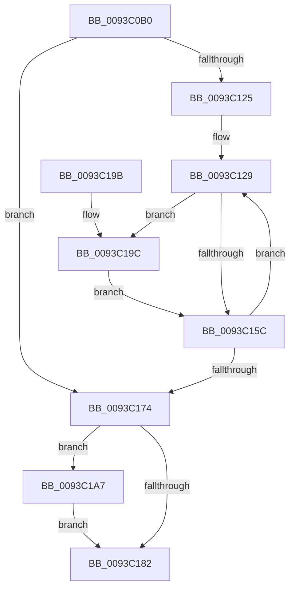

# PfSnPrefetchSectionsCleanup

- RVA: `0x0093C0B0`–`0x0093C1B5` (길이 `261` bytes)
- VA: `0x000000014093C0B0`
- 실행 섹션: `PAGE`
- PDB 이름 있음: `예`; PDB Function 태그: `아니요`
- unwind 정보 RVA: `0x0008FE8C`
- 디코드: `75`개 명령, `261/261` bytes 표시
- 미해석 바이트: `0` (있으면 어셈블리에 `.byte`로 보존)

> 이 문서는 커널 이미지의 기계어와 PDB 기호를 분석해 생성했습니다. 4번과 5번은 함수 원형과 자료형을 바이너리 사용 방식에서 추정한 C 해석이며 원본 소스 복구 결과는 아닙니다.

## 1. Dependencies

- 직접 호출 지점: **5**; 고유 호출 대상: **5**
- 직접 호출자로 확인된 함수: **1**
- RIP 상대 이미지 참조: **1**

### Outgoing calls
- `0x0093C0E8` → [memset](../../text/6C/memset_function_006C6C40.md) (function, `0x006C6C40`)
- `0x0093C114` → [KeQueryPriorityThread](../../text/38/KeQueryPriorityThread_function_0038F4F0.md) (function, `0x0038F4F0`)
- `0x0093C162` → [ExQueueWorkItem](../../text/2F/ExQueueWorkItem_function_002F9520.md) (function, `0x002F9520`)
- `0x0093C1A0` → [ExfAcquireRundownProtection](../../text/34/ExfAcquireRundownProtection_function_0034C050.md) (function, `0x0034C050`)
- `0x0093C1AE` → [ExfWaitForRundownProtectionRelease](../../text/2A/ExfWaitForRundownProtectionRelease_function_002A4CDC.md) (function, `0x002A4CDC`)

### Direct callers
- [PfSnPrefetchSections](PfSnPrefetchSections_function_0093BCF4.md) at `0x0093BED8`

### Static image references
- `0x0093C131` → RVA `0x008A8DA0` (`PfSnSectionInfoCleanupWorkItem`; read)

## 2. Other-region calls and transfers

- 다른 실행 섹션으로 향하는 call: **5**
  - `0x0093C0E8` → [memset](../../text/6C/memset_function_006C6C40.md) (`PAGE` → `.text`)
  - `0x0093C114` → [KeQueryPriorityThread](../../text/38/KeQueryPriorityThread_function_0038F4F0.md) (`PAGE` → `.text`)
  - `0x0093C162` → [ExQueueWorkItem](../../text/2F/ExQueueWorkItem_function_002F9520.md) (`PAGE` → `.text`)
  - `0x0093C1A0` → [ExfAcquireRundownProtection](../../text/34/ExfAcquireRundownProtection_function_0034C050.md) (`PAGE` → `.text`)
  - `0x0093C1AE` → [ExfWaitForRundownProtectionRelease](../../text/2A/ExfWaitForRundownProtectionRelease_function_002A4CDC.md) (`PAGE` → `.text`)
- 별도 외부 분기/꼬리 이동을 확인하지 못했습니다.

## 3. Assembly (complete function range)

```asm
0093C0B0  48 89 5C 24 10                  mov qword ptr [rsp + 0x10], rbx
0093C0B5  48 89 74 24 18                  mov qword ptr [rsp + 0x18], rsi
0093C0BA  55                              push rbp
0093C0BB  57                              push rdi
0093C0BC  41 54                           push r12
0093C0BE  41 56                           push r14
0093C0C0  41 57                           push r15
0093C0C2  48 8B EC                        mov rbp, rsp
0093C0C5  48 83 EC 50                     sub rsp, 0x50
0093C0C9  4C 8B 79 58                     mov r15, qword ptr [rcx + 0x58]
0093C0CD  8B FA                           mov edi, edx
0093C0CF  45 8B F0                        mov r14d, r8d
0093C0D2  48 8B D9                        mov rbx, rcx
0093C0D5  45 8B E0                        mov r12d, r8d
0093C0D8  33 D2                           xor edx, edx
0093C0DA  49 8B CF                        mov rcx, r15
0093C0DD  49 8B F1                        mov rsi, r9
0093C0E0  4F 8D 04 76                     lea r8, [r14 + r14*2]
0093C0E4  49 C1 E0 04                     shl r8, 4
0093C0E8  E8 53 AB D8 FF                  call 0x1406c6c40
0093C0ED  48 83 65 E8 00                  and qword ptr [rbp - 0x18], 0
0093C0F2  48 83 65 F4 00                  and qword ptr [rbp - 0xc], 0
0093C0F7  83 65 FC 00                     and dword ptr [rbp - 4], 0
0093C0FB  48 83 65 D0 00                  and qword ptr [rbp - 0x30], 0
0093C100  48 89 5D D8                     mov qword ptr [rbp - 0x28], rbx
0093C104  89 7D F0                        mov dword ptr [rbp - 0x10], edi
0093C107  48 89 75 E0                     mov qword ptr [rbp - 0x20], rsi
0093C10B  65 48 8B 0C 25 88 01 00 00      mov rcx, qword ptr gs:[0x188]
0093C114  E8 D7 33 A5 FF                  call 0x14038f4f0
0093C119  8B F8                           mov edi, eax
0093C11B  BE 01 00 00 00                  mov esi, 1
0093C120  45 85 F6                        test r14d, r14d
0093C123  74 4F                           je 0x14093c174
0093C125  49 8D 5F 10                     lea rbx, [r15 + 0x10]
0093C129  48 8D 45 D0                     lea rax, [rbp - 0x30]
0093C12D  48 89 43 10                     mov qword ptr [rbx + 0x10], rax
0093C131  48 8D 05 68 CC F6 FF            lea rax, [rip - 0x93398]
0093C138  48 83 63 F0 00                  and qword ptr [rbx - 0x10], 0
0093C13D  48 89 03                        mov qword ptr [rbx], rax
0093C140  4C 89 7B 08                     mov qword ptr [rbx + 8], r15
0093C144  0F 0D 4D D0                     prefetchw byte ptr [rbp - 0x30]
0093C148  48 8B 45 D0                     mov rax, qword ptr [rbp - 0x30]
0093C14C  48 83 E0 FE                     and rax, 0xfffffffffffffffe
0093C150  48 8D 48 02                     lea rcx, [rax + 2]
0093C154  F0 48 0F B1 4D D0               lock cmpxchg qword ptr [rbp - 0x30], rcx
0093C15A  75 40                           jne 0x14093c19c
0093C15C  8D 57 20                        lea edx, [rdi + 0x20]
0093C15F  49 8B CF                        mov rcx, r15
0093C162  E8 B9 D3 9B FF                  call 0x1402f9520
0093C167  49 83 C7 30                     add r15, 0x30
0093C16B  48 83 C3 30                     add rbx, 0x30
0093C16F  4C 2B E6                        sub r12, rsi
0093C172  75 B5                           jne 0x14093c129
0093C174  33 C0                           xor eax, eax
0093C176  F0 48 0F B1 75 D0               lock cmpxchg qword ptr [rbp - 0x30], rsi
0093C17C  48 83 F8 02                     cmp rax, 2
0093C180  73 25                           jae 0x14093c1a7
0093C182  4C 8D 5C 24 50                  lea r11, [rsp + 0x50]
0093C187  49 8B 5B 38                     mov rbx, qword ptr [r11 + 0x38]
0093C18B  49 8B 73 40                     mov rsi, qword ptr [r11 + 0x40]
0093C18F  49 8B E3                        mov rsp, r11
0093C192  41 5F                           pop r15
0093C194  41 5E                           pop r14
0093C196  41 5C                           pop r12
0093C198  5F                              pop rdi
0093C199  5D                              pop rbp
0093C19A  C3                              ret
0093C19B  CC                              int3
0093C19C  48 8D 4D D0                     lea rcx, [rbp - 0x30]
0093C1A0  E8 AB FE A0 FF                  call 0x14034c050
0093C1A5  EB B5                           jmp 0x14093c15c
0093C1A7  48 8B D0                        mov rdx, rax
0093C1AA  48 8D 4D D0                     lea rcx, [rbp - 0x30]
0093C1AE  E8 29 8B 96 FF                  call 0x1402a4cdc
0093C1B3  EB CD                           jmp 0x14093c182
```

## 4. C-style interpretation (structured pseudocode)

```c
__int64 __fastcall PfSnPrefetchSectionsCleanup(__int64 a1, int a2, int a3, __int64 a4)
{
    __int64 result;
    __int64 v_r12;
    __int64 v_r15;
    __int64 v_rbx;
    __int64 v_rsp;
    unsigned __int64 v_stack_m28;
    unsigned int v_stack_m2C;
    unsigned __int64 v_stack_m34;
    unsigned int v_stack_m38;
    unsigned __int64 v_stack_m40;
    unsigned __int64 v_stack_m48;
    unsigned __int64 v_stack_m50;
    unsigned __int64 v_stack_m58;
    unsigned __int64 v_stack_p10;
    unsigned __int64 v_stack_p18;

    v_stack_p10 = v_rbx;
    v_stack_p18 = v_rsi;
    v_rsp = (v_rsp) - (80);
    a2 = 0;
    a3 = ((unsigned int)(a3) + (unsigned int)(a3) * 2) << (4);
    result = memset(*(unsigned __int64 *)(a1 + 88), a2, a3, a4);
    v_stack_m50 = a1;
    v_stack_m38 = (unsigned int)((unsigned int)(a2));
    v_stack_m48 = a4;
    result = KeQueryPriorityThread(*(unsigned __int64 *)(gs_base + (0 + 392)), a2, a3, a4);
    if ((unsigned int)((unsigned int)(a3)) == 0) goto loc_0093C174;
loc_0093C129:
    *(unsigned __int64 *)(*(unsigned __int64 *)(a1 + 88) + 16 + 16) = v_stack_m58;
    *(unsigned __int64 *)(*(unsigned __int64 *)(a1 + 88) + 16) = v_rip - 603032;
    *(unsigned __int64 *)(*(unsigned __int64 *)(a1 + 88) + 16 + 8) = *(unsigned __int64 *)(a1 + 88);
    result = (v_stack_m58) & (-2);
    if (condition_is_not_equal) goto loc_0093C19C;
loc_0093C15C:
    result = ExQueueWorkItem(*(unsigned __int64 *)(a1 + 88), (unsigned int)((unsigned int)(result)) + 32, a3, a4);
    v_r15 = (*(unsigned __int64 *)(a1 + 88)) + (48);
    v_rbx = (*(unsigned __int64 *)(a1 + 88) + 16) + (48);
    v_r12 = ((unsigned int)(a3)) - (1);
    if (condition_is_not_equal) goto loc_0093C129;
loc_0093C174:
    result = 0;
    if (0 >= 2) goto loc_0093C1A7;
loc_0093C182:
    return result;
loc_0093C19C:
    result = ExfAcquireRundownProtection(v_stack_m58, (unsigned int)((unsigned int)(result)) + 32, a3, a4);
    goto loc_0093C15C;
loc_0093C1A7:
    result = ExfWaitForRundownProtectionRelease(v_stack_m58, result, a3, a4);
    goto loc_0093C182;
}
```

## 5. (Beta) C Style

```c
int64_t PfSnPrefetchSectionsCleanup(void *Arg1, int32_t Arg2, void *Arg3, int64_t Arg4)
{
    uint8_t *arg1 = (uint8_t *)Arg1;
    uint8_t *arg3 = (uint8_t *)Arg3;

    int64_t result;
    int64_t local_r12;
    int64_t local_r15;
    int64_t local_rbx;
    int64_t local_rsp;
    uint64_t v_stack_m28;
    uint32_t v_stack_m2C;
    uint64_t v_stack_m34;
    uint32_t v_stack_m38;
    uint64_t v_stack_m40;
    uint64_t v_stack_m48;
    uint64_t v_stack_m50;
    uint64_t v_stack_m58;
    uint64_t v_stack_p10;
    uint64_t v_stack_p18;

    v_stack_p10 = local_rbx;
    v_stack_p18 = local_rsi;
    local_rsp = (local_rsp) - (80);
    Arg2 = 0;
    Arg3 = ((uint32_t)(Arg3) + (uint32_t)(Arg3) * 2) << (4);
    result = memset(*(uint64_t *)(arg1 + 0x58), Arg2, Arg3, Arg4);
    v_stack_m50 = Arg1;
    v_stack_m38 = (uint32_t)((uint32_t)(Arg2));
    v_stack_m48 = Arg4;
    result = KeQueryPriorityThread(*(uint64_t *)(gs_base + (0 + 0x188)), Arg2, Arg3, Arg4);
    if ((uint32_t)((uint32_t)(Arg3)) == 0) goto loc_0093C174;
loc_0093C129:
    *(uint64_t *)(*(uint64_t *)(arg1 + 0x58) + 0x10 + 0x10) = v_stack_m58;
    *(uint64_t *)(*(uint64_t *)(arg1 + 0x58) + 0x10) = v_rip - 603032;
    *(uint64_t *)(*(uint64_t *)(arg1 + 0x58) + 0x10 + 0x8) = *(uint64_t *)(arg1 + 0x58);
    result = (v_stack_m58) & (-2);
    if (condition_is_not_equal) goto loc_0093C19C;
loc_0093C15C:
    result = ExQueueWorkItem(*(uint64_t *)(arg1 + 0x58), (uint32_t)((uint32_t)(result)) + 32, Arg3, Arg4);
    local_r15 = (*(uint64_t *)(arg1 + 0x58)) + (48);
    local_rbx = (*(uint64_t *)(arg1 + 0x58) + 16) + (48);
    local_r12 = ((uint32_t)(Arg3)) - (1);
    if (condition_is_not_equal) goto loc_0093C129;
loc_0093C174:
    result = 0;
    if (0 >= 2) goto loc_0093C1A7;
loc_0093C182:
    return result;
loc_0093C19C:
    result = ExfAcquireRundownProtection(v_stack_m58, (uint32_t)((uint32_t)(result)) + 32, Arg3, Arg4);
    goto loc_0093C15C;
loc_0093C1A7:
    result = ExfWaitForRundownProtectionRelease(v_stack_m58, result, Arg3, Arg4);
    goto loc_0093C182;
}
```

### 관측된 메모리 오프셋

구조체 형식이 확인되지 않은 접근은 인자 기준의 오프셋으로만 기록했습니다.

| 기준 인자 | 오프셋 표현 | 폭 (bit) | 접근 |
|---|---:|---:|---|
| `Arg1` | `+ 0x58` | `64` | `R` |
| `Arg3` | `+ 0x0 + r14*2` | `64` | `R` |

## 6. Execution-region graph

[열기: 2D/3D 그래프와 함수 탐색 컨트롤 패널](../../../control-panel.html?section=page&rva=0x0093C0B0&view=graph)

- 2D 그래프는 위에서 아래로 흐르고, 3D 그래프는 빈 공간을 드래그해 회전합니다. Shift+드래그는 이동, 휠은 확대·축소, 함수 노드 선택은 대상 보고서 이동입니다.

### Static fallback


