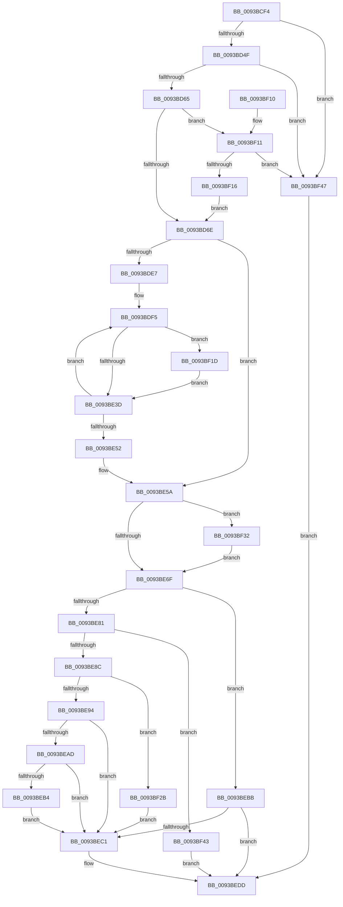

# PfSnPrefetchSections

- RVA: `0x0093BCF4`–`0x0093BF4E` (길이 `602` bytes)
- VA: `0x000000014093BCF4`
- 실행 섹션: `PAGE`
- PDB 이름 있음: `예`; PDB Function 태그: `아니요`
- unwind 정보 RVA: `0x0008FE50`
- 디코드: `175`개 명령, `602/602` bytes 표시
- 미해석 바이트: `0` (있으면 어셈블리에 `.byte`로 보존)

> 이 문서는 커널 이미지의 기계어와 PDB 기호를 분석해 생성했습니다. 4번과 5번은 함수 원형과 자료형을 바이너리 사용 방식에서 추정한 C 해석이며 원본 소스 복구 결과는 아닙니다.

## 1. Dependencies

- 직접 호출 지점: **12**; 고유 호출 대상: **11**
- 직접 호출자로 확인된 함수: **1**
- RIP 상대 이미지 참조: **1**

### Outgoing calls
- `0x0093BD40` → [PfSnLogPrefetchSectionsStart](PfSnLogPrefetchSectionsStart_function_0093C1BC.md) (function, `0x0093C1BC`)
- `0x0093BD87` → [memset](../../text/6C/memset_function_006C6C40.md) (function, `0x006C6C40`)
- `0x0093BD9B` → [memset](../../text/6C/memset_function_006C6C40.md) (function, `0x006C6C40`)
- `0x0093BDC5` → [KeQueryPriorityThread](../../text/38/KeQueryPriorityThread_function_0038F4F0.md) (function, `0x0038F4F0`)
- `0x0093BDDE` → [PfSnLogGetReadListsStart](PfSnLogGetReadListsStart_function_0093C2F0.md) (function, `0x0093C2F0`)
- `0x0093BE44` → [ExQueueWorkItem](../../text/2F/ExQueueWorkItem_function_002F9520.md) (function, `0x002F9520`)
- `0x0093BE72` → [PfSnLogGetReadListsStop](PfSnLogGetReadListsStop_function_0093C3FC.md) (function, `0x0093C3FC`)
- `0x0093BE9E` → [MmPrefetchPagesEx](MmPrefetchPagesEx_function_0093C9A0.md) (function, `0x0093C9A0`)
- `0x0093BED8` → [PfSnPrefetchSectionsCleanup](PfSnPrefetchSectionsCleanup_function_0093C0B0.md) (function, `0x0093C0B0`)
- `0x0093BEF1` → [PfSnLogPrefetchSectionsStop](PfSnLogPrefetchSectionsStop_function_0093BF54.md) (function, `0x0093BF54`)
- `0x0093BF21` → [ExfAcquireRundownProtection](../../text/34/ExfAcquireRundownProtection_function_0034C050.md) (function, `0x0034C050`)
- `0x0093BF39` → [ExfWaitForRundownProtectionRelease](../../text/2A/ExfWaitForRundownProtectionRelease_function_002A4CDC.md) (function, `0x002A4CDC`)

### Direct callers
- [PfSnAsyncPrefetchStep](PfSnAsyncPrefetchStep_function_0093B934.md) at `0x0093B96B`
- [PfSnAsyncPrefetchStep](PfSnAsyncPrefetchStep_function_0093B934.md) at `0x0093B98B`

### Static image references
- `0x0093BE0A` → RVA `0x008A8E60` (`PfSnPopulateReadList`; read)

## 2. Other-region calls and transfers

- 다른 실행 섹션으로 향하는 call: **6**
  - `0x0093BD87` → [memset](../../text/6C/memset_function_006C6C40.md) (`PAGE` → `.text`)
  - `0x0093BD9B` → [memset](../../text/6C/memset_function_006C6C40.md) (`PAGE` → `.text`)
  - `0x0093BDC5` → [KeQueryPriorityThread](../../text/38/KeQueryPriorityThread_function_0038F4F0.md) (`PAGE` → `.text`)
  - `0x0093BE44` → [ExQueueWorkItem](../../text/2F/ExQueueWorkItem_function_002F9520.md) (`PAGE` → `.text`)
  - `0x0093BF21` → [ExfAcquireRundownProtection](../../text/34/ExfAcquireRundownProtection_function_0034C050.md) (`PAGE` → `.text`)
  - `0x0093BF39` → [ExfWaitForRundownProtectionRelease](../../text/2A/ExfWaitForRundownProtectionRelease_function_002A4CDC.md) (`PAGE` → `.text`)
- 별도 외부 분기/꼬리 이동을 확인하지 못했습니다.

## 3. Assembly (complete function range)

```asm
0093BCF4  48 89 5C 24 18                  mov qword ptr [rsp + 0x18], rbx
0093BCF9  4C 89 4C 24 20                  mov qword ptr [rsp + 0x20], r9
0093BCFE  89 54 24 10                     mov dword ptr [rsp + 0x10], edx
0093BD02  55                              push rbp
0093BD03  56                              push rsi
0093BD04  57                              push rdi
0093BD05  41 54                           push r12
0093BD07  41 55                           push r13
0093BD09  41 56                           push r14
0093BD0B  41 57                           push r15
0093BD0D  48 8B EC                        mov rbp, rsp
0093BD10  48 83 EC 70                     sub rsp, 0x70
0093BD14  4C 8B 21                        mov r12, qword ptr [rcx]
0093BD17  0F 57 C0                        xorps xmm0, xmm0
0093BD1A  45 8B E8                        mov r13d, r8d
0093BD1D  4C 89 65 40                     mov qword ptr [rbp + 0x40], r12
0093BD21  44 8B C2                        mov r8d, edx
0093BD24  44 8B F2                        mov r14d, edx
0093BD27  4C 8B F9                        mov r15, rcx
0093BD2A  41 8B D5                        mov edx, r13d
0093BD2D  49 8B CC                        mov rcx, r12
0093BD30  33 FF                           xor edi, edi
0093BD32  0F 11 45 C8                     movups xmmword ptr [rbp - 0x38], xmm0
0093BD36  33 F6                           xor esi, esi
0093BD38  0F 11 45 D8                     movups xmmword ptr [rbp - 0x28], xmm0
0093BD3C  0F 11 45 E8                     movups xmmword ptr [rbp - 0x18], xmm0
0093BD40  E8 77 04 00 00                  call 0x14093c1bc
0093BD45  41 83 FE 02                     cmp r14d, 2
0093BD49  0F 8D F8 01 00 00               jge 0x14093bf47
0093BD4F  49 8B 0F                        mov rcx, qword ptr [r15]
0093BD52  8D 57 01                        lea edx, [rdi + 1]
0093BD55  8B C2                           mov eax, edx
0093BD57  8B 49 7C                        mov ecx, dword ptr [rcx + 0x7c]
0093BD5A  D3 E0                           shl eax, cl
0093BD5C  44 3B E8                        cmp r13d, eax
0093BD5F  0F 8D E2 01 00 00               jge 0x14093bf47
0093BD65  45 85 F6                        test r14d, r14d
0093BD68  0F 85 A3 01 00 00               jne 0x14093bf11
0093BD6E  49 8B 47 40                     mov rax, qword ptr [r15 + 0x40]
0093BD72  33 D2                           xor edx, edx
0093BD74  41 8B 74 24 58                  mov esi, dword ptr [r12 + 0x58]
0093BD79  48 8B C8                        mov rcx, rax
0093BD7C  44 8B C6                        mov r8d, esi
0093BD7F  48 89 45 C0                     mov qword ptr [rbp - 0x40], rax
0093BD83  49 C1 E0 03                     shl r8, 3
0093BD87  E8 B4 AE D8 FF                  call 0x1406c6c40
0093BD8C  49 8B 5F 58                     mov rbx, qword ptr [r15 + 0x58]
0093BD90  33 D2                           xor edx, edx
0093BD92  48 8B CB                        mov rcx, rbx
0093BD95  41 B8 00 06 00 00               mov r8d, 0x600
0093BD9B  E8 A0 AE D8 FF                  call 0x1406c6c40
0093BDA0  33 C0                           xor eax, eax
0093BDA2  4C 89 7D D0                     mov qword ptr [rbp - 0x30], r15
0093BDA6  48 89 45 E0                     mov qword ptr [rbp - 0x20], rax
0093BDAA  48 89 45 EC                     mov qword ptr [rbp - 0x14], rax
0093BDAE  89 45 F4                        mov dword ptr [rbp - 0xc], eax
0093BDB1  48 8B 45 60                     mov rax, qword ptr [rbp + 0x60]
0093BDB5  48 89 45 D8                     mov qword ptr [rbp - 0x28], rax
0093BDB9  89 75 E8                        mov dword ptr [rbp - 0x18], esi
0093BDBC  65 48 8B 0C 25 88 01 00 00      mov rcx, qword ptr gs:[0x188]
0093BDC5  E8 26 37 A5 FF                  call 0x14038f4f0
0093BDCA  B9 20 00 00 00                  mov ecx, 0x20
0093BDCF  03 C1                           add eax, ecx
0093BDD1  3B F1                           cmp esi, ecx
0093BDD3  89 45 58                        mov dword ptr [rbp + 0x58], eax
0093BDD6  0F 47 F1                        cmova esi, ecx
0093BDD9  49 8B CC                        mov rcx, r12
0093BDDC  8B D6                           mov edx, esi
0093BDDE  E8 0D 05 00 00                  call 0x14093c2f0
0093BDE3  85 F6                           test esi, esi
0093BDE5  74 73                           je 0x14093be5a
0093BDE7  44 8B 65 58                     mov r12d, dword ptr [rbp + 0x58]
0093BDEB  48 83 C3 2C                     add rbx, 0x2c
0093BDEF  41 BE 01 00 00 00               mov r14d, 1
0093BDF5  48 8D 45 C8                     lea rax, [rbp - 0x38]
0093BDF9  44 89 6B FC                     mov dword ptr [rbx - 4], r13d
0093BDFD  48 89 43 F4                     mov qword ptr [rbx - 0xc], rax
0093BE01  8B 03                           mov eax, dword ptr [rbx]
0093BE03  83 E0 FE                        and eax, 0xfffffffe
0093BE06  0B C7                           or eax, edi
0093BE08  89 03                           mov dword ptr [rbx], eax
0093BE0A  48 8D 05 4F D0 F6 FF            lea rax, [rip - 0x92fb1]
0093BE11  48 89 43 E4                     mov qword ptr [rbx - 0x1c], rax
0093BE15  48 8D 43 D4                     lea rax, [rbx - 0x2c]
0093BE19  48 83 20 00                     and qword ptr [rax], 0
0093BE1D  48 89 43 EC                     mov qword ptr [rbx - 0x14], rax
0093BE21  0F 0D 4D C8                     prefetchw byte ptr [rbp - 0x38]
0093BE25  48 8B 45 C8                     mov rax, qword ptr [rbp - 0x38]
0093BE29  48 83 E0 FE                     and rax, 0xfffffffffffffffe
0093BE2D  48 8D 50 02                     lea rdx, [rax + 2]
0093BE31  F0 48 0F B1 55 C8               lock cmpxchg qword ptr [rbp - 0x38], rdx
0093BE37  0F 85 E0 00 00 00               jne 0x14093bf1d
0093BE3D  41 8B D4                        mov edx, r12d
0093BE40  48 8D 4B D4                     lea rcx, [rbx - 0x2c]
0093BE44  E8 D7 D6 9B FF                  call 0x1402f9520
0093BE49  48 83 C3 30                     add rbx, 0x30
0093BE4D  49 2B F6                        sub rsi, r14
0093BE50  75 A3                           jne 0x14093bdf5
0093BE52  44 8B 75 48                     mov r14d, dword ptr [rbp + 0x48]
0093BE56  4C 8B 65 40                     mov r12, qword ptr [rbp + 0x40]
0093BE5A  33 C0                           xor eax, eax
0093BE5C  8D 48 01                        lea ecx, [rax + 1]
0093BE5F  F0 48 0F B1 4D C8               lock cmpxchg qword ptr [rbp - 0x38], rcx
0093BE65  48 83 F8 02                     cmp rax, 2
0093BE69  0F 83 C3 00 00 00               jae 0x14093bf32
0093BE6F  49 8B CC                        mov rcx, r12
0093BE72  E8 85 05 00 00                  call 0x14093c3fc
0093BE77  8B 7D E0                        mov edi, dword ptr [rbp - 0x20]
0093BE7A  8B 5D F0                        mov ebx, dword ptr [rbp - 0x10]
0093BE7D  85 DB                           test ebx, ebx
0093BE7F  78 3A                           js 0x14093bebb
0093BE81  8B 75 EC                        mov esi, dword ptr [rbp - 0x14]
0093BE84  85 FF                           test edi, edi
0093BE86  0F 84 B7 00 00 00               je 0x14093bf43
0093BE8C  85 F6                           test esi, esi
0093BE8E  0F 84 97 00 00 00               je 0x14093bf2b
0093BE94  48 8B 55 C0                     mov rdx, qword ptr [rbp - 0x40]
0093BE98  4D 8D 47 68                     lea r8, [r15 + 0x68]
0093BE9C  8B CF                           mov ecx, edi
0093BE9E  E8 FD 0A 00 00                  call 0x14093c9a0
0093BEA3  4C 8B 65 40                     mov r12, qword ptr [rbp + 0x40]
0093BEA7  8B D8                           mov ebx, eax
0093BEA9  85 C0                           test eax, eax
0093BEAB  78 14                           js 0x14093bec1
0093BEAD  49 83 7F 68 00                  cmp qword ptr [r15 + 0x68], 0
0093BEB2  75 0D                           jne 0x14093bec1
0093BEB4  BB 1A 00 00 80                  mov ebx, 0x8000001a
0093BEB9  EB 06                           jmp 0x14093bec1
0093BEBB  33 F6                           xor esi, esi
0093BEBD  85 FF                           test edi, edi
0093BEBF  74 1C                           je 0x14093bedd
0093BEC1  4C 8B 4D 60                     mov r9, qword ptr [rbp + 0x60]
0093BEC5  B8 20 00 00 00                  mov eax, 0x20
0093BECA  3B F8                           cmp edi, eax
0093BECC  44 8B C7                        mov r8d, edi
0093BECF  8B D7                           mov edx, edi
0093BED1  49 8B CF                        mov rcx, r15
0093BED4  44 0F 47 C0                     cmova r8d, eax
0093BED8  E8 D3 01 00 00                  call 0x14093c0b0
0093BEDD  8B C6                           mov eax, esi
0093BEDF  45 8B C6                        mov r8d, r14d
0093BEE2  89 7C 24 28                     mov dword ptr [rsp + 0x28], edi
0093BEE6  41 8B D5                        mov edx, r13d
0093BEE9  49 8B CC                        mov rcx, r12
0093BEEC  48 89 44 24 20                  mov qword ptr [rsp + 0x20], rax
0093BEF1  E8 5E 00 00 00                  call 0x14093bf54
0093BEF6  8B C3                           mov eax, ebx
0093BEF8  48 8B 9C 24 C0 00 00 00         mov rbx, qword ptr [rsp + 0xc0]
0093BF00  48 83 C4 70                     add rsp, 0x70
0093BF04  41 5F                           pop r15
0093BF06  41 5E                           pop r14
0093BF08  41 5D                           pop r13
0093BF0A  41 5C                           pop r12
0093BF0C  5F                              pop rdi
0093BF0D  5E                              pop rsi
0093BF0E  5D                              pop rbp
0093BF0F  C3                              ret
0093BF10  CC                              int3
0093BF11  44 3B F2                        cmp r14d, edx
0093BF14  75 31                           jne 0x14093bf47
0093BF16  8B FA                           mov edi, edx
0093BF18  E9 51 FE FF FF                  jmp 0x14093bd6e
0093BF1D  48 8D 4D C8                     lea rcx, [rbp - 0x38]
0093BF21  E8 2A 01 A1 FF                  call 0x14034c050
0093BF26  E9 12 FF FF FF                  jmp 0x14093be3d
0093BF2B  BB 01 00 00 C0                  mov ebx, 0xc0000001
0093BF30  EB 8F                           jmp 0x14093bec1
0093BF32  48 8B D0                        mov rdx, rax
0093BF35  48 8D 4D C8                     lea rcx, [rbp - 0x38]
0093BF39  E8 9E 8D 96 FF                  call 0x1402a4cdc
0093BF3E  E9 2C FF FF FF                  jmp 0x14093be6f
0093BF43  33 DB                           xor ebx, ebx
0093BF45  EB 96                           jmp 0x14093bedd
0093BF47  BB 0D 00 00 C0                  mov ebx, 0xc000000d
0093BF4C  EB 8F                           jmp 0x14093bedd
```

## 4. C-style interpretation (structured pseudocode)

```c
__int64 __fastcall PfSnPrefetchSections(__int64 a1, int a2, int a3, __int64 a4, __int64 a5)
{
    __int64 result;
    __int64 v_rbx;
    __int64 v_rdi;
    __int64 v_rsi;
    __int64 v_rsp;
    unsigned int v_stack_m44;
    unsigned int v_stack_m48;
    unsigned __int64 v_stack_m4C;
    unsigned __int64 v_stack_m50;
    unsigned __int64 v_stack_m58;
    unsigned __int64 v_stack_m60;
    unsigned __int64 v_stack_m68;
    unsigned __int64 v_stack_m70;
    unsigned __int64 v_stack_m78;
    unsigned int v_stack_m80;
    unsigned __int64 v_stack_m88;
    unsigned int v_stack_p10;
    unsigned __int64 v_stack_p18;
    unsigned __int64 v_stack_p20;
    unsigned __int64 v_stack_p8;

    v_stack_p18 = v_rbx;
    v_stack_p20 = a4;
    v_stack_p10 = a2;
    v_rsp = (v_rsp) - (112);
    v_stack_p8 = *(unsigned __int64 *)(a1);
    v_rdi = 0;
    v_stack_m70 = v_xmm0;
    v_rsi = 0;
    v_stack_m60 = v_xmm0;
    v_stack_m50 = v_xmm0;
    result = PfSnLogPrefetchSectionsStart(*(unsigned __int64 *)(a1), (unsigned int)((unsigned int)((unsigned int)(a3))), (unsigned int)(a2), a4);
    if (((unsigned int)((unsigned int)(a2))) >= 2) goto loc_0093BF47;
    result = (unsigned int)(((unsigned int)((unsigned int)(v_rdi + 1))) << ((unsigned __int8)((unsigned int)(*(unsigned int *)(*(unsigned __int64 *)(a1) + 124)))));
    if (((unsigned int)((unsigned int)(a3))) >= ((unsigned int)(result))) goto loc_0093BF47;
    if ((unsigned int)((unsigned int)(a2)) != 0) goto loc_0093BF11;
loc_0093BD6E:
    a2 = 0;
    v_stack_m78 = *(unsigned __int64 *)(a1 + 64);
    a3 = ((unsigned int)((unsigned int)((unsigned int)(*(unsigned int *)(*(unsigned __int64 *)(a1) + 88))))) << (3);
    result = memset(*(unsigned __int64 *)(a1 + 64), a2, a3, a4);
    a2 = 0;
    result = memset(*(unsigned __int64 *)(a1 + 88), a2, (unsigned int)(0x600ULL), a4);
    result = 0;
    v_stack_m68 = a1;
    v_stack_m58 = 0;
    v_stack_m4C = 0;
    v_stack_m44 = 0;
    v_stack_m60 = a5;
    v_stack_m50 = (unsigned int)((unsigned int)(*(unsigned int *)(*(unsigned __int64 *)(a1) + 88)));
    result = KeQueryPriorityThread(*(unsigned __int64 *)(gs_base + (0 + 392)), a2, (unsigned int)(0x600ULL), a4);
    result = (unsigned int)((result) + (32));
    v_stack_p20 = (unsigned int)(result);
    v_rsi = (unsigned int)(*(unsigned int *)(*(unsigned __int64 *)(a1) + 88));
    if (((unsigned int)((unsigned int)(*(unsigned int *)(*(unsigned __int64 *)(a1) + 88)))) > 32) { v_rsi = 32; }
    result = PfSnLogGetReadListsStart(*(unsigned __int64 *)(a1), (unsigned int)((unsigned int)(v_rsi)), (unsigned int)(0x600ULL), a4);
    if ((unsigned int)(v_rsi) == 0) goto loc_0093BE5A;
    v_rbx = (*(unsigned __int64 *)(a1 + 88)) + (44);
loc_0093BDF5:
    *(unsigned int *)(v_rbx - 4) = (unsigned int)((unsigned int)(a3));
    *(unsigned __int64 *)(v_rbx - 12) = v_stack_m70;
    result = (unsigned int)(((unsigned int)(*(unsigned int *)(v_rbx))) & (0xFFFFFFFEULL));
    result = (unsigned int)((result) | (0));
    *(unsigned int *)(v_rbx) = (unsigned int)(result);
    *(unsigned __int64 *)(v_rbx - 28) = v_rip - 602033;
    *(unsigned __int64 *)(v_rbx - 20) = v_rbx - 44;
    result = (v_stack_m70) & (-2);
    if (condition_is_not_equal) goto loc_0093BF1D;
loc_0093BE3D:
    result = ExQueueWorkItem(v_rbx - 44, (unsigned int)((unsigned int)((unsigned int)(v_stack_p20))), (unsigned int)(0x600ULL), a4);
    v_rbx = (v_rbx) + (48);
    v_rsi = (v_rsi) - (1);
    if (condition_is_not_equal) goto loc_0093BDF5;
loc_0093BE5A:
    result = 0;
    if (0 >= 2) goto loc_0093BF32;
loc_0093BE6F:
    result = PfSnLogGetReadListsStop(v_stack_p8, (unsigned int)((unsigned int)((unsigned int)(v_stack_p20))), (unsigned int)(0x600ULL), a4);
    if (sign_flag) goto loc_0093BEBB;
    if ((unsigned int)((unsigned int)(v_stack_m58)) == 0) goto loc_0093BF43;
    if ((unsigned int)((unsigned int)(v_stack_m4C)) == 0) goto loc_0093BF2B;
    result = MmPrefetchPagesEx((unsigned int)((unsigned int)((unsigned int)(v_stack_m58))), v_stack_m78, a1 + 104, a4);
    if (sign_flag) goto loc_0093BEC1;
    if ((*(unsigned __int64 *)(a1 + 104)) != 0) goto loc_0093BEC1;
    goto loc_0093BEC1;
loc_0093BEBB:
    v_rsi = 0;
    if ((unsigned int)((unsigned int)(v_stack_m58)) != 0) {
        a4 = a5;
        result = 32;
        a3 = (unsigned int)((unsigned int)(v_stack_m58));
        a2 = (unsigned int)((unsigned int)(v_stack_m58));
        a1 = a1;
        if (((unsigned int)((unsigned int)(v_stack_m58))) > ((unsigned int)(result))) { a3 = (unsigned int)(result); }
        result = PfSnPrefetchSectionsCleanup(a1, a2, a3, a4);
    }
    v_stack_m80 = (unsigned int)((unsigned int)(v_stack_m58));
    v_stack_m88 = 0;
    result = PfSnLogPrefetchSectionsStop(v_stack_p8, (unsigned int)((unsigned int)((unsigned int)(a3))), (unsigned int)((unsigned int)((unsigned int)(v_stack_p10))), a4);
    v_rsp = (v_rsp) + (112);
    return (unsigned int)((unsigned int)((unsigned int)(0x8000001AULL)));
loc_0093BF11:
    if (((unsigned int)((unsigned int)(v_stack_p10))) != ((unsigned int)((unsigned int)((unsigned int)((unsigned int)(a3)))))) goto loc_0093BF47;
    goto loc_0093BD6E;
loc_0093BF1D:
    result = ExfAcquireRundownProtection(v_stack_m70, (unsigned int)((unsigned int)((unsigned int)(a3))), (unsigned int)((unsigned int)((unsigned int)(v_stack_p10))), a4);
    goto loc_0093BE3D;
loc_0093BF2B:
    goto loc_0093BEC1;
loc_0093BF32:
    result = ExfWaitForRundownProtectionRelease(v_stack_m70, result, (unsigned int)((unsigned int)((unsigned int)(v_stack_p10))), a4);
    goto loc_0093BE6F;
loc_0093BF43:
    v_rbx = 0;
    goto loc_0093BEDD;
loc_0093BF47:
    goto loc_0093BEDD;
}
```

## 5. (Beta) C Style

```c
int64_t PfSnPrefetchSections(void *Arg1, int32_t Arg2, int32_t Arg3, int64_t Arg4, int64_t Arg5)
{
    uint8_t *arg1 = (uint8_t *)Arg1;

    int64_t result;
    int64_t local_rbx;
    int64_t local_rdi;
    int64_t local_rsi;
    int64_t local_rsp;
    uint32_t v_stack_m44;
    uint32_t v_stack_m48;
    uint64_t v_stack_m4C;
    uint64_t v_stack_m50;
    uint64_t v_stack_m58;
    uint64_t v_stack_m60;
    uint64_t v_stack_m68;
    uint64_t v_stack_m70;
    uint64_t v_stack_m78;
    uint32_t v_stack_m80;
    uint64_t v_stack_m88;
    uint32_t v_stack_p10;
    uint64_t v_stack_p18;
    uint64_t v_stack_p20;
    uint64_t v_stack_p8;

    v_stack_p18 = local_rbx;
    v_stack_p20 = Arg4;
    v_stack_p10 = Arg2;
    local_rsp = (local_rsp) - (112);
    v_stack_p8 = *(uint64_t *)(arg1);
    local_rdi = 0;
    v_stack_m70 = v_xmm0;
    local_rsi = 0;
    v_stack_m60 = v_xmm0;
    v_stack_m50 = v_xmm0;
    result = PfSnLogPrefetchSectionsStart(*(uint64_t *)(arg1), (uint32_t)((uint32_t)((uint32_t)(Arg3))), (uint32_t)(Arg2), Arg4);
    if (((uint32_t)((uint32_t)(Arg2))) >= 2) goto loc_0093BF47;
    result = (uint32_t)(((uint32_t)((uint32_t)(local_rdi + 1))) << ((uint8_t)((uint32_t)(*(uint32_t *)(*(uint64_t *)(arg1) + 0x7C)))));
    if (((uint32_t)((uint32_t)(Arg3))) >= ((uint32_t)(result))) goto loc_0093BF47;
    if ((uint32_t)((uint32_t)(Arg2)) != 0) goto loc_0093BF11;
loc_0093BD6E:
    Arg2 = 0;
    v_stack_m78 = *(uint64_t *)(arg1 + 0x40);
    Arg3 = ((uint32_t)((uint32_t)((uint32_t)(*(uint32_t *)(*(uint64_t *)(arg1) + 0x58))))) << (3);
    result = memset(*(uint64_t *)(arg1 + 0x40), Arg2, Arg3, Arg4);
    Arg2 = 0;
    result = memset(*(uint64_t *)(arg1 + 0x58), Arg2, (uint32_t)(0x600ULL), Arg4);
    result = 0;
    v_stack_m68 = Arg1;
    v_stack_m58 = 0;
    v_stack_m4C = 0;
    v_stack_m44 = 0;
    v_stack_m60 = Arg5;
    v_stack_m50 = (uint32_t)((uint32_t)(*(uint32_t *)(*(uint64_t *)(arg1) + 0x58)));
    result = KeQueryPriorityThread(*(uint64_t *)(gs_base + (0 + 0x188)), Arg2, (uint32_t)(0x600ULL), Arg4);
    result = (uint32_t)((result) + (32));
    v_stack_p20 = (uint32_t)(result);
    local_rsi = (uint32_t)(*(uint32_t *)(*(uint64_t *)(arg1) + 0x58));
    if (((uint32_t)((uint32_t)(*(uint32_t *)(*(uint64_t *)(arg1) + 0x58)))) > 32) { local_rsi = 32; }
    result = PfSnLogGetReadListsStart(*(uint64_t *)(arg1), (uint32_t)((uint32_t)(local_rsi)), (uint32_t)(0x600ULL), Arg4);
    if ((uint32_t)(local_rsi) == 0) goto loc_0093BE5A;
    local_rbx = (*(uint64_t *)(arg1 + 0x58)) + (44);
loc_0093BDF5:
    *(uint32_t *)(local_rbx - 0x4) = (uint32_t)((uint32_t)(Arg3));
    *(uint64_t *)(local_rbx - 0xC) = v_stack_m70;
    result = (uint32_t)(((uint32_t)(*(uint32_t *)(local_rbx))) & (0xFFFFFFFEULL));
    result = (uint32_t)((result) | (0));
    *(uint32_t *)(local_rbx) = (uint32_t)(result);
    *(uint64_t *)(local_rbx - 0x1C) = v_rip - 602033;
    *(uint64_t *)(local_rbx - 0x14) = local_rbx - 44;
    result = (v_stack_m70) & (-2);
    if (condition_is_not_equal) goto loc_0093BF1D;
loc_0093BE3D:
    result = ExQueueWorkItem(local_rbx - 44, (uint32_t)((uint32_t)((uint32_t)(v_stack_p20))), (uint32_t)(0x600ULL), Arg4);
    local_rbx = (local_rbx) + (48);
    local_rsi = (local_rsi) - (1);
    if (condition_is_not_equal) goto loc_0093BDF5;
loc_0093BE5A:
    result = 0;
    if (0 >= 2) goto loc_0093BF32;
loc_0093BE6F:
    result = PfSnLogGetReadListsStop(v_stack_p8, (uint32_t)((uint32_t)((uint32_t)(v_stack_p20))), (uint32_t)(0x600ULL), Arg4);
    if (sign_flag) goto loc_0093BEBB;
    if ((uint32_t)((uint32_t)(v_stack_m58)) == 0) goto loc_0093BF43;
    if ((uint32_t)((uint32_t)(v_stack_m4C)) == 0) goto loc_0093BF2B;
    result = MmPrefetchPagesEx((uint32_t)((uint32_t)((uint32_t)(v_stack_m58))), v_stack_m78, Arg1 + 104, Arg4);
    if (sign_flag) goto loc_0093BEC1;
    if ((*(uint64_t *)(arg1 + 0x68)) != 0) goto loc_0093BEC1;
    goto loc_0093BEC1;
loc_0093BEBB:
    local_rsi = 0;
    if ((uint32_t)((uint32_t)(v_stack_m58)) != 0) {
        Arg4 = Arg5;
        result = 32;
        Arg3 = (uint32_t)((uint32_t)(v_stack_m58));
        Arg2 = (uint32_t)((uint32_t)(v_stack_m58));
        Arg1 = Arg1;
        if (((uint32_t)((uint32_t)(v_stack_m58))) > ((uint32_t)(result))) { Arg3 = (uint32_t)(result); }
        result = PfSnPrefetchSectionsCleanup(Arg1, Arg2, Arg3, Arg4);
    }
    v_stack_m80 = (uint32_t)((uint32_t)(v_stack_m58));
    v_stack_m88 = 0;
    result = PfSnLogPrefetchSectionsStop(v_stack_p8, (uint32_t)((uint32_t)((uint32_t)(Arg3))), (uint32_t)((uint32_t)((uint32_t)(v_stack_p10))), Arg4);
    local_rsp = (local_rsp) + (112);
    return (uint32_t)((uint32_t)((uint32_t)(0x8000001AULL)));
loc_0093BF11:
    if (((uint32_t)((uint32_t)(v_stack_p10))) != ((uint32_t)((uint32_t)((uint32_t)((uint32_t)(Arg3)))))) goto loc_0093BF47;
    goto loc_0093BD6E;
loc_0093BF1D:
    result = ExfAcquireRundownProtection(v_stack_m70, (uint32_t)((uint32_t)((uint32_t)(Arg3))), (uint32_t)((uint32_t)((uint32_t)(v_stack_p10))), Arg4);
    goto loc_0093BE3D;
loc_0093BF2B:
    goto loc_0093BEC1;
loc_0093BF32:
    result = ExfWaitForRundownProtectionRelease(v_stack_m70, result, (uint32_t)((uint32_t)((uint32_t)(v_stack_p10))), Arg4);
    goto loc_0093BE6F;
loc_0093BF43:
    local_rbx = 0;
    goto loc_0093BEDD;
loc_0093BF47:
    goto loc_0093BEDD;
}
```

### 관측된 메모리 오프셋

구조체 형식이 확인되지 않은 접근은 인자 기준의 오프셋으로만 기록했습니다.

| 기준 인자 | 오프셋 표현 | 폭 (bit) | 접근 |
|---|---:|---:|---|
| `Arg1` | `+ 0x0` | `64` | `R` |
| `Arg1` | `+ 0x40` | `64` | `R` |
| `Arg1` | `+ 0x58` | `64` | `R` |
| `Arg1` | `+ 0x68` | `64` | `R` |

## 6. Execution-region graph

[열기: 2D/3D 그래프와 함수 탐색 컨트롤 패널](../../../control-panel.html?section=page&rva=0x0093BCF4&view=graph)

- 2D 그래프는 위에서 아래로 흐르고, 3D 그래프는 빈 공간을 드래그해 회전합니다. Shift+드래그는 이동, 휠은 확대·축소, 함수 노드 선택은 대상 보고서 이동입니다.

### Static fallback


