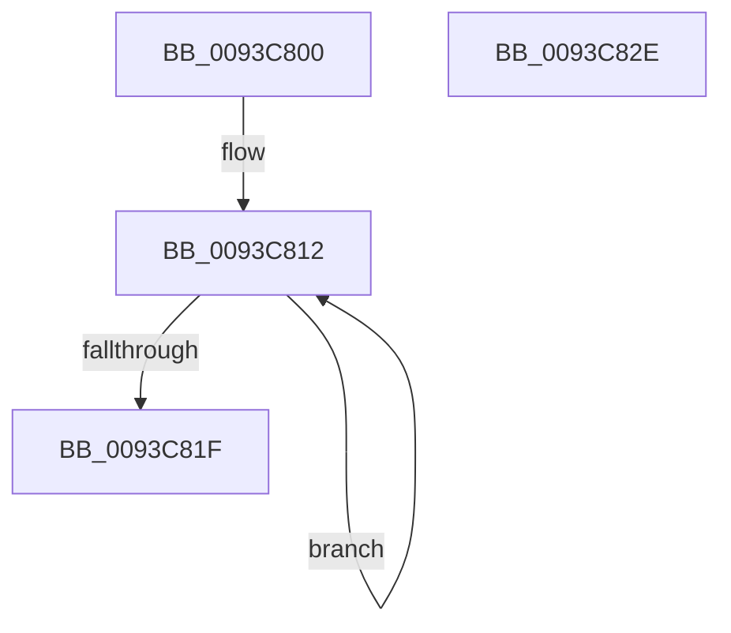

# PfpAvailablePagesForPrefetch

- RVA: `0x0093C800`–`0x0093C82F` (길이 `47` bytes)
- VA: `0x000000014093C800`
- 실행 섹션: `PAGE`
- PDB 이름 있음: `예`; PDB Function 태그: `아니요`
- unwind 정보 RVA: `0x000DB714`
- 디코드: `15`개 명령, `47/47` bytes 표시
- 미해석 바이트: `0` (있으면 어셈블리에 `.byte`로 보존)

> 이 문서는 커널 이미지의 기계어와 PDB 기호를 분석해 생성했습니다. 4번과 5번은 함수 원형과 자료형을 바이너리 사용 방식에서 추정한 C 해석이며 원본 소스 복구 결과는 아닙니다.

## 1. Dependencies

- 직접 호출 지점: **0**; 고유 호출 대상: **0**
- 직접 호출자로 확인된 함수: **4**
- RIP 상대 이미지 참조: **0**

### Outgoing calls
- 직접 디코드된 call 명령이 없습니다.

### Direct callers
- [PfpVolumePrefetchMetadata](PfpVolumePrefetchMetadata_function_0093A158.md) at `0x0093A352`
- [PfpVolumePrefetchMetadata](PfpVolumePrefetchMetadata_function_0093A158.md) at `0x0093A59D`
- [PfpPrefetchPrivatePages](PfpPrefetchPrivatePages_function_0093A7FC.md) at `0x0093A9B6`
- [PfpPrefetchDirectoryStream](PfpPrefetchDirectoryStream_function_0093AA94.md) at `0x0093AC17`
- [PfpPrefetchFilesTrickle](PfpPrefetchFilesTrickle_function_0093C4E8.md) at `0x0093C684`

### Static image references
- 디코드된 RIP-relative 메모리 참조가 없습니다.

## 2. Other-region calls and transfers

- 다른 실행 섹션으로 향하는 call: **0**
- 별도 외부 분기/꼬리 이동을 확인하지 못했습니다.

## 3. Assembly (complete function range)

```asm
0093C800  4C 8B 51 08                     mov r10, qword ptr [rcx + 8]
0093C804  4C 8D 41 28                     lea r8, [rcx + 0x28]
0093C808  4C 03 11                        add r10, qword ptr [rcx]
0093C80B  33 C0                           xor eax, eax
0093C80D  FF C2                           inc edx
0093C80F  44 8B C8                        mov r9d, eax
0093C812  4D 03 08                        add r9, qword ptr [r8]
0093C815  4D 8D 40 08                     lea r8, [r8 + 8]
0093C819  48 83 EA 01                     sub rdx, 1
0093C81D  75 F3                           jne 0x14093c812
0093C81F  4B 8D 0C 11                     lea rcx, [r9 + r10]
0093C823  48 81 F9 80 00 00 00            cmp rcx, 0x80
0093C82A  0F 93 C0                        setae al
0093C82D  C3                              ret
0093C82E  CC                              int3
```

## 4. C-style interpretation (structured pseudocode)

```c
__int64 __fastcall PfpAvailablePagesForPrefetch(__int64 a1, int a2)
{
    __int64 result;
    __int64 v_r10;

    v_r10 = (*(unsigned __int64 *)(a1 + 8)) + (*(unsigned __int64 *)(a1));
    result = 0;
    a2 = (unsigned int)((a2) + 1);
loc_0093C812:
    a4 = (0) + (*(unsigned __int64 *)(a1 + 40));
    a2 = (a2) - (1);
    if (condition_is_not_equal) goto loc_0093C812;
    result = ((a4 + v_r10 * 1) >= 128) ? 1 : 0;
    return result;
}
```

## 5. (Beta) C Style

```c
int64_t PfpAvailablePagesForPrefetch(void *Arg1, int32_t Arg2)
{
    uint8_t *arg1 = (uint8_t *)Arg1;

    int64_t result;
    int64_t local_r10;

    local_r10 = (*(uint64_t *)(arg1 + 0x8)) + (*(uint64_t *)(arg1));
    result = 0;
    Arg2 = (uint32_t)((Arg2) + 1);
loc_0093C812:
    a4 = (0) + (*(uint64_t *)(arg1 + 0x28));
    Arg2 = (Arg2) - (1);
    if (condition_is_not_equal) goto loc_0093C812;
    result = ((a4 + local_r10 * 1) >= 128) ? 1 : 0;
    return result;
}
```

### 관측된 메모리 오프셋

구조체 형식이 확인되지 않은 접근은 인자 기준의 오프셋으로만 기록했습니다.

| 기준 인자 | 오프셋 표현 | 폭 (bit) | 접근 |
|---|---:|---:|---|
| `Arg1` | `+ 0x0` | `64` | `R` |
| `Arg1` | `+ 0x8` | `64` | `R` |
| `Arg1` | `+ 0x28` | `64` | `R` |

## 6. Execution-region graph

[열기: 2D/3D 그래프와 함수 탐색 컨트롤 패널](../../../control-panel.html?section=page&rva=0x0093C800&view=graph)

- 2D 그래프는 위에서 아래로 흐르고, 3D 그래프는 빈 공간을 드래그해 회전합니다. Shift+드래그는 이동, 휠은 확대·축소, 함수 노드 선택은 대상 보고서 이동입니다.

### Static fallback


