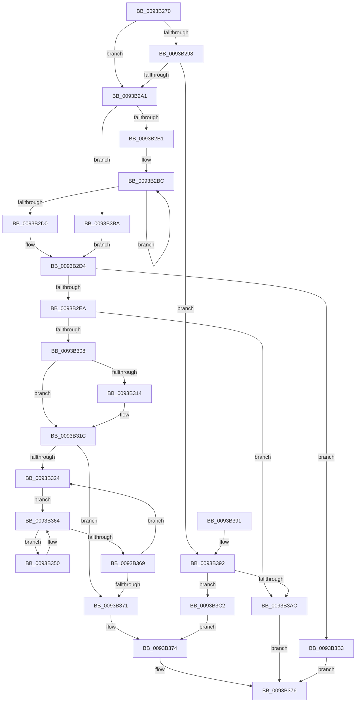

# PfpFileBuildReadList

- RVA: `0x0093B270`–`0x0093B3DB` (길이 `363` bytes)
- VA: `0x000000014093B270`
- 실행 섹션: `PAGE`
- PDB 이름 있음: `예`; PDB Function 태그: `아니요`
- unwind 정보 RVA: `0x0008FDC4`
- 디코드: `100`개 명령, `363/363` bytes 표시
- 미해석 바이트: `0` (있으면 어셈블리에 `.byte`로 보존)

> 이 문서는 커널 이미지의 기계어와 PDB 기호를 분석해 생성했습니다. 4번과 5번은 함수 원형과 자료형을 바이너리 사용 방식에서 추정한 C 해석이며 원본 소스 복구 결과는 아닙니다.

## 1. Dependencies

- 직접 호출 지점: **2**; 고유 호출 대상: **1**
- 직접 호출자로 확인된 함수: **1**
- RIP 상대 이미지 참조: **0**

### Outgoing calls
- `0x0093B2F7` → [ExAllocatePool2](../../poolcode/B8/ExAllocatePool2_function_00B820F0.md) (function, `0x00B820F0`)
- `0x0093B3A2` → [ExAllocatePool2](../../poolcode/B8/ExAllocatePool2_function_00B820F0.md) (function, `0x00B820F0`)

### Direct callers
- [PfpFileBuildReadSupport](PfpFileBuildReadSupport_function_0093B504.md) at `0x0093B761`

### Static image references
- 디코드된 RIP-relative 메모리 참조가 없습니다.

## 2. Other-region calls and transfers

- 다른 실행 섹션으로 향하는 call: **2**
  - `0x0093B2F7` → [ExAllocatePool2](../../poolcode/B8/ExAllocatePool2_function_00B820F0.md) (`PAGE` → `POOLCODE`)
  - `0x0093B3A2` → [ExAllocatePool2](../../poolcode/B8/ExAllocatePool2_function_00B820F0.md) (`PAGE` → `POOLCODE`)
- 별도 외부 분기/꼬리 이동을 확인하지 못했습니다.

## 3. Assembly (complete function range)

```asm
0093B270  48 8B C4                        mov rax, rsp
0093B273  48 89 58 08                     mov qword ptr [rax + 8], rbx
0093B277  48 89 70 10                     mov qword ptr [rax + 0x10], rsi
0093B27B  48 89 78 18                     mov qword ptr [rax + 0x18], rdi
0093B27F  4C 89 70 20                     mov qword ptr [rax + 0x20], r14
0093B283  41 57                           push r15
0093B285  48 83 EC 20                     sub rsp, 0x20
0093B289  8B 02                           mov eax, dword ptr [rdx]
0093B28B  4D 8B F1                        mov r14, r9
0093B28E  48 8B DA                        mov rbx, rdx
0093B291  4C 8B F9                        mov r15, rcx
0093B294  A8 01                           test al, 1
0093B296  74 09                           je 0x14093b2a1
0093B298  45 84 C0                        test r8b, r8b
0093B29B  0F 84 F1 00 00 00               je 0x14093b392
0093B2A1  48 8D 7B 10                     lea rdi, [rbx + 0x10]
0093B2A5  33 D2                           xor edx, edx
0093B2A7  8B 07                           mov eax, dword ptr [rdi]
0093B2A9  85 C0                           test eax, eax
0093B2AB  0F 84 09 01 00 00               je 0x14093b3ba
0093B2B1  48 8B 4B 18                     mov rcx, qword ptr [rbx + 0x18]
0093B2B5  44 8B C0                        mov r8d, eax
0093B2B8  48 83 C1 08                     add rcx, 8
0093B2BC  8B 01                           mov eax, dword ptr [rcx]
0093B2BE  83 C2 02                        add edx, 2
0093B2C1  C1 E8 0C                        shr eax, 0xc
0093B2C4  48 8D 49 10                     lea rcx, [rcx + 0x10]
0093B2C8  03 D0                           add edx, eax
0093B2CA  49 83 E8 01                     sub r8, 1
0093B2CE  75 EC                           jne 0x14093b2bc
0093B2D0  48 8D 73 10                     lea rsi, [rbx + 0x10]
0093B2D4  48 8D 04 D5 10 00 00 00         lea rax, [rdx*8 + 0x10]
0093B2DC  B9 FF FF FF FF                  mov ecx, 0xffffffff
0093B2E1  48 3B C1                        cmp rax, rcx
0093B2E4  0F 87 C9 00 00 00               ja 0x14093b3b3
0093B2EA  8B D0                           mov edx, eax
0093B2EC  B9 00 01 00 00                  mov ecx, 0x100
0093B2F1  41 B8 50 66 52 4C               mov r8d, 0x4c526650
0093B2F7  E8 F4 6D 24 00                  call 0x140b820f0
0093B2FC  4C 8B C8                        mov r9, rax
0093B2FF  48 85 C0                        test rax, rax
0093B302  0F 84 A4 00 00 00               je 0x14093b3ac
0093B308  0F 57 C0                        xorps xmm0, xmm0
0093B30B  0F 11 00                        movups xmmword ptr [rax], xmm0
0093B30E  8B 03                           mov eax, dword ptr [rbx]
0093B310  A8 01                           test al, 1
0093B312  74 08                           je 0x14093b31c
0093B314  41 C7 41 0C 01 00 00 00         mov dword ptr [r9 + 0xc], 1
0093B31C  45 33 DB                        xor r11d, r11d
0093B31F  44 39 1F                        cmp dword ptr [rdi], r11d
0093B322  76 4D                           jbe 0x14093b371
0093B324  49 8B 07                        mov rax, qword ptr [r15]
0093B327  45 8B C3                        mov r8d, r11d
0093B32A  49 C1 E0 04                     shl r8, 4
0093B32E  4C 03 43 18                     add r8, qword ptr [rbx + 0x18]
0093B332  49 8B 10                        mov rdx, qword ptr [r8]
0093B335  41 8B 48 08                     mov ecx, dword ptr [r8 + 8]
0093B339  4C 8B D2                        mov r10, rdx
0093B33C  49 81 E2 00 F0 FF FF            and r10, 0xfffffffffffff000
0093B343  F6 40 50 02                     test byte ptr [rax + 0x50], 2
0093B347  4C 0F 44 D2                     cmove r10, rdx
0093B34B  48 03 CA                        add rcx, rdx
0093B34E  EB 14                           jmp 0x14093b364
0093B350  41 8B 41 08                     mov eax, dword ptr [r9 + 8]
0093B354  4D 89 54 C1 10                  mov qword ptr [r9 + rax*8 + 0x10], r10
0093B359  41 FF 41 08                     inc dword ptr [r9 + 8]
0093B35D  49 81 C2 00 10 00 00            add r10, 0x1000
0093B364  4C 3B D1                        cmp r10, rcx
0093B367  72 E7                           jb 0x14093b350
0093B369  41 FF C3                        inc r11d
0093B36C  44 3B 1E                        cmp r11d, dword ptr [rsi]
0093B36F  72 B3                           jb 0x14093b324
0093B371  4D 89 0E                        mov qword ptr [r14], r9
0093B374  33 C0                           xor eax, eax
0093B376  48 8B 5C 24 30                  mov rbx, qword ptr [rsp + 0x30]
0093B37B  48 8B 74 24 38                  mov rsi, qword ptr [rsp + 0x38]
0093B380  48 8B 7C 24 40                  mov rdi, qword ptr [rsp + 0x40]
0093B385  4C 8B 74 24 48                  mov r14, qword ptr [rsp + 0x48]
0093B38A  48 83 C4 20                     add rsp, 0x20
0093B38E  41 5F                           pop r15
0093B390  C3                              ret
0093B391  CC                              int3
0093B392  BA 18 00 00 00                  mov edx, 0x18
0093B397  B9 00 01 00 00                  mov ecx, 0x100
0093B39C  41 B8 50 66 52 4C               mov r8d, 0x4c526650
0093B3A2  E8 49 6D 24 00                  call 0x140b820f0
0093B3A7  48 85 C0                        test rax, rax
0093B3AA  75 16                           jne 0x14093b3c2
0093B3AC  B8 9A 00 00 C0                  mov eax, 0xc000009a
0093B3B1  EB C3                           jmp 0x14093b376
0093B3B3  B8 95 00 00 C0                  mov eax, 0xc0000095
0093B3B8  EB BC                           jmp 0x14093b376
0093B3BA  48 8B F7                        mov rsi, rdi
0093B3BD  E9 12 FF FF FF                  jmp 0x14093b2d4
0093B3C2  48 83 20 00                     and qword ptr [rax], 0
0093B3C6  83 60 0C 00                     and dword ptr [rax + 0xc], 0
0093B3CA  48 83 60 10 00                  and qword ptr [rax + 0x10], 0
0093B3CF  C7 40 08 01 00 00 00            mov dword ptr [rax + 8], 1
0093B3D6  49 89 06                        mov qword ptr [r14], rax
0093B3D9  EB 99                           jmp 0x14093b374
```

## 4. C-style interpretation (structured pseudocode)

```c
__int64 __fastcall PfpFileBuildReadList(__int64 a1, __int64 a2, unsigned __int8 a3, __int64 a4)
{
    __int64 result;
    __int64 v_r10;
    __int64 v_r11;
    __int64 v_rsp;
    unsigned __int64 v_stack_p10;
    unsigned __int64 v_stack_p18;
    unsigned __int64 v_stack_p20;
    unsigned __int64 v_stack_p8;

    *(unsigned __int64 *)(v_rsp + 8) = v_rbx;
    *(unsigned __int64 *)(v_rsp + 16) = v_rsi;
    *(unsigned __int64 *)(v_rsp + 24) = v_rdi;
    *(unsigned __int64 *)(v_rsp + 32) = v_r14;
    v_rsp = (v_rsp) - (32);
    if ((((unsigned __int8)((unsigned int)(*(unsigned int *)(a2)))) & (1)) == 0) goto loc_0093B2A1;
    if (a3 == 0) goto loc_0093B392;
loc_0093B2A1:
    a2 = 0;
    if ((unsigned int)((unsigned int)(*(unsigned int *)(a2 + 16))) == 0) goto loc_0093B3BA;
    a1 = (*(unsigned __int64 *)(a2 + 24)) + (8);
loc_0093B2BC:
    a2 = (unsigned int)((a2) + (2));
    result = (unsigned int)(((unsigned int)(*(unsigned int *)(a1))) >> (12));
    a2 = (unsigned int)((a2) + ((unsigned int)(result)));
    a3 = ((unsigned int)((unsigned int)((unsigned int)(*(unsigned int *)(a2 + 16))))) - (1);
    if (condition_is_not_equal) goto loc_0093B2BC;
loc_0093B2D4:
    if ((a2 * 8 + 16) > ((unsigned int)(0xFFFFFFFFULL))) goto loc_0093B3B3;
    result = ExAllocatePool2(256, (unsigned int)((unsigned int)(a2 * 8 + 16)), (unsigned int)(0x4C526650ULL), a4);
    if (result == 0) goto loc_0093B3AC;
    *(unsigned __int64 *)(result) = v_xmm0;
    if ((((unsigned __int8)((unsigned int)(*(unsigned int *)(a2)))) & (1)) != 0) {
        *(unsigned int *)(result + 12) = 1;
    }
    v_r11 = 0;
    if ((*(unsigned int *)(a2 + 16)) <= 0) goto loc_0093B371;
loc_0093B324:
    a3 = (0) << (4);
    a3 = (a3) + (*(unsigned __int64 *)(a2 + 24));
    v_r10 = (*(unsigned __int64 *)(a3)) & (0xFFFFFFFFFFFFF000ULL);
    if (((*(unsigned __int8 *)(*(unsigned __int64 *)(a1) + 80)) & (2)) == 0) { v_r10 = *(unsigned __int64 *)(a3); }
    a1 = ((unsigned int)(*(unsigned int *)(a3 + 8))) + (*(unsigned __int64 *)(a3));
    goto loc_0093B364;
loc_0093B350:
    *(unsigned __int64 *)(result + (unsigned int)(*(unsigned int *)(result + 8)) * 8 + 16) = v_r10;
    v_r10 = (v_r10) + (0x1000ULL);
loc_0093B364:
    if (v_r10 < a1) goto loc_0093B350;
    v_r11 = (unsigned int)((v_r11) + 1);
    if (((unsigned int)(v_r11)) < (*(unsigned int *)(a2 + 16))) goto loc_0093B324;
loc_0093B371:
    *(unsigned __int64 *)(a4) = result;
loc_0093B374:
    result = 0;
loc_0093B376:
    v_rsp = (v_rsp) + (32);
    return result;
loc_0093B392:
    result = ExAllocatePool2(256, 24, (unsigned int)(0x4C526650ULL), result);
    if (result != 0) goto loc_0093B3C2;
loc_0093B3AC:
    goto loc_0093B376;
loc_0093B3B3:
    goto loc_0093B376;
loc_0093B3BA:
    goto loc_0093B2D4;
loc_0093B3C2:
    *(unsigned int *)((unsigned int)(0xC0000095ULL) + 8) = 1;
    *(unsigned __int64 *)(v_stack_p20) = (unsigned int)(0xC0000095ULL);
    goto loc_0093B374;
}
```

## 5. (Beta) C Style

```c
int64_t PfpFileBuildReadList(void *Arg1, void *Arg2, uint8_t Arg3, void *Arg4)
{
    uint8_t *arg1 = (uint8_t *)Arg1;
    uint8_t *arg2 = (uint8_t *)Arg2;
    uint8_t *arg4 = (uint8_t *)Arg4;

    int64_t result;
    int64_t local_r10;
    int64_t local_r11;
    int64_t local_rsp;
    uint64_t v_stack_p10;
    uint64_t v_stack_p18;
    uint64_t v_stack_p20;
    uint64_t v_stack_p8;

    *(uint64_t *)(local_rsp + 0x8) = local_rbx;
    *(uint64_t *)(local_rsp + 0x10) = local_rsi;
    *(uint64_t *)(local_rsp + 0x18) = local_rdi;
    *(uint64_t *)(local_rsp + 0x20) = local_r14;
    local_rsp = (local_rsp) - (32);
    if ((((uint8_t)((uint32_t)(*(uint32_t *)(arg2)))) & (1)) == 0) goto loc_0093B2A1;
    if (Arg3 == 0) goto loc_0093B392;
loc_0093B2A1:
    Arg2 = 0;
    if ((uint32_t)((uint32_t)(*(uint32_t *)(arg2 + 0x10))) == 0) goto loc_0093B3BA;
    Arg1 = (*(uint64_t *)(arg2 + 0x18)) + (8);
loc_0093B2BC:
    Arg2 = (uint32_t)((Arg2) + (2));
    result = (uint32_t)(((uint32_t)(*(uint32_t *)(arg1))) >> (12));
    Arg2 = (uint32_t)((Arg2) + ((uint32_t)(result)));
    Arg3 = ((uint32_t)((uint32_t)((uint32_t)(*(uint32_t *)(arg2 + 0x10))))) - (1);
    if (condition_is_not_equal) goto loc_0093B2BC;
loc_0093B2D4:
    if ((Arg2 * 8 + 16) > ((uint32_t)(0xFFFFFFFFULL))) goto loc_0093B3B3;
    result = ExAllocatePool2(256, (uint32_t)((uint32_t)(Arg2 * 8 + 16)), (uint32_t)(0x4C526650ULL), Arg4);
    if (result == 0) goto loc_0093B3AC;
    *(uint64_t *)(result) = v_xmm0;
    if ((((uint8_t)((uint32_t)(*(uint32_t *)(arg2)))) & (1)) != 0) {
        *(uint32_t *)(result + 0xC) = 1;
    }
    local_r11 = 0;
    if ((*(uint32_t *)(arg2 + 0x10)) <= 0) goto loc_0093B371;
loc_0093B324:
    Arg3 = (0) << (4);
    Arg3 = (Arg3) + (*(uint64_t *)(arg2 + 0x18));
    local_r10 = (*(uint64_t *)(Arg3)) & (0xFFFFFFFFFFFFF000ULL);
    if (((*(uint8_t *)(*(uint64_t *)(arg1) + 0x50)) & (2)) == 0) { local_r10 = *(uint64_t *)(Arg3); }
    Arg1 = ((uint32_t)(*(uint32_t *)(Arg3 + 0x8))) + (*(uint64_t *)(Arg3));
    goto loc_0093B364;
loc_0093B350:
    *(uint64_t *)(result + (uint32_t)(*(uint32_t *)(result + 0x8)) * 8 + 0x10) = local_r10;
    local_r10 = (local_r10) + (0x1000ULL);
loc_0093B364:
    if (local_r10 < Arg1) goto loc_0093B350;
    local_r11 = (uint32_t)((local_r11) + 1);
    if (((uint32_t)(local_r11)) < (*(uint32_t *)(arg2 + 0x10))) goto loc_0093B324;
loc_0093B371:
    *(uint64_t *)(arg4) = result;
loc_0093B374:
    result = 0;
loc_0093B376:
    local_rsp = (local_rsp) + (32);
    return result;
loc_0093B392:
    result = ExAllocatePool2(256, 24, (uint32_t)(0x4C526650ULL), result);
    if (result != 0) goto loc_0093B3C2;
loc_0093B3AC:
    goto loc_0093B376;
loc_0093B3B3:
    goto loc_0093B376;
loc_0093B3BA:
    goto loc_0093B2D4;
loc_0093B3C2:
    *(uint32_t *)((uint32_t)(0xC0000095ULL) + 0x8) = 1;
    *(uint64_t *)(v_stack_p20) = (uint32_t)(0xC0000095ULL);
    goto loc_0093B374;
}
```

### 관측된 메모리 오프셋

구조체 형식이 확인되지 않은 접근은 인자 기준의 오프셋으로만 기록했습니다.

| 기준 인자 | 오프셋 표현 | 폭 (bit) | 접근 |
|---|---:|---:|---|
| `Arg1` | `+ 0x0` | `64` | `R` |
| `Arg2` | `+ 0x0` | `32` | `R` |
| `Arg2` | `+ 0x10` | `64` | `R` |
| `Arg2` | `+ 0x18` | `64` | `R` |
| `Arg4` | `+ 0x0` | `64` | `W` |

## 6. Execution-region graph

[열기: 2D/3D 그래프와 함수 탐색 컨트롤 패널](../../../control-panel.html?section=page&rva=0x0093B270&view=graph)

- 2D 그래프는 위에서 아래로 흐르고, 3D 그래프는 빈 공간을 드래그해 회전합니다. Shift+드래그는 이동, 휠은 확대·축소, 함수 노드 선택은 대상 보고서 이동입니다.

### Static fallback


