# PfpFileBuildReadSupport

- RVA: `0x0093B504`–`0x0093B8D9` (길이 `981` bytes)
- VA: `0x000000014093B504`
- 실행 섹션: `PAGE`
- PDB 이름 있음: `예`; PDB Function 태그: `예`
- unwind 정보 RVA: `0x0008FE04`
- 디코드: `241`개 명령, `981/981` bytes 표시
- 미해석 바이트: `0` (있으면 어셈블리에 `.byte`로 보존)

> 이 문서는 커널 이미지의 기계어와 PDB 기호를 분석해 생성했습니다. 4번과 5번은 함수 원형과 자료형을 바이너리 사용 방식에서 추정한 C 해석이며 원본 소스 복구 결과는 아닙니다.

## 1. Dependencies

- 직접 호출 지점: **7**; 고유 호출 대상: **7**
- 직접 호출자로 확인된 함수: **2**
- RIP 상대 이미지 참조: **0**

### Outgoing calls
- `0x0093B669` → [PfpOpenHandleCreate](../8A/PfpOpenHandleCreate_function_008A9EDC.md) (function, `0x008A9EDC`)
- `0x0093B681` → [PfpFileCheckAttributesForPrefetch](../../text/47/PfpFileCheckAttributesForPrefetch_function_0047AF1C.md) (function, `0x0047AF1C`)
- `0x0093B745` → [MiCreateSectionCommon](../8A/MiCreateSectionCommon_function_008A9AA4.md) (function, `0x008A9AA4`)
- `0x0093B761` → [PfpFileBuildReadList](PfpFileBuildReadList_function_0093B270.md) (function, `0x0093B270`)
- `0x0093B7A0` → [PfpOpenHandleClose](../8A/PfpOpenHandleClose_function_008A9E74.md) (function, `0x008A9E74`)
- `0x0093B8C0` → [NtClose](../86/NtClose_function_00868870.md) (function, `0x00868870`)
- `0x0093B8CF` → [ExFreePoolWithTag](../../poolcode/B8/ExFreePoolWithTag_function_00B82870.md) (function, `0x00B82870`)

### Direct callers
- [PfpPrefetchFiles](PfpPrefetchFiles_function_0093AD58.md) at `0x0093AFA8`
- [PfpPrefetchFilesTrickle](PfpPrefetchFilesTrickle_function_0093C4E8.md) at `0x0093C615`

### Static image references
- 디코드된 RIP-relative 메모리 참조가 없습니다.

## 2. Other-region calls and transfers

- 다른 실행 섹션으로 향하는 call: **2**
  - `0x0093B681` → [PfpFileCheckAttributesForPrefetch](../../text/47/PfpFileCheckAttributesForPrefetch_function_0047AF1C.md) (`PAGE` → `.text`)
  - `0x0093B8CF` → [ExFreePoolWithTag](../../poolcode/B8/ExFreePoolWithTag_function_00B82870.md) (`PAGE` → `POOLCODE`)
- call이 아닌 외부 분기/꼬리 이동: **2**
  - `0x0093B888` → [sub_00B25170](../B2/Unknown_function_00B25170.md) (`tail-transfer`)
  - `0x0093B899` → [sub_00B25170](../B2/Unknown_function_00B25170.md) (`tail-transfer`)

## 3. Assembly (complete function range)

```asm
0093B504  48 89 5C 24 18                  mov qword ptr [rsp + 0x18], rbx
0093B509  55                              push rbp
0093B50A  56                              push rsi
0093B50B  57                              push rdi
0093B50C  41 54                           push r12
0093B50E  41 55                           push r13
0093B510  41 56                           push r14
0093B512  41 57                           push r15
0093B514  48 8D 6C 24 E1                  lea rbp, [rsp - 0x1f]
0093B519  48 81 EC D0 00 00 00            sub rsp, 0xd0
0093B520  33 C0                           xor eax, eax
0093B522  45 33 FF                        xor r15d, r15d
0093B525  48 21 45 CF                     and qword ptr [rbp - 0x31], rax
0093B529  45 33 F6                        xor r14d, r14d
0093B52C  48 89 45 0F                     mov qword ptr [rbp + 0xf], rax
0093B530  0F 57 C0                        xorps xmm0, xmm0
0093B533  89 45 17                        mov dword ptr [rbp + 0x17], eax
0093B536  45 8A E9                        mov r13b, r9b
0093B539  48 B8 00 00 00 00 02 00 00 00   movabs rax, 0x200000000
0093B543  4C 89 7D 67                     mov qword ptr [rbp + 0x67], r15
0093B547  48 89 45 E7                     mov qword ptr [rbp - 0x19], rax
0093B54B  41 8D 7F 02                     lea edi, [r15 + 2]
0093B54F  41 8A C1                        mov al, r9b
0093B552  4C 89 75 5F                     mov qword ptr [rbp + 0x5f], r14
0093B556  F6 D8                           neg al
0093B558  4C 8B E1                        mov r12, rcx
0093B55B  48 8B 09                        mov rcx, qword ptr [rcx]
0093B55E  41 8A C1                        mov al, r9b
0093B561  45 1B D2                        sbb r10d, r10d
0093B564  48 8B F2                        mov rsi, rdx
0093B567  41 83 E2 9F                     and r10d, 0xffffff9f
0093B56B  48 8B DE                        mov rbx, rsi
0093B56E  49 8B 54 24 08                  mov rdx, qword ptr [r12 + 8]
0093B573  41 81 C2 81 00 00 00            add r10d, 0x81
0093B57A  F6 D8                           neg al
0093B57C  0F 11 45 EF                     movups xmmword ptr [rbp - 0x11], xmm0
0093B580  45 1B C9                        sbb r9d, r9d
0093B583  41 81 E1 00 00 00 0D            and r9d, 0xd000000
0093B58A  41 81 C1 00 00 00 04            add r9d, 0x4000000
0093B591  0F 11 45 FF                     movups xmmword ptr [rbp - 1], xmm0
0093B595  44 89 4D 77                     mov dword ptr [rbp + 0x77], r9d
0093B599  0F 11 45 AF                     movups xmmword ptr [rbp - 0x51], xmm0
0093B59D  8B 41 28                        mov eax, dword ptr [rcx + 0x28]
0093B5A0  48 2B D8                        sub rbx, rax
0093B5A3  48 B8 AB AA AA AA AA AA AA AA   movabs rax, 0xaaaaaaaaaaaaaaab
0093B5AD  48 2B D9                        sub rbx, rcx
0093B5B0  48 C1 FB 04                     sar rbx, 4
0093B5B4  48 0F AF D8                     imul rbx, rax
0093B5B8  F3 0F 7F 45 D7                  movdqu xmmword ptr [rbp - 0x29], xmm0
0093B5BD  48 C1 E3 05                     shl rbx, 5
0093B5C1  48 03 DA                        add rbx, rdx
0093B5C4  48 85 D2                        test rdx, rdx
0093B5C7  0F 85 FF 01 00 00               jne 0x14093b7cc
0093B5CD  8B 0E                           mov ecx, dword ptr [rsi]
0093B5CF  8B C1                           mov eax, ecx
0093B5D1  40 22 C7                        and al, dil
0093B5D4  F6 D8                           neg al
0093B5D6  48 8B 46 20                     mov rax, qword ptr [rsi + 0x20]
0093B5DA  1B D2                           sbb edx, edx
0093B5DC  81 E2 C1 3F 00 00               and edx, 0x3fc1
0093B5E2  83 C2 60                        add edx, 0x60
0093B5E5  48 85 C0                        test rax, rax
0093B5E8  0F 84 4A 02 00 00               je 0x14093b838
0093B5EE  F6 C1 04                        test cl, 4
0093B5F1  0F 85 41 02 00 00               jne 0x14093b838
0093B5F7  0F B7 4E 28                     movzx ecx, word ptr [rsi + 0x28]
0093B5FB  48 03 C7                        add rax, rdi
0093B5FE  48 89 45 B7                     mov qword ptr [rbp - 0x49], rax
0093B602  66 03 C9                        add cx, cx
0093B605  0F B7 C1                        movzx eax, cx
0093B608  66 89 4D B1                     mov word ptr [rbp - 0x4f], cx
0093B60C  49 8B 4C 24 10                  mov rcx, qword ptr [r12 + 0x10]
0093B611  66 2B C7                        sub ax, di
0093B614  66 89 45 AF                     mov word ptr [rbp - 0x51], ax
0093B618  41 8B C0                        mov eax, r8d
0093B61B  48 C1 E0 06                     shl rax, 6
0093B61F  4C 8B 4C 01 20                  mov r9, qword ptr [rcx + rax + 0x20]
0093B624  48 03 C1                        add rax, rcx
0093B627  C7 45 EF 30 00 00 00            mov dword ptr [rbp - 0x11], 0x30
0093B62E  48 89 44 24 38                  mov qword ptr [rsp + 0x38], rax
0093B633  4C 8D 45 AF                     lea r8, [rbp - 0x51]
0093B637  C7 44 24 30 80 00 00 00         mov dword ptr [rsp + 0x30], 0x80
0093B63F  48 8D 4D CF                     lea rcx, [rbp - 0x31]
0093B643  89 54 24 28                     mov dword ptr [rsp + 0x28], edx
0093B647  49 8B 54 24 28                  mov rdx, qword ptr [r12 + 0x28]
0093B64C  4C 89 45 FF                     mov qword ptr [rbp - 1], r8
0093B650  4C 8D 45 AF                     lea r8, [rbp - 0x51]
0093B654  4C 89 4D F7                     mov qword ptr [rbp - 9], r9
0093B658  C7 45 07 40 02 00 00            mov dword ptr [rbp + 7], 0x240
0093B65F  F3 0F 7F 45 0F                  movdqu xmmword ptr [rbp + 0xf], xmm0
0093B664  44 89 54 24 20                  mov dword ptr [rsp + 0x20], r10d
0093B669  E8 6E E8 F6 FF                  call 0x1408a9edc
0093B66E  8B F8                           mov edi, eax
0093B670  85 C0                           test eax, eax
0093B672  0F 88 00 01 00 00               js 0x14093b778
0093B678  48 8B 4D CF                     mov rcx, qword ptr [rbp - 0x31]
0093B67C  BA 00 53 00 00                  mov edx, 0x5300
0093B681  E8 96 F8 B3 FF                  call 0x14047af1c
0093B686  8B F8                           mov edi, eax
0093B688  85 C0                           test eax, eax
0093B68A  0F 88 0E 02 00 00               js 0x14093b89e
0093B690  BF 02 00 00 00                  mov edi, 2
0093B695  44 8B 4D 77                     mov r9d, dword ptr [rbp + 0x77]
0093B699  4D 39 74 24 08                  cmp qword ptr [r12 + 8], r14
0093B69E  0F 84 D8 01 00 00               je 0x14093b87c
0093B6A4  0F 10 4D DF                     movups xmm1, xmmword ptr [rbp - 0x21]
0093B6A8  0F 10 45 CF                     movups xmm0, xmmword ptr [rbp - 0x31]
0093B6AC  0F 11 03                        movups xmmword ptr [rbx], xmm0
0093B6AF  0F 11 4B 10                     movups xmmword ptr [rbx + 0x10], xmm1
0093B6B3  66 0F 73 D9 08                  psrldq xmm1, 8
0093B6B8  66 48 0F 7E CB                  movq rbx, xmm1
0093B6BD  48 B8 00 00 00 00 10 00 00 00   movabs rax, 0x1000000000
0093B6C7  48 0B D8                        or rbx, rax
0093B6CA  48 89 5D E7                     mov qword ptr [rbp - 0x19], rbx
0093B6CE  8B 06                           mov eax, dword ptr [rsi]
0093B6D0  A8 01                           test al, 1
0093B6D2  74 09                           je 0x14093b6dd
0093B6D4  45 84 ED                        test r13b, r13b
0093B6D7  0F 84 83 01 00 00               je 0x14093b860
0093B6DD  4C 21 75 F7                     and qword ptr [rbp - 9], r14
0093B6E1  4C 8D 45 EF                     lea r8, [rbp - 0x11]
0093B6E5  4C 21 75 FF                     and qword ptr [rbp - 1], r14
0093B6E9  0F 57 C0                        xorps xmm0, xmm0
0093B6EC  F3 0F 7F 45 0F                  movdqu xmmword ptr [rbp + 0xf], xmm0
0093B6F1  C7 45 EF 30 00 00 00            mov dword ptr [rbp - 0x11], 0x30
0093B6F8  0F 11 45 BF                     movups xmmword ptr [rbp - 0x41], xmm0
0093B6FC  C7 45 07 40 02 00 00            mov dword ptr [rbp + 7], 0x240
0093B703  65 48 8B 04 25 88 01 00 00      mov rax, qword ptr gs:[0x188]
0093B70C  8A 88 32 02 00 00               mov cl, byte ptr [rax + 0x232]
0093B712  48 8B 45 CF                     mov rax, qword ptr [rbp - 0x31]
0093B716  88 4C 24 50                     mov byte ptr [rsp + 0x50], cl
0093B71A  48 8D 4D 67                     lea rcx, [rbp + 0x67]
0093B71E  C7 44 24 48 01 00 00 00         mov dword ptr [rsp + 0x48], 1
0093B726  44 21 74 24 40                  and dword ptr [rsp + 0x40], r14d
0093B72B  4C 21 74 24 38                  and qword ptr [rsp + 0x38], r14
0093B730  48 89 44 24 30                  mov qword ptr [rsp + 0x30], rax
0093B735  44 89 4C 24 28                  mov dword ptr [rsp + 0x28], r9d
0093B73A  45 33 C9                        xor r9d, r9d
0093B73D  89 7C 24 20                     mov dword ptr [rsp + 0x20], edi
0093B741  41 8D 51 05                     lea edx, [r9 + 5]
0093B745  E8 5A E3 F6 FF                  call 0x1408a9aa4
0093B74A  8B F8                           mov edi, eax
0093B74C  85 C0                           test eax, eax
0093B74E  0F 88 31 01 00 00               js 0x14093b885
0093B754  4C 8D 4D 5F                     lea r9, [rbp + 0x5f]
0093B758  45 8A C5                        mov r8b, r13b
0093B75B  48 8B D6                        mov rdx, rsi
0093B75E  49 8B CC                        mov rcx, r12
0093B761  E8 0A FB FF FF                  call 0x14093b270
0093B766  8B F8                           mov edi, eax
0093B768  85 C0                           test eax, eax
0093B76A  0F 89 80 00 00 00               jns 0x14093b7f0
0093B770  4C 8B 75 5F                     mov r14, qword ptr [rbp + 0x5f]
0093B774  4C 8B 7D 67                     mov r15, qword ptr [rbp + 0x67]
0093B778  48 8B 5D E7                     mov rbx, qword ptr [rbp - 0x19]
0093B77C  48 0F BA E3 20                  bt rbx, 0x20
0093B781  0F 82 1B 01 00 00               jb 0x14093b8a2
0093B787  4D 85 FF                        test r15, r15
0093B78A  0F 85 2D 01 00 00               jne 0x14093b8bd
0093B790  48 0F BA E3 22                  bt rbx, 0x22
0093B795  73 0E                           jae 0x14093b7a5
0093B797  49 8B 54 24 28                  mov rdx, qword ptr [r12 + 0x28]
0093B79C  48 8D 4D CF                     lea rcx, [rbp - 0x31]
0093B7A0  E8 CF E6 F6 FF                  call 0x1408a9e74
0093B7A5  4D 85 F6                        test r14, r14
0093B7A8  0F 85 1C 01 00 00               jne 0x14093b8ca
0093B7AE  48 8B 9C 24 20 01 00 00         mov rbx, qword ptr [rsp + 0x120]
0093B7B6  8B C7                           mov eax, edi
0093B7B8  48 81 C4 D0 00 00 00            add rsp, 0xd0
0093B7BF  41 5F                           pop r15
0093B7C1  41 5E                           pop r14
0093B7C3  41 5D                           pop r13
0093B7C5  41 5C                           pop r12
0093B7C7  5F                              pop rdi
0093B7C8  5E                              pop rsi
0093B7C9  5D                              pop rbp
0093B7CA  C3                              ret
0093B7CB  CC                              int3
0093B7CC  48 0F BA 63 18 22               bt qword ptr [rbx + 0x18], 0x22
0093B7D2  0F 83 F5 FD FF FF               jae 0x14093b5cd
0093B7D8  0F 10 03                        movups xmm0, xmmword ptr [rbx]
0093B7DB  0F 10 4B 10                     movups xmm1, xmmword ptr [rbx + 0x10]
0093B7DF  48 8B 5B 18                     mov rbx, qword ptr [rbx + 0x18]
0093B7E3  0F 11 45 CF                     movups xmmword ptr [rbp - 0x31], xmm0
0093B7E7  0F 11 4D DF                     movups xmmword ptr [rbp - 0x21], xmm1
0093B7EB  E9 CD FE FF FF                  jmp 0x14093b6bd
0093B7F0  48 8B 4D 7F                     mov rcx, qword ptr [rbp + 0x7f]
0093B7F4  48 BB 00 00 00 00 02 00 00 00   movabs rbx, 0x200000000
0093B7FE  0F 10 45 CF                     movups xmm0, xmmword ptr [rbp - 0x31]
0093B802  48 8B 45 67                     mov rax, qword ptr [rbp + 0x67]
0093B806  0F 10 4D DF                     movups xmm1, xmmword ptr [rbp - 0x21]
0093B80A  4C 21 75 CF                     and qword ptr [rbp - 0x31], r14
0093B80E  0F 11 41 08                     movups xmmword ptr [rcx + 8], xmm0
0093B812  48 89 41 28                     mov qword ptr [rcx + 0x28], rax
0093B816  33 FF                           xor edi, edi
0093B818  48 8B 45 5F                     mov rax, qword ptr [rbp + 0x5f]
0093B81C  0F 57 C0                        xorps xmm0, xmm0
0093B81F  F3 0F 7F 45 D7                  movdqu xmmword ptr [rbp - 0x29], xmm0
0093B824  48 89 01                        mov qword ptr [rcx], rax
0093B827  0F 11 49 18                     movups xmmword ptr [rcx + 0x18], xmm1
0093B82B  48 89 5D E7                     mov qword ptr [rbp - 0x19], rbx
0093B82F  48 89 71 30                     mov qword ptr [rcx + 0x30], rsi
0093B833  E9 44 FF FF FF                  jmp 0x14093b77c
0093B838  49 8B 4C 24 10                  mov rcx, qword ptr [r12 + 0x10]
0093B83D  48 8D 46 08                     lea rax, [rsi + 8]
0093B841  48 89 45 B7                     mov qword ptr [rbp - 0x49], rax
0093B845  0F BA EA 0D                     bts edx, 0xd
0093B849  41 8B C0                        mov eax, r8d
0093B84C  48 C1 E0 06                     shl rax, 6
0093B850  C7 45 AF 08 00 08 00            mov dword ptr [rbp - 0x51], 0x80008
0093B857  4C 8B 0C 01                     mov r9, qword ptr [rcx + rax]
0093B85B  E9 C4 FD FF FF                  jmp 0x14093b624
0093B860  48 8B 45 D7                     mov rax, qword ptr [rbp - 0x29]
0093B864  48 8B 48 28                     mov rcx, qword ptr [rax + 0x28]
0093B868  4C 39 71 10                     cmp qword ptr [rcx + 0x10], r14
0093B86C  0F 84 6B FE FF FF               je 0x14093b6dd
0093B872  BF 21 00 00 C0                  mov edi, 0xc0000021
0093B877  E9 00 FF FF FF                  jmp 0x14093b77c
0093B87C  48 8B 5D E7                     mov rbx, qword ptr [rbp - 0x19]
0093B880  E9 49 FE FF FF                  jmp 0x14093b6ce
0093B885  45 84 ED                        test r13b, r13b
0093B888  0F 84 E2 98 1E 00               je 0x140b25170
0093B88E  3D 33 04 00 C0                  cmp eax, 0xc0000433
0093B893  0F 84 D7 FE FF FF               je 0x14093b770
0093B899  E9 D2 98 1E 00                  jmp 0x140b25170
0093B89E  48 8B 5D E7                     mov rbx, qword ptr [rbp - 0x19]
0093B8A2  8B 06                           mov eax, dword ptr [rsi]
0093B8A4  A8 08                           test al, 8
0093B8A6  0F 85 DB FE FF FF               jne 0x14093b787
0093B8AC  83 C8 08                        or eax, 8
0093B8AF  89 06                           mov dword ptr [rsi], eax
0093B8B1  49 8B 04 24                     mov rax, qword ptr [r12]
0093B8B5  FF 40 7C                        inc dword ptr [rax + 0x7c]
0093B8B8  E9 CA FE FF FF                  jmp 0x14093b787
0093B8BD  49 8B CF                        mov rcx, r15
0093B8C0  E8 AB CF F2 FF                  call 0x140868870
0093B8C5  E9 C6 FE FF FF                  jmp 0x14093b790
0093B8CA  33 D2                           xor edx, edx
0093B8CC  49 8B CE                        mov rcx, r14
0093B8CF  E8 9C 6F 24 00                  call 0x140b82870
0093B8D4  E9 D5 FE FF FF                  jmp 0x14093b7ae
```

## 4. C-style interpretation (structured pseudocode)

```c
__int64 __fastcall PfpFileBuildReadSupport(__int64 a1, __int64 a2, int a3, int a4, __int64 a5)
{
    __int64 result;
    __int64 v_r10;
    __int64 v_r14;
    __int64 v_r15;
    __int64 v_rbx;
    __int64 v_rdi;
    __int64 v_rsp;
    unsigned int v_stack_m40;
    unsigned __int64 v_stack_m48;
    unsigned int v_stack_m50;
    unsigned __int64 v_stack_m57;
    unsigned __int64 v_stack_m58;
    unsigned __int64 v_stack_m60;
    unsigned __int64 v_stack_m68;
    unsigned __int64 v_stack_m70;
    unsigned __int64 v_stack_m78;
    unsigned __int64 v_stack_m80;
    unsigned __int64 v_stack_m88;
    unsigned __int64 v_stack_m98;
    unsigned __int64 v_stack_mA0;
    unsigned __int16 v_stack_mA6;
    unsigned __int64 v_stack_mA8;
    unsigned __int8 v_stack_mB8;
    unsigned int v_stack_mC0;
    unsigned int v_stack_mC8;
    unsigned __int64 v_stack_mD0;
    unsigned int v_stack_mD8;
    unsigned int v_stack_mE0;
    unsigned int v_stack_mE8;
    unsigned __int64 v_stack_p10;
    unsigned __int64 v_stack_p18;
    unsigned int v_stack_p20;
    unsigned __int64 v_stack_p8;

    v_stack_p18 = v_rbx;
    v_rsp = (v_rsp) - (208);
    result = 0;
    v_r15 = 0;
    v_r14 = 0;
    v_stack_m48 = 0;
    v_stack_m40 = 0;
    v_stack_p10 = 0;
    v_stack_m70 = 0;
    v_stack_p8 = 0;
    result = (unsigned __int8)(-((unsigned __int8)(a4)));
    v_r10 = (unsigned int)((v_r10) & (0xFFFFFF9FULL));
    v_r10 = (unsigned int)((v_r10) + (129));
    result = (unsigned __int8)(-((unsigned __int8)(a4)));
    v_stack_m68 = v_xmm0;
    a4 = (unsigned int)((a4) & (0xD000000ULL));
    a4 = (unsigned int)((a4) + (0x4000000ULL));
    v_stack_m58 = v_xmm0;
    v_stack_p20 = a4;
    v_stack_mA8 = v_xmm0;
    v_rbx = (a2) - ((unsigned int)(*(unsigned int *)(*(unsigned __int64 *)(a1) + 40)));
    v_rbx = (v_rbx) - (*(unsigned __int64 *)(a1));
    v_rbx = (v_rbx) >> (4);
    v_rbx = (v_rbx) * ((unsigned int)(*(unsigned int *)(*(unsigned __int64 *)(a1) + 40)));
    v_stack_m80 = v_xmm0;
    v_rbx = (v_rbx) << (5);
    v_rbx = (v_rbx) + (*(unsigned __int64 *)(a1 + 8));
    if (*(unsigned __int64 *)(a1 + 8) != 0) goto loc_0093B7CC;
loc_0093B5CD:
    result = (unsigned __int8)(((unsigned int)((unsigned int)((unsigned int)(*(unsigned int *)(a2))))) & ((unsigned __int8)(v_r15 + 2)));
    result = (unsigned __int8)(-(result));
    a2 = (unsigned int)((*(unsigned __int64 *)(a1 + 8)) & (0x3FC1ULL));
    a2 = (unsigned int)((a2) + (96));
    if (*(unsigned __int64 *)(a2 + 32) == 0) goto loc_0093B838;
    if ((((unsigned __int8)((unsigned int)(*(unsigned int *)(a2)))) & (4)) != 0) goto loc_0093B838;
    result = (*(unsigned __int64 *)(a2 + 32)) + (v_r15 + 2);
    v_stack_mA0 = result;
    a1 = (unsigned __int16)((*(unsigned __int16 *)(a2 + 40)) + ((unsigned __int16)(*(unsigned __int16 *)(a2 + 40))));
    v_stack_mA6 = (unsigned __int16)(a1);
    result = (unsigned __int16)(((unsigned __int16)(a1)) - ((unsigned __int16)(v_r15 + 2)));
    v_stack_mA8 = (unsigned __int16)(result);
    result = ((unsigned int)(a3)) << (6);
loc_0093B624:
    result = (result) + (*(unsigned __int64 *)(a1 + 16));
    v_stack_m68 = 48;
    v_stack_mD0 = result;
    v_stack_mD8 = 128;
    v_stack_mE0 = (unsigned int)(a2);
    v_stack_m58 = v_stack_mA8;
    v_stack_m60 = *(unsigned __int64 *)(*(unsigned __int64 *)(a1 + 16) + result * 1 + 32);
    v_stack_m50 = 576;
    v_stack_m48 = v_xmm0;
    v_stack_mE8 = (unsigned int)(v_r10);
    result = PfpOpenHandleCreate(v_stack_m88, *(unsigned __int64 *)(a1 + 40), v_stack_mA8, *(unsigned __int64 *)(*(unsigned __int64 *)(a1 + 16) + result * 1 + 32));
    if (sign_flag) goto loc_0093B778;
    result = PfpFileCheckAttributesForPrefetch(v_stack_m88, (unsigned int)(0x5300ULL), v_stack_mA8, *(unsigned __int64 *)(*(unsigned __int64 *)(a1 + 16) + result * 1 + 32));
    if (sign_flag) goto loc_0093B89E;
    if ((*(unsigned __int64 *)(a1 + 8)) == 0) goto loc_0093B87C;
    *(unsigned __int64 *)(v_rbx) = v_xmm0;
    *(unsigned __int64 *)(v_rbx + 16) = v_xmm1;
loc_0093B6BD:
    v_rbx = (v_rbx) | (result);
    v_stack_m70 = v_rbx;
loc_0093B6CE:
    if ((((unsigned __int8)((unsigned int)(*(unsigned int *)(a2)))) & (1)) == 0) goto loc_0093B6DD;
    if ((unsigned __int8)((unsigned __int8)(a4)) == 0) goto loc_0093B860;
loc_0093B6DD:
    v_stack_m48 = v_xmm0;
    v_stack_m68 = 48;
    v_stack_m98 = v_xmm0;
    v_stack_m50 = 576;
    v_stack_mB8 = (unsigned __int8)(*(unsigned __int8 *)(*(unsigned __int64 *)(gs_base + (0 + 392)) + 562));
    v_stack_mC0 = 1;
    v_stack_mD8 = v_stack_m88;
    v_stack_mE0 = (unsigned int)((unsigned int)(v_stack_p20));
    a4 = 0;
    v_stack_mE8 = 2;
    result = MiCreateSectionCommon(v_stack_p10, a4 + 5, v_stack_m68, a4);
    if (sign_flag) goto loc_0093B885;
    result = PfpFileBuildReadList(a1, a2, (unsigned __int8)((unsigned __int8)(a4)), v_stack_p8);
    if (!sign_flag) goto loc_0093B7F0;
loc_0093B770:
loc_0093B778:
loc_0093B77C:
    if (condition_is_below) goto loc_0093B8A2;
loc_0093B787:
    if (v_stack_p10 != 0) goto loc_0093B8BD;
loc_0093B790:
    if (!(condition_is_above_or_equal)) {
        a2 = *(unsigned __int64 *)(a1 + 40);
        a1 = v_stack_m88;
        result = PfpOpenHandleClose(a1, a2, (unsigned __int8)((unsigned __int8)(a4)), v_stack_p8);
    }
    if (v_stack_p8 != 0) goto loc_0093B8CA;
loc_0093B7AE:
    v_rsp = (v_rsp) + (208);
    return (unsigned int)((unsigned int)((unsigned int)((unsigned int)(result))));
loc_0093B7CC:
    if (condition_is_above_or_equal) goto loc_0093B5CD;
    v_stack_m88 = v_xmm0;
    v_stack_m78 = v_xmm1;
    goto loc_0093B6BD;
loc_0093B7F0:
    *(unsigned __int64 *)(a5 + 8) = v_xmm0;
    *(unsigned __int64 *)(a5 + 40) = v_stack_p10;
    v_rdi = 0;
    v_stack_m80 = v_xmm0;
    *(unsigned __int64 *)(a5) = v_stack_p8;
    *(unsigned __int64 *)(a5 + 24) = v_xmm1;
    v_stack_m70 = *(unsigned __int64 *)(v_stack_p18 + 24);
    *(unsigned __int64 *)(a5 + 48) = a2;
    goto loc_0093B77C;
loc_0093B838:
    v_stack_mA0 = a2 + 8;
    result = ((unsigned int)((unsigned int)((unsigned __int8)((unsigned __int8)(a4))))) << (6);
    v_stack_mA8 = 0x80008ULL;
    goto loc_0093B624;
loc_0093B860:
    if ((*(unsigned __int64 *)(*(unsigned __int64 *)(v_stack_m80 + 40) + 16)) == v_stack_p8) goto loc_0093B6DD;
    goto loc_0093B77C;
loc_0093B87C:
    goto loc_0093B6CE;
loc_0093B885:
    if (((unsigned int)(v_stack_m80)) == 0xC0000433ULL) goto loc_0093B770;
loc_0093B89E:
loc_0093B8A2:
    if ((((unsigned __int8)((unsigned int)(*(unsigned int *)(a2)))) & (8)) != 0) goto loc_0093B787;
    result = (unsigned int)(((unsigned int)(*(unsigned int *)(a2))) | (8));
    *(unsigned int *)(a2) = (unsigned int)(result);
    goto loc_0093B787;
loc_0093B8BD:
    result = NtClose(v_stack_p10, a2, (unsigned __int8)((unsigned __int8)(a4)), *(unsigned __int64 *)(*(unsigned __int64 *)(a1 + 16) + result * 1));
    goto loc_0093B790;
loc_0093B8CA:
    a2 = 0;
    result = ExFreePoolWithTag(v_stack_p8, a2, (unsigned __int8)((unsigned __int8)(a4)), *(unsigned __int64 *)(*(unsigned __int64 *)(a1 + 16) + result * 1));
    goto loc_0093B7AE;
}
```

## 5. (Beta) C Style

```c
int64_t PfpFileBuildReadSupport(void *Arg1, void *Arg2, int32_t Arg3, int32_t Arg4, void *Arg5)
{
    uint8_t *arg1 = (uint8_t *)Arg1;
    uint8_t *arg2 = (uint8_t *)Arg2;
    uint8_t *arg5 = (uint8_t *)Arg5;

    int64_t result;
    int64_t local_r10;
    int64_t local_r14;
    int64_t local_r15;
    int64_t local_rbx;
    int64_t local_rdi;
    int64_t local_rsp;
    uint32_t v_stack_m40;
    uint64_t v_stack_m48;
    uint32_t v_stack_m50;
    uint64_t v_stack_m57;
    uint64_t v_stack_m58;
    uint64_t v_stack_m60;
    uint64_t v_stack_m68;
    uint64_t v_stack_m70;
    uint64_t v_stack_m78;
    uint64_t v_stack_m80;
    uint64_t v_stack_m88;
    uint64_t v_stack_m98;
    uint64_t v_stack_mA0;
    uint16_t v_stack_mA6;
    uint64_t v_stack_mA8;
    uint8_t v_stack_mB8;
    uint32_t v_stack_mC0;
    uint32_t v_stack_mC8;
    uint64_t v_stack_mD0;
    uint32_t v_stack_mD8;
    uint32_t v_stack_mE0;
    uint32_t v_stack_mE8;
    uint64_t v_stack_p10;
    uint64_t v_stack_p18;
    uint32_t v_stack_p20;
    uint64_t v_stack_p8;

    v_stack_p18 = local_rbx;
    local_rsp = (local_rsp) - (208);
    result = 0;
    local_r15 = 0;
    local_r14 = 0;
    v_stack_m48 = 0;
    v_stack_m40 = 0;
    v_stack_p10 = 0;
    v_stack_m70 = 0;
    v_stack_p8 = 0;
    result = (uint8_t)(-((uint8_t)(Arg4)));
    local_r10 = (uint32_t)((local_r10) & (0xFFFFFF9FULL));
    local_r10 = (uint32_t)((local_r10) + (129));
    result = (uint8_t)(-((uint8_t)(Arg4)));
    v_stack_m68 = v_xmm0;
    Arg4 = (uint32_t)((Arg4) & (0xD000000ULL));
    Arg4 = (uint32_t)((Arg4) + (0x4000000ULL));
    v_stack_m58 = v_xmm0;
    v_stack_p20 = Arg4;
    v_stack_mA8 = v_xmm0;
    local_rbx = (Arg2) - ((uint32_t)(*(uint32_t *)(*(uint64_t *)(arg1) + 0x28)));
    local_rbx = (local_rbx) - (*(uint64_t *)(arg1));
    local_rbx = (local_rbx) >> (4);
    local_rbx = (local_rbx) * ((uint32_t)(*(uint32_t *)(*(uint64_t *)(arg1) + 0x28)));
    v_stack_m80 = v_xmm0;
    local_rbx = (local_rbx) << (5);
    local_rbx = (local_rbx) + (*(uint64_t *)(arg1 + 0x8));
    if (*(uint64_t *)(arg1 + 0x8) != 0) goto loc_0093B7CC;
loc_0093B5CD:
    result = (uint8_t)(((uint32_t)((uint32_t)((uint32_t)(*(uint32_t *)(arg2))))) & ((uint8_t)(local_r15 + 2)));
    result = (uint8_t)(-(result));
    Arg2 = (uint32_t)((*(uint64_t *)(arg1 + 0x8)) & (0x3FC1ULL));
    Arg2 = (uint32_t)((Arg2) + (96));
    if (*(uint64_t *)(arg2 + 0x20) == 0) goto loc_0093B838;
    if ((((uint8_t)((uint32_t)(*(uint32_t *)(arg2)))) & (4)) != 0) goto loc_0093B838;
    result = (*(uint64_t *)(arg2 + 0x20)) + (local_r15 + 2);
    v_stack_mA0 = result;
    Arg1 = (uint16_t)((*(uint16_t *)(arg2 + 0x28)) + ((uint16_t)(*(uint16_t *)(arg2 + 0x28))));
    v_stack_mA6 = (uint16_t)(Arg1);
    result = (uint16_t)(((uint16_t)(Arg1)) - ((uint16_t)(local_r15 + 2)));
    v_stack_mA8 = (uint16_t)(result);
    result = ((uint32_t)(Arg3)) << (6);
loc_0093B624:
    result = (result) + (*(uint64_t *)(arg1 + 0x10));
    v_stack_m68 = 48;
    v_stack_mD0 = result;
    v_stack_mD8 = 128;
    v_stack_mE0 = (uint32_t)(Arg2);
    v_stack_m58 = v_stack_mA8;
    v_stack_m60 = *(uint64_t *)(*(uint64_t *)(arg1 + 0x10) + result * 1 + 0x20);
    v_stack_m50 = 576;
    v_stack_m48 = v_xmm0;
    v_stack_mE8 = (uint32_t)(local_r10);
    result = PfpOpenHandleCreate(v_stack_m88, *(uint64_t *)(arg1 + 0x28), v_stack_mA8, *(uint64_t *)(*(uint64_t *)(arg1 + 0x10) + result * 1 + 0x20));
    if (sign_flag) goto loc_0093B778;
    result = PfpFileCheckAttributesForPrefetch(v_stack_m88, (uint32_t)(0x5300ULL), v_stack_mA8, *(uint64_t *)(*(uint64_t *)(arg1 + 0x10) + result * 1 + 0x20));
    if (sign_flag) goto loc_0093B89E;
    if ((*(uint64_t *)(arg1 + 0x8)) == 0) goto loc_0093B87C;
    *(uint64_t *)(local_rbx) = v_xmm0;
    *(uint64_t *)(local_rbx + 0x10) = v_xmm1;
loc_0093B6BD:
    local_rbx = (local_rbx) | (result);
    v_stack_m70 = local_rbx;
loc_0093B6CE:
    if ((((uint8_t)((uint32_t)(*(uint32_t *)(arg2)))) & (1)) == 0) goto loc_0093B6DD;
    if ((uint8_t)((uint8_t)(Arg4)) == 0) goto loc_0093B860;
loc_0093B6DD:
    v_stack_m48 = v_xmm0;
    v_stack_m68 = 48;
    v_stack_m98 = v_xmm0;
    v_stack_m50 = 576;
    v_stack_mB8 = (uint8_t)(*(uint8_t *)(*(uint64_t *)(gs_base + (0 + 0x188)) + 0x232));
    v_stack_mC0 = 1;
    v_stack_mD8 = v_stack_m88;
    v_stack_mE0 = (uint32_t)((uint32_t)(v_stack_p20));
    Arg4 = 0;
    v_stack_mE8 = 2;
    result = MiCreateSectionCommon(v_stack_p10, Arg4 + 5, v_stack_m68, Arg4);
    if (sign_flag) goto loc_0093B885;
    result = PfpFileBuildReadList(Arg1, Arg2, (uint8_t)((uint8_t)(Arg4)), v_stack_p8);
    if (!sign_flag) goto loc_0093B7F0;
loc_0093B770:
loc_0093B778:
loc_0093B77C:
    if (condition_is_below) goto loc_0093B8A2;
loc_0093B787:
    if (v_stack_p10 != 0) goto loc_0093B8BD;
loc_0093B790:
    if (!(condition_is_above_or_equal)) {
        Arg2 = *(uint64_t *)(arg1 + 0x28);
        Arg1 = v_stack_m88;
        result = PfpOpenHandleClose(Arg1, Arg2, (uint8_t)((uint8_t)(Arg4)), v_stack_p8);
    }
    if (v_stack_p8 != 0) goto loc_0093B8CA;
loc_0093B7AE:
    local_rsp = (local_rsp) + (208);
    return (uint32_t)((uint32_t)((uint32_t)((uint32_t)(result))));
loc_0093B7CC:
    if (condition_is_above_or_equal) goto loc_0093B5CD;
    v_stack_m88 = v_xmm0;
    v_stack_m78 = v_xmm1;
    goto loc_0093B6BD;
loc_0093B7F0:
    *(uint64_t *)(arg5 + 0x8) = v_xmm0;
    *(uint64_t *)(arg5 + 0x28) = v_stack_p10;
    local_rdi = 0;
    v_stack_m80 = v_xmm0;
    *(uint64_t *)(arg5) = v_stack_p8;
    *(uint64_t *)(arg5 + 0x18) = v_xmm1;
    v_stack_m70 = *(uint64_t *)(v_stack_p18 + 0x18);
    *(void **)(arg5 + 0x30) = Arg2;
    goto loc_0093B77C;
loc_0093B838:
    v_stack_mA0 = Arg2 + 8;
    result = ((uint32_t)((uint32_t)((uint8_t)((uint8_t)(Arg4))))) << (6);
    v_stack_mA8 = 0x80008ULL;
    goto loc_0093B624;
loc_0093B860:
    if ((*(uint64_t *)(*(uint64_t *)(v_stack_m80 + 0x28) + 0x10)) == v_stack_p8) goto loc_0093B6DD;
    goto loc_0093B77C;
loc_0093B87C:
    goto loc_0093B6CE;
loc_0093B885:
    if (((uint32_t)(v_stack_m80)) == 0xC0000433ULL) goto loc_0093B770;
loc_0093B89E:
loc_0093B8A2:
    if ((((uint8_t)((uint32_t)(*(uint32_t *)(arg2)))) & (8)) != 0) goto loc_0093B787;
    result = (uint32_t)(((uint32_t)(*(uint32_t *)(arg2))) | (8));
    *(uint32_t *)(arg2) = (uint32_t)(result);
    goto loc_0093B787;
loc_0093B8BD:
    result = NtClose(v_stack_p10, Arg2, (uint8_t)((uint8_t)(Arg4)), *(uint64_t *)(*(uint64_t *)(arg1 + 0x10) + result * 1));
    goto loc_0093B790;
loc_0093B8CA:
    Arg2 = 0;
    result = ExFreePoolWithTag(v_stack_p8, Arg2, (uint8_t)((uint8_t)(Arg4)), *(uint64_t *)(*(uint64_t *)(arg1 + 0x10) + result * 1));
    goto loc_0093B7AE;
}
```

### 관측된 메모리 오프셋

구조체 형식이 확인되지 않은 접근은 인자 기준의 오프셋으로만 기록했습니다.

| 기준 인자 | 오프셋 표현 | 폭 (bit) | 접근 |
|---|---:|---:|---|
| `Arg1` | `+ 0x0` | `64` | `R` |
| `Arg1` | `+ 0x8` | `64` | `R` |
| `Arg1` | `+ 0x10` | `64` | `R` |
| `Arg1` | `+ 0x28` | `64` | `R` |
| `Arg2` | `+ 0x0` | `32` | `R` |
| `Arg2` | `+ 0x0` | `32` | `W` |
| `Arg2` | `+ 0x8` | `64` | `R` |
| `Arg2` | `+ 0x20` | `64` | `R` |
| `Arg2` | `+ 0x28` | `16` | `R` |
| `Arg5` | `+ 0x0` | `64` | `W` |
| `Arg5` | `+ 0x8` | `128` | `R` |
| `Arg5` | `+ 0x18` | `128` | `R` |
| `Arg5` | `+ 0x28` | `64` | `W` |
| `Arg5` | `+ 0x30` | `64` | `W` |

## 6. Execution-region graph

[열기: 2D/3D 그래프와 함수 탐색 컨트롤 패널](../../../control-panel.html?section=page&rva=0x0093B504&view=graph)

- 2D 그래프는 위에서 아래로 흐르고, 3D 그래프는 빈 공간을 드래그해 회전합니다. Shift+드래그는 이동, 휠은 확대·축소, 함수 노드 선택은 대상 보고서 이동입니다.

### Static fallback

```mermaid
flowchart TD
  bb_0093B504[BB_0093B504]
  bb_0093B5CD[BB_0093B5CD]
  bb_0093B5EE[BB_0093B5EE]
  bb_0093B5F7[BB_0093B5F7]
  bb_0093B624[BB_0093B624]
  bb_0093B678[BB_0093B678]
  bb_0093B690[BB_0093B690]
  bb_0093B6A4[BB_0093B6A4]
  bb_0093B6BD[BB_0093B6BD]
  bb_0093B6CE[BB_0093B6CE]
  bb_0093B6D4[BB_0093B6D4]
  bb_0093B6DD[BB_0093B6DD]
  bb_0093B754[BB_0093B754]
  bb_0093B770[BB_0093B770]
  bb_0093B778[BB_0093B778]
  bb_0093B77C[BB_0093B77C]
  bb_0093B787[BB_0093B787]
  bb_0093B790[BB_0093B790]
  bb_0093B797[BB_0093B797]
  bb_0093B7A5[BB_0093B7A5]
  bb_0093B7AE[BB_0093B7AE]
  bb_0093B7CB[BB_0093B7CB]
  bb_0093B7CC[BB_0093B7CC]
  bb_0093B7D8[BB_0093B7D8]
  bb_0093B7F0[BB_0093B7F0]
  bb_0093B838[BB_0093B838]
  bb_0093B860[BB_0093B860]
  bb_0093B872[BB_0093B872]
  bb_0093B87C[BB_0093B87C]
  bb_0093B885[BB_0093B885]
  bb_0093B88E[BB_0093B88E]
  bb_0093B899[BB_0093B899]
  bb_0093B89E[BB_0093B89E]
  bb_0093B8A2[BB_0093B8A2]
  bb_0093B8AC[BB_0093B8AC]
  bb_0093B8BD[BB_0093B8BD]
  bb_0093B8CA[BB_0093B8CA]
  bb_0093B504 -->|branch| bb_0093B7CC
  bb_0093B504 -->|fallthrough| bb_0093B5CD
  bb_0093B5CD -->|branch| bb_0093B838
  bb_0093B5CD -->|fallthrough| bb_0093B5EE
  bb_0093B5EE -->|branch| bb_0093B838
  bb_0093B5EE -->|fallthrough| bb_0093B5F7
  bb_0093B5F7 -->|flow| bb_0093B624
  bb_0093B624 -->|branch| bb_0093B778
  bb_0093B624 -->|fallthrough| bb_0093B678
  bb_0093B678 -->|branch| bb_0093B89E
  bb_0093B678 -->|fallthrough| bb_0093B690
  bb_0093B690 -->|branch| bb_0093B87C
  bb_0093B690 -->|fallthrough| bb_0093B6A4
  bb_0093B6A4 -->|flow| bb_0093B6BD
  bb_0093B6BD -->|flow| bb_0093B6CE
  bb_0093B6CE -->|branch| bb_0093B6DD
  bb_0093B6CE -->|fallthrough| bb_0093B6D4
  bb_0093B6D4 -->|branch| bb_0093B860
  bb_0093B6D4 -->|fallthrough| bb_0093B6DD
  bb_0093B6DD -->|branch| bb_0093B885
  bb_0093B6DD -->|fallthrough| bb_0093B754
  bb_0093B754 -->|branch| bb_0093B7F0
  bb_0093B754 -->|fallthrough| bb_0093B770
  bb_0093B770 -->|flow| bb_0093B778
  bb_0093B778 -->|flow| bb_0093B77C
  bb_0093B77C -->|branch| bb_0093B8A2
  bb_0093B77C -->|fallthrough| bb_0093B787
  bb_0093B787 -->|branch| bb_0093B8BD
  bb_0093B787 -->|fallthrough| bb_0093B790
  bb_0093B790 -->|branch| bb_0093B7A5
  bb_0093B790 -->|fallthrough| bb_0093B797
  bb_0093B797 -->|flow| bb_0093B7A5
  bb_0093B7A5 -->|branch| bb_0093B8CA
  bb_0093B7A5 -->|fallthrough| bb_0093B7AE
  bb_0093B7CB -->|flow| bb_0093B7CC
  bb_0093B7CC -->|branch| bb_0093B5CD
  bb_0093B7CC -->|fallthrough| bb_0093B7D8
  bb_0093B7D8 -->|branch| bb_0093B6BD
  bb_0093B7F0 -->|branch| bb_0093B77C
  bb_0093B838 -->|branch| bb_0093B624
  bb_0093B860 -->|branch| bb_0093B6DD
  bb_0093B860 -->|fallthrough| bb_0093B872
  bb_0093B872 -->|branch| bb_0093B77C
  bb_0093B87C -->|branch| bb_0093B6CE
  bb_0093B885 -->|fallthrough| bb_0093B88E
  bb_0093B88E -->|branch| bb_0093B770
  bb_0093B88E -->|fallthrough| bb_0093B899
  bb_0093B89E -->|flow| bb_0093B8A2
  bb_0093B8A2 -->|branch| bb_0093B787
  bb_0093B8A2 -->|fallthrough| bb_0093B8AC
  bb_0093B8AC -->|branch| bb_0093B787
  bb_0093B8BD -->|branch| bb_0093B790
  bb_0093B8CA -->|branch| bb_0093B7AE
```


