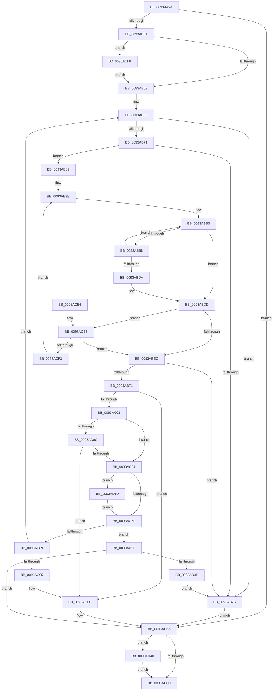

# PfpPrefetchDirectoryStream

- RVA: `0x0093AA94`–`0x0093AD52` (길이 `702` bytes)
- VA: `0x000000014093AA94`
- 실행 섹션: `PAGE`
- PDB 이름 있음: `예`; PDB Function 태그: `아니요`
- unwind 정보 RVA: `0x0008FD64`
- 디코드: `178`개 명령, `702/702` bytes 표시
- 미해석 바이트: `0` (있으면 어셈블리에 `.byte`로 보존)

> 이 문서는 커널 이미지의 기계어와 PDB 기호를 분석해 생성했습니다. 4번과 5번은 함수 원형과 자료형을 바이너리 사용 방식에서 추정한 C 해석이며 원본 소스 복구 결과는 아닙니다.

## 1. Dependencies

- 직접 호출 지점: **8**; 고유 호출 대상: **8**
- 직접 호출자로 확인된 함수: **1**
- RIP 상대 이미지 참조: **0**

### Outgoing calls
- `0x0093AB4B` → [PfpOpenHandleCreate](../8A/PfpOpenHandleCreate_function_008A9EDC.md) (function, `0x008A9EDC`)
- `0x0093ABF4` → [PfpCheckPrefetchAbort](../../text/49/PfpCheckPrefetchAbort_function_00492808.md) (function, `0x00492808`)
- `0x0093AC17` → [PfpAvailablePagesForPrefetch](PfpAvailablePagesForPrefetch_function_0093C800.md) (function, `0x0093C800`)
- `0x0093AC69` → [IopXxxControlFile](../8E/IopXxxControlFile_function_008E9AD0.md) (function, `0x008E9AD0`)
- `0x0093ACAA` → [KeBugCheckEx](../../text/4F/KeBugCheckEx_function_004FD660.md) (function, `0x004FD660`)
- `0x0093AD13` → [MmQueryMemoryListInformation](../../text/3B/MmQueryMemoryListInformation_function_003B9EDC.md) (function, `0x003B9EDC`)
- `0x0093AD25` → [PfpUpdateRepurposedByPrefetch](PfpUpdateRepurposedByPrefetch_function_0093C838.md) (function, `0x0093C838`)
- `0x0093AD48` → [PfpOpenHandleClose](../8A/PfpOpenHandleClose_function_008A9E74.md) (function, `0x008A9E74`)

### Direct callers
- [PfpVolumePrefetchMetadata](PfpVolumePrefetchMetadata_function_0093A158.md) at `0x0093A508`

### Static image references
- 디코드된 RIP-relative 메모리 참조가 없습니다.

## 2. Other-region calls and transfers

- 다른 실행 섹션으로 향하는 call: **3**
  - `0x0093ABF4` → [PfpCheckPrefetchAbort](../../text/49/PfpCheckPrefetchAbort_function_00492808.md) (`PAGE` → `.text`)
  - `0x0093ACAA` → [KeBugCheckEx](../../text/4F/KeBugCheckEx_function_004FD660.md) (`PAGE` → `.text`)
  - `0x0093AD13` → [MmQueryMemoryListInformation](../../text/3B/MmQueryMemoryListInformation_function_003B9EDC.md) (`PAGE` → `.text`)
- 별도 외부 분기/꼬리 이동을 확인하지 못했습니다.

## 3. Assembly (complete function range)

```asm
0093AA94  4C 8B DC                        mov r11, rsp
0093AA97  49 89 5B 10                     mov qword ptr [r11 + 0x10], rbx
0093AA9B  4D 89 4B 20                     mov qword ptr [r11 + 0x20], r9
0093AA9F  55                              push rbp
0093AAA0  56                              push rsi
0093AAA1  57                              push rdi
0093AAA2  41 54                           push r12
0093AAA4  41 55                           push r13
0093AAA6  41 56                           push r14
0093AAA8  41 57                           push r15
0093AAAA  48 81 EC 90 00 00 00            sub rsp, 0x90
0093AAB1  4C 8B 69 28                     mov r13, qword ptr [rcx + 0x28]
0093AAB5  48 8B F9                        mov rdi, rcx
0093AAB8  4C 8B 71 18                     mov r14, qword ptr [rcx + 0x18]
0093AABC  33 ED                           xor ebp, ebp
0093AABE  48 89 54 24 38                  mov qword ptr [rsp + 0x38], rdx
0093AAC3  4D 8B F8                        mov r15, r8
0093AAC6  0F 57 C0                        xorps xmm0, xmm0
0093AAC9  49 89 6B A8                     mov qword ptr [r11 - 0x58], rbp
0093AACD  0F 11 44 24 60                  movups xmmword ptr [rsp + 0x60], xmm0
0093AAD2  48 B8 00 00 00 00 02 00 00 00   movabs rax, 0x200000000
0093AADC  89 6C 24 30                     mov dword ptr [rsp + 0x30], ebp
0093AAE0  F3 0F 7F 44 24 78               movdqu xmmword ptr [rsp + 0x78], xmm0
0093AAE6  49 89 43 C0                     mov qword ptr [r11 - 0x40], rax
0093AAEA  49 8B D5                        mov rdx, r13
0093AAED  48 8B 01                        mov rax, qword ptr [rcx]
0093AAF0  44 8B E5                        mov r12d, ebp
0093AAF3  41 89 6B 20                     mov dword ptr [r11 + 0x20], ebp
0093AAF7  44 0F B7 40 1E                  movzx r8d, word ptr [rax + 0x1e]
0093AAFC  41 C7 06 04 00 00 00            mov dword ptr [r14], 4
0093AB03  48 8B 01                        mov rax, qword ptr [rcx]
0093AB06  44 89 84 24 D0 00 00 00         mov dword ptr [rsp + 0xd0], r8d
0093AB0E  8B 48 1C                        mov ecx, dword ptr [rax + 0x1c]
0093AB11  41 8B C0                        mov eax, r8d
0093AB14  4C 8B 84 24 F0 00 00 00         mov r8, qword ptr [rsp + 0xf0]
0093AB1C  83 E0 07                        and eax, 7
0093AB1F  C1 E0 03                        shl eax, 3
0093AB22  83 E1 07                        and ecx, 7
0093AB25  48 0B C8                        or rcx, rax
0093AB28  8B 84 24 F8 00 00 00            mov eax, dword ptr [rsp + 0xf8]
0093AB2F  49 89 4E 08                     mov qword ptr [r14 + 8], rcx
0093AB33  49 8D 4B A8                     lea rcx, [r11 - 0x58]
0093AB37  4D 8B 48 08                     mov r9, qword ptr [r8 + 8]
0093AB3B  4D 8B 40 10                     mov r8, qword ptr [r8 + 0x10]
0093AB3F  89 44 24 28                     mov dword ptr [rsp + 0x28], eax
0093AB43  C7 44 24 20 01 00 10 00         mov dword ptr [rsp + 0x20], 0x100001
0093AB4B  E8 8C F3 F6 FF                  call 0x1408a9edc
0093AB50  8B D8                           mov ebx, eax
0093AB52  85 C0                           test eax, eax
0093AB54  0F 88 5B 01 00 00               js 0x14093acb5
0093AB5A  48 8B 07                        mov rax, qword ptr [rdi]
0093AB5D  8B 48 50                        mov ecx, dword ptr [rax + 0x50]
0093AB60  F6 C1 04                        test cl, 4
0093AB63  0F 85 8F 01 00 00               jne 0x14093acf8
0093AB69  8B F5                           mov esi, ebp
0093AB6B  41 3B 77 10                     cmp esi, dword ptr [r15 + 0x10]
0093AB6F  73 0A                           jae 0x14093ab7b
0093AB71  41 89 6E 04                     mov dword ptr [r14 + 4], ebp
0093AB75  41 3B 77 10                     cmp esi, dword ptr [r15 + 0x10]
0093AB79  72 07                           jb 0x14093ab82
0093AB7B  8B DD                           mov ebx, ebp
0093AB7D  E9 33 01 00 00                  jmp 0x14093acb5
0093AB82  4C 8D 4F 20                     lea r9, [rdi + 0x20]
0093AB86  44 8B C5                        mov r8d, ebp
0093AB89  4D 8B D1                        mov r10, r9
0093AB8C  8B DD                           mov ebx, ebp
0093AB8E  49 8B 47 18                     mov rax, qword ptr [r15 + 0x18]
0093AB92  8B CE                           mov ecx, esi
0093AB94  48 03 C9                        add rcx, rcx
0093AB97  48 8B 14 C8                     mov rdx, qword ptr [rax + rcx*8]
0093AB9B  44 8B 5C C8 08                  mov r11d, dword ptr [rax + rcx*8 + 8]
0093ABA0  49 8B CC                        mov rcx, r12
0093ABA3  4C 03 DA                        add r11, rdx
0093ABA6  41 8B C0                        mov eax, r8d
0093ABA9  49 3B D4                        cmp rdx, r12
0093ABAC  44 8B C3                        mov r8d, ebx
0093ABAF  48 0F 43 CA                     cmovae rcx, rdx
0093ABB3  49 3B CB                        cmp rcx, r11
0093ABB6  73 25                           jae 0x14093abdd
0093ABB8  49 89 4C C6 10                  mov qword ptr [r14 + rax*8 + 0x10], rcx
0093ABBD  4D 8B CA                        mov r9, r10
0093ABC0  45 8B 46 04                     mov r8d, dword ptr [r14 + 4]
0093ABC4  48 81 C1 00 10 00 00            add rcx, 0x1000
0093ABCB  41 FF C0                        inc r8d
0093ABCE  45 89 46 04                     mov dword ptr [r14 + 4], r8d
0093ABD2  41 8B C0                        mov eax, r8d
0093ABD5  45 3B 02                        cmp r8d, dword ptr [r10]
0093ABD8  72 D9                           jb 0x14093abb3
0093ABDA  4C 8B E1                        mov r12, rcx
0093ABDD  41 8B D8                        mov ebx, r8d
0093ABE0  45 8B D8                        mov r11d, r8d
0093ABE3  45 3B 01                        cmp r8d, dword ptr [r9]
0093ABE6  0F 82 FB 00 00 00               jb 0x14093ace7
0093ABEC  45 85 DB                        test r11d, r11d
0093ABEF  74 8A                           je 0x14093ab7b
0093ABF1  48 8B CF                        mov rcx, rdi
0093ABF4  E8 0F 7C B5 FF                  call 0x140492808
0093ABF9  85 C0                           test eax, eax
0093ABFB  0F 85 AF 00 00 00               jne 0x14093acb0
0093AC01  48 8B 07                        mov rax, qword ptr [rdi]
0093AC04  8B 48 50                        mov ecx, dword ptr [rax + 0x50]
0093AC07  F6 C1 04                        test cl, 4
0093AC0A  74 18                           je 0x14093ac24
0093AC0C  8B 94 24 D0 00 00 00            mov edx, dword ptr [rsp + 0xd0]
0093AC13  48 8D 4F 30                     lea rcx, [rdi + 0x30]
0093AC17  E8 E4 1B 00 00                  call 0x14093c800
0093AC1C  85 C0                           test eax, eax
0093AC1E  0F 84 8C 00 00 00               je 0x14093acb0
0093AC24  83 64 24 58 00                  and dword ptr [rsp + 0x58], 0
0093AC29  42 8D 04 DD 10 00 00 00         lea eax, [r11*8 + 0x10]
0093AC31  48 8B 4C 24 70                  mov rcx, qword ptr [rsp + 0x70]
0093AC36  45 33 C9                        xor r9d, r9d
0093AC39  C6 44 24 50 00                  mov byte ptr [rsp + 0x50], 0
0093AC3E  45 33 C0                        xor r8d, r8d
0093AC41  83 64 24 48 00                  and dword ptr [rsp + 0x48], 0
0093AC46  33 D2                           xor edx, edx
0093AC48  48 83 64 24 40 00               and qword ptr [rsp + 0x40], 0
0093AC4E  89 44 24 38                     mov dword ptr [rsp + 0x38], eax
0093AC52  48 8D 44 24 60                  lea rax, [rsp + 0x60]
0093AC57  4C 89 74 24 30                  mov qword ptr [rsp + 0x30], r14
0093AC5C  C7 44 24 28 20 01 09 00         mov dword ptr [rsp + 0x28], 0x90120
0093AC64  48 89 44 24 20                  mov qword ptr [rsp + 0x20], rax
0093AC69  E8 62 EE FA FF                  call 0x1408e9ad0
0093AC6E  8B D8                           mov ebx, eax
0093AC70  48 8B 07                        mov rax, qword ptr [rdi]
0093AC73  8B 50 50                        mov edx, dword ptr [rax + 0x50]
0093AC76  F6 C2 04                        test dl, 4
0093AC79  0F 85 9E 00 00 00               jne 0x14093ad1d
0093AC7F  33 ED                           xor ebp, ebp
0093AC81  85 DB                           test ebx, ebx
0093AC83  0F 88 A6 00 00 00               js 0x14093ad2f
0093AC89  81 FB 03 01 00 00               cmp ebx, 0x103
0093AC8F  0F 85 D6 FE FF FF               jne 0x14093ab6b
0093AC95  45 33 C9                        xor r9d, r9d
0093AC98  48 89 6C 24 20                  mov qword ptr [rsp + 0x20], rbp
0093AC9D  45 33 C0                        xor r8d, r8d
0093ACA0  BA D5 15 00 00                  mov edx, 0x15d5
0093ACA5  B9 91 01 00 00                  mov ecx, 0x191
0093ACAA  E8 B1 29 BC FF                  call 0x1404fd660
0093ACAF  CC                              int3
0093ACB0  BB 40 02 00 C0                  mov ebx, 0xc0000240
0093ACB5  48 B8 00 00 00 00 04 00 00 00   movabs rax, 0x400000000
0093ACBF  48 85 84 24 88 00 00 00         test qword ptr [rsp + 0x88], rax
0093ACC7  75 77                           jne 0x14093ad40
0093ACC9  8B C3                           mov eax, ebx
0093ACCB  48 8B 9C 24 D8 00 00 00         mov rbx, qword ptr [rsp + 0xd8]
0093ACD3  48 81 C4 90 00 00 00            add rsp, 0x90
0093ACDA  41 5F                           pop r15
0093ACDC  41 5E                           pop r14
0093ACDE  41 5D                           pop r13
0093ACE0  41 5C                           pop r12
0093ACE2  5F                              pop rdi
0093ACE3  5E                              pop rsi
0093ACE4  5D                              pop rbp
0093ACE5  C3                              ret
0093ACE6  CC                              int3
0093ACE7  FF C6                           inc esi
0093ACE9  41 3B 77 10                     cmp esi, dword ptr [r15 + 0x10]
0093ACED  0F 83 F9 FE FF FF               jae 0x14093abec
0093ACF3  E9 96 FE FF FF                  jmp 0x14093ab8e
0093ACF8  48 8D 84 24 E8 00 00 00         lea rax, [rsp + 0xe8]
0093AD00  41 B8 B0 00 00 00               mov r8d, 0xb0
0093AD06  48 8D 57 30                     lea rdx, [rdi + 0x30]
0093AD0A  48 89 44 24 20                  mov qword ptr [rsp + 0x20], rax
0093AD0F  48 83 C9 FF                     or rcx, 0xffffffffffffffff
0093AD13  E8 C4 F1 A7 FF                  call 0x1403b9edc
0093AD18  E9 4C FE FF FF                  jmp 0x14093ab69
0093AD1D  41 8B 56 04                     mov edx, dword ptr [r14 + 4]
0093AD21  48 8D 4F 30                     lea rcx, [rdi + 0x30]
0093AD25  E8 0E 1B 00 00                  call 0x14093c838
0093AD2A  E9 50 FF FF FF                  jmp 0x14093ac7f
0093AD2F  81 FB 11 00 00 C0               cmp ebx, 0xc0000011
0093AD35  0F 85 7A FF FF FF               jne 0x14093acb5
0093AD3B  E9 3B FE FF FF                  jmp 0x14093ab7b
0093AD40  49 8B D5                        mov rdx, r13
0093AD43  48 8D 4C 24 70                  lea rcx, [rsp + 0x70]
0093AD48  E8 27 F1 F6 FF                  call 0x1408a9e74
0093AD4D  E9 77 FF FF FF                  jmp 0x14093acc9
```

## 4. C-style interpretation (structured pseudocode)

```c
__int64 __fastcall PfpPrefetchDirectoryStream(__int64 a1, __int64 a2, __int64 a3, __int64 a4, __int64 a5, unsigned int a6)
{
    __int64 result;
    __int64 v_r11;
    __int64 v_rbp;
    __int64 v_rsi;
    __int64 v_rsp;
    unsigned __int64 v_stack_m40;
    unsigned __int64 v_stack_m50;
    unsigned __int64 v_stack_m58;
    unsigned __int64 v_stack_m68;
    unsigned int v_stack_m70;
    unsigned __int8 v_stack_m78;
    unsigned int v_stack_m80;
    unsigned __int64 v_stack_m88;
    unsigned __int64 v_stack_m90;
    unsigned int v_stack_m98;
    unsigned int v_stack_mA0;
    unsigned int v_stack_mA8;
    unsigned __int64 v_stack_p10;
    unsigned __int64 v_stack_p20;
    unsigned __int64 v_stack_p70;
    unsigned int v_stack_p8;
    unsigned __int64 v_stack_pE8;

    *(unsigned __int64 *)(v_rsp + 16) = v_rbx;
    *(unsigned __int64 *)(v_rsp + 32) = a4;
    v_rsp = (v_rsp) - (144);
    v_rbp = 0;
    v_stack_m90 = a2;
    *(unsigned __int64 *)(v_rsp - 88) = 0;
    v_stack_m68 = v_xmm0;
    v_stack_m98 = 0;
    v_stack_m50 = v_xmm0;
    *(unsigned __int64 *)(v_rsp - 64) = result;
    *(unsigned int *)(v_rsp + 32) = 0;
    *(unsigned int *)(*(unsigned __int64 *)(a1 + 24)) = 4;
    v_stack_p8 = (unsigned int)(*(unsigned __int16 *)(*(unsigned __int64 *)(a1) + 30));
    result = (unsigned int)(((unsigned int)((unsigned int)(*(unsigned __int16 *)(*(unsigned __int64 *)(a1) + 30)))) & (7));
    result = (unsigned int)((result) << (3));
    a1 = (unsigned int)(((unsigned int)(*(unsigned int *)(*(unsigned __int64 *)(a1) + 28))) & (7));
    a1 = (a1) | (result);
    *(unsigned __int64 *)(*(unsigned __int64 *)(a1 + 24) + 8) = a1;
    v_stack_mA0 = (unsigned int)((unsigned int)(a6));
    v_stack_mA8 = 0x100001ULL;
    result = PfpOpenHandleCreate(v_rsp - 88, *(unsigned __int64 *)(a1 + 40), *(unsigned __int64 *)(a5 + 16), *(unsigned __int64 *)(a5 + 8));
    if (sign_flag) goto loc_0093ACB5;
    if ((((unsigned __int8)((unsigned int)(*(unsigned int *)(*(unsigned __int64 *)(a1) + 80)))) & (4)) != 0) goto loc_0093ACF8;
loc_0093AB69:
loc_0093AB6B:
    if (0 >= (*(unsigned int *)(a3 + 16))) goto loc_0093AB7B;
    *(unsigned int *)(*(unsigned __int64 *)(a1 + 24) + 4) = 0;
    if (0 < (*(unsigned int *)(a3 + 16))) goto loc_0093AB82;
loc_0093AB7B:
    goto loc_0093ACB5;
loc_0093AB82:
loc_0093AB8E:
    a1 = (0) + (0);
    v_r11 = ((unsigned int)(*(unsigned int *)(*(unsigned __int64 *)(a3 + 24) + a1 * 8 + 8))) + (*(unsigned __int64 *)(*(unsigned __int64 *)(a3 + 24) + a1 * 8));
    a1 = 0;
    if ((*(unsigned __int64 *)(*(unsigned __int64 *)(a3 + 24) + a1 * 8)) >= 0) { a1 = *(unsigned __int64 *)(*(unsigned __int64 *)(a3 + 24) + a1 * 8); }
loc_0093ABB3:
    if (a1 >= v_r11) goto loc_0093ABDD;
    *(unsigned __int64 *)(*(unsigned __int64 *)(a1 + 24) + 0 * 8 + 16) = a1;
    a1 = (a1) + (0x1000ULL);
    a3 = (unsigned int)(((unsigned int)(*(unsigned int *)(*(unsigned __int64 *)(a1 + 24) + 4))) + 1);
    *(unsigned int *)(*(unsigned __int64 *)(a1 + 24) + 4) = (unsigned int)(a3);
    if (((unsigned int)(a3)) < (*(unsigned int *)(a1 + 32))) goto loc_0093ABB3;
loc_0093ABDD:
    if (((unsigned int)(a3)) < (*(unsigned int *)(a1 + 32))) goto loc_0093ACE7;
loc_0093ABEC:
    if ((unsigned int)((unsigned int)((unsigned int)(a3))) == 0) goto loc_0093AB7B;
    result = PfpCheckPrefetchAbort(a1, *(unsigned __int64 *)(*(unsigned __int64 *)(a3 + 24) + a1 * 8), a3, a1 + 32);
    if ((unsigned int)(result) != 0) goto loc_0093ACB0;
    if ((((unsigned __int8)((unsigned int)(*(unsigned int *)(*(unsigned __int64 *)(a1) + 80)))) & (4)) == 0) goto loc_0093AC24;
    result = PfpAvailablePagesForPrefetch(a1 + 48, (unsigned int)(v_stack_p8), a3, a1 + 32);
    if ((unsigned int)(result) == 0) goto loc_0093ACB0;
loc_0093AC24:
    a4 = 0;
    v_stack_m78 = 0;
    a3 = 0;
    a2 = 0;
    v_stack_m90 = (unsigned int)((unsigned int)((unsigned int)(a3)) * 8 + 16);
    v_stack_m98 = *(unsigned __int64 *)(a1 + 24);
    v_stack_mA0 = 0x90120ULL;
    v_stack_mA8 = v_stack_m68;
    result = IopXxxControlFile(v_stack_m58, a2, a3, a4);
    if ((((unsigned __int8)((unsigned int)(*(unsigned int *)(*(unsigned __int64 *)(a1) + 80)))) & (4)) != 0) goto loc_0093AD1D;
loc_0093AC7F:
    v_rbp = 0;
    if (sign_flag) goto loc_0093AD2F;
    if (((unsigned int)((unsigned int)((unsigned int)(result)))) != 259) goto loc_0093AB6B;
    a4 = 0;
    v_stack_mA8 = 0;
    a3 = 0;
    result = KeBugCheckEx(401, (unsigned int)(0x15D5ULL), a3, a4);
loc_0093ACB0:
loc_0093ACB5:
    if (((v_stack_m40) & (result)) != 0) goto loc_0093AD40;
loc_0093ACC9:
    v_rsp = (v_rsp) + (144);
    return (unsigned int)((unsigned int)((unsigned int)(0xC0000240ULL)));
loc_0093ACE7:
    v_rsi = (unsigned int)((0) + 1);
    if (((unsigned int)(v_rsi)) >= (*(unsigned int *)(a3 + 16))) goto loc_0093ABEC;
    goto loc_0093AB8E;
loc_0093ACF8:
    v_stack_p20 = v_stack_pE8;
    a1 = (401) | (-1);
    result = MmQueryMemoryListInformation(a1, a1 + 48, 176, a4);
    goto loc_0093AB69;
loc_0093AD1D:
    result = PfpUpdateRepurposedByPrefetch(a1 + 48, (unsigned int)(*(unsigned int *)(*(unsigned __int64 *)(a1 + 24) + 4)), 176, a4);
    goto loc_0093AC7F;
loc_0093AD2F:
    if (((unsigned int)(v_stack_p10)) != 0xC0000011ULL) goto loc_0093ACB5;
    goto loc_0093AB7B;
loc_0093AD40:
    result = PfpOpenHandleClose(v_stack_p70, *(unsigned __int64 *)(a1 + 40), 176, a4);
    goto loc_0093ACC9;
}
```

## 5. (Beta) C Style

```c
int64_t PfpPrefetchDirectoryStream(void *Arg1, int64_t Arg2, void *Arg3, int64_t Arg4, void *Arg5, uint32_t Arg6)
{
    uint8_t *arg1 = (uint8_t *)Arg1;
    uint8_t *arg3 = (uint8_t *)Arg3;
    uint8_t *arg5 = (uint8_t *)Arg5;

    int64_t result;
    int64_t local_r11;
    int64_t local_rbp;
    int64_t local_rsi;
    int64_t local_rsp;
    uint64_t v_stack_m40;
    uint64_t v_stack_m50;
    uint64_t v_stack_m58;
    uint64_t v_stack_m68;
    uint32_t v_stack_m70;
    uint8_t v_stack_m78;
    uint32_t v_stack_m80;
    uint64_t v_stack_m88;
    uint64_t v_stack_m90;
    uint32_t v_stack_m98;
    uint32_t v_stack_mA0;
    uint32_t v_stack_mA8;
    uint64_t v_stack_p10;
    uint64_t v_stack_p20;
    uint64_t v_stack_p70;
    uint32_t v_stack_p8;
    uint64_t v_stack_pE8;

    *(uint64_t *)(local_rsp + 0x10) = local_rbx;
    *(uint64_t *)(local_rsp + 0x20) = Arg4;
    local_rsp = (local_rsp) - (144);
    local_rbp = 0;
    v_stack_m90 = Arg2;
    *(uint64_t *)(local_rsp - 0x58) = 0;
    v_stack_m68 = v_xmm0;
    v_stack_m98 = 0;
    v_stack_m50 = v_xmm0;
    *(uint64_t *)(local_rsp - 0x40) = result;
    *(uint32_t *)(local_rsp + 0x20) = 0;
    *(uint32_t *)(*(uint64_t *)(arg1 + 0x18)) = 4;
    v_stack_p8 = (uint32_t)(*(uint16_t *)(*(uint64_t *)(arg1) + 0x1E));
    result = (uint32_t)(((uint32_t)((uint32_t)(*(uint16_t *)(*(uint64_t *)(arg1) + 0x1E)))) & (7));
    result = (uint32_t)((result) << (3));
    Arg1 = (uint32_t)(((uint32_t)(*(uint32_t *)(*(uint64_t *)(arg1) + 0x1C))) & (7));
    Arg1 = (Arg1) | (result);
    *(void **)(*(uint64_t *)(arg1 + 0x18) + 0x8) = Arg1;
    v_stack_mA0 = (uint32_t)((uint32_t)(Arg6));
    v_stack_mA8 = 0x100001ULL;
    result = PfpOpenHandleCreate(local_rsp - 88, *(uint64_t *)(arg1 + 0x28), *(uint64_t *)(arg5 + 0x10), *(uint64_t *)(arg5 + 0x8));
    if (sign_flag) goto loc_0093ACB5;
    if ((((uint8_t)((uint32_t)(*(uint32_t *)(*(uint64_t *)(arg1) + 0x50)))) & (4)) != 0) goto loc_0093ACF8;
loc_0093AB69:
loc_0093AB6B:
    if (0 >= (*(uint32_t *)(arg3 + 0x10))) goto loc_0093AB7B;
    *(uint32_t *)(*(uint64_t *)(arg1 + 0x18) + 0x4) = 0;
    if (0 < (*(uint32_t *)(arg3 + 0x10))) goto loc_0093AB82;
loc_0093AB7B:
    goto loc_0093ACB5;
loc_0093AB82:
loc_0093AB8E:
    Arg1 = (0) + (0);
    local_r11 = ((uint32_t)(*(uint32_t *)(*(uint64_t *)(arg3 + 0x18) + arg1 * 8 + 0x8))) + (*(uint64_t *)(*(uint64_t *)(arg3 + 0x18) + arg1 * 8));
    Arg1 = 0;
    if ((*(uint64_t *)(*(uint64_t *)(arg3 + 0x18) + arg1 * 8)) >= 0) { Arg1 = *(uint64_t *)(*(uint64_t *)(arg3 + 0x18) + arg1 * 8); }
loc_0093ABB3:
    if (Arg1 >= local_r11) goto loc_0093ABDD;
    *(void **)(*(uint64_t *)(arg1 + 0x18) + 0x0 * 8 + 0x10) = Arg1;
    Arg1 = (Arg1) + (0x1000ULL);
    Arg3 = (uint32_t)(((uint32_t)(*(uint32_t *)(*(uint64_t *)(arg1 + 0x18) + 0x4))) + 1);
    *(uint32_t *)(*(uint64_t *)(arg1 + 0x18) + 0x4) = (uint32_t)(Arg3);
    if (((uint32_t)(Arg3)) < (*(uint32_t *)(arg1 + 0x20))) goto loc_0093ABB3;
loc_0093ABDD:
    if (((uint32_t)(Arg3)) < (*(uint32_t *)(arg1 + 0x20))) goto loc_0093ACE7;
loc_0093ABEC:
    if ((uint32_t)((uint32_t)((uint32_t)(Arg3))) == 0) goto loc_0093AB7B;
    result = PfpCheckPrefetchAbort(Arg1, *(uint64_t *)(*(uint64_t *)(arg3 + 0x18) + arg1 * 8), Arg3, Arg1 + 32);
    if ((uint32_t)(result) != 0) goto loc_0093ACB0;
    if ((((uint8_t)((uint32_t)(*(uint32_t *)(*(uint64_t *)(arg1) + 0x50)))) & (4)) == 0) goto loc_0093AC24;
    result = PfpAvailablePagesForPrefetch(Arg1 + 48, (uint32_t)(v_stack_p8), Arg3, Arg1 + 32);
    if ((uint32_t)(result) == 0) goto loc_0093ACB0;
loc_0093AC24:
    Arg4 = 0;
    v_stack_m78 = 0;
    Arg3 = 0;
    Arg2 = 0;
    v_stack_m90 = (uint32_t)((uint32_t)((uint32_t)(Arg3)) * 8 + 16);
    v_stack_m98 = *(uint64_t *)(arg1 + 0x18);
    v_stack_mA0 = 0x90120ULL;
    v_stack_mA8 = v_stack_m68;
    result = IopXxxControlFile(v_stack_m58, Arg2, Arg3, Arg4);
    if ((((uint8_t)((uint32_t)(*(uint32_t *)(*(uint64_t *)(arg1) + 0x50)))) & (4)) != 0) goto loc_0093AD1D;
loc_0093AC7F:
    local_rbp = 0;
    if (sign_flag) goto loc_0093AD2F;
    if (((uint32_t)((uint32_t)((uint32_t)(result)))) != 259) goto loc_0093AB6B;
    Arg4 = 0;
    v_stack_mA8 = 0;
    Arg3 = 0;
    result = KeBugCheckEx(401, (uint32_t)(0x15D5ULL), Arg3, Arg4);
loc_0093ACB0:
loc_0093ACB5:
    if (((v_stack_m40) & (result)) != 0) goto loc_0093AD40;
loc_0093ACC9:
    local_rsp = (local_rsp) + (144);
    return (uint32_t)((uint32_t)((uint32_t)(0xC0000240ULL)));
loc_0093ACE7:
    local_rsi = (uint32_t)((0) + 1);
    if (((uint32_t)(local_rsi)) >= (*(uint32_t *)(arg3 + 0x10))) goto loc_0093ABEC;
    goto loc_0093AB8E;
loc_0093ACF8:
    v_stack_p20 = v_stack_pE8;
    Arg1 = (401) | (-1);
    result = MmQueryMemoryListInformation(Arg1, Arg1 + 48, 176, Arg4);
    goto loc_0093AB69;
loc_0093AD1D:
    result = PfpUpdateRepurposedByPrefetch(Arg1 + 48, (uint32_t)(*(uint32_t *)(*(uint64_t *)(arg1 + 0x18) + 0x4)), 176, Arg4);
    goto loc_0093AC7F;
loc_0093AD2F:
    if (((uint32_t)(v_stack_p10)) != 0xC0000011ULL) goto loc_0093ACB5;
    goto loc_0093AB7B;
loc_0093AD40:
    result = PfpOpenHandleClose(v_stack_p70, *(uint64_t *)(arg1 + 0x28), 176, Arg4);
    goto loc_0093ACC9;
}
```

### 관측된 메모리 오프셋

구조체 형식이 확인되지 않은 접근은 인자 기준의 오프셋으로만 기록했습니다.

| 기준 인자 | 오프셋 표현 | 폭 (bit) | 접근 |
|---|---:|---:|---|
| `Arg1` | `+ 0x0` | `32` | `R` |
| `Arg1` | `+ 0x0` | `64` | `R` |
| `Arg1` | `+ 0x18` | `64` | `R` |
| `Arg1` | `+ 0x20` | `64` | `R` |
| `Arg1` | `+ 0x28` | `64` | `R` |
| `Arg1` | `+ 0x30` | `64` | `R` |
| `Arg3` | `+ 0x10` | `32` | `R` |
| `Arg3` | `+ 0x18` | `64` | `R` |
| `Arg5` | `+ 0x8` | `64` | `R` |
| `Arg5` | `+ 0x10` | `64` | `R` |

## 6. Execution-region graph

[열기: 2D/3D 그래프와 함수 탐색 컨트롤 패널](../../../control-panel.html?section=page&rva=0x0093AA94&view=graph)

- 2D 그래프는 위에서 아래로 흐르고, 3D 그래프는 빈 공간을 드래그해 회전합니다. Shift+드래그는 이동, 휠은 확대·축소, 함수 노드 선택은 대상 보고서 이동입니다.

### Static fallback


