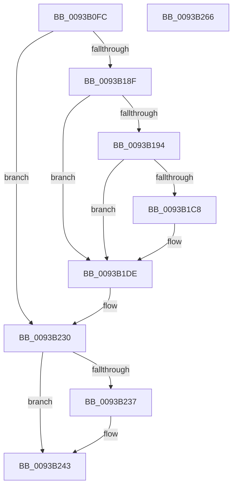

# PfpPrefetchEntireDirectory

- RVA: `0x0093B0FC`–`0x0093B267` (길이 `363` bytes)
- VA: `0x000000014093B0FC`
- 실행 섹션: `PAGE`
- PDB 이름 있음: `예`; PDB Function 태그: `아니요`
- unwind 정보 RVA: `0x0008FDA0`
- 디코드: `94`개 명령, `363/363` bytes 표시
- 미해석 바이트: `0` (있으면 어셈블리에 `.byte`로 보존)

> 이 문서는 커널 이미지의 기계어와 PDB 기호를 분석해 생성했습니다. 4번과 5번은 함수 원형과 자료형을 바이너리 사용 방식에서 추정한 C 해석이며 원본 소스 복구 결과는 아닙니다.

## 1. Dependencies

- 직접 호출 지점: **4**; 고유 호출 대상: **4**
- 직접 호출자로 확인된 함수: **1**
- RIP 상대 이미지 참조: **0**

### Outgoing calls
- `0x0093B17C` → [PfpOpenHandleCreate](../8A/PfpOpenHandleCreate_function_008A9EDC.md) (function, `0x008A9EDC`)
- `0x0093B1BF` → [IopQueryXxxInformation](../8A/IopQueryXxxInformation_function_008A89D0.md) (function, `0x008A89D0`)
- `0x0093B223` → [IopXxxControlFile](../8E/IopXxxControlFile_function_008E9AD0.md) (function, `0x008E9AD0`)
- `0x0093B23E` → [PfpOpenHandleClose](../8A/PfpOpenHandleClose_function_008A9E74.md) (function, `0x008A9E74`)

### Direct callers
- [PfSnPrefetchMetadata](PfSnPrefetchMetadata_function_0093B9B4.md) at `0x0093BBBF`

### Static image references
- 디코드된 RIP-relative 메모리 참조가 없습니다.

## 2. Other-region calls and transfers

- 다른 실행 섹션으로 향하는 call: **0**
- 별도 외부 분기/꼬리 이동을 확인하지 못했습니다.

## 3. Assembly (complete function range)

```asm
0093B0FC  4C 8B DC                        mov r11, rsp
0093B0FF  49 89 5B 08                     mov qword ptr [r11 + 8], rbx
0093B103  49 89 73 10                     mov qword ptr [r11 + 0x10], rsi
0093B107  49 89 7B 18                     mov qword ptr [r11 + 0x18], rdi
0093B10B  4D 89 63 20                     mov qword ptr [r11 + 0x20], r12
0093B10F  55                              push rbp
0093B110  41 56                           push r14
0093B112  41 57                           push r15
0093B114  49 8D 6B B1                     lea rbp, [r11 - 0x4f]
0093B118  48 81 EC A0 00 00 00            sub rsp, 0xa0
0093B11F  49 89 53 80                     mov qword ptr [r11 - 0x80], rdx
0093B123  4D 8B F8                        mov r15, r8
0093B126  4C 8B 45 77                     mov r8, qword ptr [rbp + 0x77]
0093B12A  45 33 E4                        xor r12d, r12d
0093B12D  49 8B D9                        mov rbx, r9
0093B130  44 89 64 24 30                  mov dword ptr [rsp + 0x30], r12d
0093B135  4C 8B F1                        mov r14, rcx
0093B138  C7 44 24 28 21 40 00 00         mov dword ptr [rsp + 0x28], 0x4021
0093B140  0F 57 C0                        xorps xmm0, xmm0
0093B143  4C 89 65 F7                     mov qword ptr [rbp - 9], r12
0093B147  4D 8B 48 08                     mov r9, qword ptr [r8 + 8]
0093B14B  0F 57 C9                        xorps xmm1, xmm1
0093B14E  4D 8B 40 10                     mov r8, qword ptr [r8 + 0x10]
0093B152  48 B8 00 00 00 00 02 00 00 00   movabs rax, 0x200000000
0093B15C  48 8B D1                        mov rdx, rcx
0093B15F  4C 89 65 0F                     mov qword ptr [rbp + 0xf], r12
0093B163  48 8D 4D 0F                     lea rcx, [rbp + 0xf]
0093B167  48 89 45 27                     mov qword ptr [rbp + 0x27], rax
0093B16B  0F 11 45 FF                     movups xmmword ptr [rbp - 1], xmm0
0093B16F  C7 44 24 20 01 00 10 00         mov dword ptr [rsp + 0x20], 0x100001
0093B177  F3 0F 7F 4D 17                  movdqu xmmword ptr [rbp + 0x17], xmm1
0093B17C  E8 5B ED F6 FF                  call 0x1408a9edc
0093B181  48 8B 75 27                     mov rsi, qword ptr [rbp + 0x27]
0093B185  8B F8                           mov edi, eax
0093B187  85 C0                           test eax, eax
0093B189  0F 88 A1 00 00 00               js 0x14093b230
0093B18F  48 85 DB                        test rbx, rbx
0093B192  74 4A                           je 0x14093b1de
0093B194  48 8B 7D 17                     mov rdi, qword ptr [rbp + 0x17]
0093B198  48 8D 45 7F                     lea rax, [rbp + 0x7f]
0093B19C  C6 44 24 30 01                  mov byte ptr [rsp + 0x30], 1
0093B1A1  41 8D 54 24 06                  lea edx, [r12 + 6]
0093B1A6  48 89 44 24 28                  mov qword ptr [rsp + 0x28], rax
0093B1AB  45 8D 44 24 08                  lea r8d, [r12 + 8]
0093B1B0  48 8D 45 F7                     lea rax, [rbp - 9]
0093B1B4  45 33 C9                        xor r9d, r9d
0093B1B7  48 8B CF                        mov rcx, rdi
0093B1BA  48 89 44 24 20                  mov qword ptr [rsp + 0x20], rax
0093B1BF  E8 0C D8 F6 FF                  call 0x1408a89d0
0093B1C4  85 C0                           test eax, eax
0093B1C6  78 16                           js 0x14093b1de
0093B1C8  8B 45 F7                        mov eax, dword ptr [rbp - 9]
0093B1CB  89 43 0C                        mov dword ptr [rbx + 0xc], eax
0093B1CE  8B 45 FB                        mov eax, dword ptr [rbp - 5]
0093B1D1  89 43 10                        mov dword ptr [rbx + 0x10], eax
0093B1D4  48 8B 47 18                     mov rax, qword ptr [rdi + 0x18]
0093B1D8  48 89 03                        mov qword ptr [rbx], rax
0093B1DB  89 73 08                        mov dword ptr [rbx + 8], esi
0093B1DE  41 8B 47 04                     mov eax, dword ptr [r15 + 4]
0093B1E2  45 33 C9                        xor r9d, r9d
0093B1E5  48 8B 4D 0F                     mov rcx, qword ptr [rbp + 0xf]
0093B1E9  45 33 C0                        xor r8d, r8d
0093B1EC  44 89 64 24 58                  mov dword ptr [rsp + 0x58], r12d
0093B1F1  33 D2                           xor edx, edx
0093B1F3  44 88 64 24 50                  mov byte ptr [rsp + 0x50], r12b
0093B1F8  44 89 64 24 48                  mov dword ptr [rsp + 0x48], r12d
0093B1FD  8D 04 C5 10 00 00 00            lea eax, [rax*8 + 0x10]
0093B204  4C 89 64 24 40                  mov qword ptr [rsp + 0x40], r12
0093B209  89 44 24 38                     mov dword ptr [rsp + 0x38], eax
0093B20D  48 8D 45 FF                     lea rax, [rbp - 1]
0093B211  4C 89 7C 24 30                  mov qword ptr [rsp + 0x30], r15
0093B216  C7 44 24 28 20 01 09 00         mov dword ptr [rsp + 0x28], 0x90120
0093B21E  48 89 44 24 20                  mov qword ptr [rsp + 0x20], rax
0093B223  E8 A8 E8 FA FF                  call 0x1408e9ad0
0093B228  85 C0                           test eax, eax
0093B22A  8B F8                           mov edi, eax
0093B22C  41 0F 49 FC                     cmovns edi, r12d
0093B230  48 0F BA E6 22                  bt rsi, 0x22
0093B235  73 0C                           jae 0x14093b243
0093B237  49 8B D6                        mov rdx, r14
0093B23A  48 8D 4D 0F                     lea rcx, [rbp + 0xf]
0093B23E  E8 31 EC F6 FF                  call 0x1408a9e74
0093B243  4C 8D 9C 24 A0 00 00 00         lea r11, [rsp + 0xa0]
0093B24B  8B C7                           mov eax, edi
0093B24D  49 8B 5B 20                     mov rbx, qword ptr [r11 + 0x20]
0093B251  49 8B 73 28                     mov rsi, qword ptr [r11 + 0x28]
0093B255  49 8B 7B 30                     mov rdi, qword ptr [r11 + 0x30]
0093B259  4D 8B 63 38                     mov r12, qword ptr [r11 + 0x38]
0093B25D  49 8B E3                        mov rsp, r11
0093B260  41 5F                           pop r15
0093B262  41 5E                           pop r14
0093B264  5D                              pop rbp
0093B265  C3                              ret
0093B266  CC                              int3
```

## 4. C-style interpretation (structured pseudocode)

```c
__int64 __fastcall PfpPrefetchEntireDirectory(__int64 a1, __int64 a2, __int64 a3, __int64 a4)
{
    __int64 result;
    __int64 v_r12;
    __int64 v_rdi;
    __int64 v_rsp;
    unsigned __int64 v_stack_m18;
    unsigned int v_stack_m60;
    unsigned __int8 v_stack_m68;
    unsigned int v_stack_m70;
    unsigned __int64 v_stack_m78;
    unsigned int v_stack_m80;
    unsigned int v_stack_m88;
    unsigned int v_stack_m90;
    unsigned int v_stack_m98;

    *(unsigned __int64 *)(v_rsp + 8) = v_rbx;
    *(unsigned __int64 *)(v_rsp + 16) = v_rsi;
    *(unsigned __int64 *)(v_rsp + 24) = v_rdi;
    *(unsigned __int64 *)(v_rsp + 32) = v_r12;
    v_rsp = (v_rsp) - (160);
    *(unsigned __int64 *)(v_rsp - 128) = a2;
    v_r12 = 0;
    v_stack_m88 = 0;
    v_stack_m90 = 0x4021ULL;
    *(unsigned __int64 *)(v_rsp - 79 - 9) = 0;
    *(unsigned __int64 *)(v_rsp - 79 + 15) = 0;
    *(unsigned __int64 *)(v_rsp - 79 + 39) = result;
    *(unsigned __int64 *)(v_rsp - 79 - 1) = v_xmm0;
    v_stack_m98 = 0x100001ULL;
    *(unsigned __int64 *)(v_rsp - 79 + 23) = v_xmm1;
    result = PfpOpenHandleCreate(v_rsp - 79 + 15, a1, *(unsigned __int64 *)(*(unsigned __int64 *)(v_rsp - 79 + 119) + 16), *(unsigned __int64 *)(*(unsigned __int64 *)(v_rsp - 79 + 119) + 8));
    if (sign_flag) goto loc_0093B230;
    if (a4 == 0) goto loc_0093B1DE;
    v_stack_m88 = 1;
    v_stack_m90 = v_rsp - 79 + 127;
    a4 = 0;
    v_stack_m98 = v_rsp - 79 - 9;
    result = IopQueryXxxInformation(*(unsigned __int64 *)(v_rsp - 79 + 23), v_r12 + 6, v_r12 + 8, a4);
    if (!(sign_flag)) {
        result = *(unsigned int *)(v_rsp - 79 - 9);
        *(unsigned int *)(a4 + 12) = (unsigned int)(result);
        result = *(unsigned int *)(v_rsp - 79 - 5);
        *(unsigned int *)(a4 + 16) = (unsigned int)(result);
        result = *(unsigned __int64 *)(*(unsigned __int64 *)(v_rsp - 79 + 23) + 24);
        *(unsigned __int64 *)(a4) = result;
        *(unsigned int *)(a4 + 8) = (unsigned int)(*(unsigned __int64 *)(v_rsp - 79 + 39));
    }
    a4 = 0;
    a3 = 0;
    v_stack_m60 = 0;
    a2 = 0;
    v_stack_m68 = 0;
    v_stack_m70 = 0;
    v_stack_m78 = 0;
    v_stack_m80 = (unsigned int)((unsigned int)(*(unsigned int *)(a3 + 4)) * 8 + 16);
    v_stack_m88 = 0;
    v_stack_m90 = 0x90120ULL;
    v_stack_m98 = v_rsp - 79 - 1;
    result = IopXxxControlFile(*(unsigned __int64 *)(v_rsp - 79 + 15), a2, a3, a4);
    v_rdi = (unsigned int)((unsigned int)(result));
    if (!sign_flag) { v_rdi = 0; }
loc_0093B230:
    if (!(condition_is_above_or_equal)) {
        a2 = a1;
        a1 = v_rsp - 79 + 15;
        result = PfpOpenHandleClose(a1, a2, a3, a4);
    }
    return (unsigned int)((unsigned int)(v_rdi));
}
```

## 5. (Beta) C Style

```c
int64_t PfpPrefetchEntireDirectory(int64_t Arg1, int64_t Arg2, void *Arg3, int64_t Arg4)
{
    uint8_t *arg3 = (uint8_t *)Arg3;

    int64_t result;
    int64_t local_r12;
    int64_t local_rdi;
    int64_t local_rsp;
    uint64_t v_stack_m18;
    uint32_t v_stack_m60;
    uint8_t v_stack_m68;
    uint32_t v_stack_m70;
    uint64_t v_stack_m78;
    uint32_t v_stack_m80;
    uint32_t v_stack_m88;
    uint32_t v_stack_m90;
    uint32_t v_stack_m98;

    *(uint64_t *)(local_rsp + 0x8) = local_rbx;
    *(uint64_t *)(local_rsp + 0x10) = local_rsi;
    *(uint64_t *)(local_rsp + 0x18) = local_rdi;
    *(uint64_t *)(local_rsp + 0x20) = local_r12;
    local_rsp = (local_rsp) - (160);
    *(uint64_t *)(local_rsp - 0x80) = Arg2;
    local_r12 = 0;
    v_stack_m88 = 0;
    v_stack_m90 = 0x4021ULL;
    *(uint64_t *)(local_rsp - 0x4F - 0x9) = 0;
    *(uint64_t *)(local_rsp - 0x4F + 0xF) = 0;
    *(uint64_t *)(local_rsp - 0x4F + 0x27) = result;
    *(uint64_t *)(local_rsp - 0x4F - 0x1) = v_xmm0;
    v_stack_m98 = 0x100001ULL;
    *(uint64_t *)(local_rsp - 0x4F + 0x17) = v_xmm1;
    result = PfpOpenHandleCreate(local_rsp - 79 + 15, Arg1, *(uint64_t *)(*(uint64_t *)(local_rsp - 0x4F + 0x77) + 0x10), *(uint64_t *)(*(uint64_t *)(local_rsp - 0x4F + 0x77) + 0x8));
    if (sign_flag) goto loc_0093B230;
    if (Arg4 == 0) goto loc_0093B1DE;
    v_stack_m88 = 1;
    v_stack_m90 = local_rsp - 79 + 127;
    Arg4 = 0;
    v_stack_m98 = local_rsp - 79 - 9;
    result = IopQueryXxxInformation(*(uint64_t *)(local_rsp - 0x4F + 0x17), local_r12 + 6, local_r12 + 8, Arg4);
    if (!(sign_flag)) {
        result = *(uint32_t *)(local_rsp - 0x4F - 0x9);
        *(uint32_t *)(Arg4 + 0xC) = (uint32_t)(result);
        result = *(uint32_t *)(local_rsp - 0x4F - 0x5);
        *(uint32_t *)(Arg4 + 0x10) = (uint32_t)(result);
        result = *(uint64_t *)(*(uint64_t *)(local_rsp - 0x4F + 0x17) + 0x18);
        *(uint64_t *)(Arg4) = result;
        *(uint32_t *)(Arg4 + 0x8) = (uint32_t)(*(uint64_t *)(local_rsp - 0x4F + 0x27));
    }
    Arg4 = 0;
    Arg3 = 0;
    v_stack_m60 = 0;
    Arg2 = 0;
    v_stack_m68 = 0;
    v_stack_m70 = 0;
    v_stack_m78 = 0;
    v_stack_m80 = (uint32_t)((uint32_t)(*(uint32_t *)(arg3 + 0x4)) * 8 + 16);
    v_stack_m88 = 0;
    v_stack_m90 = 0x90120ULL;
    v_stack_m98 = local_rsp - 79 - 1;
    result = IopXxxControlFile(*(uint64_t *)(local_rsp - 0x4F + 0xF), Arg2, Arg3, Arg4);
    local_rdi = (uint32_t)((uint32_t)(result));
    if (!sign_flag) { local_rdi = 0; }
loc_0093B230:
    if (!(condition_is_above_or_equal)) {
        Arg2 = Arg1;
        Arg1 = local_rsp - 79 + 15;
        result = PfpOpenHandleClose(Arg1, Arg2, Arg3, Arg4);
    }
    return (uint32_t)((uint32_t)(local_rdi));
}
```

### 관측된 메모리 오프셋

구조체 형식이 확인되지 않은 접근은 인자 기준의 오프셋으로만 기록했습니다.

| 기준 인자 | 오프셋 표현 | 폭 (bit) | 접근 |
|---|---:|---:|---|
| `Arg3` | `+ 0x4` | `32` | `R` |

## 6. Execution-region graph

[열기: 2D/3D 그래프와 함수 탐색 컨트롤 패널](../../../control-panel.html?section=page&rva=0x0093B0FC&view=graph)

- 2D 그래프는 위에서 아래로 흐르고, 3D 그래프는 빈 공간을 드래그해 회전합니다. Shift+드래그는 이동, 휠은 확대·축소, 함수 노드 선택은 대상 보고서 이동입니다.

### Static fallback


