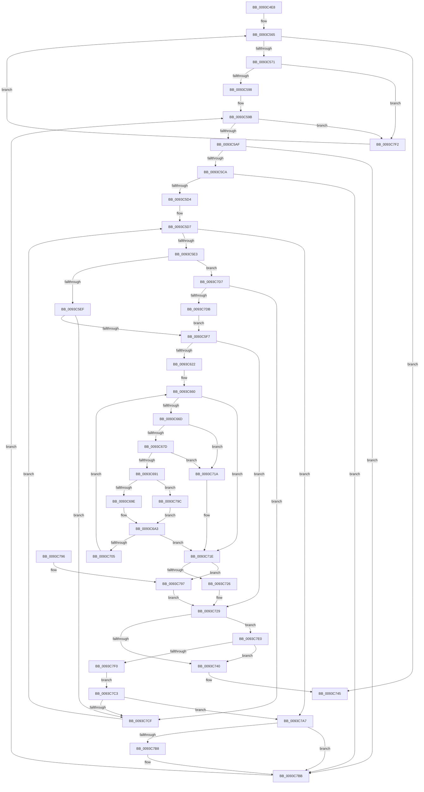

# PfpPrefetchFilesTrickle

- RVA: `0x0093C4E8`–`0x0093C7F9` (길이 `785` bytes)
- VA: `0x000000014093C4E8`
- 실행 섹션: `PAGE`
- PDB 이름 있음: `예`; PDB Function 태그: `아니요`
- unwind 정보 RVA: `0x0008FF08`
- 디코드: `218`개 명령, `785/785` bytes 표시
- 미해석 바이트: `0` (있으면 어셈블리에 `.byte`로 보존)

> 이 문서는 커널 이미지의 기계어와 PDB 기호를 분석해 생성했습니다. 4번과 5번은 함수 원형과 자료형을 바이너리 사용 방식에서 추정한 C 해석이며 원본 소스 복구 결과는 아닙니다.

## 1. Dependencies

- 직접 호출 지점: **10**; 고유 호출 대상: **9**
- 직접 호출자로 확인된 함수: **1**
- RIP 상대 이미지 참조: **0**

### Outgoing calls
- `0x0093C5FB` → [PfpReadSupportInitialize](../../text/4A/PfpReadSupportInitialize_function_004ABE20.md) (function, `0x004ABE20`)
- `0x0093C615` → [PfpFileBuildReadSupport](PfpFileBuildReadSupport_function_0093B504.md) (function, `0x0093B504`)
- `0x0093C65B` → [MmQueryMemoryListInformation](../../text/3B/MmQueryMemoryListInformation_function_003B9EDC.md) (function, `0x003B9EDC`)
- `0x0093C670` → [PfpCheckPrefetchAbort](../../text/49/PfpCheckPrefetchAbort_function_00492808.md) (function, `0x00492808`)
- `0x0093C684` → [PfpAvailablePagesForPrefetch](PfpAvailablePagesForPrefetch_function_0093C800.md) (function, `0x0093C800`)
- `0x0093C6C2` → [memcpy](../../text/6C/memcpy_function_006C6840.md) (function, `0x006C6840`)
- `0x0093C6EA` → [MmPrefetchPagesEx](MmPrefetchPagesEx_function_0093C9A0.md) (function, `0x0093C9A0`)
- `0x0093C6FC` → [PfpUpdateRepurposedByPrefetch](PfpUpdateRepurposedByPrefetch_function_0093C838.md) (function, `0x0093C838`)
- `0x0093C731` → [PfpReadSupportCleanup](PfpReadSupportCleanup_function_0093B8E0.md) (function, `0x0093B8E0`)
- `0x0093C7E3` → [PfpCheckPrefetchAbort](../../text/49/PfpCheckPrefetchAbort_function_00492808.md) (function, `0x00492808`)

### Direct callers
- [PfpPrefetchRequestPerform](PfpPrefetchRequestPerform_function_00938F74.md) at `0x00939393`

### Static image references
- 디코드된 RIP-relative 메모리 참조가 없습니다.

## 2. Other-region calls and transfers

- 다른 실행 섹션으로 향하는 call: **5**
  - `0x0093C5FB` → [PfpReadSupportInitialize](../../text/4A/PfpReadSupportInitialize_function_004ABE20.md) (`PAGE` → `.text`)
  - `0x0093C65B` → [MmQueryMemoryListInformation](../../text/3B/MmQueryMemoryListInformation_function_003B9EDC.md) (`PAGE` → `.text`)
  - `0x0093C670` → [PfpCheckPrefetchAbort](../../text/49/PfpCheckPrefetchAbort_function_00492808.md) (`PAGE` → `.text`)
  - `0x0093C6C2` → [memcpy](../../text/6C/memcpy_function_006C6840.md) (`PAGE` → `.text`)
  - `0x0093C7E3` → [PfpCheckPrefetchAbort](../../text/49/PfpCheckPrefetchAbort_function_00492808.md) (`PAGE` → `.text`)
- 별도 외부 분기/꼬리 이동을 확인하지 못했습니다.

## 3. Assembly (complete function range)

```asm
0093C4E8  40 55                           push rbp
0093C4EA  53                              push rbx
0093C4EB  56                              push rsi
0093C4EC  57                              push rdi
0093C4ED  41 54                           push r12
0093C4EF  41 55                           push r13
0093C4F1  41 56                           push r14
0093C4F3  41 57                           push r15
0093C4F5  48 8D 6C 24 E1                  lea rbp, [rsp - 0x1f]
0093C4FA  48 81 EC A8 00 00 00            sub rsp, 0xa8
0093C501  48 8B 31                        mov rsi, qword ptr [rcx]
0093C504  33 C0                           xor eax, eax
0093C506  4C 8B F9                        mov r15, rcx
0093C509  48 89 45 0F                     mov qword ptr [rbp + 0xf], rax
0093C50D  33 FF                           xor edi, edi
0093C50F  0F 57 C0                        xorps xmm0, xmm0
0093C512  48 B8 20 03 00 00 80 F7 FF FF   movabs rax, 0xfffff78000000320
0093C51C  89 7D AB                        mov dword ptr [rbp - 0x55], edi
0093C51F  0F 11 45 DF                     movups xmmword ptr [rbp - 0x21], xmm0
0093C523  40 88 7D 67                     mov byte ptr [rbp + 0x67], dil
0093C527  0F 11 45 EF                     movups xmmword ptr [rbp - 0x11], xmm0
0093C52B  48 8B 08                        mov rcx, qword ptr [rax]
0093C52E  A1 04 00 00 00 80 F7 FF FF      movabs eax, dword ptr [0xfffff78000000004]
0093C537  8B D1                           mov edx, ecx
0093C539  44 8B C0                        mov r8d, eax
0093C53C  4C 0F AF C2                     imul r8, rdx
0093C540  0F 11 45 FF                     movups xmmword ptr [rbp - 1], xmm0
0093C544  48 C1 E9 20                     shr rcx, 0x20
0093C548  8B D7                           mov edx, edi
0093C54A  0F AF C8                        imul ecx, eax
0093C54D  49 8B 07                        mov rax, qword ptr [r15]
0093C550  49 C1 E8 18                     shr r8, 0x18
0093C554  0F B7 40 1E                     movzx eax, word ptr [rax + 0x1e]
0093C558  C1 E1 08                        shl ecx, 8
0093C55B  44 03 C1                        add r8d, ecx
0093C55E  89 45 A7                        mov dword ptr [rbp - 0x59], eax
0093C561  4C 89 45 D7                     mov qword ptr [rbp - 0x29], r8
0093C565  89 55 7F                        mov dword ptr [rbp + 0x7f], edx
0093C568  3B 56 08                        cmp edx, dword ptr [rsi + 8]
0093C56B  0F 83 D4 01 00 00               jae 0x14093c745
0093C571  49 8B 47 10                     mov rax, qword ptr [r15 + 0x10]
0093C575  4C 8B 56 20                     mov r10, qword ptr [rsi + 0x20]
0093C579  8B CA                           mov ecx, edx
0093C57B  4C 89 55 C7                     mov qword ptr [rbp - 0x39], r10
0093C57F  4C 8D 0C 89                     lea r9, [rcx + rcx*4]
0093C583  48 C1 E1 06                     shl rcx, 6
0093C587  4C 89 4D BF                     mov qword ptr [rbp - 0x41], r9
0093C58B  48 0F BA 64 01 18 22            bt qword ptr [rcx + rax + 0x18], 0x22
0093C592  0F 83 5A 02 00 00               jae 0x14093c7f2
0093C598  44 8B C7                        mov r8d, edi
0093C59B  43 8B 44 CA 0C                  mov eax, dword ptr [r10 + r9*8 + 0xc]
0093C5A0  D1 E8                           shr eax, 1
0093C5A2  44 89 45 77                     mov dword ptr [rbp + 0x77], r8d
0093C5A6  44 3B C0                        cmp r8d, eax
0093C5A9  0F 83 43 02 00 00               jae 0x14093c7f2
0093C5AF  41 8B C0                        mov eax, r8d
0093C5B2  4C 8D 34 40                     lea r14, [rax + rax*2]
0093C5B6  49 C1 E6 04                     shl r14, 4
0093C5BA  4F 03 74 CA 10                  add r14, qword ptr [r10 + r9*8 + 0x10]
0093C5BF  41 8B 06                        mov eax, dword ptr [r14]
0093C5C2  A8 02                           test al, 2
0093C5C4  0F 85 F1 01 00 00               jne 0x14093c7bb
0093C5CA  41 39 7E 10                     cmp dword ptr [r14 + 0x10], edi
0093C5CE  0F 84 E7 01 00 00               je 0x14093c7bb
0093C5D4  44 8A E7                        mov r12b, dil
0093C5D7  8B C8                           mov ecx, eax
0093C5D9  41 80 FC 01                     cmp r12b, 1
0093C5DD  0F 87 C4 01 00 00               ja 0x14093c7a7
0093C5E3  83 E1 01                        and ecx, 1
0093C5E6  45 84 E4                        test r12b, r12b
0093C5E9  0F 85 E8 01 00 00               jne 0x14093c7d7
0093C5EF  85 C9                           test ecx, ecx
0093C5F1  0F 85 D8 01 00 00               jne 0x14093c7cf
0093C5F7  48 8D 4D DF                     lea rcx, [rbp - 0x21]
0093C5FB  E8 20 F8 B6 FF                  call 0x1404abe20
0093C600  4C 8D 45 DF                     lea r8, [rbp - 0x21]
0093C604  45 8A CC                        mov r9b, r12b
0093C607  4C 89 44 24 20                  mov qword ptr [rsp + 0x20], r8
0093C60C  49 8B CF                        mov rcx, r15
0093C60F  44 8B C2                        mov r8d, edx
0093C612  49 8B D6                        mov rdx, r14
0093C615  E8 EA EE FF FF                  call 0x14093b504
0093C61A  85 C0                           test eax, eax
0093C61C  0F 88 07 01 00 00               js 0x14093c729
0093C622  48 8B 4D DF                     mov rcx, qword ptr [rbp - 0x21]
0093C626  49 8D 57 30                     lea rdx, [r15 + 0x30]
0093C62A  48 8B 45 EF                     mov rax, qword ptr [rbp - 0x11]
0093C62E  41 B8 B0 00 00 00               mov r8d, 0xb0
0093C634  48 89 4D B7                     mov qword ptr [rbp - 0x49], rcx
0093C638  44 8B EF                        mov r13d, edi
0093C63B  48 89 4D CF                     mov qword ptr [rbp - 0x31], rcx
0093C63F  48 89 01                        mov qword ptr [rcx], rax
0093C642  48 8D 59 08                     lea rbx, [rcx + 8]
0093C646  8B 03                           mov eax, dword ptr [rbx]
0093C648  48 8D 4D AB                     lea rcx, [rbp - 0x55]
0093C64C  48 89 4C 24 20                  mov qword ptr [rsp + 0x20], rcx
0093C651  48 83 C9 FF                     or rcx, 0xffffffffffffffff
0093C655  89 45 AF                        mov dword ptr [rbp - 0x51], eax
0093C658  89 7D 6F                        mov dword ptr [rbp + 0x6f], edi
0093C65B  E8 7C D8 A7 FF                  call 0x1403b9edc
0093C660  44 8B 5D AF                     mov r11d, dword ptr [rbp - 0x51]
0093C664  45 3B EB                        cmp r13d, r11d
0093C667  0F 83 B1 00 00 00               jae 0x14093c71e
0093C66D  49 8B CF                        mov rcx, r15
0093C670  E8 93 61 B5 FF                  call 0x140492808
0093C675  85 C0                           test eax, eax
0093C677  0F 85 9D 00 00 00               jne 0x14093c71a
0093C67D  8B 55 A7                        mov edx, dword ptr [rbp - 0x59]
0093C680  49 8D 4F 30                     lea rcx, [r15 + 0x30]
0093C684  E8 77 01 00 00                  call 0x14093c800
0093C689  85 C0                           test eax, eax
0093C68B  0F 84 89 00 00 00               je 0x14093c71a
0093C691  41 8D 45 10                     lea eax, [r13 + 0x10]
0093C695  41 3B C3                        cmp eax, r11d
0093C698  0F 87 FE 00 00 00               ja 0x14093c79c
0093C69E  B8 10 00 00 00                  mov eax, 0x10
0093C6A3  89 03                           mov dword ptr [rbx], eax
0093C6A5  48 8B 4D B7                     mov rcx, qword ptr [rbp - 0x49]
0093C6A9  44 8B C0                        mov r8d, eax
0093C6AC  41 8B C5                        mov eax, r13d
0093C6AF  49 C1 E0 03                     shl r8, 3
0093C6B3  48 8D 59 10                     lea rbx, [rcx + 0x10]
0093C6B7  48 83 C1 10                     add rcx, 0x10
0093C6BB  48 8D 14 C1                     lea rdx, [rcx + rax*8]
0093C6BF  48 8B CB                        mov rcx, rbx
0093C6C2  E8 79 A1 D8 FF                  call 0x1406c6840
0093C6C7  49 8B 07                        mov rax, qword ptr [r15]
0093C6CA  48 8D 55 CF                     lea rdx, [rbp - 0x31]
0093C6CE  45 33 C0                        xor r8d, r8d
0093C6D1  8B 48 1C                        mov ecx, dword ptr [rax + 0x1c]
0093C6D4  8B 45 A7                        mov eax, dword ptr [rbp - 0x59]
0093C6D7  83 E1 07                        and ecx, 7
0093C6DA  83 E0 07                        and eax, 7
0093C6DD  C1 E0 03                        shl eax, 3
0093C6E0  48 0B C8                        or rcx, rax
0093C6E3  48 09 0B                        or qword ptr [rbx], rcx
0093C6E6  41 8D 48 01                     lea ecx, [r8 + 1]
0093C6EA  E8 B1 02 00 00                  call 0x14093c9a0
0093C6EF  8B D8                           mov ebx, eax
0093C6F1  49 8D 4F 30                     lea rcx, [r15 + 0x30]
0093C6F5  48 8B 45 B7                     mov rax, qword ptr [rbp - 0x49]
0093C6F9  8B 50 08                        mov edx, dword ptr [rax + 8]
0093C6FC  E8 37 01 00 00                  call 0x14093c838
0093C701  85 DB                           test ebx, ebx
0093C703  78 19                           js 0x14093c71e
0093C705  48 8B 5D B7                     mov rbx, qword ptr [rbp - 0x49]
0093C709  48 83 C3 08                     add rbx, 8
0093C70D  8B 03                           mov eax, dword ptr [rbx]
0093C70F  01 45 6F                        add dword ptr [rbp + 0x6f], eax
0093C712  44 03 E8                        add r13d, eax
0093C715  E9 46 FF FF FF                  jmp 0x14093c660
0093C71A  C6 45 67 01                     mov byte ptr [rbp + 0x67], 1
0093C71E  8B 45 6F                        mov eax, dword ptr [rbp + 0x6f]
0093C721  45 84 E4                        test r12b, r12b
0093C724  74 71                           je 0x14093c797
0093C726  01 46 64                        add dword ptr [rsi + 0x64], eax
0093C729  49 8B 4F 28                     mov rcx, qword ptr [r15 + 0x28]
0093C72D  48 8D 55 DF                     lea rdx, [rbp - 0x21]
0093C731  E8 AA F1 FF FF                  call 0x14093b8e0
0093C736  40 38 7D 67                     cmp byte ptr [rbp + 0x67], dil
0093C73A  0F 84 A0 00 00 00               je 0x14093c7e0
0093C740  BF 40 02 00 C0                  mov edi, 0xc0000240
0093C745  48 B9 20 03 00 00 80 F7 FF FF   movabs rcx, 0xfffff78000000320
0093C74F  48 8B 09                        mov rcx, qword ptr [rcx]
0093C752  A1 04 00 00 00 80 F7 FF FF      movabs eax, dword ptr [0xfffff78000000004]
0093C75B  4D 8B 0F                        mov r9, qword ptr [r15]
0093C75E  44 8B C0                        mov r8d, eax
0093C761  8B D1                           mov edx, ecx
0093C763  4C 0F AF C2                     imul r8, rdx
0093C767  48 C1 E9 20                     shr rcx, 0x20
0093C76B  0F AF C8                        imul ecx, eax
0093C76E  8B C7                           mov eax, edi
0093C770  49 C1 E8 18                     shr r8, 0x18
0093C774  C1 E1 08                        shl ecx, 8
0093C777  44 03 C1                        add r8d, ecx
0093C77A  44 2B 45 D7                     sub r8d, dword ptr [rbp - 0x29]
0093C77E  45 01 41 70                     add dword ptr [r9 + 0x70], r8d
0093C782  48 81 C4 A8 00 00 00            add rsp, 0xa8
0093C789  41 5F                           pop r15
0093C78B  41 5E                           pop r14
0093C78D  41 5D                           pop r13
0093C78F  41 5C                           pop r12
0093C791  5F                              pop rdi
0093C792  5E                              pop rsi
0093C793  5B                              pop rbx
0093C794  5D                              pop rbp
0093C795  C3                              ret
0093C796  CC                              int3
0093C797  01 46 60                        add dword ptr [rsi + 0x60], eax
0093C79A  EB 8D                           jmp 0x14093c729
0093C79C  41 8B C3                        mov eax, r11d
0093C79F  41 2B C5                        sub eax, r13d
0093C7A2  E9 FC FE FF FF                  jmp 0x14093c6a3
0093C7A7  44 8B 45 77                     mov r8d, dword ptr [rbp + 0x77]
0093C7AB  4C 8B 4D BF                     mov r9, qword ptr [rbp - 0x41]
0093C7AF  4C 8B 55 C7                     mov r10, qword ptr [rbp - 0x39]
0093C7B3  F6 C1 08                        test cl, 8
0093C7B6  75 03                           jne 0x14093c7bb
0093C7B8  FF 46 54                        inc dword ptr [rsi + 0x54]
0093C7BB  41 FF C0                        inc r8d
0093C7BE  E9 D8 FD FF FF                  jmp 0x14093c59b
0093C7C3  41 8B 06                        mov eax, dword ptr [r14]
0093C7C6  8B C8                           mov ecx, eax
0093C7C8  8B 55 7F                        mov edx, dword ptr [rbp + 0x7f]
0093C7CB  A8 08                           test al, 8
0093C7CD  75 D8                           jne 0x14093c7a7
0093C7CF  41 FE C4                        inc r12b
0093C7D2  E9 00 FE FF FF                  jmp 0x14093c5d7
0093C7D7  85 C9                           test ecx, ecx
0093C7D9  74 F4                           je 0x14093c7cf
0093C7DB  E9 17 FE FF FF                  jmp 0x14093c5f7
0093C7E0  49 8B CF                        mov rcx, r15
0093C7E3  E8 20 60 B5 FF                  call 0x140492808
0093C7E8  85 C0                           test eax, eax
0093C7EA  0F 85 50 FF FF FF               jne 0x14093c740
0093C7F0  EB D1                           jmp 0x14093c7c3
0093C7F2  FF C2                           inc edx
0093C7F4  E9 6C FD FF FF                  jmp 0x14093c565
```

## 4. C-style interpretation (structured pseudocode)

```c
__int64 __fastcall PfpPrefetchFilesTrickle(__int64 a1)
{
    __int64 result;
    __int64 v_r12;
    __int64 v_r13;
    __int64 v_r14;
    __int64 v_rbx;
    __int64 v_rdi;
    __int64 v_rsp;
    unsigned __int64 v_stack_m50;
    unsigned __int64 v_stack_m5F;
    unsigned __int64 v_stack_m60;
    unsigned __int64 v_stack_m70;
    unsigned __int64 v_stack_m80;
    unsigned __int64 v_stack_m88;
    unsigned __int64 v_stack_m90;
    unsigned __int64 v_stack_m98;
    unsigned __int64 v_stack_mA0;
    unsigned __int64 v_stack_mA8;
    unsigned int v_stack_mB0;
    unsigned int v_stack_mB4;
    unsigned int v_stack_mB8;
    unsigned __int64 v_stack_mC8;
    unsigned int v_stack_p10;
    unsigned int v_stack_p18;
    unsigned int v_stack_p20;
    unsigned __int8 v_stack_p8;

    v_rsp = (v_rsp) - (168);
    result = 0;
    v_stack_m50 = 0;
    v_rdi = 0;
    v_stack_mB4 = 0;
    v_stack_m80 = v_xmm0;
    v_stack_p8 = 0;
    v_stack_m70 = v_xmm0;
    a3 = (0) * ((unsigned int)((unsigned int)(*(unsigned __int64 *)(result))));
    v_stack_m60 = v_xmm0;
    a1 = (*(unsigned __int64 *)(result)) >> (32);
    a1 = (unsigned int)((a1) * (0));
    a3 = (a3) >> (24);
    a1 = (unsigned int)((a1) << (8));
    a3 = (unsigned int)((a3) + ((unsigned int)(a1)));
    v_stack_mB8 = (unsigned int)(*(unsigned __int16 *)(*(unsigned __int64 *)(a1) + 30));
    v_stack_m88 = a3;
loc_0093C565:
    v_stack_p20 = 0;
    if (0 >= (*(unsigned int *)(*(unsigned __int64 *)(a1) + 8))) goto loc_0093C745;
    v_stack_m98 = *(unsigned __int64 *)(*(unsigned __int64 *)(a1) + 32);
    a1 = (0) << (6);
    v_stack_mA0 = 0 + 0 * 4;
    if (condition_is_above_or_equal) goto loc_0093C7F2;
loc_0093C59B:
    result = (unsigned int)(((unsigned int)(*(unsigned int *)(*(unsigned __int64 *)(*(unsigned __int64 *)(a1) + 32) + 0 + 0 * 4 * 8 + 12))) >> (1));
    v_stack_p18 = 0;
    if (0 >= ((unsigned int)(result))) goto loc_0093C7F2;
    v_r14 = (0 + 0 * 2) << (4);
    v_r14 = (v_r14) + (*(unsigned __int64 *)(*(unsigned __int64 *)(*(unsigned __int64 *)(a1) + 32) + 0 + 0 * 4 * 8 + 16));
    if ((((unsigned __int8)((unsigned int)(*(unsigned int *)(v_r14)))) & (2)) != 0) goto loc_0093C7BB;
    if ((*(unsigned int *)(v_r14 + 16)) == 0) goto loc_0093C7BB;
loc_0093C5D7:
    if (0 > 1) goto loc_0093C7A7;
    a1 = (unsigned int)(((unsigned int)((unsigned int)((unsigned int)(*(unsigned int *)(v_r14))))) & (1));
    if (0 != 0) goto loc_0093C7D7;
    if ((unsigned int)(a1) != 0) goto loc_0093C7CF;
loc_0093C5F7:
    result = PfpReadSupportInitialize(v_stack_m80, 0, 0, 0 + 0 * 4);
    v_stack_mC8 = v_stack_m80;
    result = PfpFileBuildReadSupport(a1, v_r14, 0, 0);
    if (sign_flag) goto loc_0093C729;
    v_stack_mA8 = v_stack_m80;
    v_stack_m90 = v_stack_m80;
    *(unsigned __int64 *)(v_stack_m80) = v_stack_m70;
    v_stack_mC8 = v_stack_mB4;
    a1 = (v_stack_mB4) | (-1);
    v_stack_mB0 = (unsigned int)((unsigned int)(*(unsigned int *)(v_stack_m80 + 8)));
    v_stack_p10 = 0;
    result = MmQueryMemoryListInformation(a1, a1 + 48, 176, 0);
loc_0093C660:
    if (0 >= ((unsigned int)((unsigned int)(v_stack_mB0)))) goto loc_0093C71E;
    result = PfpCheckPrefetchAbort(a1, a1 + 48, 176, 0);
    if ((unsigned int)(result) != 0) goto loc_0093C71A;
    result = PfpAvailablePagesForPrefetch(a1 + 48, (unsigned int)(v_stack_mB8), 176, 0);
    if ((unsigned int)(result) == 0) goto loc_0093C71A;
    if (((unsigned int)(0 + 16)) > ((unsigned int)((unsigned int)(v_stack_mB0)))) goto loc_0093C79C;
loc_0093C6A3:
    *(unsigned int *)(v_stack_m80 + 8) = 16;
    a3 = (16) << (3);
    a1 = (v_stack_mA8) + (16);
    result = memcpy(v_stack_mA8 + 16, a1 + 0 * 8, a3, 0);
    a3 = 0;
    a1 = (unsigned int)(((unsigned int)(*(unsigned int *)(*(unsigned __int64 *)(a1) + 28))) & (7));
    result = (unsigned int)(((unsigned int)(v_stack_mB8)) & (7));
    result = (unsigned int)((result) << (3));
    a1 = (a1) | (result);
    result = MmPrefetchPagesEx(a3 + 1, v_stack_m90, a3, 0);
    result = PfpUpdateRepurposedByPrefetch(a1 + 48, (unsigned int)(*(unsigned int *)(v_stack_mA8 + 8)), a3, 0);
    if (sign_flag) goto loc_0093C71E;
    v_rbx = (v_stack_mA8) + (8);
    v_r13 = (unsigned int)((0) + ((unsigned int)((unsigned int)(*(unsigned int *)(v_rbx)))));
    goto loc_0093C660;
loc_0093C71A:
    v_stack_p8 = 1;
loc_0093C71E:
    if (0 == 0) goto loc_0093C797;
loc_0093C729:
    result = PfpReadSupportCleanup(*(unsigned __int64 *)(a1 + 40), v_stack_m80, a3, 0);
    if (v_stack_p8 == 0) goto loc_0093C7E0;
loc_0093C740:
loc_0093C745:
    a3 = ((unsigned int)((unsigned int)(result))) * ((unsigned int)((unsigned int)(*(unsigned __int64 *)(*(unsigned __int64 *)(a1 + 40)))));
    a1 = (*(unsigned __int64 *)(*(unsigned __int64 *)(a1 + 40))) >> (32);
    a1 = (unsigned int)((a1) * ((unsigned int)(result)));
    a3 = (a3) >> (24);
    a1 = (unsigned int)((a1) << (8));
    a3 = (unsigned int)((a3) + ((unsigned int)(a1)));
    a3 = (unsigned int)((a3) - (v_stack_m88));
    v_rsp = (v_rsp) + (168);
    return (unsigned int)((unsigned int)((unsigned int)(0xC0000240ULL)));
loc_0093C797:
    goto loc_0093C729;
loc_0093C79C:
    result = (unsigned int)(((unsigned int)((unsigned int)((unsigned int)(v_stack_mB0)))) - ((unsigned int)(v_r13)));
    goto loc_0093C6A3;
loc_0093C7A7:
    if ((((unsigned __int8)(a1)) & (8)) == 0) {
    }
    a3 = (unsigned int)(((unsigned int)(v_stack_p18)) + 1);
    goto loc_0093C59B;
loc_0093C7C3:
    if ((((unsigned __int8)((unsigned int)(*(unsigned int *)(v_r14)))) & (8)) != 0) goto loc_0093C7A7;
loc_0093C7CF:
    v_r12 = (unsigned __int8)((0) + 1);
    goto loc_0093C5D7;
loc_0093C7D7:
    if ((unsigned int)((unsigned int)((unsigned int)((unsigned int)(*(unsigned int *)(v_r14))))) == 0) goto loc_0093C7CF;
    goto loc_0093C5F7;
loc_0093C7E0:
    result = PfpCheckPrefetchAbort(a1, (unsigned int)(v_stack_p20), a3, v_stack_mA0);
    if ((unsigned int)(result) != 0) goto loc_0093C740;
    goto loc_0093C7C3;
loc_0093C7F2:
    a2 = (unsigned int)(((unsigned int)(v_stack_p20)) + 1);
    goto loc_0093C565;
}
```

## 5. (Beta) C Style

```c
int64_t PfpPrefetchFilesTrickle(void *Arg1)
{
    uint8_t *arg1 = (uint8_t *)Arg1;

    int64_t result;
    int64_t local_r12;
    int64_t local_r13;
    int64_t local_r14;
    int64_t local_rbx;
    int64_t local_rdi;
    int64_t local_rsp;
    uint64_t v_stack_m50;
    uint64_t v_stack_m5F;
    uint64_t v_stack_m60;
    uint64_t v_stack_m70;
    uint64_t v_stack_m80;
    uint64_t v_stack_m88;
    uint64_t v_stack_m90;
    uint64_t v_stack_m98;
    uint64_t v_stack_mA0;
    uint64_t v_stack_mA8;
    uint32_t v_stack_mB0;
    uint32_t v_stack_mB4;
    uint32_t v_stack_mB8;
    uint64_t v_stack_mC8;
    uint32_t v_stack_p10;
    uint32_t v_stack_p18;
    uint32_t v_stack_p20;
    uint8_t v_stack_p8;

    local_rsp = (local_rsp) - (168);
    result = 0;
    v_stack_m50 = 0;
    local_rdi = 0;
    v_stack_mB4 = 0;
    v_stack_m80 = v_xmm0;
    v_stack_p8 = 0;
    v_stack_m70 = v_xmm0;
    a3 = (0) * ((uint32_t)((uint32_t)(*(uint64_t *)(result))));
    v_stack_m60 = v_xmm0;
    Arg1 = (*(uint64_t *)(result)) >> (32);
    Arg1 = (uint32_t)((Arg1) * (0));
    a3 = (a3) >> (24);
    Arg1 = (uint32_t)((Arg1) << (8));
    a3 = (uint32_t)((a3) + ((uint32_t)(Arg1)));
    v_stack_mB8 = (uint32_t)(*(uint16_t *)(*(uint64_t *)(arg1) + 0x1E));
    v_stack_m88 = a3;
loc_0093C565:
    v_stack_p20 = 0;
    if (0 >= (*(uint32_t *)(*(uint64_t *)(arg1) + 0x8))) goto loc_0093C745;
    v_stack_m98 = *(uint64_t *)(*(uint64_t *)(arg1) + 0x20);
    Arg1 = (0) << (6);
    v_stack_mA0 = 0 + 0 * 4;
    if (condition_is_above_or_equal) goto loc_0093C7F2;
loc_0093C59B:
    result = (uint32_t)(((uint32_t)(*(uint32_t *)(*(uint64_t *)(*(uint64_t *)(arg1) + 0x20) + 0x0 + 0x0 * 4 * 8 + 0xC))) >> (1));
    v_stack_p18 = 0;
    if (0 >= ((uint32_t)(result))) goto loc_0093C7F2;
    local_r14 = (0 + 0 * 2) << (4);
    local_r14 = (local_r14) + (*(uint64_t *)(*(uint64_t *)(*(uint64_t *)(arg1) + 0x20) + 0x0 + 0x0 * 4 * 8 + 0x10));
    if ((((uint8_t)((uint32_t)(*(uint32_t *)(local_r14)))) & (2)) != 0) goto loc_0093C7BB;
    if ((*(uint32_t *)(local_r14 + 0x10)) == 0) goto loc_0093C7BB;
loc_0093C5D7:
    if (0 > 1) goto loc_0093C7A7;
    Arg1 = (uint32_t)(((uint32_t)((uint32_t)((uint32_t)(*(uint32_t *)(local_r14))))) & (1));
    if (0 != 0) goto loc_0093C7D7;
    if ((uint32_t)(Arg1) != 0) goto loc_0093C7CF;
loc_0093C5F7:
    result = PfpReadSupportInitialize(v_stack_m80, 0, 0, 0 + 0 * 4);
    v_stack_mC8 = v_stack_m80;
    result = PfpFileBuildReadSupport(Arg1, local_r14, 0, 0);
    if (sign_flag) goto loc_0093C729;
    v_stack_mA8 = v_stack_m80;
    v_stack_m90 = v_stack_m80;
    *(uint64_t *)(v_stack_m80) = v_stack_m70;
    v_stack_mC8 = v_stack_mB4;
    Arg1 = (v_stack_mB4) | (-1);
    v_stack_mB0 = (uint32_t)((uint32_t)(*(uint32_t *)(v_stack_m80 + 0x8)));
    v_stack_p10 = 0;
    result = MmQueryMemoryListInformation(Arg1, Arg1 + 48, 176, 0);
loc_0093C660:
    if (0 >= ((uint32_t)((uint32_t)(v_stack_mB0)))) goto loc_0093C71E;
    result = PfpCheckPrefetchAbort(Arg1, Arg1 + 48, 176, 0);
    if ((uint32_t)(result) != 0) goto loc_0093C71A;
    result = PfpAvailablePagesForPrefetch(Arg1 + 48, (uint32_t)(v_stack_mB8), 176, 0);
    if ((uint32_t)(result) == 0) goto loc_0093C71A;
    if (((uint32_t)(0 + 16)) > ((uint32_t)((uint32_t)(v_stack_mB0)))) goto loc_0093C79C;
loc_0093C6A3:
    *(uint32_t *)(v_stack_m80 + 0x8) = 16;
    a3 = (16) << (3);
    Arg1 = (v_stack_mA8) + (16);
    result = memcpy(v_stack_mA8 + 16, Arg1 + 0 * 8, a3, 0);
    a3 = 0;
    Arg1 = (uint32_t)(((uint32_t)(*(uint32_t *)(*(uint64_t *)(arg1) + 0x1C))) & (7));
    result = (uint32_t)(((uint32_t)(v_stack_mB8)) & (7));
    result = (uint32_t)((result) << (3));
    Arg1 = (Arg1) | (result);
    result = MmPrefetchPagesEx(a3 + 1, v_stack_m90, a3, 0);
    result = PfpUpdateRepurposedByPrefetch(Arg1 + 48, (uint32_t)(*(uint32_t *)(v_stack_mA8 + 0x8)), a3, 0);
    if (sign_flag) goto loc_0093C71E;
    local_rbx = (v_stack_mA8) + (8);
    local_r13 = (uint32_t)((0) + ((uint32_t)((uint32_t)(*(uint32_t *)(local_rbx)))));
    goto loc_0093C660;
loc_0093C71A:
    v_stack_p8 = 1;
loc_0093C71E:
    if (0 == 0) goto loc_0093C797;
loc_0093C729:
    result = PfpReadSupportCleanup(*(uint64_t *)(arg1 + 0x28), v_stack_m80, a3, 0);
    if (v_stack_p8 == 0) goto loc_0093C7E0;
loc_0093C740:
loc_0093C745:
    a3 = ((uint32_t)((uint32_t)(result))) * ((uint32_t)((uint32_t)(*(uint64_t *)(*(uint64_t *)(arg1 + 0x28)))));
    Arg1 = (*(uint64_t *)(*(uint64_t *)(arg1 + 0x28))) >> (32);
    Arg1 = (uint32_t)((Arg1) * ((uint32_t)(result)));
    a3 = (a3) >> (24);
    Arg1 = (uint32_t)((Arg1) << (8));
    a3 = (uint32_t)((a3) + ((uint32_t)(Arg1)));
    a3 = (uint32_t)((a3) - (v_stack_m88));
    local_rsp = (local_rsp) + (168);
    return (uint32_t)((uint32_t)((uint32_t)(0xC0000240ULL)));
loc_0093C797:
    goto loc_0093C729;
loc_0093C79C:
    result = (uint32_t)(((uint32_t)((uint32_t)((uint32_t)(v_stack_mB0)))) - ((uint32_t)(local_r13)));
    goto loc_0093C6A3;
loc_0093C7A7:
    if ((((uint8_t)(Arg1)) & (8)) == 0) {
    }
    a3 = (uint32_t)(((uint32_t)(v_stack_p18)) + 1);
    goto loc_0093C59B;
loc_0093C7C3:
    if ((((uint8_t)((uint32_t)(*(uint32_t *)(local_r14)))) & (8)) != 0) goto loc_0093C7A7;
loc_0093C7CF:
    local_r12 = (uint8_t)((0) + 1);
    goto loc_0093C5D7;
loc_0093C7D7:
    if ((uint32_t)((uint32_t)((uint32_t)((uint32_t)(*(uint32_t *)(local_r14))))) == 0) goto loc_0093C7CF;
    goto loc_0093C5F7;
loc_0093C7E0:
    result = PfpCheckPrefetchAbort(Arg1, (uint32_t)(v_stack_p20), a3, v_stack_mA0);
    if ((uint32_t)(result) != 0) goto loc_0093C740;
    goto loc_0093C7C3;
loc_0093C7F2:
    a2 = (uint32_t)(((uint32_t)(v_stack_p20)) + 1);
    goto loc_0093C565;
}
```

### 관측된 메모리 오프셋

구조체 형식이 확인되지 않은 접근은 인자 기준의 오프셋으로만 기록했습니다.

| 기준 인자 | 오프셋 표현 | 폭 (bit) | 접근 |
|---|---:|---:|---|
| `Arg1` | `+ 0x0` | `64` | `R` |
| `Arg1` | `+ 0x10` | `64` | `R` |
| `Arg1` | `+ 0x28` | `64` | `R` |
| `Arg1` | `+ 0x30` | `64` | `R` |

## 6. Execution-region graph

[열기: 2D/3D 그래프와 함수 탐색 컨트롤 패널](../../../control-panel.html?section=page&rva=0x0093C4E8&view=graph)

- 2D 그래프는 위에서 아래로 흐르고, 3D 그래프는 빈 공간을 드래그해 회전합니다. Shift+드래그는 이동, 휠은 확대·축소, 함수 노드 선택은 대상 보고서 이동입니다.

### Static fallback


