# PfpPrefetchFiles

- RVA: `0x0093AD58`–`0x0093B0F3` (길이 `923` bytes)
- VA: `0x000000014093AD58`
- 실행 섹션: `PAGE`
- PDB 이름 있음: `예`; PDB Function 태그: `아니요`
- unwind 정보 RVA: `0x0008FD84`
- 디코드: `251`개 명령, `923/923` bytes 표시
- 미해석 바이트: `0` (있으면 어셈블리에 `.byte`로 보존)

> 이 문서는 커널 이미지의 기계어와 PDB 기호를 분석해 생성했습니다. 4번과 5번은 함수 원형과 자료형을 바이너리 사용 방식에서 추정한 C 해석이며 원본 소스 복구 결과는 아닙니다.

## 1. Dependencies

- 직접 호출 지점: **10**; 고유 호출 대상: **8**
- 직접 호출자로 확인된 함수: **1**
- RIP 상대 이미지 참조: **0**

### Outgoing calls
- `0x0093AECE` → [ExAllocatePool2](../../poolcode/B8/ExAllocatePool2_function_00B820F0.md) (function, `0x00B820F0`)
- `0x0093AEF9` → [memset](../../text/6C/memset_function_006C6C40.md) (function, `0x006C6C40`)
- `0x0093AF0F` → [ExFreePoolWithTag](../../poolcode/B8/ExFreePoolWithTag_function_00B82870.md) (function, `0x00B82870`)
- `0x0093AF95` → [PfpReadSupportInitialize](../../text/4A/PfpReadSupportInitialize_function_004ABE20.md) (function, `0x004ABE20`)
- `0x0093AFA8` → [PfpFileBuildReadSupport](PfpFileBuildReadSupport_function_0093B504.md) (function, `0x0093B504`)
- `0x0093AFF2` → [PfpCheckPrefetchAbort](../../text/49/PfpCheckPrefetchAbort_function_00492808.md) (function, `0x00492808`)
- `0x0093B059` → [MmPrefetchPagesEx](MmPrefetchPagesEx_function_0093C9A0.md) (function, `0x0093C9A0`)
- `0x0093B077` → [PfpReadSupportCleanup](PfpReadSupportCleanup_function_0093B8E0.md) (function, `0x0093B8E0`)
- `0x0093B092` → [PfpReadSupportCleanup](PfpReadSupportCleanup_function_0093B8E0.md) (function, `0x0093B8E0`)
- `0x0093B09A` → [PfpReadSupportInitialize](../../text/4A/PfpReadSupportInitialize_function_004ABE20.md) (function, `0x004ABE20`)

### Direct callers
- [sub_00B24FD6](../B2/Unknown_function_00B24FD6.md) at `0x00B25044`
- [sub_00B24FD6](../B2/Unknown_function_00B24FD6.md) at `0x00B2508B`

### Static image references
- 디코드된 RIP-relative 메모리 참조가 없습니다.

## 2. Other-region calls and transfers

- 다른 실행 섹션으로 향하는 call: **6**
  - `0x0093AECE` → [ExAllocatePool2](../../poolcode/B8/ExAllocatePool2_function_00B820F0.md) (`PAGE` → `POOLCODE`)
  - `0x0093AEF9` → [memset](../../text/6C/memset_function_006C6C40.md) (`PAGE` → `.text`)
  - `0x0093AF0F` → [ExFreePoolWithTag](../../poolcode/B8/ExFreePoolWithTag_function_00B82870.md) (`PAGE` → `POOLCODE`)
  - `0x0093AF95` → [PfpReadSupportInitialize](../../text/4A/PfpReadSupportInitialize_function_004ABE20.md) (`PAGE` → `.text`)
  - `0x0093AFF2` → [PfpCheckPrefetchAbort](../../text/49/PfpCheckPrefetchAbort_function_00492808.md) (`PAGE` → `.text`)
  - `0x0093B09A` → [PfpReadSupportInitialize](../../text/4A/PfpReadSupportInitialize_function_004ABE20.md) (`PAGE` → `.text`)
- 별도 외부 분기/꼬리 이동을 확인하지 못했습니다.

## 3. Assembly (complete function range)

```asm
0093AD58  88 54 24 10                     mov byte ptr [rsp + 0x10], dl
0093AD5C  48 89 4C 24 08                  mov qword ptr [rsp + 8], rcx
0093AD61  53                              push rbx
0093AD62  55                              push rbp
0093AD63  56                              push rsi
0093AD64  57                              push rdi
0093AD65  41 54                           push r12
0093AD67  41 55                           push r13
0093AD69  41 56                           push r14
0093AD6B  41 57                           push r15
0093AD6D  48 83 EC 58                     sub rsp, 0x58
0093AD71  48 8B 39                        mov rdi, qword ptr [rcx]
0093AD74  48 B8 20 03 00 00 80 F7 FF FF   movabs rax, 0xfffff78000000320
0093AD7E  45 33 F6                        xor r14d, r14d
0093AD81  48 89 7C 24 40                  mov qword ptr [rsp + 0x40], rdi
0093AD86  45 33 FF                        xor r15d, r15d
0093AD89  44 8A EA                        mov r13b, dl
0093AD8C  4C 8B E1                        mov r12, rcx
0093AD8F  4C 8B 00                        mov r8, qword ptr [rax]
0093AD92  A1 04 00 00 00 80 F7 FF FF      movabs eax, dword ptr [0xfffff78000000004]
0093AD9B  8B E8                           mov ebp, eax
0093AD9D  45 8B C8                        mov r9d, r8d
0093ADA0  49 C1 E8 20                     shr r8, 0x20
0093ADA4  44 0F AF C0                     imul r8d, eax
0093ADA8  48 8B 01                        mov rax, qword ptr [rcx]
0093ADAB  49 0F AF E9                     imul rbp, r9
0093ADAF  0F B7 58 1E                     movzx ebx, word ptr [rax + 0x1e]
0093ADB3  8B 40 1C                        mov eax, dword ptr [rax + 0x1c]
0093ADB6  83 E3 07                        and ebx, 7
0093ADB9  83 E0 07                        and eax, 7
0093ADBC  48 C1 ED 18                     shr rbp, 0x18
0093ADC0  C1 E3 03                        shl ebx, 3
0093ADC3  0B D8                           or ebx, eax
0093ADC5  41 C1 E0 08                     shl r8d, 8
0093ADC9  8B 47 08                        mov eax, dword ptr [rdi + 8]
0093ADCC  41 03 E8                        add ebp, r8d
0093ADCF  48 89 6C 24 30                  mov qword ptr [rsp + 0x30], rbp
0093ADD4  89 9C 24 B0 00 00 00            mov dword ptr [rsp + 0xb0], ebx
0093ADDB  85 C0                           test eax, eax
0093ADDD  0F 85 CD 02 00 00               jne 0x14093b0b0
0093ADE3  BB 25 02 00 C0                  mov ebx, 0xc0000225
0093ADE8  48 B9 20 03 00 00 80 F7 FF FF   movabs rcx, 0xfffff78000000320
0093ADF2  48 8B 09                        mov rcx, qword ptr [rcx]
0093ADF5  A1 04 00 00 00 80 F7 FF FF      movabs eax, dword ptr [0xfffff78000000004]
0093ADFE  4D 8B 0C 24                     mov r9, qword ptr [r12]
0093AE02  44 8B C0                        mov r8d, eax
0093AE05  8B D1                           mov edx, ecx
0093AE07  4C 0F AF C2                     imul r8, rdx
0093AE0B  48 C1 E9 20                     shr rcx, 0x20
0093AE0F  49 C1 E8 18                     shr r8, 0x18
0093AE13  0F AF C8                        imul ecx, eax
0093AE16  C1 E1 08                        shl ecx, 8
0093AE19  44 03 C1                        add r8d, ecx
0093AE1C  44 2B C5                        sub r8d, ebp
0093AE1F  45 84 ED                        test r13b, r13b
0093AE22  74 18                           je 0x14093ae3c
0093AE24  45 01 41 74                     add dword ptr [r9 + 0x74], r8d
0093AE28  8B C3                           mov eax, ebx
0093AE2A  48 83 C4 58                     add rsp, 0x58
0093AE2E  41 5F                           pop r15
0093AE30  41 5E                           pop r14
0093AE32  41 5D                           pop r13
0093AE34  41 5C                           pop r12
0093AE36  5F                              pop rdi
0093AE37  5E                              pop rsi
0093AE38  5D                              pop rbp
0093AE39  5B                              pop rbx
0093AE3A  C3                              ret
0093AE3B  CC                              int3
0093AE3C  45 01 41 70                     add dword ptr [r9 + 0x70], r8d
0093AE40  EB E6                           jmp 0x14093ae28
0093AE42  49 8B 44 24 10                  mov rax, qword ptr [r12 + 0x10]
0093AE47  4D 85 44 02 18                  test qword ptr [r10 + rax + 0x18], r8
0093AE4C  74 54                           je 0x14093aea2
0093AE4E  8B 0A                           mov ecx, dword ptr [rdx]
0093AE50  45 33 DB                        xor r11d, r11d
0093AE53  F7 C1 FE FF FF FF               test ecx, 0xfffffffe
0093AE59  76 47                           jbe 0x14093aea2
0093AE5B  4F 8D 0C 5B                     lea r9, [r11 + r11*2]
0093AE5F  44 8B C1                        mov r8d, ecx
0093AE62  49 C1 E1 04                     shl r9, 4
0093AE66  4C 03 4A 04                     add r9, qword ptr [rdx + 4]
0093AE6A  41 8B 01                        mov eax, dword ptr [r9]
0093AE6D  A8 0A                           test al, 0xa
0093AE6F  75 1B                           jne 0x14093ae8c
0093AE71  45 39 71 10                     cmp dword ptr [r9 + 0x10], r14d
0093AE75  74 15                           je 0x14093ae8c
0093AE77  45 84 ED                        test r13b, r13b
0093AE7A  0F 85 4D 02 00 00               jne 0x14093b0cd
0093AE80  FF 47 54                        inc dword ptr [rdi + 0x54]
0093AE83  44 8B 02                        mov r8d, dword ptr [rdx]
0093AE86  41 FF C7                        inc r15d
0093AE89  41 8B C8                        mov ecx, r8d
0093AE8C  8B C1                           mov eax, ecx
0093AE8E  41 FF C3                        inc r11d
0093AE91  D1 E8                           shr eax, 1
0093AE93  44 3B D8                        cmp r11d, eax
0093AE96  72 C3                           jb 0x14093ae5b
0093AE98  49 B8 00 00 00 00 04 00 00 00   movabs r8, 0x400000000
0093AEA2  48 83 C2 28                     add rdx, 0x28
0093AEA6  49 83 C2 40                     add r10, 0x40
0093AEAA  48 83 EE 01                     sub rsi, 1
0093AEAE  75 92                           jne 0x14093ae42
0093AEB0  45 85 FF                        test r15d, r15d
0093AEB3  0F 84 2A FF FF FF               je 0x14093ade3
0093AEB9  41 8B C7                        mov eax, r15d
0093AEBC  41 B8 50 66 53 41               mov r8d, 0x41536650
0093AEC2  C1 E0 06                        shl eax, 6
0093AEC5  B9 00 01 00 00                  mov ecx, 0x100
0093AECA  8B D0                           mov edx, eax
0093AECC  8B F0                           mov esi, eax
0093AECE  E8 1D 72 24 00                  call 0x140b820f0
0093AED3  48 8B E8                        mov rbp, rax
0093AED6  48 85 C0                        test rax, rax
0093AED9  0F 84 FB 01 00 00               je 0x14093b0da
0093AEDF  41 8B C7                        mov eax, r15d
0093AEE2  44 8B C6                        mov r8d, esi
0093AEE5  48 6B C0 38                     imul rax, rax, 0x38
0093AEE9  33 D2                           xor edx, edx
0093AEEB  48 8B CD                        mov rcx, rbp
0093AEEE  48 03 C5                        add rax, rbp
0093AEF1  48 89 84 24 B8 00 00 00         mov qword ptr [rsp + 0xb8], rax
0093AEF9  E8 42 BD D8 FF                  call 0x1406c6c40
0093AEFE  33 F6                           xor esi, esi
0093AF00  39 77 08                        cmp dword ptr [rdi + 8], esi
0093AF03  77 1C                           ja 0x14093af21
0093AF05  BB 25 02 00 C0                  mov ebx, 0xc0000225
0093AF0A  33 D2                           xor edx, edx
0093AF0C  48 8B CD                        mov rcx, rbp
0093AF0F  E8 5C 79 24 00                  call 0x140b82870
0093AF14  44 8A AC 24 A8 00 00 00         mov r13b, byte ptr [rsp + 0xa8]
0093AF1C  E9 BE 01 00 00                  jmp 0x14093b0df
0093AF21  49 8B 44 24 10                  mov rax, qword ptr [r12 + 0x10]
0093AF26  4C 8D 2C B6                     lea r13, [rsi + rsi*4]
0093AF2A  48 8B 57 20                     mov rdx, qword ptr [rdi + 0x20]
0093AF2E  8B CE                           mov ecx, esi
0093AF30  48 C1 E1 06                     shl rcx, 6
0093AF34  48 0F BA 64 01 18 22            bt qword ptr [rcx + rax + 0x18], 0x22
0093AF3B  0F 83 93 00 00 00               jae 0x14093afd4
0093AF41  45 33 FF                        xor r15d, r15d
0093AF44  42 F7 44 EA 0C FE FF FF FF      test dword ptr [rdx + r13*8 + 0xc], 0xfffffffe
0093AF4D  0F 86 81 00 00 00               jbe 0x14093afd4
0093AF53  48 8B BC 24 A0 00 00 00         mov rdi, qword ptr [rsp + 0xa0]
0093AF5B  48 8B DA                        mov rbx, rdx
0093AF5E  4B 8D 14 7F                     lea rdx, [r15 + r15*2]
0093AF62  48 C1 E2 04                     shl rdx, 4
0093AF66  4A 03 54 EB 10                  add rdx, qword ptr [rbx + r13*8 + 0x10]
0093AF6B  8B 02                           mov eax, dword ptr [rdx]
0093AF6D  A8 0A                           test al, 0xa
0093AF6F  75 47                           jne 0x14093afb8
0093AF71  83 7A 10 00                     cmp dword ptr [rdx + 0x10], 0
0093AF75  74 41                           je 0x14093afb8
0093AF77  44 8A 84 24 A8 00 00 00         mov r8b, byte ptr [rsp + 0xa8]
0093AF7F  45 84 C0                        test r8b, r8b
0093AF82  74 04                           je 0x14093af88
0093AF84  A8 01                           test al, 1
0093AF86  74 30                           je 0x14093afb8
0093AF88  49 63 C6                        movsxd rax, r14d
0093AF8B  4C 6B E0 38                     imul r12, rax, 0x38
0093AF8F  4C 03 E5                        add r12, rbp
0093AF92  49 8B CC                        mov rcx, r12
0093AF95  E8 86 0E B7 FF                  call 0x1404abe20
0093AF9A  45 8A C8                        mov r9b, r8b
0093AF9D  4C 89 64 24 20                  mov qword ptr [rsp + 0x20], r12
0093AFA2  44 8B C6                        mov r8d, esi
0093AFA5  48 8B CF                        mov rcx, rdi
0093AFA8  E8 57 05 00 00                  call 0x14093b504
0093AFAD  85 C0                           test eax, eax
0093AFAF  0F 88 D6 00 00 00               js 0x14093b08b
0093AFB5  41 FF C6                        inc r14d
0093AFB8  42 8B 44 EB 0C                  mov eax, dword ptr [rbx + r13*8 + 0xc]
0093AFBD  41 FF C7                        inc r15d
0093AFC0  D1 E8                           shr eax, 1
0093AFC2  44 3B F8                        cmp r15d, eax
0093AFC5  72 97                           jb 0x14093af5e
0093AFC7  48 8B 7C 24 40                  mov rdi, qword ptr [rsp + 0x40]
0093AFCC  4C 8B A4 24 A0 00 00 00         mov r12, qword ptr [rsp + 0xa0]
0093AFD4  FF C6                           inc esi
0093AFD6  3B 77 08                        cmp esi, dword ptr [rdi + 8]
0093AFD9  0F 82 42 FF FF FF               jb 0x14093af21
0093AFDF  8B 9C 24 B0 00 00 00            mov ebx, dword ptr [rsp + 0xb0]
0093AFE6  45 85 F6                        test r14d, r14d
0093AFE9  0F 84 16 FF FF FF               je 0x14093af05
0093AFEF  49 8B CC                        mov rcx, r12
0093AFF2  E8 11 78 B5 FF                  call 0x140492808
0093AFF7  85 C0                           test eax, eax
0093AFF9  0F 85 EA 00 00 00               jne 0x14093b0e9
0093AFFF  4C 8B 9C 24 B8 00 00 00         mov r11, qword ptr [rsp + 0xb8]
0093B007  45 33 C9                        xor r9d, r9d
0093B00A  4D 63 D6                        movsxd r10, r14d
0093B00D  45 85 F6                        test r14d, r14d
0093B010  7E 30                           jle 0x14093b042
0093B012  45 33 C0                        xor r8d, r8d
0093B015  48 8B D5                        mov rdx, rbp
0093B018  48 8B 0A                        mov rcx, qword ptr [rdx]
0093B01B  48 8B 42 10                     mov rax, qword ptr [rdx + 0x10]
0093B01F  48 89 01                        mov qword ptr [rcx], rax
0093B022  48 8B 02                        mov rax, qword ptr [rdx]
0093B025  4B 89 04 C3                     mov qword ptr [r11 + r8*8], rax
0093B029  48 8B 0A                        mov rcx, qword ptr [rdx]
0093B02C  8B 41 08                        mov eax, dword ptr [rcx + 8]
0093B02F  44 03 C8                        add r9d, eax
0093B032  85 C0                           test eax, eax
0093B034  75 6E                           jne 0x14093b0a4
0093B036  49 FF C0                        inc r8
0093B039  48 83 C2 38                     add rdx, 0x38
0093B03D  4D 3B C2                        cmp r8, r10
0093B040  7C D6                           jl 0x14093b018
0093B042  80 BC 24 A8 00 00 00 00         cmp byte ptr [rsp + 0xa8], 0
0093B04A  74 5E                           je 0x14093b0aa
0093B04C  44 01 4F 64                     add dword ptr [rdi + 0x64], r9d
0093B050  45 33 C0                        xor r8d, r8d
0093B053  49 8B D3                        mov rdx, r11
0093B056  41 8B CE                        mov ecx, r14d
0093B059  E8 42 19 00 00                  call 0x14093c9a0
0093B05E  8B D8                           mov ebx, eax
0093B060  45 85 F6                        test r14d, r14d
0093B063  0F 8E A1 FE FF FF               jle 0x14093af0a
0093B069  48 8B FD                        mov rdi, rbp
0093B06C  41 8B F6                        mov esi, r14d
0093B06F  49 8B 4C 24 28                  mov rcx, qword ptr [r12 + 0x28]
0093B074  48 8B D7                        mov rdx, rdi
0093B077  E8 64 08 00 00                  call 0x14093b8e0
0093B07C  48 83 C7 38                     add rdi, 0x38
0093B080  48 83 EE 01                     sub rsi, 1
0093B084  75 E9                           jne 0x14093b06f
0093B086  E9 7F FE FF FF                  jmp 0x14093af0a
0093B08B  48 8B 4F 28                     mov rcx, qword ptr [rdi + 0x28]
0093B08F  49 8B D4                        mov rdx, r12
0093B092  E8 49 08 00 00                  call 0x14093b8e0
0093B097  49 8B CC                        mov rcx, r12
0093B09A  E8 81 0D B7 FF                  call 0x1404abe20
0093B09F  E9 14 FF FF FF                  jmp 0x14093afb8
0093B0A4  48 09 59 10                     or qword ptr [rcx + 0x10], rbx
0093B0A8  EB 8C                           jmp 0x14093b036
0093B0AA  44 01 4F 60                     add dword ptr [rdi + 0x60], r9d
0093B0AE  EB A0                           jmp 0x14093b050
0093B0B0  48 8B 57 20                     mov rdx, qword ptr [rdi + 0x20]
0093B0B4  45 33 D2                        xor r10d, r10d
0093B0B7  48 83 C2 0C                     add rdx, 0xc
0093B0BB  48 8B F0                        mov rsi, rax
0093B0BE  49 B8 00 00 00 00 04 00 00 00   movabs r8, 0x400000000
0093B0C8  E9 75 FD FF FF                  jmp 0x14093ae42
0093B0CD  A8 01                           test al, 1
0093B0CF  0F 84 B7 FD FF FF               je 0x14093ae8c
0093B0D5  E9 AC FD FF FF                  jmp 0x14093ae86
0093B0DA  BB 9A 00 00 C0                  mov ebx, 0xc000009a
0093B0DF  48 8B 6C 24 30                  mov rbp, qword ptr [rsp + 0x30]
0093B0E4  E9 FF FC FF FF                  jmp 0x14093ade8
0093B0E9  BB 40 02 00 C0                  mov ebx, 0xc0000240
0093B0EE  E9 6D FF FF FF                  jmp 0x14093b060
```

## 4. C-style interpretation (structured pseudocode)

```c
__int64 __fastcall PfpPrefetchFiles(__int64 a1, unsigned __int8 a2)
{
    __int64 result;
    __int64 v_r10;
    __int64 v_r11;
    __int64 v_r12;
    __int64 v_r14;
    __int64 v_r15;
    __int64 v_rbp;
    __int64 v_rbx;
    __int64 v_rdi;
    __int64 v_rsi;
    __int64 v_rsp;
    unsigned __int64 v_stack_m58;
    unsigned __int64 v_stack_m68;
    unsigned __int8 v_stack_p10;
    unsigned int v_stack_p18;
    unsigned __int64 v_stack_p20;
    unsigned __int64 v_stack_p30;
    unsigned __int64 v_stack_p40;
    unsigned __int64 v_stack_p8;
    unsigned __int64 v_stack_pA0;
    unsigned __int8 v_stack_pA8;
    unsigned int v_stack_pB0;
    unsigned __int64 v_stack_pB8;

    v_stack_p10 = a2;
    v_stack_p8 = a1;
    v_rsp = (v_rsp) - (88);
    v_r14 = 0;
    v_stack_m58 = *(unsigned __int64 *)(a1);
    v_r15 = 0;
    a3 = (*(unsigned __int64 *)(result)) >> (32);
    a3 = (unsigned int)((a3) * ((unsigned int)(result)));
    v_rbp = ((unsigned int)((unsigned int)(result))) * ((unsigned int)((unsigned int)(*(unsigned __int64 *)(result))));
    v_rbx = (unsigned int)((*(unsigned __int16 *)(*(unsigned __int64 *)(a1) + 30)) & (7));
    result = (unsigned int)(((unsigned int)(*(unsigned int *)(*(unsigned __int64 *)(a1) + 28))) & (7));
    v_rbp = (v_rbp) >> (24);
    v_rbx = (unsigned int)((v_rbx) << (3));
    v_rbx = (unsigned int)((v_rbx) | ((unsigned int)(result)));
    a3 = (unsigned int)((a3) << (8));
    v_rbp = (unsigned int)((v_rbp) + ((unsigned int)(a3)));
    v_stack_m68 = v_rbp;
    v_stack_p18 = (unsigned int)(v_rbx);
    if ((unsigned int)((unsigned int)(*(unsigned int *)(*(unsigned __int64 *)(a1) + 8))) != 0) goto loc_0093B0B0;
loc_0093ADE3:
loc_0093ADE8:
    a3 = ((unsigned int)((unsigned int)((unsigned int)(*(unsigned int *)(*(unsigned __int64 *)(a1) + 8))))) * ((unsigned int)((unsigned int)(*(unsigned __int64 *)(a1))));
    a1 = (*(unsigned __int64 *)(a1)) >> (32);
    a3 = (a3) >> (24);
    a1 = (unsigned int)((a1) * ((unsigned int)((unsigned int)(*(unsigned int *)(*(unsigned __int64 *)(a1) + 8)))));
    a1 = (unsigned int)((a1) << (8));
    a3 = (unsigned int)((a3) + ((unsigned int)(a1)));
    a3 = (unsigned int)((a3) - ((unsigned int)(v_rbp)));
    if (a2 == 0) goto loc_0093AE3C;
loc_0093AE28:
    v_rsp = (v_rsp) + (88);
    return (unsigned int)((unsigned int)((unsigned int)(0xC0000225ULL)));
loc_0093AE3C:
    goto loc_0093AE28;
loc_0093AE42:
    if (((*(unsigned __int64 *)(v_r10 + *(unsigned __int64 *)(a1 + 16) * 1 + 24)) & (a3)) == 0) goto loc_0093AEA2;
    v_r11 = 0;
    if (condition_is_below_or_equal) goto loc_0093AEA2;
loc_0093AE5B:
    a4 = (v_r11 + v_r11 * 2) << (4);
    a4 = (a4) + (*(unsigned __int64 *)((unsigned int)((unsigned int)(*(unsigned __int64 *)(a1))) + 4));
    if ((((unsigned __int8)((unsigned int)(*(unsigned int *)(a4)))) & (10)) != 0) goto loc_0093AE8C;
    if ((*(unsigned int *)(a4 + 16)) == 0) goto loc_0093AE8C;
    if (a2 != 0) goto loc_0093B0CD;
loc_0093AE86:
    v_r15 = (unsigned int)((v_r15) + 1);
loc_0093AE8C:
    v_r11 = (unsigned int)((v_r11) + 1);
    result = (unsigned int)(((unsigned int)((unsigned int)((unsigned int)((unsigned int)((unsigned int)(*(unsigned int *)((unsigned int)((unsigned int)(*(unsigned __int64 *)(a1)))))))))) >> (1));
    if (((unsigned int)(v_r11)) < ((unsigned int)(result))) goto loc_0093AE5B;
loc_0093AEA2:
    a2 = ((unsigned int)((unsigned int)(*(unsigned __int64 *)(a1)))) + (40);
    v_r10 = (v_r10) + (64);
    v_rsi = (v_rsi) - (1);
    if (condition_is_not_equal) goto loc_0093AE42;
    if ((unsigned int)(v_r15) == 0) goto loc_0093ADE3;
    result = (unsigned int)(((unsigned int)((unsigned int)(v_r15))) << (6));
    result = ExAllocatePool2(256, (unsigned int)((unsigned int)(result)), (unsigned int)(0x41536650ULL), a4);
    if (result == 0) goto loc_0093B0DA;
    result = ((unsigned int)((unsigned int)(v_r15))) * ((unsigned int)((unsigned int)(v_r15)));
    a2 = 0;
    result = (result) + (result);
    v_stack_pB8 = result;
    result = memset(result, a2, (unsigned int)((unsigned int)((unsigned int)((unsigned int)(result)))), a4);
    v_rsi = 0;
    if ((*(unsigned int *)(*(unsigned __int64 *)(a1) + 8)) > 0) goto loc_0093AF21;
loc_0093AF05:
loc_0093AF0A:
    a2 = 0;
    result = ExFreePoolWithTag(result, a2, (unsigned int)((unsigned int)((unsigned int)((unsigned int)(result)))), a4);
    goto loc_0093B0DF;
loc_0093AF21:
    a1 = (0) << (6);
    if (condition_is_above_or_equal) goto loc_0093AFD4;
    v_r15 = 0;
    if (condition_is_below_or_equal) goto loc_0093AFD4;
loc_0093AF5E:
    a2 = (v_r15 + v_r15 * 2) << (4);
    a2 = (a2) + (*(unsigned __int64 *)(*(unsigned __int64 *)(*(unsigned __int64 *)(a1) + 32) + v_rsi + v_rsi * 4 * 8 + 16));
    if ((((unsigned __int8)((unsigned int)(*(unsigned int *)(a2)))) & (10)) != 0) goto loc_0093AFB8;
    if ((*(unsigned int *)(a2 + 16)) == 0) goto loc_0093AFB8;
    if ((unsigned __int8)(v_stack_pA8) == 0) goto loc_0093AF88;
    if ((((unsigned __int8)((unsigned int)(*(unsigned int *)(a2)))) & (1)) == 0) goto loc_0093AFB8;
loc_0093AF88:
    v_r12 = (a1) * ((int)(0));
    v_r12 = (v_r12) + (result);
    result = PfpReadSupportInitialize(v_r12, a2, v_stack_pA8, a4);
    v_stack_p20 = v_r12;
    result = PfpFileBuildReadSupport(v_stack_pA0, a2, 0, (unsigned __int8)(v_stack_pA8));
    if (sign_flag) goto loc_0093B08B;
    v_r14 = (unsigned int)((v_r14) + 1);
loc_0093AFB8:
    v_r15 = (unsigned int)((v_r15) + 1);
    result = (unsigned int)(((unsigned int)(*(unsigned int *)(*(unsigned __int64 *)(*(unsigned __int64 *)(a1) + 32) + v_rsi + v_rsi * 4 * 8 + 12))) >> (1));
    if (((unsigned int)(v_r15)) < ((unsigned int)(result))) goto loc_0093AF5E;
loc_0093AFD4:
    v_rsi = (unsigned int)((v_rsi) + 1);
    if (((unsigned int)(v_rsi)) < (*(unsigned int *)(v_stack_p40 + 8))) goto loc_0093AF21;
    if ((unsigned int)(v_r14) == 0) goto loc_0093AF05;
    result = PfpCheckPrefetchAbort(v_stack_pA0, a2, 0, (unsigned __int8)(v_stack_pA8));
    if ((unsigned int)(result) != 0) goto loc_0093B0E9;
    a4 = 0;
    if (condition_is_less_or_equal) goto loc_0093B042;
    a3 = 0;
loc_0093B018:
    *(unsigned __int64 *)(*(unsigned __int64 *)(result)) = *(unsigned __int64 *)(result + 16);
    *(unsigned __int64 *)(v_stack_pB8 + a3 * 8) = *(unsigned __int64 *)(result);
    a4 = (unsigned int)((a4) + ((unsigned int)((unsigned int)(*(unsigned int *)(*(unsigned __int64 *)(result) + 8)))));
    if ((unsigned int)((unsigned int)(*(unsigned int *)(*(unsigned __int64 *)(result) + 8))) != 0) goto loc_0093B0A4;
loc_0093B036:
    a3 = (a3) + 1;
    a2 = (result) + (56);
    if (a3 < ((int)((unsigned int)(v_r14)))) goto loc_0093B018;
loc_0093B042:
    if (v_stack_pA8 == 0) goto loc_0093B0AA;
loc_0093B050:
    a3 = 0;
    result = MmPrefetchPagesEx((unsigned int)((unsigned int)(v_r14)), v_stack_pB8, a3, a4);
loc_0093B060:
    if (condition_is_less_or_equal) goto loc_0093AF0A;
loc_0093B06F:
    result = PfpReadSupportCleanup(*(unsigned __int64 *)(v_stack_pA0 + 40), result, a3, a4);
    v_rdi = (result) + (56);
    v_rsi = ((unsigned int)((unsigned int)(v_r14))) - (1);
    if (condition_is_not_equal) goto loc_0093B06F;
    goto loc_0093AF0A;
loc_0093B08B:
    result = PfpReadSupportCleanup(*(unsigned __int64 *)(v_rdi + 40), v_stack_pA0, a3, a4);
    result = PfpReadSupportInitialize(v_stack_pA0, v_stack_pA0, a3, a4);
    goto loc_0093AFB8;
loc_0093B0A4:
    goto loc_0093B036;
loc_0093B0AA:
    goto loc_0093B050;
loc_0093B0B0:
    v_r10 = 0;
    a2 = (*(unsigned __int64 *)(v_rdi + 32)) + (12);
    goto loc_0093AE42;
loc_0093B0CD:
    if ((((unsigned __int8)(result)) & (1)) == 0) goto loc_0093AE8C;
    goto loc_0093AE86;
loc_0093B0DA:
loc_0093B0DF:
    goto loc_0093ADE8;
loc_0093B0E9:
    goto loc_0093B060;
}
```

## 5. (Beta) C Style

```c
int64_t PfpPrefetchFiles(void *Arg1, uint8_t Arg2)
{
    uint8_t *arg1 = (uint8_t *)Arg1;

    int64_t result;
    int64_t local_r10;
    int64_t local_r11;
    int64_t local_r12;
    int64_t local_r14;
    int64_t local_r15;
    int64_t local_rbp;
    int64_t local_rbx;
    int64_t local_rdi;
    int64_t local_rsi;
    int64_t local_rsp;
    uint64_t v_stack_m58;
    uint64_t v_stack_m68;
    uint8_t v_stack_p10;
    uint32_t v_stack_p18;
    uint64_t v_stack_p20;
    uint64_t v_stack_p30;
    uint64_t v_stack_p40;
    uint64_t v_stack_p8;
    uint64_t v_stack_pA0;
    uint8_t v_stack_pA8;
    uint32_t v_stack_pB0;
    uint64_t v_stack_pB8;

    v_stack_p10 = Arg2;
    v_stack_p8 = Arg1;
    local_rsp = (local_rsp) - (88);
    local_r14 = 0;
    v_stack_m58 = *(uint64_t *)(arg1);
    local_r15 = 0;
    a3 = (*(uint64_t *)(result)) >> (32);
    a3 = (uint32_t)((a3) * ((uint32_t)(result)));
    local_rbp = ((uint32_t)((uint32_t)(result))) * ((uint32_t)((uint32_t)(*(uint64_t *)(result))));
    local_rbx = (uint32_t)((*(uint16_t *)(*(uint64_t *)(arg1) + 0x1E)) & (7));
    result = (uint32_t)(((uint32_t)(*(uint32_t *)(*(uint64_t *)(arg1) + 0x1C))) & (7));
    local_rbp = (local_rbp) >> (24);
    local_rbx = (uint32_t)((local_rbx) << (3));
    local_rbx = (uint32_t)((local_rbx) | ((uint32_t)(result)));
    a3 = (uint32_t)((a3) << (8));
    local_rbp = (uint32_t)((local_rbp) + ((uint32_t)(a3)));
    v_stack_m68 = local_rbp;
    v_stack_p18 = (uint32_t)(local_rbx);
    if ((uint32_t)((uint32_t)(*(uint32_t *)(*(uint64_t *)(arg1) + 0x8))) != 0) goto loc_0093B0B0;
loc_0093ADE3:
loc_0093ADE8:
    a3 = ((uint32_t)((uint32_t)((uint32_t)(*(uint32_t *)(*(uint64_t *)(arg1) + 0x8))))) * ((uint32_t)((uint32_t)(*(uint64_t *)(arg1))));
    Arg1 = (*(uint64_t *)(arg1)) >> (32);
    a3 = (a3) >> (24);
    Arg1 = (uint32_t)((Arg1) * ((uint32_t)((uint32_t)(*(uint32_t *)(*(uint64_t *)(arg1) + 0x8)))));
    Arg1 = (uint32_t)((Arg1) << (8));
    a3 = (uint32_t)((a3) + ((uint32_t)(Arg1)));
    a3 = (uint32_t)((a3) - ((uint32_t)(local_rbp)));
    if (Arg2 == 0) goto loc_0093AE3C;
loc_0093AE28:
    local_rsp = (local_rsp) + (88);
    return (uint32_t)((uint32_t)((uint32_t)(0xC0000225ULL)));
loc_0093AE3C:
    goto loc_0093AE28;
loc_0093AE42:
    if (((*(uint64_t *)(local_r10 + *(uint64_t *)(arg1 + 0x10) * 1 + 0x18)) & (a3)) == 0) goto loc_0093AEA2;
    local_r11 = 0;
    if (condition_is_below_or_equal) goto loc_0093AEA2;
loc_0093AE5B:
    a4 = (local_r11 + local_r11 * 2) << (4);
    a4 = (a4) + (*(uint64_t *)((uint32_t)((uint32_t)(*(uint64_t *)(arg1))) + 0x4));
    if ((((uint8_t)((uint32_t)(*(uint32_t *)(a4)))) & (10)) != 0) goto loc_0093AE8C;
    if ((*(uint32_t *)(a4 + 0x10)) == 0) goto loc_0093AE8C;
    if (Arg2 != 0) goto loc_0093B0CD;
loc_0093AE86:
    local_r15 = (uint32_t)((local_r15) + 1);
loc_0093AE8C:
    local_r11 = (uint32_t)((local_r11) + 1);
    result = (uint32_t)(((uint32_t)((uint32_t)((uint32_t)((uint32_t)((uint32_t)(*(uint32_t *)((uint32_t)((uint32_t)(*(uint64_t *)(arg1)))))))))) >> (1));
    if (((uint32_t)(local_r11)) < ((uint32_t)(result))) goto loc_0093AE5B;
loc_0093AEA2:
    Arg2 = ((uint32_t)((uint32_t)(*(uint64_t *)(arg1)))) + (40);
    local_r10 = (local_r10) + (64);
    local_rsi = (local_rsi) - (1);
    if (condition_is_not_equal) goto loc_0093AE42;
    if ((uint32_t)(local_r15) == 0) goto loc_0093ADE3;
    result = (uint32_t)(((uint32_t)((uint32_t)(local_r15))) << (6));
    result = ExAllocatePool2(256, (uint32_t)((uint32_t)(result)), (uint32_t)(0x41536650ULL), a4);
    if (result == 0) goto loc_0093B0DA;
    result = ((uint32_t)((uint32_t)(local_r15))) * ((uint32_t)((uint32_t)(local_r15)));
    Arg2 = 0;
    result = (result) + (result);
    v_stack_pB8 = result;
    result = memset(result, Arg2, (uint32_t)((uint32_t)((uint32_t)((uint32_t)(result)))), a4);
    local_rsi = 0;
    if ((*(uint32_t *)(*(uint64_t *)(arg1) + 0x8)) > 0) goto loc_0093AF21;
loc_0093AF05:
loc_0093AF0A:
    Arg2 = 0;
    result = ExFreePoolWithTag(result, Arg2, (uint32_t)((uint32_t)((uint32_t)((uint32_t)(result)))), a4);
    goto loc_0093B0DF;
loc_0093AF21:
    Arg1 = (0) << (6);
    if (condition_is_above_or_equal) goto loc_0093AFD4;
    local_r15 = 0;
    if (condition_is_below_or_equal) goto loc_0093AFD4;
loc_0093AF5E:
    Arg2 = (local_r15 + local_r15 * 2) << (4);
    Arg2 = (Arg2) + (*(uint64_t *)(*(uint64_t *)(*(uint64_t *)(arg1) + 0x20) + local_rsi + local_rsi * 4 * 8 + 0x10));
    if ((((uint8_t)((uint32_t)(*(uint32_t *)(Arg2)))) & (10)) != 0) goto loc_0093AFB8;
    if ((*(uint32_t *)(Arg2 + 0x10)) == 0) goto loc_0093AFB8;
    if ((uint8_t)(v_stack_pA8) == 0) goto loc_0093AF88;
    if ((((uint8_t)((uint32_t)(*(uint32_t *)(Arg2)))) & (1)) == 0) goto loc_0093AFB8;
loc_0093AF88:
    local_r12 = (Arg1) * ((int32_t)(0));
    local_r12 = (local_r12) + (result);
    result = PfpReadSupportInitialize(local_r12, Arg2, v_stack_pA8, a4);
    v_stack_p20 = local_r12;
    result = PfpFileBuildReadSupport(v_stack_pA0, Arg2, 0, (uint8_t)(v_stack_pA8));
    if (sign_flag) goto loc_0093B08B;
    local_r14 = (uint32_t)((local_r14) + 1);
loc_0093AFB8:
    local_r15 = (uint32_t)((local_r15) + 1);
    result = (uint32_t)(((uint32_t)(*(uint32_t *)(*(uint64_t *)(*(uint64_t *)(arg1) + 0x20) + local_rsi + local_rsi * 4 * 8 + 0xC))) >> (1));
    if (((uint32_t)(local_r15)) < ((uint32_t)(result))) goto loc_0093AF5E;
loc_0093AFD4:
    local_rsi = (uint32_t)((local_rsi) + 1);
    if (((uint32_t)(local_rsi)) < (*(uint32_t *)(v_stack_p40 + 0x8))) goto loc_0093AF21;
    if ((uint32_t)(local_r14) == 0) goto loc_0093AF05;
    result = PfpCheckPrefetchAbort(v_stack_pA0, Arg2, 0, (uint8_t)(v_stack_pA8));
    if ((uint32_t)(result) != 0) goto loc_0093B0E9;
    a4 = 0;
    if (condition_is_less_or_equal) goto loc_0093B042;
    a3 = 0;
loc_0093B018:
    *(uint64_t *)(*(uint64_t *)(result)) = *(uint64_t *)(result + 0x10);
    *(uint64_t *)(v_stack_pB8 + a3 * 8) = *(uint64_t *)(result);
    a4 = (uint32_t)((a4) + ((uint32_t)((uint32_t)(*(uint32_t *)(*(uint64_t *)(result) + 0x8)))));
    if ((uint32_t)((uint32_t)(*(uint32_t *)(*(uint64_t *)(result) + 0x8))) != 0) goto loc_0093B0A4;
loc_0093B036:
    a3 = (a3) + 1;
    Arg2 = (result) + (56);
    if (a3 < ((int32_t)((uint32_t)(local_r14)))) goto loc_0093B018;
loc_0093B042:
    if (v_stack_pA8 == 0) goto loc_0093B0AA;
loc_0093B050:
    a3 = 0;
    result = MmPrefetchPagesEx((uint32_t)((uint32_t)(local_r14)), v_stack_pB8, a3, a4);
loc_0093B060:
    if (condition_is_less_or_equal) goto loc_0093AF0A;
loc_0093B06F:
    result = PfpReadSupportCleanup(*(uint64_t *)(v_stack_pA0 + 0x28), result, a3, a4);
    local_rdi = (result) + (56);
    local_rsi = ((uint32_t)((uint32_t)(local_r14))) - (1);
    if (condition_is_not_equal) goto loc_0093B06F;
    goto loc_0093AF0A;
loc_0093B08B:
    result = PfpReadSupportCleanup(*(uint64_t *)(local_rdi + 0x28), v_stack_pA0, a3, a4);
    result = PfpReadSupportInitialize(v_stack_pA0, v_stack_pA0, a3, a4);
    goto loc_0093AFB8;
loc_0093B0A4:
    goto loc_0093B036;
loc_0093B0AA:
    goto loc_0093B050;
loc_0093B0B0:
    local_r10 = 0;
    Arg2 = (*(uint64_t *)(local_rdi + 0x20)) + (12);
    goto loc_0093AE42;
loc_0093B0CD:
    if ((((uint8_t)(result)) & (1)) == 0) goto loc_0093AE8C;
    goto loc_0093AE86;
loc_0093B0DA:
loc_0093B0DF:
    goto loc_0093ADE8;
loc_0093B0E9:
    goto loc_0093B060;
}
```

### 관측된 메모리 오프셋

구조체 형식이 확인되지 않은 접근은 인자 기준의 오프셋으로만 기록했습니다.

| 기준 인자 | 오프셋 표현 | 폭 (bit) | 접근 |
|---|---:|---:|---|
| `Arg1` | `+ 0x0` | `64` | `R` |
| `Arg1` | `+ 0x10` | `64` | `R` |

## 6. Execution-region graph

[열기: 2D/3D 그래프와 함수 탐색 컨트롤 패널](../../../control-panel.html?section=page&rva=0x0093AD58&view=graph)

- 2D 그래프는 위에서 아래로 흐르고, 3D 그래프는 빈 공간을 드래그해 회전합니다. Shift+드래그는 이동, 휠은 확대·축소, 함수 노드 선택은 대상 보고서 이동입니다.

### Static fallback

```mermaid
flowchart TD
  bb_0093AD58[BB_0093AD58]
  bb_0093ADE3[BB_0093ADE3]
  bb_0093ADE8[BB_0093ADE8]
  bb_0093AE24[BB_0093AE24]
  bb_0093AE28[BB_0093AE28]
  bb_0093AE3B[BB_0093AE3B]
  bb_0093AE3C[BB_0093AE3C]
  bb_0093AE42[BB_0093AE42]
  bb_0093AE4E[BB_0093AE4E]
  bb_0093AE5B[BB_0093AE5B]
  bb_0093AE71[BB_0093AE71]
  bb_0093AE77[BB_0093AE77]
  bb_0093AE80[BB_0093AE80]
  bb_0093AE86[BB_0093AE86]
  bb_0093AE8C[BB_0093AE8C]
  bb_0093AE98[BB_0093AE98]
  bb_0093AEA2[BB_0093AEA2]
  bb_0093AEB0[BB_0093AEB0]
  bb_0093AEB9[BB_0093AEB9]
  bb_0093AEDF[BB_0093AEDF]
  bb_0093AF05[BB_0093AF05]
  bb_0093AF0A[BB_0093AF0A]
  bb_0093AF21[BB_0093AF21]
  bb_0093AF41[BB_0093AF41]
  bb_0093AF53[BB_0093AF53]
  bb_0093AF5E[BB_0093AF5E]
  bb_0093AF71[BB_0093AF71]
  bb_0093AF77[BB_0093AF77]
  bb_0093AF84[BB_0093AF84]
  bb_0093AF88[BB_0093AF88]
  bb_0093AFB5[BB_0093AFB5]
  bb_0093AFB8[BB_0093AFB8]
  bb_0093AFC7[BB_0093AFC7]
  bb_0093AFD4[BB_0093AFD4]
  bb_0093AFDF[BB_0093AFDF]
  bb_0093AFEF[BB_0093AFEF]
  bb_0093AFFF[BB_0093AFFF]
  bb_0093B012[BB_0093B012]
  bb_0093B018[BB_0093B018]
  bb_0093B036[BB_0093B036]
  bb_0093B042[BB_0093B042]
  bb_0093B04C[BB_0093B04C]
  bb_0093B050[BB_0093B050]
  bb_0093B060[BB_0093B060]
  bb_0093B069[BB_0093B069]
  bb_0093B06F[BB_0093B06F]
  bb_0093B086[BB_0093B086]
  bb_0093B08B[BB_0093B08B]
  bb_0093B0A4[BB_0093B0A4]
  bb_0093B0AA[BB_0093B0AA]
  bb_0093B0B0[BB_0093B0B0]
  bb_0093B0CD[BB_0093B0CD]
  bb_0093B0D5[BB_0093B0D5]
  bb_0093B0DA[BB_0093B0DA]
  bb_0093B0DF[BB_0093B0DF]
  bb_0093B0E9[BB_0093B0E9]
  bb_0093AD58 -->|branch| bb_0093B0B0
  bb_0093AD58 -->|fallthrough| bb_0093ADE3
  bb_0093ADE3 -->|flow| bb_0093ADE8
  bb_0093ADE8 -->|branch| bb_0093AE3C
  bb_0093ADE8 -->|fallthrough| bb_0093AE24
  bb_0093AE24 -->|flow| bb_0093AE28
  bb_0093AE3B -->|flow| bb_0093AE3C
  bb_0093AE3C -->|branch| bb_0093AE28
  bb_0093AE42 -->|branch| bb_0093AEA2
  bb_0093AE42 -->|fallthrough| bb_0093AE4E
  bb_0093AE4E -->|branch| bb_0093AEA2
  bb_0093AE4E -->|fallthrough| bb_0093AE5B
  bb_0093AE5B -->|branch| bb_0093AE8C
  bb_0093AE5B -->|fallthrough| bb_0093AE71
  bb_0093AE71 -->|branch| bb_0093AE8C
  bb_0093AE71 -->|fallthrough| bb_0093AE77
  bb_0093AE77 -->|branch| bb_0093B0CD
  bb_0093AE77 -->|fallthrough| bb_0093AE80
  bb_0093AE80 -->|flow| bb_0093AE86
  bb_0093AE86 -->|flow| bb_0093AE8C
  bb_0093AE8C -->|branch| bb_0093AE5B
  bb_0093AE8C -->|fallthrough| bb_0093AE98
  bb_0093AE98 -->|flow| bb_0093AEA2
  bb_0093AEA2 -->|branch| bb_0093AE42
  bb_0093AEA2 -->|fallthrough| bb_0093AEB0
  bb_0093AEB0 -->|branch| bb_0093ADE3
  bb_0093AEB0 -->|fallthrough| bb_0093AEB9
  bb_0093AEB9 -->|branch| bb_0093B0DA
  bb_0093AEB9 -->|fallthrough| bb_0093AEDF
  bb_0093AEDF -->|branch| bb_0093AF21
  bb_0093AEDF -->|fallthrough| bb_0093AF05
  bb_0093AF05 -->|flow| bb_0093AF0A
  bb_0093AF0A -->|branch| bb_0093B0DF
  bb_0093AF21 -->|branch| bb_0093AFD4
  bb_0093AF21 -->|fallthrough| bb_0093AF41
  bb_0093AF41 -->|branch| bb_0093AFD4
  bb_0093AF41 -->|fallthrough| bb_0093AF53
  bb_0093AF53 -->|flow| bb_0093AF5E
  bb_0093AF5E -->|branch| bb_0093AFB8
  bb_0093AF5E -->|fallthrough| bb_0093AF71
  bb_0093AF71 -->|branch| bb_0093AFB8
  bb_0093AF71 -->|fallthrough| bb_0093AF77
  bb_0093AF77 -->|branch| bb_0093AF88
  bb_0093AF77 -->|fallthrough| bb_0093AF84
  bb_0093AF84 -->|branch| bb_0093AFB8
  bb_0093AF84 -->|fallthrough| bb_0093AF88
  bb_0093AF88 -->|branch| bb_0093B08B
  bb_0093AF88 -->|fallthrough| bb_0093AFB5
  bb_0093AFB5 -->|flow| bb_0093AFB8
  bb_0093AFB8 -->|branch| bb_0093AF5E
  bb_0093AFB8 -->|fallthrough| bb_0093AFC7
  bb_0093AFC7 -->|flow| bb_0093AFD4
  bb_0093AFD4 -->|branch| bb_0093AF21
  bb_0093AFD4 -->|fallthrough| bb_0093AFDF
  bb_0093AFDF -->|branch| bb_0093AF05
  bb_0093AFDF -->|fallthrough| bb_0093AFEF
  bb_0093AFEF -->|branch| bb_0093B0E9
  bb_0093AFEF -->|fallthrough| bb_0093AFFF
  bb_0093AFFF -->|branch| bb_0093B042
  bb_0093AFFF -->|fallthrough| bb_0093B012
  bb_0093B012 -->|flow| bb_0093B018
  bb_0093B018 -->|branch| bb_0093B0A4
  bb_0093B018 -->|fallthrough| bb_0093B036
  bb_0093B036 -->|branch| bb_0093B018
  bb_0093B036 -->|fallthrough| bb_0093B042
  bb_0093B042 -->|branch| bb_0093B0AA
  bb_0093B042 -->|fallthrough| bb_0093B04C
  bb_0093B04C -->|flow| bb_0093B050
  bb_0093B050 -->|flow| bb_0093B060
  bb_0093B060 -->|branch| bb_0093AF0A
  bb_0093B060 -->|fallthrough| bb_0093B069
  bb_0093B069 -->|flow| bb_0093B06F
  bb_0093B06F -->|branch| bb_0093B06F
  bb_0093B06F -->|fallthrough| bb_0093B086
  bb_0093B086 -->|branch| bb_0093AF0A
  bb_0093B08B -->|branch| bb_0093AFB8
  bb_0093B0A4 -->|branch| bb_0093B036
  bb_0093B0AA -->|branch| bb_0093B050
  bb_0093B0B0 -->|branch| bb_0093AE42
  bb_0093B0CD -->|branch| bb_0093AE8C
  bb_0093B0CD -->|fallthrough| bb_0093B0D5
  bb_0093B0D5 -->|branch| bb_0093AE86
  bb_0093B0DA -->|flow| bb_0093B0DF
  bb_0093B0DF -->|branch| bb_0093ADE8
  bb_0093B0E9 -->|branch| bb_0093B060
```


