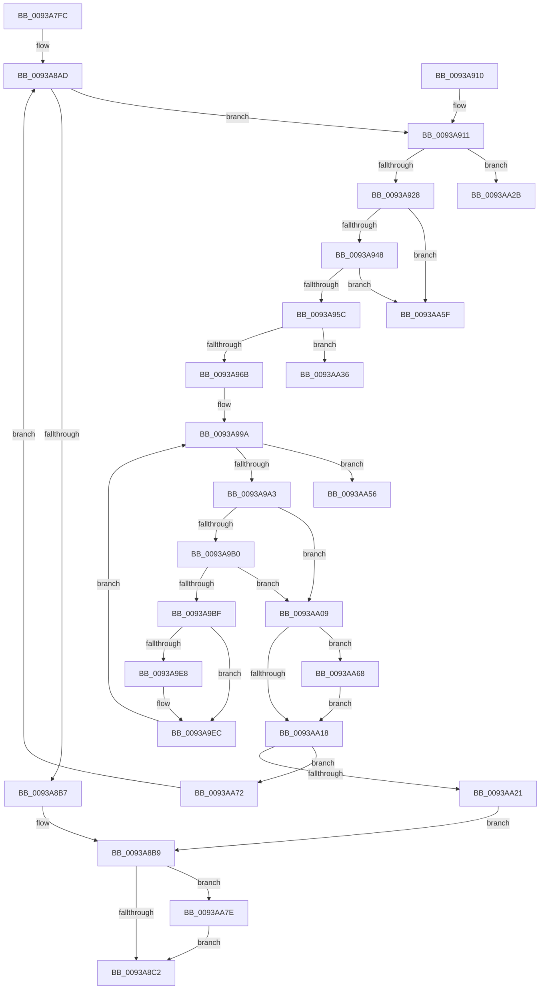

# PfpPrefetchPrivatePages

- RVA: `0x0093A7FC`–`0x0093AA8D` (길이 `657` bytes)
- VA: `0x000000014093A7FC`
- 실행 섹션: `PAGE`
- PDB 이름 있음: `예`; PDB Function 태그: `예`
- unwind 정보 RVA: `0x0008FD38`
- 디코드: `187`개 명령, `657/657` bytes 표시
- 미해석 바이트: `0` (있으면 어셈블리에 `.byte`로 보존)

> 이 문서는 커널 이미지의 기계어와 PDB 기호를 분석해 생성했습니다. 4번과 5번은 함수 원형과 자료형을 바이너리 사용 방식에서 추정한 C 해석이며 원본 소스 복구 결과는 아닙니다.

## 1. Dependencies

- 직접 호출 지점: **11**; 고유 호출 대상: **9**
- 직접 호출자로 확인된 함수: **1**
- RIP 상대 이미지 참조: **0**

### Outgoing calls
- `0x0093A91B` → [PfpCheckPrefetchAbort](../../text/49/PfpCheckPrefetchAbort_function_00492808.md) (function, `0x00492808`)
- `0x0093A93B` → [PfpSourceBuildVaArray](../AC/PfpSourceBuildVaArray_function_00AC875C.md) (function, `0x00AC875C`)
- `0x0093A94F` → [PfpSourceGetPrefetchSupport](../AC/PfpSourceGetPrefetchSupport_function_00ACF6C0.md) (function, `0x00ACF6C0`)
- `0x0093A991` → [MmQueryMemoryListInformation](../../text/3B/MmQueryMemoryListInformation_function_003B9EDC.md) (function, `0x003B9EDC`)
- `0x0093A9A7` → [PfpCheckPrefetchAbort](../../text/49/PfpCheckPrefetchAbort_function_00492808.md) (function, `0x00492808`)
- `0x0093A9B6` → [PfpAvailablePagesForPrefetch](PfpAvailablePagesForPrefetch_function_0093C800.md) (function, `0x0093C800`)
- `0x0093A9DF` → [MmPrefetchVirtualMemory](MmPrefetchVirtualMemory_function_0093A698.md) (function, `0x0093A698`)
- `0x0093A9F3` → [PfpUpdateRepurposedByPrefetch](PfpUpdateRepurposedByPrefetch_function_0093C838.md) (function, `0x0093C838`)
- `0x0093AA4B` → [MmPrefetchVirtualMemory](MmPrefetchVirtualMemory_function_0093A698.md) (function, `0x0093A698`)
- `0x0093AA6B` → [NtClose](../86/NtClose_function_00868870.md) (function, `0x00868870`)
- `0x0093AA83` → [ExFreePoolWithTag](../../poolcode/B8/ExFreePoolWithTag_function_00B82870.md) (function, `0x00B82870`)

### Direct callers
- [PfpPrefetchRequestPerform](PfpPrefetchRequestPerform_function_00938F74.md) at `0x009392E7`

### Static image references
- 디코드된 RIP-relative 메모리 참조가 없습니다.

## 2. Other-region calls and transfers

- 다른 실행 섹션으로 향하는 call: **4**
  - `0x0093A91B` → [PfpCheckPrefetchAbort](../../text/49/PfpCheckPrefetchAbort_function_00492808.md) (`PAGE` → `.text`)
  - `0x0093A991` → [MmQueryMemoryListInformation](../../text/3B/MmQueryMemoryListInformation_function_003B9EDC.md) (`PAGE` → `.text`)
  - `0x0093A9A7` → [PfpCheckPrefetchAbort](../../text/49/PfpCheckPrefetchAbort_function_00492808.md) (`PAGE` → `.text`)
  - `0x0093AA83` → [ExFreePoolWithTag](../../poolcode/B8/ExFreePoolWithTag_function_00B82870.md) (`PAGE` → `POOLCODE`)
- call이 아닌 외부 분기/꼬리 이동: **4**
  - `0x0093AA31` → [sub_00B2515E + 0x8](../B2/Unknown_function_00B2515E.md) (`tail-transfer`)
  - `0x0093AA51` → [sub_00B2515E](../B2/Unknown_function_00B2515E.md) (`tail-transfer`)
  - `0x0093AA5A` → [sub_00B2515E](../B2/Unknown_function_00B2515E.md) (`tail-transfer`)
  - `0x0093AA63` → [sub_00B2515E + 0x8](../B2/Unknown_function_00B2515E.md) (`tail-transfer`)

## 3. Assembly (complete function range)

```asm
0093A7FC  48 89 4C 24 08                  mov qword ptr [rsp + 8], rcx
0093A801  55                              push rbp
0093A802  53                              push rbx
0093A803  56                              push rsi
0093A804  57                              push rdi
0093A805  41 54                           push r12
0093A807  41 55                           push r13
0093A809  41 56                           push r14
0093A80B  41 57                           push r15
0093A80D  48 8B EC                        mov rbp, rsp
0093A810  48 83 EC 78                     sub rsp, 0x78
0093A814  48 8B 19                        mov rbx, qword ptr [rcx]
0093A817  4C 8B F1                        mov r14, rcx
0093A81A  83 65 60 00                     and dword ptr [rbp + 0x60], 0
0093A81E  45 33 ED                        xor r13d, r13d
0093A821  48 B8 20 03 00 00 80 F7 FF FF   movabs rax, 0xfffff78000000320
0093A82B  0F 57 C0                        xorps xmm0, xmm0
0093A82E  0F 11 45 D8                     movups xmmword ptr [rbp - 0x28], xmm0
0093A832  48 8B 10                        mov rdx, qword ptr [rax]
0093A835  A1 04 00 00 00 80 F7 FF FF      movabs eax, dword ptr [0xfffff78000000004]
0093A83E  44 8B 43 50                     mov r8d, dword ptr [rbx + 0x50]
0093A842  8B F8                           mov edi, eax
0093A844  48 8B 75 E0                     mov rsi, qword ptr [rbp - 0x20]
0093A848  8B CA                           mov ecx, edx
0093A84A  48 C1 EA 20                     shr rdx, 0x20
0093A84E  0F AF D0                        imul edx, eax
0093A851  49 8B 06                        mov rax, qword ptr [r14]
0093A854  48 0F AF F9                     imul rdi, rcx
0093A858  0F B7 48 1E                     movzx ecx, word ptr [rax + 0x1e]
0093A85C  C1 E2 08                        shl edx, 8
0093A85F  48 C1 EF 18                     shr rdi, 0x18
0093A863  03 FA                           add edi, edx
0093A865  89 4D B8                        mov dword ptr [rbp - 0x48], ecx
0093A868  8B 50 1C                        mov edx, dword ptr [rax + 0x1c]
0093A86B  8B C1                           mov eax, ecx
0093A86D  83 E2 07                        and edx, 7
0093A870  48 89 7D D0                     mov qword ptr [rbp - 0x30], rdi
0093A874  83 E0 07                        and eax, 7
0093A877  C1 E0 03                        shl eax, 3
0093A87A  0B D0                           or edx, eax
0093A87C  8B CA                           mov ecx, edx
0093A87E  0F BA E9 08                     bts ecx, 8
0093A882  41 F6 C0 10                     test r8b, 0x10
0093A886  0F 45 CA                        cmovne ecx, edx
0093A889  8B D1                           mov edx, ecx
0093A88B  0F BA EA 09                     bts edx, 9
0093A88F  41 F6 C0 08                     test r8b, 8
0093A893  0F 44 D1                        cmove edx, ecx
0093A896  44 8B FA                        mov r15d, edx
0093A899  41 0F BA EF 0B                  bts r15d, 0xb
0093A89E  41 F6 C0 20                     test r8b, 0x20
0093A8A2  44 0F 44 FA                     cmove r15d, edx
0093A8A6  45 33 E4                        xor r12d, r12d
0093A8A9  44 89 7D 58                     mov dword ptr [rbp + 0x58], r15d
0093A8AD  44 89 65 50                     mov dword ptr [rbp + 0x50], r12d
0093A8B1  44 3B 63 14                     cmp r12d, dword ptr [rbx + 0x14]
0093A8B5  72 5A                           jb 0x14093a911
0093A8B7  33 DB                           xor ebx, ebx
0093A8B9  48 85 F6                        test rsi, rsi
0093A8BC  0F 85 BC 01 00 00               jne 0x14093aa7e
0093A8C2  48 B9 20 03 00 00 80 F7 FF FF   movabs rcx, 0xfffff78000000320
0093A8CC  48 8B 09                        mov rcx, qword ptr [rcx]
0093A8CF  A1 04 00 00 00 80 F7 FF FF      movabs eax, dword ptr [0xfffff78000000004]
0093A8D8  4D 8B 0E                        mov r9, qword ptr [r14]
0093A8DB  44 8B C0                        mov r8d, eax
0093A8DE  8B D1                           mov edx, ecx
0093A8E0  4C 0F AF C2                     imul r8, rdx
0093A8E4  48 C1 E9 20                     shr rcx, 0x20
0093A8E8  0F AF C8                        imul ecx, eax
0093A8EB  8B C3                           mov eax, ebx
0093A8ED  49 C1 E8 18                     shr r8, 0x18
0093A8F1  C1 E1 08                        shl ecx, 8
0093A8F4  44 03 C1                        add r8d, ecx
0093A8F7  44 2B 45 D0                     sub r8d, dword ptr [rbp - 0x30]
0093A8FB  45 01 41 78                     add dword ptr [r9 + 0x78], r8d
0093A8FF  48 83 C4 78                     add rsp, 0x78
0093A903  41 5F                           pop r15
0093A905  41 5E                           pop r14
0093A907  41 5D                           pop r13
0093A909  41 5C                           pop r12
0093A90B  5F                              pop rdi
0093A90C  5E                              pop rsi
0093A90D  5B                              pop rbx
0093A90E  5D                              pop rbp
0093A90F  C3                              ret
0093A910  CC                              int3
0093A911  0F 57 C0                        xorps xmm0, xmm0
0093A914  49 8B CE                        mov rcx, r14
0093A917  0F 11 45 E8                     movups xmmword ptr [rbp - 0x18], xmm0
0093A91B  E8 E8 7E B5 FF                  call 0x140492808
0093A920  85 C0                           test eax, eax
0093A922  0F 85 03 01 00 00               jne 0x14093aa2b
0093A928  48 8B 43 38                     mov rax, qword ptr [rbx + 0x38]
0093A92C  4B 8D 0C A4                     lea rcx, [r12 + r12*4]
0093A930  48 8D 55 D8                     lea rdx, [rbp - 0x28]
0093A934  48 8D 3C C8                     lea rdi, [rax + rcx*8]
0093A938  48 8B CF                        mov rcx, rdi
0093A93B  E8 1C DE 18 00                  call 0x140ac875c
0093A940  85 C0                           test eax, eax
0093A942  0F 88 17 01 00 00               js 0x14093aa5f
0093A948  48 8D 55 E8                     lea rdx, [rbp - 0x18]
0093A94C  48 8B CF                        mov rcx, rdi
0093A94F  E8 6C 4D 19 00                  call 0x140acf6c0
0093A954  85 C0                           test eax, eax
0093A956  0F 88 03 01 00 00               js 0x14093aa5f
0093A95C  8B 43 50                        mov eax, dword ptr [rbx + 0x50]
0093A95F  48 8B 75 E0                     mov rsi, qword ptr [rbp - 0x20]
0093A963  A8 04                           test al, 4
0093A965  0F 84 CB 00 00 00               je 0x14093aa36
0093A96B  44 8B 7D D8                     mov r15d, dword ptr [rbp - 0x28]
0093A96F  48 8D 45 60                     lea rax, [rbp + 0x60]
0093A973  49 83 C6 30                     add r14, 0x30
0093A977  48 89 75 C0                     mov qword ptr [rbp - 0x40], rsi
0093A97B  49 8B D6                        mov rdx, r14
0093A97E  4C 89 75 C8                     mov qword ptr [rbp - 0x38], r14
0093A982  41 B8 B0 00 00 00               mov r8d, 0xb0
0093A988  48 89 44 24 20                  mov qword ptr [rsp + 0x20], rax
0093A98D  48 83 C9 FF                     or rcx, 0xffffffffffffffff
0093A991  E8 46 F5 A7 FF                  call 0x1403b9edc
0093A996  48 8B 7D F0                     mov rdi, qword ptr [rbp - 0x10]
0093A99A  45 85 FF                        test r15d, r15d
0093A99D  0F 84 B3 00 00 00               je 0x14093aa56
0093A9A3  48 8B 4D 48                     mov rcx, qword ptr [rbp + 0x48]
0093A9A7  E8 5C 7E B5 FF                  call 0x140492808
0093A9AC  85 C0                           test eax, eax
0093A9AE  75 59                           jne 0x14093aa09
0093A9B0  8B 55 B8                        mov edx, dword ptr [rbp - 0x48]
0093A9B3  49 8B CE                        mov rcx, r14
0093A9B6  E8 45 1E 00 00                  call 0x14093c800
0093A9BB  85 C0                           test eax, eax
0093A9BD  74 4A                           je 0x14093aa09
0093A9BF  44 8B 4D 58                     mov r9d, dword ptr [rbp + 0x58]
0093A9C3  B8 10 00 00 00                  mov eax, 0x10
0093A9C8  4C 8B 45 C0                     mov r8, qword ptr [rbp - 0x40]
0093A9CC  44 3B F8                        cmp r15d, eax
0093A9CF  45 8B E7                        mov r12d, r15d
0093A9D2  48 8B CF                        mov rcx, rdi
0093A9D5  44 0F 47 E0                     cmova r12d, eax
0093A9D9  41 8B D4                        mov edx, r12d
0093A9DC  45 8B F4                        mov r14d, r12d
0093A9DF  E8 B4 FC FF FF                  call 0x14093a698
0093A9E4  85 C0                           test eax, eax
0093A9E6  78 04                           js 0x14093a9ec
0093A9E8  44 01 63 68                     add dword ptr [rbx + 0x68], r12d
0093A9EC  48 8B 4D C8                     mov rcx, qword ptr [rbp - 0x38]
0093A9F0  49 8B D6                        mov rdx, r14
0093A9F3  E8 40 1E 00 00                  call 0x14093c838
0093A9F8  49 C1 E6 04                     shl r14, 4
0093A9FC  4C 01 75 C0                     add qword ptr [rbp - 0x40], r14
0093AA00  4C 8B 75 C8                     mov r14, qword ptr [rbp - 0x38]
0093AA04  45 2B FC                        sub r15d, r12d
0093AA07  EB 91                           jmp 0x14093a99a
0093AA09  44 8B 65 50                     mov r12d, dword ptr [rbp + 0x50]
0093AA0D  41 BD 01 00 00 00               mov r13d, 1
0093AA13  48 85 FF                        test rdi, rdi
0093AA16  75 50                           jne 0x14093aa68
0093AA18  4C 8B 75 48                     mov r14, qword ptr [rbp + 0x48]
0093AA1C  45 85 ED                        test r13d, r13d
0093AA1F  74 51                           je 0x14093aa72
0093AA21  BB 40 02 00 C0                  mov ebx, 0xc0000240
0093AA26  E9 8E FE FF FF                  jmp 0x14093a8b9
0093AA2B  41 BD 01 00 00 00               mov r13d, 1
0093AA31  E9 30 A7 1E 00                  jmp 0x140b25166
0093AA36  8B 45 D8                        mov eax, dword ptr [rbp - 0x28]
0093AA39  45 8B CF                        mov r9d, r15d
0093AA3C  48 8B 7D F0                     mov rdi, qword ptr [rbp - 0x10]
0093AA40  8B D0                           mov edx, eax
0093AA42  01 43 68                        add dword ptr [rbx + 0x68], eax
0093AA45  48 8B CF                        mov rcx, rdi
0093AA48  4C 8B C6                        mov r8, rsi
0093AA4B  E8 48 FC FF FF                  call 0x14093a698
0093AA50  90                              nop
0093AA51  E9 08 A7 1E 00                  jmp 0x140b2515e
0093AA56  44 8B 65 50                     mov r12d, dword ptr [rbp + 0x50]
0093AA5A  E9 FF A6 1E 00                  jmp 0x140b2515e
0093AA5F  48 8B 75 E0                     mov rsi, qword ptr [rbp - 0x20]
0093AA63  E9 FE A6 1E 00                  jmp 0x140b25166
0093AA68  48 8B CF                        mov rcx, rdi
0093AA6B  E8 00 DE F2 FF                  call 0x140868870
0093AA70  EB A6                           jmp 0x14093aa18
0093AA72  44 8B 7D 58                     mov r15d, dword ptr [rbp + 0x58]
0093AA76  41 FF C4                        inc r12d
0093AA79  E9 2F FE FF FF                  jmp 0x14093a8ad
0093AA7E  33 D2                           xor edx, edx
0093AA80  48 8B CE                        mov rcx, rsi
0093AA83  E8 E8 7D 24 00                  call 0x140b82870
0093AA88  E9 35 FE FF FF                  jmp 0x14093a8c2
```

## 4. C-style interpretation (structured pseudocode)

```c
__int64 __fastcall PfpPrefetchPrivatePages(__int64 a1)
{
    __int64 result;
    __int64 v_r12;
    __int64 v_r13;
    __int64 v_r14;
    __int64 v_r15;
    __int64 v_rbx;
    __int64 v_rdi;
    __int64 v_rsp;
    unsigned __int64 v_stack_m50;
    unsigned __int64 v_stack_m58;
    unsigned __int64 v_stack_m60;
    unsigned __int64 v_stack_m68;
    unsigned __int64 v_stack_m70;
    unsigned __int64 v_stack_m78;
    unsigned __int64 v_stack_m80;
    unsigned int v_stack_m88;
    unsigned int v_stack_p10;
    unsigned int v_stack_p18;
    unsigned int v_stack_p20;
    unsigned __int64 v_stack_p8;

    v_stack_p8 = a1;
    v_rsp = (v_rsp) - (120);
    v_r13 = 0;
    v_stack_m68 = v_xmm0;
    a2 = (*(unsigned __int64 *)(result)) >> (32);
    a2 = (unsigned int)((a2) * ((unsigned int)(result)));
    v_rdi = ((unsigned int)((unsigned int)(result))) * ((unsigned int)((unsigned int)(*(unsigned __int64 *)(result))));
    a2 = (unsigned int)((a2) << (8));
    v_rdi = (v_rdi) >> (24);
    v_rdi = (unsigned int)((v_rdi) + ((unsigned int)(a2)));
    v_stack_m88 = (unsigned int)(*(unsigned __int16 *)(*(unsigned __int64 *)(a1) + 30));
    a2 = (unsigned int)(((unsigned int)(*(unsigned int *)(*(unsigned __int64 *)(a1) + 28))) & (7));
    v_stack_m70 = v_rdi;
    result = (unsigned int)(((unsigned int)((unsigned int)(*(unsigned __int16 *)(*(unsigned __int64 *)(a1) + 30)))) & (7));
    result = (unsigned int)((result) << (3));
    a2 = (unsigned int)((a2) | ((unsigned int)(result)));
    a1 = (unsigned int)((unsigned int)(a2));
    if ((((unsigned __int8)((unsigned int)(*(unsigned int *)(*(unsigned __int64 *)(a1) + 80)))) & (16)) != 0) { a1 = (unsigned int)(a2); }
    a2 = (unsigned int)((unsigned int)(a1));
    if ((((unsigned __int8)((unsigned int)(*(unsigned int *)(*(unsigned __int64 *)(a1) + 80)))) & (8)) == 0) { a2 = (unsigned int)(a1); }
    v_r15 = (unsigned int)((unsigned int)(a2));
    if ((((unsigned __int8)((unsigned int)(*(unsigned int *)(*(unsigned __int64 *)(a1) + 80)))) & (32)) == 0) { v_r15 = (unsigned int)(a2); }
    v_r12 = 0;
    v_stack_p18 = (unsigned int)(v_r15);
loc_0093A8AD:
    v_stack_p10 = 0;
    if (0 < (*(unsigned int *)(*(unsigned __int64 *)(a1) + 20))) goto loc_0093A911;
    v_rbx = 0;
loc_0093A8B9:
    if (v_stack_m60 != 0) goto loc_0093AA7E;
loc_0093A8C2:
    a3 = ((unsigned int)((unsigned int)(result))) * ((unsigned int)((unsigned int)(*(unsigned __int64 *)(a1))));
    a1 = (*(unsigned __int64 *)(a1)) >> (32);
    a1 = (unsigned int)((a1) * ((unsigned int)(result)));
    a3 = (a3) >> (24);
    a1 = (unsigned int)((a1) << (8));
    a3 = (unsigned int)((a3) + ((unsigned int)(a1)));
    a3 = (unsigned int)((a3) - (v_stack_m70));
    v_rsp = (v_rsp) + (120);
    return 0;
loc_0093A911:
    v_stack_m58 = v_xmm0;
    result = PfpCheckPrefetchAbort(a1, (unsigned int)((unsigned int)(*(unsigned __int64 *)(a1))), a3, *(unsigned __int64 *)(a1));
    if ((unsigned int)(result) != 0) goto loc_0093AA2B;
    result = PfpSourceBuildVaArray(*(unsigned __int64 *)(v_rbx + 56) + v_r12 + v_r12 * 4 * 8, v_stack_m68, a3, *(unsigned __int64 *)(a1));
    if (sign_flag) goto loc_0093AA5F;
    result = PfpSourceGetPrefetchSupport(*(unsigned __int64 *)(v_rbx + 56) + v_r12 + v_r12 * 4 * 8, v_stack_m58, a3, *(unsigned __int64 *)(a1));
    if (sign_flag) goto loc_0093AA5F;
    if ((((unsigned __int8)((unsigned int)(*(unsigned int *)(v_rbx + 80)))) & (4)) == 0) goto loc_0093AA36;
    v_r14 = (a1) + (48);
    v_stack_m80 = v_stack_m60;
    v_stack_m78 = v_r14;
    v_stack_p20 = v_stack_p20;
    a1 = (*(unsigned __int64 *)(v_rbx + 56) + v_r12 + v_r12 * 4 * 8) | (-1);
    result = MmQueryMemoryListInformation(a1, v_r14, 176, *(unsigned __int64 *)(a1));
loc_0093A99A:
    if ((unsigned int)((unsigned int)(v_stack_m68)) == 0) goto loc_0093AA56;
    result = PfpCheckPrefetchAbort(v_stack_p8, v_r14, 176, *(unsigned __int64 *)(a1));
    if ((unsigned int)(result) != 0) goto loc_0093AA09;
    result = PfpAvailablePagesForPrefetch(v_r14, (unsigned int)(v_stack_m88), 176, *(unsigned __int64 *)(a1));
    if ((unsigned int)(result) == 0) goto loc_0093AA09;
    v_r12 = (unsigned int)((unsigned int)((unsigned int)(v_stack_m68)));
    if (((unsigned int)((unsigned int)(v_stack_m68))) > 16) { v_r12 = 16; }
    result = MmPrefetchVirtualMemory(v_stack_m50, (unsigned int)((unsigned int)(v_r12)), v_stack_m80, (unsigned int)(v_stack_p18));
    if (!(sign_flag)) {
    }
    result = PfpUpdateRepurposedByPrefetch(v_stack_m78, (unsigned int)((unsigned int)(v_r12)), v_stack_m80, (unsigned int)(v_stack_p18));
    v_r14 = ((unsigned int)((unsigned int)(v_r12))) << (4);
    v_r15 = (unsigned int)(((unsigned int)(v_stack_m68)) - ((unsigned int)(v_r12)));
    goto loc_0093A99A;
loc_0093AA09:
    if (v_stack_m50 != 0) goto loc_0093AA68;
loc_0093AA18:
    if (1 == 0) goto loc_0093AA72;
    goto loc_0093A8B9;
loc_0093AA2B:
loc_0093AA36:
    result = MmPrefetchVirtualMemory(v_stack_m50, (unsigned int)((unsigned int)((unsigned int)(v_stack_m68))), v_stack_m60, (unsigned int)((unsigned int)(v_r15)));
loc_0093AA56:
loc_0093AA5F:
loc_0093AA68:
    result = NtClose(v_stack_m50, (unsigned int)((unsigned int)((unsigned int)(v_stack_m68))), v_stack_m60, (unsigned int)((unsigned int)(v_r15)));
    goto loc_0093AA18;
loc_0093AA72:
    v_r12 = (unsigned int)(((unsigned int)(v_stack_p10)) + 1);
    goto loc_0093A8AD;
loc_0093AA7E:
    a2 = 0;
    result = ExFreePoolWithTag(v_stack_m60, a2, v_stack_m60, (unsigned int)((unsigned int)(v_r15)));
    goto loc_0093A8C2;
}
```

## 5. (Beta) C Style

```c
int64_t PfpPrefetchPrivatePages(void *Arg1)
{
    uint8_t *arg1 = (uint8_t *)Arg1;

    int64_t result;
    int64_t local_r12;
    int64_t local_r13;
    int64_t local_r14;
    int64_t local_r15;
    int64_t local_rbx;
    int64_t local_rdi;
    int64_t local_rsp;
    uint64_t v_stack_m50;
    uint64_t v_stack_m58;
    uint64_t v_stack_m60;
    uint64_t v_stack_m68;
    uint64_t v_stack_m70;
    uint64_t v_stack_m78;
    uint64_t v_stack_m80;
    uint32_t v_stack_m88;
    uint32_t v_stack_p10;
    uint32_t v_stack_p18;
    uint32_t v_stack_p20;
    uint64_t v_stack_p8;

    v_stack_p8 = Arg1;
    local_rsp = (local_rsp) - (120);
    local_r13 = 0;
    v_stack_m68 = v_xmm0;
    a2 = (*(uint64_t *)(result)) >> (32);
    a2 = (uint32_t)((a2) * ((uint32_t)(result)));
    local_rdi = ((uint32_t)((uint32_t)(result))) * ((uint32_t)((uint32_t)(*(uint64_t *)(result))));
    a2 = (uint32_t)((a2) << (8));
    local_rdi = (local_rdi) >> (24);
    local_rdi = (uint32_t)((local_rdi) + ((uint32_t)(a2)));
    v_stack_m88 = (uint32_t)(*(uint16_t *)(*(uint64_t *)(arg1) + 0x1E));
    a2 = (uint32_t)(((uint32_t)(*(uint32_t *)(*(uint64_t *)(arg1) + 0x1C))) & (7));
    v_stack_m70 = local_rdi;
    result = (uint32_t)(((uint32_t)((uint32_t)(*(uint16_t *)(*(uint64_t *)(arg1) + 0x1E)))) & (7));
    result = (uint32_t)((result) << (3));
    a2 = (uint32_t)((a2) | ((uint32_t)(result)));
    Arg1 = (uint32_t)((uint32_t)(a2));
    if ((((uint8_t)((uint32_t)(*(uint32_t *)(*(uint64_t *)(arg1) + 0x50)))) & (16)) != 0) { Arg1 = (uint32_t)(a2); }
    a2 = (uint32_t)((uint32_t)(Arg1));
    if ((((uint8_t)((uint32_t)(*(uint32_t *)(*(uint64_t *)(arg1) + 0x50)))) & (8)) == 0) { a2 = (uint32_t)(Arg1); }
    local_r15 = (uint32_t)((uint32_t)(a2));
    if ((((uint8_t)((uint32_t)(*(uint32_t *)(*(uint64_t *)(arg1) + 0x50)))) & (32)) == 0) { local_r15 = (uint32_t)(a2); }
    local_r12 = 0;
    v_stack_p18 = (uint32_t)(local_r15);
loc_0093A8AD:
    v_stack_p10 = 0;
    if (0 < (*(uint32_t *)(*(uint64_t *)(arg1) + 0x14))) goto loc_0093A911;
    local_rbx = 0;
loc_0093A8B9:
    if (v_stack_m60 != 0) goto loc_0093AA7E;
loc_0093A8C2:
    a3 = ((uint32_t)((uint32_t)(result))) * ((uint32_t)((uint32_t)(*(uint64_t *)(arg1))));
    Arg1 = (*(uint64_t *)(arg1)) >> (32);
    Arg1 = (uint32_t)((Arg1) * ((uint32_t)(result)));
    a3 = (a3) >> (24);
    Arg1 = (uint32_t)((Arg1) << (8));
    a3 = (uint32_t)((a3) + ((uint32_t)(Arg1)));
    a3 = (uint32_t)((a3) - (v_stack_m70));
    local_rsp = (local_rsp) + (120);
    return 0;
loc_0093A911:
    v_stack_m58 = v_xmm0;
    result = PfpCheckPrefetchAbort(Arg1, (uint32_t)((uint32_t)(*(uint64_t *)(arg1))), a3, *(uint64_t *)(arg1));
    if ((uint32_t)(result) != 0) goto loc_0093AA2B;
    result = PfpSourceBuildVaArray(*(uint64_t *)(local_rbx + 0x38) + local_r12 + local_r12 * 4 * 8, v_stack_m68, a3, *(uint64_t *)(arg1));
    if (sign_flag) goto loc_0093AA5F;
    result = PfpSourceGetPrefetchSupport(*(uint64_t *)(local_rbx + 0x38) + local_r12 + local_r12 * 4 * 8, v_stack_m58, a3, *(uint64_t *)(arg1));
    if (sign_flag) goto loc_0093AA5F;
    if ((((uint8_t)((uint32_t)(*(uint32_t *)(local_rbx + 0x50)))) & (4)) == 0) goto loc_0093AA36;
    local_r14 = (Arg1) + (48);
    v_stack_m80 = v_stack_m60;
    v_stack_m78 = local_r14;
    v_stack_p20 = v_stack_p20;
    Arg1 = (*(uint64_t *)(local_rbx + 0x38) + local_r12 + local_r12 * 4 * 8) | (-1);
    result = MmQueryMemoryListInformation(Arg1, local_r14, 176, *(uint64_t *)(arg1));
loc_0093A99A:
    if ((uint32_t)((uint32_t)(v_stack_m68)) == 0) goto loc_0093AA56;
    result = PfpCheckPrefetchAbort(v_stack_p8, local_r14, 176, *(uint64_t *)(arg1));
    if ((uint32_t)(result) != 0) goto loc_0093AA09;
    result = PfpAvailablePagesForPrefetch(local_r14, (uint32_t)(v_stack_m88), 176, *(uint64_t *)(arg1));
    if ((uint32_t)(result) == 0) goto loc_0093AA09;
    local_r12 = (uint32_t)((uint32_t)((uint32_t)(v_stack_m68)));
    if (((uint32_t)((uint32_t)(v_stack_m68))) > 16) { local_r12 = 16; }
    result = MmPrefetchVirtualMemory(v_stack_m50, (uint32_t)((uint32_t)(local_r12)), v_stack_m80, (uint32_t)(v_stack_p18));
    if (!(sign_flag)) {
    }
    result = PfpUpdateRepurposedByPrefetch(v_stack_m78, (uint32_t)((uint32_t)(local_r12)), v_stack_m80, (uint32_t)(v_stack_p18));
    local_r14 = ((uint32_t)((uint32_t)(local_r12))) << (4);
    local_r15 = (uint32_t)(((uint32_t)(v_stack_m68)) - ((uint32_t)(local_r12)));
    goto loc_0093A99A;
loc_0093AA09:
    if (v_stack_m50 != 0) goto loc_0093AA68;
loc_0093AA18:
    if (1 == 0) goto loc_0093AA72;
    goto loc_0093A8B9;
loc_0093AA2B:
loc_0093AA36:
    result = MmPrefetchVirtualMemory(v_stack_m50, (uint32_t)((uint32_t)((uint32_t)(v_stack_m68))), v_stack_m60, (uint32_t)((uint32_t)(local_r15)));
loc_0093AA56:
loc_0093AA5F:
loc_0093AA68:
    result = NtClose(v_stack_m50, (uint32_t)((uint32_t)((uint32_t)(v_stack_m68))), v_stack_m60, (uint32_t)((uint32_t)(local_r15)));
    goto loc_0093AA18;
loc_0093AA72:
    local_r12 = (uint32_t)(((uint32_t)(v_stack_p10)) + 1);
    goto loc_0093A8AD;
loc_0093AA7E:
    a2 = 0;
    result = ExFreePoolWithTag(v_stack_m60, a2, v_stack_m60, (uint32_t)((uint32_t)(local_r15)));
    goto loc_0093A8C2;
}
```

### 관측된 메모리 오프셋

구조체 형식이 확인되지 않은 접근은 인자 기준의 오프셋으로만 기록했습니다.

| 기준 인자 | 오프셋 표현 | 폭 (bit) | 접근 |
|---|---:|---:|---|
| `Arg1` | `+ 0x0` | `64` | `R` |

## 6. Execution-region graph

[열기: 2D/3D 그래프와 함수 탐색 컨트롤 패널](../../../control-panel.html?section=page&rva=0x0093A7FC&view=graph)

- 2D 그래프는 위에서 아래로 흐르고, 3D 그래프는 빈 공간을 드래그해 회전합니다. Shift+드래그는 이동, 휠은 확대·축소, 함수 노드 선택은 대상 보고서 이동입니다.

### Static fallback


