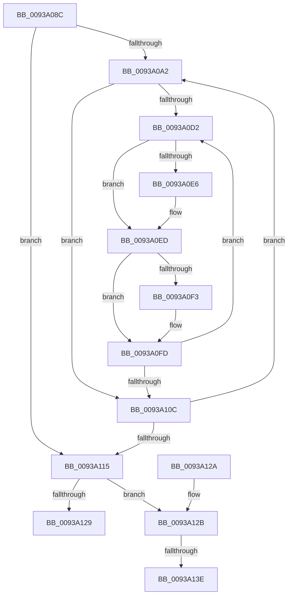

# PfpPrefetchRequestPatchOffsets

- RVA: `0x0093A08C`–`0x0093A152` (길이 `198` bytes)
- VA: `0x000000014093A08C`
- 실행 섹션: `PAGE`
- PDB 이름 있음: `예`; PDB Function 태그: `예`
- unwind 정보 RVA: `0x000DB714`
- 디코드: `56`개 명령, `198/198` bytes 표시
- 미해석 바이트: `0` (있으면 어셈블리에 `.byte`로 보존)

> 이 문서는 커널 이미지의 기계어와 PDB 기호를 분석해 생성했습니다. 4번과 5번은 함수 원형과 자료형을 바이너리 사용 방식에서 추정한 C 해석이며 원본 소스 복구 결과는 아닙니다.

## 1. Dependencies

- 직접 호출 지점: **0**; 고유 호출 대상: **0**
- 직접 호출자로 확인된 함수: **1**
- RIP 상대 이미지 참조: **0**

### Outgoing calls
- 직접 디코드된 call 명령이 없습니다.

### Direct callers
- [PfpPrefetchRequestPerform](PfpPrefetchRequestPerform_function_00938F74.md) at `0x009392C7`

### Static image references
- 디코드된 RIP-relative 메모리 참조가 없습니다.

## 2. Other-region calls and transfers

- 다른 실행 섹션으로 향하는 call: **0**
- call이 아닌 외부 분기/꼬리 이동: **2**
  - `0x0093A138` → `0x00B250A4` (`tail-transfer`)
  - `0x0093A14D` → `0x00B250A4` (`tail-transfer`)

## 3. Assembly (complete function range)

```asm
0093A08C  8B 41 20                        mov eax, dword ptr [rcx + 0x20]
0093A08F  45 33 C0                        xor r8d, r8d
0093A092  48 03 C1                        add rax, rcx
0093A095  48 8B D1                        mov rdx, rcx
0093A098  48 89 41 20                     mov qword ptr [rcx + 0x20], rax
0093A09C  44 39 41 08                     cmp dword ptr [rcx + 8], r8d
0093A0A0  76 73                           jbe 0x14093a115
0093A0A2  4C 8B 5A 20                     mov r11, qword ptr [rdx + 0x20]
0093A0A6  4F 8D 14 80                     lea r10, [r8 + r8*4]
0093A0AA  45 33 C9                        xor r9d, r9d
0093A0AD  43 8B 44 D3 20                  mov eax, dword ptr [r11 + r10*8 + 0x20]
0093A0B2  48 03 C2                        add rax, rdx
0093A0B5  4B 89 44 D3 20                  mov qword ptr [r11 + r10*8 + 0x20], rax
0093A0BA  43 8B 44 D3 10                  mov eax, dword ptr [r11 + r10*8 + 0x10]
0093A0BF  48 03 C2                        add rax, rdx
0093A0C2  43 F7 44 D3 0C FE FF FF FF      test dword ptr [r11 + r10*8 + 0xc], 0xfffffffe
0093A0CB  4B 89 44 D3 10                  mov qword ptr [r11 + r10*8 + 0x10], rax
0093A0D0  76 3A                           jbe 0x14093a10c
0093A0D2  4B 8D 0C 49                     lea rcx, [r9 + r9*2]
0093A0D6  48 C1 E1 04                     shl rcx, 4
0093A0DA  4B 03 4C D3 10                  add rcx, qword ptr [r11 + r10*8 + 0x10]
0093A0DF  8B 41 20                        mov eax, dword ptr [rcx + 0x20]
0093A0E2  85 C0                           test eax, eax
0093A0E4  74 07                           je 0x14093a0ed
0093A0E6  48 03 C2                        add rax, rdx
0093A0E9  48 89 41 20                     mov qword ptr [rcx + 0x20], rax
0093A0ED  83 79 10 00                     cmp dword ptr [rcx + 0x10], 0
0093A0F1  74 0A                           je 0x14093a0fd
0093A0F3  8B 41 18                        mov eax, dword ptr [rcx + 0x18]
0093A0F6  48 03 C2                        add rax, rdx
0093A0F9  48 89 41 18                     mov qword ptr [rcx + 0x18], rax
0093A0FD  43 8B 44 D3 0C                  mov eax, dword ptr [r11 + r10*8 + 0xc]
0093A102  41 FF C1                        inc r9d
0093A105  D1 E8                           shr eax, 1
0093A107  44 3B C8                        cmp r9d, eax
0093A10A  72 C6                           jb 0x14093a0d2
0093A10C  41 FF C0                        inc r8d
0093A10F  44 3B 42 08                     cmp r8d, dword ptr [rdx + 8]
0093A113  72 8D                           jb 0x14093a0a2
0093A115  44 8B 42 38                     mov r8d, dword ptr [rdx + 0x38]
0093A119  45 33 C9                        xor r9d, r9d
0093A11C  4C 03 C2                        add r8, rdx
0093A11F  4C 89 42 38                     mov qword ptr [rdx + 0x38], r8
0093A123  44 39 4A 14                     cmp dword ptr [rdx + 0x14], r9d
0093A127  77 02                           ja 0x14093a12b
0093A129  C3                              ret
0093A12A  CC                              int3
0093A12B  4B 8D 0C 89                     lea rcx, [r9 + r9*4]
0093A12F  4D 8D 14 C8                     lea r10, [r8 + rcx*8]
0093A133  41 83 7A 18 00                  cmp dword ptr [r10 + 0x18], 0
0093A138  0F 84 66 AF 1E 00               je 0x140b250a4
0093A13E  41 8B 42 20                     mov eax, dword ptr [r10 + 0x20]
0093A142  48 03 C2                        add rax, rdx
0093A145  49 89 42 20                     mov qword ptr [r10 + 0x20], rax
0093A149  4C 8B 42 38                     mov r8, qword ptr [rdx + 0x38]
0093A14D  E9 52 AF 1E 00                  jmp 0x140b250a4
```

## 4. C-style interpretation (structured pseudocode)

```c
__int64 __fastcall PfpPrefetchRequestPatchOffsets(__int64 a1, __int64 a2, int a3, int a4)
{
    __int64 result;

    a3 = 0;
    result = ((unsigned int)(*(unsigned int *)(a1 + 32))) + (a1);
    *(unsigned __int64 *)(a1 + 32) = result;
    if ((*(unsigned int *)(a1 + 8)) <= 0) goto loc_0093A115;
loc_0093A0A2:
    a4 = 0;
    result = ((unsigned int)(*(unsigned int *)(*(unsigned __int64 *)(a1 + 32) + a3 + a3 * 4 * 8 + 32))) + (a1);
    *(unsigned __int64 *)(*(unsigned __int64 *)(a1 + 32) + a3 + a3 * 4 * 8 + 32) = result;
    result = ((unsigned int)(*(unsigned int *)(*(unsigned __int64 *)(a1 + 32) + a3 + a3 * 4 * 8 + 16))) + (a1);
    *(unsigned __int64 *)(*(unsigned __int64 *)(a1 + 32) + a3 + a3 * 4 * 8 + 16) = result;
    if (condition_is_below_or_equal) goto loc_0093A10C;
loc_0093A0D2:
    a1 = (a4 + a4 * 2) << (4);
    a1 = (a1) + (*(unsigned __int64 *)(*(unsigned __int64 *)(a1 + 32) + a3 + a3 * 4 * 8 + 16));
    result = (unsigned int)(*(unsigned int *)(a1 + 32));
    if ((unsigned int)((unsigned int)(*(unsigned int *)(a1 + 32))) != 0) {
        result = ((unsigned int)(*(unsigned int *)(a1 + 32))) + (a1);
        *(unsigned __int64 *)(a1 + 32) = result;
    }
    if ((*(unsigned int *)(a1 + 16)) != 0) {
        result = *(unsigned int *)(a1 + 24);
        result = (result) + (a1);
        *(unsigned __int64 *)(a1 + 24) = result;
    }
    a4 = (unsigned int)((a4) + 1);
    result = (unsigned int)(((unsigned int)(*(unsigned int *)(*(unsigned __int64 *)(a1 + 32) + a3 + a3 * 4 * 8 + 12))) >> (1));
    if (a4 < ((unsigned int)(result))) goto loc_0093A0D2;
loc_0093A10C:
    a3 = (unsigned int)((a3) + 1);
    if (a3 < (*(unsigned int *)(a1 + 8))) goto loc_0093A0A2;
loc_0093A115:
    a4 = 0;
    a3 = ((unsigned int)(*(unsigned int *)(a1 + 56))) + (a1);
    *(unsigned __int64 *)(a1 + 56) = a3;
    if ((*(unsigned int *)(a1 + 20)) > 0) goto loc_0093A12B;
    return result;
loc_0093A12B:
    result = ((unsigned int)(*(unsigned int *)(a3 + a4 + a4 * 4 * 8 + 32))) + (a1);
    *(unsigned __int64 *)(a3 + a4 + a4 * 4 * 8 + 32) = result;
}
```

## 5. (Beta) C Style

```c
int64_t PfpPrefetchRequestPatchOffsets(void *Arg1, int64_t Arg2, int32_t Arg3, int32_t Arg4)
{
    uint8_t *arg1 = (uint8_t *)Arg1;

    int64_t result;

    Arg3 = 0;
    result = ((uint32_t)(*(uint32_t *)(arg1 + 0x20))) + (Arg1);
    *(uint64_t *)(arg1 + 0x20) = result;
    if ((*(uint32_t *)(arg1 + 0x8)) <= 0) goto loc_0093A115;
loc_0093A0A2:
    Arg4 = 0;
    result = ((uint32_t)(*(uint32_t *)(*(uint64_t *)(arg1 + 0x20) + Arg3 + Arg3 * 4 * 8 + 0x20))) + (Arg1);
    *(uint64_t *)(*(uint64_t *)(arg1 + 0x20) + Arg3 + Arg3 * 4 * 8 + 0x20) = result;
    result = ((uint32_t)(*(uint32_t *)(*(uint64_t *)(arg1 + 0x20) + Arg3 + Arg3 * 4 * 8 + 0x10))) + (Arg1);
    *(uint64_t *)(*(uint64_t *)(arg1 + 0x20) + Arg3 + Arg3 * 4 * 8 + 0x10) = result;
    if (condition_is_below_or_equal) goto loc_0093A10C;
loc_0093A0D2:
    Arg1 = (Arg4 + Arg4 * 2) << (4);
    Arg1 = (Arg1) + (*(uint64_t *)(*(uint64_t *)(arg1 + 0x20) + Arg3 + Arg3 * 4 * 8 + 0x10));
    result = (uint32_t)(*(uint32_t *)(arg1 + 0x20));
    if ((uint32_t)((uint32_t)(*(uint32_t *)(arg1 + 0x20))) != 0) {
        result = ((uint32_t)(*(uint32_t *)(arg1 + 0x20))) + (Arg1);
        *(uint64_t *)(arg1 + 0x20) = result;
    }
    if ((*(uint32_t *)(arg1 + 0x10)) != 0) {
        result = *(uint32_t *)(arg1 + 0x18);
        result = (result) + (Arg1);
        *(uint64_t *)(arg1 + 0x18) = result;
    }
    Arg4 = (uint32_t)((Arg4) + 1);
    result = (uint32_t)(((uint32_t)(*(uint32_t *)(*(uint64_t *)(arg1 + 0x20) + Arg3 + Arg3 * 4 * 8 + 0xC))) >> (1));
    if (Arg4 < ((uint32_t)(result))) goto loc_0093A0D2;
loc_0093A10C:
    Arg3 = (uint32_t)((Arg3) + 1);
    if (Arg3 < (*(uint32_t *)(arg1 + 0x8))) goto loc_0093A0A2;
loc_0093A115:
    Arg4 = 0;
    Arg3 = ((uint32_t)(*(uint32_t *)(arg1 + 0x38))) + (Arg1);
    *(uint64_t *)(arg1 + 0x38) = Arg3;
    if ((*(uint32_t *)(arg1 + 0x14)) > 0) goto loc_0093A12B;
    return result;
loc_0093A12B:
    result = ((uint32_t)(*(uint32_t *)(Arg3 + Arg4 + Arg4 * 4 * 8 + 0x20))) + (Arg1);
    *(uint64_t *)(Arg3 + Arg4 + Arg4 * 4 * 8 + 0x20) = result;
}
```

### 관측된 메모리 오프셋

구조체 형식이 확인되지 않은 접근은 인자 기준의 오프셋으로만 기록했습니다.

| 기준 인자 | 오프셋 표현 | 폭 (bit) | 접근 |
|---|---:|---:|---|
| `Arg1` | `+ 0x8` | `32` | `R` |
| `Arg1` | `+ 0x14` | `32` | `R` |
| `Arg1` | `+ 0x20` | `32` | `R` |
| `Arg1` | `+ 0x20` | `64` | `R` |
| `Arg1` | `+ 0x20` | `64` | `W` |
| `Arg1` | `+ 0x38` | `32` | `R` |
| `Arg1` | `+ 0x38` | `64` | `R` |
| `Arg1` | `+ 0x38` | `64` | `W` |

## 6. Execution-region graph

[열기: 2D/3D 그래프와 함수 탐색 컨트롤 패널](../../../control-panel.html?section=page&rva=0x0093A08C&view=graph)

- 2D 그래프는 위에서 아래로 흐르고, 3D 그래프는 빈 공간을 드래그해 회전합니다. Shift+드래그는 이동, 휠은 확대·축소, 함수 노드 선택은 대상 보고서 이동입니다.

### Static fallback


