# PfpPrefetchRequestPerform

- RVA: `0x00938F74`–`0x009393F6` (길이 `1,154` bytes)
- VA: `0x0000000140938F74`
- 실행 섹션: `PAGE`
- PDB 이름 있음: `예`; PDB Function 태그: `예`
- unwind 정보 RVA: `0x0008FC08`
- 디코드: `279`개 명령, `1,154/1,154` bytes 표시
- 미해석 바이트: `0` (있으면 어셈블리에 `.byte`로 보존)

> 이 문서는 커널 이미지의 기계어와 PDB 기호를 분석해 생성했습니다. 4번과 5번은 함수 원형과 자료형을 바이너리 사용 방식에서 추정한 C 해석이며 원본 소스 복구 결과는 아닙니다.

## 1. Dependencies

- 직접 호출 지점: **22**; 고유 호출 대상: **17**
- 직접 호출자로 확인된 함수: **1**
- RIP 상대 이미지 참조: **3**

### Outgoing calls
- `0x00938FC4` → [memset](../../text/6C/memset_function_006C6C40.md) (function, `0x006C6C40`)
- `0x00938FD8` → [KeInitializeEvent](../../text/40/KeInitializeEvent_function_0040DD10.md) (function, `0x0040DD10`)
- `0x0093900E` → [ExAllocatePool2](../../poolcode/B8/ExAllocatePool2_function_00B820F0.md) (function, `0x00B820F0`)
- `0x00939028` → [PfpPrefetchSharedInitialize](PfpPrefetchSharedInitialize_function_00939E30.md) (function, `0x00939E30`)
- `0x00939069` → [PfpPrefetchSharedStart](PfpPrefetchSharedStart_function_00939D24.md) (function, `0x00939D24`)
- `0x009390B0` → [ExAllocatePool2](../../poolcode/B8/ExAllocatePool2_function_00B820F0.md) (function, `0x00B820F0`)
- `0x009390C7` → [memset](../../text/6C/memset_function_006C6C40.md) (function, `0x006C6C40`)
- `0x00939120` → [ExAllocatePool2](../../poolcode/B8/ExAllocatePool2_function_00B820F0.md) (function, `0x00B820F0`)
- `0x00939151` → [PfpPrefetchVolumesCleanup](PfpPrefetchVolumesCleanup_function_009393FC.md) (function, `0x009393FC`)
- `0x0093918B` → [_security_check_cookie](../../text/6A/_security_check_cookie_function_006AC640.md) (function, `0x006AC640`)
- `0x00939237` → [PfpOpenHandleClose](../8A/PfpOpenHandleClose_function_008A9E74.md) (function, `0x008A9E74`)
- `0x00939250` → [ExFreePoolWithTag](../../poolcode/B8/ExFreePoolWithTag_function_00B82870.md) (function, `0x00B82870`)
- `0x0093926F` → [ExAllocatePool2](../../poolcode/B8/ExAllocatePool2_function_00B820F0.md) (function, `0x00B820F0`)
- `0x009392C7` → [PfpPrefetchRequestPatchOffsets](PfpPrefetchRequestPatchOffsets_function_0093A08C.md) (function, `0x0093A08C`)
- `0x009392E7` → [PfpPrefetchPrivatePages](PfpPrefetchPrivatePages_function_0093A7FC.md) (function, `0x0093A7FC`)
- `0x00939332` → [PfpVolumeOpenAndVerify](PfpVolumeOpenAndVerify_function_009381F4.md) (function, `0x009381F4`)
- `0x00939348` → [PfpVolumePrefetchMetadata](PfpVolumePrefetchMetadata_function_0093A158.md) (function, `0x0093A158`)
- `0x00939393` → [PfpPrefetchFilesTrickle](PfpPrefetchFilesTrickle_function_0093C4E8.md) (function, `0x0093C4E8`)
- `0x009393CC` → [PfpScenCtxPrefetchAbortSet](../../pagelk/B6/PfpScenCtxPrefetchAbortSet_function_00B6B3B0.md) (function, `0x00B6B3B0`)
- `0x009393D8` → [ExFreePoolWithTag](../../poolcode/B8/ExFreePoolWithTag_function_00B82870.md) (function, `0x00B82870`)
- `0x009393E2` → [PfpPrefetchSharedCleanup](PfpPrefetchSharedCleanup_function_00939EB0.md) (function, `0x00939EB0`)
- `0x009393EC` → [PfpPrefetchSharedDeref](PfpPrefetchSharedDeref_function_00939E78.md) (function, `0x00939E78`)

### Direct callers
- [PfpPrefetchRequest](PfpPrefetchRequest_function_009385CC.md) at `0x009386F2`

### Static image references
- `0x00938F97` → RVA `0x00E0A740` (`.data`; read)
- `0x009393B0` → RVA `0x00F0F230` (`.data`; read/write)
- `0x009393B7` → RVA `0x00E670D0` (`.data`; read)

## 2. Other-region calls and transfers

- 다른 실행 섹션으로 향하는 call: **11**
  - `0x00938FC4` → [memset](../../text/6C/memset_function_006C6C40.md) (`PAGE` → `.text`)
  - `0x00938FD8` → [KeInitializeEvent](../../text/40/KeInitializeEvent_function_0040DD10.md) (`PAGE` → `.text`)
  - `0x0093900E` → [ExAllocatePool2](../../poolcode/B8/ExAllocatePool2_function_00B820F0.md) (`PAGE` → `POOLCODE`)
  - `0x009390B0` → [ExAllocatePool2](../../poolcode/B8/ExAllocatePool2_function_00B820F0.md) (`PAGE` → `POOLCODE`)
  - `0x009390C7` → [memset](../../text/6C/memset_function_006C6C40.md) (`PAGE` → `.text`)
  - `0x00939120` → [ExAllocatePool2](../../poolcode/B8/ExAllocatePool2_function_00B820F0.md) (`PAGE` → `POOLCODE`)
  - `0x0093918B` → [_security_check_cookie](../../text/6A/_security_check_cookie_function_006AC640.md) (`PAGE` → `.text`)
  - `0x00939250` → [ExFreePoolWithTag](../../poolcode/B8/ExFreePoolWithTag_function_00B82870.md) (`PAGE` → `POOLCODE`)
  - `0x0093926F` → [ExAllocatePool2](../../poolcode/B8/ExAllocatePool2_function_00B820F0.md) (`PAGE` → `POOLCODE`)
  - `0x009393CC` → [PfpScenCtxPrefetchAbortSet](../../pagelk/B6/PfpScenCtxPrefetchAbortSet_function_00B6B3B0.md) (`PAGE` → `PAGELK`)
  - `0x009393D8` → [ExFreePoolWithTag](../../poolcode/B8/ExFreePoolWithTag_function_00B82870.md) (`PAGE` → `POOLCODE`)
- call이 아닌 외부 분기/꼬리 이동: **3**
  - `0x00939085` → [sub_00B24FD6](../B2/Unknown_function_00B24FD6.md) (`tail-transfer`)
  - `0x0093938D` → [sub_00B24FD6 + 0x6C](../B2/Unknown_function_00B24FD6.md) (`tail-transfer`)
  - `0x009393AB` → [sub_00B24FD6 + 0x5B](../B2/Unknown_function_00B24FD6.md) (`tail-transfer`)

## 3. Assembly (complete function range)

```asm
00938F74  48 8B C4                        mov rax, rsp
00938F77  48 89 58 10                     mov qword ptr [rax + 0x10], rbx
00938F7B  48 89 70 18                     mov qword ptr [rax + 0x18], rsi
00938F7F  48 89 78 20                     mov qword ptr [rax + 0x20], rdi
00938F83  55                              push rbp
00938F84  41 54                           push r12
00938F86  41 55                           push r13
00938F88  41 56                           push r14
00938F8A  41 57                           push r15
00938F8C  48 8D 68 98                     lea rbp, [rax - 0x68]
00938F90  48 81 EC 40 01 00 00            sub rsp, 0x140
00938F97  48 8B 05 A2 17 4D 00            mov rax, qword ptr [rip + 0x4d17a2]
00938F9E  48 33 C4                        xor rax, rsp
00938FA1  48 89 45 30                     mov qword ptr [rbp + 0x30], rax
00938FA5  48 8B F1                        mov rsi, rcx
00938FA8  0F 57 C0                        xorps xmm0, xmm0
00938FAB  33 C0                           xor eax, eax
00938FAD  48 8D 4C 24 58                  lea rcx, [rsp + 0x58]
00938FB2  33 D2                           xor edx, edx
00938FB4  48 89 44 24 40                  mov qword ptr [rsp + 0x40], rax
00938FB9  41 B8 D8 00 00 00               mov r8d, 0xd8
00938FBF  0F 11 44 24 30                  movups xmmword ptr [rsp + 0x30], xmm0
00938FC4  E8 77 DC D8 FF                  call 0x1406c6c40
00938FC9  45 33 C0                        xor r8d, r8d
00938FCC  48 89 74 24 50                  mov qword ptr [rsp + 0x50], rsi
00938FD1  33 D2                           xor edx, edx
00938FD3  48 8D 4C 24 30                  lea rcx, [rsp + 0x30]
00938FD8  E8 33 4D AD FF                  call 0x14040dd10
00938FDD  65 48 8B 04 25 88 01 00 00      mov rax, qword ptr gs:[0x188]
00938FE6  BA 90 00 00 00                  mov edx, 0x90
00938FEB  45 33 ED                        xor r13d, r13d
00938FEE  41 B8 50 66 53 43               mov r8d, 0x43536650
00938FF4  44 8A A0 32 02 00 00            mov r12b, byte ptr [rax + 0x232]
00938FFB  8D 4A B0                        lea ecx, [rdx - 0x50]
00938FFE  65 48 8B 04 25 88 01 00 00      mov rax, qword ptr gs:[0x188]
00939007  44 88 A8 32 02 00 00            mov byte ptr [rax + 0x232], r13b
0093900E  E8 DD 90 24 00                  call 0x140b820f0
00939013  48 89 44 24 78                  mov qword ptr [rsp + 0x78], rax
00939018  45 8D 75 01                     lea r14d, [r13 + 1]
0093901C  48 85 C0                        test rax, rax
0093901F  0F 84 E2 01 00 00               je 0x140939207
00939025  48 8B C8                        mov rcx, rax
00939028  E8 03 0E 00 00                  call 0x140939e30
0093902D  48 8B 44 24 78                  mov rax, qword ptr [rsp + 0x78]
00939032  48 8D 4C 24 50                  lea rcx, [rsp + 0x50]
00939037  48 89 48 18                     mov qword ptr [rax + 0x18], rcx
0093903B  48 8B 44 24 50                  mov rax, qword ptr [rsp + 0x50]
00939040  8B 48 50                        mov ecx, dword ptr [rax + 0x50]
00939043  48 8B 44 24 78                  mov rax, qword ptr [rsp + 0x78]
00939048  F6 C1 04                        test cl, 4
0093904B  0F 84 61 01 00 00               je 0x1409391b2
00939051  C7 40 3C 60 EA 00 00            mov dword ptr [rax + 0x3c], 0xea60
00939058  48 8B 44 24 78                  mov rax, qword ptr [rsp + 0x78]
0093905D  C7 40 38 96 00 00 00            mov dword ptr [rax + 0x38], 0x96
00939064  48 8B 4C 24 78                  mov rcx, qword ptr [rsp + 0x78]
00939069  E8 B6 0C 00 00                  call 0x140939d24
0093906E  8B D8                           mov ebx, eax
00939070  85 C0                           test eax, eax
00939072  0F 88 C9 00 00 00               js 0x140939141
00939078  48 8B 44 24 50                  mov rax, qword ptr [rsp + 0x50]
0093907D  44 0F B6 78 51                  movzx r15d, byte ptr [rax + 0x51]
00939082  45 85 FF                        test r15d, r15d
00939085  0F 85 4B BF 1E 00               jne 0x140b24fd6
0093908B  8B 46 08                        mov eax, dword ptr [rsi + 8]
0093908E  48 BB 00 00 00 00 02 00 00 00   movabs rbx, 0x200000000
00939098  C1 E0 06                        shl eax, 6
0093909B  BF 00 01 00 00                  mov edi, 0x100
009390A0  85 C0                           test eax, eax
009390A2  74 3F                           je 0x1409390e3
009390A4  41 B8 50 66 56 48               mov r8d, 0x48566650
009390AA  8B D0                           mov edx, eax
009390AC  8B CF                           mov ecx, edi
009390AE  8B D8                           mov ebx, eax
009390B0  E8 3B 90 24 00                  call 0x140b820f0
009390B5  48 89 44 24 60                  mov qword ptr [rsp + 0x60], rax
009390BA  48 85 C0                        test rax, rax
009390BD  74 74                           je 0x140939133
009390BF  44 8B C3                        mov r8d, ebx
009390C2  33 D2                           xor edx, edx
009390C4  48 8B C8                        mov rcx, rax
009390C7  E8 74 DB D8 FF                  call 0x1406c6c40
009390CC  41 8B D5                        mov edx, r13d
009390CF  48 BB 00 00 00 00 02 00 00 00   movabs rbx, 0x200000000
009390D9  44 39 6E 08                     cmp dword ptr [rsi + 8], r13d
009390DD  0F 87 E7 00 00 00               ja 0x1409391ca
009390E3  48 8B 44 24 50                  mov rax, qword ptr [rsp + 0x50]
009390E8  41 B8 50 66 4D 50               mov r8d, 0x504d6650
009390EE  8B 50 50                        mov edx, dword ptr [rax + 0x50]
009390F1  83 E2 04                        and edx, 4
009390F4  8B C2                           mov eax, edx
009390F6  F7 D8                           neg eax
009390F8  1B C9                           sbb ecx, ecx
009390FA  81 E1 10 FD FF FF               and ecx, 0xfffffd10
00939100  81 C1 00 03 00 00               add ecx, 0x300
00939106  F7 DA                           neg edx
00939108  89 4C 24 70                     mov dword ptr [rsp + 0x70], ecx
0093910C  48 8B CF                        mov rcx, rdi
0093910F  48 1B D2                        sbb rdx, rdx
00939112  48 81 E2 80 E8 FF FF            and rdx, 0xffffffffffffe880
00939119  48 81 C2 10 18 00 00            add rdx, 0x1810
00939120  E8 CB 8F 24 00                  call 0x140b820f0
00939125  48 89 44 24 68                  mov qword ptr [rsp + 0x68], rax
0093912A  48 85 C0                        test rax, rax
0093912D  0F 85 85 01 00 00               jne 0x1409392b8
00939133  BB 9A 00 00 C0                  mov ebx, 0xc000009a
00939138  45 85 FF                        test r15d, r15d
0093913B  0F 85 6F 02 00 00               jne 0x1409393b0
00939141  4C 39 6C 24 58                  cmp qword ptr [rsp + 0x58], r13
00939146  0F 85 C5 00 00 00               jne 0x140939211
0093914C  48 8D 4C 24 50                  lea rcx, [rsp + 0x50]
00939151  E8 A6 02 00 00                  call 0x1409393fc
00939156  48 8B 4C 24 68                  mov rcx, qword ptr [rsp + 0x68]
0093915B  48 85 C9                        test rcx, rcx
0093915E  0F 85 72 02 00 00               jne 0x1409393d6
00939164  48 8B 4C 24 78                  mov rcx, qword ptr [rsp + 0x78]
00939169  48 85 C9                        test rcx, rcx
0093916C  0F 85 70 02 00 00               jne 0x1409393e2
00939172  65 48 8B 04 25 88 01 00 00      mov rax, qword ptr gs:[0x188]
0093917B  44 88 A0 32 02 00 00            mov byte ptr [rax + 0x232], r12b
00939182  8B C3                           mov eax, ebx
00939184  48 8B 4D 30                     mov rcx, qword ptr [rbp + 0x30]
00939188  48 33 CC                        xor rcx, rsp
0093918B  E8 B0 34 D7 FF                  call 0x1406ac640
00939190  4C 8D 9C 24 40 01 00 00         lea r11, [rsp + 0x140]
00939198  49 8B 5B 38                     mov rbx, qword ptr [r11 + 0x38]
0093919C  49 8B 73 40                     mov rsi, qword ptr [r11 + 0x40]
009391A0  49 8B 7B 48                     mov rdi, qword ptr [r11 + 0x48]
009391A4  49 8B E3                        mov rsp, r11
009391A7  41 5F                           pop r15
009391A9  41 5E                           pop r14
009391AB  41 5D                           pop r13
009391AD  41 5C                           pop r12
009391AF  5D                              pop rbp
009391B0  C3                              ret
009391B1  CC                              int3
009391B2  C7 40 3C FA 00 00 00            mov dword ptr [rax + 0x3c], 0xfa
009391B9  48 8B 44 24 78                  mov rax, qword ptr [rsp + 0x78]
009391BE  C7 40 38 0F 00 00 00            mov dword ptr [rax + 0x38], 0xf
009391C5  E9 9A FE FF FF                  jmp 0x140939064
009391CA  48 8B 44 24 60                  mov rax, qword ptr [rsp + 0x60]
009391CF  0F 57 C0                        xorps xmm0, xmm0
009391D2  8B CA                           mov ecx, edx
009391D4  41 03 D6                        add edx, r14d
009391D7  48 C1 E1 06                     shl rcx, 6
009391DB  0F 11 04 01                     movups xmmword ptr [rcx + rax], xmm0
009391DF  0F 11 44 01 10                  movups xmmword ptr [rcx + rax + 0x10], xmm0
009391E4  48 09 5C 01 18                  or qword ptr [rcx + rax + 0x18], rbx
009391E9  48 8B 44 24 60                  mov rax, qword ptr [rsp + 0x60]
009391EE  0F 11 44 01 20                  movups xmmword ptr [rcx + rax + 0x20], xmm0
009391F3  0F 11 44 01 30                  movups xmmword ptr [rcx + rax + 0x30], xmm0
009391F8  48 09 5C 01 38                  or qword ptr [rcx + rax + 0x38], rbx
009391FD  3B 56 08                        cmp edx, dword ptr [rsi + 8]
00939200  72 C8                           jb 0x1409391ca
00939202  E9 DC FE FF FF                  jmp 0x1409390e3
00939207  BB 9A 00 00 C0                  mov ebx, 0xc000009a
0093920C  E9 30 FF FF FF                  jmp 0x140939141
00939211  48 8B 54 24 50                  mov rdx, qword ptr [rsp + 0x50]
00939216  41 8B FD                        mov edi, r13d
00939219  44 39 6A 0C                     cmp dword ptr [rdx + 0xc], r13d
0093921D  76 2A                           jbe 0x140939249
0093921F  8B CF                           mov ecx, edi
00939221  48 C1 E1 05                     shl rcx, 5
00939225  48 03 4C 24 58                  add rcx, qword ptr [rsp + 0x58]
0093922A  48 0F BA 61 18 22               bt qword ptr [rcx + 0x18], 0x22
00939230  73 0F                           jae 0x140939241
00939232  48 8B 54 24 78                  mov rdx, qword ptr [rsp + 0x78]
00939237  E8 38 0C F7 FF                  call 0x1408a9e74
0093923C  48 8B 54 24 50                  mov rdx, qword ptr [rsp + 0x50]
00939241  41 03 FE                        add edi, r14d
00939244  3B 7A 0C                        cmp edi, dword ptr [rdx + 0xc]
00939247  72 D6                           jb 0x14093921f
00939249  48 8B 4C 24 58                  mov rcx, qword ptr [rsp + 0x58]
0093924E  33 D2                           xor edx, edx
00939250  E8 1B 96 24 00                  call 0x140b82870
00939255  E9 F2 FE FF FF                  jmp 0x14093914c
0093925A  8B 42 0C                        mov eax, dword ptr [rdx + 0xc]
0093925D  85 C0                           test eax, eax
0093925F  74 63                           je 0x1409392c4
00939261  C1 E0 05                        shl eax, 5
00939264  41 B8 50 66 46 68               mov r8d, 0x68466650
0093926A  8B D0                           mov edx, eax
0093926C  48 8B CF                        mov rcx, rdi
0093926F  E8 7C 8E 24 00                  call 0x140b820f0
00939274  48 89 44 24 58                  mov qword ptr [rsp + 0x58], rax
00939279  48 85 C0                        test rax, rax
0093927C  0F 84 B1 FE FF FF               je 0x140939133
00939282  48 8B 44 24 50                  mov rax, qword ptr [rsp + 0x50]
00939287  41 8B CD                        mov ecx, r13d
0093928A  44 39 68 0C                     cmp dword ptr [rax + 0xc], r13d
0093928E  76 34                           jbe 0x1409392c4
00939290  8B C1                           mov eax, ecx
00939292  0F 57 C0                        xorps xmm0, xmm0
00939295  48 C1 E0 05                     shl rax, 5
00939299  41 03 CE                        add ecx, r14d
0093929C  48 03 44 24 58                  add rax, qword ptr [rsp + 0x58]
009392A1  0F 11 00                        movups xmmword ptr [rax], xmm0
009392A4  0F 11 40 10                     movups xmmword ptr [rax + 0x10], xmm0
009392A8  48 09 58 18                     or qword ptr [rax + 0x18], rbx
009392AC  48 8B 44 24 50                  mov rax, qword ptr [rsp + 0x50]
009392B1  3B 48 0C                        cmp ecx, dword ptr [rax + 0xc]
009392B4  72 DA                           jb 0x140939290
009392B6  EB 0C                           jmp 0x1409392c4
009392B8  48 8B 54 24 50                  mov rdx, qword ptr [rsp + 0x50]
009392BD  8B 42 50                        mov eax, dword ptr [rdx + 0x50]
009392C0  A8 04                           test al, 4
009392C2  74 96                           je 0x14093925a
009392C4  48 8B CE                        mov rcx, rsi
009392C7  E8 C0 0D 00 00                  call 0x14093a08c
009392CC  66 44 39 6E 1E                  cmp word ptr [rsi + 0x1e], r13w
009392D1  0F 84 8A 00 00 00               je 0x140939361
009392D7  BF 9A 00 00 C0                  mov edi, 0xc000009a
009392DC  44 39 6E 14                     cmp dword ptr [rsi + 0x14], r13d
009392E0  74 2A                           je 0x14093930c
009392E2  48 8D 4C 24 50                  lea rcx, [rsp + 0x50]
009392E7  E8 10 15 00 00                  call 0x14093a7fc
009392EC  8B D8                           mov ebx, eax
009392EE  3D 40 02 00 C0                  cmp eax, 0xc0000240
009392F3  0F 84 3F FE FF FF               je 0x140939138
009392F9  3B C7                           cmp eax, edi
009392FB  0F 84 37 FE FF FF               je 0x140939138
00939301  3D 17 00 00 C0                  cmp eax, 0xc0000017
00939306  0F 84 2C FE FF FF               je 0x140939138
0093930C  45 8B F5                        mov r14d, r13d
0093930F  44 3B 76 08                     cmp r14d, dword ptr [rsi + 8]
00939313  73 68                           jae 0x14093937d
00939315  48 8B 46 20                     mov rax, qword ptr [rsi + 0x20]
00939319  41 8B D6                        mov edx, r14d
0093931C  48 8D 0C 92                     lea rcx, [rdx + rdx*4]
00939320  48 C1 E2 06                     shl rdx, 6
00939324  48 03 54 24 60                  add rdx, qword ptr [rsp + 0x60]
00939329  4C 8D 04 C8                     lea r8, [rax + rcx*8]
0093932D  48 8B 4C 24 78                  mov rcx, qword ptr [rsp + 0x78]
00939332  E8 BD EE FF FF                  call 0x1409381f4
00939337  85 C0                           test eax, eax
00939339  79 05                           jns 0x140939340
0093933B  41 FF C6                        inc r14d
0093933E  EB CF                           jmp 0x14093930f
00939340  41 8B D6                        mov edx, r14d
00939343  48 8D 4C 24 50                  lea rcx, [rsp + 0x50]
00939348  E8 0B 0E 00 00                  call 0x14093a158
0093934D  8B D8                           mov ebx, eax
0093934F  3D 40 02 00 C0                  cmp eax, 0xc0000240
00939354  75 E5                           jne 0x14093933b
00939356  41 BE 01 00 00 00               mov r14d, 1
0093935C  E9 D7 FD FF FF                  jmp 0x140939138
00939361  66 44 39 6E 1C                  cmp word ptr [rsi + 0x1c], r13w
00939366  0F 84 6B FF FF FF               je 0x1409392d7
0093936C  0F B7 46 1C                     movzx eax, word ptr [rsi + 0x1c]
00939370  66 41 2B C6                     sub ax, r14w
00939374  66 89 46 1E                     mov word ptr [rsi + 0x1e], ax
00939378  E9 5A FF FF FF                  jmp 0x1409392d7
0093937D  48 8B 44 24 50                  mov rax, qword ptr [rsp + 0x50]
00939382  8B 48 50                        mov ecx, dword ptr [rax + 0x50]
00939385  F6 C1 04                        test cl, 4
00939388  48 8D 4C 24 50                  lea rcx, [rsp + 0x50]
0093938D  0F 84 AF BC 1E 00               je 0x140b25042
00939393  E8 50 31 00 00                  call 0x14093c4e8
00939398  8B D8                           mov ebx, eax
0093939A  3D 40 02 00 C0                  cmp eax, 0xc0000240
0093939F  74 B5                           je 0x140939356
009393A1  3B C7                           cmp eax, edi
009393A3  74 B1                           je 0x140939356
009393A5  41 BE 17 00 00 C0               mov r14d, 0xc0000017
009393AB  E9 81 BC 1E 00                  jmp 0x140b25031
009393B0  F0 FF 0D 79 5E 5D 00            lock dec dword ptr [rip + 0x5d5e79]
009393B7  48 8D 0D 12 DD 52 00            lea rcx, [rip + 0x52dd12]
009393BE  45 8B CE                        mov r9d, r14d
009393C1  44 89 6C 24 20                  mov dword ptr [rsp + 0x20], r13d
009393C6  45 33 C0                        xor r8d, r8d
009393C9  41 8B D7                        mov edx, r15d
009393CC  E8 DF 1F 23 00                  call 0x140b6b3b0
009393D1  E9 6B FD FF FF                  jmp 0x140939141
009393D6  33 D2                           xor edx, edx
009393D8  E8 93 94 24 00                  call 0x140b82870
009393DD  E9 82 FD FF FF                  jmp 0x140939164
009393E2  E8 C9 0A 00 00                  call 0x140939eb0
009393E7  48 8B 4C 24 78                  mov rcx, qword ptr [rsp + 0x78]
009393EC  E8 87 0A 00 00                  call 0x140939e78
009393F1  E9 7C FD FF FF                  jmp 0x140939172
```

## 4. C-style interpretation (structured pseudocode)

```c
__int64 __fastcall PfpPrefetchRequestPerform(__int64 a1, int a2)
{
    __int64 result;
    __int64 v_r13;
    __int64 v_r14;
    __int64 v_rdi;
    __int64 v_rsp;
    unsigned __int64 v_stack_m100;
    unsigned __int64 v_stack_m108;
    unsigned __int64 v_stack_m110;
    unsigned __int64 v_stack_m118;
    unsigned int v_stack_m120;
    unsigned __int64 v_stack_m128;
    unsigned __int64 v_stack_m138;
    unsigned __int64 v_stack_m28;
    unsigned __int64 v_stack_mC8;
    unsigned __int64 v_stack_mE0;
    unsigned __int64 v_stack_mE8;
    unsigned __int64 v_stack_mF0;
    unsigned int v_stack_mF8;

    *(unsigned __int64 *)(v_rsp + 16) = v_rbx;
    *(unsigned __int64 *)(v_rsp + 24) = v_rsi;
    *(unsigned __int64 *)(v_rsp + 32) = v_rdi;
    v_rsp = (v_rsp) - (320);
    result = (*(unsigned __int64 *)(v_rip + 5052322)) ^ (v_rsp);
    *(unsigned __int64 *)(v_rsp - 104 + 48) = result;
    result = 0;
    a2 = 0;
    v_stack_m128 = 0;
    v_stack_m138 = v_xmm0;
    result = memset(v_stack_m110, a2, 216, a4);
    a3 = 0;
    v_stack_m118 = a1;
    a2 = 0;
    result = KeInitializeEvent(v_stack_m138, a2, a3, a4);
    v_r13 = 0;
    *(unsigned __int8 *)(*(unsigned __int64 *)(gs_base + (0 + 392)) + 562) = 0;
    result = ExAllocatePool2(144 - 80, 144, (unsigned int)(0x43536650ULL), a4);
    v_stack_mF0 = result;
    if (result == 0) goto loc_00939207;
    result = PfpPrefetchSharedInitialize(result, 144, (unsigned int)(0x43536650ULL), a4);
    *(unsigned __int64 *)(v_stack_mF0 + 24) = v_stack_m118;
    if ((((unsigned __int8)((unsigned int)(*(unsigned int *)(v_stack_m118 + 80)))) & (4)) == 0) goto loc_009391B2;
    *(unsigned int *)(v_stack_mF0 + 60) = 0xEA60ULL;
    *(unsigned int *)(v_stack_mF0 + 56) = 150;
loc_00939064:
    result = PfpPrefetchSharedStart(v_stack_mF0, 144, (unsigned int)(0x43536650ULL), a4);
    if (sign_flag) goto loc_00939141;
    result = (unsigned int)(((unsigned int)(*(unsigned int *)(a1 + 8))) << (6));
    if ((unsigned int)(result) == 0) goto loc_009390E3;
    result = ExAllocatePool2(256, (unsigned int)((unsigned int)(result)), (unsigned int)(0x48566650ULL), a4);
    v_stack_m108 = result;
    if (result == 0) goto loc_00939133;
    a2 = 0;
    result = memset(result, a2, (unsigned int)((unsigned int)((unsigned int)((unsigned int)(result)))), a4);
    if ((*(unsigned int *)(a1 + 8)) > 0) goto loc_009391CA;
loc_009390E3:
    a2 = (unsigned int)(((unsigned int)(*(unsigned int *)(v_stack_m118 + 80))) & (4));
    result = (unsigned int)(-((unsigned int)(a2)));
    a1 = (unsigned int)((result) & (0xFFFFFD10ULL));
    a1 = (unsigned int)((a1) + (768));
    a2 = (unsigned int)(-(a2));
    v_stack_mF8 = (unsigned int)(a1);
    a2 = (a2) & (0xFFFFFFFFFFFFE880ULL);
    a2 = (a2) + (0x1810ULL);
    result = ExAllocatePool2(256, a2, (unsigned int)(0x504D6650ULL), a4);
    v_stack_m100 = result;
    if (result != 0) goto loc_009392B8;
loc_00939133:
loc_00939138:
    if ((unsigned int)(*(unsigned __int8 *)(v_stack_m118 + 81)) != 0) goto loc_009393B0;
loc_00939141:
    if (v_stack_m110 != 0) goto loc_00939211;
loc_0093914C:
    result = PfpPrefetchVolumesCleanup(v_stack_m118, a2, (unsigned int)(0x504D6650ULL), a4);
    if (v_stack_m100 != 0) goto loc_009393D6;
loc_00939164:
    if (v_stack_mF0 != 0) goto loc_009393E2;
loc_00939172:
    *(unsigned __int8 *)(*(unsigned __int64 *)(gs_base + (0 + 392)) + 562) = (unsigned __int8)(*(unsigned __int8 *)(*(unsigned __int64 *)(gs_base + (0 + 392)) + 562));
    a1 = (*(unsigned __int64 *)(v_rsp - 104 + 48)) ^ (v_rsp);
    result = _security_check_cookie(a1, a2, (unsigned int)(0x504D6650ULL), a4);
    return result;
loc_009391B2:
    *(unsigned int *)(result + 60) = 250;
    *(unsigned int *)(v_stack_mC8 + 56) = 15;
    goto loc_00939064;
loc_009391CA:
    a2 = (unsigned int)((a2) + ((unsigned int)(v_r13 + 1)));
    a1 = ((unsigned int)(a2)) << (6);
    *(unsigned __int64 *)(a1 + v_stack_mE0 * 1) = v_xmm0;
    *(unsigned __int64 *)(a1 + v_stack_mE0 * 1 + 16) = v_xmm0;
    *(unsigned __int64 *)(a1 + v_stack_mE0 * 1 + 32) = v_xmm0;
    *(unsigned __int64 *)(a1 + v_stack_mE0 * 1 + 48) = v_xmm0;
    if (a2 < (*(unsigned int *)(*(unsigned __int64 *)(v_stack_m28 + 64) + 8))) goto loc_009391CA;
    goto loc_009390E3;
loc_00939207:
    goto loc_00939141;
loc_00939211:
    if ((*(unsigned int *)(v_stack_mF0 + 12)) <= 0) goto loc_00939249;
loc_0093921F:
    a1 = (0) << (5);
    a1 = (a1) + (v_stack_mE8);
    result = v_stack_mE0;
    if (!(condition_is_above_or_equal)) {
        a2 = v_stack_mC8;
        result = PfpOpenHandleClose(a1, a2, (unsigned int)(0x504D6650ULL), a4);
        a2 = v_stack_mF0;
    }
    v_rdi = (unsigned int)((0) + ((unsigned int)(v_r13 + 1)));
    if (((unsigned int)(v_rdi)) < (*(unsigned int *)(a2 + 12))) goto loc_0093921F;
loc_00939249:
    a2 = 0;
    result = ExFreePoolWithTag(v_stack_mE8, a2, (unsigned int)(0x504D6650ULL), a4);
    goto loc_0093914C;
loc_0093925A:
    if ((unsigned int)((unsigned int)(*(unsigned int *)(a2 + 12))) == 0) goto loc_009392C4;
    result = (unsigned int)(((unsigned int)(*(unsigned int *)(a2 + 12))) << (5));
    result = ExAllocatePool2(v_rdi, (unsigned int)((unsigned int)(result)), (unsigned int)(0x68466650ULL), a4);
    v_stack_mE8 = result;
    if (result == 0) goto loc_00939133;
    if ((*(unsigned int *)(v_stack_mF0 + 12)) <= 0) goto loc_009392C4;
loc_00939290:
    result = (0) << (5);
    a1 = (unsigned int)((0) + ((unsigned int)(v_r13 + 1)));
    result = (result) + (v_stack_mE8);
    *(unsigned __int64 *)(result) = v_xmm0;
    *(unsigned __int64 *)(result + 16) = v_xmm0;
    if (((unsigned int)(a1)) < (*(unsigned int *)(v_stack_mF0 + 12))) goto loc_00939290;
    goto loc_009392C4;
loc_009392B8:
    if ((((unsigned __int8)((unsigned int)(*(unsigned int *)(v_stack_mF0 + 80)))) & (4)) == 0) goto loc_0093925A;
loc_009392C4:
    result = PfpPrefetchRequestPatchOffsets(*(unsigned __int64 *)(v_stack_m28 + 64), v_stack_mF0, (unsigned int)(0x68466650ULL), a4);
    if ((*(unsigned __int16 *)(*(unsigned __int64 *)(v_stack_m28 + 64) + 30)) == 0) goto loc_00939361;
loc_009392D7:
    if ((*(unsigned int *)(*(unsigned __int64 *)(v_stack_m28 + 64) + 20)) == 0) goto loc_0093930C;
    result = PfpPrefetchPrivatePages(v_stack_mF0, v_stack_mF0, (unsigned int)(0x68466650ULL), a4);
    if (((unsigned int)(result)) == 0xC0000240ULL) goto loc_00939138;
    if (((unsigned int)(result)) == ((unsigned int)((unsigned int)(0xC000009AULL)))) goto loc_00939138;
    if (((unsigned int)(result)) == 0xC0000017ULL) goto loc_00939138;
loc_0093930C:
loc_0093930F:
    if (0 >= (*(unsigned int *)(*(unsigned __int64 *)(v_stack_m28 + 64) + 8))) goto loc_0093937D;
    a2 = (0) << (6);
    a2 = (a2) + (v_stack_mE0);
    result = PfpVolumeOpenAndVerify(v_stack_mC8, a2, *(unsigned __int64 *)(*(unsigned __int64 *)(v_stack_m28 + 64) + 32) + 0 + 0 * 4 * 8, a4);
    if (!sign_flag) goto loc_00939340;
loc_0093933B:
    v_r14 = (unsigned int)((0) + 1);
    goto loc_0093930F;
loc_00939340:
    result = PfpVolumePrefetchMetadata(v_stack_mF0, (unsigned int)((unsigned int)(v_r14)), *(unsigned __int64 *)(*(unsigned __int64 *)(v_stack_m28 + 64) + 32) + 0 + 0 * 4 * 8, a4);
    if (((unsigned int)(result)) != 0xC0000240ULL) goto loc_0093933B;
loc_00939356:
    goto loc_00939138;
loc_00939361:
    if ((*(unsigned __int16 *)(*(unsigned __int64 *)(v_stack_m28 + 64) + 28)) == 0) goto loc_009392D7;
    result = (unsigned __int16)((*(unsigned __int16 *)(*(unsigned __int64 *)(v_stack_m28 + 64) + 28)) - (1));
    *(unsigned __int16 *)(*(unsigned __int64 *)(v_stack_m28 + 64) + 30) = (unsigned __int16)(result);
    goto loc_009392D7;
loc_0093937D:
    result = PfpPrefetchFilesTrickle(v_stack_mF0, (unsigned int)((unsigned int)(v_r14)), *(unsigned __int64 *)(*(unsigned __int64 *)(v_stack_m28 + 64) + 32) + 0 + 0 * 4 * 8, a4);
    if (((unsigned int)(result)) == 0xC0000240ULL) goto loc_00939356;
    if (((unsigned int)(result)) == ((unsigned int)((unsigned int)(0xC000009AULL)))) goto loc_00939356;
loc_009393B0:
    v_stack_m120 = 0;
    a3 = 0;
    result = PfpScenCtxPrefetchAbortSet(v_rip + 5430546, (unsigned int)((unsigned int)(*(unsigned __int8 *)(v_stack_m118 + 81))), a3, (unsigned int)((unsigned int)((unsigned int)(0xC0000017ULL))));
    goto loc_00939141;
loc_009393D6:
    a2 = 0;
    result = ExFreePoolWithTag(v_rip + 5430546, a2, a3, (unsigned int)((unsigned int)((unsigned int)(0xC0000017ULL))));
    goto loc_00939164;
loc_009393E2:
    result = PfpPrefetchSharedCleanup(v_rip + 5430546, a2, a3, (unsigned int)((unsigned int)((unsigned int)(0xC0000017ULL))));
    result = PfpPrefetchSharedDeref(v_stack_mC8, a2, a3, (unsigned int)((unsigned int)((unsigned int)(0xC0000017ULL))));
    goto loc_00939172;
}
```

## 5. (Beta) C Style

```c
int64_t PfpPrefetchRequestPerform(void *Arg1, int32_t Arg2)
{
    uint8_t *arg1 = (uint8_t *)Arg1;

    int64_t result;
    int64_t local_r13;
    int64_t local_r14;
    int64_t local_rdi;
    int64_t local_rsp;
    uint64_t v_stack_m100;
    uint64_t v_stack_m108;
    uint64_t v_stack_m110;
    uint64_t v_stack_m118;
    uint32_t v_stack_m120;
    uint64_t v_stack_m128;
    uint64_t v_stack_m138;
    uint64_t v_stack_m28;
    uint64_t v_stack_mC8;
    uint64_t v_stack_mE0;
    uint64_t v_stack_mE8;
    uint64_t v_stack_mF0;
    uint32_t v_stack_mF8;

    *(uint64_t *)(local_rsp + 0x10) = local_rbx;
    *(uint64_t *)(local_rsp + 0x18) = local_rsi;
    *(uint64_t *)(local_rsp + 0x20) = local_rdi;
    local_rsp = (local_rsp) - (320);
    result = (*(uint64_t *)(v_rip + 0x4D17A2)) ^ (local_rsp);
    *(uint64_t *)(local_rsp - 0x68 + 0x30) = result;
    result = 0;
    Arg2 = 0;
    v_stack_m128 = 0;
    v_stack_m138 = v_xmm0;
    result = memset(v_stack_m110, Arg2, 216, a4);
    a3 = 0;
    v_stack_m118 = Arg1;
    Arg2 = 0;
    result = KeInitializeEvent(v_stack_m138, Arg2, a3, a4);
    local_r13 = 0;
    *(uint8_t *)(*(uint64_t *)(gs_base + (0 + 0x188)) + 0x232) = 0;
    result = ExAllocatePool2(144 - 80, 144, (uint32_t)(0x43536650ULL), a4);
    v_stack_mF0 = result;
    if (result == 0) goto loc_00939207;
    result = PfpPrefetchSharedInitialize(result, 144, (uint32_t)(0x43536650ULL), a4);
    *(uint64_t *)(v_stack_mF0 + 0x18) = v_stack_m118;
    if ((((uint8_t)((uint32_t)(*(uint32_t *)(v_stack_m118 + 0x50)))) & (4)) == 0) goto loc_009391B2;
    *(uint32_t *)(v_stack_mF0 + 0x3C) = 0xEA60ULL;
    *(uint32_t *)(v_stack_mF0 + 0x38) = 150;
loc_00939064:
    result = PfpPrefetchSharedStart(v_stack_mF0, 144, (uint32_t)(0x43536650ULL), a4);
    if (sign_flag) goto loc_00939141;
    result = (uint32_t)(((uint32_t)(*(uint32_t *)(arg1 + 0x8))) << (6));
    if ((uint32_t)(result) == 0) goto loc_009390E3;
    result = ExAllocatePool2(256, (uint32_t)((uint32_t)(result)), (uint32_t)(0x48566650ULL), a4);
    v_stack_m108 = result;
    if (result == 0) goto loc_00939133;
    Arg2 = 0;
    result = memset(result, Arg2, (uint32_t)((uint32_t)((uint32_t)((uint32_t)(result)))), a4);
    if ((*(uint32_t *)(arg1 + 0x8)) > 0) goto loc_009391CA;
loc_009390E3:
    Arg2 = (uint32_t)(((uint32_t)(*(uint32_t *)(v_stack_m118 + 0x50))) & (4));
    result = (uint32_t)(-((uint32_t)(Arg2)));
    Arg1 = (uint32_t)((result) & (0xFFFFFD10ULL));
    Arg1 = (uint32_t)((Arg1) + (768));
    Arg2 = (uint32_t)(-(Arg2));
    v_stack_mF8 = (uint32_t)(Arg1);
    Arg2 = (Arg2) & (0xFFFFFFFFFFFFE880ULL);
    Arg2 = (Arg2) + (0x1810ULL);
    result = ExAllocatePool2(256, Arg2, (uint32_t)(0x504D6650ULL), a4);
    v_stack_m100 = result;
    if (result != 0) goto loc_009392B8;
loc_00939133:
loc_00939138:
    if ((uint32_t)(*(uint8_t *)(v_stack_m118 + 0x51)) != 0) goto loc_009393B0;
loc_00939141:
    if (v_stack_m110 != 0) goto loc_00939211;
loc_0093914C:
    result = PfpPrefetchVolumesCleanup(v_stack_m118, Arg2, (uint32_t)(0x504D6650ULL), a4);
    if (v_stack_m100 != 0) goto loc_009393D6;
loc_00939164:
    if (v_stack_mF0 != 0) goto loc_009393E2;
loc_00939172:
    *(uint8_t *)(*(uint64_t *)(gs_base + (0 + 0x188)) + 0x232) = (uint8_t)(*(uint8_t *)(*(uint64_t *)(gs_base + (0 + 0x188)) + 0x232));
    Arg1 = (*(uint64_t *)(local_rsp - 0x68 + 0x30)) ^ (local_rsp);
    result = _security_check_cookie(Arg1, Arg2, (uint32_t)(0x504D6650ULL), a4);
    return result;
loc_009391B2:
    *(uint32_t *)(result + 0x3C) = 250;
    *(uint32_t *)(v_stack_mC8 + 0x38) = 15;
    goto loc_00939064;
loc_009391CA:
    Arg2 = (uint32_t)((Arg2) + ((uint32_t)(local_r13 + 1)));
    Arg1 = ((uint32_t)(Arg2)) << (6);
    *(uint64_t *)(arg1 + v_stack_mE0 * 1) = v_xmm0;
    *(uint64_t *)(arg1 + v_stack_mE0 * 1 + 0x10) = v_xmm0;
    *(uint64_t *)(arg1 + v_stack_mE0 * 1 + 0x20) = v_xmm0;
    *(uint64_t *)(arg1 + v_stack_mE0 * 1 + 0x30) = v_xmm0;
    if (Arg2 < (*(uint32_t *)(*(uint64_t *)(v_stack_m28 + 0x40) + 0x8))) goto loc_009391CA;
    goto loc_009390E3;
loc_00939207:
    goto loc_00939141;
loc_00939211:
    if ((*(uint32_t *)(v_stack_mF0 + 0xC)) <= 0) goto loc_00939249;
loc_0093921F:
    Arg1 = (0) << (5);
    Arg1 = (Arg1) + (v_stack_mE8);
    result = v_stack_mE0;
    if (!(condition_is_above_or_equal)) {
        Arg2 = v_stack_mC8;
        result = PfpOpenHandleClose(Arg1, Arg2, (uint32_t)(0x504D6650ULL), a4);
        Arg2 = v_stack_mF0;
    }
    local_rdi = (uint32_t)((0) + ((uint32_t)(local_r13 + 1)));
    if (((uint32_t)(local_rdi)) < (*(uint32_t *)(Arg2 + 0xC))) goto loc_0093921F;
loc_00939249:
    Arg2 = 0;
    result = ExFreePoolWithTag(v_stack_mE8, Arg2, (uint32_t)(0x504D6650ULL), a4);
    goto loc_0093914C;
loc_0093925A:
    if ((uint32_t)((uint32_t)(*(uint32_t *)(Arg2 + 0xC))) == 0) goto loc_009392C4;
    result = (uint32_t)(((uint32_t)(*(uint32_t *)(Arg2 + 0xC))) << (5));
    result = ExAllocatePool2(local_rdi, (uint32_t)((uint32_t)(result)), (uint32_t)(0x68466650ULL), a4);
    v_stack_mE8 = result;
    if (result == 0) goto loc_00939133;
    if ((*(uint32_t *)(v_stack_mF0 + 0xC)) <= 0) goto loc_009392C4;
loc_00939290:
    result = (0) << (5);
    Arg1 = (uint32_t)((0) + ((uint32_t)(local_r13 + 1)));
    result = (result) + (v_stack_mE8);
    *(uint64_t *)(result) = v_xmm0;
    *(uint64_t *)(result + 0x10) = v_xmm0;
    if (((uint32_t)(Arg1)) < (*(uint32_t *)(v_stack_mF0 + 0xC))) goto loc_00939290;
    goto loc_009392C4;
loc_009392B8:
    if ((((uint8_t)((uint32_t)(*(uint32_t *)(v_stack_mF0 + 0x50)))) & (4)) == 0) goto loc_0093925A;
loc_009392C4:
    result = PfpPrefetchRequestPatchOffsets(*(uint64_t *)(v_stack_m28 + 0x40), v_stack_mF0, (uint32_t)(0x68466650ULL), a4);
    if ((*(uint16_t *)(*(uint64_t *)(v_stack_m28 + 0x40) + 0x1E)) == 0) goto loc_00939361;
loc_009392D7:
    if ((*(uint32_t *)(*(uint64_t *)(v_stack_m28 + 0x40) + 0x14)) == 0) goto loc_0093930C;
    result = PfpPrefetchPrivatePages(v_stack_mF0, v_stack_mF0, (uint32_t)(0x68466650ULL), a4);
    if (((uint32_t)(result)) == 0xC0000240ULL) goto loc_00939138;
    if (((uint32_t)(result)) == ((uint32_t)((uint32_t)(0xC000009AULL)))) goto loc_00939138;
    if (((uint32_t)(result)) == 0xC0000017ULL) goto loc_00939138;
loc_0093930C:
loc_0093930F:
    if (0 >= (*(uint32_t *)(*(uint64_t *)(v_stack_m28 + 0x40) + 0x8))) goto loc_0093937D;
    Arg2 = (0) << (6);
    Arg2 = (Arg2) + (v_stack_mE0);
    result = PfpVolumeOpenAndVerify(v_stack_mC8, Arg2, *(uint64_t *)(*(uint64_t *)(v_stack_m28 + 0x40) + 0x20) + 0 + 0 * 4 * 8, a4);
    if (!sign_flag) goto loc_00939340;
loc_0093933B:
    local_r14 = (uint32_t)((0) + 1);
    goto loc_0093930F;
loc_00939340:
    result = PfpVolumePrefetchMetadata(v_stack_mF0, (uint32_t)((uint32_t)(local_r14)), *(uint64_t *)(*(uint64_t *)(v_stack_m28 + 0x40) + 0x20) + 0 + 0 * 4 * 8, a4);
    if (((uint32_t)(result)) != 0xC0000240ULL) goto loc_0093933B;
loc_00939356:
    goto loc_00939138;
loc_00939361:
    if ((*(uint16_t *)(*(uint64_t *)(v_stack_m28 + 0x40) + 0x1C)) == 0) goto loc_009392D7;
    result = (uint16_t)((*(uint16_t *)(*(uint64_t *)(v_stack_m28 + 0x40) + 0x1C)) - (1));
    *(uint16_t *)(*(uint64_t *)(v_stack_m28 + 0x40) + 0x1E) = (uint16_t)(result);
    goto loc_009392D7;
loc_0093937D:
    result = PfpPrefetchFilesTrickle(v_stack_mF0, (uint32_t)((uint32_t)(local_r14)), *(uint64_t *)(*(uint64_t *)(v_stack_m28 + 0x40) + 0x20) + 0 + 0 * 4 * 8, a4);
    if (((uint32_t)(result)) == 0xC0000240ULL) goto loc_00939356;
    if (((uint32_t)(result)) == ((uint32_t)((uint32_t)(0xC000009AULL)))) goto loc_00939356;
loc_009393B0:
    v_stack_m120 = 0;
    a3 = 0;
    result = PfpScenCtxPrefetchAbortSet(v_rip + 5430546, (uint32_t)((uint32_t)(*(uint8_t *)(v_stack_m118 + 0x51))), a3, (uint32_t)((uint32_t)((uint32_t)(0xC0000017ULL))));
    goto loc_00939141;
loc_009393D6:
    Arg2 = 0;
    result = ExFreePoolWithTag(v_rip + 5430546, Arg2, a3, (uint32_t)((uint32_t)((uint32_t)(0xC0000017ULL))));
    goto loc_00939164;
loc_009393E2:
    result = PfpPrefetchSharedCleanup(v_rip + 5430546, Arg2, a3, (uint32_t)((uint32_t)((uint32_t)(0xC0000017ULL))));
    result = PfpPrefetchSharedDeref(v_stack_mC8, Arg2, a3, (uint32_t)((uint32_t)((uint32_t)(0xC0000017ULL))));
    goto loc_00939172;
}
```

### 관측된 메모리 오프셋

구조체 형식이 확인되지 않은 접근은 인자 기준의 오프셋으로만 기록했습니다.

| 기준 인자 | 오프셋 표현 | 폭 (bit) | 접근 |
|---|---:|---:|---|
| `Arg1` | `+ 0x8` | `32` | `R` |
| `Arg1` | `+ 0x14` | `32` | `R` |
| `Arg1` | `+ 0x1C` | `16` | `R` |
| `Arg1` | `+ 0x1E` | `16` | `R` |
| `Arg1` | `+ 0x1E` | `16` | `W` |
| `Arg1` | `+ 0x20` | `64` | `R` |

## 6. Execution-region graph

[열기: 2D/3D 그래프와 함수 탐색 컨트롤 패널](../../../control-panel.html?section=page&rva=0x00938F74&view=graph)

- 2D 그래프는 위에서 아래로 흐르고, 3D 그래프는 빈 공간을 드래그해 회전합니다. Shift+드래그는 이동, 휠은 확대·축소, 함수 노드 선택은 대상 보고서 이동입니다.

### Static fallback

```mermaid
flowchart TD
  bb_00938F74[BB_00938F74]
  bb_00939025[BB_00939025]
  bb_00939051[BB_00939051]
  bb_00939064[BB_00939064]
  bb_00939078[BB_00939078]
  bb_0093908B[BB_0093908B]
  bb_009390A4[BB_009390A4]
  bb_009390BF[BB_009390BF]
  bb_009390E3[BB_009390E3]
  bb_00939133[BB_00939133]
  bb_00939138[BB_00939138]
  bb_00939141[BB_00939141]
  bb_0093914C[BB_0093914C]
  bb_00939164[BB_00939164]
  bb_00939172[BB_00939172]
  bb_009391B1[BB_009391B1]
  bb_009391B2[BB_009391B2]
  bb_009391CA[BB_009391CA]
  bb_00939202[BB_00939202]
  bb_00939207[BB_00939207]
  bb_00939211[BB_00939211]
  bb_0093921F[BB_0093921F]
  bb_00939232[BB_00939232]
  bb_00939241[BB_00939241]
  bb_00939249[BB_00939249]
  bb_0093925A[BB_0093925A]
  bb_00939261[BB_00939261]
  bb_00939282[BB_00939282]
  bb_00939290[BB_00939290]
  bb_009392B6[BB_009392B6]
  bb_009392B8[BB_009392B8]
  bb_009392C4[BB_009392C4]
  bb_009392D7[BB_009392D7]
  bb_009392E2[BB_009392E2]
  bb_009392F9[BB_009392F9]
  bb_00939301[BB_00939301]
  bb_0093930C[BB_0093930C]
  bb_0093930F[BB_0093930F]
  bb_00939315[BB_00939315]
  bb_0093933B[BB_0093933B]
  bb_00939340[BB_00939340]
  bb_00939356[BB_00939356]
  bb_00939361[BB_00939361]
  bb_0093936C[BB_0093936C]
  bb_0093937D[BB_0093937D]
  bb_00939393[BB_00939393]
  bb_009393A1[BB_009393A1]
  bb_009393A5[BB_009393A5]
  bb_009393B0[BB_009393B0]
  bb_009393D6[BB_009393D6]
  bb_009393E2[BB_009393E2]
  bb_00938F74 -->|branch| bb_00939207
  bb_00938F74 -->|fallthrough| bb_00939025
  bb_00939025 -->|branch| bb_009391B2
  bb_00939025 -->|fallthrough| bb_00939051
  bb_00939051 -->|flow| bb_00939064
  bb_00939064 -->|branch| bb_00939141
  bb_00939064 -->|fallthrough| bb_00939078
  bb_00939078 -->|fallthrough| bb_0093908B
  bb_0093908B -->|branch| bb_009390E3
  bb_0093908B -->|fallthrough| bb_009390A4
  bb_009390A4 -->|branch| bb_00939133
  bb_009390A4 -->|fallthrough| bb_009390BF
  bb_009390BF -->|branch| bb_009391CA
  bb_009390BF -->|fallthrough| bb_009390E3
  bb_009390E3 -->|branch| bb_009392B8
  bb_009390E3 -->|fallthrough| bb_00939133
  bb_00939133 -->|flow| bb_00939138
  bb_00939138 -->|branch| bb_009393B0
  bb_00939138 -->|fallthrough| bb_00939141
  bb_00939141 -->|branch| bb_00939211
  bb_00939141 -->|fallthrough| bb_0093914C
  bb_0093914C -->|branch| bb_009393D6
  bb_0093914C -->|fallthrough| bb_00939164
  bb_00939164 -->|branch| bb_009393E2
  bb_00939164 -->|fallthrough| bb_00939172
  bb_009391B1 -->|flow| bb_009391B2
  bb_009391B2 -->|branch| bb_00939064
  bb_009391CA -->|branch| bb_009391CA
  bb_009391CA -->|fallthrough| bb_00939202
  bb_00939202 -->|branch| bb_009390E3
  bb_00939207 -->|branch| bb_00939141
  bb_00939211 -->|branch| bb_00939249
  bb_00939211 -->|fallthrough| bb_0093921F
  bb_0093921F -->|branch| bb_00939241
  bb_0093921F -->|fallthrough| bb_00939232
  bb_00939232 -->|flow| bb_00939241
  bb_00939241 -->|branch| bb_0093921F
  bb_00939241 -->|fallthrough| bb_00939249
  bb_00939249 -->|branch| bb_0093914C
  bb_0093925A -->|branch| bb_009392C4
  bb_0093925A -->|fallthrough| bb_00939261
  bb_00939261 -->|branch| bb_00939133
  bb_00939261 -->|fallthrough| bb_00939282
  bb_00939282 -->|branch| bb_009392C4
  bb_00939282 -->|fallthrough| bb_00939290
  bb_00939290 -->|branch| bb_00939290
  bb_00939290 -->|fallthrough| bb_009392B6
  bb_009392B6 -->|branch| bb_009392C4
  bb_009392B8 -->|branch| bb_0093925A
  bb_009392B8 -->|fallthrough| bb_009392C4
  bb_009392C4 -->|branch| bb_00939361
  bb_009392C4 -->|fallthrough| bb_009392D7
  bb_009392D7 -->|branch| bb_0093930C
  bb_009392D7 -->|fallthrough| bb_009392E2
  bb_009392E2 -->|branch| bb_00939138
  bb_009392E2 -->|fallthrough| bb_009392F9
  bb_009392F9 -->|branch| bb_00939138
  bb_009392F9 -->|fallthrough| bb_00939301
  bb_00939301 -->|branch| bb_00939138
  bb_00939301 -->|fallthrough| bb_0093930C
  bb_0093930C -->|flow| bb_0093930F
  bb_0093930F -->|branch| bb_0093937D
  bb_0093930F -->|fallthrough| bb_00939315
  bb_00939315 -->|branch| bb_00939340
  bb_00939315 -->|fallthrough| bb_0093933B
  bb_0093933B -->|branch| bb_0093930F
  bb_00939340 -->|branch| bb_0093933B
  bb_00939340 -->|fallthrough| bb_00939356
  bb_00939356 -->|branch| bb_00939138
  bb_00939361 -->|branch| bb_009392D7
  bb_00939361 -->|fallthrough| bb_0093936C
  bb_0093936C -->|branch| bb_009392D7
  bb_0093937D -->|fallthrough| bb_00939393
  bb_00939393 -->|branch| bb_00939356
  bb_00939393 -->|fallthrough| bb_009393A1
  bb_009393A1 -->|branch| bb_00939356
  bb_009393A1 -->|fallthrough| bb_009393A5
  bb_009393B0 -->|branch| bb_00939141
  bb_009393D6 -->|branch| bb_00939164
  bb_009393E2 -->|branch| bb_00939172
```


