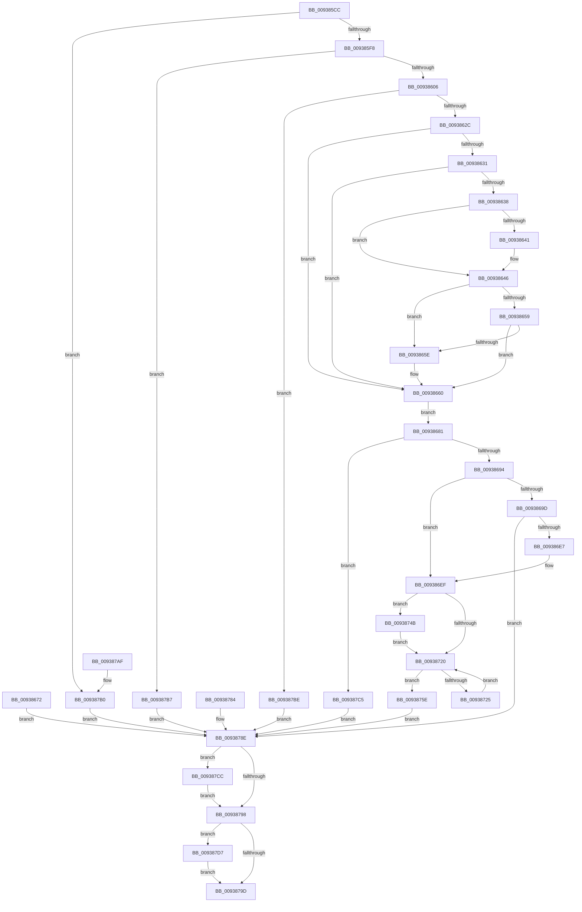

# PfpPrefetchRequest

- RVA: `0x009385CC`–`0x009387E3` (길이 `535` bytes)
- VA: `0x00000001409385CC`
- 실행 섹션: `PAGE`
- PDB 이름 있음: `예`; PDB Function 태그: `아니요`
- unwind 정보 RVA: `0x0008FB94`
- 디코드: `145`개 명령, `535/535` bytes 표시
- 미해석 바이트: `0` (있으면 어셈블리에 `.byte`로 보존)

> 이 문서는 커널 이미지의 기계어와 PDB 기호를 분석해 생성했습니다. 4번과 5번은 함수 원형과 자료형을 바이너리 사용 방식에서 추정한 C 해석이며 원본 소스 복구 결과는 아닙니다.

## 1. Dependencies

- 직접 호출 지점: **9**; 고유 호출 대상: **9**
- 직접 호출자로 확인된 함수: **1**
- RIP 상대 이미지 참조: **1**

### Outgoing calls
- `0x00938613` → [ExAllocatePool2](../../poolcode/B8/ExAllocatePool2_function_00B820F0.md) (function, `0x00B820F0`)
- `0x00938641` → [ExRaiseDatatypeMisalignment](../89/ExRaiseDatatypeMisalignment_function_00899FD0.md) (function, `0x00899FD0`)
- `0x0093866B` → [memcpy](../../text/6C/memcpy_function_006C6840.md) (function, `0x006C6840`)
- `0x00938687` → [PfPrefetchRequestVerify](PfPrefetchRequestVerify_function_009387EC.md) (function, `0x009387EC`)
- `0x009386CC` → [ObReferenceObjectByHandle](../86/ObReferenceObjectByHandle_function_00868DB0.md) (function, `0x00868DB0`)
- `0x009386F2` → [PfpPrefetchRequestPerform](PfpPrefetchRequestPerform_function_00938F74.md) (function, `0x00938F74`)
- `0x00938757` → [ProbeForWrite](../8E/ProbeForWrite_function_008E91C0.md) (function, `0x008E91C0`)
- `0x009387D0` → [ObfDereferenceObject](../../text/2F/ObfDereferenceObject_function_002F9350.md) (function, `0x002F9350`)
- `0x009387DC` → [ExFreePoolWithTag](../../poolcode/B8/ExFreePoolWithTag_function_00B82870.md) (function, `0x00B82870`)

### Direct callers
- [PfSetSuperfetchInformation](../AD/PfSetSuperfetchInformation_function_00ADE6E8.md) at `0x00ADEA36`

### Static image references
- `0x0093869D` → RVA `0x00FC6B80` (`ALMOSTRO`; read)

## 2. Other-region calls and transfers

- 다른 실행 섹션으로 향하는 call: **4**
  - `0x00938613` → [ExAllocatePool2](../../poolcode/B8/ExAllocatePool2_function_00B820F0.md) (`PAGE` → `POOLCODE`)
  - `0x0093866B` → [memcpy](../../text/6C/memcpy_function_006C6840.md) (`PAGE` → `.text`)
  - `0x009387D0` → [ObfDereferenceObject](../../text/2F/ObfDereferenceObject_function_002F9350.md) (`PAGE` → `.text`)
  - `0x009387DC` → [ExFreePoolWithTag](../../poolcode/B8/ExFreePoolWithTag_function_00B82870.md) (`PAGE` → `POOLCODE`)
- 별도 외부 분기/꼬리 이동을 확인하지 못했습니다.

## 3. Assembly (complete function range)

```asm
009385CC  88 54 24 10                     mov byte ptr [rsp + 0x10], dl
009385D0  53                              push rbx
009385D1  56                              push rsi
009385D2  57                              push rdi
009385D3  41 54                           push r12
009385D5  41 55                           push r13
009385D7  41 56                           push r14
009385D9  41 57                           push r15
009385DB  48 83 EC 40                     sub rsp, 0x40
009385DF  40 8A FA                        mov dil, dl
009385E2  48 8B F1                        mov rsi, rcx
009385E5  33 DB                           xor ebx, ebx
009385E7  21 9C 24 80 00 00 00            and dword ptr [rsp + 0x80], ebx
009385EE  83 79 08 05                     cmp dword ptr [rcx + 8], 5
009385F2  0F 85 B8 01 00 00               jne 0x1409387b0
009385F8  8B 41 18                        mov eax, dword ptr [rcx + 0x18]
009385FB  3D 80 00 00 00                  cmp eax, 0x80
00938600  0F 82 B1 01 00 00               jb 0x1409387b7
00938606  8B D0                           mov edx, eax
00938608  B9 00 01 00 00                  mov ecx, 0x100
0093860D  41 B8 50 66 52 51               mov r8d, 0x51526650
00938613  E8 D8 9A 24 00                  call 0x140b820f0
00938618  48 8B D8                        mov rbx, rax
0093861B  48 89 84 24 98 00 00 00         mov qword ptr [rsp + 0x98], rax
00938623  48 85 C0                        test rax, rax
00938626  0F 84 92 01 00 00               je 0x1409387be
0093862C  40 84 FF                        test dil, dil
0093862F  74 2F                           je 0x140938660
00938631  8B 46 18                        mov eax, dword ptr [rsi + 0x18]
00938634  85 C0                           test eax, eax
00938636  74 28                           je 0x140938660
00938638  48 8B 4E 10                     mov rcx, qword ptr [rsi + 0x10]
0093863C  F6 C1 07                        test cl, 7
0093863F  74 05                           je 0x140938646
00938641  E8 8A 19 F6 FF                  call 0x140899fd0
00938646  48 8D 14 01                     lea rdx, [rcx + rax]
0093864A  48 B8 00 00 FF FF FF 7F 00 00   movabs rax, 0x7fffffff0000
00938654  48 3B D0                        cmp rdx, rax
00938657  77 05                           ja 0x14093865e
00938659  48 3B D1                        cmp rdx, rcx
0093865C  73 02                           jae 0x140938660
0093865E  8A 00                           mov al, byte ptr [rax]
00938660  44 8B 46 18                     mov r8d, dword ptr [rsi + 0x18]
00938664  48 8B 56 10                     mov rdx, qword ptr [rsi + 0x10]
00938668  48 8B CB                        mov rcx, rbx
0093866B  E8 D0 E1 D8 FF                  call 0x1406c6840
00938670  EB 0F                           jmp 0x140938681
00938672  8B F8                           mov edi, eax
00938674  48 8B 9C 24 98 00 00 00         mov rbx, qword ptr [rsp + 0x98]
0093867C  E9 0D 01 00 00                  jmp 0x14093878e
00938681  8B 56 18                        mov edx, dword ptr [rsi + 0x18]
00938684  48 8B CB                        mov rcx, rbx
00938687  E8 60 01 00 00                  call 0x1409387ec
0093868C  85 C0                           test eax, eax
0093868E  0F 85 31 01 00 00               jne 0x1409387c5
00938694  48 8B 4B 48                     mov rcx, qword ptr [rbx + 0x48]
00938698  48 85 C9                        test rcx, rcx
0093869B  74 52                           je 0x1409386ef
0093869D  4C 8B 05 DC E4 68 00            mov r8, qword ptr [rip + 0x68e4dc]
009386A4  48 83 A4 24 90 00 00 00 00      and qword ptr [rsp + 0x90], 0
009386AD  48 83 64 24 28 00               and qword ptr [rsp + 0x28], 0
009386B3  48 8D 84 24 90 00 00 00         lea rax, [rsp + 0x90]
009386BB  48 89 44 24 20                  mov qword ptr [rsp + 0x20], rax
009386C0  44 8A CF                        mov r9b, dil
009386C3  41 BE 01 00 00 00               mov r14d, 1
009386C9  41 8B D6                        mov edx, r14d
009386CC  E8 DF 06 F3 FF                  call 0x140868db0
009386D1  8B F8                           mov edi, eax
009386D3  48 8B 84 24 90 00 00 00         mov rax, qword ptr [rsp + 0x90]
009386DB  48 89 43 48                     mov qword ptr [rbx + 0x48], rax
009386DF  85 FF                           test edi, edi
009386E1  0F 88 A7 00 00 00               js 0x14093878e
009386E7  44 89 B4 24 80 00 00 00         mov dword ptr [rsp + 0x80], r14d
009386EF  48 8B CB                        mov rcx, rbx
009386F2  E8 7D 08 00 00                  call 0x140938f74
009386F7  8B F8                           mov edi, eax
009386F9  8B 53 28                        mov edx, dword ptr [rbx + 0x28]
009386FC  4C 8D 34 1A                     lea r14, [rdx + rbx]
00938700  8B 4B 0C                        mov ecx, dword ptr [rbx + 0xc]
00938703  4C 8D 2C 49                     lea r13, [rcx + rcx*2]
00938707  49 C1 E5 04                     shl r13, 4
0093870B  4D 03 EE                        add r13, r14
0093870E  4C 8B 7E 10                     mov r15, qword ptr [rsi + 0x10]
00938712  4E 8D 24 3A                     lea r12, [rdx + r15]
00938716  80 BC 24 88 00 00 00 00         cmp byte ptr [rsp + 0x88], 0
0093871E  75 2B                           jne 0x14093874b
00938720  4D 3B F5                        cmp r14, r13
00938723  73 39                           jae 0x14093875e
00938725  41 8B 04 24                     mov eax, dword ptr [r12]
00938729  8B C8                           mov ecx, eax
0093872B  41 33 0E                        xor ecx, dword ptr [r14]
0093872E  83 E1 08                        and ecx, 8
00938731  33 C8                           xor ecx, eax
00938733  41 89 0C 24                     mov dword ptr [r12], ecx
00938737  49 83 C6 30                     add r14, 0x30
0093873B  4C 89 74 24 30                  mov qword ptr [rsp + 0x30], r14
00938740  49 83 C4 30                     add r12, 0x30
00938744  4C 89 64 24 38                  mov qword ptr [rsp + 0x38], r12
00938749  EB D5                           jmp 0x140938720
0093874B  8B 56 18                        mov edx, dword ptr [rsi + 0x18]
0093874E  41 B8 08 00 00 00               mov r8d, 8
00938754  49 8B CF                        mov rcx, r15
00938757  E8 64 0A FB FF                  call 0x1408e91c0
0093875C  EB C2                           jmp 0x140938720
0093875E  0F 10 43 54                     movups xmm0, xmmword ptr [rbx + 0x54]
00938762  41 0F 11 47 54                  movups xmmword ptr [r15 + 0x54], xmm0
00938767  0F 10 4B 64                     movups xmm1, xmmword ptr [rbx + 0x64]
0093876B  41 0F 11 4F 64                  movups xmmword ptr [r15 + 0x64], xmm1
00938770  F2 0F 10 43 74                  movsd xmm0, qword ptr [rbx + 0x74]
00938775  F2 41 0F 11 47 74               movsd qword ptr [r15 + 0x74], xmm0
0093877B  8B 43 7C                        mov eax, dword ptr [rbx + 0x7c]
0093877E  41 89 47 7C                     mov dword ptr [r15 + 0x7c], eax
00938782  EB 0A                           jmp 0x14093878e
00938784  8B F8                           mov edi, eax
00938786  48 8B 9C 24 98 00 00 00         mov rbx, qword ptr [rsp + 0x98]
0093878E  83 BC 24 80 00 00 00 00         cmp dword ptr [rsp + 0x80], 0
00938796  75 34                           jne 0x1409387cc
00938798  48 85 DB                        test rbx, rbx
0093879B  75 3A                           jne 0x1409387d7
0093879D  8B C7                           mov eax, edi
0093879F  48 83 C4 40                     add rsp, 0x40
009387A3  41 5F                           pop r15
009387A5  41 5E                           pop r14
009387A7  41 5D                           pop r13
009387A9  41 5C                           pop r12
009387AB  5F                              pop rdi
009387AC  5E                              pop rsi
009387AD  5B                              pop rbx
009387AE  C3                              ret
009387AF  CC                              int3
009387B0  BF 03 00 00 C0                  mov edi, 0xc0000003
009387B5  EB D7                           jmp 0x14093878e
009387B7  BF 06 02 00 C0                  mov edi, 0xc0000206
009387BC  EB D0                           jmp 0x14093878e
009387BE  BF 9A 00 00 C0                  mov edi, 0xc000009a
009387C3  EB C9                           jmp 0x14093878e
009387C5  BF 7B 00 00 C0                  mov edi, 0xc000007b
009387CA  EB C2                           jmp 0x14093878e
009387CC  48 8B 4B 48                     mov rcx, qword ptr [rbx + 0x48]
009387D0  E8 7B 0B 9C FF                  call 0x1402f9350
009387D5  EB C1                           jmp 0x140938798
009387D7  33 D2                           xor edx, edx
009387D9  48 8B CB                        mov rcx, rbx
009387DC  E8 8F A0 24 00                  call 0x140b82870
009387E1  EB BA                           jmp 0x14093879d
```

## 4. C-style interpretation (structured pseudocode)

```c
__int64 __fastcall PfpPrefetchRequest(__int64 a1, unsigned __int8 a2)
{
    __int64 result;
    __int64 v_r12;
    __int64 v_r13;
    __int64 v_r14;
    __int64 v_rbx;
    __int64 v_rsp;
    unsigned __int64 v_stack_m40;
    unsigned __int64 v_stack_m48;
    unsigned __int64 v_stack_m50;
    unsigned __int64 v_stack_m58;
    unsigned __int8 v_stack_p10;
    unsigned __int64 v_stack_p18;
    unsigned __int64 v_stack_p20;
    unsigned int v_stack_p8;

    v_stack_p10 = a2;
    v_rsp = (v_rsp) - (64);
    v_rbx = 0;
    if ((*(unsigned int *)(a1 + 8)) != 5) goto loc_009387B0;
    if (((unsigned int)((unsigned int)(*(unsigned int *)(a1 + 24)))) < 128) goto loc_009387B7;
    result = ExAllocatePool2(256, (unsigned int)((unsigned int)((unsigned int)(*(unsigned int *)(a1 + 24)))), (unsigned int)(0x51526650ULL), a4);
    v_stack_p20 = result;
    if (result == 0) goto loc_009387BE;
    if (a2 == 0) goto loc_00938660;
    if ((unsigned int)((unsigned int)(*(unsigned int *)(a1 + 24))) == 0) goto loc_00938660;
    result = (unsigned int)(*(unsigned int *)(a1 + 24));
    if ((((unsigned __int8)(*(unsigned __int64 *)(a1 + 16))) & (7)) != 0) {
        result = ExRaiseDatatypeMisalignment(*(unsigned __int64 *)(a1 + 16), (unsigned int)((unsigned int)((unsigned int)(*(unsigned int *)(a1 + 24)))), (unsigned int)(0x51526650ULL), a4);
    }
    if ((*(unsigned __int64 *)(a1 + 16) + result * 1) > result) goto loc_0093865E;
    if ((*(unsigned __int64 *)(a1 + 16) + result * 1) < (*(unsigned __int64 *)(a1 + 16))) {
        result = *(unsigned __int8 *)(result);
    }
    result = memcpy(result, *(unsigned __int64 *)(a1 + 16), (unsigned int)(*(unsigned int *)(a1 + 24)), a4);
    goto loc_00938681;
loc_00938681:
    result = PfPrefetchRequestVerify(result, (unsigned int)(*(unsigned int *)(a1 + 24)), (unsigned int)(*(unsigned int *)(a1 + 24)), a4);
    if ((unsigned int)(result) != 0) goto loc_009387C5;
    if (*(unsigned __int64 *)(result + 72) == 0) goto loc_009386EF;
    v_stack_m58 = v_stack_p18;
    result = ObReferenceObjectByHandle(*(unsigned __int64 *)(result + 72), 1, *(unsigned __int64 *)(v_rip + 6874332), a2);
    *(unsigned __int64 *)(result + 72) = v_stack_p18;
    if (sign_flag) goto loc_0093878E;
    v_stack_p8 = 1;
loc_009386EF:
    result = PfpPrefetchRequestPerform(result, 1, *(unsigned __int64 *)(v_rip + 6874332), a2);
    v_r13 = ((unsigned int)(*(unsigned int *)(result + 12)) + (unsigned int)(*(unsigned int *)(result + 12)) * 2) << (4);
    v_r13 = (v_r13) + ((unsigned int)(*(unsigned int *)(result + 40)) + result * 1);
    if (v_stack_p10 != 0) goto loc_0093874B;
loc_00938720:
    if (((unsigned int)(*(unsigned int *)(result + 40)) + result * 1) >= v_r13) goto loc_0093875E;
    a1 = (unsigned int)(((unsigned int)((unsigned int)((unsigned int)(*(unsigned int *)((unsigned int)(*(unsigned int *)(result + 40)) + *(unsigned __int64 *)(a1 + 16) * 1))))) ^ (*(unsigned int *)((unsigned int)(*(unsigned int *)(result + 40)) + result * 1)));
    a1 = (unsigned int)((a1) & (8));
    a1 = (unsigned int)((a1) ^ ((unsigned int)((unsigned int)(*(unsigned int *)((unsigned int)(*(unsigned int *)(result + 40)) + *(unsigned __int64 *)(a1 + 16) * 1)))));
    *(unsigned int *)((unsigned int)(*(unsigned int *)(result + 40)) + *(unsigned __int64 *)(a1 + 16) * 1) = (unsigned int)(a1);
    v_r14 = ((unsigned int)(*(unsigned int *)(result + 40)) + result * 1) + (48);
    v_stack_m48 = v_r14;
    v_r12 = ((unsigned int)(*(unsigned int *)(result + 40)) + *(unsigned __int64 *)(a1 + 16) * 1) + (48);
    v_stack_m40 = v_r12;
    goto loc_00938720;
loc_0093874B:
    result = ProbeForWrite(*(unsigned __int64 *)(a1 + 16), (unsigned int)(*(unsigned int *)(a1 + 24)), 8, a2);
    goto loc_00938720;
loc_0093875E:
    *(unsigned __int64 *)(*(unsigned __int64 *)(a1 + 16) + 84) = v_xmm0;
    *(unsigned __int64 *)(*(unsigned __int64 *)(a1 + 16) + 100) = v_xmm1;
    *(unsigned __int64 *)(*(unsigned __int64 *)(a1 + 16) + 116) = v_xmm0;
    *(unsigned int *)(*(unsigned __int64 *)(a1 + 16) + 124) = (unsigned int)((unsigned int)(*(unsigned int *)(result + 124)));
    goto loc_0093878E;
loc_0093878E:
    if (v_stack_p8 != 0) goto loc_009387CC;
loc_00938798:
    if (result != 0) goto loc_009387D7;
loc_0093879D:
    v_rsp = (v_rsp) + (64);
    return (unsigned int)((unsigned int)((unsigned int)((unsigned int)(result))));
loc_009387B0:
    goto loc_0093878E;
loc_009387B7:
    goto loc_0093878E;
loc_009387BE:
    goto loc_0093878E;
loc_009387C5:
    goto loc_0093878E;
loc_009387CC:
    result = ObfDereferenceObject(*(unsigned __int64 *)(result + 72), (unsigned int)(*(unsigned int *)(a1 + 24)), 8, a2);
    goto loc_00938798;
loc_009387D7:
    a2 = 0;
    result = ExFreePoolWithTag(result, a2, 8, a2);
    goto loc_0093879D;
}
```

## 5. (Beta) C Style

```c
int64_t PfpPrefetchRequest(void *Arg1, uint8_t Arg2)
{
    uint8_t *arg1 = (uint8_t *)Arg1;

    int64_t result;
    int64_t local_r12;
    int64_t local_r13;
    int64_t local_r14;
    int64_t local_rbx;
    int64_t local_rsp;
    uint64_t v_stack_m40;
    uint64_t v_stack_m48;
    uint64_t v_stack_m50;
    uint64_t v_stack_m58;
    uint8_t v_stack_p10;
    uint64_t v_stack_p18;
    uint64_t v_stack_p20;
    uint32_t v_stack_p8;

    v_stack_p10 = Arg2;
    local_rsp = (local_rsp) - (64);
    local_rbx = 0;
    if ((*(uint32_t *)(arg1 + 0x8)) != 5) goto loc_009387B0;
    if (((uint32_t)((uint32_t)(*(uint32_t *)(arg1 + 0x18)))) < 128) goto loc_009387B7;
    result = ExAllocatePool2(256, (uint32_t)((uint32_t)((uint32_t)(*(uint32_t *)(arg1 + 0x18)))), (uint32_t)(0x51526650ULL), a4);
    v_stack_p20 = result;
    if (result == 0) goto loc_009387BE;
    if (Arg2 == 0) goto loc_00938660;
    if ((uint32_t)((uint32_t)(*(uint32_t *)(arg1 + 0x18))) == 0) goto loc_00938660;
    result = (uint32_t)(*(uint32_t *)(arg1 + 0x18));
    if ((((uint8_t)(*(uint64_t *)(arg1 + 0x10))) & (7)) != 0) {
        result = ExRaiseDatatypeMisalignment(*(uint64_t *)(arg1 + 0x10), (uint32_t)((uint32_t)((uint32_t)(*(uint32_t *)(arg1 + 0x18)))), (uint32_t)(0x51526650ULL), a4);
    }
    if ((*(uint64_t *)(arg1 + 0x10) + result * 1) > result) goto loc_0093865E;
    if ((*(uint64_t *)(arg1 + 0x10) + result * 1) < (*(uint64_t *)(arg1 + 0x10))) {
        result = *(uint8_t *)(result);
    }
    result = memcpy(result, *(uint64_t *)(arg1 + 0x10), (uint32_t)(*(uint32_t *)(arg1 + 0x18)), a4);
    goto loc_00938681;
loc_00938681:
    result = PfPrefetchRequestVerify(result, (uint32_t)(*(uint32_t *)(arg1 + 0x18)), (uint32_t)(*(uint32_t *)(arg1 + 0x18)), a4);
    if ((uint32_t)(result) != 0) goto loc_009387C5;
    if (*(uint64_t *)(result + 0x48) == 0) goto loc_009386EF;
    v_stack_m58 = v_stack_p18;
    result = ObReferenceObjectByHandle(*(uint64_t *)(result + 0x48), 1, *(uint64_t *)(v_rip + 0x68E4DC), Arg2);
    *(uint64_t *)(result + 0x48) = v_stack_p18;
    if (sign_flag) goto loc_0093878E;
    v_stack_p8 = 1;
loc_009386EF:
    result = PfpPrefetchRequestPerform(result, 1, *(uint64_t *)(v_rip + 0x68E4DC), Arg2);
    local_r13 = ((uint32_t)(*(uint32_t *)(result + 0xC)) + (uint32_t)(*(uint32_t *)(result + 0xC)) * 2) << (4);
    local_r13 = (local_r13) + ((uint32_t)(*(uint32_t *)(result + 0x28)) + result * 1);
    if (v_stack_p10 != 0) goto loc_0093874B;
loc_00938720:
    if (((uint32_t)(*(uint32_t *)(result + 0x28)) + result * 1) >= local_r13) goto loc_0093875E;
    Arg1 = (uint32_t)(((uint32_t)((uint32_t)((uint32_t)(*(uint32_t *)((uint32_t)(*(uint32_t *)(result + 0x28)) + *(uint64_t *)(arg1 + 0x10) * 1))))) ^ (*(uint32_t *)((uint32_t)(*(uint32_t *)(result + 0x28)) + result * 1)));
    Arg1 = (uint32_t)((Arg1) & (8));
    Arg1 = (uint32_t)((Arg1) ^ ((uint32_t)((uint32_t)(*(uint32_t *)((uint32_t)(*(uint32_t *)(result + 0x28)) + *(uint64_t *)(arg1 + 0x10) * 1)))));
    *(uint32_t *)((uint32_t)(*(uint32_t *)(result + 0x28)) + *(uint64_t *)(arg1 + 0x10) * 1) = (uint32_t)(Arg1);
    local_r14 = ((uint32_t)(*(uint32_t *)(result + 0x28)) + result * 1) + (48);
    v_stack_m48 = local_r14;
    local_r12 = ((uint32_t)(*(uint32_t *)(result + 0x28)) + *(uint64_t *)(arg1 + 0x10) * 1) + (48);
    v_stack_m40 = local_r12;
    goto loc_00938720;
loc_0093874B:
    result = ProbeForWrite(*(uint64_t *)(arg1 + 0x10), (uint32_t)(*(uint32_t *)(arg1 + 0x18)), 8, Arg2);
    goto loc_00938720;
loc_0093875E:
    *(uint64_t *)(*(uint64_t *)(arg1 + 0x10) + 0x54) = v_xmm0;
    *(uint64_t *)(*(uint64_t *)(arg1 + 0x10) + 0x64) = v_xmm1;
    *(uint64_t *)(*(uint64_t *)(arg1 + 0x10) + 0x74) = v_xmm0;
    *(uint32_t *)(*(uint64_t *)(arg1 + 0x10) + 0x7C) = (uint32_t)((uint32_t)(*(uint32_t *)(result + 0x7C)));
    goto loc_0093878E;
loc_0093878E:
    if (v_stack_p8 != 0) goto loc_009387CC;
loc_00938798:
    if (result != 0) goto loc_009387D7;
loc_0093879D:
    local_rsp = (local_rsp) + (64);
    return (uint32_t)((uint32_t)((uint32_t)((uint32_t)(result))));
loc_009387B0:
    goto loc_0093878E;
loc_009387B7:
    goto loc_0093878E;
loc_009387BE:
    goto loc_0093878E;
loc_009387C5:
    goto loc_0093878E;
loc_009387CC:
    result = ObfDereferenceObject(*(uint64_t *)(result + 0x48), (uint32_t)(*(uint32_t *)(arg1 + 0x18)), 8, Arg2);
    goto loc_00938798;
loc_009387D7:
    Arg2 = 0;
    result = ExFreePoolWithTag(result, Arg2, 8, Arg2);
    goto loc_0093879D;
}
```

### 관측된 메모리 오프셋

구조체 형식이 확인되지 않은 접근은 인자 기준의 오프셋으로만 기록했습니다.

| 기준 인자 | 오프셋 표현 | 폭 (bit) | 접근 |
|---|---:|---:|---|
| `Arg1` | `+ 0x8` | `32` | `R` |
| `Arg1` | `+ 0x10` | `64` | `R` |
| `Arg1` | `+ 0x18` | `32` | `R` |

## 6. Execution-region graph

[열기: 2D/3D 그래프와 함수 탐색 컨트롤 패널](../../../control-panel.html?section=page&rva=0x009385CC&view=graph)

- 2D 그래프는 위에서 아래로 흐르고, 3D 그래프는 빈 공간을 드래그해 회전합니다. Shift+드래그는 이동, 휠은 확대·축소, 함수 노드 선택은 대상 보고서 이동입니다.

### Static fallback


