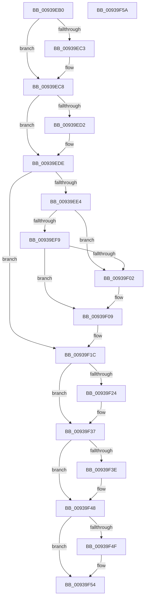

# PfpPrefetchSharedCleanup

- RVA: `0x00939EB0`–`0x00939F5B` (길이 `171` bytes)
- VA: `0x0000000140939EB0`
- 실행 섹션: `PAGE`
- PDB 이름 있음: `예`; PDB Function 태그: `아니요`
- unwind 정보 RVA: `0x0005CF00`
- 디코드: `46`개 명령, `171/171` bytes 표시
- 미해석 바이트: `0` (있으면 어셈블리에 `.byte`로 보존)

> 이 문서는 커널 이미지의 기계어와 PDB 기호를 분석해 생성했습니다. 4번과 5번은 함수 원형과 자료형을 바이너리 사용 방식에서 추정한 C 해석이며 원본 소스 복구 결과는 아닙니다.

## 1. Dependencies

- 직접 호출 지점: **7**; 고유 호출 대상: **6**
- 직접 호출자로 확인된 함수: **3**
- RIP 상대 이미지 참조: **3**

### Outgoing calls
- `0x00939EC3` → [KeAbPostRelease](../../text/2E/KeAbPostRelease_function_002E1600.md) (function, `0x002E1600`)
- `0x00939ED9` → [KeAbPostRelease](../../text/2E/KeAbPostRelease_function_002E1600.md) (function, `0x002E1600`)
- `0x00939EEB` → [FsRtlAcquirePushLockExclusive](../../text/4A/FsRtlAcquirePushLockExclusive_function_004A05F4.md) (function, `0x004A05F4`)
- `0x00939F17` → [PfLockExclusiveRelease](../../text/49/PfLockExclusiveRelease_function_00491D88.md) (function, `0x00491D88`)
- `0x00939F2B` → [ExReleaseRundownProtection](../../text/34/ExReleaseRundownProtection_function_00349E80.md) (function, `0x00349E80`)
- `0x00939F43` → [PsSetCurrentThreadPrefetching](../8A/PsSetCurrentThreadPrefetching_function_008A9A40.md) (function, `0x008A9A40`)
- `0x00939F4F` → [KeLeaveCriticalRegion](../../text/25/KeLeaveCriticalRegion_function_0025D8B0.md) (function, `0x0025D8B0`)

### Direct callers
- [PfpQueryFileExtentsRequest](../75/PfpQueryFileExtentsRequest_function_007508E8.md) at `0x00750F32`
- [PfpPrefetchRequestPerform](PfpPrefetchRequestPerform_function_00938F74.md) at `0x009393E2`
- [PfSnCleanupPrefetchHeader](PfSnCleanupPrefetchHeader_function_00939898.md) at `0x00939954`

### Static image references
- `0x00939ED2` → RVA `0x00E66EB0` (`.data`; read)
- `0x00939EE4` → RVA `0x00E67200` (`.data`; read)
- `0x00939F24` → RVA `0x00E671F0` (`.data`; read)

## 2. Other-region calls and transfers

- 다른 실행 섹션으로 향하는 call: **6**
  - `0x00939EC3` → [KeAbPostRelease](../../text/2E/KeAbPostRelease_function_002E1600.md) (`PAGE` → `.text`)
  - `0x00939ED9` → [KeAbPostRelease](../../text/2E/KeAbPostRelease_function_002E1600.md) (`PAGE` → `.text`)
  - `0x00939EEB` → [FsRtlAcquirePushLockExclusive](../../text/4A/FsRtlAcquirePushLockExclusive_function_004A05F4.md) (`PAGE` → `.text`)
  - `0x00939F17` → [PfLockExclusiveRelease](../../text/49/PfLockExclusiveRelease_function_00491D88.md) (`PAGE` → `.text`)
  - `0x00939F2B` → [ExReleaseRundownProtection](../../text/34/ExReleaseRundownProtection_function_00349E80.md) (`PAGE` → `.text`)
  - `0x00939F4F` → [KeLeaveCriticalRegion](../../text/25/KeLeaveCriticalRegion_function_0025D8B0.md) (`PAGE` → `.text`)
- 별도 외부 분기/꼬리 이동을 확인하지 못했습니다.

## 3. Assembly (complete function range)

```asm
00939EB0  40 53                           push rbx
00939EB2  48 83 EC 20                     sub rsp, 0x20
00939EB6  48 83 B9 80 00 00 00 00         cmp qword ptr [rcx + 0x80], 0
00939EBE  48 8B D9                        mov rbx, rcx
00939EC1  74 05                           je 0x140939ec8
00939EC3  E8 38 77 9A FF                  call 0x1402e1600
00939EC8  48 83 BB 88 00 00 00 00         cmp qword ptr [rbx + 0x88], 0
00939ED0  74 0C                           je 0x140939ede
00939ED2  48 8D 0D D7 CF 52 00            lea rcx, [rip + 0x52cfd7]
00939ED9  E8 22 77 9A FF                  call 0x1402e1600
00939EDE  48 83 3B 00                     cmp qword ptr [rbx], 0
00939EE2  74 38                           je 0x140939f1c
00939EE4  48 8D 0D 15 D3 52 00            lea rcx, [rip + 0x52d315]
00939EEB  E8 04 67 B6 FF                  call 0x1404a05f4
00939EF0  48 8B 13                        mov rdx, qword ptr [rbx]
00939EF3  48 39 5A 08                     cmp qword ptr [rdx + 8], rbx
00939EF7  75 09                           jne 0x140939f02
00939EF9  48 8B 43 08                     mov rax, qword ptr [rbx + 8]
00939EFD  48 39 18                        cmp qword ptr [rax], rbx
00939F00  74 07                           je 0x140939f09
00939F02  B9 03 00 00 00                  mov ecx, 3
00939F07  CD 29                           int 0x29
00939F09  48 89 10                        mov qword ptr [rax], rdx
00939F0C  48 8D 0D ED D2 52 00            lea rcx, [rip + 0x52d2ed]
00939F13  48 89 42 08                     mov qword ptr [rdx + 8], rax
00939F17  E8 6C 7E B5 FF                  call 0x140491d88
00939F1C  8B 4B 44                        mov ecx, dword ptr [rbx + 0x44]
00939F1F  F6 C1 01                        test cl, 1
00939F22  74 13                           je 0x140939f37
00939F24  48 8D 0D C5 D2 52 00            lea rcx, [rip + 0x52d2c5]
00939F2B  E8 50 FF A0 FF                  call 0x140349e80
00939F30  83 63 44 FE                     and dword ptr [rbx + 0x44], 0xfffffffe
00939F34  8B 4B 44                        mov ecx, dword ptr [rbx + 0x44]
00939F37  48 83 7B 10 00                  cmp qword ptr [rbx + 0x10], 0
00939F3C  74 0A                           je 0x140939f48
00939F3E  D1 E9                           shr ecx, 1
00939F40  80 E1 01                        and cl, 1
00939F43  E8 F8 FA F6 FF                  call 0x1408a9a40
00939F48  8B 43 44                        mov eax, dword ptr [rbx + 0x44]
00939F4B  A8 08                           test al, 8
00939F4D  74 05                           je 0x140939f54
00939F4F  E8 5C 39 92 FF                  call 0x14025d8b0
00939F54  48 83 C4 20                     add rsp, 0x20
00939F58  5B                              pop rbx
00939F59  C3                              ret
00939F5A  CC                              int3
```

## 4. C-style interpretation (structured pseudocode)

```c
__int64 __fastcall PfpPrefetchSharedCleanup(__int64 a1)
{
    __int64 result;
    __int64 v_rsp;

    v_rsp = (v_rsp) - (32);
    if ((*(unsigned __int64 *)(a1 + 128)) != 0) {
        result = KeAbPostRelease(a1, a2, a3, a4);
    }
    if ((*(unsigned __int64 *)(a1 + 136)) != 0) {
        a1 = v_rip + 5427159;
        result = KeAbPostRelease(a1, a2, a3, a4);
    }
    if ((*(unsigned __int64 *)(a1)) == 0) goto loc_00939F1C;
    result = FsRtlAcquirePushLockExclusive(v_rip + 5427989, a2, a3, a4);
    if ((*(unsigned __int64 *)(*(unsigned __int64 *)(a1) + 8)) != a1) goto loc_00939F02;
    if ((*(unsigned __int64 *)(*(unsigned __int64 *)(a1 + 8))) != a1) {
        a1 = 3;
    }
    *(unsigned __int64 *)(*(unsigned __int64 *)(a1 + 8)) = *(unsigned __int64 *)(a1);
    *(unsigned __int64 *)(*(unsigned __int64 *)(a1) + 8) = *(unsigned __int64 *)(a1 + 8);
    result = PfLockExclusiveRelease(v_rip + 5427949, *(unsigned __int64 *)(a1), a3, a4);
loc_00939F1C:
    if ((((unsigned __int8)((unsigned int)(*(unsigned int *)(a1 + 68)))) & (1)) != 0) {
        a1 = v_rip + 5427909;
        result = ExReleaseRundownProtection(a1, *(unsigned __int64 *)(a1), a3, a4);
        a1 = *(unsigned int *)(a1 + 68);
    }
    if ((*(unsigned __int64 *)(a1 + 16)) != 0) {
        a1 = (unsigned int)((a1) >> (1));
        a1 = (unsigned __int8)((a1) & (1));
        result = PsSetCurrentThreadPrefetching(a1, *(unsigned __int64 *)(a1), a3, a4);
    }
    result = (unsigned int)(*(unsigned int *)(a1 + 68));
    if ((((unsigned __int8)((unsigned int)(*(unsigned int *)(a1 + 68)))) & (8)) != 0) {
        result = KeLeaveCriticalRegion(a1, *(unsigned __int64 *)(a1), a3, a4);
    }
    v_rsp = (v_rsp) + (32);
    return result;
}
```

## 5. (Beta) C Style

```c
int64_t PfpPrefetchSharedCleanup(void *Arg1)
{
    uint8_t *arg1 = (uint8_t *)Arg1;

    int64_t result;
    int64_t local_rsp;

    local_rsp = (local_rsp) - (32);
    if ((*(uint64_t *)(arg1 + 0x80)) != 0) {
        result = KeAbPostRelease(Arg1, a2, a3, a4);
    }
    if ((*(uint64_t *)(arg1 + 0x88)) != 0) {
        Arg1 = v_rip + 5427159;
        result = KeAbPostRelease(Arg1, a2, a3, a4);
    }
    if ((*(uint64_t *)(arg1)) == 0) goto loc_00939F1C;
    result = FsRtlAcquirePushLockExclusive(v_rip + 5427989, a2, a3, a4);
    if ((*(uint64_t *)(*(uint64_t *)(arg1) + 0x8)) != Arg1) goto loc_00939F02;
    if ((*(uint64_t *)(*(uint64_t *)(arg1 + 0x8))) != Arg1) {
        Arg1 = 3;
    }
    *(uint64_t *)(*(uint64_t *)(arg1 + 0x8)) = *(uint64_t *)(arg1);
    *(uint64_t *)(*(uint64_t *)(arg1) + 0x8) = *(uint64_t *)(arg1 + 0x8);
    result = PfLockExclusiveRelease(v_rip + 5427949, *(uint64_t *)(arg1), a3, a4);
loc_00939F1C:
    if ((((uint8_t)((uint32_t)(*(uint32_t *)(arg1 + 0x44)))) & (1)) != 0) {
        Arg1 = v_rip + 5427909;
        result = ExReleaseRundownProtection(Arg1, *(uint64_t *)(arg1), a3, a4);
        Arg1 = *(uint32_t *)(arg1 + 0x44);
    }
    if ((*(uint64_t *)(arg1 + 0x10)) != 0) {
        Arg1 = (uint32_t)((Arg1) >> (1));
        Arg1 = (uint8_t)((Arg1) & (1));
        result = PsSetCurrentThreadPrefetching(Arg1, *(uint64_t *)(arg1), a3, a4);
    }
    result = (uint32_t)(*(uint32_t *)(arg1 + 0x44));
    if ((((uint8_t)((uint32_t)(*(uint32_t *)(arg1 + 0x44)))) & (8)) != 0) {
        result = KeLeaveCriticalRegion(Arg1, *(uint64_t *)(arg1), a3, a4);
    }
    local_rsp = (local_rsp) + (32);
    return result;
}
```

### 관측된 메모리 오프셋

구조체 형식이 확인되지 않은 접근은 인자 기준의 오프셋으로만 기록했습니다.

| 기준 인자 | 오프셋 표현 | 폭 (bit) | 접근 |
|---|---:|---:|---|
| `Arg1` | `+ 0x0` | `64` | `R` |
| `Arg1` | `+ 0x8` | `64` | `R` |
| `Arg1` | `+ 0x10` | `64` | `R` |
| `Arg1` | `+ 0x44` | `32` | `R` |
| `Arg1` | `+ 0x44` | `32` | `R/W` |
| `Arg1` | `+ 0x80` | `64` | `R` |
| `Arg1` | `+ 0x88` | `64` | `R` |

## 6. Execution-region graph

[열기: 2D/3D 그래프와 함수 탐색 컨트롤 패널](../../../control-panel.html?section=page&rva=0x00939EB0&view=graph)

- 2D 그래프는 위에서 아래로 흐르고, 3D 그래프는 빈 공간을 드래그해 회전합니다. Shift+드래그는 이동, 휠은 확대·축소, 함수 노드 선택은 대상 보고서 이동입니다.

### Static fallback


