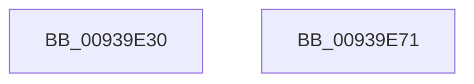

# PfpPrefetchSharedInitialize

- RVA: `0x00939E30`–`0x00939E72` (길이 `66` bytes)
- VA: `0x0000000140939E30`
- 실행 섹션: `PAGE`
- PDB 이름 있음: `예`; PDB Function 태그: `아니요`
- unwind 정보 RVA: `0x0005CF00`
- 디코드: `18`개 명령, `66/66` bytes 표시
- 미해석 바이트: `0` (있으면 어셈블리에 `.byte`로 보존)

> 이 문서는 커널 이미지의 기계어와 PDB 기호를 분석해 생성했습니다. 4번과 5번은 함수 원형과 자료형을 바이너리 사용 방식에서 추정한 C 해석이며 원본 소스 복구 결과는 아닙니다.

## 1. Dependencies

- 직접 호출 지점: **2**; 고유 호출 대상: **2**
- 직접 호출자로 확인된 함수: **3**
- RIP 상대 이미지 참조: **1**

### Outgoing calls
- `0x00939E41` → [memset](../../text/6C/memset_function_006C6C40.md) (function, `0x006C6C40`)
- `0x00939E5E` → [KeInitializeEvent](../../text/40/KeInitializeEvent_function_0040DD10.md) (function, `0x0040DD10`)

### Direct callers
- [PfpQueryFileExtentsRequest](../75/PfpQueryFileExtentsRequest_function_007508E8.md) at `0x00750B45`
- [PfpPrefetchRequestPerform](PfpPrefetchRequestPerform_function_00938F74.md) at `0x00939028`
- [PfSnAsyncPrefetchWorker](PfSnAsyncPrefetchWorker_function_009394B0.md) at `0x009395E7`

### Static image references
- `0x00939E46` → RVA `0x00ABC350` (`PfpPrefetchSharedConflictNotifyStart`; read)

## 2. Other-region calls and transfers

- 다른 실행 섹션으로 향하는 call: **2**
  - `0x00939E41` → [memset](../../text/6C/memset_function_006C6C40.md) (`PAGE` → `.text`)
  - `0x00939E5E` → [KeInitializeEvent](../../text/40/KeInitializeEvent_function_0040DD10.md) (`PAGE` → `.text`)
- 별도 외부 분기/꼬리 이동을 확인하지 못했습니다.

## 3. Assembly (complete function range)

```asm
00939E30  40 53                           push rbx
00939E32  48 83 EC 20                     sub rsp, 0x20
00939E36  33 D2                           xor edx, edx
00939E38  41 B8 90 00 00 00               mov r8d, 0x90
00939E3E  48 8B D9                        mov rbx, rcx
00939E41  E8 FA CD D8 FF                  call 0x1406c6c40
00939E46  48 8D 05 03 25 18 00            lea rax, [rip + 0x182503]
00939E4D  48 89 5B 30                     mov qword ptr [rbx + 0x30], rbx
00939E51  48 8D 4B 58                     lea rcx, [rbx + 0x58]
00939E55  48 89 43 28                     mov qword ptr [rbx + 0x28], rax
00939E59  45 33 C0                        xor r8d, r8d
00939E5C  33 D2                           xor edx, edx
00939E5E  E8 AD 3E AD FF                  call 0x14040dd10
00939E63  48 C7 43 78 01 00 00 00         mov qword ptr [rbx + 0x78], 1
00939E6B  48 83 C4 20                     add rsp, 0x20
00939E6F  5B                              pop rbx
00939E70  C3                              ret
00939E71  CC                              int3
```

## 4. C-style interpretation (structured pseudocode)

```c
__int64 __fastcall PfpPrefetchSharedInitialize(__int64 a1, int a2)
{
    __int64 result;
    __int64 v_rsp;

    v_rsp = (v_rsp) - (32);
    a2 = 0;
    result = memset(a1, a2, 144, a4);
    *(unsigned __int64 *)(a1 + 48) = a1;
    *(unsigned __int64 *)(a1 + 40) = v_rip + 1582339;
    a3 = 0;
    a2 = 0;
    result = KeInitializeEvent(a1 + 88, a2, a3, a4);
    *(unsigned __int64 *)(a1 + 120) = 1;
    v_rsp = (v_rsp) + (32);
    return result;
}
```

## 5. (Beta) C Style

```c
int64_t PfpPrefetchSharedInitialize(void *Arg1, int32_t Arg2)
{
    uint8_t *arg1 = (uint8_t *)Arg1;

    int64_t result;
    int64_t local_rsp;

    local_rsp = (local_rsp) - (32);
    Arg2 = 0;
    result = memset(Arg1, Arg2, 144, a4);
    *(void **)(arg1 + 0x30) = Arg1;
    *(uint64_t *)(arg1 + 0x28) = v_rip + 1582339;
    a3 = 0;
    Arg2 = 0;
    result = KeInitializeEvent(Arg1 + 88, Arg2, a3, a4);
    *(uint64_t *)(arg1 + 0x78) = 1;
    local_rsp = (local_rsp) + (32);
    return result;
}
```

### 관측된 메모리 오프셋

구조체 형식이 확인되지 않은 접근은 인자 기준의 오프셋으로만 기록했습니다.

| 기준 인자 | 오프셋 표현 | 폭 (bit) | 접근 |
|---|---:|---:|---|
| `Arg1` | `+ 0x28` | `64` | `W` |
| `Arg1` | `+ 0x30` | `64` | `W` |
| `Arg1` | `+ 0x58` | `64` | `R` |
| `Arg1` | `+ 0x78` | `64` | `W` |

## 6. Execution-region graph

[열기: 2D/3D 그래프와 함수 탐색 컨트롤 패널](../../../control-panel.html?section=page&rva=0x00939E30&view=graph)

- 2D 그래프는 위에서 아래로 흐르고, 3D 그래프는 빈 공간을 드래그해 회전합니다. Shift+드래그는 이동, 휠은 확대·축소, 함수 노드 선택은 대상 보고서 이동입니다.

### Static fallback


