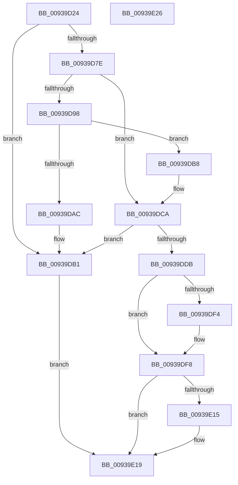

# PfpPrefetchSharedStart

- RVA: `0x00939D24`–`0x00939E27` (길이 `259` bytes)
- VA: `0x0000000140939D24`
- 실행 섹션: `PAGE`
- PDB 이름 있음: `예`; PDB Function 태그: `아니요`
- unwind 정보 RVA: `0x0005CAAC`
- 디코드: `68`개 명령, `259/259` bytes 표시
- 미해석 바이트: `0` (있으면 어셈블리에 `.byte`로 보존)

> 이 문서는 커널 이미지의 기계어와 PDB 기호를 분석해 생성했습니다. 4번과 5번은 함수 원형과 자료형을 바이너리 사용 방식에서 추정한 C 해석이며 원본 소스 복구 결과는 아닙니다.

## 1. Dependencies

- 직접 호출 지점: **6**; 고유 호출 대상: **5**
- 직접 호출자로 확인된 함수: **3**
- RIP 상대 이미지 참조: **6**

### Outgoing calls
- `0x00939D55` → [PsSetCurrentThreadPrefetching](../8A/PsSetCurrentThreadPrefetching_function_008A9A40.md) (function, `0x008A9A40`)
- `0x00939D73` → [ExAcquireRundownProtection](../../text/21/ExAcquireRundownProtection_function_00216620.md) (function, `0x00216620`)
- `0x00939D89` → [FsRtlAcquirePushLockExclusive](../../text/4A/FsRtlAcquirePushLockExclusive_function_004A05F4.md) (function, `0x004A05F4`)
- `0x00939DD1` → [PfLockExclusiveRelease](../../text/49/PfLockExclusiveRelease_function_00491D88.md) (function, `0x00491D88`)
- `0x00939DE3` → [KeAbPreAcquire](../../text/21/KeAbPreAcquire_function_00210230.md) (function, `0x00210230`)
- `0x00939E04` → [KeAbPreAcquire](../../text/21/KeAbPreAcquire_function_00210230.md) (function, `0x00210230`)

### Direct callers
- [PfpQueryFileExtentsRequest](../75/PfpQueryFileExtentsRequest_function_007508E8.md) at `0x00750B5B`
- [PfpPrefetchRequestPerform](PfpPrefetchRequestPerform_function_00938F74.md) at `0x00939069`
- [PfSnAsyncPrefetchWorker](PfSnAsyncPrefetchWorker_function_009394B0.md) at `0x00939617`

### Static image references
- `0x00939D69` → RVA `0x00E671F0` (`.data`; read)
- `0x00939D82` → RVA `0x00E67200` (`.data`; read)
- `0x00939D8E` → RVA `0x00E67218` (`.data`; read)
- `0x00939D98` → RVA `0x00E67208` (`.data`; read)
- `0x00939DC3` → RVA `0x00E67208` (`.data`; write)
- `0x00939DFB` → RVA `0x00E66EB0` (`.data`; read)

## 2. Other-region calls and transfers

- 다른 실행 섹션으로 향하는 call: **5**
  - `0x00939D73` → [ExAcquireRundownProtection](../../text/21/ExAcquireRundownProtection_function_00216620.md) (`PAGE` → `.text`)
  - `0x00939D89` → [FsRtlAcquirePushLockExclusive](../../text/4A/FsRtlAcquirePushLockExclusive_function_004A05F4.md) (`PAGE` → `.text`)
  - `0x00939DD1` → [PfLockExclusiveRelease](../../text/49/PfLockExclusiveRelease_function_00491D88.md) (`PAGE` → `.text`)
  - `0x00939DE3` → [KeAbPreAcquire](../../text/21/KeAbPreAcquire_function_00210230.md) (`PAGE` → `.text`)
  - `0x00939E04` → [KeAbPreAcquire](../../text/21/KeAbPreAcquire_function_00210230.md) (`PAGE` → `.text`)
- 별도 외부 분기/꼬리 이동을 확인하지 못했습니다.

## 3. Assembly (complete function range)

```asm
00939D24  48 89 5C 24 08                  mov qword ptr [rsp + 8], rbx
00939D29  57                              push rdi
00939D2A  48 83 EC 20                     sub rsp, 0x20
00939D2E  65 48 8B 04 25 88 01 00 00      mov rax, qword ptr gs:[0x188]
00939D37  48 8B D9                        mov rbx, rcx
00939D3A  66 FF 88 E4 01 00 00            dec word ptr [rax + 0x1e4]
00939D41  90                              nop
00939D42  83 49 44 08                     or dword ptr [rcx + 0x44], 8
00939D46  65 48 8B 04 25 88 01 00 00      mov rax, qword ptr gs:[0x188]
00939D4F  48 89 41 10                     mov qword ptr [rcx + 0x10], rax
00939D53  B1 01                           mov cl, 1
00939D55  E8 E6 FC F6 FF                  call 0x1408a9a40
00939D5A  8B 4B 44                        mov ecx, dword ptr [rbx + 0x44]
00939D5D  0F B6 C0                        movzx eax, al
00939D60  03 C0                           add eax, eax
00939D62  33 C1                           xor eax, ecx
00939D64  83 E0 02                        and eax, 2
00939D67  33 C1                           xor eax, ecx
00939D69  48 8D 0D 80 D4 52 00            lea rcx, [rip + 0x52d480]
00939D70  89 43 44                        mov dword ptr [rbx + 0x44], eax
00939D73  E8 A8 C8 8D FF                  call 0x140216620
00939D78  33 FF                           xor edi, edi
00939D7A  84 C0                           test al, al
00939D7C  74 33                           je 0x140939db1
00939D7E  83 4B 44 01                     or dword ptr [rbx + 0x44], 1
00939D82  48 8D 0D 77 D4 52 00            lea rcx, [rip + 0x52d477]
00939D89  E8 66 68 B6 FF                  call 0x1404a05f4
00939D8E  8B 05 84 D4 52 00               mov eax, dword ptr [rip + 0x52d484]
00939D94  A8 01                           test al, 1
00939D96  75 32                           jne 0x140939dca
00939D98  48 8B 05 69 D4 52 00            mov rax, qword ptr [rip + 0x52d469]
00939D9F  48 8D 0D 62 D4 52 00            lea rcx, [rip + 0x52d462]
00939DA6  48 39 48 08                     cmp qword ptr [rax + 8], rcx
00939DAA  74 0C                           je 0x140939db8
00939DAC  8D 4F 03                        lea ecx, [rdi + 3]
00939DAF  CD 29                           int 0x29
00939DB1  BF B9 02 00 C0                  mov edi, 0xc00002b9
00939DB6  EB 61                           jmp 0x140939e19
00939DB8  48 89 03                        mov qword ptr [rbx], rax
00939DBB  48 89 4B 08                     mov qword ptr [rbx + 8], rcx
00939DBF  48 89 58 08                     mov qword ptr [rax + 8], rbx
00939DC3  48 89 1D 3E D4 52 00            mov qword ptr [rip + 0x52d43e], rbx
00939DCA  48 8D 0D 2F D4 52 00            lea rcx, [rip + 0x52d42f]
00939DD1  E8 B2 7F B5 FF                  call 0x140491d88
00939DD6  48 39 3B                        cmp qword ptr [rbx], rdi
00939DD9  74 D6                           je 0x140939db1
00939DDB  45 33 C0                        xor r8d, r8d
00939DDE  33 D2                           xor edx, edx
00939DE0  48 8B CB                        mov rcx, rbx
00939DE3  E8 48 64 8D FF                  call 0x140210230
00939DE8  48 89 83 80 00 00 00            mov qword ptr [rbx + 0x80], rax
00939DEF  48 85 C0                        test rax, rax
00939DF2  74 04                           je 0x140939df8
00939DF4  C6 40 0A 01                     mov byte ptr [rax + 0xa], 1
00939DF8  45 33 C0                        xor r8d, r8d
00939DFB  48 8D 0D AE D0 52 00            lea rcx, [rip + 0x52d0ae]
00939E02  33 D2                           xor edx, edx
00939E04  E8 27 64 8D FF                  call 0x140210230
00939E09  48 89 83 88 00 00 00            mov qword ptr [rbx + 0x88], rax
00939E10  48 85 C0                        test rax, rax
00939E13  74 04                           je 0x140939e19
00939E15  C6 40 0A 01                     mov byte ptr [rax + 0xa], 1
00939E19  48 8B 5C 24 30                  mov rbx, qword ptr [rsp + 0x30]
00939E1E  8B C7                           mov eax, edi
00939E20  48 83 C4 20                     add rsp, 0x20
00939E24  5F                              pop rdi
00939E25  C3                              ret
00939E26  CC                              int3
```

## 4. C-style interpretation (structured pseudocode)

```c
__int64 __fastcall PfpPrefetchSharedStart(__int64 a1, int a2, int a3)
{
    __int64 result;
    __int64 v_rdi;
    __int64 v_rsp;
    unsigned __int64 v_stack_p8;

    v_stack_p8 = v_rbx;
    v_rsp = (v_rsp) - (32);
    *(unsigned __int64 *)(a1 + 16) = *(unsigned __int64 *)(gs_base + (0 + 392));
    result = PsSetCurrentThreadPrefetching(1, a2, a3, a4);
    result = (unsigned int)(((unsigned __int8)(result)) + ((unsigned int)((unsigned __int8)(result))));
    result = (unsigned int)((result) ^ ((unsigned int)((unsigned int)(*(unsigned int *)(a1 + 68)))));
    result = (unsigned int)((result) & (2));
    result = (unsigned int)((result) ^ ((unsigned int)((unsigned int)(*(unsigned int *)(a1 + 68)))));
    *(unsigned int *)(a1 + 68) = (unsigned int)(result);
    result = ExAcquireRundownProtection(v_rip + 5428352, a2, a3, a4);
    v_rdi = 0;
    if ((unsigned __int8)(result) == 0) goto loc_00939DB1;
    result = FsRtlAcquirePushLockExclusive(v_rip + 5428343, a2, a3, a4);
    if ((((unsigned __int8)((unsigned int)(*(unsigned int *)(v_rip + 5428356)))) & (1)) != 0) goto loc_00939DCA;
    if ((*(unsigned __int64 *)(*(unsigned __int64 *)(v_rip + 5428329) + 8)) == (v_rip + 5428322)) goto loc_00939DB8;
loc_00939DB1:
    goto loc_00939E19;
loc_00939DB8:
    *(unsigned __int64 *)(a1) = *(unsigned __int64 *)(v_rip + 5428329);
    *(unsigned __int64 *)(a1 + 8) = v_rdi + 3;
    *(unsigned __int64 *)(*(unsigned __int64 *)(v_rip + 5428329) + 8) = a1;
    *(unsigned __int64 *)(v_rip + 5428286) = a1;
loc_00939DCA:
    result = PfLockExclusiveRelease(v_rip + 5428271, a2, a3, a4);
    if ((*(unsigned __int64 *)(a1)) == ((unsigned int)(0xC00002B9ULL))) goto loc_00939DB1;
    a3 = 0;
    a2 = 0;
    result = KeAbPreAcquire(a1, a2, a3, a4);
    *(unsigned __int64 *)(a1 + 128) = result;
    if (result != 0) {
        *(unsigned __int8 *)(result + 10) = 1;
    }
    a3 = 0;
    a2 = 0;
    result = KeAbPreAcquire(v_rip + 5427374, a2, a3, a4);
    *(unsigned __int64 *)(a1 + 136) = result;
    if (result != 0) {
        *(unsigned __int8 *)(result + 10) = 1;
    }
    v_rsp = (v_rsp) + (32);
    return (unsigned int)((unsigned int)((unsigned int)(0xC00002B9ULL)));
}
```

## 5. (Beta) C Style

```c
int64_t PfpPrefetchSharedStart(void *Arg1, int32_t Arg2, int32_t Arg3)
{
    uint8_t *arg1 = (uint8_t *)Arg1;

    int64_t result;
    int64_t local_rdi;
    int64_t local_rsp;
    uint64_t v_stack_p8;

    v_stack_p8 = local_rbx;
    local_rsp = (local_rsp) - (32);
    *(uint64_t *)(arg1 + 0x10) = *(uint64_t *)(gs_base + (0 + 0x188));
    result = PsSetCurrentThreadPrefetching(1, Arg2, Arg3, a4);
    result = (uint32_t)(((uint8_t)(result)) + ((uint32_t)((uint8_t)(result))));
    result = (uint32_t)((result) ^ ((uint32_t)((uint32_t)(*(uint32_t *)(arg1 + 0x44)))));
    result = (uint32_t)((result) & (2));
    result = (uint32_t)((result) ^ ((uint32_t)((uint32_t)(*(uint32_t *)(arg1 + 0x44)))));
    *(uint32_t *)(arg1 + 0x44) = (uint32_t)(result);
    result = ExAcquireRundownProtection(v_rip + 5428352, Arg2, Arg3, a4);
    local_rdi = 0;
    if ((uint8_t)(result) == 0) goto loc_00939DB1;
    result = FsRtlAcquirePushLockExclusive(v_rip + 5428343, Arg2, Arg3, a4);
    if ((((uint8_t)((uint32_t)(*(uint32_t *)(v_rip + 0x52D484)))) & (1)) != 0) goto loc_00939DCA;
    if ((*(uint64_t *)(*(uint64_t *)(v_rip + 0x52D469) + 0x8)) == (v_rip + 5428322)) goto loc_00939DB8;
loc_00939DB1:
    goto loc_00939E19;
loc_00939DB8:
    *(uint64_t *)(arg1) = *(uint64_t *)(v_rip + 0x52D469);
    *(uint64_t *)(arg1 + 0x8) = local_rdi + 3;
    *(void **)(*(uint64_t *)(v_rip + 0x52D469) + 0x8) = Arg1;
    *(void **)(v_rip + 0x52D43E) = Arg1;
loc_00939DCA:
    result = PfLockExclusiveRelease(v_rip + 5428271, Arg2, Arg3, a4);
    if ((*(uint64_t *)(arg1)) == ((uint32_t)(0xC00002B9ULL))) goto loc_00939DB1;
    Arg3 = 0;
    Arg2 = 0;
    result = KeAbPreAcquire(Arg1, Arg2, Arg3, a4);
    *(uint64_t *)(arg1 + 0x80) = result;
    if (result != 0) {
        *(uint8_t *)(result + 0xA) = 1;
    }
    Arg3 = 0;
    Arg2 = 0;
    result = KeAbPreAcquire(v_rip + 5427374, Arg2, Arg3, a4);
    *(uint64_t *)(arg1 + 0x88) = result;
    if (result != 0) {
        *(uint8_t *)(result + 0xA) = 1;
    }
    local_rsp = (local_rsp) + (32);
    return (uint32_t)((uint32_t)((uint32_t)(0xC00002B9ULL)));
}
```

### 관측된 메모리 오프셋

구조체 형식이 확인되지 않은 접근은 인자 기준의 오프셋으로만 기록했습니다.

| 기준 인자 | 오프셋 표현 | 폭 (bit) | 접근 |
|---|---:|---:|---|
| `Arg1` | `+ 0x0` | `64` | `R` |
| `Arg1` | `+ 0x0` | `64` | `W` |
| `Arg1` | `+ 0x8` | `64` | `W` |
| `Arg1` | `+ 0x10` | `64` | `W` |
| `Arg1` | `+ 0x44` | `32` | `R` |
| `Arg1` | `+ 0x44` | `32` | `R/W` |
| `Arg1` | `+ 0x44` | `32` | `W` |
| `Arg1` | `+ 0x80` | `64` | `W` |
| `Arg1` | `+ 0x88` | `64` | `W` |

## 6. Execution-region graph

[열기: 2D/3D 그래프와 함수 탐색 컨트롤 패널](../../../control-panel.html?section=page&rva=0x00939D24&view=graph)

- 2D 그래프는 위에서 아래로 흐르고, 3D 그래프는 빈 공간을 드래그해 회전합니다. Shift+드래그는 이동, 휠은 확대·축소, 함수 노드 선택은 대상 보고서 이동입니다.

### Static fallback


