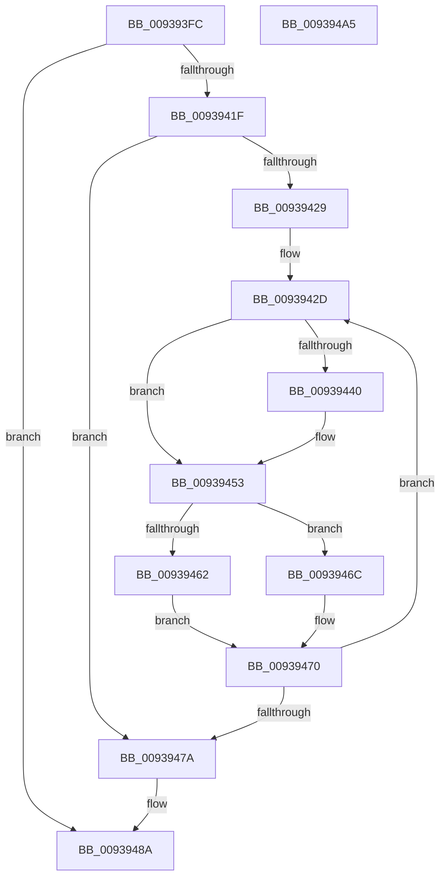

# PfpPrefetchVolumesCleanup

- RVA: `0x009393FC`–`0x009394A6` (길이 `170` bytes)
- VA: `0x00000001409393FC`
- 실행 섹션: `PAGE`
- PDB 이름 있음: `예`; PDB Function 태그: `아니요`
- unwind 정보 RVA: `0x0008FC44`
- 디코드: `49`개 명령, `170/170` bytes 표시
- 미해석 바이트: `0` (있으면 어셈블리에 `.byte`로 보존)

> 이 문서는 커널 이미지의 기계어와 PDB 기호를 분석해 생성했습니다. 4번과 5번은 함수 원형과 자료형을 바이너리 사용 방식에서 추정한 C 해석이며 원본 소스 복구 결과는 아닙니다.

## 1. Dependencies

- 직접 호출 지점: **3**; 고유 호출 대상: **2**
- 직접 호출자로 확인된 함수: **1**
- RIP 상대 이미지 참조: **0**

### Outgoing calls
- `0x0093944E` → [PfpOpenHandleClose](../8A/PfpOpenHandleClose_function_008A9E74.md) (function, `0x008A9E74`)
- `0x00939465` → [PfpOpenHandleClose](../8A/PfpOpenHandleClose_function_008A9E74.md) (function, `0x008A9E74`)
- `0x00939480` → [ExFreePoolWithTag](../../poolcode/B8/ExFreePoolWithTag_function_00B82870.md) (function, `0x00B82870`)

### Direct callers
- [PfpPrefetchRequestPerform](PfpPrefetchRequestPerform_function_00938F74.md) at `0x00939151`

### Static image references
- 디코드된 RIP-relative 메모리 참조가 없습니다.

## 2. Other-region calls and transfers

- 다른 실행 섹션으로 향하는 call: **1**
  - `0x00939480` → [ExFreePoolWithTag](../../poolcode/B8/ExFreePoolWithTag_function_00B82870.md) (`PAGE` → `POOLCODE`)
- 별도 외부 분기/꼬리 이동을 확인하지 못했습니다.

## 3. Assembly (complete function range)

```asm
009393FC  48 8B C4                        mov rax, rsp
009393FF  48 89 58 08                     mov qword ptr [rax + 8], rbx
00939403  48 89 68 10                     mov qword ptr [rax + 0x10], rbp
00939407  48 89 70 18                     mov qword ptr [rax + 0x18], rsi
0093940B  48 89 78 20                     mov qword ptr [rax + 0x20], rdi
0093940F  41 57                           push r15
00939411  48 83 EC 20                     sub rsp, 0x20
00939415  48 83 79 10 00                  cmp qword ptr [rcx + 0x10], 0
0093941A  48 8B D9                        mov rbx, rcx
0093941D  74 6B                           je 0x14093948a
0093941F  48 8B 01                        mov rax, qword ptr [rcx]
00939422  33 F6                           xor esi, esi
00939424  39 70 08                        cmp dword ptr [rax + 8], esi
00939427  76 51                           jbe 0x14093947a
00939429  48 8D 79 28                     lea rdi, [rcx + 0x28]
0093942D  48 8B 4B 10                     mov rcx, qword ptr [rbx + 0x10]
00939431  8B EE                           mov ebp, esi
00939433  48 C1 E5 06                     shl rbp, 6
00939437  48 0F BA 64 29 38 22            bt qword ptr [rcx + rbp + 0x38], 0x22
0093943E  73 13                           jae 0x140939453
00939440  48 83 C1 20                     add rcx, 0x20
00939444  48 8D 7B 28                     lea rdi, [rbx + 0x28]
00939448  48 8B 17                        mov rdx, qword ptr [rdi]
0093944B  48 03 CD                        add rcx, rbp
0093944E  E8 21 0A F7 FF                  call 0x1408a9e74
00939453  48 8B 4B 10                     mov rcx, qword ptr [rbx + 0x10]
00939457  48 03 CD                        add rcx, rbp
0093945A  48 0F BA 61 18 22               bt qword ptr [rcx + 0x18], 0x22
00939460  73 0A                           jae 0x14093946c
00939462  48 8B 17                        mov rdx, qword ptr [rdi]
00939465  E8 0A 0A F7 FF                  call 0x1408a9e74
0093946A  EB 04                           jmp 0x140939470
0093946C  48 8D 7B 28                     lea rdi, [rbx + 0x28]
00939470  48 8B 03                        mov rax, qword ptr [rbx]
00939473  FF C6                           inc esi
00939475  3B 70 08                        cmp esi, dword ptr [rax + 8]
00939478  72 B3                           jb 0x14093942d
0093947A  48 8B 4B 10                     mov rcx, qword ptr [rbx + 0x10]
0093947E  33 D2                           xor edx, edx
00939480  E8 EB 93 24 00                  call 0x140b82870
00939485  48 83 63 10 00                  and qword ptr [rbx + 0x10], 0
0093948A  48 8B 5C 24 30                  mov rbx, qword ptr [rsp + 0x30]
0093948F  48 8B 6C 24 38                  mov rbp, qword ptr [rsp + 0x38]
00939494  48 8B 74 24 40                  mov rsi, qword ptr [rsp + 0x40]
00939499  48 8B 7C 24 48                  mov rdi, qword ptr [rsp + 0x48]
0093949E  48 83 C4 20                     add rsp, 0x20
009394A2  41 5F                           pop r15
009394A4  C3                              ret
009394A5  CC                              int3
```

## 4. C-style interpretation (structured pseudocode)

```c
__int64 __fastcall PfpPrefetchVolumesCleanup(__int64 a1)
{
    __int64 result;
    __int64 v_rbp;
    __int64 v_rdi;
    __int64 v_rsi;
    __int64 v_rsp;
    unsigned __int64 v_stack_p10;
    unsigned __int64 v_stack_p18;
    unsigned __int64 v_stack_p20;
    unsigned __int64 v_stack_p8;

    *(unsigned __int64 *)(v_rsp + 8) = v_rbx;
    *(unsigned __int64 *)(v_rsp + 16) = v_rbp;
    *(unsigned __int64 *)(v_rsp + 24) = v_rsi;
    *(unsigned __int64 *)(v_rsp + 32) = v_rdi;
    v_rsp = (v_rsp) - (32);
    if ((*(unsigned __int64 *)(a1 + 16)) == 0) goto loc_0093948A;
    v_rsi = 0;
    if ((*(unsigned int *)(*(unsigned __int64 *)(a1) + 8)) <= 0) goto loc_0093947A;
loc_0093942D:
    v_rbp = (0) << (6);
    result = *(unsigned __int64 *)(a1);
    v_rdi = a1 + 40;
    if (!(condition_is_above_or_equal)) {
        a1 = (*(unsigned __int64 *)(a1 + 16)) + (32);
        v_rdi = a1 + 40;
        a2 = *(unsigned __int64 *)(v_rdi);
        a1 = (a1) + (v_rbp);
        result = PfpOpenHandleClose(a1, a2, a3, a4);
    }
    a1 = (*(unsigned __int64 *)(a1 + 16)) + (v_rbp);
    if (condition_is_above_or_equal) goto loc_0093946C;
    result = PfpOpenHandleClose(a1, *(unsigned __int64 *)(v_rdi), a3, a4);
    goto loc_00939470;
loc_0093946C:
loc_00939470:
    v_rsi = (unsigned int)((v_rsi) + 1);
    if (((unsigned int)(v_rsi)) < (*(unsigned int *)(*(unsigned __int64 *)(a1) + 8))) goto loc_0093942D;
loc_0093947A:
    a2 = 0;
    result = ExFreePoolWithTag(*(unsigned __int64 *)(a1 + 16), a2, a3, a4);
loc_0093948A:
    v_rsp = (v_rsp) + (32);
    return result;
}
```

## 5. (Beta) C Style

```c
int64_t PfpPrefetchVolumesCleanup(void *Arg1)
{
    uint8_t *arg1 = (uint8_t *)Arg1;

    int64_t result;
    int64_t local_rbp;
    int64_t local_rdi;
    int64_t local_rsi;
    int64_t local_rsp;
    uint64_t v_stack_p10;
    uint64_t v_stack_p18;
    uint64_t v_stack_p20;
    uint64_t v_stack_p8;

    *(uint64_t *)(local_rsp + 0x8) = local_rbx;
    *(uint64_t *)(local_rsp + 0x10) = local_rbp;
    *(uint64_t *)(local_rsp + 0x18) = local_rsi;
    *(uint64_t *)(local_rsp + 0x20) = local_rdi;
    local_rsp = (local_rsp) - (32);
    if ((*(uint64_t *)(arg1 + 0x10)) == 0) goto loc_0093948A;
    local_rsi = 0;
    if ((*(uint32_t *)(*(uint64_t *)(arg1) + 0x8)) <= 0) goto loc_0093947A;
loc_0093942D:
    local_rbp = (0) << (6);
    result = *(uint64_t *)(arg1);
    local_rdi = Arg1 + 40;
    if (!(condition_is_above_or_equal)) {
        Arg1 = (*(uint64_t *)(arg1 + 0x10)) + (32);
        local_rdi = Arg1 + 40;
        a2 = *(uint64_t *)(local_rdi);
        Arg1 = (Arg1) + (local_rbp);
        result = PfpOpenHandleClose(Arg1, a2, a3, a4);
    }
    Arg1 = (*(uint64_t *)(arg1 + 0x10)) + (local_rbp);
    if (condition_is_above_or_equal) goto loc_0093946C;
    result = PfpOpenHandleClose(Arg1, *(uint64_t *)(local_rdi), a3, a4);
    goto loc_00939470;
loc_0093946C:
loc_00939470:
    local_rsi = (uint32_t)((local_rsi) + 1);
    if (((uint32_t)(local_rsi)) < (*(uint32_t *)(*(uint64_t *)(arg1) + 0x8))) goto loc_0093942D;
loc_0093947A:
    a2 = 0;
    result = ExFreePoolWithTag(*(uint64_t *)(arg1 + 0x10), a2, a3, a4);
loc_0093948A:
    local_rsp = (local_rsp) + (32);
    return result;
}
```

### 관측된 메모리 오프셋

구조체 형식이 확인되지 않은 접근은 인자 기준의 오프셋으로만 기록했습니다.

| 기준 인자 | 오프셋 표현 | 폭 (bit) | 접근 |
|---|---:|---:|---|
| `Arg1` | `+ 0x0` | `64` | `R` |
| `Arg1` | `+ 0x10` | `64` | `R` |
| `Arg1` | `+ 0x10` | `64` | `R/W` |
| `Arg1` | `+ 0x28` | `64` | `R` |

## 6. Execution-region graph

[열기: 2D/3D 그래프와 함수 탐색 컨트롤 패널](../../../control-panel.html?section=page&rva=0x009393FC&view=graph)

- 2D 그래프는 위에서 아래로 흐르고, 3D 그래프는 빈 공간을 드래그해 회전합니다. Shift+드래그는 이동, 휠은 확대·축소, 함수 노드 선택은 대상 보고서 이동입니다.

### Static fallback


