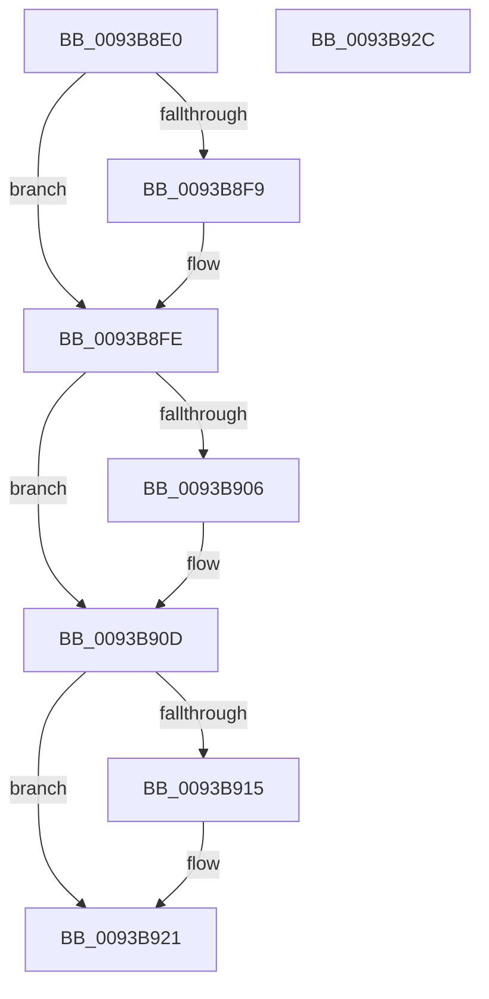

# PfpReadSupportCleanup

- RVA: `0x0093B8E0`–`0x0093B92D` (길이 `77` bytes)
- VA: `0x000000014093B8E0`
- 실행 섹션: `PAGE`
- PDB 이름 있음: `예`; PDB Function 태그: `아니요`
- unwind 정보 RVA: `0x0005CAAC`
- 디코드: `24`개 명령, `77/77` bytes 표시
- 미해석 바이트: `0` (있으면 어셈블리에 `.byte`로 보존)

> 이 문서는 커널 이미지의 기계어와 PDB 기호를 분석해 생성했습니다. 4번과 5번은 함수 원형과 자료형을 바이너리 사용 방식에서 추정한 C 해석이며 원본 소스 복구 결과는 아닙니다.

## 1. Dependencies

- 직접 호출 지점: **3**; 고유 호출 대상: **3**
- 직접 호출자로 확인된 함수: **2**
- RIP 상대 이미지 참조: **0**

### Outgoing calls
- `0x0093B8F9` → [NtClose](../86/NtClose_function_00868870.md) (function, `0x00868870`)
- `0x0093B908` → [ExFreePoolWithTag](../../poolcode/B8/ExFreePoolWithTag_function_00B82870.md) (function, `0x00B82870`)
- `0x0093B91C` → [PfpOpenHandleClose](../8A/PfpOpenHandleClose_function_008A9E74.md) (function, `0x008A9E74`)

### Direct callers
- [PfpPrefetchFiles](PfpPrefetchFiles_function_0093AD58.md) at `0x0093B077`
- [PfpPrefetchFiles](PfpPrefetchFiles_function_0093AD58.md) at `0x0093B092`
- [PfpPrefetchFilesTrickle](PfpPrefetchFilesTrickle_function_0093C4E8.md) at `0x0093C731`

### Static image references
- 디코드된 RIP-relative 메모리 참조가 없습니다.

## 2. Other-region calls and transfers

- 다른 실행 섹션으로 향하는 call: **1**
  - `0x0093B908` → [ExFreePoolWithTag](../../poolcode/B8/ExFreePoolWithTag_function_00B82870.md) (`PAGE` → `POOLCODE`)
- 별도 외부 분기/꼬리 이동을 확인하지 못했습니다.

## 3. Assembly (complete function range)

```asm
0093B8E0  48 89 5C 24 08                  mov qword ptr [rsp + 8], rbx
0093B8E5  57                              push rdi
0093B8E6  48 83 EC 20                     sub rsp, 0x20
0093B8EA  48 8B F9                        mov rdi, rcx
0093B8ED  48 8B DA                        mov rbx, rdx
0093B8F0  48 8B 4A 28                     mov rcx, qword ptr [rdx + 0x28]
0093B8F4  48 85 C9                        test rcx, rcx
0093B8F7  74 05                           je 0x14093b8fe
0093B8F9  E8 72 CF F2 FF                  call 0x140868870
0093B8FE  48 8B 0B                        mov rcx, qword ptr [rbx]
0093B901  48 85 C9                        test rcx, rcx
0093B904  74 07                           je 0x14093b90d
0093B906  33 D2                           xor edx, edx
0093B908  E8 63 6F 24 00                  call 0x140b82870
0093B90D  48 0F BA 63 20 22               bt qword ptr [rbx + 0x20], 0x22
0093B913  73 0C                           jae 0x14093b921
0093B915  48 8D 4B 08                     lea rcx, [rbx + 8]
0093B919  48 8B D7                        mov rdx, rdi
0093B91C  E8 53 E5 F6 FF                  call 0x1408a9e74
0093B921  48 8B 5C 24 30                  mov rbx, qword ptr [rsp + 0x30]
0093B926  48 83 C4 20                     add rsp, 0x20
0093B92A  5F                              pop rdi
0093B92B  C3                              ret
0093B92C  CC                              int3
```

## 4. C-style interpretation (structured pseudocode)

```c
__int64 __fastcall PfpReadSupportCleanup(__int64 a1, __int64 a2)
{
    __int64 result;
    __int64 v_rsp;
    unsigned __int64 v_stack_p8;

    v_stack_p8 = v_rbx;
    v_rsp = (v_rsp) - (32);
    if (*(unsigned __int64 *)(a2 + 40) != 0) {
        result = NtClose(*(unsigned __int64 *)(a2 + 40), a2, a3, a4);
    }
    if (*(unsigned __int64 *)(a2) != 0) {
        a2 = 0;
        result = ExFreePoolWithTag(*(unsigned __int64 *)(a2), a2, a3, a4);
    }
    if (!(condition_is_above_or_equal)) {
        a1 = a2 + 8;
        a2 = a1;
        result = PfpOpenHandleClose(a1, a2, a3, a4);
    }
    v_rsp = (v_rsp) + (32);
    return result;
}
```

## 5. (Beta) C Style

```c
int64_t PfpReadSupportCleanup(int64_t Arg1, void *Arg2)
{
    uint8_t *arg2 = (uint8_t *)Arg2;

    int64_t result;
    int64_t local_rsp;
    uint64_t v_stack_p8;

    v_stack_p8 = local_rbx;
    local_rsp = (local_rsp) - (32);
    if (*(uint64_t *)(arg2 + 0x28) != 0) {
        result = NtClose(*(uint64_t *)(arg2 + 0x28), Arg2, a3, a4);
    }
    if (*(uint64_t *)(arg2) != 0) {
        Arg2 = 0;
        result = ExFreePoolWithTag(*(uint64_t *)(arg2), Arg2, a3, a4);
    }
    if (!(condition_is_above_or_equal)) {
        Arg1 = Arg2 + 8;
        Arg2 = Arg1;
        result = PfpOpenHandleClose(Arg1, Arg2, a3, a4);
    }
    local_rsp = (local_rsp) + (32);
    return result;
}
```

### 관측된 메모리 오프셋

구조체 형식이 확인되지 않은 접근은 인자 기준의 오프셋으로만 기록했습니다.

| 기준 인자 | 오프셋 표현 | 폭 (bit) | 접근 |
|---|---:|---:|---|
| `Arg2` | `+ 0x0` | `64` | `R` |
| `Arg2` | `+ 0x8` | `64` | `R` |
| `Arg2` | `+ 0x20` | `64` | `R` |
| `Arg2` | `+ 0x28` | `64` | `R` |

## 6. Execution-region graph

[열기: 2D/3D 그래프와 함수 탐색 컨트롤 패널](../../../control-panel.html?section=page&rva=0x0093B8E0&view=graph)

- 2D 그래프는 위에서 아래로 흐르고, 3D 그래프는 빈 공간을 드래그해 회전합니다. Shift+드래그는 이동, 휠은 확대·축소, 함수 노드 선택은 대상 보고서 이동입니다.

### Static fallback


