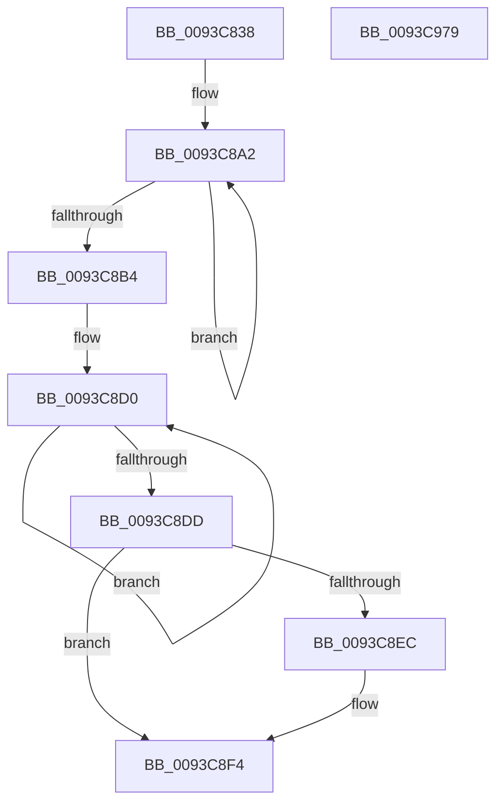

# PfpUpdateRepurposedByPrefetch

- RVA: `0x0093C838`–`0x0093C97A` (길이 `322` bytes)
- VA: `0x000000014093C838`
- 실행 섹션: `PAGE`
- PDB 이름 있음: `예`; PDB Function 태그: `아니요`
- unwind 정보 RVA: `0x0008FF24`
- 디코드: `77`개 명령, `322/322` bytes 표시
- 미해석 바이트: `0` (있으면 어셈블리에 `.byte`로 보존)

> 이 문서는 커널 이미지의 기계어와 PDB 기호를 분석해 생성했습니다. 4번과 5번은 함수 원형과 자료형을 바이너리 사용 방식에서 추정한 C 해석이며 원본 소스 복구 결과는 아닙니다.

## 1. Dependencies

- 직접 호출 지점: **3**; 고유 호출 대상: **3**
- 직접 호출자로 확인된 함수: **5**
- RIP 상대 이미지 참조: **2**

### Outgoing calls
- `0x0093C86A` → [memset](../../text/6C/memset_function_006C6C40.md) (function, `0x006C6C40`)
- `0x0093C88D` → [MmQueryMemoryListInformation](../../text/3B/MmQueryMemoryListInformation_function_003B9EDC.md) (function, `0x003B9EDC`)
- `0x0093C963` → [_security_check_cookie](../../text/6A/_security_check_cookie_function_006AC640.md) (function, `0x006AC640`)

### Direct callers
- [PfpVolumePrefetchMetadata](PfpVolumePrefetchMetadata_function_0093A158.md) at `0x0093A5B6`
- [PfpPrefetchPrivatePages](PfpPrefetchPrivatePages_function_0093A7FC.md) at `0x0093A9F3`
- [PfpPrefetchDirectoryStream](PfpPrefetchDirectoryStream_function_0093AA94.md) at `0x0093AD25`
- [PfpPrefetchFilesTrickle](PfpPrefetchFilesTrickle_function_0093C4E8.md) at `0x0093C6FC`
- [sub_00B250B4](../B2/Unknown_function_00B250B4.md) at `0x00B2511D`

### Static image references
- `0x0093C845` → RVA `0x00E0A740` (`.data`; read)
- `0x0093C8EC` → RVA `0x00E67220` (`.data`; read/write)

## 2. Other-region calls and transfers

- 다른 실행 섹션으로 향하는 call: **3**
  - `0x0093C86A` → [memset](../../text/6C/memset_function_006C6C40.md) (`PAGE` → `.text`)
  - `0x0093C88D` → [MmQueryMemoryListInformation](../../text/3B/MmQueryMemoryListInformation_function_003B9EDC.md) (`PAGE` → `.text`)
  - `0x0093C963` → [_security_check_cookie](../../text/6A/_security_check_cookie_function_006AC640.md) (`PAGE` → `.text`)
- 별도 외부 분기/꼬리 이동을 확인하지 못했습니다.

## 3. Assembly (complete function range)

```asm
0093C838  48 89 5C 24 18                  mov qword ptr [rsp + 0x18], rbx
0093C83D  57                              push rdi
0093C83E  48 81 EC 00 01 00 00            sub rsp, 0x100
0093C845  48 8B 05 F4 DE 4C 00            mov rax, qword ptr [rip + 0x4cdef4]
0093C84C  48 33 C4                        xor rax, rsp
0093C84F  48 89 84 24 F0 00 00 00         mov qword ptr [rsp + 0xf0], rax
0093C857  48 8B FA                        mov rdi, rdx
0093C85A  48 8B D9                        mov rbx, rcx
0093C85D  33 D2                           xor edx, edx
0093C85F  48 8D 4C 24 40                  lea rcx, [rsp + 0x40]
0093C864  41 B8 B0 00 00 00               mov r8d, 0xb0
0093C86A  E8 D1 A3 D8 FF                  call 0x1406c6c40
0093C86F  83 64 24 30 00                  and dword ptr [rsp + 0x30], 0
0093C874  48 8D 44 24 30                  lea rax, [rsp + 0x30]
0093C879  41 B8 B0 00 00 00               mov r8d, 0xb0
0093C87F  48 89 44 24 20                  mov qword ptr [rsp + 0x20], rax
0093C884  48 8D 54 24 40                  lea rdx, [rsp + 0x40]
0093C889  48 83 C9 FF                     or rcx, 0xffffffffffffffff
0093C88D  E8 4A D6 A7 FF                  call 0x1403b9edc
0093C892  0F 57 C9                        xorps xmm1, xmm1
0093C895  48 8D 84 24 A8 00 00 00         lea rax, [rsp + 0xa8]
0093C89D  B9 04 00 00 00                  mov ecx, 4
0093C8A2  F3 0F 6F 00                     movdqu xmm0, xmmword ptr [rax]
0093C8A6  48 8D 40 10                     lea rax, [rax + 0x10]
0093C8AA  66 0F D4 C8                     paddq xmm1, xmm0
0093C8AE  48 83 E9 01                     sub rcx, 1
0093C8B2  75 EE                           jne 0x14093c8a2
0093C8B4  66 0F 6F C1                     movdqa xmm0, xmm1
0093C8B8  48 8D 4B 68                     lea rcx, [rbx + 0x68]
0093C8BC  33 D2                           xor edx, edx
0093C8BE  66 0F 73 D8 08                  psrldq xmm0, 8
0093C8C3  66 0F D4 C8                     paddq xmm1, xmm0
0093C8C7  66 48 0F 7E C8                  movq rax, xmm1
0093C8CC  44 8D 42 08                     lea r8d, [rdx + 8]
0093C8D0  48 03 11                        add rdx, qword ptr [rcx]
0093C8D3  48 8D 49 08                     lea rcx, [rcx + 8]
0093C8D7  49 83 E8 01                     sub r8, 1
0093C8DB  75 F3                           jne 0x14093c8d0
0093C8DD  48 2B C2                        sub rax, rdx
0093C8E0  48 3B C7                        cmp rax, rdi
0093C8E3  48 0F 47 C7                     cmova rax, rdi
0093C8E7  48 85 C0                        test rax, rax
0093C8EA  74 08                           je 0x14093c8f4
0093C8EC  F0 48 01 05 2C A9 52 00         lock add qword ptr [rip + 0x52a92c], rax
0093C8F4  48 8D 44 24 40                  lea rax, [rsp + 0x40]
0093C8F9  B9 80 00 00 00                  mov ecx, 0x80
0093C8FE  0F 10 00                        movups xmm0, xmmword ptr [rax]
0093C901  0F 10 48 10                     movups xmm1, xmmword ptr [rax + 0x10]
0093C905  0F 11 03                        movups xmmword ptr [rbx], xmm0
0093C908  0F 10 40 20                     movups xmm0, xmmword ptr [rax + 0x20]
0093C90C  0F 11 4B 10                     movups xmmword ptr [rbx + 0x10], xmm1
0093C910  0F 10 48 30                     movups xmm1, xmmword ptr [rax + 0x30]
0093C914  0F 11 43 20                     movups xmmword ptr [rbx + 0x20], xmm0
0093C918  0F 10 40 40                     movups xmm0, xmmword ptr [rax + 0x40]
0093C91C  0F 11 4B 30                     movups xmmword ptr [rbx + 0x30], xmm1
0093C920  0F 10 48 50                     movups xmm1, xmmword ptr [rax + 0x50]
0093C924  0F 11 43 40                     movups xmmword ptr [rbx + 0x40], xmm0
0093C928  0F 10 40 60                     movups xmm0, xmmword ptr [rax + 0x60]
0093C92C  0F 11 4B 50                     movups xmmword ptr [rbx + 0x50], xmm1
0093C930  0F 10 0C 08                     movups xmm1, xmmword ptr [rax + rcx]
0093C934  0F 11 43 60                     movups xmmword ptr [rbx + 0x60], xmm0
0093C938  48 03 D9                        add rbx, rcx
0093C93B  0F 10 40 70                     movups xmm0, xmmword ptr [rax + 0x70]
0093C93F  0F 11 43 F0                     movups xmmword ptr [rbx - 0x10], xmm0
0093C943  0F 10 44 08 10                  movups xmm0, xmmword ptr [rax + rcx + 0x10]
0093C948  0F 11 0B                        movups xmmword ptr [rbx], xmm1
0093C94B  0F 10 4C 08 20                  movups xmm1, xmmword ptr [rax + rcx + 0x20]
0093C950  0F 11 43 10                     movups xmmword ptr [rbx + 0x10], xmm0
0093C954  0F 11 4B 20                     movups xmmword ptr [rbx + 0x20], xmm1
0093C958  48 8B 8C 24 F0 00 00 00         mov rcx, qword ptr [rsp + 0xf0]
0093C960  48 33 CC                        xor rcx, rsp
0093C963  E8 D8 FC D6 FF                  call 0x1406ac640
0093C968  48 8B 9C 24 20 01 00 00         mov rbx, qword ptr [rsp + 0x120]
0093C970  48 81 C4 00 01 00 00            add rsp, 0x100
0093C977  5F                              pop rdi
0093C978  C3                              ret
0093C979  CC                              int3
```

## 4. C-style interpretation (structured pseudocode)

```c
__int64 __fastcall PfpUpdateRepurposedByPrefetch(__int64 a1, __int64 a2)
{
    __int64 result;
    __int64 v_rbx;
    __int64 v_rsp;
    unsigned __int64 v_stack_m18;
    unsigned __int64 v_stack_m60;
    unsigned __int64 v_stack_mC8;
    unsigned int v_stack_mD8;
    unsigned __int64 v_stack_mE8;
    unsigned __int64 v_stack_p18;

    v_stack_p18 = v_rbx;
    v_rsp = (v_rsp) - (256);
    result = (*(unsigned __int64 *)(v_rip + 5037812)) ^ (v_rsp);
    v_stack_m18 = result;
    a2 = 0;
    result = memset(v_stack_mC8, a2, 176, a4);
    v_stack_mE8 = v_stack_mD8;
    a1 = (v_stack_mC8) | (-1);
    result = MmQueryMemoryListInformation(a1, v_stack_mC8, 176, a4);
loc_0093C8A2:
    a1 = (4) - (1);
    if (condition_is_not_equal) goto loc_0093C8A2;
    a2 = 0;
loc_0093C8D0:
    a2 = (a2) + (*(unsigned __int64 *)(a1 + 104));
    a3 = (a2 + 8) - (1);
    if (condition_is_not_equal) goto loc_0093C8D0;
    result = (v_stack_m60 + 16) - (a2);
    if (result > a2) { result = a2; }
    if (result != 0) {
    }
    *(unsigned __int64 *)(a1) = v_xmm0;
    *(unsigned __int64 *)(a1 + 16) = v_xmm1;
    *(unsigned __int64 *)(a1 + 32) = v_xmm0;
    *(unsigned __int64 *)(a1 + 48) = v_xmm1;
    *(unsigned __int64 *)(a1 + 64) = v_xmm0;
    *(unsigned __int64 *)(a1 + 80) = v_xmm1;
    *(unsigned __int64 *)(a1 + 96) = v_xmm0;
    v_rbx = (a1) + (128);
    *(unsigned __int64 *)(v_rbx - 16) = v_xmm0;
    *(unsigned __int64 *)(v_rbx) = v_xmm1;
    *(unsigned __int64 *)(v_rbx + 16) = v_xmm0;
    *(unsigned __int64 *)(v_rbx + 32) = v_xmm1;
    a1 = (v_stack_m18) ^ (v_rsp);
    result = _security_check_cookie(a1, a2, a3, a4);
    v_rsp = (v_rsp) + (256);
    return result;
}
```

## 5. (Beta) C Style

```c
int64_t PfpUpdateRepurposedByPrefetch(void *Arg1, int64_t Arg2)
{
    uint8_t *arg1 = (uint8_t *)Arg1;

    int64_t result;
    int64_t local_rbx;
    int64_t local_rsp;
    uint64_t v_stack_m18;
    uint64_t v_stack_m60;
    uint64_t v_stack_mC8;
    uint32_t v_stack_mD8;
    uint64_t v_stack_mE8;
    uint64_t v_stack_p18;

    v_stack_p18 = local_rbx;
    local_rsp = (local_rsp) - (256);
    result = (*(uint64_t *)(v_rip + 0x4CDEF4)) ^ (local_rsp);
    v_stack_m18 = result;
    Arg2 = 0;
    result = memset(v_stack_mC8, Arg2, 176, a4);
    v_stack_mE8 = v_stack_mD8;
    Arg1 = (v_stack_mC8) | (-1);
    result = MmQueryMemoryListInformation(Arg1, v_stack_mC8, 176, a4);
loc_0093C8A2:
    Arg1 = (4) - (1);
    if (condition_is_not_equal) goto loc_0093C8A2;
    Arg2 = 0;
loc_0093C8D0:
    Arg2 = (Arg2) + (*(uint64_t *)(arg1 + 0x68));
    a3 = (Arg2 + 8) - (1);
    if (condition_is_not_equal) goto loc_0093C8D0;
    result = (v_stack_m60 + 16) - (Arg2);
    if (result > Arg2) { result = Arg2; }
    if (result != 0) {
    }
    *(uint64_t *)(arg1) = v_xmm0;
    *(uint64_t *)(arg1 + 0x10) = v_xmm1;
    *(uint64_t *)(arg1 + 0x20) = v_xmm0;
    *(uint64_t *)(arg1 + 0x30) = v_xmm1;
    *(uint64_t *)(arg1 + 0x40) = v_xmm0;
    *(uint64_t *)(arg1 + 0x50) = v_xmm1;
    *(uint64_t *)(arg1 + 0x60) = v_xmm0;
    local_rbx = (Arg1) + (128);
    *(uint64_t *)(local_rbx - 0x10) = v_xmm0;
    *(uint64_t *)(local_rbx) = v_xmm1;
    *(uint64_t *)(local_rbx + 0x10) = v_xmm0;
    *(uint64_t *)(local_rbx + 0x20) = v_xmm1;
    Arg1 = (v_stack_m18) ^ (local_rsp);
    result = _security_check_cookie(Arg1, Arg2, a3, a4);
    local_rsp = (local_rsp) + (256);
    return result;
}
```

### 관측된 메모리 오프셋

구조체 형식이 확인되지 않은 접근은 인자 기준의 오프셋으로만 기록했습니다.

| 기준 인자 | 오프셋 표현 | 폭 (bit) | 접근 |
|---|---:|---:|---|
| `Arg1` | `- 0x10` | `128` | `R` |
| `Arg1` | `+ 0x0` | `64` | `R` |
| `Arg1` | `+ 0x0` | `128` | `R` |
| `Arg1` | `+ 0x8` | `64` | `R` |
| `Arg1` | `+ 0x10` | `128` | `R` |
| `Arg1` | `+ 0x20` | `128` | `R` |
| `Arg1` | `+ 0x30` | `128` | `R` |
| `Arg1` | `+ 0x40` | `128` | `R` |
| `Arg1` | `+ 0x50` | `128` | `R` |
| `Arg1` | `+ 0x60` | `128` | `R` |
| `Arg1` | `+ 0x68` | `64` | `R` |

## 6. Execution-region graph

[열기: 2D/3D 그래프와 함수 탐색 컨트롤 패널](../../../control-panel.html?section=page&rva=0x0093C838&view=graph)

- 2D 그래프는 위에서 아래로 흐르고, 3D 그래프는 빈 공간을 드래그해 회전합니다. Shift+드래그는 이동, 휠은 확대·축소, 함수 노드 선택은 대상 보고서 이동입니다.

### Static fallback


