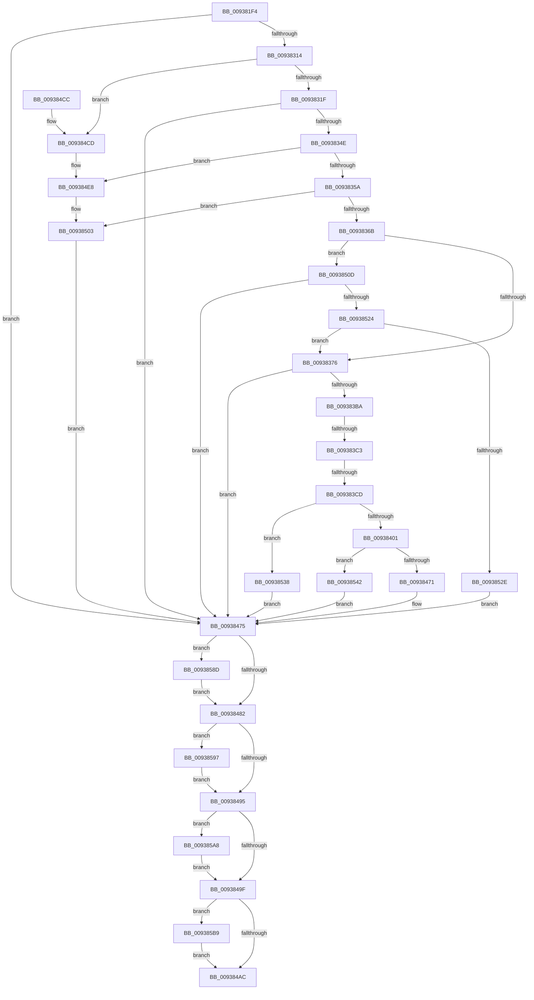

# PfpVolumeOpenAndVerify

- RVA: `0x009381F4`–`0x009385C5` (길이 `977` bytes)
- VA: `0x00000001409381F4`
- 실행 섹션: `PAGE`
- PDB 이름 있음: `예`; PDB Function 태그: `예`
- unwind 정보 RVA: `0x0008FB60`
- 디코드: `231`개 명령, `977/977` bytes 표시
- 미해석 바이트: `0` (있으면 어셈블리에 `.byte`로 보존)

> 이 문서는 커널 이미지의 기계어와 PDB 기호를 분석해 생성했습니다. 4번과 5번은 함수 원형과 자료형을 바이너리 사용 방식에서 추정한 C 해석이며 원본 소스 복구 결과는 아닙니다.

## 1. Dependencies

- 직접 호출 지점: **16**; 고유 호출 대상: **12**
- 직접 호출자로 확인된 함수: **1**
- RIP 상대 이미지 참조: **1**

### Outgoing calls
- `0x00938305` → [IopCreateFile](../8A/IopCreateFile_function_008AB298.md) (function, `0x008AB298`)
- `0x00938338` → [NtQueryVolumeInformationFile](../8A/NtQueryVolumeInformationFile_function_008AC8C0.md) (function, `0x008AC8C0`)
- `0x0093835E` → [PfVolumeSupportedForPrefetch](../../text/4C/PfVolumeSupportedForPrefetch_function_004C82CC.md) (function, `0x004C82CC`)
- `0x0093837A` → [NtClose](../86/NtClose_function_00868870.md) (function, `0x00868870`)
- `0x009383AB` → [PfpOpenHandleCreate](../8A/PfpOpenHandleCreate_function_008A9EDC.md) (function, `0x008A9EDC`)
- `0x009383EF` → [ExAllocatePool2](../../poolcode/B8/ExAllocatePool2_function_00B820F0.md) (function, `0x00B820F0`)
- `0x0093840D` → [memcpy](../../text/6C/memcpy_function_006C6840.md) (function, `0x006C6840`)
- `0x00938462` → [PfpOpenHandleCreate](../8A/PfpOpenHandleCreate_function_008A9EDC.md) (function, `0x008A9EDC`)
- `0x009384B5` → [_security_check_cookie](../../text/6A/_security_check_cookie_function_006AC640.md) (function, `0x006AC640`)
- `0x009384E2` → [KeBugCheckEx](../../text/4F/KeBugCheckEx_function_004FD660.md) (function, `0x004FD660`)
- `0x009384FD` → [KeBugCheckEx](../../text/4F/KeBugCheckEx_function_004FD660.md) (function, `0x004FD660`)
- `0x00938515` → [NtGetDevicePowerState](../A9/NtGetDevicePowerState_function_00A9B750.md) (function, `0x00A9B750`)
- `0x0093858D` → [NtClose](../86/NtClose_function_00868870.md) (function, `0x00868870`)
- `0x0093859E` → [PfpOpenHandleClose](../8A/PfpOpenHandleClose_function_008A9E74.md) (function, `0x008A9E74`)
- `0x009385AF` → [PfpOpenHandleClose](../8A/PfpOpenHandleClose_function_008A9E74.md) (function, `0x008A9E74`)
- `0x009385BB` → [ExFreePoolWithTag](../../poolcode/B8/ExFreePoolWithTag_function_00B82870.md) (function, `0x00B82870`)

### Direct callers
- [PfpPrefetchRequestPerform](PfpPrefetchRequestPerform_function_00938F74.md) at `0x00939332`

### Static image references
- `0x0093820B` → RVA `0x00E0A740` (`.data`; read)

## 2. Other-region calls and transfers

- 다른 실행 섹션으로 향하는 call: **7**
  - `0x0093835E` → [PfVolumeSupportedForPrefetch](../../text/4C/PfVolumeSupportedForPrefetch_function_004C82CC.md) (`PAGE` → `.text`)
  - `0x009383EF` → [ExAllocatePool2](../../poolcode/B8/ExAllocatePool2_function_00B820F0.md) (`PAGE` → `POOLCODE`)
  - `0x0093840D` → [memcpy](../../text/6C/memcpy_function_006C6840.md) (`PAGE` → `.text`)
  - `0x009384B5` → [_security_check_cookie](../../text/6A/_security_check_cookie_function_006AC640.md) (`PAGE` → `.text`)
  - `0x009384E2` → [KeBugCheckEx](../../text/4F/KeBugCheckEx_function_004FD660.md) (`PAGE` → `.text`)
  - `0x009384FD` → [KeBugCheckEx](../../text/4F/KeBugCheckEx_function_004FD660.md) (`PAGE` → `.text`)
  - `0x009385BB` → [ExFreePoolWithTag](../../poolcode/B8/ExFreePoolWithTag_function_00B82870.md) (`PAGE` → `POOLCODE`)
- call이 아닌 외부 분기/꼬리 이동: **2**
  - `0x009383BD` → [sub_00B24F64](../B2/Unknown_function_00B24F64.md) (`tail-transfer`)
  - `0x009383C7` → [sub_00B24F64](../B2/Unknown_function_00B24F64.md) (`tail-transfer`)

## 3. Assembly (complete function range)

```asm
009381F4  40 55                           push rbp
009381F6  53                              push rbx
009381F7  56                              push rsi
009381F8  57                              push rdi
009381F9  41 54                           push r12
009381FB  41 56                           push r14
009381FD  41 57                           push r15
009381FF  48 8D 6C 24 A0                  lea rbp, [rsp - 0x60]
00938204  48 81 EC 60 01 00 00            sub rsp, 0x160
0093820B  48 8B 05 2E 25 4D 00            mov rax, qword ptr [rip + 0x4d252e]
00938212  48 33 C4                        xor rax, rsp
00938215  48 89 45 50                     mov qword ptr [rbp + 0x50], rax
00938219  45 33 E4                        xor r12d, r12d
0093821C  48 C7 45 08 30 00 00 00         mov qword ptr [rbp + 8], 0x30
00938224  4C 89 64 24 78                  mov qword ptr [rsp + 0x78], r12
00938229  4C 8D 4D F8                     lea r9, [rbp - 8]
0093822D  33 C0                           xor eax, eax
0093822F  4C 89 65 D0                     mov qword ptr [rbp - 0x30], r12
00938233  48 89 45 48                     mov qword ptr [rbp + 0x48], rax
00938237  0F 57 C0                        xorps xmm0, xmm0
0093823A  49 8B 40 20                     mov rax, qword ptr [r8 + 0x20]
0093823E  49 8B F8                        mov rdi, r8
00938241  48 89 45 98                     mov qword ptr [rbp - 0x68], rax
00938245  4C 8B FA                        mov r15, rdx
00938248  41 0F B7 40 18                  movzx eax, word ptr [r8 + 0x18]
0093824D  4C 8B F1                        mov r14, rcx
00938250  66 03 C0                        add ax, ax
00938253  44 89 65 94                     mov dword ptr [rbp - 0x6c], r12d
00938257  66 89 45 90                     mov word ptr [rbp - 0x70], ax
0093825B  4C 8D 45 08                     lea r8, [rbp + 8]
0093825F  66 83 C0 02                     add ax, 2
00938263  48 C7 45 20 40 02 00 00         mov qword ptr [rbp + 0x20], 0x240
0093826B  66 89 45 92                     mov word ptr [rbp - 0x6e], ax
0093826F  48 8D 4D 80                     lea rcx, [rbp - 0x80]
00938273  48 8D 45 90                     lea rax, [rbp - 0x70]
00938277  4C 89 65 A0                     mov qword ptr [rbp - 0x60], r12
0093827B  48 89 45 18                     mov qword ptr [rbp + 0x18], rax
0093827F  48 BE 00 00 00 00 02 00 00 00   movabs rsi, 0x200000000
00938289  41 8D 44 24 20                  lea eax, [r12 + 0x20]
0093828E  44 89 65 88                     mov dword ptr [rbp - 0x78], r12d
00938292  89 44 24 70                     mov dword ptr [rsp + 0x70], eax
00938296  BA 80 00 10 00                  mov edx, 0x100080
0093829B  44 89 64 24 68                  mov dword ptr [rsp + 0x68], r12d
009382A0  4C 89 64 24 60                  mov qword ptr [rsp + 0x60], r12
009382A5  44 89 64 24 58                  mov dword ptr [rsp + 0x58], r12d
009382AA  44 89 64 24 50                  mov dword ptr [rsp + 0x50], r12d
009382AF  4C 89 64 24 48                  mov qword ptr [rsp + 0x48], r12
009382B4  89 44 24 40                     mov dword ptr [rsp + 0x40], eax
009382B8  C7 44 24 38 01 00 00 00         mov dword ptr [rsp + 0x38], 1
009382C0  C7 44 24 30 07 00 00 00         mov dword ptr [rsp + 0x30], 7
009382C8  44 89 64 24 28                  mov dword ptr [rsp + 0x28], r12d
009382CD  4C 89 64 24 20                  mov qword ptr [rsp + 0x20], r12
009382D2  0F 11 45 38                     movups xmmword ptr [rbp + 0x38], xmm0
009382D6  4C 89 65 B0                     mov qword ptr [rbp - 0x50], r12
009382DA  0F 11 45 F8                     movups xmmword ptr [rbp - 8], xmm0
009382DE  48 89 75 C8                     mov qword ptr [rbp - 0x38], rsi
009382E2  F3 0F 7F 45 B8                  movdqu xmmword ptr [rbp - 0x48], xmm0
009382E7  4C 89 65 D8                     mov qword ptr [rbp - 0x28], r12
009382EB  F3 0F 7F 45 E0                  movdqu xmmword ptr [rbp - 0x20], xmm0
009382F0  48 89 75 F0                     mov qword ptr [rbp - 0x10], rsi
009382F4  4C 89 65 A8                     mov qword ptr [rbp - 0x58], r12
009382F8  4C 89 65 80                     mov qword ptr [rbp - 0x80], r12
009382FC  4C 89 65 10                     mov qword ptr [rbp + 0x10], r12
00938300  F3 0F 7F 45 28                  movdqu xmmword ptr [rbp + 0x28], xmm0
00938305  E8 8E 2F F7 FF                  call 0x1408ab298
0093830A  8B D8                           mov ebx, eax
0093830C  85 C0                           test eax, eax
0093830E  0F 88 61 01 00 00               js 0x140938475
00938314  3D 03 01 00 00                  cmp eax, 0x103
00938319  0F 84 AE 01 00 00               je 0x1409384cd
0093831F  48 8B 4D 80                     mov rcx, qword ptr [rbp - 0x80]
00938323  45 8D 4C 24 08                  lea r9d, [r12 + 8]
00938328  4C 8D 45 D0                     lea r8, [rbp - 0x30]
0093832C  C7 44 24 20 04 00 00 00         mov dword ptr [rsp + 0x20], 4
00938334  48 8D 55 F8                     lea rdx, [rbp - 8]
00938338  E8 83 45 F7 FF                  call 0x1408ac8c0
0093833D  B9 00 00 00 C0                  mov ecx, 0xc0000000
00938342  8B D8                           mov ebx, eax
00938344  23 C1                           and eax, ecx
00938346  3B C1                           cmp eax, ecx
00938348  0F 84 27 01 00 00               je 0x140938475
0093834E  81 FB 03 01 00 00               cmp ebx, 0x103
00938354  0F 84 8E 01 00 00               je 0x1409384e8
0093835A  48 8D 4D D0                     lea rcx, [rbp - 0x30]
0093835E  E8 69 FF B8 FF                  call 0x1404c82cc
00938363  85 C0                           test eax, eax
00938365  0F 85 98 01 00 00               jne 0x140938503
0093836B  8B 47 0C                        mov eax, dword ptr [rdi + 0xc]
0093836E  A8 01                           test al, 1
00938370  0F 85 97 01 00 00               jne 0x14093850d
00938376  48 8B 4D 80                     mov rcx, qword ptr [rbp - 0x80]
0093837A  E8 F1 04 F3 FF                  call 0x140868870
0093837F  4C 89 64 24 38                  mov qword ptr [rsp + 0x38], r12
00938384  4C 8D 45 90                     lea r8, [rbp - 0x70]
00938388  44 89 64 24 30                  mov dword ptr [rsp + 0x30], r12d
0093838D  48 8D 4D B0                     lea rcx, [rbp - 0x50]
00938391  C7 44 24 28 20 00 00 00         mov dword ptr [rsp + 0x28], 0x20
00938399  45 33 C9                        xor r9d, r9d
0093839C  49 8B D6                        mov rdx, r14
0093839F  C7 44 24 20 80 01 10 00         mov dword ptr [rsp + 0x20], 0x100180
009383A7  4C 89 65 80                     mov qword ptr [rbp - 0x80], r12
009383AB  E8 2C 1B F7 FF                  call 0x1408a9edc
009383B0  8B D8                           mov ebx, eax
009383B2  85 C0                           test eax, eax
009383B4  0F 88 BB 00 00 00               js 0x140938475
009383BA  4C 39 27                        cmp qword ptr [rdi], r12
009383BD  0F 85 A1 CB 1E 00               jne 0x140b24f64
009383C3  44 39 67 08                     cmp dword ptr [rdi + 8], r12d
009383C7  0F 85 97 CB 1E 00               jne 0x140b24f64
009383CD  0F B7 45 90                     movzx eax, word ptr [rbp - 0x70]
009383D1  B9 00 01 00 00                  mov ecx, 0x100
009383D6  66 83 C0 02                     add ax, 2
009383DA  41 B8 50 66 52 44               mov r8d, 0x44526650
009383E0  66 89 45 A0                     mov word ptr [rbp - 0x60], ax
009383E4  66 83 C0 02                     add ax, 2
009383E8  0F B7 D0                        movzx edx, ax
009383EB  66 89 55 A2                     mov word ptr [rbp - 0x5e], dx
009383EF  E8 FC 9C 24 00                  call 0x140b820f0
009383F4  48 89 45 A8                     mov qword ptr [rbp - 0x58], rax
009383F8  48 85 C0                        test rax, rax
009383FB  0F 84 37 01 00 00               je 0x140938538
00938401  44 0F B7 45 90                  movzx r8d, word ptr [rbp - 0x70]
00938406  48 8B C8                        mov rcx, rax
00938409  48 8B 55 98                     mov rdx, qword ptr [rbp - 0x68]
0093840D  E8 2E E4 D8 FF                  call 0x1406c6840
00938412  0F B7 4D 90                     movzx ecx, word ptr [rbp - 0x70]
00938416  4C 8D 45 A0                     lea r8, [rbp - 0x60]
0093841A  48 8B 45 A8                     mov rax, qword ptr [rbp - 0x58]
0093841E  45 33 C9                        xor r9d, r9d
00938421  48 D1 E9                        shr rcx, 1
00938424  49 8B D6                        mov rdx, r14
00938427  66 C7 04 48 5C 00               mov word ptr [rax + rcx*2], 0x5c
0093842D  0F B7 4D A0                     movzx ecx, word ptr [rbp - 0x60]
00938431  48 8B 45 A8                     mov rax, qword ptr [rbp - 0x58]
00938435  48 D1 E9                        shr rcx, 1
00938438  66 44 89 24 48                  mov word ptr [rax + rcx*2], r12w
0093843D  48 8D 45 B0                     lea rax, [rbp - 0x50]
00938441  48 89 44 24 38                  mov qword ptr [rsp + 0x38], rax
00938446  48 8D 4D D8                     lea rcx, [rbp - 0x28]
0093844A  C7 44 24 30 80 00 00 00         mov dword ptr [rsp + 0x30], 0x80
00938452  C7 44 24 28 21 00 00 00         mov dword ptr [rsp + 0x28], 0x21
0093845A  C7 44 24 20 89 00 12 00         mov dword ptr [rsp + 0x20], 0x120089
00938462  E8 75 1A F7 FF                  call 0x1408a9edc
00938467  8B D8                           mov ebx, eax
00938469  85 C0                           test eax, eax
0093846B  0F 89 D1 00 00 00               jns 0x140938542
00938471  48 8B 75 F0                     mov rsi, qword ptr [rbp - 0x10]
00938475  48 8B 4D 80                     mov rcx, qword ptr [rbp - 0x80]
00938479  48 85 C9                        test rcx, rcx
0093847C  0F 85 0B 01 00 00               jne 0x14093858d
00938482  48 BF 00 00 00 00 04 00 00 00   movabs rdi, 0x400000000
0093848C  48 85 F7                        test rdi, rsi
0093848F  0F 85 02 01 00 00               jne 0x140938597
00938495  48 85 7D C8                     test qword ptr [rbp - 0x38], rdi
00938499  0F 85 09 01 00 00               jne 0x1409385a8
0093849F  48 8B 4D A8                     mov rcx, qword ptr [rbp - 0x58]
009384A3  48 85 C9                        test rcx, rcx
009384A6  0F 85 0D 01 00 00               jne 0x1409385b9
009384AC  8B C3                           mov eax, ebx
009384AE  48 8B 4D 50                     mov rcx, qword ptr [rbp + 0x50]
009384B2  48 33 CC                        xor rcx, rsp
009384B5  E8 86 41 D7 FF                  call 0x1406ac640
009384BA  48 81 C4 60 01 00 00            add rsp, 0x160
009384C1  41 5F                           pop r15
009384C3  41 5E                           pop r14
009384C5  41 5C                           pop r12
009384C7  5F                              pop rdi
009384C8  5E                              pop rsi
009384C9  5B                              pop rbx
009384CA  5D                              pop rbp
009384CB  C3                              ret
009384CC  CC                              int3
009384CD  45 33 C9                        xor r9d, r9d
009384D0  4C 89 64 24 20                  mov qword ptr [rsp + 0x20], r12
009384D5  45 33 C0                        xor r8d, r8d
009384D8  BA 4F 14 00 00                  mov edx, 0x144f
009384DD  B9 91 01 00 00                  mov ecx, 0x191
009384E2  E8 79 51 BC FF                  call 0x1404fd660
009384E7  CC                              int3
009384E8  45 33 C9                        xor r9d, r9d
009384EB  4C 89 64 24 20                  mov qword ptr [rsp + 0x20], r12
009384F0  45 33 C0                        xor r8d, r8d
009384F3  BA 5F 14 00 00                  mov edx, 0x145f
009384F8  B9 91 01 00 00                  mov ecx, 0x191
009384FD  E8 5E 51 BC FF                  call 0x1404fd660
00938502  CC                              int3
00938503  BB BB 00 00 C0                  mov ebx, 0xc00000bb
00938508  E9 68 FF FF FF                  jmp 0x140938475
0093850D  48 8B 4D 80                     mov rcx, qword ptr [rbp - 0x80]
00938511  48 8D 55 88                     lea rdx, [rbp - 0x78]
00938515  E8 36 32 16 00                  call 0x140a9b750
0093851A  8B D8                           mov ebx, eax
0093851C  85 C0                           test eax, eax
0093851E  0F 88 51 FF FF FF               js 0x140938475
00938524  83 7D 88 01                     cmp dword ptr [rbp - 0x78], 1
00938528  0F 86 48 FE FF FF               jbe 0x140938376
0093852E  BB 0F 00 00 80                  mov ebx, 0x8000000f
00938533  E9 3D FF FF FF                  jmp 0x140938475
00938538  BB 9A 00 00 C0                  mov ebx, 0xc000009a
0093853D  E9 33 FF FF FF                  jmp 0x140938475
00938542  0F 10 45 B0                     movups xmm0, xmmword ptr [rbp - 0x50]
00938546  4C 89 65 B0                     mov qword ptr [rbp - 0x50], r12
0093854A  41 8B DC                        mov ebx, r12d
0093854D  0F 10 4D C0                     movups xmm1, xmmword ptr [rbp - 0x40]
00938551  48 89 75 C8                     mov qword ptr [rbp - 0x38], rsi
00938555  41 0F 11 07                     movups xmmword ptr [r15], xmm0
00938559  0F 57 C0                        xorps xmm0, xmm0
0093855C  F3 0F 7F 45 B8                  movdqu xmmword ptr [rbp - 0x48], xmm0
00938561  0F 10 45 D8                     movups xmm0, xmmword ptr [rbp - 0x28]
00938565  4C 89 65 D8                     mov qword ptr [rbp - 0x28], r12
00938569  41 0F 11 4F 10                  movups xmmword ptr [r15 + 0x10], xmm1
0093856E  0F 10 4D E8                     movups xmm1, xmmword ptr [rbp - 0x18]
00938572  48 89 75 F0                     mov qword ptr [rbp - 0x10], rsi
00938576  41 0F 11 47 20                  movups xmmword ptr [r15 + 0x20], xmm0
0093857B  0F 57 C0                        xorps xmm0, xmm0
0093857E  F3 0F 7F 45 E0                  movdqu xmmword ptr [rbp - 0x20], xmm0
00938583  41 0F 11 4F 30                  movups xmmword ptr [r15 + 0x30], xmm1
00938588  E9 E8 FE FF FF                  jmp 0x140938475
0093858D  E8 DE 02 F3 FF                  call 0x140868870
00938592  E9 EB FE FF FF                  jmp 0x140938482
00938597  49 8B D6                        mov rdx, r14
0093859A  48 8D 4D D8                     lea rcx, [rbp - 0x28]
0093859E  E8 D1 18 F7 FF                  call 0x1408a9e74
009385A3  E9 ED FE FF FF                  jmp 0x140938495
009385A8  49 8B D6                        mov rdx, r14
009385AB  48 8D 4D B0                     lea rcx, [rbp - 0x50]
009385AF  E8 C0 18 F7 FF                  call 0x1408a9e74
009385B4  E9 E6 FE FF FF                  jmp 0x14093849f
009385B9  33 D2                           xor edx, edx
009385BB  E8 B0 A2 24 00                  call 0x140b82870
009385C0  E9 E7 FE FF FF                  jmp 0x1409384ac
```

## 4. C-style interpretation (structured pseudocode)

```c
__int64 __fastcall PfpVolumeOpenAndVerify(__int64 a1, __int64 a2, __int64 a3)
{
    __int64 result;
    __int64 v_r12;
    __int64 v_rsp;
    unsigned __int64 v_stack_m100;
    unsigned int v_stack_m104;
    unsigned __int16 v_stack_m106;
    unsigned __int16 v_stack_m108;
    unsigned int v_stack_m110;
    unsigned __int64 v_stack_m118;
    unsigned __int64 v_stack_m120;
    unsigned int v_stack_m128;
    unsigned int v_stack_m130;
    unsigned __int64 v_stack_m138;
    unsigned int v_stack_m140;
    unsigned int v_stack_m148;
    unsigned __int64 v_stack_m150;
    unsigned int v_stack_m158;
    unsigned int v_stack_m160;
    unsigned int v_stack_m168;
    unsigned int v_stack_m170;
    unsigned __int64 v_stack_m178;
    unsigned __int64 v_stack_m48;
    unsigned __int64 v_stack_m50;
    unsigned __int64 v_stack_m60;
    unsigned __int64 v_stack_m70;
    unsigned __int64 v_stack_m78;
    unsigned __int64 v_stack_m80;
    unsigned __int64 v_stack_m88;
    unsigned __int64 v_stack_m90;
    unsigned __int64 v_stack_m98;
    unsigned __int64 v_stack_mA0;
    unsigned __int64 v_stack_mA8;
    unsigned __int64 v_stack_mB0;
    unsigned __int64 v_stack_mB8;
    unsigned __int64 v_stack_mC0;
    unsigned __int64 v_stack_mC8;
    unsigned __int64 v_stack_mD0;
    unsigned __int64 v_stack_mD8;
    unsigned __int64 v_stack_mE0;
    unsigned __int64 v_stack_mE8;
    unsigned __int64 v_stack_mF0;
    unsigned __int16 v_stack_mF6;
    unsigned __int64 v_stack_mF8;
    unsigned __int64 v_stack_p20;

    v_rsp = (v_rsp) - (352);
    result = (*(unsigned __int64 *)(v_rip + 5055790)) ^ (v_rsp);
    v_stack_m48 = result;
    v_r12 = 0;
    v_stack_m90 = 48;
    v_stack_m120 = 0;
    result = 0;
    v_stack_mC8 = 0;
    v_stack_m50 = 0;
    v_stack_m100 = *(unsigned __int64 *)(a3 + 32);
    result = (unsigned __int16)((*(unsigned __int16 *)(a3 + 24)) + ((unsigned __int16)(*(unsigned __int16 *)(a3 + 24))));
    v_stack_m104 = 0;
    v_stack_m108 = (unsigned __int16)(result);
    result = (unsigned __int16)((result) + (2));
    v_stack_m78 = 576;
    v_stack_m106 = (unsigned __int16)(result);
    v_stack_mF8 = 0;
    v_stack_m80 = v_stack_m108;
    v_stack_m110 = 0;
    v_stack_m128 = (unsigned int)(v_r12 + 32);
    v_stack_m130 = 0;
    v_stack_m138 = 0;
    v_stack_m140 = 0;
    v_stack_m148 = 0;
    v_stack_m150 = 0;
    v_stack_m158 = (unsigned int)(v_r12 + 32);
    v_stack_m160 = 1;
    v_stack_m168 = 7;
    v_stack_m170 = 0;
    v_stack_m178 = 0;
    v_stack_m60 = v_xmm0;
    v_stack_mE8 = 0;
    v_stack_mA0 = v_xmm0;
    v_stack_mD0 = v_rsi;
    v_stack_mE0 = v_xmm0;
    v_stack_mC0 = 0;
    v_stack_mB8 = v_xmm0;
    v_stack_mA8 = v_rsi;
    v_stack_mF0 = 0;
    v_stack_m118 = 0;
    v_stack_m88 = 0;
    v_stack_m70 = v_xmm0;
    result = IopCreateFile(v_stack_m118, (unsigned int)(0x100080ULL), v_stack_m90, v_stack_mA0);
    if (sign_flag) goto loc_00938475;
    if (((unsigned int)(result)) == 259) goto loc_009384CD;
    v_stack_m178 = 4;
    result = NtQueryVolumeInformationFile(v_stack_m118, v_stack_mA0, v_stack_mC8, v_r12 + 8);
    result = (unsigned int)((result) & ((unsigned int)((unsigned int)(0xC0000000ULL))));
    if (((unsigned int)(result)) == ((unsigned int)((unsigned int)(0xC0000000ULL)))) goto loc_00938475;
    if (((unsigned int)((unsigned int)((unsigned int)(result)))) == 259) goto loc_009384E8;
    result = PfVolumeSupportedForPrefetch(v_stack_mC8, v_stack_mA0, v_stack_mC8, v_r12 + 8);
    if ((unsigned int)(result) != 0) goto loc_00938503;
    if ((((unsigned __int8)((unsigned int)(*(unsigned int *)(a3 + 12)))) & (1)) != 0) goto loc_0093850D;
loc_00938376:
    result = NtClose(v_stack_m118, v_stack_mA0, v_stack_mC8, v_r12 + 8);
    v_stack_m160 = 0;
    v_stack_m168 = 0;
    v_stack_m170 = 32;
    a4 = 0;
    v_stack_m178 = 0x100180ULL;
    v_stack_m118 = 0;
    result = PfpOpenHandleCreate(v_stack_mE8, a1, v_stack_m108, a4);
    if (sign_flag) goto loc_00938475;
    result = (unsigned __int16)((v_stack_m108) + (2));
    v_stack_mF8 = (unsigned __int16)(result);
    result = (unsigned __int16)((result) + (2));
    v_stack_mF6 = (unsigned __int16)((unsigned __int16)(result));
    result = ExAllocatePool2(256, (unsigned __int16)(result), (unsigned int)(0x44526650ULL), a4);
    v_stack_mF0 = result;
    if (result == 0) goto loc_00938538;
    result = memcpy(result, v_stack_m100, v_stack_m108, a4);
    a4 = 0;
    a1 = (v_stack_m108) >> (1);
    *(unsigned __int16 *)(v_stack_mF0 + a1 * 2) = 92;
    a1 = (v_stack_mF8) >> (1);
    *(unsigned __int16 *)(v_stack_mF0 + a1 * 2) = 0;
    v_stack_m160 = v_stack_mE8;
    v_stack_m168 = 128;
    v_stack_m170 = 33;
    v_stack_m178 = 0x120089ULL;
    result = PfpOpenHandleCreate(v_stack_mC0, a1, v_stack_mF8, a4);
    if (!sign_flag) goto loc_00938542;
loc_00938475:
    if (v_stack_m118 != 0) goto loc_0093858D;
loc_00938482:
    if (((a3) & (v_stack_mA8)) != 0) goto loc_00938597;
loc_00938495:
    if (((v_stack_mD0) & (a3)) != 0) goto loc_009385A8;
loc_0093849F:
    if (v_stack_mF0 != 0) goto loc_009385B9;
loc_009384AC:
    a1 = (v_stack_m48) ^ (v_rsp);
    result = _security_check_cookie(a1, a1, v_stack_mF8, a4);
    v_rsp = (v_rsp) + (352);
    return result;
loc_009384CD:
    a4 = 0;
    v_stack_p20 = 0;
    a3 = 0;
    result = KeBugCheckEx(401, (unsigned int)(0x144FULL), a3, a4);
loc_009384E8:
    a4 = 0;
    v_stack_p20 = 0;
    a3 = 0;
    result = KeBugCheckEx(401, (unsigned int)(0x145FULL), a3, a4);
loc_00938503:
    goto loc_00938475;
loc_0093850D:
    result = NtGetDevicePowerState(v_stack_m118, v_stack_m110, a3, a4);
    if (sign_flag) goto loc_00938475;
    if (v_stack_m110 <= 1) goto loc_00938376;
    goto loc_00938475;
loc_00938538:
    goto loc_00938475;
loc_00938542:
    v_stack_mE8 = 0;
    v_stack_mD0 = v_stack_mA8;
    *(unsigned __int64 *)(a2) = v_xmm0;
    v_stack_mE0 = v_xmm0;
    v_stack_mC0 = 0;
    *(unsigned __int64 *)(a2 + 16) = v_xmm1;
    v_stack_mA8 = v_stack_mA8;
    *(unsigned __int64 *)(a2 + 32) = v_xmm0;
    v_stack_mB8 = v_xmm0;
    *(unsigned __int64 *)(a2 + 48) = v_xmm1;
    goto loc_00938475;
loc_0093858D:
    result = NtClose(v_stack_m118, v_stack_m110, a3, a4);
    goto loc_00938482;
loc_00938597:
    result = PfpOpenHandleClose(v_stack_mC0, a1, a3, a4);
    goto loc_00938495;
loc_009385A8:
    result = PfpOpenHandleClose(v_stack_mE8, a1, a3, a4);
    goto loc_0093849F;
loc_009385B9:
    a2 = 0;
    result = ExFreePoolWithTag(v_stack_mE8, a2, a3, a4);
    goto loc_009384AC;
}
```

## 5. (Beta) C Style

```c
int64_t PfpVolumeOpenAndVerify(int64_t Arg1, void *Arg2, void *Arg3)
{
    uint8_t *arg2 = (uint8_t *)Arg2;
    uint8_t *arg3 = (uint8_t *)Arg3;

    int64_t result;
    int64_t local_r12;
    int64_t local_rsp;
    uint64_t v_stack_m100;
    uint32_t v_stack_m104;
    uint16_t v_stack_m106;
    uint16_t v_stack_m108;
    uint32_t v_stack_m110;
    uint64_t v_stack_m118;
    uint64_t v_stack_m120;
    uint32_t v_stack_m128;
    uint32_t v_stack_m130;
    uint64_t v_stack_m138;
    uint32_t v_stack_m140;
    uint32_t v_stack_m148;
    uint64_t v_stack_m150;
    uint32_t v_stack_m158;
    uint32_t v_stack_m160;
    uint32_t v_stack_m168;
    uint32_t v_stack_m170;
    uint64_t v_stack_m178;
    uint64_t v_stack_m48;
    uint64_t v_stack_m50;
    uint64_t v_stack_m60;
    uint64_t v_stack_m70;
    uint64_t v_stack_m78;
    uint64_t v_stack_m80;
    uint64_t v_stack_m88;
    uint64_t v_stack_m90;
    uint64_t v_stack_m98;
    uint64_t v_stack_mA0;
    uint64_t v_stack_mA8;
    uint64_t v_stack_mB0;
    uint64_t v_stack_mB8;
    uint64_t v_stack_mC0;
    uint64_t v_stack_mC8;
    uint64_t v_stack_mD0;
    uint64_t v_stack_mD8;
    uint64_t v_stack_mE0;
    uint64_t v_stack_mE8;
    uint64_t v_stack_mF0;
    uint16_t v_stack_mF6;
    uint64_t v_stack_mF8;
    uint64_t v_stack_p20;

    local_rsp = (local_rsp) - (352);
    result = (*(uint64_t *)(v_rip + 0x4D252E)) ^ (local_rsp);
    v_stack_m48 = result;
    local_r12 = 0;
    v_stack_m90 = 48;
    v_stack_m120 = 0;
    result = 0;
    v_stack_mC8 = 0;
    v_stack_m50 = 0;
    v_stack_m100 = *(uint64_t *)(arg3 + 0x20);
    result = (uint16_t)((*(uint16_t *)(arg3 + 0x18)) + ((uint16_t)(*(uint16_t *)(arg3 + 0x18))));
    v_stack_m104 = 0;
    v_stack_m108 = (uint16_t)(result);
    result = (uint16_t)((result) + (2));
    v_stack_m78 = 576;
    v_stack_m106 = (uint16_t)(result);
    v_stack_mF8 = 0;
    v_stack_m80 = v_stack_m108;
    v_stack_m110 = 0;
    v_stack_m128 = (uint32_t)(local_r12 + 32);
    v_stack_m130 = 0;
    v_stack_m138 = 0;
    v_stack_m140 = 0;
    v_stack_m148 = 0;
    v_stack_m150 = 0;
    v_stack_m158 = (uint32_t)(local_r12 + 32);
    v_stack_m160 = 1;
    v_stack_m168 = 7;
    v_stack_m170 = 0;
    v_stack_m178 = 0;
    v_stack_m60 = v_xmm0;
    v_stack_mE8 = 0;
    v_stack_mA0 = v_xmm0;
    v_stack_mD0 = local_rsi;
    v_stack_mE0 = v_xmm0;
    v_stack_mC0 = 0;
    v_stack_mB8 = v_xmm0;
    v_stack_mA8 = local_rsi;
    v_stack_mF0 = 0;
    v_stack_m118 = 0;
    v_stack_m88 = 0;
    v_stack_m70 = v_xmm0;
    result = IopCreateFile(v_stack_m118, (uint32_t)(0x100080ULL), v_stack_m90, v_stack_mA0);
    if (sign_flag) goto loc_00938475;
    if (((uint32_t)(result)) == 259) goto loc_009384CD;
    v_stack_m178 = 4;
    result = NtQueryVolumeInformationFile(v_stack_m118, v_stack_mA0, v_stack_mC8, local_r12 + 8);
    result = (uint32_t)((result) & ((uint32_t)((uint32_t)(0xC0000000ULL))));
    if (((uint32_t)(result)) == ((uint32_t)((uint32_t)(0xC0000000ULL)))) goto loc_00938475;
    if (((uint32_t)((uint32_t)((uint32_t)(result)))) == 259) goto loc_009384E8;
    result = PfVolumeSupportedForPrefetch(v_stack_mC8, v_stack_mA0, v_stack_mC8, local_r12 + 8);
    if ((uint32_t)(result) != 0) goto loc_00938503;
    if ((((uint8_t)((uint32_t)(*(uint32_t *)(arg3 + 0xC)))) & (1)) != 0) goto loc_0093850D;
loc_00938376:
    result = NtClose(v_stack_m118, v_stack_mA0, v_stack_mC8, local_r12 + 8);
    v_stack_m160 = 0;
    v_stack_m168 = 0;
    v_stack_m170 = 32;
    a4 = 0;
    v_stack_m178 = 0x100180ULL;
    v_stack_m118 = 0;
    result = PfpOpenHandleCreate(v_stack_mE8, Arg1, v_stack_m108, a4);
    if (sign_flag) goto loc_00938475;
    result = (uint16_t)((v_stack_m108) + (2));
    v_stack_mF8 = (uint16_t)(result);
    result = (uint16_t)((result) + (2));
    v_stack_mF6 = (uint16_t)((uint16_t)(result));
    result = ExAllocatePool2(256, (uint16_t)(result), (uint32_t)(0x44526650ULL), a4);
    v_stack_mF0 = result;
    if (result == 0) goto loc_00938538;
    result = memcpy(result, v_stack_m100, v_stack_m108, a4);
    a4 = 0;
    Arg1 = (v_stack_m108) >> (1);
    *(uint16_t *)(v_stack_mF0 + Arg1 * 2) = 92;
    Arg1 = (v_stack_mF8) >> (1);
    *(uint16_t *)(v_stack_mF0 + Arg1 * 2) = 0;
    v_stack_m160 = v_stack_mE8;
    v_stack_m168 = 128;
    v_stack_m170 = 33;
    v_stack_m178 = 0x120089ULL;
    result = PfpOpenHandleCreate(v_stack_mC0, Arg1, v_stack_mF8, a4);
    if (!sign_flag) goto loc_00938542;
loc_00938475:
    if (v_stack_m118 != 0) goto loc_0093858D;
loc_00938482:
    if (((Arg3) & (v_stack_mA8)) != 0) goto loc_00938597;
loc_00938495:
    if (((v_stack_mD0) & (Arg3)) != 0) goto loc_009385A8;
loc_0093849F:
    if (v_stack_mF0 != 0) goto loc_009385B9;
loc_009384AC:
    Arg1 = (v_stack_m48) ^ (local_rsp);
    result = _security_check_cookie(Arg1, Arg1, v_stack_mF8, a4);
    local_rsp = (local_rsp) + (352);
    return result;
loc_009384CD:
    a4 = 0;
    v_stack_p20 = 0;
    Arg3 = 0;
    result = KeBugCheckEx(401, (uint32_t)(0x144FULL), Arg3, a4);
loc_009384E8:
    a4 = 0;
    v_stack_p20 = 0;
    Arg3 = 0;
    result = KeBugCheckEx(401, (uint32_t)(0x145FULL), Arg3, a4);
loc_00938503:
    goto loc_00938475;
loc_0093850D:
    result = NtGetDevicePowerState(v_stack_m118, v_stack_m110, Arg3, a4);
    if (sign_flag) goto loc_00938475;
    if (v_stack_m110 <= 1) goto loc_00938376;
    goto loc_00938475;
loc_00938538:
    goto loc_00938475;
loc_00938542:
    v_stack_mE8 = 0;
    v_stack_mD0 = v_stack_mA8;
    *(uint64_t *)(arg2) = v_xmm0;
    v_stack_mE0 = v_xmm0;
    v_stack_mC0 = 0;
    *(uint64_t *)(arg2 + 0x10) = v_xmm1;
    v_stack_mA8 = v_stack_mA8;
    *(uint64_t *)(arg2 + 0x20) = v_xmm0;
    v_stack_mB8 = v_xmm0;
    *(uint64_t *)(arg2 + 0x30) = v_xmm1;
    goto loc_00938475;
loc_0093858D:
    result = NtClose(v_stack_m118, v_stack_m110, Arg3, a4);
    goto loc_00938482;
loc_00938597:
    result = PfpOpenHandleClose(v_stack_mC0, Arg1, Arg3, a4);
    goto loc_00938495;
loc_009385A8:
    result = PfpOpenHandleClose(v_stack_mE8, Arg1, Arg3, a4);
    goto loc_0093849F;
loc_009385B9:
    Arg2 = 0;
    result = ExFreePoolWithTag(v_stack_mE8, Arg2, Arg3, a4);
    goto loc_009384AC;
}
```

### 관측된 메모리 오프셋

구조체 형식이 확인되지 않은 접근은 인자 기준의 오프셋으로만 기록했습니다.

| 기준 인자 | 오프셋 표현 | 폭 (bit) | 접근 |
|---|---:|---:|---|
| `Arg2` | `+ 0x0` | `128` | `R` |
| `Arg2` | `+ 0x10` | `128` | `R` |
| `Arg2` | `+ 0x20` | `128` | `R` |
| `Arg2` | `+ 0x30` | `128` | `R` |
| `Arg3` | `+ 0x0` | `64` | `R` |
| `Arg3` | `+ 0x8` | `32` | `R` |
| `Arg3` | `+ 0xC` | `32` | `R` |
| `Arg3` | `+ 0x18` | `16` | `R` |
| `Arg3` | `+ 0x20` | `64` | `R` |

## 6. Execution-region graph

[열기: 2D/3D 그래프와 함수 탐색 컨트롤 패널](../../../control-panel.html?section=page&rva=0x009381F4&view=graph)

- 2D 그래프는 위에서 아래로 흐르고, 3D 그래프는 빈 공간을 드래그해 회전합니다. Shift+드래그는 이동, 휠은 확대·축소, 함수 노드 선택은 대상 보고서 이동입니다.

### Static fallback


