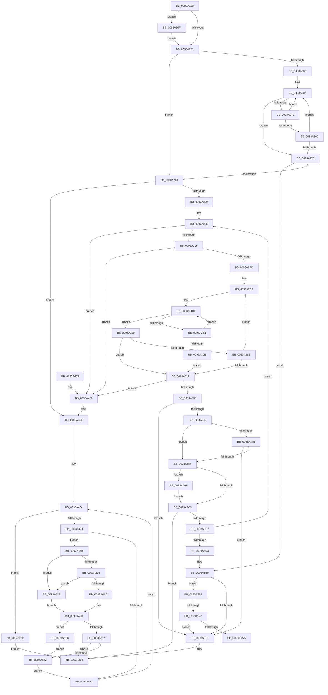

# PfpVolumePrefetchMetadata

- RVA: `0x0093A158`–`0x0093A5CB` (길이 `1,139` bytes)
- VA: `0x000000014093A158`
- 실행 섹션: `PAGE`
- PDB 이름 있음: `예`; PDB Function 태그: `예`
- unwind 정보 RVA: `0x0008FCE0`
- 디코드: `305`개 명령, `1,139/1,139` bytes 표시
- 미해석 바이트: `0` (있으면 어셈블리에 `.byte`로 보존)

> 이 문서는 커널 이미지의 기계어와 PDB 기호를 분석해 생성했습니다. 4번과 5번은 함수 원형과 자료형을 바이너리 사용 방식에서 추정한 C 해석이며 원본 소스 복구 결과는 아닙니다.

## 1. Dependencies

- 직접 호출 지점: **9**; 고유 호출 대상: **7**
- 직접 호출자로 확인된 함수: **1**
- RIP 상대 이미지 참조: **0**

### Outgoing calls
- `0x0093A333` → [PfpCheckPrefetchAbort](../../text/49/PfpCheckPrefetchAbort_function_00492808.md) (function, `0x00492808`)
- `0x0093A352` → [PfpAvailablePagesForPrefetch](PfpAvailablePagesForPrefetch_function_0093C800.md) (function, `0x0093C800`)
- `0x0093A3AD` → [IopXxxControlFile](../8E/IopXxxControlFile_function_008E9AD0.md) (function, `0x008E9AD0`)
- `0x0093A3E9` → [KeBugCheckEx](../../text/4F/KeBugCheckEx_function_004FD660.md) (function, `0x004FD660`)
- `0x0093A3F2` → [PfpCheckPrefetchAbort](../../text/49/PfpCheckPrefetchAbort_function_00492808.md) (function, `0x00492808`)
- `0x0093A508` → [PfpPrefetchDirectoryStream](PfpPrefetchDirectoryStream_function_0093AA94.md) (function, `0x0093AA94`)
- `0x0093A576` → [MmQueryMemoryListInformation](../../text/3B/MmQueryMemoryListInformation_function_003B9EDC.md) (function, `0x003B9EDC`)
- `0x0093A59D` → [PfpAvailablePagesForPrefetch](PfpAvailablePagesForPrefetch_function_0093C800.md) (function, `0x0093C800`)
- `0x0093A5B6` → [PfpUpdateRepurposedByPrefetch](PfpUpdateRepurposedByPrefetch_function_0093C838.md) (function, `0x0093C838`)

### Direct callers
- [PfpPrefetchRequestPerform](PfpPrefetchRequestPerform_function_00938F74.md) at `0x00939348`

### Static image references
- 디코드된 RIP-relative 메모리 참조가 없습니다.

## 2. Other-region calls and transfers

- 다른 실행 섹션으로 향하는 call: **4**
  - `0x0093A333` → [PfpCheckPrefetchAbort](../../text/49/PfpCheckPrefetchAbort_function_00492808.md) (`PAGE` → `.text`)
  - `0x0093A3E9` → [KeBugCheckEx](../../text/4F/KeBugCheckEx_function_004FD660.md) (`PAGE` → `.text`)
  - `0x0093A3F2` → [PfpCheckPrefetchAbort](../../text/49/PfpCheckPrefetchAbort_function_00492808.md) (`PAGE` → `.text`)
  - `0x0093A576` → [MmQueryMemoryListInformation](../../text/3B/MmQueryMemoryListInformation_function_003B9EDC.md) (`PAGE` → `.text`)
- call이 아닌 외부 분기/꼬리 이동: **2**
  - `0x0093A591` → [sub_00B250B4](../B2/Unknown_function_00B250B4.md) (`tail-transfer`)
  - `0x0093A5AA` → [sub_00B250B4](../B2/Unknown_function_00B250B4.md) (`tail-transfer`)

## 3. Assembly (complete function range)

```asm
0093A158  89 54 24 10                     mov dword ptr [rsp + 0x10], edx
0093A15C  55                              push rbp
0093A15D  53                              push rbx
0093A15E  56                              push rsi
0093A15F  57                              push rdi
0093A160  41 54                           push r12
0093A162  41 55                           push r13
0093A164  41 56                           push r14
0093A166  41 57                           push r15
0093A168  48 8D 6C 24 E1                  lea rbp, [rsp - 0x1f]
0093A16D  48 81 EC C8 00 00 00            sub rsp, 0xc8
0093A174  33 C0                           xor eax, eax
0093A176  44 8B C2                        mov r8d, edx
0093A179  21 45 77                        and dword ptr [rbp + 0x77], eax
0093A17C  48 8B F9                        mov rdi, rcx
0093A17F  48 89 45 07                     mov qword ptr [rbp + 7], rax
0093A183  0F 57 C0                        xorps xmm0, xmm0
0093A186  89 45 0F                        mov dword ptr [rbp + 0xf], eax
0093A189  0F 57 C9                        xorps xmm1, xmm1
0093A18C  0F 11 45 D7                     movups xmmword ptr [rbp - 0x29], xmm0
0093A190  48 B8 20 03 00 00 80 F7 FF FF   movabs rax, 0xfffff78000000320
0093A19A  45 33 ED                        xor r13d, r13d
0093A19D  0F 11 4D C7                     movups xmmword ptr [rbp - 0x39], xmm1
0093A1A1  45 8B E0                        mov r12d, r8d
0093A1A4  0F 11 45 E7                     movups xmmword ptr [rbp - 0x19], xmm0
0093A1A8  48 8B 08                        mov rcx, qword ptr [rax]
0093A1AB  A1 04 00 00 00 80 F7 FF FF      movabs eax, dword ptr [0xfffff78000000004]
0093A1B4  48 8B 77 18                     mov rsi, qword ptr [rdi + 0x18]
0093A1B8  44 8B C8                        mov r9d, eax
0093A1BB  8B D1                           mov edx, ecx
0093A1BD  48 C1 E9 20                     shr rcx, 0x20
0093A1C1  0F AF C8                        imul ecx, eax
0093A1C4  48 8B 07                        mov rax, qword ptr [rdi]
0093A1C7  4C 0F AF CA                     imul r9, rdx
0093A1CB  0F 11 45 F7                     movups xmmword ptr [rbp - 9], xmm0
0093A1CF  0F B7 58 1E                     movzx ebx, word ptr [rax + 0x1e]
0093A1D3  4C 8B 50 20                     mov r10, qword ptr [rax + 0x20]
0093A1D7  C1 E1 08                        shl ecx, 8
0093A1DA  C7 06 03 00 00 00               mov dword ptr [rsi], 3
0093A1E0  48 8B 07                        mov rax, qword ptr [rdi]
0093A1E3  49 C1 E9 18                     shr r9, 0x18
0093A1E7  44 03 C9                        add r9d, ecx
0093A1EA  89 5D 67                        mov dword ptr [rbp + 0x67], ebx
0093A1ED  4C 89 4D BF                     mov qword ptr [rbp - 0x41], r9
0093A1F1  4F 8D 0C 80                     lea r9, [r8 + r8*4]
0093A1F5  8B 48 1C                        mov ecx, dword ptr [rax + 0x1c]
0093A1F8  8B C3                           mov eax, ebx
0093A1FA  83 E0 07                        and eax, 7
0093A1FD  4C 89 4D 7F                     mov qword ptr [rbp + 0x7f], r9
0093A201  C1 E0 03                        shl eax, 3
0093A204  83 E1 07                        and ecx, 7
0093A207  48 0B C8                        or rcx, rax
0093A20A  4C 89 55 B7                     mov qword ptr [rbp - 0x49], r10
0093A20E  48 89 4E 08                     mov qword ptr [rsi + 8], rcx
0093A212  48 8B 07                        mov rax, qword ptr [rdi]
0093A215  8B 48 50                        mov ecx, dword ptr [rax + 0x50]
0093A218  F6 C1 04                        test cl, 4
0093A21B  0F 85 3E 03 00 00               jne 0x14093a55f
0093A221  45 33 FF                        xor r15d, r15d
0093A224  43 8B 44 CA 0C                  mov eax, dword ptr [r10 + r9*8 + 0xc]
0093A229  D1 E8                           shr eax, 1
0093A22B  44 3B F8                        cmp r15d, eax
0093A22E  73 50                           jae 0x14093a280
0093A230  83 66 04 00                     and dword ptr [rsi + 4], 0
0093A234  43 8B 44 CA 0C                  mov eax, dword ptr [r10 + r9*8 + 0xc]
0093A239  D1 E8                           shr eax, 1
0093A23B  44 3B F8                        cmp r15d, eax
0093A23E  73 33                           jae 0x14093a273
0093A240  4B 8D 0C 7F                     lea rcx, [r15 + r15*2]
0093A244  41 FF C7                        inc r15d
0093A247  48 C1 E1 04                     shl rcx, 4
0093A24B  4B 03 4C CA 10                  add rcx, qword ptr [r10 + r9*8 + 0x10]
0093A250  F6 01 10                        test byte ptr [rcx], 0x10
0093A253  48 8B 51 08                     mov rdx, qword ptr [rcx + 8]
0093A257  4C 0F 45 E9                     cmovne r13, rcx
0093A25B  48 85 D2                        test rdx, rdx
0093A25E  74 D4                           je 0x14093a234
0093A260  8B 46 04                        mov eax, dword ptr [rsi + 4]
0093A263  48 89 54 C6 10                  mov qword ptr [rsi + rax*8 + 0x10], rdx
0093A268  FF 46 04                        inc dword ptr [rsi + 4]
0093A26B  8B 46 04                        mov eax, dword ptr [rsi + 4]
0093A26E  3B 47 20                        cmp eax, dword ptr [rdi + 0x20]
0093A271  72 C1                           jb 0x14093a234
0093A273  44 8B 5E 04                     mov r11d, dword ptr [rsi + 4]
0093A277  45 85 DB                        test r11d, r11d
0093A27A  0F 85 6F 01 00 00               jne 0x14093a3ef
0093A280  4D 85 ED                        test r13, r13
0093A283  0F 84 D5 01 00 00               je 0x14093a45e
0093A289  48 8B 07                        mov rax, qword ptr [rdi]
0093A28C  45 33 F6                        xor r14d, r14d
0093A28F  FF 40 58                        inc dword ptr [rax + 0x58]
0093A292  45 33 E4                        xor r12d, r12d
0093A295  45 3B 65 10                     cmp r12d, dword ptr [r13 + 0x10]
0093A299  0F 83 B7 01 00 00               jae 0x14093a456
0093A29F  83 66 04 00                     and dword ptr [rsi + 4], 0
0093A2A3  45 3B 65 10                     cmp r12d, dword ptr [r13 + 0x10]
0093A2A7  0F 83 A9 01 00 00               jae 0x14093a456
0093A2AD  44 8B 4F 20                     mov r9d, dword ptr [rdi + 0x20]
0093A2B1  45 33 C0                        xor r8d, r8d
0093A2B4  33 DB                           xor ebx, ebx
0093A2B6  49 8B 45 18                     mov rax, qword ptr [r13 + 0x18]
0093A2BA  4D 8B D6                        mov r10, r14
0093A2BD  41 8B CC                        mov ecx, r12d
0093A2C0  48 03 C9                        add rcx, rcx
0093A2C3  48 8B 14 C8                     mov rdx, qword ptr [rax + rcx*8]
0093A2C7  44 8B 5C C8 08                  mov r11d, dword ptr [rax + rcx*8 + 8]
0093A2CC  4C 03 DA                        add r11, rdx
0093A2CF  41 8B C0                        mov eax, r8d
0093A2D2  49 3B D6                        cmp rdx, r14
0093A2D5  44 8B C3                        mov r8d, ebx
0093A2D8  4C 0F 43 F2                     cmovae r14, rdx
0093A2DC  4D 3B F3                        cmp r14, r11
0093A2DF  73 2F                           jae 0x14093a310
0093A2E1  49 8B CE                        mov rcx, r14
0093A2E4  49 81 C6 00 10 00 00            add r14, 0x1000
0093A2EB  48 C1 E9 0A                     shr rcx, 0xa
0093A2EF  48 89 4C C6 10                  mov qword ptr [rsi + rax*8 + 0x10], rcx
0093A2F4  44 8B 46 04                     mov r8d, dword ptr [rsi + 4]
0093A2F8  41 FF C0                        inc r8d
0093A2FB  44 89 46 04                     mov dword ptr [rsi + 4], r8d
0093A2FF  44 8B 4F 20                     mov r9d, dword ptr [rdi + 0x20]
0093A303  41 8B C0                        mov eax, r8d
0093A306  45 3B C1                        cmp r8d, r9d
0093A309  72 D1                           jb 0x14093a2dc
0093A30B  45 8B D8                        mov r11d, r8d
0093A30E  EB 17                           jmp 0x14093a327
0093A310  41 8B D8                        mov ebx, r8d
0093A313  45 8B D8                        mov r11d, r8d
0093A316  4D 8B F2                        mov r14, r10
0093A319  45 3B C1                        cmp r8d, r9d
0093A31C  73 09                           jae 0x14093a327
0093A31E  41 FF C4                        inc r12d
0093A321  45 3B 65 10                     cmp r12d, dword ptr [r13 + 0x10]
0093A325  72 8F                           jb 0x14093a2b6
0093A327  45 85 DB                        test r11d, r11d
0093A32A  0F 84 26 01 00 00               je 0x14093a456
0093A330  48 8B CF                        mov rcx, rdi
0093A333  E8 D0 84 B5 FF                  call 0x140492808
0093A338  85 C0                           test eax, eax
0093A33A  0F 85 BF 00 00 00               jne 0x14093a3ff
0093A340  48 8B 07                        mov rax, qword ptr [rdi]
0093A343  8B 48 50                        mov ecx, dword ptr [rax + 0x50]
0093A346  F6 C1 04                        test cl, 4
0093A349  74 14                           je 0x14093a35f
0093A34B  8B 55 67                        mov edx, dword ptr [rbp + 0x67]
0093A34E  48 8D 4F 30                     lea rcx, [rdi + 0x30]
0093A352  E8 A9 24 00 00                  call 0x14093c800
0093A357  85 C0                           test eax, eax
0093A359  0F 84 A0 00 00 00               je 0x14093a3ff
0093A35F  83 64 24 58 00                  and dword ptr [rsp + 0x58], 0
0093A364  45 33 C9                        xor r9d, r9d
0093A367  48 8B 47 10                     mov rax, qword ptr [rdi + 0x10]
0093A36B  45 33 C0                        xor r8d, r8d
0093A36E  8B 4D 6F                        mov ecx, dword ptr [rbp + 0x6f]
0093A371  33 D2                           xor edx, edx
0093A373  C6 44 24 50 00                  mov byte ptr [rsp + 0x50], 0
0093A378  83 64 24 48 00                  and dword ptr [rsp + 0x48], 0
0093A37D  48 83 64 24 40 00               and qword ptr [rsp + 0x40], 0
0093A383  48 C1 E1 06                     shl rcx, 6
0093A387  48 8B 0C 01                     mov rcx, qword ptr [rcx + rax]
0093A38B  42 8D 04 DD 10 00 00 00         lea eax, [r11*8 + 0x10]
0093A393  89 44 24 38                     mov dword ptr [rsp + 0x38], eax
0093A397  48 8D 45 D7                     lea rax, [rbp - 0x29]
0093A39B  48 89 74 24 30                  mov qword ptr [rsp + 0x30], rsi
0093A3A0  C7 44 24 28 20 01 09 00         mov dword ptr [rsp + 0x28], 0x90120
0093A3A8  48 89 44 24 20                  mov qword ptr [rsp + 0x20], rax
0093A3AD  E8 1E F7 FA FF                  call 0x1408e9ad0
0093A3B2  8B D8                           mov ebx, eax
0093A3B4  48 8B 07                        mov rax, qword ptr [rdi]
0093A3B7  8B 50 50                        mov edx, dword ptr [rax + 0x50]
0093A3BA  F6 C2 04                        test dl, 4
0093A3BD  0F 85 EC 01 00 00               jne 0x14093a5af
0093A3C3  85 DB                           test ebx, ebx
0093A3C5  78 3D                           js 0x14093a404
0093A3C7  81 FB 03 01 00 00               cmp ebx, 0x103
0093A3CD  0F 85 C2 FE FF FF               jne 0x14093a295
0093A3D3  48 83 64 24 20 00               and qword ptr [rsp + 0x20], 0
0093A3D9  45 33 C9                        xor r9d, r9d
0093A3DC  45 33 C0                        xor r8d, r8d
0093A3DF  BA 79 17 00 00                  mov edx, 0x1779
0093A3E4  B9 91 01 00 00                  mov ecx, 0x191
0093A3E9  E8 72 32 BC FF                  call 0x1404fd660
0093A3EE  CC                              int3
0093A3EF  48 8B CF                        mov rcx, rdi
0093A3F2  E8 11 84 B5 FF                  call 0x140492808
0093A3F7  85 C0                           test eax, eax
0093A3F9  0F 84 89 01 00 00               je 0x14093a588
0093A3FF  BB 40 02 00 C0                  mov ebx, 0xc0000240
0093A404  48 B9 20 03 00 00 80 F7 FF FF   movabs rcx, 0xfffff78000000320
0093A40E  48 8B 09                        mov rcx, qword ptr [rcx]
0093A411  A1 04 00 00 00 80 F7 FF FF      movabs eax, dword ptr [0xfffff78000000004]
0093A41A  4C 8B 0F                        mov r9, qword ptr [rdi]
0093A41D  44 8B C0                        mov r8d, eax
0093A420  8B D1                           mov edx, ecx
0093A422  4C 0F AF C2                     imul r8, rdx
0093A426  48 C1 E9 20                     shr rcx, 0x20
0093A42A  0F AF C8                        imul ecx, eax
0093A42D  8B C3                           mov eax, ebx
0093A42F  49 C1 E8 18                     shr r8, 0x18
0093A433  C1 E1 08                        shl ecx, 8
0093A436  44 03 C1                        add r8d, ecx
0093A439  44 2B 45 BF                     sub r8d, dword ptr [rbp - 0x41]
0093A43D  45 01 41 6C                     add dword ptr [r9 + 0x6c], r8d
0093A441  48 81 C4 C8 00 00 00            add rsp, 0xc8
0093A448  41 5F                           pop r15
0093A44A  41 5E                           pop r14
0093A44C  41 5D                           pop r13
0093A44E  41 5C                           pop r12
0093A450  5F                              pop rdi
0093A451  5E                              pop rsi
0093A452  5B                              pop rbx
0093A453  5D                              pop rbp
0093A454  C3                              ret
0093A455  CC                              int3
0093A456  4C 8B 4D 7F                     mov r9, qword ptr [rbp + 0x7f]
0093A45A  4C 8B 55 B7                     mov r10, qword ptr [rbp - 0x49]
0093A45E  44 8B 75 6F                     mov r14d, dword ptr [rbp + 0x6f]
0093A462  33 F6                           xor esi, esi
0093A464  43 8B 44 CA 0C                  mov eax, dword ptr [r10 + r9*8 + 0xc]
0093A469  D1 E8                           shr eax, 1
0093A46B  3B F0                           cmp esi, eax
0093A46D  0F 83 E5 00 00 00               jae 0x14093a558
0093A473  4C 8D 04 76                     lea r8, [rsi + rsi*2]
0093A477  49 C1 E0 04                     shl r8, 4
0093A47B  4F 03 44 CA 10                  add r8, qword ptr [r10 + r9*8 + 0x10]
0093A480  41 8B 00                        mov eax, dword ptr [r8]
0093A483  A8 02                           test al, 2
0093A485  75 04                           jne 0x14093a48b
0093A487  FF C6                           inc esi
0093A489  EB D9                           jmp 0x14093a464
0093A48B  49 8B 48 20                     mov rcx, qword ptr [r8 + 0x20]
0093A48F  48 85 C9                        test rcx, rcx
0093A492  0F 84 97 00 00 00               je 0x14093a52f
0093A498  A8 04                           test al, 4
0093A49A  0F 85 8F 00 00 00               jne 0x14093a52f
0093A4A0  48 8D 41 02                     lea rax, [rcx + 2]
0093A4A4  41 B9 21 40 00 00               mov r9d, 0x4021
0093A4AA  48 89 45 CF                     mov qword ptr [rbp - 0x31], rax
0093A4AE  41 0F B7 48 28                  movzx ecx, word ptr [r8 + 0x28]
0093A4B3  66 03 C9                        add cx, cx
0093A4B6  66 89 4D C9                     mov word ptr [rbp - 0x37], cx
0093A4BA  8D 41 FE                        lea eax, [rcx - 2]
0093A4BD  48 8B 4F 10                     mov rcx, qword ptr [rdi + 0x10]
0093A4C1  66 89 45 C7                     mov word ptr [rbp - 0x39], ax
0093A4C5  49 8B C6                        mov rax, r14
0093A4C8  48 C1 E0 06                     shl rax, 6
0093A4CC  48 8B 54 01 20                  mov rdx, qword ptr [rcx + rax + 0x20]
0093A4D1  48 89 55 EF                     mov qword ptr [rbp - 0x11], rdx
0093A4D5  0F 57 C0                        xorps xmm0, xmm0
0093A4D8  48 8D 55 C7                     lea rdx, [rbp - 0x39]
0093A4DC  44 89 4C 24 28                  mov dword ptr [rsp + 0x28], r9d
0093A4E1  48 89 55 F7                     mov qword ptr [rbp - 9], rdx
0093A4E5  48 8D 14 08                     lea rdx, [rax + rcx]
0093A4E9  48 8D 45 E7                     lea rax, [rbp - 0x19]
0093A4ED  C7 45 E7 30 00 00 00            mov dword ptr [rbp - 0x19], 0x30
0093A4F4  48 8B CF                        mov rcx, rdi
0093A4F7  48 89 44 24 20                  mov qword ptr [rsp + 0x20], rax
0093A4FC  C7 45 FF 40 02 00 00            mov dword ptr [rbp - 1], 0x240
0093A503  F3 0F 7F 45 07                  movdqu xmmword ptr [rbp + 7], xmm0
0093A508  E8 87 05 00 00                  call 0x14093aa94
0093A50D  8B D8                           mov ebx, eax
0093A50F  85 C0                           test eax, eax
0093A511  0F 89 A9 00 00 00               jns 0x14093a5c0
0093A517  3D 40 02 00 C0                  cmp eax, 0xc0000240
0093A51C  0F 84 E2 FE FF FF               je 0x14093a404
0093A522  4C 8B 55 B7                     mov r10, qword ptr [rbp - 0x49]
0093A526  4C 8B 4D 7F                     mov r9, qword ptr [rbp + 0x7f]
0093A52A  E9 58 FF FF FF                  jmp 0x14093a487
0093A52F  48 8B 4F 10                     mov rcx, qword ptr [rdi + 0x10]
0093A533  49 8D 40 08                     lea rax, [r8 + 8]
0093A537  48 89 45 CF                     mov qword ptr [rbp - 0x31], rax
0093A53B  41 B9 21 60 00 00               mov r9d, 0x6021
0093A541  49 8B C6                        mov rax, r14
0093A544  C7 45 C7 08 00 08 00            mov dword ptr [rbp - 0x39], 0x80008
0093A54B  48 C1 E0 06                     shl rax, 6
0093A54F  48 8B 14 01                     mov rdx, qword ptr [rcx + rax]
0093A553  E9 79 FF FF FF                  jmp 0x14093a4d1
0093A558  33 DB                           xor ebx, ebx
0093A55A  E9 A5 FE FF FF                  jmp 0x14093a404
0093A55F  48 8D 45 77                     lea rax, [rbp + 0x77]
0093A563  41 B8 B0 00 00 00               mov r8d, 0xb0
0093A569  48 8D 57 30                     lea rdx, [rdi + 0x30]
0093A56D  48 89 44 24 20                  mov qword ptr [rsp + 0x20], rax
0093A572  48 83 C9 FF                     or rcx, 0xffffffffffffffff
0093A576  E8 61 F9 A7 FF                  call 0x1403b9edc
0093A57B  4C 8B 4D 7F                     mov r9, qword ptr [rbp + 0x7f]
0093A57F  4C 8B 55 B7                     mov r10, qword ptr [rbp - 0x49]
0093A583  E9 99 FC FF FF                  jmp 0x14093a221
0093A588  48 8B 07                        mov rax, qword ptr [rdi]
0093A58B  8B 48 50                        mov ecx, dword ptr [rax + 0x50]
0093A58E  F6 C1 04                        test cl, 4
0093A591  0F 84 1D AB 1E 00               je 0x140b250b4
0093A597  8B D3                           mov edx, ebx
0093A599  48 8D 4F 30                     lea rcx, [rdi + 0x30]
0093A59D  E8 5E 22 00 00                  call 0x14093c800
0093A5A2  85 C0                           test eax, eax
0093A5A4  0F 84 55 FE FF FF               je 0x14093a3ff
0093A5AA  E9 05 AB 1E 00                  jmp 0x140b250b4
0093A5AF  8B 56 04                        mov edx, dword ptr [rsi + 4]
0093A5B2  48 8D 4F 30                     lea rcx, [rdi + 0x30]
0093A5B6  E8 7D 22 00 00                  call 0x14093c838
0093A5BB  E9 03 FE FF FF                  jmp 0x14093a3c3
0093A5C0  48 8B 07                        mov rax, qword ptr [rdi]
0093A5C3  FF 40 58                        inc dword ptr [rax + 0x58]
0093A5C6  E9 57 FF FF FF                  jmp 0x14093a522
```

## 4. C-style interpretation (structured pseudocode)

```c
__int64 __fastcall PfpVolumePrefetchMetadata(__int64 a1, int a2)
{
    __int64 result;
    __int64 v_r11;
    __int64 v_r12;
    __int64 v_r13;
    __int64 v_r14;
    __int64 v_r15;
    __int64 v_rbx;
    __int64 v_rsi;
    __int64 v_rsp;
    unsigned int v_stack_m50;
    unsigned __int64 v_stack_m58;
    unsigned __int64 v_stack_m5F;
    unsigned int v_stack_m60;
    unsigned __int64 v_stack_m68;
    unsigned __int64 v_stack_m70;
    unsigned __int64 v_stack_m78;
    unsigned __int64 v_stack_m88;
    unsigned __int64 v_stack_m90;
    unsigned __int16 v_stack_m96;
    unsigned __int64 v_stack_m98;
    unsigned __int64 v_stack_mA0;
    unsigned __int64 v_stack_mA8;
    unsigned int v_stack_mB0;
    unsigned __int8 v_stack_mB8;
    unsigned int v_stack_mC0;
    unsigned __int64 v_stack_mC8;
    unsigned int v_stack_mD0;
    unsigned __int64 v_stack_mD8;
    unsigned int v_stack_mE0;
    unsigned __int64 v_stack_mE8;
    unsigned int v_stack_p10;
    unsigned int v_stack_p18;
    unsigned __int64 v_stack_p20;
    unsigned int v_stack_p28;
    unsigned int v_stack_p8;

    v_stack_p10 = a2;
    v_rsp = (v_rsp) - (200);
    result = 0;
    v_stack_m58 = 0;
    v_stack_m50 = 0;
    v_stack_m88 = v_xmm0;
    v_r13 = 0;
    v_stack_m98 = v_xmm1;
    v_stack_m78 = v_xmm0;
    a1 = (*(unsigned __int64 *)(result)) >> (32);
    a1 = (unsigned int)((a1) * (0));
    a4 = (0) * ((unsigned int)((unsigned int)(*(unsigned __int64 *)(result))));
    v_stack_m68 = v_xmm0;
    a1 = (unsigned int)((a1) << (8));
    *(unsigned int *)(*(unsigned __int64 *)(a1 + 24)) = 3;
    a4 = (a4) >> (24);
    a4 = (unsigned int)((a4) + ((unsigned int)(a1)));
    v_stack_p8 = (unsigned int)(*(unsigned __int16 *)(*(unsigned __int64 *)(a1) + 30));
    v_stack_mA0 = a4;
    result = (unsigned int)(((unsigned int)((unsigned int)(*(unsigned __int16 *)(*(unsigned __int64 *)(a1) + 30)))) & (7));
    v_stack_p20 = (unsigned int)(a2) + (unsigned int)(a2) * 4;
    result = (unsigned int)((result) << (3));
    a1 = (unsigned int)(((unsigned int)(*(unsigned int *)(*(unsigned __int64 *)(a1) + 28))) & (7));
    a1 = (a1) | (result);
    v_stack_mA8 = *(unsigned __int64 *)(*(unsigned __int64 *)(a1) + 32);
    *(unsigned __int64 *)(*(unsigned __int64 *)(a1 + 24) + 8) = a1;
    if ((((unsigned __int8)((unsigned int)(*(unsigned int *)(*(unsigned __int64 *)(a1) + 80)))) & (4)) != 0) goto loc_0093A55F;
loc_0093A221:
    v_r15 = 0;
    result = (unsigned int)(((unsigned int)(*(unsigned int *)(*(unsigned __int64 *)(*(unsigned __int64 *)(a1) + 32) + (unsigned int)(a2) + (unsigned int)(a2) * 4 * 8 + 12))) >> (1));
    if (0 >= ((unsigned int)(result))) goto loc_0093A280;
loc_0093A234:
    result = (unsigned int)(((unsigned int)(*(unsigned int *)(*(unsigned __int64 *)(*(unsigned __int64 *)(a1) + 32) + (unsigned int)(a2) + (unsigned int)(a2) * 4 * 8 + 12))) >> (1));
    if (0 >= ((unsigned int)(result))) goto loc_0093A273;
    v_r15 = (unsigned int)((v_r15) + 1);
    a1 = (v_r15 + v_r15 * 2) << (4);
    a1 = (a1) + (*(unsigned __int64 *)(*(unsigned __int64 *)(*(unsigned __int64 *)(a1) + 32) + (unsigned int)(a2) + (unsigned int)(a2) * 4 * 8 + 16));
    if (((*(unsigned __int8 *)(a1)) & (16)) != 0) { v_r13 = a1; }
    if (*(unsigned __int64 *)(a1 + 8) == 0) goto loc_0093A234;
    *(unsigned __int64 *)(*(unsigned __int64 *)(a1 + 24) + (unsigned int)(*(unsigned int *)(*(unsigned __int64 *)(a1 + 24) + 4)) * 8 + 16) = *(unsigned __int64 *)(a1 + 8);
    if (((unsigned int)((unsigned int)(*(unsigned int *)(*(unsigned __int64 *)(a1 + 24) + 4)))) < (*(unsigned int *)(a1 + 32))) goto loc_0093A234;
loc_0093A273:
    if ((unsigned int)((unsigned int)(*(unsigned int *)(*(unsigned __int64 *)(a1 + 24) + 4))) != 0) goto loc_0093A3EF;
loc_0093A280:
    if (v_r13 == 0) goto loc_0093A45E;
    v_r14 = 0;
    v_r12 = 0;
loc_0093A295:
    if (0 >= (*(unsigned int *)(v_r13 + 16))) goto loc_0093A456;
    if (0 >= (*(unsigned int *)(v_r13 + 16))) goto loc_0093A456;
    a3 = 0;
    v_rbx = 0;
loc_0093A2B6:
    a1 = (0) + (0);
    v_r11 = ((unsigned int)(*(unsigned int *)(*(unsigned __int64 *)(v_r13 + 24) + a1 * 8 + 8))) + (*(unsigned __int64 *)(*(unsigned __int64 *)(v_r13 + 24) + a1 * 8));
    if ((*(unsigned __int64 *)(*(unsigned __int64 *)(v_r13 + 24) + a1 * 8)) >= 0) { v_r14 = *(unsigned __int64 *)(*(unsigned __int64 *)(v_r13 + 24) + a1 * 8); }
loc_0093A2DC:
    if (v_r14 >= v_r11) goto loc_0093A310;
    v_r14 = (v_r14) + (0x1000ULL);
    a1 = (v_r14) >> (10);
    *(unsigned __int64 *)(*(unsigned __int64 *)(a1 + 24) + 0 * 8 + 16) = a1;
    a3 = (unsigned int)(((unsigned int)(*(unsigned int *)(*(unsigned __int64 *)(a1 + 24) + 4))) + 1);
    *(unsigned int *)(*(unsigned __int64 *)(a1 + 24) + 4) = (unsigned int)(a3);
    if (((unsigned int)(a3)) < ((unsigned int)((unsigned int)(*(unsigned int *)(a1 + 32))))) goto loc_0093A2DC;
    goto loc_0093A327;
loc_0093A310:
    if (((unsigned int)(a3)) >= ((unsigned int)((unsigned int)(*(unsigned int *)(a1 + 32))))) goto loc_0093A327;
    v_r12 = (unsigned int)((v_r12) + 1);
    if (((unsigned int)(v_r12)) < (*(unsigned int *)(v_r13 + 16))) goto loc_0093A2B6;
loc_0093A327:
    if ((unsigned int)((unsigned int)((unsigned int)(a3))) == 0) goto loc_0093A456;
    result = PfpCheckPrefetchAbort(a1, *(unsigned __int64 *)(*(unsigned __int64 *)(v_r13 + 24) + a1 * 8), a3, (unsigned int)(*(unsigned int *)(a1 + 32)));
    if ((unsigned int)(result) != 0) goto loc_0093A3FF;
    if ((((unsigned __int8)((unsigned int)(*(unsigned int *)(*(unsigned __int64 *)(a1) + 80)))) & (4)) == 0) goto loc_0093A35F;
    result = PfpAvailablePagesForPrefetch(a1 + 48, (unsigned int)(v_stack_p8), a3, (unsigned int)(*(unsigned int *)(a1 + 32)));
    if ((unsigned int)(result) == 0) goto loc_0093A3FF;
loc_0093A35F:
    a4 = 0;
    a3 = 0;
    a2 = 0;
    v_stack_mB8 = 0;
    a1 = ((unsigned int)(v_stack_p10)) << (6);
    v_stack_mD0 = (unsigned int)((unsigned int)((unsigned int)(a3)) * 8 + 16);
    v_stack_mD8 = *(unsigned __int64 *)(a1 + 24);
    v_stack_mE0 = 0x90120ULL;
    v_stack_mE8 = v_stack_m88;
    result = IopXxxControlFile(*(unsigned __int64 *)(a1 + *(unsigned __int64 *)(a1 + 16) * 1), a2, a3, a4);
    if ((((unsigned __int8)((unsigned int)(*(unsigned int *)(*(unsigned __int64 *)(a1) + 80)))) & (4)) != 0) goto loc_0093A5AF;
loc_0093A3C3:
    if (sign_flag) goto loc_0093A404;
    if (((unsigned int)((unsigned int)((unsigned int)(result)))) != 259) goto loc_0093A295;
    a4 = 0;
    a3 = 0;
    result = KeBugCheckEx(401, (unsigned int)(0x1779ULL), a3, a4);
loc_0093A3EF:
    result = PfpCheckPrefetchAbort(a1, (unsigned int)(0x1779ULL), a3, a4);
    if ((unsigned int)(result) == 0) goto loc_0093A588;
loc_0093A3FF:
loc_0093A404:
    a3 = ((unsigned int)((unsigned int)(result))) * ((unsigned int)((unsigned int)(*(unsigned __int64 *)(a1))));
    a1 = (*(unsigned __int64 *)(a1)) >> (32);
    a1 = (unsigned int)((a1) * ((unsigned int)(result)));
    a3 = (a3) >> (24);
    a1 = (unsigned int)((a1) << (8));
    a3 = (unsigned int)((a3) + ((unsigned int)(a1)));
    a3 = (unsigned int)((a3) - (v_stack_mA0));
    v_rsp = (v_rsp) + (200);
    return (unsigned int)((unsigned int)((unsigned int)(0xC0000240ULL)));
loc_0093A456:
loc_0093A45E:
    v_rsi = 0;
loc_0093A464:
    result = (unsigned int)(((unsigned int)(*(unsigned int *)(v_stack_mA8 + v_stack_p20 * 8 + 12))) >> (1));
    if (0 >= ((unsigned int)(result))) goto loc_0093A558;
    a3 = (v_rsi + v_rsi * 2) << (4);
    a3 = (a3) + (*(unsigned __int64 *)(v_stack_mA8 + v_stack_p20 * 8 + 16));
    if ((((unsigned __int8)((unsigned int)(*(unsigned int *)(a3)))) & (2)) != 0) goto loc_0093A48B;
loc_0093A487:
    v_rsi = (unsigned int)((v_rsi) + 1);
    goto loc_0093A464;
loc_0093A48B:
    if (*(unsigned __int64 *)(a3 + 32) == 0) goto loc_0093A52F;
    if ((((unsigned __int8)((unsigned int)(*(unsigned int *)(a3)))) & (4)) != 0) goto loc_0093A52F;
    v_stack_m90 = *(unsigned __int64 *)(a3 + 32) + 2;
    a1 = (unsigned __int16)((*(unsigned __int16 *)(a3 + 40)) + ((unsigned __int16)(*(unsigned __int16 *)(a3 + 40))));
    v_stack_m96 = (unsigned __int16)(a1);
    v_stack_m98 = (unsigned __int16)(a1 - 2);
    result = ((unsigned int)(v_stack_p10)) << (6);
loc_0093A4D1:
    v_stack_m70 = *(unsigned __int64 *)(*(unsigned __int64 *)(a1 + 16) + result * 1 + 32);
    v_stack_p28 = (unsigned int)((unsigned int)(0x4021ULL));
    v_stack_m68 = v_stack_m98;
    v_stack_m78 = 48;
    v_stack_p20 = v_stack_m78;
    v_stack_m60 = 576;
    v_stack_m58 = v_xmm0;
    result = PfpPrefetchDirectoryStream(a1, result + *(unsigned __int64 *)(a1 + 16) * 1, a3, (unsigned int)(0x4021ULL));
    if (!sign_flag) goto loc_0093A5C0;
    if (((unsigned int)(result)) == 0xC0000240ULL) goto loc_0093A404;
loc_0093A522:
    goto loc_0093A487;
loc_0093A52F:
    v_stack_m90 = a3 + 8;
    v_stack_m98 = 0x80008ULL;
    result = ((unsigned int)(v_stack_p10)) << (6);
    goto loc_0093A4D1;
loc_0093A558:
    v_rbx = 0;
    goto loc_0093A404;
loc_0093A55F:
    v_stack_p20 = v_stack_p18;
    a1 = (*(unsigned __int64 *)(a1 + 16)) | (-1);
    result = MmQueryMemoryListInformation(a1, a1 + 48, 176, (unsigned int)(0x6021ULL));
    goto loc_0093A221;
loc_0093A588:
    result = PfpAvailablePagesForPrefetch(a1 + 48, 0, 176, v_stack_p20);
    if ((unsigned int)(result) == 0) goto loc_0093A3FF;
loc_0093A5AF:
    result = PfpUpdateRepurposedByPrefetch(a1 + 48, (unsigned int)(*(unsigned int *)(v_rsi + 4)), 176, v_stack_p20);
    goto loc_0093A3C3;
loc_0093A5C0:
    goto loc_0093A522;
}
```

## 5. (Beta) C Style

```c
int64_t PfpVolumePrefetchMetadata(void *Arg1, void *Arg2)
{
    uint8_t *arg1 = (uint8_t *)Arg1;
    uint8_t *arg2 = (uint8_t *)Arg2;

    int64_t result;
    int64_t local_r11;
    int64_t local_r12;
    int64_t local_r13;
    int64_t local_r14;
    int64_t local_r15;
    int64_t local_rbx;
    int64_t local_rsi;
    int64_t local_rsp;
    uint32_t v_stack_m50;
    uint64_t v_stack_m58;
    uint64_t v_stack_m5F;
    uint32_t v_stack_m60;
    uint64_t v_stack_m68;
    uint64_t v_stack_m70;
    uint64_t v_stack_m78;
    uint64_t v_stack_m88;
    uint64_t v_stack_m90;
    uint16_t v_stack_m96;
    uint64_t v_stack_m98;
    uint64_t v_stack_mA0;
    uint64_t v_stack_mA8;
    uint32_t v_stack_mB0;
    uint8_t v_stack_mB8;
    uint32_t v_stack_mC0;
    uint64_t v_stack_mC8;
    uint32_t v_stack_mD0;
    uint64_t v_stack_mD8;
    uint32_t v_stack_mE0;
    uint64_t v_stack_mE8;
    uint32_t v_stack_p10;
    uint32_t v_stack_p18;
    uint64_t v_stack_p20;
    uint32_t v_stack_p28;
    uint32_t v_stack_p8;

    v_stack_p10 = Arg2;
    local_rsp = (local_rsp) - (200);
    result = 0;
    v_stack_m58 = 0;
    v_stack_m50 = 0;
    v_stack_m88 = v_xmm0;
    local_r13 = 0;
    v_stack_m98 = v_xmm1;
    v_stack_m78 = v_xmm0;
    Arg1 = (*(uint64_t *)(result)) >> (32);
    Arg1 = (uint32_t)((Arg1) * (0));
    a4 = (0) * ((uint32_t)((uint32_t)(*(uint64_t *)(result))));
    v_stack_m68 = v_xmm0;
    Arg1 = (uint32_t)((Arg1) << (8));
    *(uint32_t *)(*(uint64_t *)(arg1 + 0x18)) = 3;
    a4 = (a4) >> (24);
    a4 = (uint32_t)((a4) + ((uint32_t)(Arg1)));
    v_stack_p8 = (uint32_t)(*(uint16_t *)(*(uint64_t *)(arg1) + 0x1E));
    v_stack_mA0 = a4;
    result = (uint32_t)(((uint32_t)((uint32_t)(*(uint16_t *)(*(uint64_t *)(arg1) + 0x1E)))) & (7));
    v_stack_p20 = (uint32_t)(Arg2) + (uint32_t)(Arg2) * 4;
    result = (uint32_t)((result) << (3));
    Arg1 = (uint32_t)(((uint32_t)(*(uint32_t *)(*(uint64_t *)(arg1) + 0x1C))) & (7));
    Arg1 = (Arg1) | (result);
    v_stack_mA8 = *(uint64_t *)(*(uint64_t *)(arg1) + 0x20);
    *(void **)(*(uint64_t *)(arg1 + 0x18) + 0x8) = Arg1;
    if ((((uint8_t)((uint32_t)(*(uint32_t *)(*(uint64_t *)(arg1) + 0x50)))) & (4)) != 0) goto loc_0093A55F;
loc_0093A221:
    local_r15 = 0;
    result = (uint32_t)(((uint32_t)(*(uint32_t *)(*(uint64_t *)(*(uint64_t *)(arg1) + 0x20) + (uint32_t)(arg2) + (uint32_t)(arg2) * 4 * 8 + 0xC))) >> (1));
    if (0 >= ((uint32_t)(result))) goto loc_0093A280;
loc_0093A234:
    result = (uint32_t)(((uint32_t)(*(uint32_t *)(*(uint64_t *)(*(uint64_t *)(arg1) + 0x20) + (uint32_t)(arg2) + (uint32_t)(arg2) * 4 * 8 + 0xC))) >> (1));
    if (0 >= ((uint32_t)(result))) goto loc_0093A273;
    local_r15 = (uint32_t)((local_r15) + 1);
    Arg1 = (local_r15 + local_r15 * 2) << (4);
    Arg1 = (Arg1) + (*(uint64_t *)(*(uint64_t *)(*(uint64_t *)(arg1) + 0x20) + (uint32_t)(arg2) + (uint32_t)(arg2) * 4 * 8 + 0x10));
    if (((*(uint8_t *)(arg1)) & (16)) != 0) { local_r13 = Arg1; }
    if (*(uint64_t *)(arg1 + 0x8) == 0) goto loc_0093A234;
    *(uint64_t *)(*(uint64_t *)(arg1 + 0x18) + (uint32_t)(*(uint32_t *)(*(uint64_t *)(arg1 + 0x18) + 0x4)) * 8 + 0x10) = *(uint64_t *)(arg1 + 0x8);
    if (((uint32_t)((uint32_t)(*(uint32_t *)(*(uint64_t *)(arg1 + 0x18) + 0x4)))) < (*(uint32_t *)(arg1 + 0x20))) goto loc_0093A234;
loc_0093A273:
    if ((uint32_t)((uint32_t)(*(uint32_t *)(*(uint64_t *)(arg1 + 0x18) + 0x4))) != 0) goto loc_0093A3EF;
loc_0093A280:
    if (local_r13 == 0) goto loc_0093A45E;
    local_r14 = 0;
    local_r12 = 0;
loc_0093A295:
    if (0 >= (*(uint32_t *)(local_r13 + 0x10))) goto loc_0093A456;
    if (0 >= (*(uint32_t *)(local_r13 + 0x10))) goto loc_0093A456;
    a3 = 0;
    local_rbx = 0;
loc_0093A2B6:
    Arg1 = (0) + (0);
    local_r11 = ((uint32_t)(*(uint32_t *)(*(uint64_t *)(local_r13 + 0x18) + arg1 * 8 + 0x8))) + (*(uint64_t *)(*(uint64_t *)(local_r13 + 0x18) + arg1 * 8));
    if ((*(uint64_t *)(*(uint64_t *)(local_r13 + 0x18) + arg1 * 8)) >= 0) { local_r14 = *(uint64_t *)(*(uint64_t *)(local_r13 + 0x18) + arg1 * 8); }
loc_0093A2DC:
    if (local_r14 >= local_r11) goto loc_0093A310;
    local_r14 = (local_r14) + (0x1000ULL);
    Arg1 = (local_r14) >> (10);
    *(void **)(*(uint64_t *)(arg1 + 0x18) + 0x0 * 8 + 0x10) = Arg1;
    a3 = (uint32_t)(((uint32_t)(*(uint32_t *)(*(uint64_t *)(arg1 + 0x18) + 0x4))) + 1);
    *(uint32_t *)(*(uint64_t *)(arg1 + 0x18) + 0x4) = (uint32_t)(a3);
    if (((uint32_t)(a3)) < ((uint32_t)((uint32_t)(*(uint32_t *)(arg1 + 0x20))))) goto loc_0093A2DC;
    goto loc_0093A327;
loc_0093A310:
    if (((uint32_t)(a3)) >= ((uint32_t)((uint32_t)(*(uint32_t *)(arg1 + 0x20))))) goto loc_0093A327;
    local_r12 = (uint32_t)((local_r12) + 1);
    if (((uint32_t)(local_r12)) < (*(uint32_t *)(local_r13 + 0x10))) goto loc_0093A2B6;
loc_0093A327:
    if ((uint32_t)((uint32_t)((uint32_t)(a3))) == 0) goto loc_0093A456;
    result = PfpCheckPrefetchAbort(Arg1, *(uint64_t *)(*(uint64_t *)(local_r13 + 0x18) + arg1 * 8), a3, (uint32_t)(*(uint32_t *)(arg1 + 0x20)));
    if ((uint32_t)(result) != 0) goto loc_0093A3FF;
    if ((((uint8_t)((uint32_t)(*(uint32_t *)(*(uint64_t *)(arg1) + 0x50)))) & (4)) == 0) goto loc_0093A35F;
    result = PfpAvailablePagesForPrefetch(Arg1 + 48, (uint32_t)(v_stack_p8), a3, (uint32_t)(*(uint32_t *)(arg1 + 0x20)));
    if ((uint32_t)(result) == 0) goto loc_0093A3FF;
loc_0093A35F:
    a4 = 0;
    a3 = 0;
    Arg2 = 0;
    v_stack_mB8 = 0;
    Arg1 = ((uint32_t)(v_stack_p10)) << (6);
    v_stack_mD0 = (uint32_t)((uint32_t)((uint32_t)(a3)) * 8 + 16);
    v_stack_mD8 = *(uint64_t *)(arg1 + 0x18);
    v_stack_mE0 = 0x90120ULL;
    v_stack_mE8 = v_stack_m88;
    result = IopXxxControlFile(*(uint64_t *)(arg1 + *(uint64_t *)(arg1 + 0x10) * 1), Arg2, a3, a4);
    if ((((uint8_t)((uint32_t)(*(uint32_t *)(*(uint64_t *)(arg1) + 0x50)))) & (4)) != 0) goto loc_0093A5AF;
loc_0093A3C3:
    if (sign_flag) goto loc_0093A404;
    if (((uint32_t)((uint32_t)((uint32_t)(result)))) != 259) goto loc_0093A295;
    a4 = 0;
    a3 = 0;
    result = KeBugCheckEx(401, (uint32_t)(0x1779ULL), a3, a4);
loc_0093A3EF:
    result = PfpCheckPrefetchAbort(Arg1, (uint32_t)(0x1779ULL), a3, a4);
    if ((uint32_t)(result) == 0) goto loc_0093A588;
loc_0093A3FF:
loc_0093A404:
    a3 = ((uint32_t)((uint32_t)(result))) * ((uint32_t)((uint32_t)(*(uint64_t *)(arg1))));
    Arg1 = (*(uint64_t *)(arg1)) >> (32);
    Arg1 = (uint32_t)((Arg1) * ((uint32_t)(result)));
    a3 = (a3) >> (24);
    Arg1 = (uint32_t)((Arg1) << (8));
    a3 = (uint32_t)((a3) + ((uint32_t)(Arg1)));
    a3 = (uint32_t)((a3) - (v_stack_mA0));
    local_rsp = (local_rsp) + (200);
    return (uint32_t)((uint32_t)((uint32_t)(0xC0000240ULL)));
loc_0093A456:
loc_0093A45E:
    local_rsi = 0;
loc_0093A464:
    result = (uint32_t)(((uint32_t)(*(uint32_t *)(v_stack_mA8 + v_stack_p20 * 8 + 0xC))) >> (1));
    if (0 >= ((uint32_t)(result))) goto loc_0093A558;
    a3 = (local_rsi + local_rsi * 2) << (4);
    a3 = (a3) + (*(uint64_t *)(v_stack_mA8 + v_stack_p20 * 8 + 0x10));
    if ((((uint8_t)((uint32_t)(*(uint32_t *)(a3)))) & (2)) != 0) goto loc_0093A48B;
loc_0093A487:
    local_rsi = (uint32_t)((local_rsi) + 1);
    goto loc_0093A464;
loc_0093A48B:
    if (*(uint64_t *)(a3 + 0x20) == 0) goto loc_0093A52F;
    if ((((uint8_t)((uint32_t)(*(uint32_t *)(a3)))) & (4)) != 0) goto loc_0093A52F;
    v_stack_m90 = *(uint64_t *)(a3 + 0x20) + 2;
    Arg1 = (uint16_t)((*(uint16_t *)(a3 + 0x28)) + ((uint16_t)(*(uint16_t *)(a3 + 0x28))));
    v_stack_m96 = (uint16_t)(Arg1);
    v_stack_m98 = (uint16_t)(Arg1 - 2);
    result = ((uint32_t)(v_stack_p10)) << (6);
loc_0093A4D1:
    v_stack_m70 = *(uint64_t *)(*(uint64_t *)(arg1 + 0x10) + result * 1 + 0x20);
    v_stack_p28 = (uint32_t)((uint32_t)(0x4021ULL));
    v_stack_m68 = v_stack_m98;
    v_stack_m78 = 48;
    v_stack_p20 = v_stack_m78;
    v_stack_m60 = 576;
    v_stack_m58 = v_xmm0;
    result = PfpPrefetchDirectoryStream(Arg1, result + *(uint64_t *)(arg1 + 0x10) * 1, a3, (uint32_t)(0x4021ULL));
    if (!sign_flag) goto loc_0093A5C0;
    if (((uint32_t)(result)) == 0xC0000240ULL) goto loc_0093A404;
loc_0093A522:
    goto loc_0093A487;
loc_0093A52F:
    v_stack_m90 = a3 + 8;
    v_stack_m98 = 0x80008ULL;
    result = ((uint32_t)(v_stack_p10)) << (6);
    goto loc_0093A4D1;
loc_0093A558:
    local_rbx = 0;
    goto loc_0093A404;
loc_0093A55F:
    v_stack_p20 = v_stack_p18;
    Arg1 = (*(uint64_t *)(arg1 + 0x10)) | (-1);
    result = MmQueryMemoryListInformation(Arg1, Arg1 + 48, 176, (uint32_t)(0x6021ULL));
    goto loc_0093A221;
loc_0093A588:
    result = PfpAvailablePagesForPrefetch(Arg1 + 48, 0, 176, v_stack_p20);
    if ((uint32_t)(result) == 0) goto loc_0093A3FF;
loc_0093A5AF:
    result = PfpUpdateRepurposedByPrefetch(Arg1 + 48, (uint32_t)(*(uint32_t *)(local_rsi + 0x4)), 176, v_stack_p20);
    goto loc_0093A3C3;
loc_0093A5C0:
    goto loc_0093A522;
}
```

### 관측된 메모리 오프셋

구조체 형식이 확인되지 않은 접근은 인자 기준의 오프셋으로만 기록했습니다.

| 기준 인자 | 오프셋 표현 | 폭 (bit) | 접근 |
|---|---:|---:|---|
| `Arg1` | `+ 0x0` | `64` | `R` |
| `Arg1` | `+ 0x10` | `64` | `R` |
| `Arg1` | `+ 0x18` | `64` | `R` |
| `Arg1` | `+ 0x20` | `32` | `R` |
| `Arg1` | `+ 0x30` | `64` | `R` |
| `Arg2` | `+ 0x0 + r8*4` | `64` | `R` |

## 6. Execution-region graph

[열기: 2D/3D 그래프와 함수 탐색 컨트롤 패널](../../../control-panel.html?section=page&rva=0x0093A158&view=graph)

- 2D 그래프는 위에서 아래로 흐르고, 3D 그래프는 빈 공간을 드래그해 회전합니다. Shift+드래그는 이동, 휠은 확대·축소, 함수 노드 선택은 대상 보고서 이동입니다.

### Static fallback


