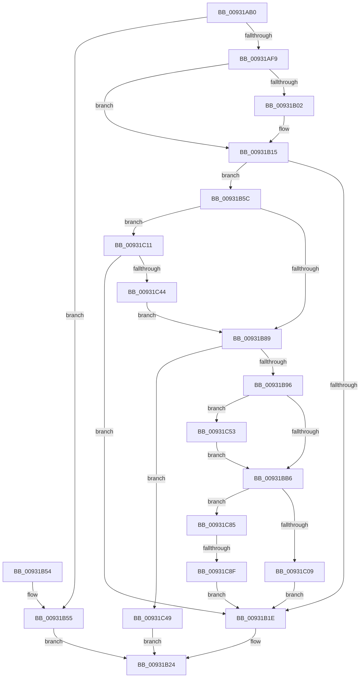

# PiDrvDbLoadNode

- RVA: `0x00931AB0`–`0x00931C99` (길이 `489` bytes)
- VA: `0x0000000140931AB0`
- 실행 섹션: `PAGE`
- PDB 이름 있음: `예`; PDB Function 태그: `예`
- unwind 정보 RVA: `0x0008ED7C`
- 디코드: `120`개 명령, `489/489` bytes 표시
- 미해석 바이트: `0` (있으면 어셈블리에 `.byte`로 보존)

> 이 문서는 커널 이미지의 기계어와 PDB 기호를 분석해 생성했습니다. 4번과 5번은 함수 원형과 자료형을 바이너리 사용 방식에서 추정한 C 해석이며 원본 소스 복구 결과는 아닙니다.

## 1. Dependencies

- 직접 호출 지점: **13**; 고유 호출 대상: **12**
- 직접 호출자로 확인된 함수: **1**
- RIP 상대 이미지 참조: **5**

### Outgoing calls
- `0x00931AEE` → [ExAcquireResourceExclusiveLite](../../text/21/ExAcquireResourceExclusiveLite_function_00214E20.md) (function, `0x00214E20`)
- `0x00931B09` → [KeCancelTimer](../../text/23/KeCancelTimer_function_002327E0.md) (function, `0x002327E0`)
- `0x00931B28` → [ExReleaseResourceLite](../../text/25/ExReleaseResourceLite_function_0025FA10.md) (function, `0x0025FA10`)
- `0x00931B36` → [KeLeaveCriticalRegionThread](../../text/25/KeLeaveCriticalRegionThread_function_0025EFF0.md) (function, `0x0025EFF0`)
- `0x00931B7C` → [_RegRtlOpenKeyTransacted](../8E/_RegRtlOpenKeyTransacted_function_008EF810.md) (function, `0x008EF810`)
- `0x00931BA2` → [ZwWaitForSingleObject](../../text/6A/ZwWaitForSingleObject_function_006AD150.md) (function, `0x006AD150`)
- `0x00931BE0` → [KeInitializeEvent](../../text/40/KeInitializeEvent_function_0040DD10.md) (function, `0x0040DD10`)
- `0x00931BEA` → [ExQueueWorkItem](../../text/2F/ExQueueWorkItem_function_002F9520.md) (function, `0x002F9520`)
- `0x00931BFF` → [KeWaitForSingleObject](../../text/20/KeWaitForSingleObject_function_0020E6B0.md) (function, `0x0020E6B0`)
- `0x00931C2B` → [PnpCtxRegOpenKey](../8E/PnpCtxRegOpenKey_function_008EF7B8.md) (function, `0x008EF7B8`)
- `0x00931C37` → [ZwClose](../../text/6A/ZwClose_function_006AD2B0.md) (function, `0x006AD2B0`)
- `0x00931C68` → [PnpDiagnosticTraceObjectWithStatus](../../text/4A/PnpDiagnosticTraceObjectWithStatus_function_004A9F58.md) (function, `0x004A9F58`)
- `0x00931C7B` → [PnpDiagnosticTraceObjectWithStatus](../../text/4A/PnpDiagnosticTraceObjectWithStatus_function_004A9F58.md) (function, `0x004A9F58`)

### Direct callers
- [PiDrvDbNodeActionCallback](PiDrvDbNodeActionCallback_function_00931980.md) at `0x00931A74`

### Static image references
- `0x00931B89` → RVA `0x00F8C5E4` (`.data`; read)
- `0x00931BC0` → RVA `0x00A91D40` (`PiDrvDbLoadNodeWorkerCallback`; read)
- `0x00931C16` → RVA `0x00B00330` (` ?? ::NNGAKEGL::`string'`; read)
- `0x00931C61` → RVA `0x00026D90` (`.rdata`; read)
- `0x00931C74` → RVA `0x00027738` (`.rdata`; read)

## 2. Other-region calls and transfers

- 다른 실행 섹션으로 향하는 call: **11**
  - `0x00931AEE` → [ExAcquireResourceExclusiveLite](../../text/21/ExAcquireResourceExclusiveLite_function_00214E20.md) (`PAGE` → `.text`)
  - `0x00931B09` → [KeCancelTimer](../../text/23/KeCancelTimer_function_002327E0.md) (`PAGE` → `.text`)
  - `0x00931B28` → [ExReleaseResourceLite](../../text/25/ExReleaseResourceLite_function_0025FA10.md) (`PAGE` → `.text`)
  - `0x00931B36` → [KeLeaveCriticalRegionThread](../../text/25/KeLeaveCriticalRegionThread_function_0025EFF0.md) (`PAGE` → `.text`)
  - `0x00931BA2` → [ZwWaitForSingleObject](../../text/6A/ZwWaitForSingleObject_function_006AD150.md) (`PAGE` → `.text`)
  - `0x00931BE0` → [KeInitializeEvent](../../text/40/KeInitializeEvent_function_0040DD10.md) (`PAGE` → `.text`)
  - `0x00931BEA` → [ExQueueWorkItem](../../text/2F/ExQueueWorkItem_function_002F9520.md) (`PAGE` → `.text`)
  - `0x00931BFF` → [KeWaitForSingleObject](../../text/20/KeWaitForSingleObject_function_0020E6B0.md) (`PAGE` → `.text`)
  - `0x00931C37` → [ZwClose](../../text/6A/ZwClose_function_006AD2B0.md) (`PAGE` → `.text`)
  - `0x00931C68` → [PnpDiagnosticTraceObjectWithStatus](../../text/4A/PnpDiagnosticTraceObjectWithStatus_function_004A9F58.md) (`PAGE` → `.text`)
  - `0x00931C7B` → [PnpDiagnosticTraceObjectWithStatus](../../text/4A/PnpDiagnosticTraceObjectWithStatus_function_004A9F58.md) (`PAGE` → `.text`)
- call이 아닌 외부 분기/꼬리 이동: **1**
  - `0x00931C89` → [sub_00B244D0](../B2/Unknown_function_00B244D0.md) (`tail-transfer`)

## 3. Assembly (complete function range)

```asm
00931AB0  48 89 5C 24 10                  mov qword ptr [rsp + 0x10], rbx
00931AB5  48 89 6C 24 18                  mov qword ptr [rsp + 0x18], rbp
00931ABA  56                              push rsi
00931ABB  57                              push rdi
00931ABC  41 54                           push r12
00931ABE  41 56                           push r14
00931AC0  41 57                           push r15
00931AC2  48 83 EC 30                     sub rsp, 0x30
00931AC6  45 33 E4                        xor r12d, r12d
00931AC9  4C 8B FA                        mov r15, rdx
00931ACC  4C 89 64 24 60                  mov qword ptr [rsp + 0x60], r12
00931AD1  48 8B F1                        mov rsi, rcx
00931AD4  65 48 8B 04 25 88 01 00 00      mov rax, qword ptr gs:[0x188]
00931ADD  B2 01                           mov dl, 1
00931ADF  48 83 C1 58                     add rcx, 0x58
00931AE3  41 8B DC                        mov ebx, r12d
00931AE6  66 FF 88 E4 01 00 00            dec word ptr [rax + 0x1e4]
00931AED  90                              nop
00931AEE  E8 2D 33 8E FF                  call 0x140214e20
00931AF3  44 38 66 50                     cmp byte ptr [rsi + 0x50], r12b
00931AF7  75 5C                           jne 0x140931b55
00931AF9  44 38 A6 E8 01 00 00            cmp byte ptr [rsi + 0x1e8], r12b
00931B00  74 13                           je 0x140931b15
00931B02  48 8D 8E 08 01 00 00            lea rcx, [rsi + 0x108]
00931B09  E8 D2 0C 90 FF                  call 0x1402327e0
00931B0E  44 88 A6 E8 01 00 00            mov byte ptr [rsi + 0x1e8], r12b
00931B15  4C 8D 76 48                     lea r14, [rsi + 0x48]
00931B19  4D 39 26                        cmp qword ptr [r14], r12
00931B1C  74 3E                           je 0x140931b5c
00931B1E  49 8B 06                        mov rax, qword ptr [r14]
00931B21  49 89 07                        mov qword ptr [r15], rax
00931B24  48 8D 4E 58                     lea rcx, [rsi + 0x58]
00931B28  E8 E3 DE 92 FF                  call 0x14025fa10
00931B2D  65 48 8B 0C 25 88 01 00 00      mov rcx, qword ptr gs:[0x188]
00931B36  E8 B5 D4 92 FF                  call 0x14025eff0
00931B3B  48 8B 6C 24 70                  mov rbp, qword ptr [rsp + 0x70]
00931B40  8B C3                           mov eax, ebx
00931B42  48 8B 5C 24 68                  mov rbx, qword ptr [rsp + 0x68]
00931B47  48 83 C4 30                     add rsp, 0x30
00931B4B  41 5F                           pop r15
00931B4D  41 5E                           pop r14
00931B4F  41 5C                           pop r12
00931B51  5F                              pop rdi
00931B52  5E                              pop rsi
00931B53  C3                              ret
00931B54  CC                              int3
00931B55  BB 67 04 00 C0                  mov ebx, 0xc0000467
00931B5A  EB C8                           jmp 0x140931b24
00931B5C  48 8B 56 28                     mov rdx, qword ptr [rsi + 0x28]
00931B60  48 8D 44 24 60                  lea rax, [rsp + 0x60]
00931B65  BB 00 00 00 02                  mov ebx, 0x2000000
00931B6A  4C 89 64 24 28                  mov qword ptr [rsp + 0x28], r12
00931B6F  44 8B CB                        mov r9d, ebx
00931B72  48 89 44 24 20                  mov qword ptr [rsp + 0x20], rax
00931B77  45 33 C0                        xor r8d, r8d
00931B7A  33 C9                           xor ecx, ecx
00931B7C  E8 8F DC FB FF                  call 0x1408ef810
00931B81  85 C0                           test eax, eax
00931B83  0F 89 88 00 00 00               jns 0x140931c11
00931B89  44 39 25 54 AA 65 00            cmp dword ptr [rip + 0x65aa54], r12d
00931B90  0F 85 B3 00 00 00               jne 0x140931c49
00931B96  48 8B 8E D8 01 00 00            mov rcx, qword ptr [rsi + 0x1d8]
00931B9D  45 33 C0                        xor r8d, r8d
00931BA0  33 D2                           xor edx, edx
00931BA2  E8 A9 B5 D7 FF                  call 0x1406ad150
00931BA7  8B F8                           mov edi, eax
00931BA9  44 38 A6 E9 01 00 00            cmp byte ptr [rsi + 0x1e9], r12b
00931BB0  0F 84 9D 00 00 00               je 0x140931c53
00931BB6  48 8D 9E E0 00 00 00            lea rbx, [rsi + 0xe0]
00931BBD  45 33 C0                        xor r8d, r8d
00931BC0  48 8D 05 79 01 16 00            lea rax, [rip + 0x160179]
00931BC7  48 89 73 18                     mov qword ptr [rbx + 0x18], rsi
00931BCB  48 8D BE C8 00 00 00            lea rdi, [rsi + 0xc8]
00931BD2  48 89 43 10                     mov qword ptr [rbx + 0x10], rax
00931BD6  48 8B CF                        mov rcx, rdi
00931BD9  4C 89 23                        mov qword ptr [rbx], r12
00931BDC  41 8D 50 01                     lea edx, [r8 + 1]
00931BE0  E8 2B C1 AD FF                  call 0x14040dd10
00931BE5  33 D2                           xor edx, edx
00931BE7  48 8B CB                        mov rcx, rbx
00931BEA  E8 31 79 9C FF                  call 0x1402f9520
00931BEF  45 33 C9                        xor r9d, r9d
00931BF2  4C 89 64 24 20                  mov qword ptr [rsp + 0x20], r12
00931BF7  45 33 C0                        xor r8d, r8d
00931BFA  33 D2                           xor edx, edx
00931BFC  48 8B CF                        mov rcx, rdi
00931BFF  E8 AC CA 8D FF                  call 0x14020e6b0
00931C04  4D 39 26                        cmp qword ptr [r14], r12
00931C07  74 7C                           je 0x140931c85
00931C09  41 8B DC                        mov ebx, r12d
00931C0C  E9 0D FF FF FF                  jmp 0x140931b1e
00931C11  48 8B 54 24 60                  mov rdx, qword ptr [rsp + 0x60]
00931C16  4C 8D 05 13 E7 1C 00            lea r8, [rip + 0x1ce713]
00931C1D  4C 89 74 24 28                  mov qword ptr [rsp + 0x28], r14
00931C22  45 33 C9                        xor r9d, r9d
00931C25  33 C9                           xor ecx, ecx
00931C27  89 5C 24 20                     mov dword ptr [rsp + 0x20], ebx
00931C2B  E8 88 DB FB FF                  call 0x1408ef7b8
00931C30  48 8B 4C 24 60                  mov rcx, qword ptr [rsp + 0x60]
00931C35  8B D8                           mov ebx, eax
00931C37  E8 74 B6 D7 FF                  call 0x1406ad2b0
00931C3C  85 DB                           test ebx, ebx
00931C3E  0F 89 DA FE FF FF               jns 0x140931b1e
00931C44  E9 40 FF FF FF                  jmp 0x140931b89
00931C49  BB EB 02 00 C0                  mov ebx, 0xc00002eb
00931C4E  E9 D1 FE FF FF                  jmp 0x140931b24
00931C53  44 8B C7                        mov r8d, edi
00931C56  C6 86 E9 01 00 00 01            mov byte ptr [rsi + 0x1e9], 1
00931C5D  48 8D 56 10                     lea rdx, [rsi + 0x10]
00931C61  48 8D 0D 28 51 6F FF            lea rcx, [rip - 0x90aed8]
00931C68  E8 EB 82 B7 FF                  call 0x1404a9f58
00931C6D  44 8B C7                        mov r8d, edi
00931C70  48 8D 56 10                     lea rdx, [rsi + 0x10]
00931C74  48 8D 0D BD 5A 6F FF            lea rcx, [rip - 0x90a543]
00931C7B  E8 D8 82 B7 FF                  call 0x1404a9f58
00931C80  E9 31 FF FF FF                  jmp 0x140931bb6
00931C85  44 38 66 50                     cmp byte ptr [rsi + 0x50], r12b
00931C89  0F 84 41 28 1F 00               je 0x140b244d0
00931C8F  BB 67 04 00 C0                  mov ebx, 0xc0000467
00931C94  E9 85 FE FF FF                  jmp 0x140931b1e
```

## 4. C-style interpretation (structured pseudocode)

```c
__int64 __fastcall PiDrvDbLoadNode(__int64 a1, __int64 a2, int a3)
{
    __int64 result;
    __int64 v_r12;
    __int64 v_rsp;
    unsigned __int64 v_stack_p10;
    unsigned __int64 v_stack_p18;
    unsigned __int64 v_stack_p20;
    unsigned __int64 v_stack_p28;
    unsigned __int64 v_stack_p60;
    unsigned __int64 v_stack_p8;

    v_stack_p10 = v_rbx;
    v_stack_p18 = v_rbp;
    v_rsp = (v_rsp) - (48);
    v_r12 = 0;
    v_stack_p8 = 0;
    a1 = (a1) + (88);
    result = ExAcquireResourceExclusiveLite(a1, 1, a3, a4);
    if ((*(unsigned __int8 *)(a1 + 80)) != 0) goto loc_00931B55;
    if ((*(unsigned __int8 *)(a1 + 488)) != 0) {
        a1 = a1 + 264;
        result = KeCancelTimer(a1, 1, a3, a4);
        *(unsigned __int8 *)(a1 + 488) = 0;
    }
    if ((*(unsigned __int64 *)(a1 + 72)) == 0) goto loc_00931B5C;
loc_00931B1E:
    *(unsigned __int64 *)(a2) = *(unsigned __int64 *)(a1 + 72);
loc_00931B24:
    result = ExReleaseResourceLite(a1 + 88, 1, a3, a4);
    result = KeLeaveCriticalRegionThread(*(unsigned __int64 *)(gs_base + (0 + 392)), 1, a3, a4);
    v_rsp = (v_rsp) + (48);
    return 0;
loc_00931B55:
    goto loc_00931B24;
loc_00931B5C:
    v_stack_p28 = 0;
    v_stack_p20 = v_stack_p60;
    a3 = 0;
    a1 = 0;
    result = _RegRtlOpenKeyTransacted(a1, *(unsigned __int64 *)(a1 + 40), a3, (unsigned int)((unsigned int)((unsigned int)(0x2000000ULL))));
    if (!sign_flag) goto loc_00931C11;
loc_00931B89:
    if ((*(unsigned int *)(v_rip + 6662740)) != 0) goto loc_00931C49;
    a3 = 0;
    a2 = 0;
    result = ZwWaitForSingleObject(*(unsigned __int64 *)(a1 + 472), a2, a3, (unsigned int)((unsigned int)((unsigned int)(0x2000000ULL))));
    if ((*(unsigned __int8 *)(a1 + 489)) == 0) goto loc_00931C53;
loc_00931BB6:
    a3 = 0;
    *(unsigned __int64 *)(a1 + 224 + 24) = 0;
    *(unsigned __int64 *)(a1 + 224 + 16) = v_rip + 1442169;
    *(unsigned __int64 *)(a1 + 224) = 0;
    result = KeInitializeEvent(a1 + 200, a3 + 1, a3, (unsigned int)((unsigned int)((unsigned int)(0x2000000ULL))));
    a2 = 0;
    result = ExQueueWorkItem(a1 + 224, a2, a3, (unsigned int)((unsigned int)((unsigned int)(0x2000000ULL))));
    a4 = 0;
    v_stack_p20 = 0;
    a3 = 0;
    a2 = 0;
    result = KeWaitForSingleObject(a1 + 200, a2, a3, a4);
    if ((*(unsigned __int64 *)(a1 + 72)) == 0) goto loc_00931C85;
    goto loc_00931B1E;
loc_00931C11:
    v_stack_p28 = a1 + 72;
    a4 = 0;
    a1 = 0;
    v_stack_p20 = 0;
    result = PnpCtxRegOpenKey(a1, v_stack_p60, v_rip + 1894163, a4);
    result = ZwClose(v_stack_p60, v_stack_p60, v_rip + 1894163, a4);
    if (!sign_flag) goto loc_00931B1E;
    goto loc_00931B89;
loc_00931C49:
    goto loc_00931B24;
loc_00931C53:
    *(unsigned __int8 *)(a1 + 489) = 1;
    result = PnpDiagnosticTraceObjectWithStatus(v_rip - 9481944, a1 + 16, (unsigned int)((unsigned int)(a1 + 200)), a4);
    result = PnpDiagnosticTraceObjectWithStatus(v_rip - 9479491, a1 + 16, (unsigned int)((unsigned int)(a1 + 200)), a4);
    goto loc_00931BB6;
loc_00931C85:
    goto loc_00931B1E;
}
```

## 5. (Beta) C Style

```c
int64_t PiDrvDbLoadNode(void *Arg1, void *Arg2, int32_t Arg3)
{
    uint8_t *arg1 = (uint8_t *)Arg1;
    uint8_t *arg2 = (uint8_t *)Arg2;

    int64_t result;
    int64_t local_r12;
    int64_t local_rsp;
    uint64_t v_stack_p10;
    uint64_t v_stack_p18;
    uint64_t v_stack_p20;
    uint64_t v_stack_p28;
    uint64_t v_stack_p60;
    uint64_t v_stack_p8;

    v_stack_p10 = local_rbx;
    v_stack_p18 = local_rbp;
    local_rsp = (local_rsp) - (48);
    local_r12 = 0;
    v_stack_p8 = 0;
    Arg1 = (Arg1) + (88);
    result = ExAcquireResourceExclusiveLite(Arg1, 1, Arg3, a4);
    if ((*(uint8_t *)(arg1 + 0x50)) != 0) goto loc_00931B55;
    if ((*(uint8_t *)(arg1 + 0x1E8)) != 0) {
        Arg1 = Arg1 + 264;
        result = KeCancelTimer(Arg1, 1, Arg3, a4);
        *(uint8_t *)(arg1 + 0x1E8) = 0;
    }
    if ((*(uint64_t *)(arg1 + 0x48)) == 0) goto loc_00931B5C;
loc_00931B1E:
    *(uint64_t *)(arg2) = *(uint64_t *)(arg1 + 0x48);
loc_00931B24:
    result = ExReleaseResourceLite(Arg1 + 88, 1, Arg3, a4);
    result = KeLeaveCriticalRegionThread(*(uint64_t *)(gs_base + (0 + 0x188)), 1, Arg3, a4);
    local_rsp = (local_rsp) + (48);
    return 0;
loc_00931B55:
    goto loc_00931B24;
loc_00931B5C:
    v_stack_p28 = 0;
    v_stack_p20 = v_stack_p60;
    Arg3 = 0;
    Arg1 = 0;
    result = _RegRtlOpenKeyTransacted(Arg1, *(uint64_t *)(arg1 + 0x28), Arg3, (uint32_t)((uint32_t)((uint32_t)(0x2000000ULL))));
    if (!sign_flag) goto loc_00931C11;
loc_00931B89:
    if ((*(uint32_t *)(v_rip + 0x65AA54)) != 0) goto loc_00931C49;
    Arg3 = 0;
    Arg2 = 0;
    result = ZwWaitForSingleObject(*(uint64_t *)(arg1 + 0x1D8), Arg2, Arg3, (uint32_t)((uint32_t)((uint32_t)(0x2000000ULL))));
    if ((*(uint8_t *)(arg1 + 0x1E9)) == 0) goto loc_00931C53;
loc_00931BB6:
    Arg3 = 0;
    *(uint64_t *)(arg1 + 0xE0 + 0x18) = 0;
    *(uint64_t *)(arg1 + 0xE0 + 0x10) = v_rip + 1442169;
    *(uint64_t *)(arg1 + 0xE0) = 0;
    result = KeInitializeEvent(Arg1 + 200, Arg3 + 1, Arg3, (uint32_t)((uint32_t)((uint32_t)(0x2000000ULL))));
    Arg2 = 0;
    result = ExQueueWorkItem(Arg1 + 224, Arg2, Arg3, (uint32_t)((uint32_t)((uint32_t)(0x2000000ULL))));
    a4 = 0;
    v_stack_p20 = 0;
    Arg3 = 0;
    Arg2 = 0;
    result = KeWaitForSingleObject(Arg1 + 200, Arg2, Arg3, a4);
    if ((*(uint64_t *)(arg1 + 0x48)) == 0) goto loc_00931C85;
    goto loc_00931B1E;
loc_00931C11:
    v_stack_p28 = Arg1 + 72;
    a4 = 0;
    Arg1 = 0;
    v_stack_p20 = 0;
    result = PnpCtxRegOpenKey(Arg1, v_stack_p60, v_rip + 1894163, a4);
    result = ZwClose(v_stack_p60, v_stack_p60, v_rip + 1894163, a4);
    if (!sign_flag) goto loc_00931B1E;
    goto loc_00931B89;
loc_00931C49:
    goto loc_00931B24;
loc_00931C53:
    *(uint8_t *)(arg1 + 0x1E9) = 1;
    result = PnpDiagnosticTraceObjectWithStatus(v_rip - 9481944, Arg1 + 16, (uint32_t)((uint32_t)(Arg1 + 200)), a4);
    result = PnpDiagnosticTraceObjectWithStatus(v_rip - 9479491, Arg1 + 16, (uint32_t)((uint32_t)(Arg1 + 200)), a4);
    goto loc_00931BB6;
loc_00931C85:
    goto loc_00931B1E;
}
```

### 관측된 메모리 오프셋

구조체 형식이 확인되지 않은 접근은 인자 기준의 오프셋으로만 기록했습니다.

| 기준 인자 | 오프셋 표현 | 폭 (bit) | 접근 |
|---|---:|---:|---|
| `Arg1` | `+ 0x0` | `64` | `R` |
| `Arg1` | `+ 0x0` | `64` | `W` |
| `Arg1` | `+ 0x10` | `64` | `R` |
| `Arg1` | `+ 0x10` | `64` | `W` |
| `Arg1` | `+ 0x18` | `64` | `W` |
| `Arg1` | `+ 0x28` | `64` | `R` |
| `Arg1` | `+ 0x48` | `64` | `R` |
| `Arg1` | `+ 0x50` | `8` | `R` |
| `Arg1` | `+ 0x58` | `64` | `R` |
| `Arg1` | `+ 0xC8` | `64` | `R` |
| `Arg1` | `+ 0xE0` | `64` | `R` |
| `Arg1` | `+ 0x108` | `64` | `R` |
| `Arg1` | `+ 0x1D8` | `64` | `R` |
| `Arg1` | `+ 0x1E8` | `8` | `R` |
| `Arg1` | `+ 0x1E8` | `8` | `W` |
| `Arg1` | `+ 0x1E9` | `8` | `R` |
| `Arg1` | `+ 0x1E9` | `8` | `W` |
| `Arg2` | `+ 0x0` | `64` | `W` |

## 6. Execution-region graph

[열기: 2D/3D 그래프와 함수 탐색 컨트롤 패널](../../../control-panel.html?section=page&rva=0x00931AB0&view=graph)

- 2D 그래프는 위에서 아래로 흐르고, 3D 그래프는 빈 공간을 드래그해 회전합니다. Shift+드래그는 이동, 휠은 확대·축소, 함수 노드 선택은 대상 보고서 이동입니다.

### Static fallback


