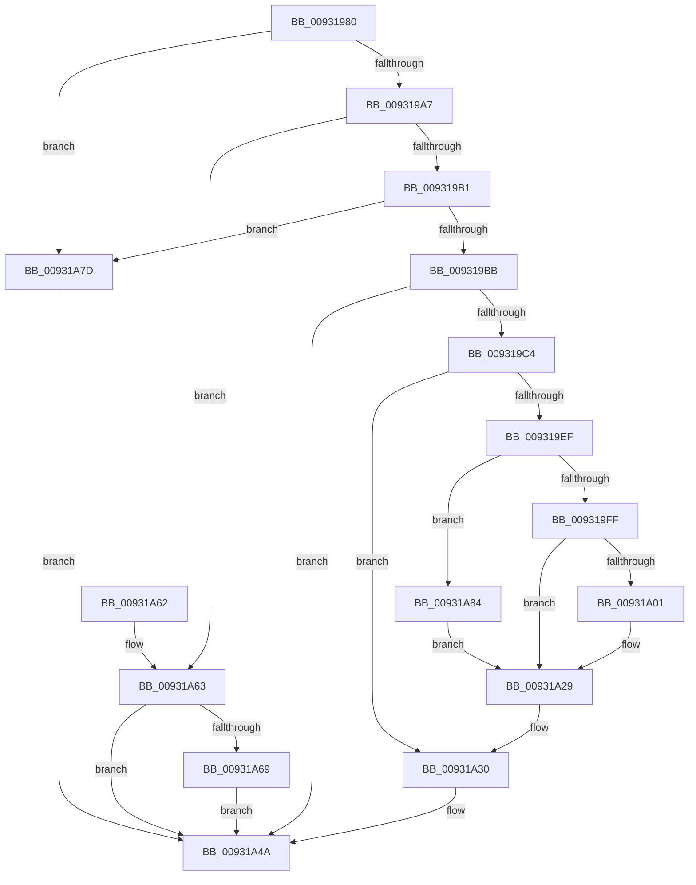

# PiDrvDbNodeActionCallback

- RVA: `0x00931980`–`0x00931AA7` (길이 `295` bytes)
- VA: `0x0000000140931980`
- 실행 섹션: `PAGE`
- PDB 이름 있음: `예`; PDB Function 태그: `아니요`
- unwind 정보 RVA: `0x0008ED64`
- 디코드: `69`개 명령, `295/295` bytes 표시
- 미해석 바이트: `0` (있으면 어셈블리에 `.byte`로 보존)

> 이 문서는 커널 이미지의 기계어와 PDB 기호를 분석해 생성했습니다. 4번과 5번은 함수 원형과 자료형을 바이너리 사용 방식에서 추정한 C 해석이며 원본 소스 복구 결과는 아닙니다.

## 1. Dependencies

- 직접 호출 지점: **6**; 고유 호출 대상: **6**
- 직접 호출자로 확인된 함수: **2**
- RIP 상대 이미지 참조: **0**

### Outgoing calls
- `0x009319E4` → [ExAcquireResourceExclusiveLite](../../text/21/ExAcquireResourceExclusiveLite_function_00214E20.md) (function, `0x00214E20`)
- `0x00931A24` → [KeSetCoalescableTimer](../../text/22/KeSetCoalescableTimer_function_0022FFD0.md) (function, `0x0022FFD0`)
- `0x00931A37` → [ExReleaseResourceLite](../../text/25/ExReleaseResourceLite_function_0025FA10.md) (function, `0x0025FA10`)
- `0x00931A45` → [KeLeaveCriticalRegionThread](../../text/25/KeLeaveCriticalRegionThread_function_0025EFF0.md) (function, `0x0025EFF0`)
- `0x00931A74` → [PiDrvDbLoadNode](PiDrvDbLoadNode_function_00931AB0.md) (function, `0x00931AB0`)
- `0x00931AA0` → [KiSetTimerEx](../../text/23/KiSetTimerEx_function_00232CB0.md) (function, `0x00232CB0`)

### Direct callers
- [DrvDbLoadDatabaseNode](DrvDbLoadDatabaseNode_function_00931668.md) at `0x009316ED`
- [DrvDbLoadDatabaseNode](DrvDbLoadDatabaseNode_function_00931668.md) at `0x0093175B`
- [DrvDbUnloadDatabaseNode](DrvDbUnloadDatabaseNode_function_0093183C.md) at `0x009318A3`
- [DrvDbUnloadDatabaseNode](DrvDbUnloadDatabaseNode_function_0093183C.md) at `0x009318F7`

### Static image references
- 디코드된 RIP-relative 메모리 참조가 없습니다.

## 2. Other-region calls and transfers

- 다른 실행 섹션으로 향하는 call: **5**
  - `0x009319E4` → [ExAcquireResourceExclusiveLite](../../text/21/ExAcquireResourceExclusiveLite_function_00214E20.md) (`PAGE` → `.text`)
  - `0x00931A24` → [KeSetCoalescableTimer](../../text/22/KeSetCoalescableTimer_function_0022FFD0.md) (`PAGE` → `.text`)
  - `0x00931A37` → [ExReleaseResourceLite](../../text/25/ExReleaseResourceLite_function_0025FA10.md) (`PAGE` → `.text`)
  - `0x00931A45` → [KeLeaveCriticalRegionThread](../../text/25/KeLeaveCriticalRegionThread_function_0025EFF0.md) (`PAGE` → `.text`)
  - `0x00931AA0` → [KiSetTimerEx](../../text/23/KiSetTimerEx_function_00232CB0.md) (`PAGE` → `.text`)
- 별도 외부 분기/꼬리 이동을 확인하지 못했습니다.

## 3. Assembly (complete function range)

```asm
00931980  48 89 5C 24 08                  mov qword ptr [rsp + 8], rbx
00931985  48 89 74 24 10                  mov qword ptr [rsp + 0x10], rsi
0093198A  48 89 7C 24 18                  mov qword ptr [rsp + 0x18], rdi
0093198F  41 56                           push r14
00931991  48 83 EC 30                     sub rsp, 0x30
00931995  48 8B 7C 24 68                  mov rdi, qword ptr [rsp + 0x68]
0093199A  33 DB                           xor ebx, ebx
0093199C  8B 47 40                        mov eax, dword ptr [rdi + 0x40]
0093199F  A8 04                           test al, 4
009319A1  0F 84 D6 00 00 00               je 0x140931a7d
009319A7  41 83 E8 01                     sub r8d, 1
009319AB  0F 84 B2 00 00 00               je 0x140931a63
009319B1  41 83 F8 01                     cmp r8d, 1
009319B5  0F 85 C2 00 00 00               jne 0x140931a7d
009319BB  45 3B C8                        cmp r9d, r8d
009319BE  0F 85 86 00 00 00               jne 0x140931a4a
009319C4  48 8B 44 24 60                  mov rax, qword ptr [rsp + 0x60]
009319C9  48 8D 4F 58                     lea rcx, [rdi + 0x58]
009319CD  41 8A D0                        mov dl, r8b
009319D0  4C 8B 30                        mov r14, qword ptr [rax]
009319D3  65 48 8B 04 25 88 01 00 00      mov rax, qword ptr gs:[0x188]
009319DC  66 FF 88 E4 01 00 00            dec word ptr [rax + 0x1e4]
009319E3  90                              nop
009319E4  E8 37 34 8E FF                  call 0x140214e20
009319E9  48 39 5F 48                     cmp qword ptr [rdi + 0x48], rbx
009319ED  74 41                           je 0x140931a30
009319EF  48 8B 87 E0 01 00 00            mov rax, qword ptr [rdi + 0x1e0]
009319F6  48 85 C0                        test rax, rax
009319F9  0F 84 85 00 00 00               je 0x140931a84
009319FF  79 28                           jns 0x140931a29
00931A01  48 8B 97 E0 01 00 00            mov rdx, qword ptr [rdi + 0x1e0]
00931A08  48 8D 87 48 01 00 00            lea rax, [rdi + 0x148]
00931A0F  48 8D 8F 08 01 00 00            lea rcx, [rdi + 0x108]
00931A16  48 89 44 24 20                  mov qword ptr [rsp + 0x20], rax
00931A1B  41 B9 98 3A 00 00               mov r9d, 0x3a98
00931A21  45 33 C0                        xor r8d, r8d
00931A24  E8 A7 E5 8F FF                  call 0x14022ffd0
00931A29  C6 87 E8 01 00 00 01            mov byte ptr [rdi + 0x1e8], 1
00931A30  48 8D 4F 58                     lea rcx, [rdi + 0x58]
00931A34  49 89 1E                        mov qword ptr [r14], rbx
00931A37  E8 D4 DF 92 FF                  call 0x14025fa10
00931A3C  65 48 8B 0C 25 88 01 00 00      mov rcx, qword ptr gs:[0x188]
00931A45  E8 A6 D5 92 FF                  call 0x14025eff0
00931A4A  48 8B 74 24 48                  mov rsi, qword ptr [rsp + 0x48]
00931A4F  8B C3                           mov eax, ebx
00931A51  48 8B 5C 24 40                  mov rbx, qword ptr [rsp + 0x40]
00931A56  48 8B 7C 24 50                  mov rdi, qword ptr [rsp + 0x50]
00931A5B  48 83 C4 30                     add rsp, 0x30
00931A5F  41 5E                           pop r14
00931A61  C3                              ret
00931A62  CC                              int3
00931A63  41 83 F9 01                     cmp r9d, 1
00931A67  75 E1                           jne 0x140931a4a
00931A69  48 8B 54 24 60                  mov rdx, qword ptr [rsp + 0x60]
00931A6E  48 8B CF                        mov rcx, rdi
00931A71  48 8B 12                        mov rdx, qword ptr [rdx]
00931A74  E8 37 00 00 00                  call 0x140931ab0
00931A79  8B D8                           mov ebx, eax
00931A7B  EB CD                           jmp 0x140931a4a
00931A7D  BB 02 00 00 C0                  mov ebx, 0xc0000002
00931A82  EB C6                           jmp 0x140931a4a
00931A84  48 8D 97 48 01 00 00            lea rdx, [rdi + 0x148]
00931A8B  45 33 C9                        xor r9d, r9d
00931A8E  48 89 54 24 20                  mov qword ptr [rsp + 0x20], rdx
00931A93  48 8D 8F 08 01 00 00            lea rcx, [rdi + 0x108]
00931A9A  48 8B D0                        mov rdx, rax
00931A9D  45 33 C0                        xor r8d, r8d
00931AA0  E8 0B 12 90 FF                  call 0x140232cb0
00931AA5  EB 82                           jmp 0x140931a29
```

## 4. C-style interpretation (structured pseudocode)

```c
__int64 __fastcall PiDrvDbNodeActionCallback(__int64 a1, __int64 a2, int a3, int a4, __int64 a5, __int64 a6)
{
    __int64 result;
    __int64 v_rbx;
    __int64 v_rsp;
    unsigned __int64 v_stack_m18;
    unsigned __int64 v_stack_p10;
    unsigned __int64 v_stack_p18;
    unsigned __int64 v_stack_p20;
    unsigned __int64 v_stack_p8;

    v_stack_p8 = v_rbx;
    v_stack_p10 = v_rsi;
    v_stack_p18 = v_rdi;
    v_rsp = (v_rsp) - (48);
    v_rbx = 0;
    if ((((unsigned __int8)((unsigned int)(*(unsigned int *)(a6 + 64)))) & (4)) == 0) goto loc_00931A7D;
    a3 = (unsigned int)((a3) - (1));
    if (condition_is_equal) goto loc_00931A63;
    if (a3 != 1) goto loc_00931A7D;
    if (a4 != a3) goto loc_00931A4A;
    result = ExAcquireResourceExclusiveLite(a6 + 88, (unsigned __int8)(a3), a3, a4);
    if ((*(unsigned __int64 *)(a6 + 72)) == 0) goto loc_00931A30;
    if (*(unsigned __int64 *)(a6 + 480) == 0) goto loc_00931A84;
    result = *(unsigned __int64 *)(a6 + 480);
    if (sign_flag) {
        a2 = *(unsigned __int64 *)(a6 + 480);
        result = a6 + 328;
        a1 = a6 + 264;
        v_stack_m18 = result;
        a4 = 0x3A98ULL;
        a3 = 0;
        result = KeSetCoalescableTimer(a1, a2, a3, a4);
    }
    *(unsigned __int8 *)(a6 + 488) = 1;
loc_00931A30:
    *(unsigned __int64 *)(*(unsigned __int64 *)(a5)) = 0;
    result = ExReleaseResourceLite(a6 + 88, a2, a3, a4);
    result = KeLeaveCriticalRegionThread(*(unsigned __int64 *)(gs_base + (0 + 392)), a2, a3, a4);
loc_00931A4A:
    v_rsp = (v_rsp) + (48);
    return 0;
loc_00931A63:
    if (a4 != 1) goto loc_00931A4A;
    result = PiDrvDbLoadNode(v_stack_p18, *(unsigned __int64 *)(a5), a3, a4);
    goto loc_00931A4A;
loc_00931A7D:
    goto loc_00931A4A;
loc_00931A84:
    a4 = 0;
    v_stack_p20 = v_stack_p18 + 328;
    a3 = 0;
    result = KiSetTimerEx(v_stack_p18 + 264, result, a3, a4);
    goto loc_00931A29;
}
```

## 5. (Beta) C Style

```c
int64_t PiDrvDbNodeActionCallback(int64_t Arg1, int64_t Arg2, int32_t Arg3, int32_t Arg4, void *Arg5, void *Arg6)
{
    uint8_t *arg5 = (uint8_t *)Arg5;
    uint8_t *arg6 = (uint8_t *)Arg6;

    int64_t result;
    int64_t local_rbx;
    int64_t local_rsp;
    uint64_t v_stack_m18;
    uint64_t v_stack_p10;
    uint64_t v_stack_p18;
    uint64_t v_stack_p20;
    uint64_t v_stack_p8;

    v_stack_p8 = local_rbx;
    v_stack_p10 = local_rsi;
    v_stack_p18 = local_rdi;
    local_rsp = (local_rsp) - (48);
    local_rbx = 0;
    if ((((uint8_t)((uint32_t)(*(uint32_t *)(arg6 + 0x40)))) & (4)) == 0) goto loc_00931A7D;
    Arg3 = (uint32_t)((Arg3) - (1));
    if (condition_is_equal) goto loc_00931A63;
    if (Arg3 != 1) goto loc_00931A7D;
    if (Arg4 != Arg3) goto loc_00931A4A;
    result = ExAcquireResourceExclusiveLite(Arg6 + 88, (uint8_t)(Arg3), Arg3, Arg4);
    if ((*(uint64_t *)(arg6 + 0x48)) == 0) goto loc_00931A30;
    if (*(uint64_t *)(arg6 + 0x1E0) == 0) goto loc_00931A84;
    result = *(uint64_t *)(arg6 + 0x1E0);
    if (sign_flag) {
        Arg2 = *(uint64_t *)(arg6 + 0x1E0);
        result = Arg6 + 328;
        Arg1 = Arg6 + 264;
        v_stack_m18 = result;
        Arg4 = 0x3A98ULL;
        Arg3 = 0;
        result = KeSetCoalescableTimer(Arg1, Arg2, Arg3, Arg4);
    }
    *(uint8_t *)(arg6 + 0x1E8) = 1;
loc_00931A30:
    *(uint64_t *)(*(uint64_t *)(arg5)) = 0;
    result = ExReleaseResourceLite(Arg6 + 88, Arg2, Arg3, Arg4);
    result = KeLeaveCriticalRegionThread(*(uint64_t *)(gs_base + (0 + 0x188)), Arg2, Arg3, Arg4);
loc_00931A4A:
    local_rsp = (local_rsp) + (48);
    return 0;
loc_00931A63:
    if (Arg4 != 1) goto loc_00931A4A;
    result = PiDrvDbLoadNode(v_stack_p18, *(uint64_t *)(arg5), Arg3, Arg4);
    goto loc_00931A4A;
loc_00931A7D:
    goto loc_00931A4A;
loc_00931A84:
    Arg4 = 0;
    v_stack_p20 = v_stack_p18 + 328;
    Arg3 = 0;
    result = KiSetTimerEx(v_stack_p18 + 264, result, Arg3, Arg4);
    goto loc_00931A29;
}
```

### 관측된 메모리 오프셋

구조체 형식이 확인되지 않은 접근은 인자 기준의 오프셋으로만 기록했습니다.

| 기준 인자 | 오프셋 표현 | 폭 (bit) | 접근 |
|---|---:|---:|---|
| `Arg5` | `+ 0x0` | `64` | `R` |
| `Arg6` | `+ 0x40` | `32` | `R` |
| `Arg6` | `+ 0x48` | `64` | `R` |
| `Arg6` | `+ 0x58` | `64` | `R` |
| `Arg6` | `+ 0x108` | `64` | `R` |
| `Arg6` | `+ 0x148` | `64` | `R` |
| `Arg6` | `+ 0x1E0` | `64` | `R` |
| `Arg6` | `+ 0x1E8` | `8` | `W` |

## 6. Execution-region graph

[열기: 2D/3D 그래프와 함수 탐색 컨트롤 패널](../../../control-panel.html?section=page&rva=0x00931980&view=graph)

- 2D 그래프는 위에서 아래로 흐르고, 3D 그래프는 빈 공간을 드래그해 회전합니다. Shift+드래그는 이동, 휠은 확대·축소, 함수 노드 선택은 대상 보고서 이동입니다.

### Static fallback


