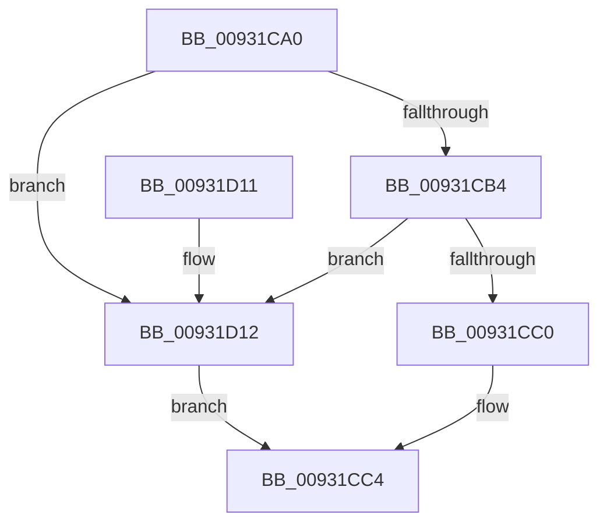

# PnpCtxRegCreateTree

- RVA: `0x00931CA0`–`0x00931D16` (길이 `118` bytes)
- VA: `0x0000000140931CA0`
- 실행 섹션: `PAGE`
- PDB 이름 있음: `예`; PDB Function 태그: `아니요`
- unwind 정보 RVA: `0x00071A68`
- 디코드: `30`개 명령, `118/118` bytes 표시
- 미해석 바이트: `0` (있으면 어셈블리에 `.byte`로 보존)

> 이 문서는 커널 이미지의 기계어와 PDB 기호를 분석해 생성했습니다. 4번과 5번은 함수 원형과 자료형을 바이너리 사용 방식에서 추정한 C 해석이며 원본 소스 복구 결과는 아닙니다.

## 1. Dependencies

- 직접 호출 지점: **1**; 고유 호출 대상: **1**
- 직접 호출자로 확인된 함수: **11**
- RIP 상대 이미지 참조: **0**

### Outgoing calls
- `0x00931D06` → [RegRtlCreateTreeTransacted](RegRtlCreateTreeTransacted_function_00931D1C.md) (function, `0x00931D1C`)

### Direct callers
- [PipUpdateDeviceProducts](../../text/5A/PipUpdateDeviceProducts_function_005A46C0.md) at `0x005A4834`
- [PiDrvDbQuerySyncNodesUpdated](../74/PiDrvDbQuerySyncNodesUpdated_function_00741F70.md) at `0x00742057`
- [sub_008EE966](../8E/Unknown_function_008EE966.md) at `0x008EEA11`
- [_CmOpenCommonClassRegKeyWorker](../8F/_CmOpenCommonClassRegKeyWorker_function_008F0A1C.md) at `0x008F0EFB`
- [_CmOpenDeviceInterfaceRegKeyWorker](../8F/_CmOpenDeviceInterfaceRegKeyWorker_function_008F2B48.md) at `0x008F3097`
- [CmOpenDeviceContainerRegKeyWorker](../8F/CmOpenDeviceContainerRegKeyWorker_function_008F4904.md) at `0x008F4B41`
- [sub_00931420](Unknown_function_00931420.md) at `0x0093160A`
- [_PnpOpenPropertiesKey](../99/_PnpOpenPropertiesKey_function_009938A0.md) at `0x00993AB8`
- [sub_00B24164](../B2/Unknown_function_00B24164.md) at `0x00B2425B`
- [sub_00B24270](../B2/Unknown_function_00B24270.md) at `0x00B24301`
- [sub_00B47E86](../B4/Unknown_function_00B47E86.md) at `0x00B47F0B`

### Static image references
- 디코드된 RIP-relative 메모리 참조가 없습니다.

## 2. Other-region calls and transfers

- 다른 실행 섹션으로 향하는 call: **0**
- 별도 외부 분기/꼬리 이동을 확인하지 못했습니다.

## 3. Assembly (complete function range)

```asm
00931CA0  40 53                           push rbx
00931CA2  48 83 EC 50                     sub rsp, 0x50
00931CA6  45 8B D1                        mov r10d, r9d
00931CA9  4D 8B D8                        mov r11, r8
00931CAC  48 8B DA                        mov rbx, rdx
00931CAF  48 85 C9                        test rcx, rcx
00931CB2  74 5E                           je 0x140931d12
00931CB4  48 8B 81 E0 00 00 00            mov rax, qword ptr [rcx + 0xe0]
00931CBB  48 85 C0                        test rax, rax
00931CBE  74 52                           je 0x140931d12
00931CC0  48 8B 48 08                     mov rcx, qword ptr [rax + 8]
00931CC4  48 8B 84 24 98 00 00 00         mov rax, qword ptr [rsp + 0x98]
00931CCC  45 8B C2                        mov r8d, r10d
00931CCF  44 8B 8C 24 80 00 00 00         mov r9d, dword ptr [rsp + 0x80]
00931CD7  49 8B D3                        mov rdx, r11
00931CDA  48 89 4C 24 40                  mov qword ptr [rsp + 0x40], rcx
00931CDF  48 8B CB                        mov rcx, rbx
00931CE2  48 89 44 24 38                  mov qword ptr [rsp + 0x38], rax
00931CE7  48 8B 84 24 90 00 00 00         mov rax, qword ptr [rsp + 0x90]
00931CEF  48 89 44 24 30                  mov qword ptr [rsp + 0x30], rax
00931CF4  48 8B 84 24 88 00 00 00         mov rax, qword ptr [rsp + 0x88]
00931CFC  C6 44 24 28 00                  mov byte ptr [rsp + 0x28], 0
00931D01  48 89 44 24 20                  mov qword ptr [rsp + 0x20], rax
00931D06  E8 11 00 00 00                  call 0x140931d1c
00931D0B  48 83 C4 50                     add rsp, 0x50
00931D0F  5B                              pop rbx
00931D10  C3                              ret
00931D11  CC                              int3
00931D12  33 C9                           xor ecx, ecx
00931D14  EB AE                           jmp 0x140931cc4
```

## 4. C-style interpretation (structured pseudocode)

```c
__int64 __fastcall PnpCtxRegCreateTree(__int64 a1, __int64 a2, __int64 a3, int a4, unsigned int a5, __int64 a6, __int64 a7, __int64 a8)
{
    __int64 result;
    __int64 v_rsp;
    unsigned __int64 v_stack_m18;
    unsigned __int64 v_stack_m20;
    unsigned __int64 v_stack_m28;
    unsigned __int8 v_stack_m30;
    unsigned __int64 v_stack_m38;

    v_rsp = (v_rsp) - (80);
    if (a1 == 0) goto loc_00931D12;
    if (*(unsigned __int64 *)(a1 + 224) == 0) goto loc_00931D12;
loc_00931CC4:
    v_stack_m18 = *(unsigned __int64 *)(*(unsigned __int64 *)(a1 + 224) + 8);
    v_stack_m20 = a8;
    v_stack_m28 = a7;
    v_stack_m30 = 0;
    v_stack_m38 = a6;
    result = RegRtlCreateTreeTransacted(a2, a3, (unsigned int)((unsigned int)((unsigned int)(a4))), (unsigned int)(a5));
    v_rsp = (v_rsp) + (80);
    return result;
loc_00931D12:
    a1 = 0;
    goto loc_00931CC4;
}
```

## 5. (Beta) C Style

```c
int64_t PnpCtxRegCreateTree(int64_t Arg1, int64_t Arg2, int64_t Arg3, int32_t Arg4, uint32_t Arg5, int64_t Arg6, int64_t Arg7, int64_t Arg8)
{
    int64_t result;
    int64_t local_rsp;
    uint64_t v_stack_m18;
    uint64_t v_stack_m20;
    uint64_t v_stack_m28;
    uint8_t v_stack_m30;
    uint64_t v_stack_m38;

    local_rsp = (local_rsp) - (80);
    if (Arg1 == 0) goto loc_00931D12;
    if (*(uint64_t *)(Arg1 + 0xE0) == 0) goto loc_00931D12;
loc_00931CC4:
    v_stack_m18 = *(uint64_t *)(*(uint64_t *)(Arg1 + 0xE0) + 0x8);
    v_stack_m20 = Arg8;
    v_stack_m28 = Arg7;
    v_stack_m30 = 0;
    v_stack_m38 = Arg6;
    result = RegRtlCreateTreeTransacted(Arg2, Arg3, (uint32_t)((uint32_t)((uint32_t)(Arg4))), (uint32_t)(Arg5));
    local_rsp = (local_rsp) + (80);
    return result;
loc_00931D12:
    Arg1 = 0;
    goto loc_00931CC4;
}
```

## 6. Execution-region graph

[열기: 2D/3D 그래프와 함수 탐색 컨트롤 패널](../../../control-panel.html?section=page&rva=0x00931CA0&view=graph)

- 2D 그래프는 위에서 아래로 흐르고, 3D 그래프는 빈 공간을 드래그해 회전합니다. Shift+드래그는 이동, 휠은 확대·축소, 함수 노드 선택은 대상 보고서 이동입니다.

### Static fallback


