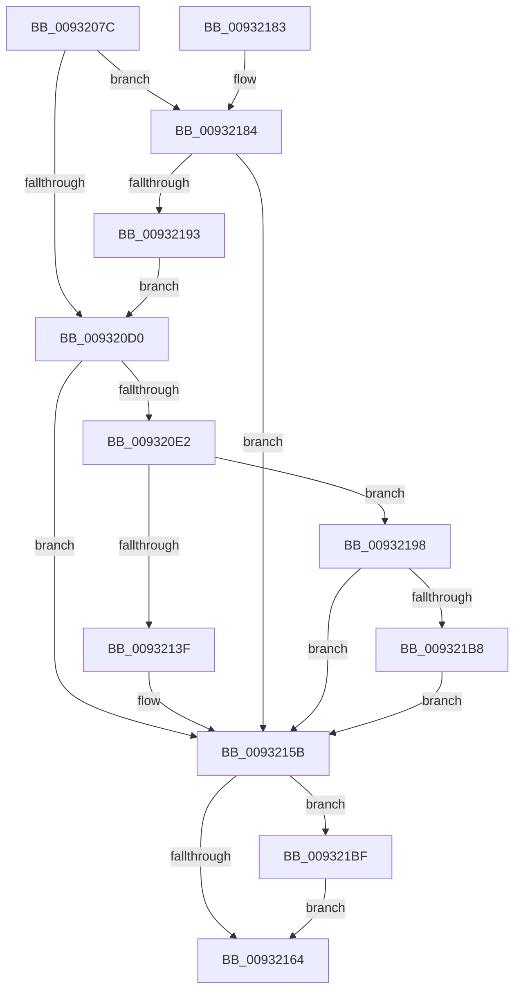

# RegRtlCreateKeyTransacted

- RVA: `0x0093207C`–`0x009321C6` (길이 `330` bytes)
- VA: `0x000000014093207C`
- 실행 섹션: `PAGE`
- PDB 이름 있음: `예`; PDB Function 태그: `아니요`
- unwind 정보 RVA: `0x0008EDCC`
- 디코드: `95`개 명령, `330/330` bytes 표시
- 미해석 바이트: `0` (있으면 어셈블리에 `.byte`로 보존)

> 이 문서는 커널 이미지의 기계어와 PDB 기호를 분석해 생성했습니다. 4번과 5번은 함수 원형과 자료형을 바이너리 사용 방식에서 추정한 C 해석이며 원본 소스 복구 결과는 아닙니다.

## 1. Dependencies

- 직접 호출 지점: **6**; 고유 호출 대상: **6**
- 직접 호출자로 확인된 함수: **8**
- RIP 상대 이미지 참조: **0**

### Outgoing calls
- `0x009320C3` → [RegRtlIsPredefinedKey](RegRtlIsPredefinedKey_function_009321CC.md) (function, `0x009321CC`)
- `0x009320D7` → [RtlInitUnicodeStringEx](../../text/46/RtlInitUnicodeStringEx_function_00463960.md) (function, `0x00463960`)
- `0x00932154` → [ZwCreateKey](../../text/6A/ZwCreateKey_function_006AD470.md) (function, `0x006AD470`)
- `0x00932188` → [RegRtlOpenPredefinedKey](../83/RegRtlOpenPredefinedKey_function_00832A14.md) (function, `0x00832A14`)
- `0x009321AA` → [NtCreateKeyTransacted_Stub](../83/NtCreateKeyTransacted_Stub_function_00832CF4.md) (function, `0x00832CF4`)
- `0x009321BF` → [ZwClose](../../text/6A/ZwClose_function_006AD2B0.md) (function, `0x006AD2B0`)

### Direct callers
- [SysCtxOpenControlSet](../83/SysCtxOpenControlSet_function_00831B00.md) at `0x00831BD4`
- [SysCtxOpenControlSet](../83/SysCtxOpenControlSet_function_00831B00.md) at `0x00831CE1`
- [RegRtlCopyTreeInternal](../83/RegRtlCopyTreeInternal_function_008324C0.md) at `0x00832669`
- [_CmAddDeviceToContainerWorker](../8F/_CmAddDeviceToContainerWorker_function_008FF2EC.md) at `0x008FF40F`
- [_CmAddDeviceToContainerWorker](../8F/_CmAddDeviceToContainerWorker_function_008FF2EC.md) at `0x008FF471`
- [RegRtlCreateTreeTransacted](RegRtlCreateTreeTransacted_function_00931D1C.md) at `0x00931F73`
- [PnpSetPropertyWorker](../99/PnpSetPropertyWorker_function_00991C08.md) at `0x00991DBA`
- [PnpSetPropertyWorker](../99/PnpSetPropertyWorker_function_00991C08.md) at `0x00991E2B`
- [SysCtxRegCreateKey](../A6/SysCtxRegCreateKey_function_00A6933C.md) at `0x00A69397`
- [_CmSetDeviceInterfaceMappedPropertyFromRegValue](../A7/_CmSetDeviceInterfaceMappedPropertyFromRegValue_function_00A729E4.md) at `0x00A72C07`
- [_CmCreateOrdinalInstanceKey](../A7/_CmCreateOrdinalInstanceKey_function_00A77838.md) at `0x00A77994`

### Static image references
- 디코드된 RIP-relative 메모리 참조가 없습니다.

## 2. Other-region calls and transfers

- 다른 실행 섹션으로 향하는 call: **3**
  - `0x009320D7` → [RtlInitUnicodeStringEx](../../text/46/RtlInitUnicodeStringEx_function_00463960.md) (`PAGE` → `.text`)
  - `0x00932154` → [ZwCreateKey](../../text/6A/ZwCreateKey_function_006AD470.md) (`PAGE` → `.text`)
  - `0x009321BF` → [ZwClose](../../text/6A/ZwClose_function_006AD2B0.md) (`PAGE` → `.text`)
- 별도 외부 분기/꼬리 이동을 확인하지 못했습니다.

## 3. Assembly (complete function range)

```asm
0093207C  48 8B C4                        mov rax, rsp
0093207F  48 89 58 08                     mov qword ptr [rax + 8], rbx
00932083  48 89 70 10                     mov qword ptr [rax + 0x10], rsi
00932087  48 89 78 18                     mov qword ptr [rax + 0x18], rdi
0093208B  55                              push rbp
0093208C  41 56                           push r14
0093208E  41 57                           push r15
00932090  48 8D 68 C9                     lea rbp, [rax - 0x37]
00932094  48 81 EC 90 00 00 00            sub rsp, 0x90
0093209B  33 C0                           xor eax, eax
0093209D  0F 57 C0                        xorps xmm0, xmm0
009320A0  48 21 45 CF                     and qword ptr [rbp - 0x31], rax
009320A4  45 8B F1                        mov r14d, r9d
009320A7  0F 11 45 E7                     movups xmmword ptr [rbp - 0x19], xmm0
009320AB  48 89 45 07                     mov qword ptr [rbp + 7], rax
009320AF  41 8B F0                        mov esi, r8d
009320B2  0F 11 45 F7                     movups xmmword ptr [rbp - 9], xmm0
009320B6  89 45 0F                        mov dword ptr [rbp + 0xf], eax
009320B9  4C 8B FA                        mov r15, rdx
009320BC  0F 11 45 D7                     movups xmmword ptr [rbp - 0x29], xmm0
009320C0  48 8B F9                        mov rdi, rcx
009320C3  E8 04 01 00 00                  call 0x1409321cc
009320C8  84 C0                           test al, al
009320CA  0F 85 B4 00 00 00               jne 0x140932184
009320D0  49 8B D7                        mov rdx, r15
009320D3  48 8D 4D D7                     lea rcx, [rbp - 0x29]
009320D7  E8 84 18 B3 FF                  call 0x140463960
009320DC  8B D8                           mov ebx, eax
009320DE  85 C0                           test eax, eax
009320E0  78 79                           js 0x14093215b
009320E2  8B C6                           mov eax, esi
009320E4  C7 45 E7 30 00 00 00            mov dword ptr [rbp - 0x19], 0x30
009320EB  83 E0 08                        and eax, 8
009320EE  4C 8D 45 E7                     lea r8, [rbp - 0x19]
009320F2  83 C8 06                        or eax, 6
009320F5  41 8B D6                        mov edx, r14d
009320F8  C1 E0 05                        shl eax, 5
009320FB  8B C8                           mov ecx, eax
009320FD  83 C9 02                        or ecx, 2
00932100  80 7D 67 00                     cmp byte ptr [rbp + 0x67], 0
00932104  0F 44 C8                        cmove ecx, eax
00932107  48 8B 45 CF                     mov rax, qword ptr [rbp - 0x31]
0093210B  48 85 C0                        test rax, rax
0093210E  48 0F 45 F8                     cmovne rdi, rax
00932112  48 83 65 0F 00                  and qword ptr [rbp + 0xf], 0
00932117  0F BA E9 09                     bts ecx, 9
0093211B  48 89 7D EF                     mov qword ptr [rbp - 0x11], rdi
0093211F  48 8D 45 D7                     lea rax, [rbp - 0x29]
00932123  89 4D FF                        mov dword ptr [rbp - 1], ecx
00932126  48 8B 4D 7F                     mov rcx, qword ptr [rbp + 0x7f]
0093212A  48 89 45 F7                     mov qword ptr [rbp - 9], rax
0093212E  48 8B 45 5F                     mov rax, qword ptr [rbp + 0x5f]
00932132  48 89 45 07                     mov qword ptr [rbp + 7], rax
00932136  48 8B 45 77                     mov rax, qword ptr [rbp + 0x77]
0093213A  48 85 C9                        test rcx, rcx
0093213D  75 59                           jne 0x140932198
0093213F  48 89 44 24 30                  mov qword ptr [rsp + 0x30], rax
00932144  45 33 C9                        xor r9d, r9d
00932147  89 74 24 28                     mov dword ptr [rsp + 0x28], esi
0093214B  48 21 4C 24 20                  and qword ptr [rsp + 0x20], rcx
00932150  48 8B 4D 6F                     mov rcx, qword ptr [rbp + 0x6f]
00932154  E8 17 B3 D7 FF                  call 0x1406ad470
00932159  8B D8                           mov ebx, eax
0093215B  48 8B 4D CF                     mov rcx, qword ptr [rbp - 0x31]
0093215F  48 85 C9                        test rcx, rcx
00932162  75 5B                           jne 0x1409321bf
00932164  4C 8D 9C 24 90 00 00 00         lea r11, [rsp + 0x90]
0093216C  8B C3                           mov eax, ebx
0093216E  49 8B 5B 20                     mov rbx, qword ptr [r11 + 0x20]
00932172  49 8B 73 28                     mov rsi, qword ptr [r11 + 0x28]
00932176  49 8B 7B 30                     mov rdi, qword ptr [r11 + 0x30]
0093217A  49 8B E3                        mov rsp, r11
0093217D  41 5F                           pop r15
0093217F  41 5E                           pop r14
00932181  5D                              pop rbp
00932182  C3                              ret
00932183  CC                              int3
00932184  48 8D 55 CF                     lea rdx, [rbp - 0x31]
00932188  E8 87 08 F0 FF                  call 0x140832a14
0093218D  8B D8                           mov ebx, eax
0093218F  85 C0                           test eax, eax
00932191  78 C8                           js 0x14093215b
00932193  E9 38 FF FF FF                  jmp 0x1409320d0
00932198  48 89 44 24 38                  mov qword ptr [rsp + 0x38], rax
0093219D  48 89 4C 24 30                  mov qword ptr [rsp + 0x30], rcx
009321A2  48 8B 4D 6F                     mov rcx, qword ptr [rbp + 0x6f]
009321A6  89 74 24 28                     mov dword ptr [rsp + 0x28], esi
009321AA  E8 45 0B F0 FF                  call 0x140832cf4
009321AF  8B D8                           mov ebx, eax
009321B1  3D 7A 00 00 C0                  cmp eax, 0xc000007a
009321B6  75 A3                           jne 0x14093215b
009321B8  BB 04 00 19 C0                  mov ebx, 0xc0190004
009321BD  EB 9C                           jmp 0x14093215b
009321BF  E8 EC B0 D7 FF                  call 0x1406ad2b0
009321C4  EB 9E                           jmp 0x140932164
```

## 4. C-style interpretation (structured pseudocode)

```c
__int64 __fastcall RegRtlCreateKeyTransacted(__int64 a1, __int64 a2, int a3, int a4)
{
    __int64 result;
    __int64 v_rsp;
    unsigned __int64 v_stack_m18;
    unsigned __int64 v_stack_m58;
    unsigned __int64 v_stack_m60;
    unsigned int v_stack_m68;
    unsigned __int64 v_stack_m78;
    unsigned int v_stack_m80;
    unsigned __int64 v_stack_m88;

    *(unsigned __int64 *)(v_rsp + 8) = v_rbx;
    *(unsigned __int64 *)(v_rsp + 16) = v_rsi;
    *(unsigned __int64 *)(v_rsp + 24) = v_rdi;
    v_rsp = (v_rsp) - (144);
    result = 0;
    *(unsigned __int64 *)(v_rsp - 55 - 25) = v_xmm0;
    *(unsigned __int64 *)(v_rsp - 55 + 7) = 0;
    *(unsigned __int64 *)(v_rsp - 55 - 9) = v_xmm0;
    *(unsigned int *)(v_rsp - 55 + 15) = 0;
    *(unsigned __int64 *)(v_rsp - 55 - 41) = v_xmm0;
    result = RegRtlIsPredefinedKey(a1, a2, a3, a4);
    if ((unsigned __int8)(result) != 0) goto loc_00932184;
loc_009320D0:
    result = RtlInitUnicodeStringEx(v_rsp - 55 - 41, a2, a3, a4);
    if (sign_flag) goto loc_0093215B;
    *(unsigned int *)(v_rsp - 55 - 25) = 48;
    result = (unsigned int)(((unsigned int)((unsigned int)((unsigned int)(a3)))) & (8));
    result = (unsigned int)((result) | (6));
    result = (unsigned int)((result) << (5));
    a1 = (unsigned int)(((unsigned int)((unsigned int)(result))) | (2));
    if ((*(unsigned __int8 *)(v_rsp - 55 + 103)) == 0) { a1 = (unsigned int)(result); }
    if (*(unsigned __int64 *)(v_rsp - 55 - 49) != 0) { a1 = *(unsigned __int64 *)(v_rsp - 55 - 49); }
    *(unsigned __int64 *)(v_rsp - 55 - 17) = a1;
    *(unsigned int *)(v_rsp - 55 - 1) = (unsigned int)(a1);
    *(unsigned __int64 *)(v_rsp - 55 - 9) = v_rsp - 55 - 41;
    *(unsigned __int64 *)(v_rsp - 55 + 7) = *(unsigned __int64 *)(v_rsp - 55 + 95);
    if (*(unsigned __int64 *)(v_rsp - 55 + 127) != 0) goto loc_00932198;
    v_stack_m78 = *(unsigned __int64 *)(v_rsp - 55 + 119);
    a4 = 0;
    v_stack_m80 = (unsigned int)((unsigned int)(a3));
    result = ZwCreateKey(*(unsigned __int64 *)(v_rsp - 55 + 111), (unsigned int)((unsigned int)((unsigned int)(a4))), v_rsp - 55 - 25, a4);
loc_0093215B:
    if (*(unsigned __int64 *)(v_rsp - 55 - 49) != 0) goto loc_009321BF;
loc_00932164:
    return (unsigned int)((unsigned int)((unsigned int)((unsigned int)(result))));
loc_00932184:
    result = RegRtlOpenPredefinedKey(*(unsigned __int64 *)(v_rsp - 55 - 49), v_rsp - 55 - 49, v_rsp - 55 - 25, a4);
    if (sign_flag) goto loc_0093215B;
    goto loc_009320D0;
loc_00932198:
    v_stack_m58 = result;
    v_stack_m60 = *(unsigned __int64 *)(v_rsp - 55 - 49);
    v_stack_m68 = (unsigned int)(*(unsigned __int64 *)(v_stack_m18 + 40));
    result = NtCreateKeyTransacted_Stub(*(unsigned __int64 *)(v_rsp - 55 + 111), v_rsp - 55 - 49, v_rsp - 55 - 25, a4);
    if (((unsigned int)(result)) != 0xC000007AULL) goto loc_0093215B;
    goto loc_0093215B;
loc_009321BF:
    result = ZwClose(*(unsigned __int64 *)(v_rsp - 55 + 111), v_rsp - 55 - 49, v_rsp - 55 - 25, a4);
    goto loc_00932164;
}
```

## 5. (Beta) C Style

```c
int64_t RegRtlCreateKeyTransacted(int64_t Arg1, int64_t Arg2, int32_t Arg3, int32_t Arg4)
{
    int64_t result;
    int64_t local_rsp;
    uint64_t v_stack_m18;
    uint64_t v_stack_m58;
    uint64_t v_stack_m60;
    uint32_t v_stack_m68;
    uint64_t v_stack_m78;
    uint32_t v_stack_m80;
    uint64_t v_stack_m88;

    *(uint64_t *)(local_rsp + 0x8) = local_rbx;
    *(uint64_t *)(local_rsp + 0x10) = local_rsi;
    *(uint64_t *)(local_rsp + 0x18) = local_rdi;
    local_rsp = (local_rsp) - (144);
    result = 0;
    *(uint64_t *)(local_rsp - 0x37 - 0x19) = v_xmm0;
    *(uint64_t *)(local_rsp - 0x37 + 0x7) = 0;
    *(uint64_t *)(local_rsp - 0x37 - 0x9) = v_xmm0;
    *(uint32_t *)(local_rsp - 0x37 + 0xF) = 0;
    *(uint64_t *)(local_rsp - 0x37 - 0x29) = v_xmm0;
    result = RegRtlIsPredefinedKey(Arg1, Arg2, Arg3, Arg4);
    if ((uint8_t)(result) != 0) goto loc_00932184;
loc_009320D0:
    result = RtlInitUnicodeStringEx(local_rsp - 55 - 41, Arg2, Arg3, Arg4);
    if (sign_flag) goto loc_0093215B;
    *(uint32_t *)(local_rsp - 0x37 - 0x19) = 48;
    result = (uint32_t)(((uint32_t)((uint32_t)((uint32_t)(Arg3)))) & (8));
    result = (uint32_t)((result) | (6));
    result = (uint32_t)((result) << (5));
    Arg1 = (uint32_t)(((uint32_t)((uint32_t)(result))) | (2));
    if ((*(uint8_t *)(local_rsp - 0x37 + 0x67)) == 0) { Arg1 = (uint32_t)(result); }
    if (*(uint64_t *)(local_rsp - 0x37 - 0x31) != 0) { Arg1 = *(uint64_t *)(local_rsp - 0x37 - 0x31); }
    *(uint64_t *)(local_rsp - 0x37 - 0x11) = Arg1;
    *(uint32_t *)(local_rsp - 0x37 - 0x1) = (uint32_t)(Arg1);
    *(uint64_t *)(local_rsp - 0x37 - 0x9) = local_rsp - 55 - 41;
    *(uint64_t *)(local_rsp - 0x37 + 0x7) = *(uint64_t *)(local_rsp - 0x37 + 0x5F);
    if (*(uint64_t *)(local_rsp - 0x37 + 0x7F) != 0) goto loc_00932198;
    v_stack_m78 = *(uint64_t *)(local_rsp - 0x37 + 0x77);
    Arg4 = 0;
    v_stack_m80 = (uint32_t)((uint32_t)(Arg3));
    result = ZwCreateKey(*(uint64_t *)(local_rsp - 0x37 + 0x6F), (uint32_t)((uint32_t)((uint32_t)(Arg4))), local_rsp - 55 - 25, Arg4);
loc_0093215B:
    if (*(uint64_t *)(local_rsp - 0x37 - 0x31) != 0) goto loc_009321BF;
loc_00932164:
    return (uint32_t)((uint32_t)((uint32_t)((uint32_t)(result))));
loc_00932184:
    result = RegRtlOpenPredefinedKey(*(uint64_t *)(local_rsp - 0x37 - 0x31), local_rsp - 55 - 49, local_rsp - 55 - 25, Arg4);
    if (sign_flag) goto loc_0093215B;
    goto loc_009320D0;
loc_00932198:
    v_stack_m58 = result;
    v_stack_m60 = *(uint64_t *)(local_rsp - 0x37 - 0x31);
    v_stack_m68 = (uint32_t)(*(uint64_t *)(v_stack_m18 + 0x28));
    result = NtCreateKeyTransacted_Stub(*(uint64_t *)(local_rsp - 0x37 + 0x6F), local_rsp - 55 - 49, local_rsp - 55 - 25, Arg4);
    if (((uint32_t)(result)) != 0xC000007AULL) goto loc_0093215B;
    goto loc_0093215B;
loc_009321BF:
    result = ZwClose(*(uint64_t *)(local_rsp - 0x37 + 0x6F), local_rsp - 55 - 49, local_rsp - 55 - 25, Arg4);
    goto loc_00932164;
}
```

## 6. Execution-region graph

[열기: 2D/3D 그래프와 함수 탐색 컨트롤 패널](../../../control-panel.html?section=page&rva=0x0093207C&view=graph)

- 2D 그래프는 위에서 아래로 흐르고, 3D 그래프는 빈 공간을 드래그해 회전합니다. Shift+드래그는 이동, 휠은 확대·축소, 함수 노드 선택은 대상 보고서 이동입니다.

### Static fallback


