# RegRtlCreateTreeTransacted

- RVA: `0x00931D1C`–`0x00932076` (길이 `858` bytes)
- VA: `0x0000000140931D1C`
- 실행 섹션: `PAGE`
- PDB 이름 있음: `예`; PDB Function 태그: `아니요`
- unwind 정보 RVA: `0x0008EDA8`
- 디코드: `228`개 명령, `858/858` bytes 표시
- 미해석 바이트: `0` (있으면 어셈블리에 `.byte`로 보존)

> 이 문서는 커널 이미지의 기계어와 PDB 기호를 분석해 생성했습니다. 4번과 5번은 함수 원형과 자료형을 바이너리 사용 방식에서 추정한 C 해석이며 원본 소스 복구 결과는 아닙니다.

## 1. Dependencies

- 직접 호출 지점: **13**; 고유 호출 대상: **12**
- 직접 호출자로 확인된 함수: **5**
- RIP 상대 이미지 참조: **1**

### Outgoing calls
- `0x00931D72` → [RegRtlIsPredefinedKey](RegRtlIsPredefinedKey_function_009321CC.md) (function, `0x009321CC`)
- `0x00931D86` → [RtlInitUnicodeStringEx](../../text/46/RtlInitUnicodeStringEx_function_00463960.md) (function, `0x00463960`)
- `0x00931E0E` → [ZwCreateKey](../../text/6A/ZwCreateKey_function_006AD470.md) (function, `0x006AD470`)
- `0x00931EAC` → [ExAllocatePool2](../../poolcode/B8/ExAllocatePool2_function_00B820F0.md) (function, `0x00B820F0`)
- `0x00931ED3` → [RtlStringCchCopyExW](../../text/41/RtlStringCchCopyExW_function_0041E1C0.md) (function, `0x0041E1C0`)
- `0x00931F0A` → [wcschr](../../text/50/wcschr_function_00501A60.md) (function, `0x00501A60`)
- `0x00931F73` → [RegRtlCreateKeyTransacted](RegRtlCreateKeyTransacted_function_0093207C.md) (function, `0x0093207C`)
- `0x00931F8C` → [ZwClose](../../text/6A/ZwClose_function_006AD2B0.md) (function, `0x006AD2B0`)
- `0x00931FD2` → [RegRtlOpenPredefinedKey](../83/RegRtlOpenPredefinedKey_function_00832A14.md) (function, `0x00832A14`)
- `0x00931FF9` → [NtCreateKeyTransacted_Stub](../83/NtCreateKeyTransacted_Stub_function_00832CF4.md) (function, `0x00832CF4`)
- `0x00932015` → [ZwClose](../../text/6A/ZwClose_function_006AD2B0.md) (function, `0x006AD2B0`)
- `0x00932039` → [wcsnicmp](../../text/50/wcsnicmp_function_005001C0.md) (function, `0x005001C0`)
- `0x00932062` → [ExFreePoolWithTag](../../poolcode/B8/ExFreePoolWithTag_function_00B82870.md) (function, `0x00B82870`)

### Direct callers
- [SysCtxRegCreateTree](SysCtxRegCreateTree_function_0093000C.md) at `0x00930067`
- [sub_00930EBB](Unknown_function_00930EBB.md) at `0x00930F2A`
- [sub_00931330](Unknown_function_00931330.md) at `0x009313B3`
- [PnpCtxRegCreateTree](PnpCtxRegCreateTree_function_00931CA0.md) at `0x00931D06`
- [PiDqOpenUserObjectRegKey](../99/PiDqOpenUserObjectRegKey_function_00990444.md) at `0x00990749`

### Static image references
- `0x0093202F` → RVA `0x00037B78` (`.rdata`; read)

## 2. Other-region calls and transfers

- 다른 실행 섹션으로 향하는 call: **9**
  - `0x00931D86` → [RtlInitUnicodeStringEx](../../text/46/RtlInitUnicodeStringEx_function_00463960.md) (`PAGE` → `.text`)
  - `0x00931E0E` → [ZwCreateKey](../../text/6A/ZwCreateKey_function_006AD470.md) (`PAGE` → `.text`)
  - `0x00931EAC` → [ExAllocatePool2](../../poolcode/B8/ExAllocatePool2_function_00B820F0.md) (`PAGE` → `POOLCODE`)
  - `0x00931ED3` → [RtlStringCchCopyExW](../../text/41/RtlStringCchCopyExW_function_0041E1C0.md) (`PAGE` → `.text`)
  - `0x00931F0A` → [wcschr](../../text/50/wcschr_function_00501A60.md) (`PAGE` → `.text`)
  - `0x00931F8C` → [ZwClose](../../text/6A/ZwClose_function_006AD2B0.md) (`PAGE` → `.text`)
  - `0x00932015` → [ZwClose](../../text/6A/ZwClose_function_006AD2B0.md) (`PAGE` → `.text`)
  - `0x00932039` → [wcsnicmp](../../text/50/wcsnicmp_function_005001C0.md) (`PAGE` → `.text`)
  - `0x00932062` → [ExFreePoolWithTag](../../poolcode/B8/ExFreePoolWithTag_function_00B82870.md) (`PAGE` → `POOLCODE`)
- 별도 외부 분기/꼬리 이동을 확인하지 못했습니다.

## 3. Assembly (complete function range)

```asm
00931D1C  48 8B C4                        mov rax, rsp
00931D1F  48 89 58 08                     mov qword ptr [rax + 8], rbx
00931D23  48 89 70 10                     mov qword ptr [rax + 0x10], rsi
00931D27  48 89 78 18                     mov qword ptr [rax + 0x18], rdi
00931D2B  44 89 48 20                     mov dword ptr [rax + 0x20], r9d
00931D2F  55                              push rbp
00931D30  41 54                           push r12
00931D32  41 55                           push r13
00931D34  41 56                           push r14
00931D36  41 57                           push r15
00931D38  48 8D 68 C9                     lea rbp, [rax - 0x37]
00931D3C  48 81 EC A0 00 00 00            sub rsp, 0xa0
00931D43  33 C0                           xor eax, eax
00931D45  0F 57 C0                        xorps xmm0, xmm0
00931D48  45 33 E4                        xor r12d, r12d
00931D4B  48 89 45 FF                     mov qword ptr [rbp - 1], rax
00931D4F  4C 89 65 C7                     mov qword ptr [rbp - 0x39], r12
00931D53  41 8B F1                        mov esi, r9d
00931D56  0F 11 45 DF                     movups xmmword ptr [rbp - 0x21], xmm0
00931D5A  89 45 07                        mov dword ptr [rbp + 7], eax
00931D5D  45 8B E8                        mov r13d, r8d
00931D60  0F 11 45 EF                     movups xmmword ptr [rbp - 0x11], xmm0
00931D64  4C 89 65 BF                     mov qword ptr [rbp - 0x41], r12
00931D68  48 8B FA                        mov rdi, rdx
00931D6B  0F 11 45 CF                     movups xmmword ptr [rbp - 0x31], xmm0
00931D6F  4C 8B F9                        mov r15, rcx
00931D72  E8 55 04 00 00                  call 0x1409321cc
00931D77  84 C0                           test al, al
00931D79  0F 85 4F 02 00 00               jne 0x140931fce
00931D7F  48 8B D7                        mov rdx, rdi
00931D82  48 8D 4D CF                     lea rcx, [rbp - 0x31]
00931D86  E8 D5 1B B3 FF                  call 0x140463960
00931D8B  8B D8                           mov ebx, eax
00931D8D  85 C0                           test eax, eax
00931D8F  0F 88 80 00 00 00               js 0x140931e15
00931D95  41 8B C5                        mov eax, r13d
00931D98  C7 45 DF 30 00 00 00            mov dword ptr [rbp - 0x21], 0x30
00931D9F  83 E0 08                        and eax, 8
00931DA2  4C 89 65 07                     mov qword ptr [rbp + 7], r12
00931DA6  83 C8 06                        or eax, 6
00931DA9  4C 8D 45 DF                     lea r8, [rbp - 0x21]
00931DAD  C1 E0 05                        shl eax, 5
00931DB0  49 8B CF                        mov rcx, r15
00931DB3  8B D0                           mov edx, eax
00931DB5  83 CA 02                        or edx, 2
00931DB8  44 38 65 67                     cmp byte ptr [rbp + 0x67], r12b
00931DBC  0F 44 D0                        cmove edx, eax
00931DBF  48 8B 45 BF                     mov rax, qword ptr [rbp - 0x41]
00931DC3  48 85 C0                        test rax, rax
00931DC6  48 0F 45 C8                     cmovne rcx, rax
00931DCA  0F BA EA 09                     bts edx, 9
00931DCE  48 8D 45 CF                     lea rax, [rbp - 0x31]
00931DD2  48 89 4D E7                     mov qword ptr [rbp - 0x19], rcx
00931DD6  48 8B 4D 7F                     mov rcx, qword ptr [rbp + 0x7f]
00931DDA  48 89 45 EF                     mov qword ptr [rbp - 0x11], rax
00931DDE  48 8B 45 5F                     mov rax, qword ptr [rbp + 0x5f]
00931DE2  48 89 45 FF                     mov qword ptr [rbp - 1], rax
00931DE6  48 8B 45 77                     mov rax, qword ptr [rbp + 0x77]
00931DEA  89 55 F7                        mov dword ptr [rbp - 9], edx
00931DED  8B D6                           mov edx, esi
00931DEF  48 85 C9                        test rcx, rcx
00931DF2  0F 85 EE 01 00 00               jne 0x140931fe6
00931DF8  48 8B 4D 6F                     mov rcx, qword ptr [rbp + 0x6f]
00931DFC  45 33 C9                        xor r9d, r9d
00931DFF  48 89 44 24 30                  mov qword ptr [rsp + 0x30], rax
00931E04  44 89 6C 24 28                  mov dword ptr [rsp + 0x28], r13d
00931E09  4C 89 64 24 20                  mov qword ptr [rsp + 0x20], r12
00931E0E  E8 5D B6 D7 FF                  call 0x1406ad470
00931E13  8B D8                           mov ebx, eax
00931E15  48 8B 4D BF                     mov rcx, qword ptr [rbp - 0x41]
00931E19  48 85 C9                        test rcx, rcx
00931E1C  0F 85 F3 01 00 00               jne 0x140932015
00931E22  81 FB 34 00 00 C0               cmp ebx, 0xc0000034
00931E28  74 24                           je 0x140931e4e
00931E2A  4C 8D 9C 24 A0 00 00 00         lea r11, [rsp + 0xa0]
00931E32  8B C3                           mov eax, ebx
00931E34  49 8B 5B 30                     mov rbx, qword ptr [r11 + 0x30]
00931E38  49 8B 73 38                     mov rsi, qword ptr [r11 + 0x38]
00931E3C  49 8B 7B 40                     mov rdi, qword ptr [r11 + 0x40]
00931E40  49 8B E3                        mov rsp, r11
00931E43  41 5F                           pop r15
00931E45  41 5E                           pop r14
00931E47  41 5D                           pop r13
00931E49  41 5C                           pop r12
00931E4B  5D                              pop rbp
00931E4C  C3                              ret
00931E4D  CC                              int3
00931E4E  48 85 FF                        test rdi, rdi
00931E51  0F 84 15 02 00 00               je 0x14093206c
00931E57  BA FF 7F 00 00                  mov edx, 0x7fff
00931E5C  48 8B C7                        mov rax, rdi
00931E5F  8B CA                           mov ecx, edx
00931E61  66 44 39 20                     cmp word ptr [rax], r12w
00931E65  74 0A                           je 0x140931e71
00931E67  48 83 C0 02                     add rax, 2
00931E6B  48 83 E9 01                     sub rcx, 1
00931E6F  75 F0                           jne 0x140931e61
00931E71  48 8B C1                        mov rax, rcx
00931E74  48 F7 D8                        neg rax
00931E77  48 8B C1                        mov rax, rcx
00931E7A  1B DB                           sbb ebx, ebx
00931E7C  48 2B D1                        sub rdx, rcx
00931E7F  F7 D3                           not ebx
00931E81  81 E3 0D 00 00 C0               and ebx, 0xc000000d
00931E87  48 F7 D8                        neg rax
00931E8A  4D 1B C0                        sbb r8, r8
00931E8D  4C 23 C2                        and r8, rdx
00931E90  48 85 C9                        test rcx, rcx
00931E93  74 95                           je 0x140931e2a
00931E95  49 8D 58 01                     lea rbx, [r8 + 1]
00931E99  41 BE 00 01 00 00               mov r14d, 0x100
00931E9F  48 8D 14 1B                     lea rdx, [rbx + rbx]
00931EA3  41 8B CE                        mov ecx, r14d
00931EA6  41 B8 52 45 47 4C               mov r8d, 0x4c474552
00931EAC  E8 3F 02 25 00                  call 0x140b820f0
00931EB1  48 8B F0                        mov rsi, rax
00931EB4  48 85 C0                        test rax, rax
00931EB7  0F 84 62 01 00 00               je 0x14093201f
00931EBD  44 89 74 24 28                  mov dword ptr [rsp + 0x28], r14d
00931EC2  45 33 C9                        xor r9d, r9d
00931EC5  4C 8B C7                        mov r8, rdi
00931EC8  4C 89 64 24 20                  mov qword ptr [rsp + 0x20], r12
00931ECD  48 8B D3                        mov rdx, rbx
00931ED0  48 8B C8                        mov rcx, rax
00931ED3  E8 E8 C2 AE FF                  call 0x14041e1c0
00931ED8  8B D8                           mov ebx, eax
00931EDA  85 C0                           test eax, eax
00931EDC  0F 85 7B 01 00 00               jne 0x14093205d
00931EE2  48 8B FE                        mov rdi, rsi
00931EE5  4D 8B F7                        mov r14, r15
00931EE8  BB 02 00 00 80                  mov ebx, 0x80000002
00931EED  4D 85 FF                        test r15, r15
00931EF0  0F 84 33 01 00 00               je 0x140932029
00931EF6  45 8B E5                        mov r12d, r13d
00931EF9  41 83 E4 FC                     and r12d, 0xfffffffc
00931EFD  B8 5C 00 00 00                  mov eax, 0x5c
00931F02  48 8B CF                        mov rcx, rdi
00931F05  8B D0                           mov edx, eax
00931F07  48 8B DF                        mov rbx, rdi
00931F0A  E8 51 FB BC FF                  call 0x140501a60
00931F0F  45 33 DB                        xor r11d, r11d
00931F12  48 8B F8                        mov rdi, rax
00931F15  48 85 C0                        test rax, rax
00931F18  0F 85 8D 00 00 00               jne 0x140931fab
00931F1E  44 8B 4D 57                     mov r9d, dword ptr [rbp + 0x57]
00931F22  48 85 FF                        test rdi, rdi
00931F25  0F B6 4D 67                     movzx ecx, byte ptr [rbp + 0x67]
00931F29  BA 04 00 00 00                  mov edx, 4
00931F2E  4C 8B 55 77                     mov r10, qword ptr [rbp + 0x77]
00931F32  44 0F 45 CA                     cmovne r9d, edx
00931F36  48 8B 55 7F                     mov rdx, qword ptr [rbp + 0x7f]
00931F3A  41 0F 45 CB                     cmovne ecx, r11d
00931F3E  48 8B 45 5F                     mov rax, qword ptr [rbp + 0x5f]
00931F42  4D 0F 45 D3                     cmovne r10, r11
00931F46  48 89 54 24 40                  mov qword ptr [rsp + 0x40], rdx
00931F4B  45 8B C5                        mov r8d, r13d
00931F4E  4C 89 54 24 38                  mov qword ptr [rsp + 0x38], r10
00931F53  48 8D 55 C7                     lea rdx, [rbp - 0x39]
00931F57  48 89 54 24 30                  mov qword ptr [rsp + 0x30], rdx
00931F5C  49 0F 45 C3                     cmovne rax, r11
00931F60  88 4C 24 28                     mov byte ptr [rsp + 0x28], cl
00931F64  45 0F 45 C4                     cmovne r8d, r12d
00931F68  49 8B CE                        mov rcx, r14
00931F6B  48 89 44 24 20                  mov qword ptr [rsp + 0x20], rax
00931F70  48 8B D3                        mov rdx, rbx
00931F73  E8 04 01 00 00                  call 0x14093207c
00931F78  8B D8                           mov ebx, eax
00931F7A  4D 3B F7                        cmp r14, r15
00931F7D  74 12                           je 0x140931f91
00931F7F  B8 02 00 00 80                  mov eax, 0x80000002
00931F84  4C 3B F0                        cmp r14, rax
00931F87  74 08                           je 0x140931f91
00931F89  49 8B CE                        mov rcx, r14
00931F8C  E8 1F B3 D7 FF                  call 0x1406ad2b0
00931F91  85 DB                           test ebx, ebx
00931F93  0F 85 C4 00 00 00               jne 0x14093205d
00931F99  48 85 FF                        test rdi, rdi
00931F9C  0F 84 B0 00 00 00               je 0x140932052
00931FA2  4C 8B 75 C7                     mov r14, qword ptr [rbp - 0x39]
00931FA6  E9 52 FF FF FF                  jmp 0x140931efd
00931FAB  66 44 89 18                     mov word ptr [rax], r11w
00931FAF  B9 5C 00 00 00                  mov ecx, 0x5c
00931FB4  48 83 C7 02                     add rdi, 2
00931FB8  0F B7 07                        movzx eax, word ptr [rdi]
00931FBB  66 3B C1                        cmp ax, cx
00931FBE  74 F4                           je 0x140931fb4
00931FC0  66 F7 D8                        neg ax
00931FC3  48 1B C0                        sbb rax, rax
00931FC6  48 23 F8                        and rdi, rax
00931FC9  E9 50 FF FF FF                  jmp 0x140931f1e
00931FCE  48 8D 55 BF                     lea rdx, [rbp - 0x41]
00931FD2  E8 3D 0A F0 FF                  call 0x140832a14
00931FD7  8B D8                           mov ebx, eax
00931FD9  85 C0                           test eax, eax
00931FDB  0F 88 34 FE FF FF               js 0x140931e15
00931FE1  E9 99 FD FF FF                  jmp 0x140931d7f
00931FE6  48 89 44 24 38                  mov qword ptr [rsp + 0x38], rax
00931FEB  48 89 4C 24 30                  mov qword ptr [rsp + 0x30], rcx
00931FF0  48 8B 4D 6F                     mov rcx, qword ptr [rbp + 0x6f]
00931FF4  44 89 6C 24 28                  mov dword ptr [rsp + 0x28], r13d
00931FF9  E8 F6 0C F0 FF                  call 0x140832cf4
00931FFE  8B D8                           mov ebx, eax
00932000  3D 7A 00 00 C0                  cmp eax, 0xc000007a
00932005  0F 85 0A FE FF FF               jne 0x140931e15
0093200B  BB 04 00 19 C0                  mov ebx, 0xc0190004
00932010  E9 00 FE FF FF                  jmp 0x140931e15
00932015  E8 96 B2 D7 FF                  call 0x1406ad2b0
0093201A  E9 03 FE FF FF                  jmp 0x140931e22
0093201F  BB 17 00 00 C0                  mov ebx, 0xc0000017
00932024  E9 01 FE FF FF                  jmp 0x140931e2a
00932029  41 B8 12 00 00 00               mov r8d, 0x12
0093202F  48 8D 15 42 5B 70 FF            lea rdx, [rip - 0x8fa4be]
00932036  48 8B CE                        mov rcx, rsi
00932039  E8 82 E1 BC FF                  call 0x1405001c0
0093203E  85 C0                           test eax, eax
00932040  0F 85 B0 FE FF FF               jne 0x140931ef6
00932046  4C 8B F3                        mov r14, rbx
00932049  48 8D 7E 24                     lea rdi, [rsi + 0x24]
0093204D  E9 A4 FE FF FF                  jmp 0x140931ef6
00932052  48 8B 4D 6F                     mov rcx, qword ptr [rbp + 0x6f]
00932056  48 8B 45 C7                     mov rax, qword ptr [rbp - 0x39]
0093205A  48 89 01                        mov qword ptr [rcx], rax
0093205D  33 D2                           xor edx, edx
0093205F  48 8B CE                        mov rcx, rsi
00932062  E8 09 08 25 00                  call 0x140b82870
00932067  E9 BE FD FF FF                  jmp 0x140931e2a
0093206C  BB 0D 00 00 C0                  mov ebx, 0xc000000d
00932071  E9 B4 FD FF FF                  jmp 0x140931e2a
```

## 4. C-style interpretation (structured pseudocode)

```c
__int64 __fastcall RegRtlCreateTreeTransacted(__int64 a1, __int64 a2, int a3, int a4)
{
    __int64 result;
    __int64 v_r10;
    __int64 v_r11;
    __int64 v_r12;
    __int64 v_rbx;
    __int64 v_rdi;
    __int64 v_rsp;
    unsigned __int64 v_stack_m28;
    unsigned __int64 v_stack_m60;
    unsigned __int64 v_stack_m68;
    unsigned __int64 v_stack_m70;
    unsigned int v_stack_m78;
    unsigned __int64 v_stack_m80;
    unsigned __int64 v_stack_m98;
    unsigned int v_stack_mA0;
    unsigned __int64 v_stack_mA8;

    *(unsigned __int64 *)(v_rsp + 8) = v_rbx;
    *(unsigned __int64 *)(v_rsp + 16) = v_rsi;
    *(unsigned __int64 *)(v_rsp + 24) = v_rdi;
    *(unsigned int *)(v_rsp + 32) = a4;
    v_rsp = (v_rsp) - (160);
    result = 0;
    v_r12 = 0;
    *(unsigned __int64 *)(v_rsp - 55 - 1) = 0;
    *(unsigned __int64 *)(v_rsp - 55 - 57) = 0;
    *(unsigned __int64 *)(v_rsp - 55 - 33) = v_xmm0;
    *(unsigned int *)(v_rsp - 55 + 7) = 0;
    *(unsigned __int64 *)(v_rsp - 55 - 17) = v_xmm0;
    *(unsigned __int64 *)(v_rsp - 55 - 65) = 0;
    *(unsigned __int64 *)(v_rsp - 55 - 49) = v_xmm0;
    result = RegRtlIsPredefinedKey(a1, a2, a3, a4);
    if ((unsigned __int8)(result) != 0) goto loc_00931FCE;
loc_00931D7F:
    result = RtlInitUnicodeStringEx(v_rsp - 55 - 49, a2, a3, a4);
    if (sign_flag) goto loc_00931E15;
    *(unsigned int *)(v_rsp - 55 - 33) = 48;
    result = (unsigned int)(((unsigned int)((unsigned int)((unsigned int)(a3)))) & (8));
    *(unsigned __int64 *)(v_rsp - 55 + 7) = 0;
    result = (unsigned int)((result) | (6));
    result = (unsigned int)((result) << (5));
    a2 = (unsigned int)(((unsigned int)((unsigned int)(result))) | (2));
    if ((*(unsigned __int8 *)(v_rsp - 55 + 103)) == 0) { a2 = (unsigned int)(result); }
    if (*(unsigned __int64 *)(v_rsp - 55 - 65) != 0) { a1 = *(unsigned __int64 *)(v_rsp - 55 - 65); }
    *(unsigned __int64 *)(v_rsp - 55 - 25) = a1;
    *(unsigned __int64 *)(v_rsp - 55 - 17) = v_rsp - 55 - 49;
    *(unsigned __int64 *)(v_rsp - 55 - 1) = *(unsigned __int64 *)(v_rsp - 55 + 95);
    *(unsigned int *)(v_rsp - 55 - 9) = (unsigned int)(a2);
    if (*(unsigned __int64 *)(v_rsp - 55 + 127) != 0) goto loc_00931FE6;
    a4 = 0;
    v_stack_m98 = *(unsigned __int64 *)(v_rsp - 55 + 119);
    v_stack_mA0 = (unsigned int)((unsigned int)(a3));
    v_stack_mA8 = 0;
    result = ZwCreateKey(*(unsigned __int64 *)(v_rsp - 55 + 111), (unsigned int)((unsigned int)((unsigned int)(a4))), v_rsp - 55 - 33, a4);
loc_00931E15:
    if (*(unsigned __int64 *)(v_rsp - 55 - 65) != 0) goto loc_00932015;
loc_00931E22:
    if (((unsigned int)((unsigned int)((unsigned int)(result)))) == 0xC0000034ULL) goto loc_00931E4E;
loc_00931E2A:
    return (unsigned int)((unsigned int)((unsigned int)((unsigned int)(result))));
loc_00931E4E:
    if (*(unsigned __int64 *)(v_stack_m28 + 64) == 0) goto loc_0093206C;
loc_00931E61:
    if ((*(unsigned __int16 *)(*(unsigned __int64 *)(v_stack_m28 + 64))) == 0) goto loc_00931E71;
    result = (*(unsigned __int64 *)(v_stack_m28 + 64)) + (2);
    a1 = ((unsigned int)((unsigned int)((unsigned int)(0x7FFFULL)))) - (1);
    if (condition_is_not_equal) goto loc_00931E61;
loc_00931E71:
    result = -(a1);
    a2 = ((unsigned int)(0x7FFFULL)) - (a1);
    v_rbx = (unsigned int)(~(*(unsigned __int64 *)(v_stack_m28 + 48)));
    v_rbx = (unsigned int)((v_rbx) & (0xC000000DULL));
    result = -(a1);
    a3 = (v_rsp - 55 - 33) & (a2);
    if (a1 == 0) goto loc_00931E2A;
    result = ExAllocatePool2(256, a3 + 1 + a3 + 1 * 1, (unsigned int)(0x4C474552ULL), a4);
    if (result == 0) goto loc_0093201F;
    v_stack_m78 = 256;
    a4 = 0;
    v_stack_m80 = 0;
    result = RtlStringCchCopyExW(result, a3 + 1, *(unsigned __int64 *)(v_stack_m28 + 64), a4);
    if ((unsigned int)(result) != 0) goto loc_0093205D;
    if (a1 == 0) goto loc_00932029;
loc_00931EF6:
    v_r12 = (unsigned int)(((unsigned int)((unsigned int)((unsigned int)(a3)))) & (0xFFFFFFFCULL));
loc_00931EFD:
    result = wcschr(result, 92, *(unsigned __int64 *)(v_stack_m28 + 64), a4);
    v_r11 = 0;
    if (result != 0) goto loc_00931FAB;
loc_00931F1E:
    a4 = (unsigned int)(*(unsigned int *)(v_rsp - 55 + 87));
    if (result != 0) { a4 = 4; }
    a1 = *(unsigned __int8 *)(v_rsp - 55 + 103);
    if (result != 0) { a1 = 0; }
    v_r10 = *(unsigned __int64 *)(v_rsp - 55 + 119);
    if (result != 0) { v_r10 = 0; }
    v_stack_m60 = *(unsigned __int64 *)(v_rsp - 55 + 127);
    v_stack_m68 = v_r10;
    v_stack_m70 = v_rsp - 55 - 57;
    result = *(unsigned __int64 *)(v_rsp - 55 + 95);
    if (result != 0) { result = 0; }
    v_stack_m78 = (unsigned __int8)(a1);
    a3 = (unsigned int)((unsigned int)((unsigned int)(a3)));
    if (result != 0) { a3 = (unsigned int)(v_r12); }
    v_stack_m80 = result;
    result = RegRtlCreateKeyTransacted(a1, result, a3, a4);
    if (a1 == a1) goto loc_00931F91;
    result = (unsigned int)(0x80000002ULL);
    if (a1 != ((unsigned int)(0x80000002ULL))) {
        a1 = a1;
        result = ZwClose(a1, result, a3, a4);
    }
    if ((unsigned int)((unsigned int)((unsigned int)(result))) != 0) goto loc_0093205D;
    if (result == 0) goto loc_00932052;
    goto loc_00931EFD;
loc_00931FAB:
    *(unsigned __int16 *)(result) = 0;
loc_00931FB4:
    v_rdi = (result) + (2);
    if (((unsigned __int16)(*(unsigned __int16 *)(v_rdi))) == 92) goto loc_00931FB4;
    result = (unsigned __int16)(-(*(unsigned __int16 *)(v_rdi)));
    v_rdi = (v_rdi) & (result);
    goto loc_00931F1E;
loc_00931FCE:
    result = RegRtlOpenPredefinedKey(92, v_rsp - 55 - 65, a3, a4);
    if (sign_flag) goto loc_00931E15;
    goto loc_00931D7F;
loc_00931FE6:
    v_stack_m68 = result;
    v_stack_m70 = 92;
    v_stack_m78 = (unsigned int)((unsigned int)(a3));
    result = NtCreateKeyTransacted_Stub(*(unsigned __int64 *)(v_rsp - 55 + 111), v_rsp - 55 - 65, a3, a4);
    if (((unsigned int)(result)) != 0xC000007AULL) goto loc_00931E15;
    goto loc_00931E15;
loc_00932015:
    result = ZwClose(*(unsigned __int64 *)(v_rsp - 55 + 111), v_rsp - 55 - 65, a3, a4);
    goto loc_00931E22;
loc_0093201F:
    goto loc_00931E2A;
loc_00932029:
    result = wcsnicmp(result, v_rip - 9413822, 18, a4);
    if ((unsigned int)(result) != 0) goto loc_00931EF6;
    goto loc_00931EF6;
loc_00932052:
    *(unsigned __int64 *)(*(unsigned __int64 *)(v_rsp - 55 + 111)) = *(unsigned __int64 *)(v_rsp - 55 - 57);
loc_0093205D:
    a2 = 0;
    result = ExFreePoolWithTag(result, a2, 18, a4);
    goto loc_00931E2A;
loc_0093206C:
    goto loc_00931E2A;
}
```

## 5. (Beta) C Style

```c
int64_t RegRtlCreateTreeTransacted(int64_t Arg1, int64_t Arg2, int32_t Arg3, int32_t Arg4)
{
    int64_t result;
    int64_t local_r10;
    int64_t local_r11;
    int64_t local_r12;
    int64_t local_rbx;
    int64_t local_rdi;
    int64_t local_rsp;
    uint64_t v_stack_m28;
    uint64_t v_stack_m60;
    uint64_t v_stack_m68;
    uint64_t v_stack_m70;
    uint32_t v_stack_m78;
    uint64_t v_stack_m80;
    uint64_t v_stack_m98;
    uint32_t v_stack_mA0;
    uint64_t v_stack_mA8;

    *(uint64_t *)(local_rsp + 0x8) = local_rbx;
    *(uint64_t *)(local_rsp + 0x10) = local_rsi;
    *(uint64_t *)(local_rsp + 0x18) = local_rdi;
    *(uint32_t *)(local_rsp + 0x20) = Arg4;
    local_rsp = (local_rsp) - (160);
    result = 0;
    local_r12 = 0;
    *(uint64_t *)(local_rsp - 0x37 - 0x1) = 0;
    *(uint64_t *)(local_rsp - 0x37 - 0x39) = 0;
    *(uint64_t *)(local_rsp - 0x37 - 0x21) = v_xmm0;
    *(uint32_t *)(local_rsp - 0x37 + 0x7) = 0;
    *(uint64_t *)(local_rsp - 0x37 - 0x11) = v_xmm0;
    *(uint64_t *)(local_rsp - 0x37 - 0x41) = 0;
    *(uint64_t *)(local_rsp - 0x37 - 0x31) = v_xmm0;
    result = RegRtlIsPredefinedKey(Arg1, Arg2, Arg3, Arg4);
    if ((uint8_t)(result) != 0) goto loc_00931FCE;
loc_00931D7F:
    result = RtlInitUnicodeStringEx(local_rsp - 55 - 49, Arg2, Arg3, Arg4);
    if (sign_flag) goto loc_00931E15;
    *(uint32_t *)(local_rsp - 0x37 - 0x21) = 48;
    result = (uint32_t)(((uint32_t)((uint32_t)((uint32_t)(Arg3)))) & (8));
    *(uint64_t *)(local_rsp - 0x37 + 0x7) = 0;
    result = (uint32_t)((result) | (6));
    result = (uint32_t)((result) << (5));
    Arg2 = (uint32_t)(((uint32_t)((uint32_t)(result))) | (2));
    if ((*(uint8_t *)(local_rsp - 0x37 + 0x67)) == 0) { Arg2 = (uint32_t)(result); }
    if (*(uint64_t *)(local_rsp - 0x37 - 0x41) != 0) { Arg1 = *(uint64_t *)(local_rsp - 0x37 - 0x41); }
    *(uint64_t *)(local_rsp - 0x37 - 0x19) = Arg1;
    *(uint64_t *)(local_rsp - 0x37 - 0x11) = local_rsp - 55 - 49;
    *(uint64_t *)(local_rsp - 0x37 - 0x1) = *(uint64_t *)(local_rsp - 0x37 + 0x5F);
    *(uint32_t *)(local_rsp - 0x37 - 0x9) = (uint32_t)(Arg2);
    if (*(uint64_t *)(local_rsp - 0x37 + 0x7F) != 0) goto loc_00931FE6;
    Arg4 = 0;
    v_stack_m98 = *(uint64_t *)(local_rsp - 0x37 + 0x77);
    v_stack_mA0 = (uint32_t)((uint32_t)(Arg3));
    v_stack_mA8 = 0;
    result = ZwCreateKey(*(uint64_t *)(local_rsp - 0x37 + 0x6F), (uint32_t)((uint32_t)((uint32_t)(Arg4))), local_rsp - 55 - 33, Arg4);
loc_00931E15:
    if (*(uint64_t *)(local_rsp - 0x37 - 0x41) != 0) goto loc_00932015;
loc_00931E22:
    if (((uint32_t)((uint32_t)((uint32_t)(result)))) == 0xC0000034ULL) goto loc_00931E4E;
loc_00931E2A:
    return (uint32_t)((uint32_t)((uint32_t)((uint32_t)(result))));
loc_00931E4E:
    if (*(uint64_t *)(v_stack_m28 + 0x40) == 0) goto loc_0093206C;
loc_00931E61:
    if ((*(uint16_t *)(*(uint64_t *)(v_stack_m28 + 0x40))) == 0) goto loc_00931E71;
    result = (*(uint64_t *)(v_stack_m28 + 0x40)) + (2);
    Arg1 = ((uint32_t)((uint32_t)((uint32_t)(0x7FFFULL)))) - (1);
    if (condition_is_not_equal) goto loc_00931E61;
loc_00931E71:
    result = -(Arg1);
    Arg2 = ((uint32_t)(0x7FFFULL)) - (Arg1);
    local_rbx = (uint32_t)(~(*(uint64_t *)(v_stack_m28 + 0x30)));
    local_rbx = (uint32_t)((local_rbx) & (0xC000000DULL));
    result = -(Arg1);
    Arg3 = (local_rsp - 55 - 33) & (Arg2);
    if (Arg1 == 0) goto loc_00931E2A;
    result = ExAllocatePool2(256, Arg3 + 1 + Arg3 + 1 * 1, (uint32_t)(0x4C474552ULL), Arg4);
    if (result == 0) goto loc_0093201F;
    v_stack_m78 = 256;
    Arg4 = 0;
    v_stack_m80 = 0;
    result = RtlStringCchCopyExW(result, Arg3 + 1, *(uint64_t *)(v_stack_m28 + 0x40), Arg4);
    if ((uint32_t)(result) != 0) goto loc_0093205D;
    if (Arg1 == 0) goto loc_00932029;
loc_00931EF6:
    local_r12 = (uint32_t)(((uint32_t)((uint32_t)((uint32_t)(Arg3)))) & (0xFFFFFFFCULL));
loc_00931EFD:
    result = wcschr(result, 92, *(uint64_t *)(v_stack_m28 + 0x40), Arg4);
    local_r11 = 0;
    if (result != 0) goto loc_00931FAB;
loc_00931F1E:
    Arg4 = (uint32_t)(*(uint32_t *)(local_rsp - 0x37 + 0x57));
    if (result != 0) { Arg4 = 4; }
    Arg1 = *(uint8_t *)(local_rsp - 0x37 + 0x67);
    if (result != 0) { Arg1 = 0; }
    local_r10 = *(uint64_t *)(local_rsp - 0x37 + 0x77);
    if (result != 0) { local_r10 = 0; }
    v_stack_m60 = *(uint64_t *)(local_rsp - 0x37 + 0x7F);
    v_stack_m68 = local_r10;
    v_stack_m70 = local_rsp - 55 - 57;
    result = *(uint64_t *)(local_rsp - 0x37 + 0x5F);
    if (result != 0) { result = 0; }
    v_stack_m78 = (uint8_t)(Arg1);
    Arg3 = (uint32_t)((uint32_t)((uint32_t)(Arg3)));
    if (result != 0) { Arg3 = (uint32_t)(local_r12); }
    v_stack_m80 = result;
    result = RegRtlCreateKeyTransacted(Arg1, result, Arg3, Arg4);
    if (Arg1 == Arg1) goto loc_00931F91;
    result = (uint32_t)(0x80000002ULL);
    if (Arg1 != ((uint32_t)(0x80000002ULL))) {
        Arg1 = Arg1;
        result = ZwClose(Arg1, result, Arg3, Arg4);
    }
    if ((uint32_t)((uint32_t)((uint32_t)(result))) != 0) goto loc_0093205D;
    if (result == 0) goto loc_00932052;
    goto loc_00931EFD;
loc_00931FAB:
    *(uint16_t *)(result) = 0;
loc_00931FB4:
    local_rdi = (result) + (2);
    if (((uint16_t)(*(uint16_t *)(local_rdi))) == 92) goto loc_00931FB4;
    result = (uint16_t)(-(*(uint16_t *)(local_rdi)));
    local_rdi = (local_rdi) & (result);
    goto loc_00931F1E;
loc_00931FCE:
    result = RegRtlOpenPredefinedKey(92, local_rsp - 55 - 65, Arg3, Arg4);
    if (sign_flag) goto loc_00931E15;
    goto loc_00931D7F;
loc_00931FE6:
    v_stack_m68 = result;
    v_stack_m70 = 92;
    v_stack_m78 = (uint32_t)((uint32_t)(Arg3));
    result = NtCreateKeyTransacted_Stub(*(uint64_t *)(local_rsp - 0x37 + 0x6F), local_rsp - 55 - 65, Arg3, Arg4);
    if (((uint32_t)(result)) != 0xC000007AULL) goto loc_00931E15;
    goto loc_00931E15;
loc_00932015:
    result = ZwClose(*(uint64_t *)(local_rsp - 0x37 + 0x6F), local_rsp - 55 - 65, Arg3, Arg4);
    goto loc_00931E22;
loc_0093201F:
    goto loc_00931E2A;
loc_00932029:
    result = wcsnicmp(result, v_rip - 9413822, 18, Arg4);
    if ((uint32_t)(result) != 0) goto loc_00931EF6;
    goto loc_00931EF6;
loc_00932052:
    *(uint64_t *)(*(uint64_t *)(local_rsp - 0x37 + 0x6F)) = *(uint64_t *)(local_rsp - 0x37 - 0x39);
loc_0093205D:
    Arg2 = 0;
    result = ExFreePoolWithTag(result, Arg2, 18, Arg4);
    goto loc_00931E2A;
loc_0093206C:
    goto loc_00931E2A;
}
```

## 6. Execution-region graph

[열기: 2D/3D 그래프와 함수 탐색 컨트롤 패널](../../../control-panel.html?section=page&rva=0x00931D1C&view=graph)

- 2D 그래프는 위에서 아래로 흐르고, 3D 그래프는 빈 공간을 드래그해 회전합니다. Shift+드래그는 이동, 휠은 확대·축소, 함수 노드 선택은 대상 보고서 이동입니다.

### Static fallback

```mermaid
flowchart TD
  bb_00931D1C[BB_00931D1C]
  bb_00931D7F[BB_00931D7F]
  bb_00931D95[BB_00931D95]
  bb_00931DF8[BB_00931DF8]
  bb_00931E15[BB_00931E15]
  bb_00931E22[BB_00931E22]
  bb_00931E2A[BB_00931E2A]
  bb_00931E4D[BB_00931E4D]
  bb_00931E4E[BB_00931E4E]
  bb_00931E57[BB_00931E57]
  bb_00931E61[BB_00931E61]
  bb_00931E67[BB_00931E67]
  bb_00931E71[BB_00931E71]
  bb_00931E95[BB_00931E95]
  bb_00931EBD[BB_00931EBD]
  bb_00931EE2[BB_00931EE2]
  bb_00931EF6[BB_00931EF6]
  bb_00931EFD[BB_00931EFD]
  bb_00931F1E[BB_00931F1E]
  bb_00931F7F[BB_00931F7F]
  bb_00931F89[BB_00931F89]
  bb_00931F91[BB_00931F91]
  bb_00931F99[BB_00931F99]
  bb_00931FA2[BB_00931FA2]
  bb_00931FAB[BB_00931FAB]
  bb_00931FB4[BB_00931FB4]
  bb_00931FC0[BB_00931FC0]
  bb_00931FCE[BB_00931FCE]
  bb_00931FE1[BB_00931FE1]
  bb_00931FE6[BB_00931FE6]
  bb_0093200B[BB_0093200B]
  bb_00932015[BB_00932015]
  bb_0093201F[BB_0093201F]
  bb_00932029[BB_00932029]
  bb_00932046[BB_00932046]
  bb_00932052[BB_00932052]
  bb_0093205D[BB_0093205D]
  bb_0093206C[BB_0093206C]
  bb_00931D1C -->|branch| bb_00931FCE
  bb_00931D1C -->|fallthrough| bb_00931D7F
  bb_00931D7F -->|branch| bb_00931E15
  bb_00931D7F -->|fallthrough| bb_00931D95
  bb_00931D95 -->|branch| bb_00931FE6
  bb_00931D95 -->|fallthrough| bb_00931DF8
  bb_00931DF8 -->|flow| bb_00931E15
  bb_00931E15 -->|branch| bb_00932015
  bb_00931E15 -->|fallthrough| bb_00931E22
  bb_00931E22 -->|branch| bb_00931E4E
  bb_00931E22 -->|fallthrough| bb_00931E2A
  bb_00931E4D -->|flow| bb_00931E4E
  bb_00931E4E -->|branch| bb_0093206C
  bb_00931E4E -->|fallthrough| bb_00931E57
  bb_00931E57 -->|flow| bb_00931E61
  bb_00931E61 -->|branch| bb_00931E71
  bb_00931E61 -->|fallthrough| bb_00931E67
  bb_00931E67 -->|branch| bb_00931E61
  bb_00931E67 -->|fallthrough| bb_00931E71
  bb_00931E71 -->|branch| bb_00931E2A
  bb_00931E71 -->|fallthrough| bb_00931E95
  bb_00931E95 -->|branch| bb_0093201F
  bb_00931E95 -->|fallthrough| bb_00931EBD
  bb_00931EBD -->|branch| bb_0093205D
  bb_00931EBD -->|fallthrough| bb_00931EE2
  bb_00931EE2 -->|branch| bb_00932029
  bb_00931EE2 -->|fallthrough| bb_00931EF6
  bb_00931EF6 -->|flow| bb_00931EFD
  bb_00931EFD -->|branch| bb_00931FAB
  bb_00931EFD -->|fallthrough| bb_00931F1E
  bb_00931F1E -->|branch| bb_00931F91
  bb_00931F1E -->|fallthrough| bb_00931F7F
  bb_00931F7F -->|branch| bb_00931F91
  bb_00931F7F -->|fallthrough| bb_00931F89
  bb_00931F89 -->|flow| bb_00931F91
  bb_00931F91 -->|branch| bb_0093205D
  bb_00931F91 -->|fallthrough| bb_00931F99
  bb_00931F99 -->|branch| bb_00932052
  bb_00931F99 -->|fallthrough| bb_00931FA2
  bb_00931FA2 -->|branch| bb_00931EFD
  bb_00931FAB -->|flow| bb_00931FB4
  bb_00931FB4 -->|branch| bb_00931FB4
  bb_00931FB4 -->|fallthrough| bb_00931FC0
  bb_00931FC0 -->|branch| bb_00931F1E
  bb_00931FCE -->|branch| bb_00931E15
  bb_00931FCE -->|fallthrough| bb_00931FE1
  bb_00931FE1 -->|branch| bb_00931D7F
  bb_00931FE6 -->|branch| bb_00931E15
  bb_00931FE6 -->|fallthrough| bb_0093200B
  bb_0093200B -->|branch| bb_00931E15
  bb_00932015 -->|branch| bb_00931E22
  bb_0093201F -->|branch| bb_00931E2A
  bb_00932029 -->|branch| bb_00931EF6
  bb_00932029 -->|fallthrough| bb_00932046
  bb_00932046 -->|branch| bb_00931EF6
  bb_00932052 -->|flow| bb_0093205D
  bb_0093205D -->|branch| bb_00931E2A
  bb_0093206C -->|branch| bb_00931E2A
```


