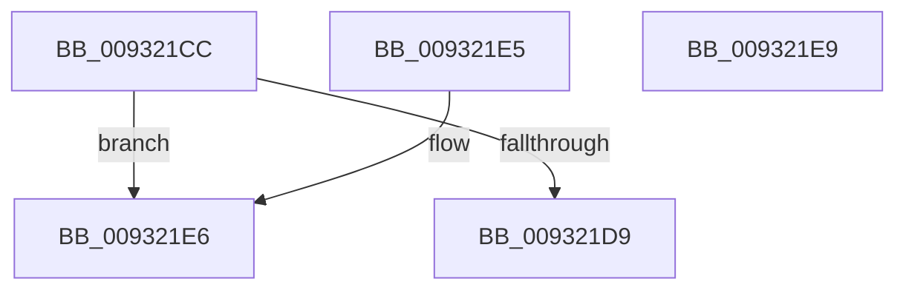

# RegRtlIsPredefinedKey

- RVA: `0x009321CC`–`0x009321EA` (길이 `30` bytes)
- VA: `0x00000001409321CC`
- 실행 섹션: `PAGE`
- PDB 이름 있음: `예`; PDB Function 태그: `아니요`
- unwind 정보 RVA: `0x000DB714`
- 디코드: `11`개 명령, `30/30` bytes 표시
- 미해석 바이트: `0` (있으면 어셈블리에 `.byte`로 보존)

> 이 문서는 커널 이미지의 기계어와 PDB 기호를 분석해 생성했습니다. 4번과 5번은 함수 원형과 자료형을 바이너리 사용 방식에서 추정한 C 해석이며 원본 소스 복구 결과는 아닙니다.

## 1. Dependencies

- 직접 호출 지점: **0**; 고유 호출 대상: **0**
- 직접 호출자로 확인된 함수: **7**
- RIP 상대 이미지 참조: **0**

### Outgoing calls
- 직접 디코드된 call 명령이 없습니다.

### Direct callers
- [RegRtlQueryKeyPathName](../83/RegRtlQueryKeyPathName_function_00832AD8.md) at `0x00832B16`
- [_CmAddDeviceToContainerWorker](../8F/_CmAddDeviceToContainerWorker_function_008FF2EC.md) at `0x008FF519`
- [_CmAddDeviceToContainerWorker](../8F/_CmAddDeviceToContainerWorker_function_008FF2EC.md) at `0x008FF5CA`
- [RegRtlCreateTreeTransacted](RegRtlCreateTreeTransacted_function_00931D1C.md) at `0x00931D72`
- [RegRtlCreateKeyTransacted](RegRtlCreateKeyTransacted_function_0093207C.md) at `0x009320C3`
- [PnpSetPropertyWorker](../99/PnpSetPropertyWorker_function_00991C08.md) at `0x00991EFC`
- [PnpSetPropertyWorker](../99/PnpSetPropertyWorker_function_00991C08.md) at `0x00991FA8`
- [_CmSetDeviceInterfaceMappedPropertyFromRegValue](../A7/_CmSetDeviceInterfaceMappedPropertyFromRegValue_function_00A729E4.md) at `0x00A72C68`
- [_CmCreateOrdinalInstanceKey](../A7/_CmCreateOrdinalInstanceKey_function_00A77838.md) at `0x00A779F4`

### Static image references
- 디코드된 RIP-relative 메모리 참조가 없습니다.

## 2. Other-region calls and transfers

- 다른 실행 섹션으로 향하는 call: **0**
- 별도 외부 분기/꼬리 이동을 확인하지 못했습니다.

## 3. Assembly (complete function range)

```asm
009321CC  48 8D 81 00 00 00 80            lea rax, [rcx - 0x80000000]
009321D3  48 83 F8 06                     cmp rax, 6
009321D7  76 0D                           jbe 0x1409321e6
009321D9  B8 07 00 00 80                  mov eax, 0x80000007
009321DE  48 3B C8                        cmp rcx, rax
009321E1  0F 94 C0                        sete al
009321E4  C3                              ret
009321E5  CC                              int3
009321E6  B0 01                           mov al, 1
009321E8  C3                              ret
009321E9  CC                              int3
```

## 4. C-style interpretation (structured pseudocode)

```c
__int64 __fastcall RegRtlIsPredefinedKey(__int64 a1)
{
    __int64 result;

    if ((a1 - 2147483648) <= 6) goto loc_009321E6;
    result = (a1 == ((unsigned int)(0x80000007ULL))) ? 1 : 0;
    return result;
loc_009321E6:
    return 1;
}
```

## 5. (Beta) C Style

```c
int64_t RegRtlIsPredefinedKey(void *Arg1)
{
    uint8_t *arg1 = (uint8_t *)Arg1;

    int64_t result;

    if ((Arg1 - 2147483648) <= 6) goto loc_009321E6;
    result = (Arg1 == ((uint32_t)(0x80000007ULL))) ? 1 : 0;
    return result;
loc_009321E6:
    return 1;
}
```

### 관측된 메모리 오프셋

구조체 형식이 확인되지 않은 접근은 인자 기준의 오프셋으로만 기록했습니다.

| 기준 인자 | 오프셋 표현 | 폭 (bit) | 접근 |
|---|---:|---:|---|
| `Arg1` | `- 0x80000000` | `64` | `R` |

## 6. Execution-region graph

[열기: 2D/3D 그래프와 함수 탐색 컨트롤 패널](../../../control-panel.html?section=page&rva=0x009321CC&view=graph)

- 2D 그래프는 위에서 아래로 흐르고, 3D 그래프는 빈 공간을 드래그해 회전합니다. Shift+드래그는 이동, 휠은 확대·축소, 함수 노드 선택은 대상 보고서 이동입니다.

### Static fallback


