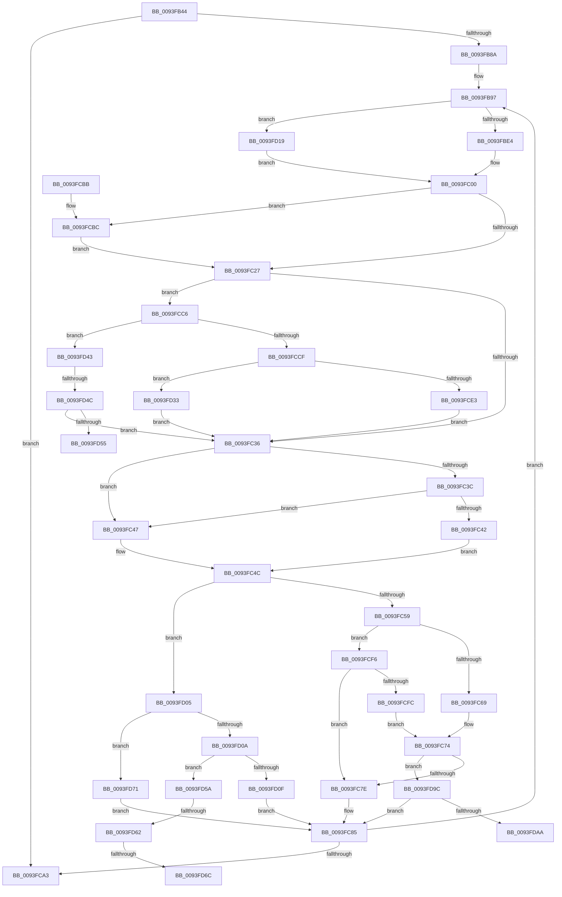

# RtlApplyFunctionOverrideFixups

- RVA: `0x0093FB44`–`0x0093FDB8` (길이 `628` bytes)
- VA: `0x000000014093FB44`
- 실행 섹션: `PAGE`
- PDB 이름 있음: `예`; PDB Function 태그: `예`
- unwind 정보 RVA: `0x00090164`
- 디코드: `167`개 명령, `628/628` bytes 표시
- 미해석 바이트: `0` (있으면 어셈블리에 `.byte`로 보존)

> 이 문서는 커널 이미지의 기계어와 PDB 기호를 분석해 생성했습니다. 4번과 5번은 함수 원형과 자료형을 바이너리 사용 방식에서 추정한 C 해석이며 원본 소스 복구 결과는 아닙니다.

## 1. Dependencies

- 직접 호출 지점: **1**; 고유 호출 대상: **1**
- 직접 호출자로 확인된 함수: **2**
- RIP 상대 이미지 참조: **0**

### Outgoing calls
- `0x0093FB6E` → [RtlpGetFunctionOverrideIndex](RtlpGetFunctionOverrideIndex_function_0093FDC0.md) (function, `0x0093FDC0`)

### Direct callers
- [RtlApplyFunctionOverrideFixupsToImage](../79/RtlApplyFunctionOverrideFixupsToImage_function_007954E0.md) at `0x007955DB`
- [MiPerformFixups](MiPerformFixups_function_0093F5F4.md) at `0x0093F8AC`

### Static image references
- 디코드된 RIP-relative 메모리 참조가 없습니다.

## 2. Other-region calls and transfers

- 다른 실행 섹션으로 향하는 call: **0**
- call이 아닌 외부 분기/꼬리 이동: **6**
  - `0x0093FD46` → [sub_00B25348](../B2/Unknown_function_00B25348.md) (`tail-transfer`)
  - `0x0093FD55` → [sub_00B25348](../B2/Unknown_function_00B25348.md) (`tail-transfer`)
  - `0x0093FD5C` → [sub_00B25348 + 0x36](../B2/Unknown_function_00B25348.md) (`tail-transfer`)
  - `0x0093FD66` → [sub_00B25348 + 0x36](../B2/Unknown_function_00B25348.md) (`tail-transfer`)
  - `0x0093FD6C` → [sub_00B25348 + 0x75](../B2/Unknown_function_00B25348.md) (`tail-transfer`)
  - `0x0093FDB3` → [sub_00B25348 + 0x9F](../B2/Unknown_function_00B25348.md) (`tail-transfer`)

## 3. Assembly (complete function range)

```asm
0093FB44  48 89 5C 24 18                  mov qword ptr [rsp + 0x18], rbx
0093FB49  44 88 4C 24 20                  mov byte ptr [rsp + 0x20], r9b
0093FB4E  48 89 4C 24 08                  mov qword ptr [rsp + 8], rcx
0093FB53  55                              push rbp
0093FB54  56                              push rsi
0093FB55  57                              push rdi
0093FB56  41 54                           push r12
0093FB58  41 55                           push r13
0093FB5A  41 56                           push r14
0093FB5C  41 57                           push r15
0093FB5E  48 83 EC 30                     sub rsp, 0x30
0093FB62  41 8A E9                        mov bpl, r9b
0093FB65  49 8B F0                        mov rsi, r8
0093FB68  44 8B FA                        mov r15d, edx
0093FB6B  4C 8B F1                        mov r14, rcx
0093FB6E  E8 4D 02 00 00                  call 0x14093fdc0
0093FB73  45 33 C0                        xor r8d, r8d
0093FB76  48 89 44 24 28                  mov qword ptr [rsp + 0x28], rax
0093FB7B  48 8B C8                        mov rcx, rax
0093FB7E  45 8B E0                        mov r12d, r8d
0093FB81  44 39 00                        cmp dword ptr [rax], r8d
0093FB84  0F 86 19 01 00 00               jbe 0x14093fca3
0093FB8A  41 C1 E7 0C                     shl r15d, 0xc
0093FB8E  41 8D 58 04                     lea ebx, [r8 + 4]
0093FB92  44 89 7C 24 78                  mov dword ptr [rsp + 0x78], r15d
0093FB97  41 8B C4                        mov eax, r12d
0093FB9A  BA FF 0F 00 00                  mov edx, 0xfff
0093FB9F  44 0F B7 6C C1 04               movzx r13d, word ptr [rcx + rax*8 + 4]
0093FBA5  44 0F B7 5C C1 06               movzx r11d, word ptr [rcx + rax*8 + 6]
0093FBAB  41 0F B7 FD                     movzx edi, r13w
0093FBAF  8B 44 C1 08                     mov eax, dword ptr [rcx + rax*8 + 8]
0093FBB3  45 0F B7 D3                     movzx r10d, r11w
0093FBB7  66 41 C1 EB 03                  shr r11w, 3
0093FBBC  48 03 C0                        add rax, rax
0093FBBF  66 23 FA                        and di, dx
0093FBC2  66 41 C1 ED 0C                  shr r13w, 0xc
0093FBC7  66 41 83 E3 07                  and r11w, 7
0093FBCC  66 41 83 E2 07                  and r10w, 7
0093FBD1  41 8B 54 C6 28                  mov edx, dword ptr [r14 + rax*8 + 0x28]
0093FBD6  44 38 84 24 90 00 00 00         cmp byte ptr [rsp + 0x90], r8b
0093FBDE  0F 85 35 01 00 00               jne 0x14093fd19
0093FBE4  45 8B 4C C6 2C                  mov r9d, dword ptr [r14 + rax*8 + 0x2c]
0093FBE9  41 8B 44 C6 34                  mov eax, dword ptr [r14 + rax*8 + 0x34]
0093FBEE  44 8B C0                        mov r8d, eax
0093FBF1  22 C3                           and al, bl
0093FBF3  41 83 E0 01                     and r8d, 1
0093FBF7  F6 D8                           neg al
0093FBF9  48 1B DB                        sbb rbx, rbx
0093FBFC  49 23 5E 08                     and rbx, qword ptr [r14 + 8]
0093FC00  40 84 ED                        test bpl, bpl
0093FC03  41 0F B7 C2                     movzx eax, r10w
0093FC07  41 0F 44 D1                     cmove edx, r9d
0093FC0B  33 C9                           xor ecx, ecx
0093FC0D  40 84 ED                        test bpl, bpl
0093FC10  0F B7 EF                        movzx ebp, di
0093FC13  41 0F 44 C8                     cmove ecx, r8d
0093FC17  41 03 EF                        add ebp, r15d
0093FC1A  45 33 C0                        xor r8d, r8d
0093FC1D  66 45 85 D2                     test r10w, r10w
0093FC21  0F 84 95 00 00 00               je 0x14093fcbc
0093FC27  44 8D 3C 28                     lea r15d, [rax + rbp]
0093FC2B  44 8B CA                        mov r9d, edx
0093FC2E  85 C9                           test ecx, ecx
0093FC30  0F 85 90 00 00 00               jne 0x14093fcc6
0093FC36  66 45 85 D2                     test r10w, r10w
0093FC3A  75 0B                           jne 0x14093fc47
0093FC3C  66 45 85 DB                     test r11w, r11w
0093FC40  75 05                           jne 0x14093fc47
0093FC42  41 8A D8                        mov bl, r8b
0093FC45  EB 05                           jmp 0x14093fc4c
0093FC47  BB 01 00 00 00                  mov ebx, 1
0093FC4C  41 0F B7 CD                     movzx ecx, r13w
0093FC50  83 E9 01                        sub ecx, 1
0093FC53  0F 85 AC 00 00 00               jne 0x14093fd05
0093FC59  45 2B CF                        sub r9d, r15d
0093FC5C  8D 59 04                        lea ebx, [rcx + 4]
0093FC5F  66 45 85 D2                     test r10w, r10w
0093FC63  0F 84 8D 00 00 00               je 0x14093fcf6
0093FC69  8B CB                           mov ecx, ebx
0093FC6B  41 2A CA                        sub cl, r10b
0093FC6E  C0 E1 03                        shl cl, 3
0093FC71  41 D3 E9                        shr r9d, cl
0093FC74  66 44 3B D3                     cmp r10w, bx
0093FC78  0F 85 1E 01 00 00               jne 0x14093fd9c
0093FC7E  0F B7 C7                        movzx eax, di
0093FC81  44 89 0C 30                     mov dword ptr [rax + rsi], r9d
0093FC85  48 8B 4C 24 28                  mov rcx, qword ptr [rsp + 0x28]
0093FC8A  41 FF C4                        inc r12d
0093FC8D  44 8B 7C 24 78                  mov r15d, dword ptr [rsp + 0x78]
0093FC92  40 8A AC 24 88 00 00 00         mov bpl, byte ptr [rsp + 0x88]
0093FC9A  44 3B 21                        cmp r12d, dword ptr [rcx]
0093FC9D  0F 82 F4 FE FF FF               jb 0x14093fb97
0093FCA3  48 8B 9C 24 80 00 00 00         mov rbx, qword ptr [rsp + 0x80]
0093FCAB  48 83 C4 30                     add rsp, 0x30
0093FCAF  41 5F                           pop r15
0093FCB1  41 5E                           pop r14
0093FCB3  41 5D                           pop r13
0093FCB5  41 5C                           pop r12
0093FCB7  5F                              pop rdi
0093FCB8  5E                              pop rsi
0093FCB9  5D                              pop rbp
0093FCBA  C3                              ret
0093FCBB  CC                              int3
0093FCBC  B8 04 00 00 00                  mov eax, 4
0093FCC1  E9 61 FF FF FF                  jmp 0x14093fc27
0093FCC6  41 0F B7 CD                     movzx ecx, r13w
0093FCCA  83 E9 01                        sub ecx, 1
0093FCCD  75 74                           jne 0x14093fd43
0093FCCF  41 8B C7                        mov eax, r15d
0093FCD2  44 8B CA                        mov r9d, edx
0093FCD5  4C 03 CB                        add r9, rbx
0093FCD8  49 8B C9                        mov rcx, r9
0093FCDB  48 2B C8                        sub rcx, rax
0093FCDE  4C 3B C8                        cmp r9, rax
0093FCE1  7C 50                           jl 0x14093fd33
0093FCE3  48 81 F9 FF FF FF 7F            cmp rcx, 0x7fffffff
0093FCEA  41 0F 4E D1                     cmovle edx, r9d
0093FCEE  44 8B CA                        mov r9d, edx
0093FCF1  E9 40 FF FF FF                  jmp 0x14093fc36
0093FCF6  66 45 85 DB                     test r11w, r11w
0093FCFA  74 82                           je 0x14093fc7e
0093FCFC  45 0F B7 D3                     movzx r10d, r11w
0093FD00  E9 6F FF FF FF                  jmp 0x14093fc74
0093FD05  83 E9 01                        sub ecx, 1
0093FD08  74 67                           je 0x14093fd71
0093FD0A  83 F9 01                        cmp ecx, 1
0093FD0D  74 4B                           je 0x14093fd5a
0093FD0F  BB 04 00 00 00                  mov ebx, 4
0093FD14  E9 6C FF FF FF                  jmp 0x14093fc85
0093FD19  45 8B 44 C6 34                  mov r8d, dword ptr [r14 + rax*8 + 0x34]
0093FD1E  49 8B 5E 10                     mov rbx, qword ptr [r14 + 0x10]
0093FD22  45 8B 4C C6 30                  mov r9d, dword ptr [r14 + rax*8 + 0x30]
0093FD27  41 D1 E8                        shr r8d, 1
0093FD2A  41 83 E0 01                     and r8d, 1
0093FD2E  E9 CD FE FF FF                  jmp 0x14093fc00
0093FD33  48 81 F9 00 00 00 80            cmp rcx, -0x80000000
0093FD3A  44 0F 4C CA                     cmovl r9d, edx
0093FD3E  E9 F3 FE FF FF                  jmp 0x14093fc36
0093FD43  83 E9 01                        sub ecx, 1
0093FD46  0F 84 FC 55 1E 00               je 0x140b25348
0093FD4C  83 F9 01                        cmp ecx, 1
0093FD4F  0F 85 E1 FE FF FF               jne 0x14093fc36
0093FD55  E9 EE 55 1E 00                  jmp 0x140b25348
0093FD5A  84 DB                           test bl, bl
0093FD5C  0F 84 1C 56 1E 00               je 0x140b2537e
0093FD62  66 45 85 DB                     test r11w, r11w
0093FD66  0F 85 12 56 1E 00               jne 0x140b2537e
0093FD6C  E9 4C 56 1E 00                  jmp 0x140b253bd
0093FD71  44 2B CD                        sub r9d, ebp
0093FD74  44 0F B7 C7                     movzx r8d, di
0093FD78  41 8B C1                        mov eax, r9d
0093FD7B  BB 04 00 00 00                  mov ebx, 4
0093FD80  99                              cdq
0093FD81  F7 FB                           idiv ebx
0093FD83  41 8B 0C 30                     mov ecx, dword ptr [r8 + rsi]
0093FD87  33 C1                           xor eax, ecx
0093FD89  25 FF FF FF 03                  and eax, 0x3ffffff
0093FD8E  33 C1                           xor eax, ecx
0093FD90  41 89 04 30                     mov dword ptr [r8 + rsi], eax
0093FD94  45 33 C0                        xor r8d, r8d
0093FD97  E9 E9 FE FF FF                  jmp 0x14093fc85
0093FD9C  41 0F B7 C8                     movzx ecx, r8w
0093FDA0  66 45 3B C2                     cmp r8w, r10w
0093FDA4  0F 83 DB FE FF FF               jae 0x14093fc85
0093FDAA  0F B7 D7                        movzx edx, di
0093FDAD  41 BE 01 00 00 00               mov r14d, 1
0093FDB3  E9 2F 56 1E 00                  jmp 0x140b253e7
```

## 4. C-style interpretation (structured pseudocode)

```c
__int64 __fastcall RtlApplyFunctionOverrideFixups(__int64 a1, int a2, __int64 a3, unsigned __int8 a4, unsigned __int8 a5)
{
    __int64 result;
    __int64 v_r10;
    __int64 v_r11;
    __int64 v_r12;
    __int64 v_r13;
    __int64 v_r15;
    __int64 v_rbp;
    __int64 v_rbx;
    __int64 v_rdi;
    __int64 v_rsp;
    unsigned __int64 v_stack_m40;
    unsigned int v_stack_p10;
    unsigned __int64 v_stack_p18;
    unsigned __int8 v_stack_p20;
    unsigned __int64 v_stack_p8;

    v_stack_p18 = v_rbx;
    v_stack_p20 = a4;
    v_stack_p8 = a1;
    v_rsp = (v_rsp) - (48);
    result = RtlpGetFunctionOverrideIndex(a1, a2, a3, a4);
    a3 = 0;
    v_stack_m40 = result;
    if ((*(unsigned int *)(result)) <= 0) goto loc_0093FCA3;
    v_r15 = (unsigned int)(((unsigned int)(a2)) << (12));
    v_stack_p10 = (unsigned int)(v_r15);
loc_0093FB97:
    v_r11 = (unsigned __int16)((*(unsigned __int16 *)(result + 0 * 8 + 6)) >> (3));
    result = ((unsigned int)(*(unsigned int *)(result + 0 * 8 + 8))) + ((unsigned int)(*(unsigned int *)(result + 0 * 8 + 8)));
    v_rdi = (unsigned __int16)(((unsigned __int16)(*(unsigned __int16 *)(result + 0 * 8 + 4))) & ((unsigned __int16)((unsigned int)(0xFFFULL))));
    v_r13 = (unsigned __int16)((*(unsigned __int16 *)(result + 0 * 8 + 4)) >> (12));
    v_r11 = (unsigned __int16)((v_r11) & (7));
    v_r10 = (unsigned __int16)(((unsigned __int16)(*(unsigned __int16 *)(result + 0 * 8 + 6))) & (7));
    if (a5 != 0) goto loc_0093FD19;
    result = (unsigned __int8)(((unsigned int)(*(unsigned int *)(a1 + result * 8 + 52))) & ((unsigned __int8)(a3 + 4)));
    a3 = (unsigned int)(((unsigned int)((unsigned int)((unsigned int)(*(unsigned int *)(a1 + result * 8 + 52))))) & (1));
    result = (unsigned __int8)(-(result));
    v_rbx = (a3 + 4) & (*(unsigned __int64 *)(a1 + 8));
loc_0093FC00:
    a2 = (unsigned int)(*(unsigned int *)(a1 + result * 8 + 40));
    if (a4 == 0) { a2 = (unsigned int)((unsigned int)(*(unsigned int *)(a1 + result * 8 + 44))); }
    a1 = 0;
    if (a4 == 0) { a1 = (unsigned int)(a3); }
    v_rbp = (unsigned int)(((unsigned __int16)(v_rdi)) + ((unsigned int)(v_r15)));
    a3 = 0;
    if ((unsigned __int16)(v_r10) == 0) goto loc_0093FCBC;
loc_0093FC27:
    if ((unsigned int)(a1) != 0) goto loc_0093FCC6;
loc_0093FC36:
    if ((unsigned __int16)(v_r10) != 0) goto loc_0093FC47;
    if ((unsigned __int16)(v_r11) != 0) goto loc_0093FC47;
    goto loc_0093FC4C;
loc_0093FC47:
loc_0093FC4C:
    a1 = (unsigned int)(((unsigned __int16)(v_r13)) - (1));
    if (condition_is_not_equal) goto loc_0093FD05;
    a4 = (unsigned int)(((unsigned int)(a2)) - ((unsigned int)((unsigned __int16)(v_r10) + v_rbp * 1)));
    if ((unsigned __int16)(v_r10) == 0) goto loc_0093FCF6;
    a1 = (unsigned __int8)(((unsigned int)((unsigned int)(a1 + 4))) - ((unsigned __int8)(v_r10)));
    a1 = (unsigned __int8)((a1) << (3));
    a4 = (unsigned int)((a4) >> ((unsigned __int8)(a1)));
loc_0093FC74:
    if (((unsigned __int16)(v_r10)) != ((unsigned __int16)(a1 + 4))) goto loc_0093FD9C;
loc_0093FC7E:
    *(unsigned int *)((unsigned __int16)(v_rdi) + a3 * 1) = a4;
loc_0093FC85:
    v_r12 = (unsigned int)((0) + 1);
    if (((unsigned int)(v_r12)) < (*(unsigned int *)(v_stack_m40))) goto loc_0093FB97;
loc_0093FCA3:
    v_rsp = (v_rsp) + (48);
    return (unsigned __int16)(v_rdi);
loc_0093FCBC:
    goto loc_0093FC27;
loc_0093FCC6:
    a1 = (unsigned int)(((unsigned __int16)(v_r13)) - (1));
    if (condition_is_not_equal) goto loc_0093FD43;
    a4 = ((unsigned int)(a2)) + (v_stack_p18);
    a1 = (a4) - ((unsigned int)((unsigned int)((unsigned int)(v_stack_p10))));
    if (a4 < ((unsigned int)((unsigned int)((unsigned int)(v_stack_p10))))) goto loc_0093FD33;
    if (a1 <= 0x7FFFFFFFULL) { a2 = a4; }
    goto loc_0093FC36;
loc_0093FCF6:
    if ((unsigned __int16)(v_r11) == 0) goto loc_0093FC7E;
    goto loc_0093FC74;
loc_0093FD05:
    a1 = (unsigned int)((a1) - (1));
    if (condition_is_equal) goto loc_0093FD71;
    if (((unsigned int)(a1)) == 1) goto loc_0093FD5A;
    goto loc_0093FC85;
loc_0093FD19:
    a3 = (unsigned int)(((unsigned int)(*(unsigned int *)(a1 + (unsigned int)((unsigned int)((unsigned int)(v_stack_p10))) * 8 + 52))) >> (1));
    a3 = (unsigned int)((a3) & (1));
    goto loc_0093FC00;
loc_0093FD33:
    a4 = (unsigned int)(*(unsigned int *)(a1 + (unsigned int)((unsigned int)((unsigned int)(v_stack_p10))) * 8 + 48));
    if (a1 < 0xFFFFFFFF80000000ULL) { a4 = a2; }
    goto loc_0093FC36;
loc_0093FD43:
    a1 = (unsigned int)((a1) - (1));
    if (((unsigned int)(a1)) != 1) goto loc_0093FC36;
loc_0093FD5A:
loc_0093FD71:
    a4 = (unsigned int)((a4) - ((unsigned int)(v_stack_p20)));
    result = (unsigned int)(((unsigned int)(a4)) ^ ((unsigned int)((unsigned int)(*(unsigned int *)((unsigned __int16)(v_rdi) + a3 * 1)))));
    result = (unsigned int)((result) & (0x3FFFFFFULL));
    result = (unsigned int)((result) ^ ((unsigned int)((unsigned int)(*(unsigned int *)((unsigned __int16)(v_rdi) + a3 * 1)))));
    *(unsigned int *)((unsigned __int16)(v_rdi) + a3 * 1) = (unsigned int)(result);
    a3 = 0;
    goto loc_0093FC85;
loc_0093FD9C:
    if (0 >= ((unsigned __int16)((unsigned __int16)(v_r11)))) goto loc_0093FC85;
}
```

## 5. (Beta) C Style

```c
int64_t RtlApplyFunctionOverrideFixups(void *Arg1, int32_t Arg2, int64_t Arg3, uint8_t Arg4, uint8_t Arg5)
{
    uint8_t *arg1 = (uint8_t *)Arg1;

    int64_t result;
    int64_t local_r10;
    int64_t local_r11;
    int64_t local_r12;
    int64_t local_r13;
    int64_t local_r15;
    int64_t local_rbp;
    int64_t local_rbx;
    int64_t local_rdi;
    int64_t local_rsp;
    uint64_t v_stack_m40;
    uint32_t v_stack_p10;
    uint64_t v_stack_p18;
    uint8_t v_stack_p20;
    uint64_t v_stack_p8;

    v_stack_p18 = local_rbx;
    v_stack_p20 = Arg4;
    v_stack_p8 = Arg1;
    local_rsp = (local_rsp) - (48);
    result = RtlpGetFunctionOverrideIndex(Arg1, Arg2, Arg3, Arg4);
    Arg3 = 0;
    v_stack_m40 = result;
    if ((*(uint32_t *)(result)) <= 0) goto loc_0093FCA3;
    local_r15 = (uint32_t)(((uint32_t)(Arg2)) << (12));
    v_stack_p10 = (uint32_t)(local_r15);
loc_0093FB97:
    local_r11 = (uint16_t)((*(uint16_t *)(result + 0x0 * 8 + 0x6)) >> (3));
    result = ((uint32_t)(*(uint32_t *)(result + 0x0 * 8 + 0x8))) + ((uint32_t)(*(uint32_t *)(result + 0x0 * 8 + 0x8)));
    local_rdi = (uint16_t)(((uint16_t)(*(uint16_t *)(result + 0x0 * 8 + 0x4))) & ((uint16_t)((uint32_t)(0xFFFULL))));
    local_r13 = (uint16_t)((*(uint16_t *)(result + 0x0 * 8 + 0x4)) >> (12));
    local_r11 = (uint16_t)((local_r11) & (7));
    local_r10 = (uint16_t)(((uint16_t)(*(uint16_t *)(result + 0x0 * 8 + 0x6))) & (7));
    if (Arg5 != 0) goto loc_0093FD19;
    result = (uint8_t)(((uint32_t)(*(uint32_t *)(arg1 + result * 8 + 0x34))) & ((uint8_t)(Arg3 + 4)));
    Arg3 = (uint32_t)(((uint32_t)((uint32_t)((uint32_t)(*(uint32_t *)(arg1 + result * 8 + 0x34))))) & (1));
    result = (uint8_t)(-(result));
    local_rbx = (Arg3 + 4) & (*(uint64_t *)(arg1 + 0x8));
loc_0093FC00:
    Arg2 = (uint32_t)(*(uint32_t *)(arg1 + result * 8 + 0x28));
    if (Arg4 == 0) { Arg2 = (uint32_t)((uint32_t)(*(uint32_t *)(arg1 + result * 8 + 0x2C))); }
    Arg1 = 0;
    if (Arg4 == 0) { Arg1 = (uint32_t)(Arg3); }
    local_rbp = (uint32_t)(((uint16_t)(local_rdi)) + ((uint32_t)(local_r15)));
    Arg3 = 0;
    if ((uint16_t)(local_r10) == 0) goto loc_0093FCBC;
loc_0093FC27:
    if ((uint32_t)(Arg1) != 0) goto loc_0093FCC6;
loc_0093FC36:
    if ((uint16_t)(local_r10) != 0) goto loc_0093FC47;
    if ((uint16_t)(local_r11) != 0) goto loc_0093FC47;
    goto loc_0093FC4C;
loc_0093FC47:
loc_0093FC4C:
    Arg1 = (uint32_t)(((uint16_t)(local_r13)) - (1));
    if (condition_is_not_equal) goto loc_0093FD05;
    Arg4 = (uint32_t)(((uint32_t)(Arg2)) - ((uint32_t)((uint16_t)(local_r10) + local_rbp * 1)));
    if ((uint16_t)(local_r10) == 0) goto loc_0093FCF6;
    Arg1 = (uint8_t)(((uint32_t)((uint32_t)(Arg1 + 4))) - ((uint8_t)(local_r10)));
    Arg1 = (uint8_t)((Arg1) << (3));
    Arg4 = (uint32_t)((Arg4) >> ((uint8_t)(Arg1)));
loc_0093FC74:
    if (((uint16_t)(local_r10)) != ((uint16_t)(Arg1 + 4))) goto loc_0093FD9C;
loc_0093FC7E:
    *(uint32_t *)((uint16_t)(local_rdi) + Arg3 * 1) = Arg4;
loc_0093FC85:
    local_r12 = (uint32_t)((0) + 1);
    if (((uint32_t)(local_r12)) < (*(uint32_t *)(v_stack_m40))) goto loc_0093FB97;
loc_0093FCA3:
    local_rsp = (local_rsp) + (48);
    return (uint16_t)(local_rdi);
loc_0093FCBC:
    goto loc_0093FC27;
loc_0093FCC6:
    Arg1 = (uint32_t)(((uint16_t)(local_r13)) - (1));
    if (condition_is_not_equal) goto loc_0093FD43;
    Arg4 = ((uint32_t)(Arg2)) + (v_stack_p18);
    Arg1 = (Arg4) - ((uint32_t)((uint32_t)((uint32_t)(v_stack_p10))));
    if (Arg4 < ((uint32_t)((uint32_t)((uint32_t)(v_stack_p10))))) goto loc_0093FD33;
    if (Arg1 <= 0x7FFFFFFFULL) { Arg2 = Arg4; }
    goto loc_0093FC36;
loc_0093FCF6:
    if ((uint16_t)(local_r11) == 0) goto loc_0093FC7E;
    goto loc_0093FC74;
loc_0093FD05:
    Arg1 = (uint32_t)((Arg1) - (1));
    if (condition_is_equal) goto loc_0093FD71;
    if (((uint32_t)(Arg1)) == 1) goto loc_0093FD5A;
    goto loc_0093FC85;
loc_0093FD19:
    Arg3 = (uint32_t)(((uint32_t)(*(uint32_t *)(arg1 + (uint32_t)((uint32_t)((uint32_t)(v_stack_p10))) * 8 + 0x34))) >> (1));
    Arg3 = (uint32_t)((Arg3) & (1));
    goto loc_0093FC00;
loc_0093FD33:
    Arg4 = (uint32_t)(*(uint32_t *)(arg1 + (uint32_t)((uint32_t)((uint32_t)(v_stack_p10))) * 8 + 0x30));
    if (Arg1 < 0xFFFFFFFF80000000ULL) { Arg4 = Arg2; }
    goto loc_0093FC36;
loc_0093FD43:
    Arg1 = (uint32_t)((Arg1) - (1));
    if (((uint32_t)(Arg1)) != 1) goto loc_0093FC36;
loc_0093FD5A:
loc_0093FD71:
    Arg4 = (uint32_t)((Arg4) - ((uint32_t)(v_stack_p20)));
    result = (uint32_t)(((uint32_t)(Arg4)) ^ ((uint32_t)((uint32_t)(*(uint32_t *)((uint16_t)(local_rdi) + Arg3 * 1)))));
    result = (uint32_t)((result) & (0x3FFFFFFULL));
    result = (uint32_t)((result) ^ ((uint32_t)((uint32_t)(*(uint32_t *)((uint16_t)(local_rdi) + Arg3 * 1)))));
    *(uint32_t *)((uint16_t)(local_rdi) + Arg3 * 1) = (uint32_t)(result);
    Arg3 = 0;
    goto loc_0093FC85;
loc_0093FD9C:
    if (0 >= ((uint16_t)((uint16_t)(local_r11)))) goto loc_0093FC85;
}
```

### 관측된 메모리 오프셋

구조체 형식이 확인되지 않은 접근은 인자 기준의 오프셋으로만 기록했습니다.

| 기준 인자 | 오프셋 표현 | 폭 (bit) | 접근 |
|---|---:|---:|---|
| `Arg1` | `+ 0x8` | `64` | `R` |
| `Arg1` | `+ 0x10` | `64` | `R` |
| `Arg1` | `+ 0x28 + rax*8` | `32` | `R` |
| `Arg1` | `+ 0x2C + rax*8` | `32` | `R` |
| `Arg1` | `+ 0x30 + rax*8` | `32` | `R` |
| `Arg1` | `+ 0x34 + rax*8` | `32` | `R` |

## 6. Execution-region graph

[열기: 2D/3D 그래프와 함수 탐색 컨트롤 패널](../../../control-panel.html?section=page&rva=0x0093FB44&view=graph)

- 2D 그래프는 위에서 아래로 흐르고, 3D 그래프는 빈 공간을 드래그해 회전합니다. Shift+드래그는 이동, 휠은 확대·축소, 함수 노드 선택은 대상 보고서 이동입니다.

### Static fallback


