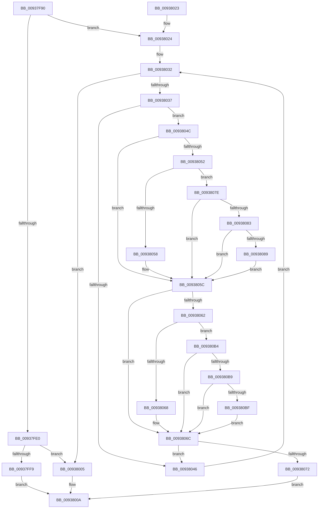

# RtlCompareUnicodeString

- RVA: `0x00937F90`–`0x009380EA` (길이 `346` bytes)
- VA: `0x0000000140937F90`
- 실행 섹션: `PAGE`
- PDB 이름 있음: `예`; PDB Function 태그: `아니요`
- unwind 정보 RVA: `0x00078E58`
- 디코드: `106`개 명령, `346/346` bytes 표시
- 미해석 바이트: `0` (있으면 어셈블리에 `.byte`로 보존)

> 이 문서는 커널 이미지의 기계어와 PDB 기호를 분석해 생성했습니다. 4번과 5번은 함수 원형과 자료형을 바이너리 사용 방식에서 추정한 C 해석이며 원본 소스 복구 결과는 아닙니다.

## 1. Dependencies

- 직접 호출 지점: **2**; 고유 호출 대상: **2**
- 직접 호출자로 확인된 함수: **13**
- RIP 상대 이미지 참조: **0**

### Outgoing calls
- `0x00937FBD` → [PsGetCurrentServerSiloGlobals](../../text/2F/PsGetCurrentServerSiloGlobals_function_002FE1F0.md) (function, `0x002FE1F0`)
- `0x00937FE9` → [RtlCompareMemory](../../text/6B/RtlCompareMemory_function_006BA670.md) (function, `0x006BA670`)

### Direct callers
- [KsepCacheHwIdEqual](../../text/4C/KsepCacheHwIdEqual_function_004C20C0.md) at `0x004C20CF`
- [PopFxFindAcpiDeviceByUniqueId](../../text/4C/PopFxFindAcpiDeviceByUniqueId_function_004C5C30.md) at `0x004C5CDF`
- [ApiSetpGetExtensionNameKeyInfo](../../text/66/ApiSetpGetExtensionNameKeyInfo_function_00664E4C.md) at `0x00664EEC`
- [sub_006DFDF8](../../text/6D/Unknown_function_006DFDF8.md) at `0x006DFE32`
- [sub_006F1F12](../../text/6F/Unknown_function_006F1F12.md) at `0x006F1FD4`
- [FsRtlFindInTunnelCacheEx](FsRtlFindInTunnelCacheEx_function_00937A50.md) at `0x00937BB4`
- [FsRtlAddToTunnelCacheEx](FsRtlAddToTunnelCacheEx_function_00937C00.md) at `0x00937CEC`
- [sub_00B24F40](../B2/Unknown_function_00B24F40.md) at `0x00B24F46`
- [sub_00B24F52](../B2/Unknown_function_00B24F52.md) at `0x00B24F55`
- [IopInitializeBootDrivers](../../init/C2/IopInitializeBootDrivers_function_00C2E6F4.md) at `0x00C2E9EB`
- [IopInitializeBootDrivers](../../init/C2/IopInitializeBootDrivers_function_00C2E6F4.md) at `0x00C2EA05`
- [KeHwPolicyLocateResource](../../init/C3/KeHwPolicyLocateResource_function_00C38A80.md) at `0x00C38AFB`
- [PsInitializeWin32kServiceTable](../../init/C4/PsInitializeWin32kServiceTable_function_00C44C08.md) at `0x00C44C7D`
- [CmpSetSystemBiosInformation](../../init/C5/CmpSetSystemBiosInformation_function_00C5A5D0.md) at `0x00C5A746`

### Static image references
- 디코드된 RIP-relative 메모리 참조가 없습니다.

## 2. Other-region calls and transfers

- 다른 실행 섹션으로 향하는 call: **2**
  - `0x00937FBD` → [PsGetCurrentServerSiloGlobals](../../text/2F/PsGetCurrentServerSiloGlobals_function_002FE1F0.md) (`PAGE` → `.text`)
  - `0x00937FE9` → [RtlCompareMemory](../../text/6B/RtlCompareMemory_function_006BA670.md) (`PAGE` → `.text`)
- 별도 외부 분기/꼬리 이동을 확인하지 못했습니다.

## 3. Assembly (complete function range)

```asm
00937F90  48 89 5C 24 08                  mov qword ptr [rsp + 8], rbx
00937F95  48 89 6C 24 10                  mov qword ptr [rsp + 0x10], rbp
00937F9A  48 89 74 24 18                  mov qword ptr [rsp + 0x18], rsi
00937F9F  57                              push rdi
00937FA0  41 56                           push r14
00937FA2  41 57                           push r15
00937FA4  48 83 EC 20                     sub rsp, 0x20
00937FA8  44 0F B7 32                     movzx r14d, word ptr [rdx]
00937FAC  0F B7 29                        movzx ebp, word ptr [rcx]
00937FAF  48 8B 7A 08                     mov rdi, qword ptr [rdx + 8]
00937FB3  48 8B 59 08                     mov rbx, qword ptr [rcx + 8]
00937FB7  49 D1 EE                        shr r14, 1
00937FBA  48 D1 ED                        shr rbp, 1
00937FBD  E8 2E 62 9C FF                  call 0x1402fe1f0
00937FC2  49 3B EE                        cmp rbp, r14
00937FC5  48 8B F5                        mov rsi, rbp
00937FC8  49 0F 47 F6                     cmova rsi, r14
00937FCC  4C 8B 98 B0 04 00 00            mov r11, qword ptr [rax + 0x4b0]
00937FD3  48 8D 04 36                     lea rax, [rsi + rsi]
00937FD7  4C 8D 14 18                     lea r10, [rax + rbx]
00937FDB  45 84 C0                        test r8b, r8b
00937FDE  75 44                           jne 0x140938024
00937FE0  4C 8B C0                        mov r8, rax
00937FE3  48 8B D7                        mov rdx, rdi
00937FE6  48 8B CB                        mov rcx, rbx
00937FE9  E8 82 26 D8 FF                  call 0x1406ba670
00937FEE  48 8B C8                        mov rcx, rax
00937FF1  48 D1 E9                        shr rcx, 1
00937FF4  48 3B CE                        cmp rcx, rsi
00937FF7  73 0C                           jae 0x140938005
00937FF9  0F B7 04 4B                     movzx eax, word ptr [rbx + rcx*2]
00937FFD  0F B7 0C 4F                     movzx ecx, word ptr [rdi + rcx*2]
00938001  2B C1                           sub eax, ecx
00938003  EB 05                           jmp 0x14093800a
00938005  41 2B EE                        sub ebp, r14d
00938008  8B C5                           mov eax, ebp
0093800A  48 8B 5C 24 40                  mov rbx, qword ptr [rsp + 0x40]
0093800F  48 8B 6C 24 48                  mov rbp, qword ptr [rsp + 0x48]
00938014  48 8B 74 24 50                  mov rsi, qword ptr [rsp + 0x50]
00938019  48 83 C4 20                     add rsp, 0x20
0093801D  41 5F                           pop r15
0093801F  41 5E                           pop r14
00938021  5F                              pop rdi
00938022  C3                              ret
00938023  CC                              int3
00938024  48 2B FB                        sub rdi, rbx
00938027  BE E0 FF 00 00                  mov esi, 0xffe0
0093802C  41 BF C0 00 00 00               mov r15d, 0xc0
00938032  49 3B DA                        cmp rbx, r10
00938035  73 CE                           jae 0x140938005
00938037  44 0F B7 03                     movzx r8d, word ptr [rbx]
0093803B  44 0F B7 0C 1F                  movzx r9d, word ptr [rdi + rbx]
00938040  66 45 3B C1                     cmp r8w, r9w
00938044  75 06                           jne 0x14093804c
00938046  48 83 C3 02                     add rbx, 2
0093804A  EB E6                           jmp 0x140938032
0093804C  41 83 F8 61                     cmp r8d, 0x61
00938050  72 0A                           jb 0x14093805c
00938052  41 83 F8 7A                     cmp r8d, 0x7a
00938056  77 26                           ja 0x14093807e
00938058  66 44 03 C6                     add r8w, si
0093805C  41 83 F9 61                     cmp r9d, 0x61
00938060  72 0A                           jb 0x14093806c
00938062  41 83 F9 7A                     cmp r9d, 0x7a
00938066  77 4C                           ja 0x1409380b4
00938068  66 44 03 CE                     add r9w, si
0093806C  66 45 3B C1                     cmp r8w, r9w
00938070  74 D4                           je 0x140938046
00938072  41 0F B7 C9                     movzx ecx, r9w
00938076  41 0F B7 C0                     movzx eax, r8w
0093807A  2B C1                           sub eax, ecx
0093807C  EB 8C                           jmp 0x14093800a
0093807E  4D 85 DB                        test r11, r11
00938081  74 D9                           je 0x14093805c
00938083  66 45 3B C7                     cmp r8w, r15w
00938087  72 D3                           jb 0x14093805c
00938089  49 8B C0                        mov rax, r8
0093808C  41 8B D0                        mov edx, r8d
0093808F  48 C1 E8 08                     shr rax, 8
00938093  83 E2 0F                        and edx, 0xf
00938096  41 0F B7 0C 43                  movzx ecx, word ptr [r11 + rax*2]
0093809B  41 8B C0                        mov eax, r8d
0093809E  C1 E8 04                        shr eax, 4
009380A1  83 E0 0F                        and eax, 0xf
009380A4  03 C8                           add ecx, eax
009380A6  41 0F B7 0C 4B                  movzx ecx, word ptr [r11 + rcx*2]
009380AB  03 CA                           add ecx, edx
009380AD  66 45 03 04 4B                  add r8w, word ptr [r11 + rcx*2]
009380B2  EB A8                           jmp 0x14093805c
009380B4  4D 85 DB                        test r11, r11
009380B7  74 B3                           je 0x14093806c
009380B9  66 45 3B CF                     cmp r9w, r15w
009380BD  72 AD                           jb 0x14093806c
009380BF  49 8B C1                        mov rax, r9
009380C2  41 8B D1                        mov edx, r9d
009380C5  48 C1 E8 08                     shr rax, 8
009380C9  83 E2 0F                        and edx, 0xf
009380CC  41 0F B7 0C 43                  movzx ecx, word ptr [r11 + rax*2]
009380D1  41 8B C1                        mov eax, r9d
009380D4  C1 E8 04                        shr eax, 4
009380D7  83 E0 0F                        and eax, 0xf
009380DA  03 C8                           add ecx, eax
009380DC  41 0F B7 0C 4B                  movzx ecx, word ptr [r11 + rcx*2]
009380E1  03 CA                           add ecx, edx
009380E3  66 45 03 0C 4B                  add r9w, word ptr [r11 + rcx*2]
009380E8  EB 82                           jmp 0x14093806c
```

## 4. C-style interpretation (structured pseudocode)

```c
__int64 __fastcall RtlCompareUnicodeString(__int64 a1, __int64 a2, unsigned __int8 a3)
{
    __int64 result;
    __int64 v_r14;
    __int64 v_rbp;
    __int64 v_rbx;
    __int64 v_rdi;
    __int64 v_rsi;
    __int64 v_rsp;
    unsigned __int64 v_stack_p10;
    unsigned __int64 v_stack_p18;
    unsigned __int64 v_stack_p8;

    v_stack_p8 = v_rbx;
    v_stack_p10 = v_rbp;
    v_stack_p18 = v_rsi;
    v_rsp = (v_rsp) - (32);
    v_r14 = (*(unsigned __int16 *)(a2)) >> (1);
    v_rbp = (*(unsigned __int16 *)(a1)) >> (1);
    result = PsGetCurrentServerSiloGlobals(a1, a2, a3, a4);
    v_rsi = v_rbp;
    if (v_rbp > v_r14) { v_rsi = v_r14; }
    if (a3 != 0) goto loc_00938024;
    result = RtlCompareMemory(*(unsigned __int64 *)(a1 + 8), *(unsigned __int64 *)(a2 + 8), v_rsi + v_rsi * 1, a4);
    a1 = (result) >> (1);
    if (a1 >= v_rsi) goto loc_00938005;
    result = (unsigned int)((*(unsigned __int16 *)(*(unsigned __int64 *)(a1 + 8) + a1 * 2)) - ((unsigned int)(*(unsigned __int16 *)(*(unsigned __int64 *)(a2 + 8) + a1 * 2))));
    goto loc_0093800A;
loc_00938005:
    v_rbp = (unsigned int)((v_rbp) - ((unsigned int)(v_r14)));
loc_0093800A:
    v_rsp = (v_rsp) + (32);
    return (unsigned int)((unsigned int)(v_rbp));
loc_00938024:
    v_rdi = (*(unsigned __int64 *)(a2 + 8)) - (v_stack_p8);
loc_00938032:
    if (v_stack_p8 >= (v_rsi + v_rsi * 1 + *(unsigned __int64 *)(a1 + 8) * 1)) goto loc_00938005;
    if (((unsigned __int16)(*(unsigned __int16 *)(v_stack_p8))) != ((unsigned __int16)(*(unsigned __int16 *)(v_rdi + v_stack_p8 * 1)))) goto loc_0093804C;
loc_00938046:
    v_rbx = (v_stack_p8) + (2);
    goto loc_00938032;
loc_0093804C:
    if (((unsigned int)(*(unsigned __int16 *)(v_stack_p8))) < 97) goto loc_0093805C;
    if (((unsigned int)(*(unsigned __int16 *)(v_stack_p8))) > 122) goto loc_0093807E;
    a3 = (unsigned __int16)((*(unsigned __int16 *)(v_stack_p8)) + ((unsigned __int16)((unsigned int)(0xFFE0ULL))));
loc_0093805C:
    if (((unsigned int)(*(unsigned __int16 *)(v_rdi + v_stack_p8 * 1))) < 97) goto loc_0093806C;
    if (((unsigned int)(*(unsigned __int16 *)(v_rdi + v_stack_p8 * 1))) > 122) goto loc_009380B4;
    a4 = (unsigned __int16)((*(unsigned __int16 *)(v_rdi + v_stack_p8 * 1)) + ((unsigned __int16)((unsigned int)(0xFFE0ULL))));
loc_0093806C:
    if (a3 == ((unsigned __int16)(a4))) goto loc_00938046;
    result = (unsigned int)((a3) - ((unsigned int)((unsigned __int16)(a4))));
    goto loc_0093800A;
loc_0093807E:
    if (*(unsigned __int64 *)(result + 1200) == 0) goto loc_0093805C;
    if (a3 < 192) goto loc_0093805C;
    result = (a3) >> (8);
    a2 = (unsigned int)(((unsigned int)(a3)) & (15));
    result = (unsigned int)(((unsigned int)(a3)) >> (4));
    result = (unsigned int)((result) & (15));
    a1 = (unsigned int)((*(unsigned __int16 *)(*(unsigned __int64 *)(result + 1200) + result * 2)) + ((unsigned int)(result)));
    a1 = (unsigned int)((*(unsigned __int16 *)(*(unsigned __int64 *)(result + 1200) + a1 * 2)) + ((unsigned int)(a2)));
    a3 = (unsigned __int16)((a3) + (*(unsigned __int16 *)(*(unsigned __int64 *)(result + 1200) + a1 * 2)));
    goto loc_0093805C;
loc_009380B4:
    if (*(unsigned __int64 *)(result + 1200) == 0) goto loc_0093806C;
    if (((unsigned __int16)(a4)) < 192) goto loc_0093806C;
    result = (a4) >> (8);
    a2 = (unsigned int)(((unsigned int)((unsigned int)(a4))) & (15));
    result = (unsigned int)(((unsigned int)((unsigned int)(a4))) >> (4));
    result = (unsigned int)((result) & (15));
    a1 = (unsigned int)((*(unsigned __int16 *)(*(unsigned __int64 *)(result + 1200) + result * 2)) + ((unsigned int)(result)));
    a1 = (unsigned int)((*(unsigned __int16 *)(*(unsigned __int64 *)(result + 1200) + a1 * 2)) + ((unsigned int)(a2)));
    a4 = (unsigned __int16)((a4) + (*(unsigned __int16 *)(*(unsigned __int64 *)(result + 1200) + a1 * 2)));
    goto loc_0093806C;
}
```

## 5. (Beta) C Style

```c
int64_t RtlCompareUnicodeString(void *Arg1, void *Arg2, uint8_t Arg3)
{
    uint8_t *arg1 = (uint8_t *)Arg1;
    uint8_t *arg2 = (uint8_t *)Arg2;

    int64_t result;
    int64_t local_r14;
    int64_t local_rbp;
    int64_t local_rbx;
    int64_t local_rdi;
    int64_t local_rsi;
    int64_t local_rsp;
    uint64_t v_stack_p10;
    uint64_t v_stack_p18;
    uint64_t v_stack_p8;

    v_stack_p8 = local_rbx;
    v_stack_p10 = local_rbp;
    v_stack_p18 = local_rsi;
    local_rsp = (local_rsp) - (32);
    local_r14 = (*(uint16_t *)(arg2)) >> (1);
    local_rbp = (*(uint16_t *)(arg1)) >> (1);
    result = PsGetCurrentServerSiloGlobals(Arg1, Arg2, Arg3, a4);
    local_rsi = local_rbp;
    if (local_rbp > local_r14) { local_rsi = local_r14; }
    if (Arg3 != 0) goto loc_00938024;
    result = RtlCompareMemory(*(uint64_t *)(arg1 + 0x8), *(uint64_t *)(arg2 + 0x8), local_rsi + local_rsi * 1, a4);
    Arg1 = (result) >> (1);
    if (Arg1 >= local_rsi) goto loc_00938005;
    result = (uint32_t)((*(uint16_t *)(*(uint64_t *)(arg1 + 0x8) + arg1 * 2)) - ((uint32_t)(*(uint16_t *)(*(uint64_t *)(arg2 + 0x8) + arg1 * 2))));
    goto loc_0093800A;
loc_00938005:
    local_rbp = (uint32_t)((local_rbp) - ((uint32_t)(local_r14)));
loc_0093800A:
    local_rsp = (local_rsp) + (32);
    return (uint32_t)((uint32_t)(local_rbp));
loc_00938024:
    local_rdi = (*(uint64_t *)(arg2 + 0x8)) - (v_stack_p8);
loc_00938032:
    if (v_stack_p8 >= (local_rsi + local_rsi * 1 + *(uint64_t *)(arg1 + 0x8) * 1)) goto loc_00938005;
    if (((uint16_t)(*(uint16_t *)(v_stack_p8))) != ((uint16_t)(*(uint16_t *)(local_rdi + v_stack_p8 * 1)))) goto loc_0093804C;
loc_00938046:
    local_rbx = (v_stack_p8) + (2);
    goto loc_00938032;
loc_0093804C:
    if (((uint32_t)(*(uint16_t *)(v_stack_p8))) < 97) goto loc_0093805C;
    if (((uint32_t)(*(uint16_t *)(v_stack_p8))) > 122) goto loc_0093807E;
    Arg3 = (uint16_t)((*(uint16_t *)(v_stack_p8)) + ((uint16_t)((uint32_t)(0xFFE0ULL))));
loc_0093805C:
    if (((uint32_t)(*(uint16_t *)(local_rdi + v_stack_p8 * 1))) < 97) goto loc_0093806C;
    if (((uint32_t)(*(uint16_t *)(local_rdi + v_stack_p8 * 1))) > 122) goto loc_009380B4;
    a4 = (uint16_t)((*(uint16_t *)(local_rdi + v_stack_p8 * 1)) + ((uint16_t)((uint32_t)(0xFFE0ULL))));
loc_0093806C:
    if (Arg3 == ((uint16_t)(a4))) goto loc_00938046;
    result = (uint32_t)((Arg3) - ((uint32_t)((uint16_t)(a4))));
    goto loc_0093800A;
loc_0093807E:
    if (*(uint64_t *)(result + 0x4B0) == 0) goto loc_0093805C;
    if (Arg3 < 192) goto loc_0093805C;
    result = (Arg3) >> (8);
    Arg2 = (uint32_t)(((uint32_t)(Arg3)) & (15));
    result = (uint32_t)(((uint32_t)(Arg3)) >> (4));
    result = (uint32_t)((result) & (15));
    Arg1 = (uint32_t)((*(uint16_t *)(*(uint64_t *)(result + 0x4B0) + result * 2)) + ((uint32_t)(result)));
    Arg1 = (uint32_t)((*(uint16_t *)(*(uint64_t *)(result + 0x4B0) + arg1 * 2)) + ((uint32_t)(Arg2)));
    Arg3 = (uint16_t)((Arg3) + (*(uint16_t *)(*(uint64_t *)(result + 0x4B0) + arg1 * 2)));
    goto loc_0093805C;
loc_009380B4:
    if (*(uint64_t *)(result + 0x4B0) == 0) goto loc_0093806C;
    if (((uint16_t)(a4)) < 192) goto loc_0093806C;
    result = (a4) >> (8);
    Arg2 = (uint32_t)(((uint32_t)((uint32_t)(a4))) & (15));
    result = (uint32_t)(((uint32_t)((uint32_t)(a4))) >> (4));
    result = (uint32_t)((result) & (15));
    Arg1 = (uint32_t)((*(uint16_t *)(*(uint64_t *)(result + 0x4B0) + result * 2)) + ((uint32_t)(result)));
    Arg1 = (uint32_t)((*(uint16_t *)(*(uint64_t *)(result + 0x4B0) + arg1 * 2)) + ((uint32_t)(Arg2)));
    a4 = (uint16_t)((a4) + (*(uint16_t *)(*(uint64_t *)(result + 0x4B0) + arg1 * 2)));
    goto loc_0093806C;
}
```

### 관측된 메모리 오프셋

구조체 형식이 확인되지 않은 접근은 인자 기준의 오프셋으로만 기록했습니다.

| 기준 인자 | 오프셋 표현 | 폭 (bit) | 접근 |
|---|---:|---:|---|
| `Arg1` | `+ 0x0` | `16` | `R` |
| `Arg1` | `+ 0x8` | `64` | `R` |
| `Arg2` | `+ 0x0` | `16` | `R` |
| `Arg2` | `+ 0x8` | `64` | `R` |

## 6. Execution-region graph

[열기: 2D/3D 그래프와 함수 탐색 컨트롤 패널](../../../control-panel.html?section=page&rva=0x00937F90&view=graph)

- 2D 그래프는 위에서 아래로 흐르고, 3D 그래프는 빈 공간을 드래그해 회전합니다. Shift+드래그는 이동, 휠은 확대·축소, 함수 노드 선택은 대상 보고서 이동입니다.

### Static fallback


