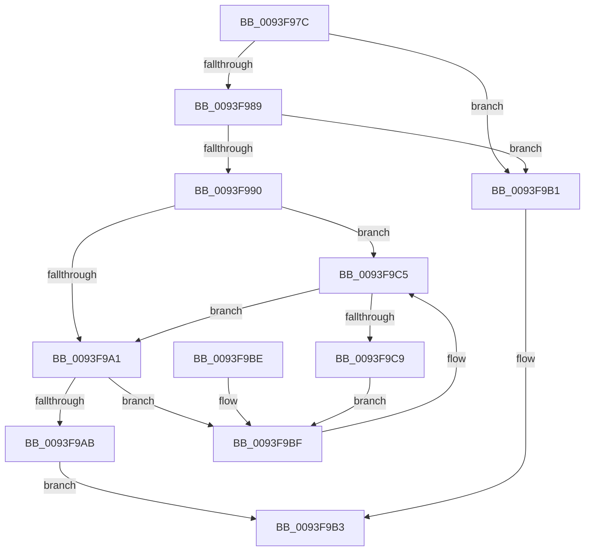

# RtlDoesRequireFunctionOverrideFixups

- RVA: `0x0093F97C`–`0x0093F9CB` (길이 `79` bytes)
- VA: `0x000000014093F97C`
- 실행 섹션: `PAGE`
- PDB 이름 있음: `예`; PDB Function 태그: `아니요`
- unwind 정보 RVA: `0x00090138`
- 디코드: `30`개 명령, `79/79` bytes 표시
- 미해석 바이트: `0` (있으면 어셈블리에 `.byte`로 보존)

> 이 문서는 커널 이미지의 기계어와 PDB 기호를 분석해 생성했습니다. 4번과 5번은 함수 원형과 자료형을 바이너리 사용 방식에서 추정한 C 해석이며 원본 소스 복구 결과는 아닙니다.

## 1. Dependencies

- 직접 호출 지점: **1**; 고유 호출 대상: **1**
- 직접 호출자로 확인된 함수: **3**
- RIP 상대 이미지 참조: **0**

### Outgoing calls
- `0x0093F9BF` → [gsl::details::terminate](../../text/4F/gsl_details_terminate_function_004F9AA0.md) (function, `0x004F9AA0`)

### Direct callers
- [RtlApplyFunctionOverrideFixupsToImage](../79/RtlApplyFunctionOverrideFixupsToImage_function_007954E0.md) at `0x007955BB`
- [MiRelocateImagePfn](MiRelocateImagePfn_function_0093F2A8.md) at `0x0093F4E4`
- [MiPerformFixups](MiPerformFixups_function_0093F5F4.md) at `0x0093F6D8`

### Static image references
- 디코드된 RIP-relative 메모리 참조가 없습니다.

## 2. Other-region calls and transfers

- 다른 실행 섹션으로 향하는 call: **1**
  - `0x0093F9BF` → [gsl::details::terminate](../../text/4F/gsl_details_terminate_function_004F9AA0.md) (`PAGE` → `.text`)
- 별도 외부 분기/꼬리 이동을 확인하지 못했습니다.

## 3. Assembly (complete function range)

```asm
0093F97C  48 83 EC 28                     sub rsp, 0x28
0093F980  44 8B 41 20                     mov r8d, dword ptr [rcx + 0x20]
0093F984  41 3B D0                        cmp edx, r8d
0093F987  72 28                           jb 0x14093f9b1
0093F989  8B 41 24                        mov eax, dword ptr [rcx + 0x24]
0093F98C  3B D0                           cmp edx, eax
0093F98E  77 21                           ja 0x14093f9b1
0093F990  4C 8B 51 18                     mov r10, qword ptr [rcx + 0x18]
0093F994  41 2B C0                        sub eax, r8d
0093F997  FF C0                           inc eax
0093F999  44 8B C8                        mov r9d, eax
0093F99C  4D 85 D2                        test r10, r10
0093F99F  74 24                           je 0x14093f9c5
0093F9A1  41 2B D0                        sub edx, r8d
0093F9A4  8B C2                           mov eax, edx
0093F9A6  49 3B C1                        cmp rax, r9
0093F9A9  73 14                           jae 0x14093f9bf
0093F9AB  49 8B 04 D2                     mov rax, qword ptr [r10 + rdx*8]
0093F9AF  EB 02                           jmp 0x14093f9b3
0093F9B1  33 C0                           xor eax, eax
0093F9B3  48 85 C0                        test rax, rax
0093F9B6  0F 95 C0                        setne al
0093F9B9  48 83 C4 28                     add rsp, 0x28
0093F9BD  C3                              ret
0093F9BE  CC                              int3
0093F9BF  E8 DC A0 BB FF                  call 0x1404f9aa0
0093F9C4  CC                              int3
0093F9C5  85 C0                           test eax, eax
0093F9C7  74 D8                           je 0x14093f9a1
0093F9C9  EB F4                           jmp 0x14093f9bf
```

## 4. C-style interpretation (structured pseudocode)

```c
__int64 __fastcall RtlDoesRequireFunctionOverrideFixups(__int64 a1, int a2)
{
    __int64 result;
    __int64 v_rsp;

    v_rsp = (v_rsp) - (40);
    if (a2 < ((unsigned int)((unsigned int)(*(unsigned int *)(a1 + 32))))) goto loc_0093F9B1;
    if (a2 > ((unsigned int)((unsigned int)(*(unsigned int *)(a1 + 36))))) goto loc_0093F9B1;
    result = (unsigned int)(((unsigned int)(*(unsigned int *)(a1 + 36))) - ((unsigned int)((unsigned int)(*(unsigned int *)(a1 + 32)))));
    result = (unsigned int)((result) + 1);
    if (*(unsigned __int64 *)(a1 + 24) == 0) goto loc_0093F9C5;
loc_0093F9A1:
    a2 = (unsigned int)((a2) - ((unsigned int)((unsigned int)(*(unsigned int *)(a1 + 32)))));
    if (((unsigned int)(a2)) >= ((unsigned int)((unsigned int)(result)))) goto loc_0093F9BF;
    goto loc_0093F9B3;
loc_0093F9B1:
    result = 0;
loc_0093F9B3:
    result = (0 != 0) ? 1 : 0;
    v_rsp = (v_rsp) + (40);
    return result;
loc_0093F9BF:
    result = gsl__details__terminate(a1, a2, (unsigned int)(*(unsigned int *)(a1 + 32)), (unsigned int)((unsigned int)(result)));
loc_0093F9C5:
    if ((unsigned int)(result) == 0) goto loc_0093F9A1;
    goto loc_0093F9BF;
}
```

## 5. (Beta) C Style

```c
int64_t RtlDoesRequireFunctionOverrideFixups(void *Arg1, int32_t Arg2)
{
    uint8_t *arg1 = (uint8_t *)Arg1;

    int64_t result;
    int64_t local_rsp;

    local_rsp = (local_rsp) - (40);
    if (Arg2 < ((uint32_t)((uint32_t)(*(uint32_t *)(arg1 + 0x20))))) goto loc_0093F9B1;
    if (Arg2 > ((uint32_t)((uint32_t)(*(uint32_t *)(arg1 + 0x24))))) goto loc_0093F9B1;
    result = (uint32_t)(((uint32_t)(*(uint32_t *)(arg1 + 0x24))) - ((uint32_t)((uint32_t)(*(uint32_t *)(arg1 + 0x20)))));
    result = (uint32_t)((result) + 1);
    if (*(uint64_t *)(arg1 + 0x18) == 0) goto loc_0093F9C5;
loc_0093F9A1:
    Arg2 = (uint32_t)((Arg2) - ((uint32_t)((uint32_t)(*(uint32_t *)(arg1 + 0x20)))));
    if (((uint32_t)(Arg2)) >= ((uint32_t)((uint32_t)(result)))) goto loc_0093F9BF;
    goto loc_0093F9B3;
loc_0093F9B1:
    result = 0;
loc_0093F9B3:
    result = (0 != 0) ? 1 : 0;
    local_rsp = (local_rsp) + (40);
    return result;
loc_0093F9BF:
    result = gsl__details__terminate(Arg1, Arg2, (uint32_t)(*(uint32_t *)(arg1 + 0x20)), (uint32_t)((uint32_t)(result)));
loc_0093F9C5:
    if ((uint32_t)(result) == 0) goto loc_0093F9A1;
    goto loc_0093F9BF;
}
```

### 관측된 메모리 오프셋

구조체 형식이 확인되지 않은 접근은 인자 기준의 오프셋으로만 기록했습니다.

| 기준 인자 | 오프셋 표현 | 폭 (bit) | 접근 |
|---|---:|---:|---|
| `Arg1` | `+ 0x18` | `64` | `R` |
| `Arg1` | `+ 0x20` | `32` | `R` |
| `Arg1` | `+ 0x24` | `32` | `R` |

## 6. Execution-region graph

[열기: 2D/3D 그래프와 함수 탐색 컨트롤 패널](../../../control-panel.html?section=page&rva=0x0093F97C&view=graph)

- 2D 그래프는 위에서 아래로 흐르고, 3D 그래프는 빈 공간을 드래그해 회전합니다. Shift+드래그는 이동, 휠은 확대·축소, 함수 노드 선택은 대상 보고서 이동입니다.

### Static fallback


