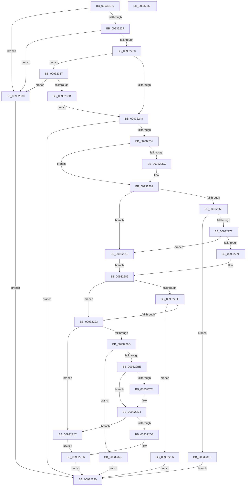

# RtlDuplicateUnicodeString

- RVA: `0x009321F0`–`0x00932360` (길이 `368` bytes)
- VA: `0x00000001409321F0`
- 실행 섹션: `PAGE`
- PDB 이름 있음: `예`; PDB Function 태그: `아니요`
- unwind 정보 RVA: `0x0008EDEC`
- 디코드: `102`개 명령, `368/368` bytes 표시
- 미해석 바이트: `0` (있으면 어셈블리에 `.byte`로 보존)

> 이 문서는 커널 이미지의 기계어와 PDB 기호를 분석해 생성했습니다. 4번과 5번은 함수 원형과 자료형을 바이너리 사용 방식에서 추정한 C 해석이며 원본 소스 복구 결과는 아닙니다.

## 1. Dependencies

- 직접 호출 지점: **3**; 고유 호출 대상: **3**
- 직접 호출자로 확인된 함수: **18**
- RIP 상대 이미지 참조: **0**

### Outgoing calls
- `0x0093224A` → [RtlValidateUnicodeString](../../text/45/RtlValidateUnicodeString_function_004510E0.md) (function, `0x004510E0`)
- `0x009322AC` → [ExAllocatePool2](../../poolcode/B8/ExAllocatePool2_function_00B820F0.md) (function, `0x00B820F0`)
- `0x009322CF` → [memcpy](../../text/6C/memcpy_function_006C6840.md) (function, `0x006C6840`)

### Direct callers
- [DifRtlDuplicateUnicodeStringWrapper](../../text/63/DifRtlDuplicateUnicodeStringWrapper_function_0063BC40.md) at `0x0063BD24`
- [PipAddBindingId](../72/PipAddBindingId_function_00727814.md) at `0x00727856`
- [PipAddRequestToEdge](../72/PipAddRequestToEdge_function_00727898.md) at `0x00727973`
- [PiDrvDbQuerySystemPathWin32](../74/PiDrvDbQuerySystemPathWin32_function_007421F4.md) at `0x00742331`
- [PiDrvDbRegisterNode](../74/PiDrvDbRegisterNode_function_00742658.md) at `0x007429BA`
- [PopAssociateThermalRequest](../75/PopAssociateThermalRequest_function_00756E78.md) at `0x00756F98`
- [PopRegisterCoolingExtensionProtection](../75/PopRegisterCoolingExtensionProtection_function_007575D0.md) at `0x00757730`
- [PpmRegisterProvSocIdentifier](../76/PpmRegisterProvSocIdentifier_function_007642A0.md) at `0x007642D0`
- [MiGetAllRegisteredPatches](../80/MiGetAllRegisteredPatches_function_0080367C.md) at `0x008037AB`
- [DrvDbGetObjectDatabaseNode](DrvDbGetObjectDatabaseNode_function_00930228.md) at `0x009302F6`
- [sub_00931420](Unknown_function_00931420.md) at `0x00931471`
- [PiGetServiceNameInfo](../99/PiGetServiceNameInfo_function_00998AA8.md) at `0x00998B48`
- [MiResolveImageReferences](../A2/MiResolveImageReferences_function_00A23BE4.md) at `0x00A23F86`
- [EtwpCovSampModuleGetName](../A5/EtwpCovSampModuleGetName_function_00A5095C.md) at `0x00A509D7`
- [NtManageHotPatch](../AF/NtManageHotPatch_function_00AF8660.md) at `0x00AF8A76`
- [NtManageHotPatch](../AF/NtManageHotPatch_function_00AF8660.md) at `0x00AF8AB4`
- [sub_00B3ABCE](../B3/Unknown_function_00B3ABCE.md) at `0x00B3AC50`
- [sub_00B3F7C0](../B3/Unknown_function_00B3F7C0.md) at `0x00B3F7E5`
- [PnpEarlyLaunchImageNotificationPreProcess](../../init/C3/PnpEarlyLaunchImageNotificationPreProcess_function_00C32D10.md) at `0x00C32D70`
- [PnpEarlyLaunchImageNotificationPreProcess](../../init/C3/PnpEarlyLaunchImageNotificationPreProcess_function_00C32D10.md) at `0x00C32D7F`
- [PnpEarlyLaunchImageNotificationPreProcess](../../init/C3/PnpEarlyLaunchImageNotificationPreProcess_function_00C32D10.md) at `0x00C32D8E`
- [PnpEarlyLaunchImageNotificationPreProcess](../../init/C3/PnpEarlyLaunchImageNotificationPreProcess_function_00C32D10.md) at `0x00C32D9D`

### Static image references
- 디코드된 RIP-relative 메모리 참조가 없습니다.

## 2. Other-region calls and transfers

- 다른 실행 섹션으로 향하는 call: **3**
  - `0x0093224A` → [RtlValidateUnicodeString](../../text/45/RtlValidateUnicodeString_function_004510E0.md) (`PAGE` → `.text`)
  - `0x009322AC` → [ExAllocatePool2](../../poolcode/B8/ExAllocatePool2_function_00B820F0.md) (`PAGE` → `POOLCODE`)
  - `0x009322CF` → [memcpy](../../text/6C/memcpy_function_006C6840.md) (`PAGE` → `.text`)
- 별도 외부 분기/꼬리 이동을 확인하지 못했습니다.

## 3. Assembly (complete function range)

```asm
009321F0  48 89 5C 24 08                  mov qword ptr [rsp + 8], rbx
009321F5  48 89 74 24 10                  mov qword ptr [rsp + 0x10], rsi
009321FA  48 89 7C 24 18                  mov qword ptr [rsp + 0x18], rdi
009321FF  4C 89 64 24 20                  mov qword ptr [rsp + 0x20], r12
00932204  41 55                           push r13
00932206  41 56                           push r14
00932208  41 57                           push r15
0093220A  48 83 EC 30                     sub rsp, 0x30
0093220E  49 8B F8                        mov rdi, r8
00932211  4C 8B E2                        mov r12, rdx
00932214  8B D9                           mov ebx, ecx
00932216  33 C0                           xor eax, eax
00932218  0F B7 F0                        movzx esi, ax
0093221B  44 8B E8                        mov r13d, eax
0093221E  48 89 44 24 28                  mov qword ptr [rsp + 0x28], rax
00932223  F7 C1 FC FF FF FF               test ecx, 0xfffffffc
00932229  0F 85 01 01 00 00               jne 0x140932330
0093222F  4D 85 C0                        test r8, r8
00932232  0F 84 F8 00 00 00               je 0x140932330
00932238  44 8B F9                        mov r15d, ecx
0093223B  83 E3 01                        and ebx, 1
0093223E  41 83 E7 02                     and r15d, 2
00932242  0F 85 EF 00 00 00               jne 0x140932337
00932248  33 C9                           xor ecx, ecx
0093224A  E8 91 EE B1 FF                  call 0x1404510e0
0093224F  85 C0                           test eax, eax
00932251  0F 88 E9 00 00 00               js 0x140932340
00932257  4D 85 E4                        test r12, r12
0093225A  74 05                           je 0x140932261
0093225C  41 0F B7 34 24                  movzx esi, word ptr [r12]
00932261  85 DB                           test ebx, ebx
00932263  0F 84 A7 00 00 00               je 0x140932310
00932269  B8 FE FF 00 00                  mov eax, 0xfffe
0093226E  66 3B F0                        cmp si, ax
00932271  0F 84 A7 00 00 00               je 0x14093231e
00932277  85 DB                           test ebx, ebx
00932279  0F 84 91 00 00 00               je 0x140932310
0093227F  44 8D 76 02                     lea r14d, [rsi + 2]
00932283  66 44 89 74 24 20               mov word ptr [rsp + 0x20], r14w
00932289  45 85 FF                        test r15d, r15d
0093228C  75 05                           jne 0x140932293
0093228E  66 85 F6                        test si, si
00932291  74 63                           je 0x1409322f6
00932293  66 45 85 F6                     test r14w, r14w
00932297  0F 84 8F 00 00 00               je 0x14093232c
0093229D  41 0F B7 D6                     movzx edx, r14w
009322A1  B9 00 01 00 00                  mov ecx, 0x100
009322A6  41 B8 53 74 72 67               mov r8d, 0x67727453
009322AC  E8 3F FE 24 00                  call 0x140b820f0
009322B1  4C 8B E8                        mov r13, rax
009322B4  48 89 44 24 28                  mov qword ptr [rsp + 0x28], rax
009322B9  48 85 C0                        test rax, rax
009322BC  74 67                           je 0x140932325
009322BE  66 85 F6                        test si, si
009322C1  74 11                           je 0x1409322d4
009322C3  44 0F B7 C6                     movzx r8d, si
009322C7  49 8B 54 24 08                  mov rdx, qword ptr [r12 + 8]
009322CC  48 8B C8                        mov rcx, rax
009322CF  E8 6C 45 D9 FF                  call 0x1406c6840
009322D4  85 DB                           test ebx, ebx
009322D6  74 54                           je 0x14093232c
009322D8  0F B7 C6                        movzx eax, si
009322DB  48 D1 E8                        shr rax, 1
009322DE  33 C9                           xor ecx, ecx
009322E0  66 41 89 4C 45 00               mov word ptr [r13 + rax*2], cx
009322E6  66 44 89 77 02                  mov word ptr [rdi + 2], r14w
009322EB  66 89 37                        mov word ptr [rdi], si
009322EE  4C 89 6F 08                     mov qword ptr [rdi + 8], r13
009322F2  8B C1                           mov eax, ecx
009322F4  EB 4A                           jmp 0x140932340
009322F6  33 C9                           xor ecx, ecx
009322F8  44 8B F1                        mov r14d, ecx
009322FB  66 89 4C 24 20                  mov word ptr [rsp + 0x20], cx
00932300  66 44 89 77 02                  mov word ptr [rdi + 2], r14w
00932305  66 89 37                        mov word ptr [rdi], si
00932308  4C 89 6F 08                     mov qword ptr [rdi + 8], r13
0093230C  8B C1                           mov eax, ecx
0093230E  EB 30                           jmp 0x140932340
00932310  44 0F B7 F6                     movzx r14d, si
00932314  66 89 74 24 20                  mov word ptr [rsp + 0x20], si
00932319  E9 6B FF FF FF                  jmp 0x140932289
0093231E  B8 06 01 00 C0                  mov eax, 0xc0000106
00932323  EB 1B                           jmp 0x140932340
00932325  B8 17 00 00 C0                  mov eax, 0xc0000017
0093232A  EB 14                           jmp 0x140932340
0093232C  33 C9                           xor ecx, ecx
0093232E  EB B6                           jmp 0x1409322e6
00932330  B8 0D 00 00 C0                  mov eax, 0xc000000d
00932335  EB 09                           jmp 0x140932340
00932337  85 DB                           test ebx, ebx
00932339  74 F5                           je 0x140932330
0093233B  E9 08 FF FF FF                  jmp 0x140932248
00932340  48 8B 5C 24 50                  mov rbx, qword ptr [rsp + 0x50]
00932345  48 8B 74 24 58                  mov rsi, qword ptr [rsp + 0x58]
0093234A  48 8B 7C 24 60                  mov rdi, qword ptr [rsp + 0x60]
0093234F  4C 8B 64 24 68                  mov r12, qword ptr [rsp + 0x68]
00932354  48 83 C4 30                     add rsp, 0x30
00932358  41 5F                           pop r15
0093235A  41 5E                           pop r14
0093235C  41 5D                           pop r13
0093235E  C3                              ret
0093235F  CC                              int3
```

## 4. C-style interpretation (structured pseudocode)

```c
__int64 __fastcall RtlDuplicateUnicodeString(int a1, __int64 a2, __int64 a3)
{
    __int64 result;
    __int64 v_r15;
    __int64 v_rbx;
    __int64 v_rsi;
    __int64 v_rsp;
    unsigned __int64 v_stack_m20;
    unsigned __int16 v_stack_m28;
    unsigned __int64 v_stack_p10;
    unsigned __int64 v_stack_p18;
    unsigned __int64 v_stack_p20;
    unsigned __int64 v_stack_p8;

    v_stack_p8 = v_rbx;
    v_stack_p10 = v_rsi;
    v_stack_p18 = v_rdi;
    v_stack_p20 = v_r12;
    v_rsp = (v_rsp) - (48);
    result = 0;
    v_stack_m20 = 0;
    if (((a1) & (0xFFFFFFFCULL)) != 0) goto loc_00932330;
    if (a3 == 0) goto loc_00932330;
    v_rbx = (unsigned int)(((unsigned int)(a1)) & (1));
    v_r15 = (unsigned int)(((unsigned int)(a1)) & (2));
    if (condition_is_not_equal) goto loc_00932337;
loc_00932248:
    a1 = 0;
    result = RtlValidateUnicodeString(a1, a2, a3, a4);
    if (sign_flag) goto loc_00932340;
    v_rsi = 0;
    if (a2 != 0) {
        v_rsi = *(unsigned __int16 *)(a2);
    }
    if ((unsigned int)(v_rbx) == 0) goto loc_00932310;
    if (((unsigned __int16)(v_rsi)) == ((unsigned __int16)((unsigned int)(0xFFFEULL)))) goto loc_0093231E;
    if ((unsigned int)(v_rbx) == 0) goto loc_00932310;
    v_stack_m28 = (unsigned __int16)(v_rsi + 2);
loc_00932289:
    if ((unsigned int)(v_r15) != 0) goto loc_00932293;
    if ((unsigned __int16)(v_rsi) == 0) goto loc_009322F6;
loc_00932293:
    if ((unsigned __int16)(v_rsi + 2) == 0) goto loc_0093232C;
    result = ExAllocatePool2(256, (unsigned __int16)(v_rsi + 2), (unsigned int)(0x67727453ULL), a4);
    v_stack_m20 = result;
    if (result == 0) goto loc_00932325;
    if ((unsigned __int16)(v_rsi) != 0) {
        a3 = (unsigned __int16)(v_rsi);
        a2 = *(unsigned __int64 *)(a2 + 8);
        a1 = result;
        result = memcpy(a1, a2, a3, a4);
    }
    if ((unsigned int)(v_rbx) == 0) goto loc_0093232C;
    result = ((unsigned __int16)(v_rsi)) >> (1);
    a1 = 0;
    *(unsigned __int16 *)(result + result * 2) = 0;
loc_009322E6:
    *(unsigned __int16 *)(a3 + 2) = (unsigned __int16)(v_rsi + 2);
    *(unsigned __int16 *)(a3) = (unsigned __int16)(v_rsi);
    *(unsigned __int64 *)(a3 + 8) = result;
    goto loc_00932340;
loc_009322F6:
    a1 = 0;
    v_stack_m28 = 0;
    *(unsigned __int16 *)(a3 + 2) = 0;
    *(unsigned __int16 *)(a3) = (unsigned __int16)(v_rsi);
    *(unsigned __int64 *)(a3 + 8) = result;
    goto loc_00932340;
loc_00932310:
    v_stack_m28 = (unsigned __int16)(v_rsi);
    goto loc_00932289;
loc_0093231E:
    goto loc_00932340;
loc_00932325:
    goto loc_00932340;
loc_0093232C:
    a1 = 0;
    goto loc_009322E6;
loc_00932330:
    goto loc_00932340;
loc_00932337:
    if ((unsigned int)(v_rbx) == 0) goto loc_00932330;
    goto loc_00932248;
loc_00932340:
    v_rsp = (v_rsp) + (48);
    return (unsigned int)(0xC000000DULL);
}
```

## 5. (Beta) C Style

```c
int64_t RtlDuplicateUnicodeString(int32_t Arg1, int64_t Arg2, void *Arg3)
{
    uint8_t *arg3 = (uint8_t *)Arg3;

    int64_t result;
    int64_t local_r15;
    int64_t local_rbx;
    int64_t local_rsi;
    int64_t local_rsp;
    uint64_t v_stack_m20;
    uint16_t v_stack_m28;
    uint64_t v_stack_p10;
    uint64_t v_stack_p18;
    uint64_t v_stack_p20;
    uint64_t v_stack_p8;

    v_stack_p8 = local_rbx;
    v_stack_p10 = local_rsi;
    v_stack_p18 = local_rdi;
    v_stack_p20 = local_r12;
    local_rsp = (local_rsp) - (48);
    result = 0;
    v_stack_m20 = 0;
    if (((Arg1) & (0xFFFFFFFCULL)) != 0) goto loc_00932330;
    if (Arg3 == NULL) goto loc_00932330;
    local_rbx = (uint32_t)(((uint32_t)(Arg1)) & (1));
    local_r15 = (uint32_t)(((uint32_t)(Arg1)) & (2));
    if (condition_is_not_equal) goto loc_00932337;
loc_00932248:
    Arg1 = 0;
    result = RtlValidateUnicodeString(Arg1, Arg2, Arg3, a4);
    if (sign_flag) goto loc_00932340;
    local_rsi = 0;
    if (Arg2 != 0) {
        local_rsi = *(uint16_t *)(Arg2);
    }
    if ((uint32_t)(local_rbx) == 0) goto loc_00932310;
    if (((uint16_t)(local_rsi)) == ((uint16_t)((uint32_t)(0xFFFEULL)))) goto loc_0093231E;
    if ((uint32_t)(local_rbx) == 0) goto loc_00932310;
    v_stack_m28 = (uint16_t)(local_rsi + 2);
loc_00932289:
    if ((uint32_t)(local_r15) != 0) goto loc_00932293;
    if ((uint16_t)(local_rsi) == 0) goto loc_009322F6;
loc_00932293:
    if ((uint16_t)(local_rsi + 2) == 0) goto loc_0093232C;
    result = ExAllocatePool2(256, (uint16_t)(local_rsi + 2), (uint32_t)(0x67727453ULL), a4);
    v_stack_m20 = result;
    if (result == 0) goto loc_00932325;
    if ((uint16_t)(local_rsi) != 0) {
        Arg3 = (uint16_t)(local_rsi);
        Arg2 = *(uint64_t *)(Arg2 + 0x8);
        Arg1 = result;
        result = memcpy(Arg1, Arg2, Arg3, a4);
    }
    if ((uint32_t)(local_rbx) == 0) goto loc_0093232C;
    result = ((uint16_t)(local_rsi)) >> (1);
    Arg1 = 0;
    *(uint16_t *)(result + result * 2) = 0;
loc_009322E6:
    *(uint16_t *)(arg3 + 0x2) = (uint16_t)(local_rsi + 2);
    *(uint16_t *)(arg3) = (uint16_t)(local_rsi);
    *(uint64_t *)(arg3 + 0x8) = result;
    goto loc_00932340;
loc_009322F6:
    Arg1 = 0;
    v_stack_m28 = 0;
    *(uint16_t *)(arg3 + 0x2) = 0;
    *(uint16_t *)(arg3) = (uint16_t)(local_rsi);
    *(uint64_t *)(arg3 + 0x8) = result;
    goto loc_00932340;
loc_00932310:
    v_stack_m28 = (uint16_t)(local_rsi);
    goto loc_00932289;
loc_0093231E:
    goto loc_00932340;
loc_00932325:
    goto loc_00932340;
loc_0093232C:
    Arg1 = 0;
    goto loc_009322E6;
loc_00932330:
    goto loc_00932340;
loc_00932337:
    if ((uint32_t)(local_rbx) == 0) goto loc_00932330;
    goto loc_00932248;
loc_00932340:
    local_rsp = (local_rsp) + (48);
    return (uint32_t)(0xC000000DULL);
}
```

### 관측된 메모리 오프셋

구조체 형식이 확인되지 않은 접근은 인자 기준의 오프셋으로만 기록했습니다.

| 기준 인자 | 오프셋 표현 | 폭 (bit) | 접근 |
|---|---:|---:|---|
| `Arg3` | `+ 0x0` | `16` | `W` |
| `Arg3` | `+ 0x2` | `16` | `W` |
| `Arg3` | `+ 0x8` | `64` | `W` |

## 6. Execution-region graph

[열기: 2D/3D 그래프와 함수 탐색 컨트롤 패널](../../../control-panel.html?section=page&rva=0x009321F0&view=graph)

- 2D 그래프는 위에서 아래로 흐르고, 3D 그래프는 빈 공간을 드래그해 회전합니다. Shift+드래그는 이동, 휠은 확대·축소, 함수 노드 선택은 대상 보고서 이동입니다.

### Static fallback


