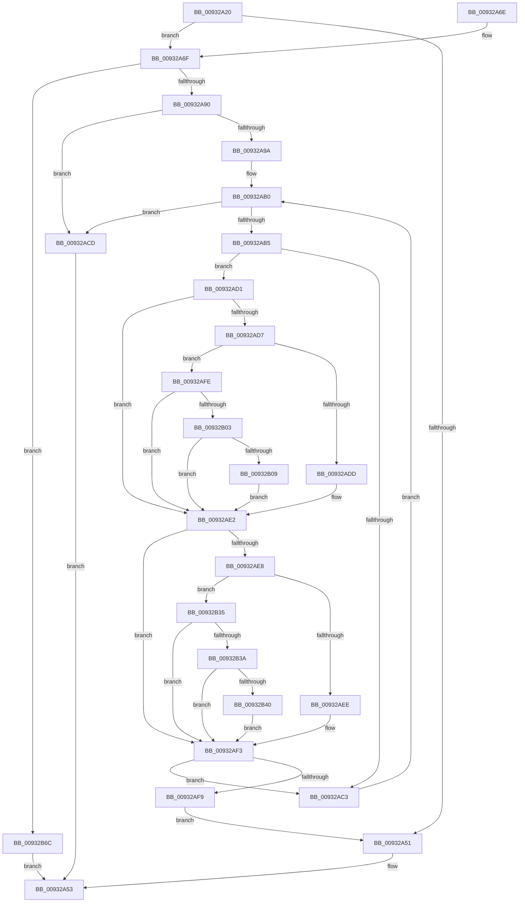

# RtlEqualUnicodeString

- RVA: `0x00932A20`–`0x00932B7B` (길이 `347` bytes)
- VA: `0x0000000140932A20`
- 실행 섹션: `PAGE`
- PDB 이름 있음: `예`; PDB Function 태그: `아니요`
- unwind 정보 RVA: `0x0008EF00`
- 디코드: `101`개 명령, `347/347` bytes 표시
- 미해석 바이트: `0` (있으면 어셈블리에 `.byte`로 보존)

> 이 문서는 커널 이미지의 기계어와 PDB 기호를 분석해 생성했습니다. 4번과 5번은 함수 원형과 자료형을 바이너리 사용 방식에서 추정한 C 해석이며 원본 소스 복구 결과는 아닙니다.

## 1. Dependencies

- 직접 호출 지점: **3**; 고유 호출 대상: **3**
- 직접 호출자로 확인된 함수: **104**
- RIP 상대 이미지 참조: **0**

### Outgoing calls
- `0x00932A3D` → [PsGetCurrentServerSiloGlobals](../../text/2F/PsGetCurrentServerSiloGlobals_function_002FE1F0.md) (function, `0x002FE1F0`)
- `0x00932A90` → [RtlCompareMemory](../../text/6B/RtlCompareMemory_function_006BA670.md) (function, `0x006BA670`)
- `0x00932B6C` → [memcmp](../../text/6C/memcmp_function_006C6B10.md) (function, `0x006C6B10`)

### Direct callers
- [sub_00213726](../../text/21/Unknown_function_00213726.md) at `0x00213738`
- [AuthzBasepCompareUnicodeStringOperands](../../text/2F/AuthzBasepCompareUnicodeStringOperands_function_002FE26C.md) at `0x002FE454`
- [sub_0030013C](../../text/30/Unknown_function_0030013C.md) at `0x00300156`
- [AuthzBasepFindSecurityAttributeValue](../../text/30/AuthzBasepFindSecurityAttributeValue_function_00302B2C.md) at `0x00302D5F`
- [AuthzBasepFindSecurityAttributeValue](../../text/30/AuthzBasepFindSecurityAttributeValue_function_00302B2C.md) at `0x00302DE4`
- [sub_003A7809](../../text/3A/Unknown_function_003A7809.md) at `0x003A793F`
- [sub_003A7EB8](../../text/3A/Unknown_function_003A7EB8.md) at `0x003A7ED1`
- [AuthzBasepCopyoutSecurityAttributes](../../text/3A/AuthzBasepCopyoutSecurityAttributes_function_003A8100.md) at `0x003A839B`
- [AuthzBasepSecurityAttributePresent](../../text/3A/AuthzBasepSecurityAttributePresent_function_003A88B0.md) at `0x003A8938`
- [AuthzBasepFindSecurityAttribute](../../text/3A/AuthzBasepFindSecurityAttribute_function_003A8980.md) at `0x003A8A04`
- [AuthzBasepEqualUnicodeString](../../text/3A/AuthzBasepEqualUnicodeString_function_003A8A80.md) at `0x003A8A8F`
- [RtlDeriveCapabilitySidsFromName](../../text/47/RtlDeriveCapabilitySidsFromName_function_00474DC0.md) at `0x00474EA1`
- [PopPepUpdateDripsDeviceVetoMask](../../text/4B/PopPepUpdateDripsDeviceVetoMask_function_004B079C.md) at `0x004B08F2`
- [VfDriverLoadSucceeded](../../text/4B/VfDriverLoadSucceeded_function_004BD418.md) at `0x004BD44D`
- [PnpMultiSzContainsString](../../text/4C/PnpMultiSzContainsString_function_004C2740.md) at `0x004C27D5`
- [PopPepInitializeVetoMasks](../../text/4C/PopPepInitializeVetoMasks_function_004C9350.md) at `0x004C93F3`
- [PiDrvDbFindNode](../../text/4F/PiDrvDbFindNode_function_004F8E60.md) at `0x004F8EA0`
- [PopEmModuleAddressMatchCallback](../../text/5D/PopEmModuleAddressMatchCallback_function_005DA3F0.md) at `0x005DA46F`
- [PopEmUpdateDeviceConstraintCallback](../../text/5D/PopEmUpdateDeviceConstraintCallback_function_005DC7F0.md) at `0x005DC883`
- [VfDriverRemoveAllDifVerification](../../text/61/VfDriverRemoveAllDifVerification_function_006130E4.md) at `0x0061313E`
- [IopIsReportedAlready](../72/IopIsReportedAlready_function_00726C6C.md) at `0x00726D5D`
- [PipAddRequestToEdge](../72/PipAddRequestToEdge_function_00727898.md) at `0x007278F1`
- [PipDeleteBindingId](../72/PipDeleteBindingId_function_00727BFC.md) at `0x00727C2E`
- [PiDevCfgCheckDeviceNeedsUpdate](../73/PiDevCfgCheckDeviceNeedsUpdate_function_00731DDC.md) at `0x0073215C`
- [PiDevCfgCheckDeviceNeedsUpdate](../73/PiDevCfgCheckDeviceNeedsUpdate_function_00731DDC.md) at `0x0073223E`
- [PiDrvDbResolveFilePathKeyValues](../74/PiDrvDbResolveFilePathKeyValues_function_00742C00.md) at `0x00742D48`
- [PiDrvDbResolveFilePathKeyValues](../74/PiDrvDbResolveFilePathKeyValues_function_00742C00.md) at `0x00742D67`
- [PiDrvDbResolveFilePathKeyValues](../74/PiDrvDbResolveFilePathKeyValues_function_00742C00.md) at `0x00742D9F`
- [PiDrvDbResolveSystemFilePath](../74/PiDrvDbResolveSystemFilePath_function_00743514.md) at `0x00743582`
- [PiDrvDbResolveSystemFilePath](../74/PiDrvDbResolveSystemFilePath_function_00743514.md) at `0x007435BA`
- [KsepDbCacheQueryDeviceData](../74/KsepDbCacheQueryDeviceData_function_00748CFC.md) at `0x00748D54`
- [KseHookQueryValueKey](../74/KseHookQueryValueKey_function_0074BD00.md) at `0x0074BD6E`
- [KseHookQueryValueKey](../74/KseHookQueryValueKey_function_0074BD00.md) at `0x0074BD96`
- [SepGetAgentIdFromOriginClaim](../7A/SepGetAgentIdFromOriginClaim_function_007A10C0.md) at `0x007A1113`
- [SepUserClaimsContainAgentId](../7A/SepUserClaimsContainAgentId_function_007A1148.md) at `0x007A11AA`
- [SLQueryLicenseValueInternal](../7C/SLQueryLicenseValueInternal_function_007C93EC.md) at `0x007C983F`
- [ExpFindArcName](../7C/ExpFindArcName_function_007CB5CC.md) at `0x007CB75F`
- [ExpFindArcName](../7C/ExpFindArcName_function_007CB5CC.md) at `0x007CB7F8`
- [CmpFindMachineHiveByMountPoint](../7E/CmpFindMachineHiveByMountPoint_function_007E1DF8.md) at `0x007E1E5B`
- [MiInsertPreviouslyRegisteredHotPatchRecord](../80/MiInsertPreviouslyRegisteredHotPatchRecord_function_00804370.md) at `0x008043DD`
- [PnpCtxFindNode](../82/PnpCtxFindNode_function_00828E50.md) at `0x00828EAB`
- [PnpCtxFindNode](../82/PnpCtxFindNode_function_00828E50.md) at `0x00828ED6`
- [CmClassFilterCallback](../82/CmClassFilterCallback_function_0082C6F0.md) at `0x0082C7D8`
- [CmDeviceClassesSubkeyCallback](../82/CmDeviceClassesSubkeyCallback_function_0082C940.md) at `0x0082CB12`
- [CmServiceFilterCallback](../82/CmServiceFilterCallback_function_0082D7A0.md) at `0x0082D916`
- [CmServiceFilterCallback](../82/CmServiceFilterCallback_function_0082D7A0.md) at `0x0082DB63`
- [VrpHandleIoctlUnloadDifferencingHiveForHost](../83/VrpHandleIoctlUnloadDifferencingHiveForHost_function_0083B7A4.md) at `0x0083B8B4`
- [CmSetValueKey](../84/CmSetValueKey_function_008457C0.md) at `0x00846582`
- [VrpFindDiffHiveEntryForMountPointWithLock](../85/VrpFindDiffHiveEntryForMountPointWithLock_function_0085E484.md) at `0x0085E5D7`
- [CmLoadAppKey](../87/CmLoadAppKey_function_00876FFC.md) at `0x008772B4`
- [IopDeviceInterfaceFilterCallback](../8E/IopDeviceInterfaceFilterCallback_function_008E5410.md) at `0x008E5567`
- [SepValidateReferencedCachedHandles](../8F/SepValidateReferencedCachedHandles_function_008F4BB0.md) at `0x008F4E17`
- [SepValidateReferencedCachedHandles](../8F/SepValidateReferencedCachedHandles_function_008F4BB0.md) at `0x008F4E46`
- [CmIsRootDevice](CmIsRootDevice_function_009325E4.md) at `0x00932610`
- [DrvDbFindDatabaseNode](DrvDbFindDatabaseNode_function_00932628.md) at `0x0093267A`
- [EtwpAcquireLoggerContext](EtwpAcquireLoggerContext_function_009326AC.md) at `0x009327AD`
- [EtwpAcquireLoggerContextByLoggerName](EtwpAcquireLoggerContextByLoggerName_function_0093283C.md) at `0x00932894`
- [VrpPreOpenOrCreate](VrpPreOpenOrCreate_function_00932B84.md) at `0x00932CB9`
- [VrpPreOpenOrCreate](VrpPreOpenOrCreate_function_00932B84.md) at `0x00932D24`
- [VrpCreateNamespaceNode](VrpCreateNamespaceNode_function_00935538.md) at `0x009355C7`
- [PiDevCfgQueryIncludedDriverConfigurations](../97/PiDevCfgQueryIncludedDriverConfigurations_function_009754BC.md) at `0x00975682`
- [PiDevCfgQueryIncludedDriverConfigurations](../97/PiDevCfgQueryIncludedDriverConfigurations_function_009754BC.md) at `0x00975697`
- [PiDevCfgConfigureDevice](../97/PiDevCfgConfigureDevice_function_00977BB4.md) at `0x0097878B`
- [PiFindDevInstMatch](../99/PiFindDevInstMatch_function_009996A0.md) at `0x0099984F`
- [IopQueryRegistryKeySystemPath](../99/IopQueryRegistryKeySystemPath_function_0099A1CC.md) at `0x0099A34A`
- [SepFindMatchingCachedHandlesEntry](../9A/SepFindMatchingCachedHandlesEntry_function_009A9698.md) at `0x009A9747`
- [PiPnpRtlServiceFilterCallback](../A0/PiPnpRtlServiceFilterCallback_function_00A0DB80.md) at `0x00A0DC9A`
- [PiPnpRtlServiceFilterCallback](../A0/PiPnpRtlServiceFilterCallback_function_00A0DB80.md) at `0x00A0DE99`
- [SepIsImageInMinTcbList](../A1/SepIsImageInMinTcbList_function_00A12DE0.md) at `0x00A12E22`
- [SepIsMinTCB](../A1/SepIsMinTCB_function_00A13120.md) at `0x00A13260`
- [MiResolveImageReferences](../A2/MiResolveImageReferences_function_00A23BE4.md) at `0x00A23DB9`
- [MiObtainSectionForDriver](../A2/MiObtainSectionForDriver_function_00A24494.md) at `0x00A245C3`
- [PipFindDeviceOverrideEntry](../A2/PipFindDeviceOverrideEntry_function_00A2A694.md) at `0x00A2A8C4`
- [AdtpLookupDriveLetter](../A4/AdtpLookupDriveLetter_function_00A4A844.md) at `0x00A4A8BC`
- [SepIsNgenImage](../A5/SepIsNgenImage_function_00A557B4.md) at `0x00A55841`
- [EtwpLookupLoggerIdByName](../A6/EtwpLookupLoggerIdByName_function_00A60FF8.md) at `0x00A61047`
- [PopBatteryDeviceState](../A7/PopBatteryDeviceState_function_00A7905C.md) at `0x00A791C5`
- [PiDevCfgResolveVariable](../A8/PiDevCfgResolveVariable_function_00A81AB8.md) at `0x00A81D43`
- [PipQueryBindingResolution](../A8/PipQueryBindingResolution_function_00A85310.md) at `0x00A8538B`
- [AdtpBuildAccessesString](../A8/AdtpBuildAccessesString_function_00A8898C.md) at `0x00A88B82`
- [AdtpBuildAccessesString](../A8/AdtpBuildAccessesString_function_00A8898C.md) at `0x00A88D1B`
- [AdtpBuildAccessesString](../A8/AdtpBuildAccessesString_function_00A8898C.md) at `0x00A88D61`
- [AdtpBuildAccessesString](../A8/AdtpBuildAccessesString_function_00A8898C.md) at `0x00A88E60`
- [PspIdentityBasedJobBreakaway](../A8/PspIdentityBasedJobBreakaway_function_00A899CC.md) at `0x00A89B93`
- [PspIdentityBasedJobBreakaway](../A8/PspIdentityBasedJobBreakaway_function_00A899CC.md) at `0x00A89BAF`
- [VrpPreLoadKey](../A8/VrpPreLoadKey_function_00A8A43C.md) at `0x00A8A642`
- [RtlpGetNtProductTypeFromRegistry](../AA/RtlpGetNtProductTypeFromRegistry_function_00AA26D8.md) at `0x00AA281A`
- [RtlpGetNtProductTypeFromRegistry](../AA/RtlpGetNtProductTypeFromRegistry_function_00AA26D8.md) at `0x00AA282E`
- [RtlpGetNtProductTypeFromRegistry](../AA/RtlpGetNtProductTypeFromRegistry_function_00AA26D8.md) at `0x00AA2842`
- [PiRemoveDeferredSetInterfaceState](../AA/PiRemoveDeferredSetInterfaceState_function_00AAE03C.md) at `0x00AAE089`
- [PiDevCfgResolveMultiSzValue](../AB/PiDevCfgResolveMultiSzValue_function_00AB6894.md) at `0x00AB6AFC`
- [PiDevCfgLogDeviceConfigured](../AD/PiDevCfgLogDeviceConfigured_function_00ADCDD4.md) at `0x00ADD084`
- [SepAddTokenOriginClaim](../AF/SepAddTokenOriginClaim_function_00AF2130.md) at `0x00AF227F`
- [sub_00B1E436](../B1/Unknown_function_00B1E436.md) at `0x00B1E544`
- [sub_00B1E93A](../B1/Unknown_function_00B1E93A.md) at `0x00B1EA88`
- [sub_00B2D22A](../B2/Unknown_function_00B2D22A.md) at `0x00B2D300`
- [sub_00B2F42E](../B2/Unknown_function_00B2F42E.md) at `0x00B2F460`
- [sub_00B4588A](../B4/Unknown_function_00B4588A.md) at `0x00B45941`
- [sub_00B4588A](../B4/Unknown_function_00B4588A.md) at `0x00B45960`
- [sub_00B4588A](../B4/Unknown_function_00B4588A.md) at `0x00B45996`
- [sub_00B4588A](../B4/Unknown_function_00B4588A.md) at `0x00B459B4`
- [ViIsDriverSuspectForVerifier](../../pagevrfy/B9/ViIsDriverSuspectForVerifier_function_00B9381C.md) at `0x00B93853`
- [ViLogAndLoadXdv](../../pagevrfy/B9/ViLogAndLoadXdv_function_00B93B30.md) at `0x00B93B57`
- [VfDriverApplyDifVerification](../../pagevrfy/B9/VfDriverApplyDifVerification_function_00B9A028.md) at `0x00B9A075`
- [VfDriverApplyDifVerification](../../pagevrfy/B9/VfDriverApplyDifVerification_function_00B9A028.md) at `0x00B9A0B5`
- [VfDriverEnableVerifier](../../pagevrfy/B9/VfDriverEnableVerifier_function_00B9A240.md) at `0x00B9A2A6`
- [VfDriverRemoveDifVerification](../../pagevrfy/B9/VfDriverRemoveDifVerification_function_00B9A4E0.md) at `0x00B9A50F`
- [VfDriverRemoveDifVerification](../../pagevrfy/B9/VfDriverRemoveDifVerification_function_00B9A4E0.md) at `0x00B9A559`
- [ViDriverReApplyVerifierForAll](../../pagevrfy/B9/ViDriverReApplyVerifierForAll_function_00B9A8D4.md) at `0x00B9A91A`
- [VfSuspectDriversLoadCallback](../../pagevrfy/BA/VfSuspectDriversLoadCallback_function_00BAAB2C.md) at `0x00BAAB7E`
- [VfSuspectDriversLoadCallback](../../pagevrfy/BA/VfSuspectDriversLoadCallback_function_00BAAB2C.md) at `0x00BAABBC`
- [VfSuspectDriversLoadCallback](../../pagevrfy/BA/VfSuspectDriversLoadCallback_function_00BAAB2C.md) at `0x00BAABDB`
- [VfSuspectDriversLoadCallback](../../pagevrfy/BA/VfSuspectDriversLoadCallback_function_00BAAB2C.md) at `0x00BAAC0A`
- [VfSuspectDriversLoadCallback](../../pagevrfy/BA/VfSuspectDriversLoadCallback_function_00BAAB2C.md) at `0x00BAAC39`
- [VfSuspectDriversLoadCallback](../../pagevrfy/BA/VfSuspectDriversLoadCallback_function_00BAAB2C.md) at `0x00BAAC68`
- [VfSuspectDriversLoadCallback](../../pagevrfy/BA/VfSuspectDriversLoadCallback_function_00BAAB2C.md) at `0x00BAAC94`
- [VfSuspectDriversLoadCallback](../../pagevrfy/BA/VfSuspectDriversLoadCallback_function_00BAAB2C.md) at `0x00BAACC0`
- [VfSuspectDriversLoadCallback](../../pagevrfy/BA/VfSuspectDriversLoadCallback_function_00BAAB2C.md) at `0x00BAACF2`
- [VfSuspectDriversUnloadCallback](../../pagevrfy/BA/VfSuspectDriversUnloadCallback_function_00BAAF34.md) at `0x00BAAF5C`
- [VfSuspectDriversUnloadCallback](../../pagevrfy/BA/VfSuspectDriversUnloadCallback_function_00BAAF34.md) at `0x00BAAF80`
- [VfSuspectDriversUnloadCallback](../../pagevrfy/BA/VfSuspectDriversUnloadCallback_function_00BAAF34.md) at `0x00BAAF9F`
- [VfSuspectDriversUnloadCallback](../../pagevrfy/BA/VfSuspectDriversUnloadCallback_function_00BAAF34.md) at `0x00BAAFBE`
- [VfSuspectDriversUnloadCallback](../../pagevrfy/BA/VfSuspectDriversUnloadCallback_function_00BAAF34.md) at `0x00BAAFDD`
- [VfSuspectDriversUnloadCallback](../../pagevrfy/BA/VfSuspectDriversUnloadCallback_function_00BAAF34.md) at `0x00BAAFFC`
- [ViSuspectDriversLookupEntry](../../pagevrfy/BA/ViSuspectDriversLookupEntry_function_00BAB194.md) at `0x00BAB1BE`
- [VfAddVerifierEntry](../../pagevrfy/BA/VfAddVerifierEntry_function_00BAC31C.md) at `0x00BAC3D2`
- [ViFilterIsDeviceExcluded](../../pagevrfy/BA/ViFilterIsDeviceExcluded_function_00BAD470.md) at `0x00BAD4AD`
- [ViFilterIsDeviceExcluded](../../pagevrfy/BA/ViFilterIsDeviceExcluded_function_00BAD470.md) at `0x00BAD4C3`
- [ViFilterIsDeviceExcluded](../../pagevrfy/BA/ViFilterIsDeviceExcluded_function_00BAD470.md) at `0x00BAD4D9`
- [VfDriverLoadImage](../../pagevrfy/BB/VfDriverLoadImage_function_00BB7DE4.md) at `0x00BB7E14`
- [VfCheckUserHandle](../../pagevrfy/BB/VfCheckUserHandle_function_00BB9218.md) at `0x00BB9346`
- [VfCheckUserHandle](../../pagevrfy/BB/VfCheckUserHandle_function_00BB9218.md) at `0x00BB9361`
- [sub_00BF16D0](../../init/BF/Unknown_function_00BF16D0.md) at `0x00BF8FFB`
- [sub_00BF16D0](../../init/BF/Unknown_function_00BF16D0.md) at `0x00C0F172`
- [PipLookupGroupName](../../init/C3/PipLookupGroupName_function_00C31578.md) at `0x00C3160A`
- [PipLookupGroupName](../../init/C3/PipLookupGroupName_function_00C31578.md) at `0x00C31629`
- [VfInitBootDriversLoaded](../../init/C4/VfInitBootDriversLoaded_function_00C4BD0C.md) at `0x00C4BF9F`
- [ViInitSystemPhase0](../../init/C4/ViInitSystemPhase0_function_00C4C1B0.md) at `0x00C4C581`
- [ExpPrmInitialization](../../init/C5/ExpPrmInitialization_function_00C517F8.md) at `0x00C51855`
- [CmpCreateHardwareProfiles](../../init/C5/CmpCreateHardwareProfiles_function_00C56EF4.md) at `0x00C575AB`
- [CmpDoSort](../../init/C5/CmpDoSort_function_00C5BE84.md) at `0x00C5BF2E`
- [CmpFindHiveSubKey](../../init/C5/CmpFindHiveSubKey_function_00C5C398.md) at `0x00C5C406`
- [CmpGetKnownHivePathNode](../../init/C5/CmpGetKnownHivePathNode_function_00C5C85C.md) at `0x00C5C8DB`
- [CmpGetKnownHivePathNode](../../init/C5/CmpGetKnownHivePathNode_function_00C5C85C.md) at `0x00C5C8F3`
- [CmGetSystemDriverList](../../init/C7/CmGetSystemDriverList_function_00C7380C.md) at `0x00C73A0C`
- [PpInitGetGroupOrderIndex](../../init/C7/PpInitGetGroupOrderIndex_function_00C77534.md) at `0x00C775FE`
- [PnpLoadBootFilterDriver](../../init/C7/PnpLoadBootFilterDriver_function_00C77938.md) at `0x00C779FF`

### Static image references
- 디코드된 RIP-relative 메모리 참조가 없습니다.

## 2. Other-region calls and transfers

- 다른 실행 섹션으로 향하는 call: **3**
  - `0x00932A3D` → [PsGetCurrentServerSiloGlobals](../../text/2F/PsGetCurrentServerSiloGlobals_function_002FE1F0.md) (`PAGE` → `.text`)
  - `0x00932A90` → [RtlCompareMemory](../../text/6B/RtlCompareMemory_function_006BA670.md) (`PAGE` → `.text`)
  - `0x00932B6C` → [memcmp](../../text/6C/memcmp_function_006C6B10.md) (`PAGE` → `.text`)
- 별도 외부 분기/꼬리 이동을 확인하지 못했습니다.

## 3. Assembly (complete function range)

```asm
00932A20  48 89 5C 24 08                  mov qword ptr [rsp + 8], rbx
00932A25  48 89 6C 24 10                  mov qword ptr [rsp + 0x10], rbp
00932A2A  48 89 74 24 18                  mov qword ptr [rsp + 0x18], rsi
00932A2F  48 89 7C 24 20                  mov qword ptr [rsp + 0x20], rdi
00932A34  41 56                           push r14
00932A36  48 83 EC 20                     sub rsp, 0x20
00932A3A  48 8B D9                        mov rbx, rcx
00932A3D  E8 AE B7 9C FF                  call 0x1402fe1f0
00932A42  48 8B A8 B0 04 00 00            mov rbp, qword ptr [rax + 0x4b0]
00932A49  0F B7 03                        movzx eax, word ptr [rbx]
00932A4C  66 3B 02                        cmp ax, word ptr [rdx]
00932A4F  74 1E                           je 0x140932a6f
00932A51  32 C0                           xor al, al
00932A53  48 8B 5C 24 30                  mov rbx, qword ptr [rsp + 0x30]
00932A58  48 8B 6C 24 38                  mov rbp, qword ptr [rsp + 0x38]
00932A5D  48 8B 74 24 40                  mov rsi, qword ptr [rsp + 0x40]
00932A62  48 8B 7C 24 48                  mov rdi, qword ptr [rsp + 0x48]
00932A67  48 83 C4 20                     add rsp, 0x20
00932A6B  41 5E                           pop r14
00932A6D  C3                              ret
00932A6E  CC                              int3
00932A6F  48 8B 5B 08                     mov rbx, qword ptr [rbx + 8]
00932A73  45 84 C0                        test r8b, r8b
00932A76  48 8B 7A 08                     mov rdi, qword ptr [rdx + 8]
00932A7A  4C 8B F0                        mov r14, rax
00932A7D  48 8B D7                        mov rdx, rdi
00932A80  48 8B CB                        mov rcx, rbx
00932A83  4C 8B C0                        mov r8, rax
00932A86  48 8D 34 18                     lea rsi, [rax + rbx]
00932A8A  0F 84 DC 00 00 00               je 0x140932b6c
00932A90  E8 DB 7B D8 FF                  call 0x1406ba670
00932A95  49 3B C6                        cmp rax, r14
00932A98  74 33                           je 0x140932acd
00932A9A  48 D1 E8                        shr rax, 1
00932A9D  41 BA C0 00 00 00               mov r10d, 0xc0
00932AA3  48 03 C0                        add rax, rax
00932AA6  48 03 D8                        add rbx, rax
00932AA9  48 03 F8                        add rdi, rax
00932AAC  0F 1F 40 00                     nop dword ptr [rax]
00932AB0  48 3B DE                        cmp rbx, rsi
00932AB3  73 18                           jae 0x140932acd
00932AB5  44 0F B7 03                     movzx r8d, word ptr [rbx]
00932AB9  44 0F B7 0F                     movzx r9d, word ptr [rdi]
00932ABD  66 45 3B C1                     cmp r8w, r9w
00932AC1  75 0E                           jne 0x140932ad1
00932AC3  48 83 C3 02                     add rbx, 2
00932AC7  48 83 C7 02                     add rdi, 2
00932ACB  EB E3                           jmp 0x140932ab0
00932ACD  B0 01                           mov al, 1
00932ACF  EB 82                           jmp 0x140932a53
00932AD1  41 83 F8 61                     cmp r8d, 0x61
00932AD5  72 0B                           jb 0x140932ae2
00932AD7  41 83 F8 7A                     cmp r8d, 0x7a
00932ADB  77 21                           ja 0x140932afe
00932ADD  66 41 83 E8 20                  sub r8w, 0x20
00932AE2  41 83 F9 61                     cmp r9d, 0x61
00932AE6  72 0B                           jb 0x140932af3
00932AE8  41 83 F9 7A                     cmp r9d, 0x7a
00932AEC  77 47                           ja 0x140932b35
00932AEE  66 41 83 E9 20                  sub r9w, 0x20
00932AF3  66 45 3B C1                     cmp r8w, r9w
00932AF7  74 CA                           je 0x140932ac3
00932AF9  E9 53 FF FF FF                  jmp 0x140932a51
00932AFE  48 85 ED                        test rbp, rbp
00932B01  74 DF                           je 0x140932ae2
00932B03  66 45 3B C2                     cmp r8w, r10w
00932B07  72 D9                           jb 0x140932ae2
00932B09  49 8B C0                        mov rax, r8
00932B0C  41 8B D0                        mov edx, r8d
00932B0F  48 C1 E8 08                     shr rax, 8
00932B13  83 E2 0F                        and edx, 0xf
00932B16  0F B7 4C 45 00                  movzx ecx, word ptr [rbp + rax*2]
00932B1B  41 8B C0                        mov eax, r8d
00932B1E  C1 E8 04                        shr eax, 4
00932B21  83 E0 0F                        and eax, 0xf
00932B24  03 C8                           add ecx, eax
00932B26  0F B7 4C 4D 00                  movzx ecx, word ptr [rbp + rcx*2]
00932B2B  03 CA                           add ecx, edx
00932B2D  66 44 03 44 4D 00               add r8w, word ptr [rbp + rcx*2]
00932B33  EB AD                           jmp 0x140932ae2
00932B35  48 85 ED                        test rbp, rbp
00932B38  74 B9                           je 0x140932af3
00932B3A  66 45 3B CA                     cmp r9w, r10w
00932B3E  72 B3                           jb 0x140932af3
00932B40  49 8B C1                        mov rax, r9
00932B43  41 8B D1                        mov edx, r9d
00932B46  48 C1 E8 08                     shr rax, 8
00932B4A  83 E2 0F                        and edx, 0xf
00932B4D  0F B7 4C 45 00                  movzx ecx, word ptr [rbp + rax*2]
00932B52  41 8B C1                        mov eax, r9d
00932B55  C1 E8 04                        shr eax, 4
00932B58  83 E0 0F                        and eax, 0xf
00932B5B  03 C8                           add ecx, eax
00932B5D  0F B7 4C 4D 00                  movzx ecx, word ptr [rbp + rcx*2]
00932B62  03 CA                           add ecx, edx
00932B64  66 44 03 4C 4D 00               add r9w, word ptr [rbp + rcx*2]
00932B6A  EB 87                           jmp 0x140932af3
00932B6C  E8 9F 3F D9 FF                  call 0x1406c6b10
00932B71  85 C0                           test eax, eax
00932B73  0F 94 C0                        sete al
00932B76  E9 D8 FE FF FF                  jmp 0x140932a53
```

## 4. C-style interpretation (structured pseudocode)

```c
__int64 __fastcall RtlEqualUnicodeString(__int64 a1, __int64 a2, unsigned __int8 a3)
{
    __int64 result;
    __int64 v_rbx;
    __int64 v_rdi;
    __int64 v_rsp;
    unsigned __int64 v_stack_p10;
    unsigned __int64 v_stack_p18;
    unsigned __int64 v_stack_p20;
    unsigned __int64 v_stack_p8;

    v_stack_p8 = v_rbx;
    v_stack_p10 = v_rbp;
    v_stack_p18 = v_rsi;
    v_stack_p20 = v_rdi;
    v_rsp = (v_rsp) - (32);
    result = PsGetCurrentServerSiloGlobals(a1, a2, a3, a4);
    if (((unsigned __int16)(*(unsigned __int16 *)(a1))) == (*(unsigned __int16 *)(a2))) goto loc_00932A6F;
loc_00932A51:
    result = 0;
loc_00932A53:
    v_rsp = (v_rsp) + (32);
    return result;
loc_00932A6F:
    if (a3 == 0) goto loc_00932B6C;
    result = RtlCompareMemory(*(unsigned __int64 *)(v_stack_p8 + 8), *(unsigned __int64 *)(a2 + 8), 0, a4);
    if (result == 0) goto loc_00932ACD;
    result = (result) >> (1);
    result = (result) + (result);
    v_rbx = (*(unsigned __int64 *)(v_stack_p8 + 8)) + (result);
    v_rdi = (*(unsigned __int64 *)(a2 + 8)) + (result);
loc_00932AB0:
    if (v_rbx >= (result + *(unsigned __int64 *)(v_stack_p8 + 8) * 1)) goto loc_00932ACD;
    if (((unsigned __int16)(*(unsigned __int16 *)(v_rbx))) != ((unsigned __int16)(*(unsigned __int16 *)(v_rdi)))) goto loc_00932AD1;
loc_00932AC3:
    v_rbx = (v_rbx) + (2);
    v_rdi = (v_rdi) + (2);
    goto loc_00932AB0;
loc_00932ACD:
    goto loc_00932A53;
loc_00932AD1:
    if (((unsigned int)(*(unsigned __int16 *)(v_rbx))) < 97) goto loc_00932AE2;
    if (((unsigned int)(*(unsigned __int16 *)(v_rbx))) > 122) goto loc_00932AFE;
    a3 = (unsigned __int16)((*(unsigned __int16 *)(v_rbx)) - (32));
loc_00932AE2:
    if (((unsigned int)(*(unsigned __int16 *)(v_rdi))) < 97) goto loc_00932AF3;
    if (((unsigned int)(*(unsigned __int16 *)(v_rdi))) > 122) goto loc_00932B35;
    a4 = (unsigned __int16)((*(unsigned __int16 *)(v_rdi)) - (32));
loc_00932AF3:
    if (a3 == ((unsigned __int16)(a4))) goto loc_00932AC3;
    goto loc_00932A51;
loc_00932AFE:
    if (v_stack_p10 == 0) goto loc_00932AE2;
    if (a3 < 192) goto loc_00932AE2;
    result = (a3) >> (8);
    a2 = (unsigned int)(((unsigned int)(a3)) & (15));
    result = (unsigned int)(((unsigned int)(a3)) >> (4));
    result = (unsigned int)((result) & (15));
    a1 = (unsigned int)((*(unsigned __int16 *)(v_stack_p10 + result * 2)) + ((unsigned int)(result)));
    a1 = (unsigned int)((*(unsigned __int16 *)(v_stack_p10 + a1 * 2)) + ((unsigned int)(a2)));
    a3 = (unsigned __int16)((a3) + (*(unsigned __int16 *)(v_stack_p10 + a1 * 2)));
    goto loc_00932AE2;
loc_00932B35:
    if (v_stack_p10 == 0) goto loc_00932AF3;
    if (((unsigned __int16)(a4)) < 192) goto loc_00932AF3;
    result = (a4) >> (8);
    a2 = (unsigned int)(((unsigned int)((unsigned int)(a4))) & (15));
    result = (unsigned int)(((unsigned int)((unsigned int)(a4))) >> (4));
    result = (unsigned int)((result) & (15));
    a1 = (unsigned int)((*(unsigned __int16 *)(v_stack_p10 + result * 2)) + ((unsigned int)(result)));
    a1 = (unsigned int)((*(unsigned __int16 *)(v_stack_p10 + a1 * 2)) + ((unsigned int)(a2)));
    a4 = (unsigned __int16)((a4) + (*(unsigned __int16 *)(v_stack_p10 + a1 * 2)));
    goto loc_00932AF3;
loc_00932B6C:
    result = memcmp(a1, a2, a3, a4);
    result = ((unsigned int)(result) == 0) ? 1 : 0;
    goto loc_00932A53;
}
```

## 5. (Beta) C Style

```c
int64_t RtlEqualUnicodeString(void *Arg1, int64_t Arg2, uint8_t Arg3)
{
    uint8_t *arg1 = (uint8_t *)Arg1;

    int64_t result;
    int64_t local_rbx;
    int64_t local_rdi;
    int64_t local_rsp;
    uint64_t v_stack_p10;
    uint64_t v_stack_p18;
    uint64_t v_stack_p20;
    uint64_t v_stack_p8;

    v_stack_p8 = local_rbx;
    v_stack_p10 = local_rbp;
    v_stack_p18 = local_rsi;
    v_stack_p20 = local_rdi;
    local_rsp = (local_rsp) - (32);
    result = PsGetCurrentServerSiloGlobals(Arg1, Arg2, Arg3, a4);
    if (((uint16_t)(*(uint16_t *)(arg1))) == (*(uint16_t *)(Arg2))) goto loc_00932A6F;
loc_00932A51:
    result = 0;
loc_00932A53:
    local_rsp = (local_rsp) + (32);
    return result;
loc_00932A6F:
    if (Arg3 == 0) goto loc_00932B6C;
    result = RtlCompareMemory(*(uint64_t *)(v_stack_p8 + 0x8), *(uint64_t *)(Arg2 + 0x8), 0, a4);
    if (result == 0) goto loc_00932ACD;
    result = (result) >> (1);
    result = (result) + (result);
    local_rbx = (*(uint64_t *)(v_stack_p8 + 0x8)) + (result);
    local_rdi = (*(uint64_t *)(Arg2 + 0x8)) + (result);
loc_00932AB0:
    if (local_rbx >= (result + *(uint64_t *)(v_stack_p8 + 0x8) * 1)) goto loc_00932ACD;
    if (((uint16_t)(*(uint16_t *)(local_rbx))) != ((uint16_t)(*(uint16_t *)(local_rdi)))) goto loc_00932AD1;
loc_00932AC3:
    local_rbx = (local_rbx) + (2);
    local_rdi = (local_rdi) + (2);
    goto loc_00932AB0;
loc_00932ACD:
    goto loc_00932A53;
loc_00932AD1:
    if (((uint32_t)(*(uint16_t *)(local_rbx))) < 97) goto loc_00932AE2;
    if (((uint32_t)(*(uint16_t *)(local_rbx))) > 122) goto loc_00932AFE;
    Arg3 = (uint16_t)((*(uint16_t *)(local_rbx)) - (32));
loc_00932AE2:
    if (((uint32_t)(*(uint16_t *)(local_rdi))) < 97) goto loc_00932AF3;
    if (((uint32_t)(*(uint16_t *)(local_rdi))) > 122) goto loc_00932B35;
    a4 = (uint16_t)((*(uint16_t *)(local_rdi)) - (32));
loc_00932AF3:
    if (Arg3 == ((uint16_t)(a4))) goto loc_00932AC3;
    goto loc_00932A51;
loc_00932AFE:
    if (v_stack_p10 == 0) goto loc_00932AE2;
    if (Arg3 < 192) goto loc_00932AE2;
    result = (Arg3) >> (8);
    Arg2 = (uint32_t)(((uint32_t)(Arg3)) & (15));
    result = (uint32_t)(((uint32_t)(Arg3)) >> (4));
    result = (uint32_t)((result) & (15));
    Arg1 = (uint32_t)((*(uint16_t *)(v_stack_p10 + result * 2)) + ((uint32_t)(result)));
    Arg1 = (uint32_t)((*(uint16_t *)(v_stack_p10 + arg1 * 2)) + ((uint32_t)(Arg2)));
    Arg3 = (uint16_t)((Arg3) + (*(uint16_t *)(v_stack_p10 + arg1 * 2)));
    goto loc_00932AE2;
loc_00932B35:
    if (v_stack_p10 == 0) goto loc_00932AF3;
    if (((uint16_t)(a4)) < 192) goto loc_00932AF3;
    result = (a4) >> (8);
    Arg2 = (uint32_t)(((uint32_t)((uint32_t)(a4))) & (15));
    result = (uint32_t)(((uint32_t)((uint32_t)(a4))) >> (4));
    result = (uint32_t)((result) & (15));
    Arg1 = (uint32_t)((*(uint16_t *)(v_stack_p10 + result * 2)) + ((uint32_t)(result)));
    Arg1 = (uint32_t)((*(uint16_t *)(v_stack_p10 + arg1 * 2)) + ((uint32_t)(Arg2)));
    a4 = (uint16_t)((a4) + (*(uint16_t *)(v_stack_p10 + arg1 * 2)));
    goto loc_00932AF3;
loc_00932B6C:
    result = memcmp(Arg1, Arg2, Arg3, a4);
    result = ((uint32_t)(result) == 0) ? 1 : 0;
    goto loc_00932A53;
}
```

### 관측된 메모리 오프셋

구조체 형식이 확인되지 않은 접근은 인자 기준의 오프셋으로만 기록했습니다.

| 기준 인자 | 오프셋 표현 | 폭 (bit) | 접근 |
|---|---:|---:|---|
| `Arg1` | `+ 0x0` | `16` | `R` |
| `Arg1` | `+ 0x8` | `64` | `R` |

## 6. Execution-region graph

[열기: 2D/3D 그래프와 함수 탐색 컨트롤 패널](../../../control-panel.html?section=page&rva=0x00932A20&view=graph)

- 2D 그래프는 위에서 아래로 흐르고, 3D 그래프는 빈 공간을 드래그해 회전합니다. Shift+드래그는 이동, 휠은 확대·축소, 함수 노드 선택은 대상 보고서 이동입니다.

### Static fallback


