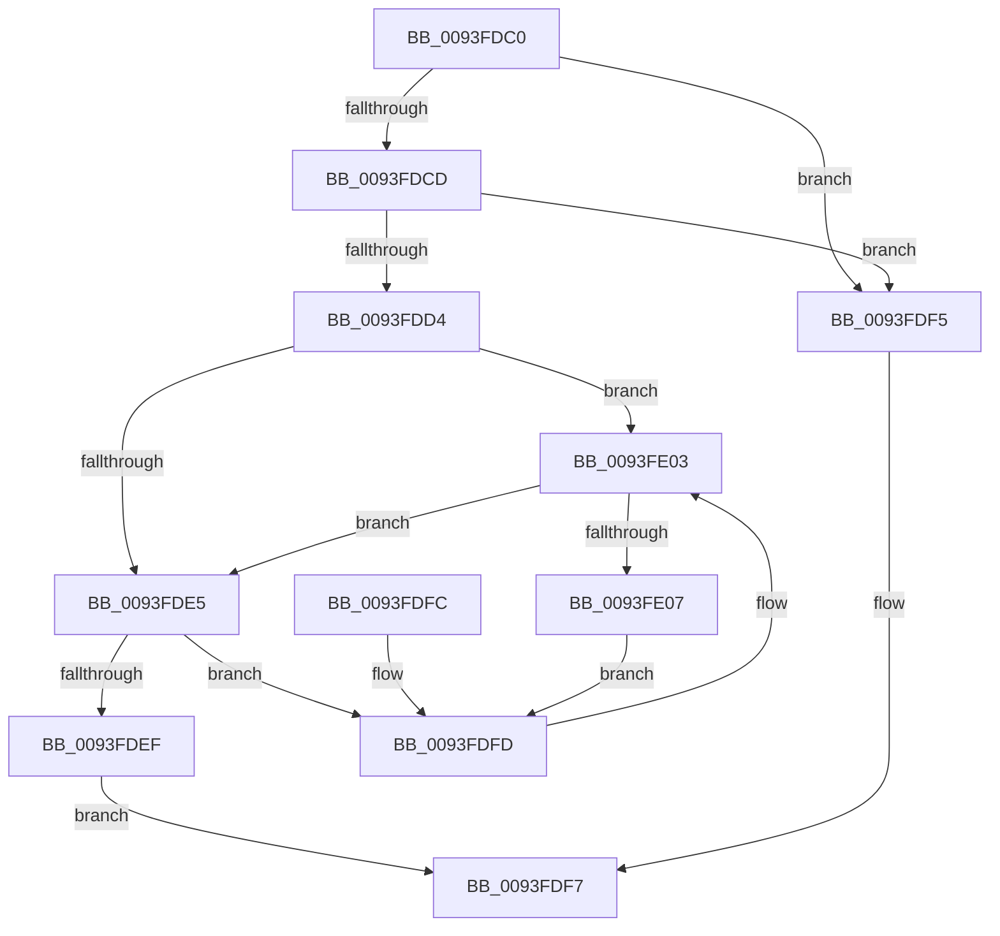

# RtlpGetFunctionOverrideIndex

- RVA: `0x0093FDC0`–`0x0093FE09` (길이 `73` bytes)
- VA: `0x000000014093FDC0`
- 실행 섹션: `PAGE`
- PDB 이름 있음: `예`; PDB Function 태그: `아니요`
- unwind 정보 RVA: `0x00090138`
- 디코드: `28`개 명령, `73/73` bytes 표시
- 미해석 바이트: `0` (있으면 어셈블리에 `.byte`로 보존)

> 이 문서는 커널 이미지의 기계어와 PDB 기호를 분석해 생성했습니다. 4번과 5번은 함수 원형과 자료형을 바이너리 사용 방식에서 추정한 C 해석이며 원본 소스 복구 결과는 아닙니다.

## 1. Dependencies

- 직접 호출 지점: **1**; 고유 호출 대상: **1**
- 직접 호출자로 확인된 함수: **1**
- RIP 상대 이미지 참조: **0**

### Outgoing calls
- `0x0093FDFD` → [gsl::details::terminate](../../text/4F/gsl_details_terminate_function_004F9AA0.md) (function, `0x004F9AA0`)

### Direct callers
- [RtlApplyFunctionOverrideFixups](RtlApplyFunctionOverrideFixups_function_0093FB44.md) at `0x0093FB6E`

### Static image references
- 디코드된 RIP-relative 메모리 참조가 없습니다.

## 2. Other-region calls and transfers

- 다른 실행 섹션으로 향하는 call: **1**
  - `0x0093FDFD` → [gsl::details::terminate](../../text/4F/gsl_details_terminate_function_004F9AA0.md) (`PAGE` → `.text`)
- 별도 외부 분기/꼬리 이동을 확인하지 못했습니다.

## 3. Assembly (complete function range)

```asm
0093FDC0  48 83 EC 28                     sub rsp, 0x28
0093FDC4  44 8B 41 20                     mov r8d, dword ptr [rcx + 0x20]
0093FDC8  41 3B D0                        cmp edx, r8d
0093FDCB  72 28                           jb 0x14093fdf5
0093FDCD  8B 41 24                        mov eax, dword ptr [rcx + 0x24]
0093FDD0  3B D0                           cmp edx, eax
0093FDD2  77 21                           ja 0x14093fdf5
0093FDD4  4C 8B 51 18                     mov r10, qword ptr [rcx + 0x18]
0093FDD8  41 2B C0                        sub eax, r8d
0093FDDB  FF C0                           inc eax
0093FDDD  44 8B C8                        mov r9d, eax
0093FDE0  4D 85 D2                        test r10, r10
0093FDE3  74 1E                           je 0x14093fe03
0093FDE5  41 2B D0                        sub edx, r8d
0093FDE8  8B C2                           mov eax, edx
0093FDEA  49 3B C1                        cmp rax, r9
0093FDED  73 0E                           jae 0x14093fdfd
0093FDEF  49 8B 04 D2                     mov rax, qword ptr [r10 + rdx*8]
0093FDF3  EB 02                           jmp 0x14093fdf7
0093FDF5  33 C0                           xor eax, eax
0093FDF7  48 83 C4 28                     add rsp, 0x28
0093FDFB  C3                              ret
0093FDFC  CC                              int3
0093FDFD  E8 9E 9C BB FF                  call 0x1404f9aa0
0093FE02  CC                              int3
0093FE03  85 C0                           test eax, eax
0093FE05  74 DE                           je 0x14093fde5
0093FE07  EB F4                           jmp 0x14093fdfd
```

## 4. C-style interpretation (structured pseudocode)

```c
__int64 __fastcall RtlpGetFunctionOverrideIndex(__int64 a1, int a2)
{
    __int64 result;
    __int64 v_rsp;

    v_rsp = (v_rsp) - (40);
    if (a2 < ((unsigned int)((unsigned int)(*(unsigned int *)(a1 + 32))))) goto loc_0093FDF5;
    if (a2 > ((unsigned int)((unsigned int)(*(unsigned int *)(a1 + 36))))) goto loc_0093FDF5;
    result = (unsigned int)(((unsigned int)(*(unsigned int *)(a1 + 36))) - ((unsigned int)((unsigned int)(*(unsigned int *)(a1 + 32)))));
    result = (unsigned int)((result) + 1);
    if (*(unsigned __int64 *)(a1 + 24) == 0) goto loc_0093FE03;
loc_0093FDE5:
    a2 = (unsigned int)((a2) - ((unsigned int)((unsigned int)(*(unsigned int *)(a1 + 32)))));
    if (((unsigned int)(a2)) >= ((unsigned int)((unsigned int)(result)))) goto loc_0093FDFD;
    goto loc_0093FDF7;
loc_0093FDF5:
    result = 0;
loc_0093FDF7:
    v_rsp = (v_rsp) + (40);
    return result;
loc_0093FDFD:
    result = gsl__details__terminate(a1, a2, (unsigned int)(*(unsigned int *)(a1 + 32)), (unsigned int)((unsigned int)(result)));
loc_0093FE03:
    if ((unsigned int)(result) == 0) goto loc_0093FDE5;
    goto loc_0093FDFD;
}
```

## 5. (Beta) C Style

```c
int64_t RtlpGetFunctionOverrideIndex(void *Arg1, int32_t Arg2)
{
    uint8_t *arg1 = (uint8_t *)Arg1;

    int64_t result;
    int64_t local_rsp;

    local_rsp = (local_rsp) - (40);
    if (Arg2 < ((uint32_t)((uint32_t)(*(uint32_t *)(arg1 + 0x20))))) goto loc_0093FDF5;
    if (Arg2 > ((uint32_t)((uint32_t)(*(uint32_t *)(arg1 + 0x24))))) goto loc_0093FDF5;
    result = (uint32_t)(((uint32_t)(*(uint32_t *)(arg1 + 0x24))) - ((uint32_t)((uint32_t)(*(uint32_t *)(arg1 + 0x20)))));
    result = (uint32_t)((result) + 1);
    if (*(uint64_t *)(arg1 + 0x18) == 0) goto loc_0093FE03;
loc_0093FDE5:
    Arg2 = (uint32_t)((Arg2) - ((uint32_t)((uint32_t)(*(uint32_t *)(arg1 + 0x20)))));
    if (((uint32_t)(Arg2)) >= ((uint32_t)((uint32_t)(result)))) goto loc_0093FDFD;
    goto loc_0093FDF7;
loc_0093FDF5:
    result = 0;
loc_0093FDF7:
    local_rsp = (local_rsp) + (40);
    return result;
loc_0093FDFD:
    result = gsl__details__terminate(Arg1, Arg2, (uint32_t)(*(uint32_t *)(arg1 + 0x20)), (uint32_t)((uint32_t)(result)));
loc_0093FE03:
    if ((uint32_t)(result) == 0) goto loc_0093FDE5;
    goto loc_0093FDFD;
}
```

### 관측된 메모리 오프셋

구조체 형식이 확인되지 않은 접근은 인자 기준의 오프셋으로만 기록했습니다.

| 기준 인자 | 오프셋 표현 | 폭 (bit) | 접근 |
|---|---:|---:|---|
| `Arg1` | `+ 0x18` | `64` | `R` |
| `Arg1` | `+ 0x20` | `32` | `R` |
| `Arg1` | `+ 0x24` | `32` | `R` |

## 6. Execution-region graph

[열기: 2D/3D 그래프와 함수 탐색 컨트롤 패널](../../../control-panel.html?section=page&rva=0x0093FDC0&view=graph)

- 2D 그래프는 위에서 아래로 흐르고, 3D 그래프는 빈 공간을 드래그해 회전합니다. Shift+드래그는 이동, 휠은 확대·축소, 함수 노드 선택은 대상 보고서 이동입니다.

### Static fallback


