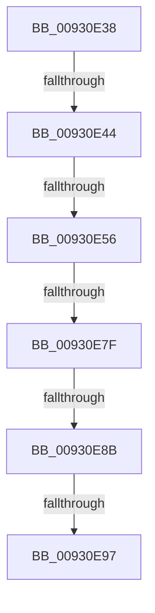

# sub_00930E38

- RVA: `0x00930E38`–`0x00930EA1` (길이 `105` bytes)
- VA: `0x0000000140930E38`
- 실행 섹션: `PAGE`
- PDB 이름 있음: `아니요`; PDB Function 태그: `아니요`
- unwind 정보 RVA: `0x0008EBF0`
- 디코드: `21`개 명령, `105/105` bytes 표시
- 미해석 바이트: `0` (있으면 어셈블리에 `.byte`로 보존)

> 이 문서는 커널 이미지의 기계어와 PDB 기호를 분석해 생성했습니다. 4번과 5번은 함수 원형과 자료형을 바이너리 사용 방식에서 추정한 C 해석이며 원본 소스 복구 결과는 아닙니다.

## 1. Dependencies

- 직접 호출 지점: **2**; 고유 호출 대상: **2**
- 직접 호출자로 확인된 함수: **0**
- RIP 상대 이미지 참조: **0**

### Outgoing calls
- `0x00930E63` → [ExReleaseResourceLite](../../text/25/ExReleaseResourceLite_function_0025FA10.md) (function, `0x0025FA10`)
- `0x00930E71` → [KeLeaveCriticalRegionThread](../../text/25/KeLeaveCriticalRegionThread_function_0025EFF0.md) (function, `0x0025EFF0`)

### Direct callers
- 이 함수 시작 RVA로 연결되는 직접 call은 확인되지 않았습니다. 간접 호출은 완전히 역산할 수 없습니다.

### Static image references
- 디코드된 RIP-relative 메모리 참조가 없습니다.

## 2. Other-region calls and transfers

- 다른 실행 섹션으로 향하는 call: **2**
  - `0x00930E63` → [ExReleaseResourceLite](../../text/25/ExReleaseResourceLite_function_0025FA10.md) (`PAGE` → `.text`)
  - `0x00930E71` → [KeLeaveCriticalRegionThread](../../text/25/KeLeaveCriticalRegionThread_function_0025EFF0.md) (`PAGE` → `.text`)
- call이 아닌 외부 분기/꼬리 이동: **5**
  - `0x00930E42` → [sub_00930EBB](Unknown_function_00930EBB.md) (`tail-transfer`)
  - `0x00930E50` → [sub_00930F5A + 0x50](Unknown_function_00930F5A.md) (`tail-transfer`)
  - `0x00930E79` → [sub_00930F5A + 0xA2](Unknown_function_00930F5A.md) (`tail-transfer`)
  - `0x00930E85` → [sub_00930F5A](Unknown_function_00930F5A.md) (`tail-transfer`)
  - `0x00930E91` → [sub_00930F5A](Unknown_function_00930F5A.md) (`tail-transfer`)

## 3. Assembly (complete function range)

```asm
00930E38  4C 89 AC 24 80 00 00 00         mov qword ptr [rsp + 0x80], r13
00930E40  A8 02                           test al, 2
00930E42  74 77                           je 0x140930ebb
00930E44  4C 8D 7F 68                     lea r15, [rdi + 0x68]
00930E48  49 39 1C EF                     cmp qword ptr [r15 + rbp*8], rbx
00930E4C  4D 8D 3C EF                     lea r15, [r15 + rbp*8]
00930E50  0F 84 54 01 00 00               je 0x140930faa
00930E56  49 8B 07                        mov rax, qword ptr [r15]
00930E59  49 89 06                        mov qword ptr [r14], rax
00930E5C  48 8B 8F 98 00 00 00            mov rcx, qword ptr [rdi + 0x98]
00930E63  E8 A8 EB 92 FF                  call 0x14025fa10
00930E68  65 48 8B 0C 25 88 01 00 00      mov rcx, qword ptr gs:[0x188]
00930E71  E8 7A E1 92 FF                  call 0x14025eff0
00930E76  48 85 F6                        test rsi, rsi
00930E79  0F 85 7D 01 00 00               jne 0x140930ffc
00930E7F  81 FB 25 02 00 C0               cmp ebx, 0xc0000225
00930E85  0F 84 CF 00 00 00               je 0x140930f5a
00930E8B  81 FB 34 00 00 C0               cmp ebx, 0xc0000034
00930E91  0F 84 C3 00 00 00               je 0x140930f5a
00930E97  8B C3                           mov eax, ebx
00930E99  4C 8B AC 24 80 00 00 00         mov r13, qword ptr [rsp + 0x80]
```

## 4. C-style interpretation (structured pseudocode)

```c
__int64 __fastcall sub_00930E38(__int64 a1, __int64 a2, __int64 a3, __int64 a4, __int64 a5, __int64 a6, __int64 a7, __int64 a8, __int64 a9, __int64 a10, __int64 a11, __int64 a12, __int64 a13, __int64 a14, __int64 a15, __int64 a16)
{
    __int64 result;
    unsigned __int64 v_stack_p80;

    v_stack_p80 = v_r13;
    *(unsigned __int64 *)(v_r14) = *(unsigned __int64 *)(v_rdi + 104 + v_rbp * 8);
    result = ExReleaseResourceLite(*(unsigned __int64 *)(v_rdi + 152), a2, a3, a4);
    result = KeLeaveCriticalRegionThread(*(unsigned __int64 *)(gs_base + (0 + 392)), a2, a3, a4);
    return (unsigned int)((unsigned int)(v_rbx));
}
```

## 5. (Beta) C Style

```c
int64_t sub_00930E38(int64_t Arg1, int64_t Arg2, int64_t Arg3, int64_t Arg4, uint64_t Arg5, uint64_t Arg6, uint64_t Arg7, uint64_t Arg8, uint64_t Arg9, uint64_t Arg10, uint64_t Arg11, uint64_t Arg12, uint64_t Arg13, uint64_t Arg14, uint64_t Arg15, int64_t Arg16)
{
    int64_t result;
    uint64_t v_stack_p80;

    v_stack_p80 = local_r13;
    *(uint64_t *)(local_r14) = *(uint64_t *)(local_rdi + 0x68 + local_rbp * 8);
    result = ExReleaseResourceLite(*(uint64_t *)(local_rdi + 0x98), Arg2, Arg3, Arg4);
    result = KeLeaveCriticalRegionThread(*(uint64_t *)(gs_base + (0 + 0x188)), Arg2, Arg3, Arg4);
    return (uint32_t)((uint32_t)(local_rbx));
}
```

## 6. Execution-region graph

[열기: 2D/3D 그래프와 함수 탐색 컨트롤 패널](../../../control-panel.html?section=page&rva=0x00930E38&view=graph)

- 2D 그래프는 위에서 아래로 흐르고, 3D 그래프는 빈 공간을 드래그해 회전합니다. Shift+드래그는 이동, 휠은 확대·축소, 함수 노드 선택은 대상 보고서 이동입니다.

### Static fallback


