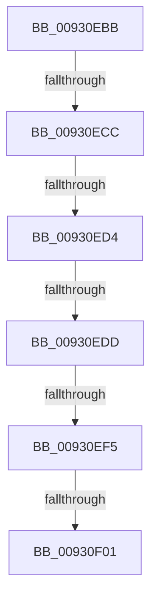

# sub_00930EBB

- RVA: `0x00930EBB`–`0x00930F36` (길이 `123` bytes)
- VA: `0x0000000140930EBB`
- 실행 섹션: `PAGE`
- PDB 이름 있음: `아니요`; PDB Function 태그: `아니요`
- unwind 정보 RVA: `0x0008EC18`
- 디코드: `31`개 명령, `123/123` bytes 표시
- 미해석 바이트: `0` (있으면 어셈블리에 `.byte`로 보존)

> 이 문서는 커널 이미지의 기계어와 PDB 기호를 분석해 생성했습니다. 4번과 5번은 함수 원형과 자료형을 바이너리 사용 방식에서 추정한 C 해석이며 원본 소스 복구 결과는 아닙니다.

## 1. Dependencies

- 직접 호출 지점: **2**; 고유 호출 대상: **2**
- 직접 호출자로 확인된 함수: **0**
- RIP 상대 이미지 참조: **1**

### Outgoing calls
- `0x00930EC1` → [DrvDbLoadDatabaseNode](DrvDbLoadDatabaseNode_function_00931668.md) (function, `0x00931668`)
- `0x00930F2A` → [RegRtlCreateTreeTransacted](RegRtlCreateTreeTransacted_function_00931D1C.md) (function, `0x00931D1C`)

### Direct callers
- 이 함수 시작 RVA로 연결되는 직접 call은 확인되지 않았습니다. 간접 호출은 완전히 역산할 수 없습니다.

### Static image references
- `0x00930EE1` → RVA `0x000021B0` (`.rdata`; read)

## 2. Other-region calls and transfers

- 다른 실행 섹션으로 향하는 call: **0**
- call이 아닌 외부 분기/꼬리 이동: **6**
  - `0x00930ECA` → [sub_00930E38 + 0x24](Unknown_function_00930E38.md) (`tail-transfer`)
  - `0x00930ECE` → [sub_00930F5A + 0xF](Unknown_function_00930F5A.md) (`tail-transfer`)
  - `0x00930ED7` → [sub_00930F5A + 0x8C](Unknown_function_00930F5A.md) (`tail-transfer`)
  - `0x00930EF3` → [sub_00930F5A + 0xA](Unknown_function_00930F5A.md) (`tail-transfer`)
  - `0x00930EFF` → [sub_00930F5A + 0xA](Unknown_function_00930F5A.md) (`tail-transfer`)
  - `0x00930F31` → [sub_00930E38 + 0x24](Unknown_function_00930E38.md) (`tail-transfer`)

## 3. Assembly (complete function range)

```asm
00930EBB  48 8B D7                        mov rdx, rdi
00930EBE  49 8B CC                        mov rcx, r12
00930EC1  E8 A2 07 00 00                  call 0x140931668
00930EC6  8B D8                           mov ebx, eax
00930EC8  85 C0                           test eax, eax
00930ECA  78 90                           js 0x140930e5c
00930ECC  85 ED                           test ebp, ebp
00930ECE  0F 84 95 00 00 00               je 0x140930f69
00930ED4  83 FD 01                        cmp ebp, 1
00930ED7  0F 84 09 01 00 00               je 0x140930fe6
00930EDD  49 8B 04 24                     mov rax, qword ptr [r12]
00930EE1  48 8D 15 C8 12 6D FF            lea rdx, [rip - 0x92ed38]
00930EE8  48 8B 14 EA                     mov rdx, qword ptr [rdx + rbp*8]
00930EEC  4C 8B 57 60                     mov r10, qword ptr [rdi + 0x60]
00930EF0  48 85 C0                        test rax, rax
00930EF3  74 6F                           je 0x140930f64
00930EF5  48 8B 80 E0 00 00 00            mov rax, qword ptr [rax + 0xe0]
00930EFC  48 85 C0                        test rax, rax
00930EFF  74 63                           je 0x140930f64
00930F01  48 8B 48 08                     mov rcx, qword ptr [rax + 8]
00930F05  48 89 4C 24 40                  mov qword ptr [rsp + 0x40], rcx
00930F0A  41 B9 00 00 00 02               mov r9d, 0x2000000
00930F10  4C 89 7C 24 38                  mov qword ptr [rsp + 0x38], r15
00930F15  45 33 C0                        xor r8d, r8d
00930F18  4C 89 74 24 30                  mov qword ptr [rsp + 0x30], r14
00930F1D  49 8B CA                        mov rcx, r10
00930F20  44 88 7C 24 28                  mov byte ptr [rsp + 0x28], r15b
00930F25  48 89 74 24 20                  mov qword ptr [rsp + 0x20], rsi
00930F2A  E8 ED 0D 00 00                  call 0x140931d1c
00930F2F  8B D8                           mov ebx, eax
00930F31  E9 26 FF FF FF                  jmp 0x140930e5c
```

## 4. C-style interpretation (structured pseudocode)

```c
__int64 __fastcall sub_00930EBB(__int64 a1, __int64 a2, int a3)
{
    __int64 result;
    unsigned __int64 v_stack_p20;
    unsigned __int8 v_stack_p28;
    unsigned __int64 v_stack_p30;
    unsigned __int64 v_stack_p38;
    unsigned __int64 v_stack_p40;

    result = DrvDbLoadDatabaseNode(v_r12, v_rdi, a3, a4);
    v_stack_p40 = *(unsigned __int64 *)(*(unsigned __int64 *)(*(unsigned __int64 *)(v_r12) + 224) + 8);
    v_stack_p38 = v_r15;
    a3 = 0;
    v_stack_p30 = v_r14;
    v_stack_p28 = (unsigned __int8)(v_r15);
    v_stack_p20 = v_rsi;
    result = RegRtlCreateTreeTransacted(*(unsigned __int64 *)(v_rdi + 96), *(unsigned __int64 *)(v_rip - 9628984 + v_rbp * 8), a3, (unsigned int)(0x2000000ULL));
}
```

## 5. (Beta) C Style

```c
int64_t sub_00930EBB(int64_t Arg1, int64_t Arg2, int32_t Arg3)
{
    int64_t result;
    uint64_t v_stack_p20;
    uint8_t v_stack_p28;
    uint64_t v_stack_p30;
    uint64_t v_stack_p38;
    uint64_t v_stack_p40;

    result = DrvDbLoadDatabaseNode(local_r12, local_rdi, Arg3, a4);
    v_stack_p40 = *(uint64_t *)(*(uint64_t *)(*(uint64_t *)(local_r12) + 0xE0) + 0x8);
    v_stack_p38 = local_r15;
    Arg3 = 0;
    v_stack_p30 = local_r14;
    v_stack_p28 = (uint8_t)(local_r15);
    v_stack_p20 = local_rsi;
    result = RegRtlCreateTreeTransacted(*(uint64_t *)(local_rdi + 0x60), *(uint64_t *)(v_rip - 0x92ED38 + local_rbp * 8), Arg3, (uint32_t)(0x2000000ULL));
}
```

## 6. Execution-region graph

[열기: 2D/3D 그래프와 함수 탐색 컨트롤 패널](../../../control-panel.html?section=page&rva=0x00930EBB&view=graph)

- 2D 그래프는 위에서 아래로 흐르고, 3D 그래프는 빈 공간을 드래그해 회전합니다. Shift+드래그는 이동, 휠은 확대·축소, 함수 노드 선택은 대상 보고서 이동입니다.

### Static fallback


