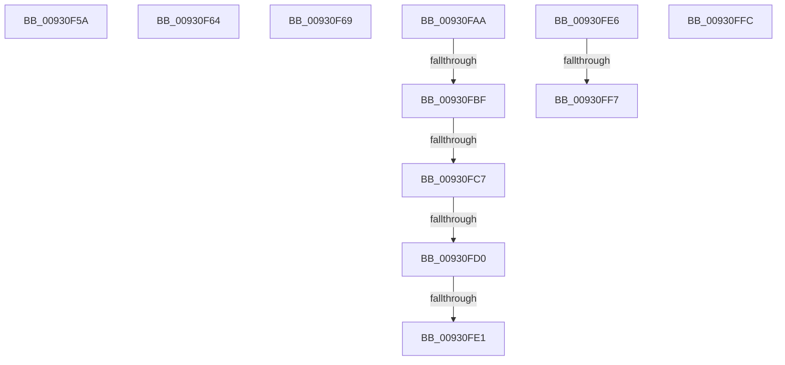

# sub_00930F5A

- RVA: `0x00930F5A`–`0x0093100B` (길이 `177` bytes)
- VA: `0x0000000140930F5A`
- 실행 섹션: `PAGE`
- PDB 이름 있음: `아니요`; PDB Function 태그: `아니요`
- unwind 정보 RVA: `0x0008EC3C`
- 디코드: `41`개 명령, `177/177` bytes 표시
- 미해석 바이트: `0` (있으면 어셈블리에 `.byte`로 보존)

> 이 문서는 커널 이미지의 기계어와 PDB 기호를 분석해 생성했습니다. 4번과 5번은 함수 원형과 자료형을 바이너리 사용 방식에서 추정한 C 해석이며 원본 소스 복구 결과는 아닙니다.

## 1. Dependencies

- 직접 호출 지점: **7**; 고유 호출 대상: **6**
- 직접 호출자로 확인된 함수: **0**
- RIP 상대 이미지 참조: **0**

### Outgoing calls
- `0x00930F84` → [PnpCtxRegOpenKey](../8E/PnpCtxRegOpenKey_function_008EF7B8.md) (function, `0x008EF7B8`)
- `0x00930F92` → [ExReleaseResourceLite](../../text/25/ExReleaseResourceLite_function_0025FA10.md) (function, `0x0025FA10`)
- `0x00930FA0` → [KeLeaveCriticalRegionThread](../../text/25/KeLeaveCriticalRegionThread_function_0025EFF0.md) (function, `0x0025EFF0`)
- `0x00930FB0` → [DrvDbLoadDatabaseNode](DrvDbLoadDatabaseNode_function_00931668.md) (function, `0x00931668`)
- `0x00930FD0` → [DrvDbGetRegistrarSecurityDescriptor](../83/DrvDbGetRegistrarSecurityDescriptor_function_00835728.md) (function, `0x00835728`)
- `0x00930FE6` → [DrvDbGetRegistrarSecurityDescriptor](../83/DrvDbGetRegistrarSecurityDescriptor_function_00835728.md) (function, `0x00835728`)
- `0x00931001` → [ExFreePoolWithTag](../../poolcode/B8/ExFreePoolWithTag_function_00B82870.md) (function, `0x00B82870`)

### Direct callers
- 이 함수 시작 RVA로 연결되는 직접 call은 확인되지 않았습니다. 간접 호출은 완전히 역산할 수 없습니다.

### Static image references
- 디코드된 RIP-relative 메모리 참조가 없습니다.

## 2. Other-region calls and transfers

- 다른 실행 섹션으로 향하는 call: **3**
  - `0x00930F92` → [ExReleaseResourceLite](../../text/25/ExReleaseResourceLite_function_0025FA10.md) (`PAGE` → `.text`)
  - `0x00930FA0` → [KeLeaveCriticalRegionThread](../../text/25/KeLeaveCriticalRegionThread_function_0025EFF0.md) (`PAGE` → `.text`)
  - `0x00931001` → [ExFreePoolWithTag](../../poolcode/B8/ExFreePoolWithTag_function_00B82870.md) (`PAGE` → `POOLCODE`)
- call이 아닌 외부 분기/꼬리 이동: **11**
  - `0x00930F5F` → [sub_00930E38 + 0x61](Unknown_function_00930E38.md) (`tail-transfer`)
  - `0x00930F67` → [sub_00930EBB + 0x4A](Unknown_function_00930EBB.md) (`tail-transfer`)
  - `0x00930FA5` → [sub_00930E38 + 0x47](Unknown_function_00930E38.md) (`tail-transfer`)
  - `0x00930FB9` → [sub_00930E38 + 0x24](Unknown_function_00930E38.md) (`tail-transfer`)
  - `0x00930FC1` → [sub_00B240D8 + 0x38](../B2/Unknown_function_00B240D8.md) (`tail-transfer`)
  - `0x00930FCA` → [sub_00B240D8](../B2/Unknown_function_00B240D8.md) (`tail-transfer`)
  - `0x00930FDB` → [sub_00B240D8](../B2/Unknown_function_00B240D8.md) (`tail-transfer`)
  - `0x00930FE1` → [sub_00B240D8 + 0x67](../B2/Unknown_function_00B240D8.md) (`tail-transfer`)
  - `0x00930FF1` → [sub_00930EBB + 0x22](Unknown_function_00930EBB.md) (`tail-transfer`)
  - `0x00930FF7` → [sub_00B240D8 + 0x67](../B2/Unknown_function_00B240D8.md) (`tail-transfer`)
  - `0x00931006` → [sub_00930E38 + 0x47](Unknown_function_00930E38.md) (`tail-transfer`)

## 3. Assembly (complete function range)

```asm
00930F5A  B8 6D 03 00 C0                  mov eax, 0xc000036d
00930F5F  E9 35 FF FF FF                  jmp 0x140930e99
00930F64  49 8B CF                        mov rcx, r15
00930F67  EB 9C                           jmp 0x140930f05
00930F69  48 8B 57 60                     mov rdx, qword ptr [rdi + 0x60]
00930F6D  45 33 C9                        xor r9d, r9d
00930F70  49 8B 0C 24                     mov rcx, qword ptr [r12]
00930F74  45 33 C0                        xor r8d, r8d
00930F77  4C 89 74 24 28                  mov qword ptr [rsp + 0x28], r14
00930F7C  C7 44 24 20 00 00 00 02         mov dword ptr [rsp + 0x20], 0x2000000
00930F84  E8 2F E8 FB FF                  call 0x1408ef7b8
00930F89  48 8B 8F 98 00 00 00            mov rcx, qword ptr [rdi + 0x98]
00930F90  8B D8                           mov ebx, eax
00930F92  E8 79 EA 92 FF                  call 0x14025fa10
00930F97  65 48 8B 0C 25 88 01 00 00      mov rcx, qword ptr gs:[0x188]
00930FA0  E8 4B E0 92 FF                  call 0x14025eff0
00930FA5  E9 D5 FE FF FF                  jmp 0x140930e7f
00930FAA  48 8B D7                        mov rdx, rdi
00930FAD  49 8B CC                        mov rcx, r12
00930FB0  E8 B3 06 00 00                  call 0x140931668
00930FB5  8B D8                           mov ebx, eax
00930FB7  85 C0                           test eax, eax
00930FB9  0F 88 9D FE FF FF               js 0x140930e5c
00930FBF  85 ED                           test ebp, ebp
00930FC1  0F 84 49 31 1F 00               je 0x140b24110
00930FC7  83 FD 01                        cmp ebp, 1
00930FCA  0F 85 08 31 1F 00               jne 0x140b240d8
00930FD0  E8 53 47 F0 FF                  call 0x140835728
00930FD5  48 8B F0                        mov rsi, rax
00930FD8  48 85 C0                        test rax, rax
00930FDB  0F 85 F7 30 1F 00               jne 0x140b240d8
00930FE1  E9 59 31 1F 00                  jmp 0x140b2413f
00930FE6  E8 3D 47 F0 FF                  call 0x140835728
00930FEB  48 8B F0                        mov rsi, rax
00930FEE  48 85 C0                        test rax, rax
00930FF1  0F 85 E6 FE FF FF               jne 0x140930edd
00930FF7  E9 43 31 1F 00                  jmp 0x140b2413f
00930FFC  33 D2                           xor edx, edx
00930FFE  48 8B CE                        mov rcx, rsi
00931001  E8 6A 18 25 00                  call 0x140b82870
00931006  E9 74 FE FF FF                  jmp 0x140930e7f
```

## 4. C-style interpretation (structured pseudocode)

```c
__int64 __fastcall sub_00930F5A(__int64 a1, __int64 a2, int a3, int a4)
{
    unsigned int v_stack_p20;
    unsigned __int64 v_stack_p28;
}
```

## 5. (Beta) C Style

```c
int64_t sub_00930F5A(int64_t Arg1, int64_t Arg2, int32_t Arg3, int32_t Arg4)
{
    uint32_t v_stack_p20;
    uint64_t v_stack_p28;
}
```

## 6. Execution-region graph

[열기: 2D/3D 그래프와 함수 탐색 컨트롤 패널](../../../control-panel.html?section=page&rva=0x00930F5A&view=graph)

- 2D 그래프는 위에서 아래로 흐르고, 3D 그래프는 빈 공간을 드래그해 회전합니다. Shift+드래그는 이동, 휠은 확대·축소, 함수 노드 선택은 대상 보고서 이동입니다.

### Static fallback


