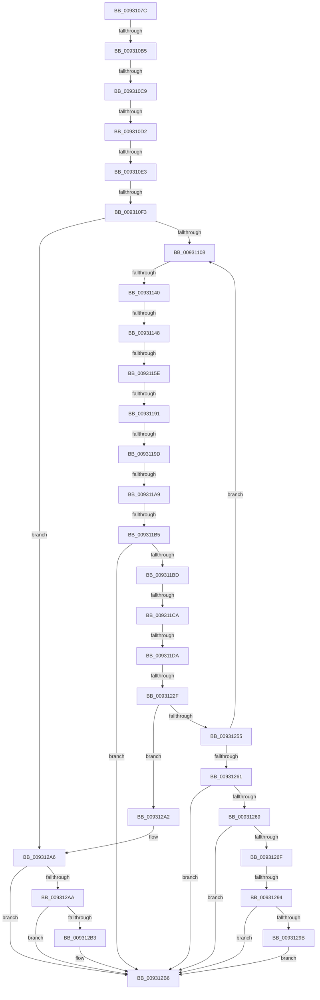

# sub_0093107C

- RVA: `0x0093107C`–`0x009312D7` (길이 `603` bytes)
- VA: `0x000000014093107C`
- 실행 섹션: `PAGE`
- PDB 이름 있음: `아니요`; PDB Function 태그: `아니요`
- unwind 정보 RVA: `0x0008EC78`
- 디코드: `140`개 명령, `603/603` bytes 표시
- 미해석 바이트: `0` (있으면 어셈블리에 `.byte`로 보존)

> 이 문서는 커널 이미지의 기계어와 PDB 기호를 분석해 생성했습니다. 4번과 5번은 함수 원형과 자료형을 바이너리 사용 방식에서 추정한 C 해석이며 원본 소스 복구 결과는 아닙니다.

## 1. Dependencies

- 직접 호출 지점: **8**; 고유 호출 대상: **5**
- 직접 호출자로 확인된 함수: **0**
- RIP 상대 이미지 참조: **0**

### Outgoing calls
- `0x00931130` → [ExAcquireResourceExclusiveLite](../../text/21/ExAcquireResourceExclusiveLite_function_00214E20.md) (function, `0x00214E20`)
- `0x00931175` → [ExReleaseResourceLite](../../text/25/ExReleaseResourceLite_function_0025FA10.md) (function, `0x0025FA10`)
- `0x00931183` → [KeLeaveCriticalRegionThread](../../text/25/KeLeaveCriticalRegionThread_function_0025EFF0.md) (function, `0x0025EFF0`)
- `0x009311FA` → [_RegRtlOpenKeyTransacted](../8E/_RegRtlOpenKeyTransacted_function_008EF810.md) (function, `0x008EF810`)
- `0x0093121F` → [ExAcquireResourceExclusiveLite](../../text/21/ExAcquireResourceExclusiveLite_function_00214E20.md) (function, `0x00214E20`)
- `0x00931236` → [ExReleaseResourceLite](../../text/25/ExReleaseResourceLite_function_0025FA10.md) (function, `0x0025FA10`)
- `0x00931244` → [KeLeaveCriticalRegionThread](../../text/25/KeLeaveCriticalRegionThread_function_0025EFF0.md) (function, `0x0025EFF0`)
- `0x00931285` → [DrvDbAcquireDatabaseNodeBaseKey](DrvDbAcquireDatabaseNodeBaseKey_function_00930DE0.md) (function, `0x00930DE0`)

### Direct callers
- 이 함수 시작 RVA로 연결되는 직접 call은 확인되지 않았습니다. 간접 호출은 완전히 역산할 수 없습니다.

### Static image references
- 디코드된 RIP-relative 메모리 참조가 없습니다.

## 2. Other-region calls and transfers

- 다른 실행 섹션으로 향하는 call: **6**
  - `0x00931130` → [ExAcquireResourceExclusiveLite](../../text/21/ExAcquireResourceExclusiveLite_function_00214E20.md) (`PAGE` → `.text`)
  - `0x00931175` → [ExReleaseResourceLite](../../text/25/ExReleaseResourceLite_function_0025FA10.md) (`PAGE` → `.text`)
  - `0x00931183` → [KeLeaveCriticalRegionThread](../../text/25/KeLeaveCriticalRegionThread_function_0025EFF0.md) (`PAGE` → `.text`)
  - `0x0093121F` → [ExAcquireResourceExclusiveLite](../../text/21/ExAcquireResourceExclusiveLite_function_00214E20.md) (`PAGE` → `.text`)
  - `0x00931236` → [ExReleaseResourceLite](../../text/25/ExReleaseResourceLite_function_0025FA10.md) (`PAGE` → `.text`)
  - `0x00931244` → [KeLeaveCriticalRegionThread](../../text/25/KeLeaveCriticalRegionThread_function_0025EFF0.md) (`PAGE` → `.text`)
- call이 아닌 외부 분기/꼬리 이동: **17**
  - `0x009310AF` → [sub_00931330 + 0x8F](Unknown_function_00931330.md) (`tail-transfer`)
  - `0x009310C3` → [sub_00931420 + 0x11E](Unknown_function_00931420.md) (`tail-transfer`)
  - `0x009310CC` → [sub_00931420 + 0x44](Unknown_function_00931420.md) (`tail-transfer`)
  - `0x009310DD` → [sub_00931420 + 0x9F](Unknown_function_00931420.md) (`tail-transfer`)
  - `0x009310ED` → [sub_00931420 + 0x9F](Unknown_function_00931420.md) (`tail-transfer`)
  - `0x0093113A` → [sub_00931420](Unknown_function_00931420.md) (`tail-transfer`)
  - `0x00931142` → [sub_00931330](Unknown_function_00931330.md) (`tail-transfer`)
  - `0x00931158` → [sub_00B24164](../B2/Unknown_function_00B24164.md) (`tail-transfer`)
  - `0x0093118B` → [sub_00931420 + 0x233](Unknown_function_00931420.md) (`tail-transfer`)
  - `0x00931197` → [sub_00931420 + 0x145](Unknown_function_00931420.md) (`tail-transfer`)
  - `0x009311A3` → [sub_00931420 + 0x145](Unknown_function_00931420.md) (`tail-transfer`)
  - `0x009311AF` → [sub_00931420 + 0x1A](Unknown_function_00931420.md) (`tail-transfer`)
  - `0x009311C4` → [sub_00931420 + 0x128](Unknown_function_00931420.md) (`tail-transfer`)
  - `0x009311D4` → [sub_00931420 + 0x128](Unknown_function_00931420.md) (`tail-transfer`)
  - `0x00931229` → [sub_00931420 + 0x24](Unknown_function_00931420.md) (`tail-transfer`)
  - `0x0093128E` → [sub_00B24164 + 0xCF](../B2/Unknown_function_00B24164.md) (`tail-transfer`)
  - `0x009312D5` → [sub_009312D7 + 0x48](Unknown_function_009312D7.md) (`tail-transfer`)

## 3. Assembly (complete function range)

```asm
0093107C  4C 89 60 10                     mov qword ptr [rax + 0x10], r12
00931080  0F 57 C0                        xorps xmm0, xmm0
00931083  4C 89 70 D0                     mov qword ptr [rax - 0x30], r14
00931087  49 8B F9                        mov rdi, r9
0093108A  45 33 F6                        xor r14d, r14d
0093108D  4C 89 78 C8                     mov qword ptr [rax - 0x38], r15
00931091  66 41 83 39 40                  cmp word ptr [r9], 0x40
00931096  4C 8B E2                        mov r12, rdx
00931099  4C 8B E9                        mov r13, rcx
0093109C  4C 89 75 CF                     mov qword ptr [rbp - 0x31], r14
009310A0  4C 89 75 D7                     mov qword ptr [rbp - 0x29], r14
009310A4  41 8B DE                        mov ebx, r14d
009310A7  44 89 75 E3                     mov dword ptr [rbp - 0x1d], r14d
009310AB  0F 11 45 EF                     movups xmmword ptr [rbp - 0x11], xmm0
009310AF  0F 84 0A 03 00 00               je 0x1409313bf
009310B5  48 8B F7                        mov rsi, rdi
009310B8  4C 89 75 E7                     mov qword ptr [rbp - 0x19], r14
009310BC  44 89 75 DF                     mov dword ptr [rbp - 0x21], r14d
009310C0  48 85 F6                        test rsi, rsi
009310C3  0F 84 75 04 00 00               je 0x14093153e
009310C9  48 3B F7                        cmp rsi, rdi
009310CC  0F 85 92 03 00 00               jne 0x140931464
009310D2  4D 8B 7D 30                     mov r15, qword ptr [r13 + 0x30]
009310D6  4C 89 7D D7                     mov qword ptr [rbp - 0x29], r15
009310DA  4D 85 FF                        test r15, r15
009310DD  0F 85 DC 03 00 00               jne 0x1409314bf
009310E3  4C 89 65 D7                     mov qword ptr [rbp - 0x29], r12
009310E7  4D 8B FC                        mov r15, r12
009310EA  4D 85 E4                        test r12, r12
009310ED  0F 85 CC 03 00 00               jne 0x1409314bf
009310F3  49 8B 7D 10                     mov rdi, qword ptr [r13 + 0x10]
009310F7  4D 8D 65 10                     lea r12, [r13 + 0x10]
009310FB  4C 89 65 DF                     mov qword ptr [rbp - 0x21], r12
009310FF  49 3B FC                        cmp rdi, r12
00931102  0F 84 9E 01 00 00               je 0x1409312a6
00931108  4C 89 75 CF                     mov qword ptr [rbp - 0x31], r14
0093110C  B2 01                           mov dl, 1
0093110E  65 48 8B 04 25 88 01 00 00      mov rax, qword ptr gs:[0x188]
00931117  41 8B DE                        mov ebx, r14d
0093111A  48 89 7D D7                     mov qword ptr [rbp - 0x29], rdi
0093111E  4D 8B FE                        mov r15, r14
00931121  66 FF 88 E4 01 00 00            dec word ptr [rax + 0x1e4]
00931128  90                              nop
00931129  48 8B 8F 98 00 00 00            mov rcx, qword ptr [rdi + 0x98]
00931130  E8 EB 3C 8E FF                  call 0x140214e20
00931135  8B 47 40                        mov eax, dword ptr [rdi + 0x40]
00931138  A8 04                           test al, 4
0093113A  0F 85 E0 02 00 00               jne 0x140931420
00931140  A8 02                           test al, 2
00931142  0F 84 E8 01 00 00               je 0x140931330
00931148  4C 63 6D 4F                     movsxd r13, dword ptr [rbp + 0x4f]
0093114C  4D 8D 65 0D                     lea r12, [r13 + 0xd]
00931150  4A 39 1C E7                     cmp qword ptr [rdi + r12*8], rbx
00931154  4E 8D 24 E7                     lea r12, [rdi + r12*8]
00931158  0F 84 06 30 1F 00               je 0x140b24164
0093115E  4C 8B 6D 3F                     mov r13, qword ptr [rbp + 0x3f]
00931162  49 8B 04 24                     mov rax, qword ptr [r12]
00931166  48 89 45 CF                     mov qword ptr [rbp - 0x31], rax
0093116A  4D 8D 65 10                     lea r12, [r13 + 0x10]
0093116E  48 8B 8F 98 00 00 00            mov rcx, qword ptr [rdi + 0x98]
00931175  E8 96 E8 92 FF                  call 0x14025fa10
0093117A  65 48 8B 0C 25 88 01 00 00      mov rcx, qword ptr gs:[0x188]
00931183  E8 68 DE 92 FF                  call 0x14025eff0
00931188  4D 85 FF                        test r15, r15
0093118B  0F 85 C2 04 00 00               jne 0x140931653
00931191  81 FB 25 02 00 C0               cmp ebx, 0xc0000225
00931197  0F 84 C8 03 00 00               je 0x140931565
0093119D  81 FB 34 00 00 C0               cmp ebx, 0xc0000034
009311A3  0F 84 BC 03 00 00               je 0x140931565
009311A9  81 FB 67 04 00 C0               cmp ebx, 0xc0000467
009311AF  0F 84 85 02 00 00               je 0x14093143a
009311B5  85 DB                           test ebx, ebx
009311B7  0F 88 F9 00 00 00               js 0x1409312b6
009311BD  49 8B 45 00                     mov rax, qword ptr [r13]
009311C1  48 85 C0                        test rax, rax
009311C4  0F 84 7E 03 00 00               je 0x140931548
009311CA  48 8B 88 E0 00 00 00            mov rcx, qword ptr [rax + 0xe0]
009311D1  48 85 C9                        test rcx, rcx
009311D4  0F 84 6E 03 00 00               je 0x140931548
009311DA  48 8B 41 08                     mov rax, qword ptr [rcx + 8]
009311DE  44 8B 4D 5F                     mov r9d, dword ptr [rbp + 0x5f]
009311E2  45 33 C0                        xor r8d, r8d
009311E5  48 8B 4D CF                     mov rcx, qword ptr [rbp - 0x31]
009311E9  48 8B D6                        mov rdx, rsi
009311EC  48 89 44 24 28                  mov qword ptr [rsp + 0x28], rax
009311F1  48 8B 45 6F                     mov rax, qword ptr [rbp + 0x6f]
009311F5  48 89 44 24 20                  mov qword ptr [rsp + 0x20], rax
009311FA  E8 11 E6 FB FF                  call 0x1408ef810
009311FF  4C 8B 7D CF                     mov r15, qword ptr [rbp - 0x31]
00931203  8B D8                           mov ebx, eax
00931205  65 48 8B 04 25 88 01 00 00      mov rax, qword ptr gs:[0x188]
0093120E  B2 01                           mov dl, 1
00931210  66 FF 88 E4 01 00 00            dec word ptr [rax + 0x1e4]
00931217  90                              nop
00931218  48 8B 8F 98 00 00 00            mov rcx, qword ptr [rdi + 0x98]
0093121F  E8 FC 3B 8E FF                  call 0x140214e20
00931224  8B 47 40                        mov eax, dword ptr [rdi + 0x40]
00931227  A8 02                           test al, 2
00931229  0F 84 15 02 00 00               je 0x140931444
0093122F  48 8B 8F 98 00 00 00            mov rcx, qword ptr [rdi + 0x98]
00931236  E8 D5 E7 92 FF                  call 0x14025fa10
0093123B  65 48 8B 0C 25 88 01 00 00      mov rcx, qword ptr gs:[0x188]
00931244  E8 A7 DD 92 FF                  call 0x14025eff0
00931249  4C 89 75 CF                     mov qword ptr [rbp - 0x31], r14
0093124D  81 FB 34 00 00 C0               cmp ebx, 0xc0000034
00931253  75 4D                           jne 0x1409312a2
00931255  48 8B 3F                        mov rdi, qword ptr [rdi]
00931258  49 3B FC                        cmp rdi, r12
0093125B  0F 85 A7 FE FF FF               jne 0x140931108
00931261  81 FB 34 00 00 C0               cmp ebx, 0xc0000034
00931267  75 4D                           jne 0x1409312b6
00931269  44 38 75 67                     cmp byte ptr [rbp + 0x67], r14b
0093126D  74 47                           je 0x1409312b6
0093126F  4D 8B 7D 28                     mov r15, qword ptr [r13 + 0x28]
00931273  4C 8D 4D CF                     lea r9, [rbp - 0x31]
00931277  44 8B 45 4F                     mov r8d, dword ptr [rbp + 0x4f]
0093127B  49 8B D7                        mov rdx, r15
0093127E  49 8B CD                        mov rcx, r13
00931281  4C 89 7D D7                     mov qword ptr [rbp - 0x29], r15
00931285  E8 56 FB FF FF                  call 0x140930de0
0093128A  8B D8                           mov ebx, eax
0093128C  85 C0                           test eax, eax
0093128E  0F 89 9F 2F 1F 00               jns 0x140b24233
00931294  3D 67 04 00 C0                  cmp eax, 0xc0000467
00931299  75 1B                           jne 0x1409312b6
0093129B  BB A2 00 00 C0                  mov ebx, 0xc00000a2
009312A0  EB 14                           jmp 0x1409312b6
009312A2  4C 8B 7D D7                     mov r15, qword ptr [rbp - 0x29]
009312A6  85 DB                           test ebx, ebx
009312A8  78 0C                           js 0x1409312b6
009312AA  48 8B 45 7F                     mov rax, qword ptr [rbp + 0x7f]
009312AE  48 85 C0                        test rax, rax
009312B1  74 03                           je 0x1409312b6
009312B3  4C 89 38                        mov qword ptr [rax], r15
009312B6  48 8B 75 CF                     mov rsi, qword ptr [rbp - 0x31]
009312BA  4C 8B BC 24 80 00 00 00         mov r15, qword ptr [rsp + 0x80]
009312C2  4C 8B B4 24 88 00 00 00         mov r14, qword ptr [rsp + 0x88]
009312CA  4C 8B A4 24 C8 00 00 00         mov r12, qword ptr [rsp + 0xc8]
009312D2  48 85 F6                        test rsi, rsi
009312D5  74 48                           je 0x14093131f
```

## 4. C-style interpretation (structured pseudocode)

```c
__int64 __fastcall sub_0093107C(__int64 a1, __int64 a2, int a3, __int64 a4, __int64 a5, __int64 a6, __int64 a7, __int64 a8, __int64 a9, __int64 a10, __int64 a11, __int64 a12, __int64 a13, __int64 a14, __int64 a15, __int64 a16, __int64 a17, __int64 a18, __int64 a19, __int64 a20, __int64 a21, __int64 a22, __int64 a23, __int64 a24, __int64 a25)
{
    __int64 result;
    __int64 v_r14;
    unsigned __int64 v_stack_p20;
    unsigned __int64 v_stack_p28;

    *(unsigned __int64 *)(result + 16) = v_r12;
    *(unsigned __int64 *)(result - 48) = v_r14;
    v_r14 = 0;
    *(unsigned __int64 *)(result - 56) = v_r15;
    *(unsigned __int64 *)(v_rbp - 49) = 0;
    *(unsigned __int64 *)(v_rbp - 41) = 0;
    *(unsigned int *)(v_rbp - 29) = 0;
    *(unsigned __int64 *)(v_rbp - 17) = v_xmm0;
    *(unsigned __int64 *)(v_rbp - 25) = 0;
    *(unsigned int *)(v_rbp - 33) = 0;
    *(unsigned __int64 *)(v_rbp - 41) = *(unsigned __int64 *)(a1 + 48);
    *(unsigned __int64 *)(v_rbp - 41) = a2;
    *(unsigned __int64 *)(v_rbp - 33) = a1 + 16;
    if ((*(unsigned __int64 *)(a1 + 16)) == (a1 + 16)) goto loc_009312A6;
loc_00931108:
    *(unsigned __int64 *)(v_rbp - 49) = 0;
    *(unsigned __int64 *)(v_rbp - 41) = *(unsigned __int64 *)(a1 + 16);
    result = ExAcquireResourceExclusiveLite(*(unsigned __int64 *)(*(unsigned __int64 *)(a1 + 16) + 152), 1, a3, a4);
    *(unsigned __int64 *)(v_rbp - 49) = *(unsigned __int64 *)(*(unsigned __int64 *)(a1 + 16) + (int)(*(unsigned int *)(v_rbp + 79)) + 13 * 8);
    result = ExReleaseResourceLite(*(unsigned __int64 *)(*(unsigned __int64 *)(a1 + 16) + 152), 1, a3, a4);
    result = KeLeaveCriticalRegionThread(*(unsigned __int64 *)(gs_base + (0 + 392)), 1, a3, a4);
    if (sign_flag) goto loc_009312B6;
    a3 = 0;
    v_stack_p28 = *(unsigned __int64 *)(*(unsigned __int64 *)(*(unsigned __int64 *)(*(unsigned __int64 *)(v_rbp + 63)) + 224) + 8);
    v_stack_p20 = *(unsigned __int64 *)(v_rbp + 111);
    result = _RegRtlOpenKeyTransacted(*(unsigned __int64 *)(v_rbp - 49), a4, a3, (unsigned int)(*(unsigned int *)(v_rbp + 95)));
    result = ExAcquireResourceExclusiveLite(*(unsigned __int64 *)(*(unsigned __int64 *)(a1 + 16) + 152), 1, a3, (unsigned int)(*(unsigned int *)(v_rbp + 95)));
    result = ExReleaseResourceLite(*(unsigned __int64 *)(*(unsigned __int64 *)(a1 + 16) + 152), 1, a3, (unsigned int)(*(unsigned int *)(v_rbp + 95)));
    result = KeLeaveCriticalRegionThread(*(unsigned __int64 *)(gs_base + (0 + 392)), 1, a3, (unsigned int)(*(unsigned int *)(v_rbp + 95)));
    *(unsigned __int64 *)(v_rbp - 49) = 0;
    if (((unsigned int)((unsigned int)((unsigned int)(result)))) != 0xC0000034ULL) goto loc_009312A2;
    if ((*(unsigned __int64 *)(*(unsigned __int64 *)(a1 + 16))) != (*(unsigned __int64 *)(v_rbp + 63) + 16)) goto loc_00931108;
    if (((unsigned int)((unsigned int)((unsigned int)(result)))) != 0xC0000034ULL) goto loc_009312B6;
    if ((*(unsigned __int8 *)(v_rbp + 103)) == 0) goto loc_009312B6;
    *(unsigned __int64 *)(v_rbp - 41) = *(unsigned __int64 *)(*(unsigned __int64 *)(v_rbp + 63) + 40);
    result = DrvDbAcquireDatabaseNodeBaseKey(*(unsigned __int64 *)(v_rbp + 63), *(unsigned __int64 *)(*(unsigned __int64 *)(v_rbp + 63) + 40), (unsigned int)(*(unsigned int *)(v_rbp + 79)), v_rbp - 49);
    if (((unsigned int)(result)) != 0xC0000467ULL) goto loc_009312B6;
    goto loc_009312B6;
loc_009312A2:
loc_009312A6:
    if (sign_flag) goto loc_009312B6;
    if (*(unsigned __int64 *)(v_rbp + 127) != 0) {
        *(unsigned __int64 *)(*(unsigned __int64 *)(v_rbp + 127)) = *(unsigned __int64 *)(v_rbp - 41);
    }
}
```

## 5. (Beta) C Style

```c
int64_t sub_0093107C(void *Arg1, int64_t Arg2, int32_t Arg3, void *Arg4, uint64_t Arg5, uint64_t Arg6, uint64_t Arg7, uint64_t Arg8, uint64_t Arg9, uint64_t Arg10, uint64_t Arg11, uint64_t Arg12, uint64_t Arg13, uint64_t Arg14, uint64_t Arg15, int64_t Arg16, int64_t Arg17, uint64_t Arg18, uint64_t Arg19, uint64_t Arg20, uint64_t Arg21, uint64_t Arg22, uint64_t Arg23, uint64_t Arg24, int64_t Arg25)
{
    uint8_t *arg1 = (uint8_t *)Arg1;
    uint8_t *arg4 = (uint8_t *)Arg4;

    int64_t result;
    int64_t local_r14;
    uint64_t v_stack_p20;
    uint64_t v_stack_p28;

    *(uint64_t *)(result + 0x10) = local_r12;
    *(uint64_t *)(result - 0x30) = local_r14;
    local_r14 = 0;
    *(uint64_t *)(result - 0x38) = local_r15;
    *(uint64_t *)(local_rbp - 0x31) = 0;
    *(uint64_t *)(local_rbp - 0x29) = 0;
    *(uint32_t *)(local_rbp - 0x1D) = 0;
    *(uint64_t *)(local_rbp - 0x11) = v_xmm0;
    *(uint64_t *)(local_rbp - 0x19) = 0;
    *(uint32_t *)(local_rbp - 0x21) = 0;
    *(uint64_t *)(local_rbp - 0x29) = *(uint64_t *)(arg1 + 0x30);
    *(uint64_t *)(local_rbp - 0x29) = Arg2;
    *(void **)(local_rbp - 0x21) = Arg1 + 16;
    if ((*(uint64_t *)(arg1 + 0x10)) == (Arg1 + 16)) goto loc_009312A6;
loc_00931108:
    *(uint64_t *)(local_rbp - 0x31) = 0;
    *(uint64_t *)(local_rbp - 0x29) = *(uint64_t *)(arg1 + 0x10);
    result = ExAcquireResourceExclusiveLite(*(uint64_t *)(*(uint64_t *)(arg1 + 0x10) + 0x98), 1, Arg3, Arg4);
    *(uint64_t *)(local_rbp - 0x31) = *(uint64_t *)(*(uint64_t *)(arg1 + 0x10) + (int32_t)(*(uint32_t *)(local_rbp + 0x4F)) + 0xD * 8);
    result = ExReleaseResourceLite(*(uint64_t *)(*(uint64_t *)(arg1 + 0x10) + 0x98), 1, Arg3, Arg4);
    result = KeLeaveCriticalRegionThread(*(uint64_t *)(gs_base + (0 + 0x188)), 1, Arg3, Arg4);
    if (sign_flag) goto loc_009312B6;
    Arg3 = 0;
    v_stack_p28 = *(uint64_t *)(*(uint64_t *)(*(uint64_t *)(*(uint64_t *)(local_rbp + 0x3F)) + 0xE0) + 0x8);
    v_stack_p20 = *(uint64_t *)(local_rbp + 0x6F);
    result = _RegRtlOpenKeyTransacted(*(uint64_t *)(local_rbp - 0x31), Arg4, Arg3, (uint32_t)(*(uint32_t *)(local_rbp + 0x5F)));
    result = ExAcquireResourceExclusiveLite(*(uint64_t *)(*(uint64_t *)(arg1 + 0x10) + 0x98), 1, Arg3, (uint32_t)(*(uint32_t *)(local_rbp + 0x5F)));
    result = ExReleaseResourceLite(*(uint64_t *)(*(uint64_t *)(arg1 + 0x10) + 0x98), 1, Arg3, (uint32_t)(*(uint32_t *)(local_rbp + 0x5F)));
    result = KeLeaveCriticalRegionThread(*(uint64_t *)(gs_base + (0 + 0x188)), 1, Arg3, (uint32_t)(*(uint32_t *)(local_rbp + 0x5F)));
    *(uint64_t *)(local_rbp - 0x31) = 0;
    if (((uint32_t)((uint32_t)((uint32_t)(result)))) != 0xC0000034ULL) goto loc_009312A2;
    if ((*(uint64_t *)(*(uint64_t *)(arg1 + 0x10))) != (*(uint64_t *)(local_rbp + 0x3F) + 16)) goto loc_00931108;
    if (((uint32_t)((uint32_t)((uint32_t)(result)))) != 0xC0000034ULL) goto loc_009312B6;
    if ((*(uint8_t *)(local_rbp + 0x67)) == 0) goto loc_009312B6;
    *(uint64_t *)(local_rbp - 0x29) = *(uint64_t *)(*(uint64_t *)(local_rbp + 0x3F) + 0x28);
    result = DrvDbAcquireDatabaseNodeBaseKey(*(uint64_t *)(local_rbp + 0x3F), *(uint64_t *)(*(uint64_t *)(local_rbp + 0x3F) + 0x28), (uint32_t)(*(uint32_t *)(local_rbp + 0x4F)), local_rbp - 49);
    if (((uint32_t)(result)) != 0xC0000467ULL) goto loc_009312B6;
    goto loc_009312B6;
loc_009312A2:
loc_009312A6:
    if (sign_flag) goto loc_009312B6;
    if (*(uint64_t *)(local_rbp + 0x7F) != 0) {
        *(uint64_t *)(*(uint64_t *)(local_rbp + 0x7F)) = *(uint64_t *)(local_rbp - 0x29);
    }
}
```

### 관측된 메모리 오프셋

구조체 형식이 확인되지 않은 접근은 인자 기준의 오프셋으로만 기록했습니다.

| 기준 인자 | 오프셋 표현 | 폭 (bit) | 접근 |
|---|---:|---:|---|
| `Arg1` | `+ 0x10` | `64` | `R` |
| `Arg1` | `+ 0x30` | `64` | `R` |
| `Arg4` | `+ 0x0` | `16` | `R` |

## 6. Execution-region graph

[열기: 2D/3D 그래프와 함수 탐색 컨트롤 패널](../../../control-panel.html?section=page&rva=0x0093107C&view=graph)

- 2D 그래프는 위에서 아래로 흐르고, 3D 그래프는 빈 공간을 드래그해 회전합니다. Shift+드래그는 이동, 휠은 확대·축소, 함수 노드 선택은 대상 보고서 이동입니다.

### Static fallback


