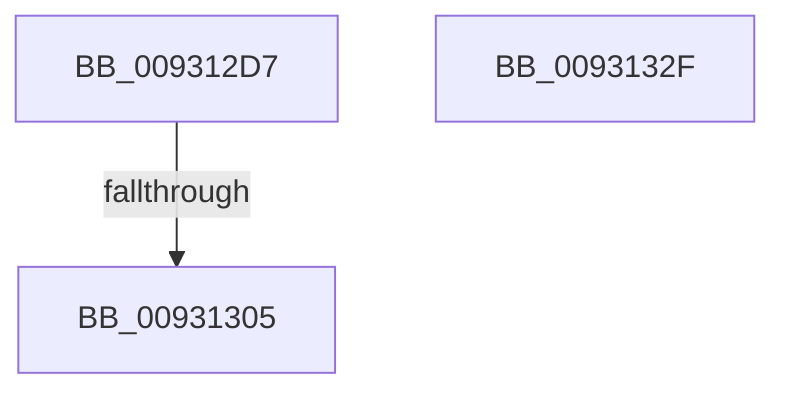

# sub_009312D7

- RVA: `0x009312D7`–`0x00931330` (길이 `89` bytes)
- VA: `0x00000001409312D7`
- 실행 섹션: `PAGE`
- PDB 이름 있음: `아니요`; PDB Function 태그: `아니요`
- unwind 정보 RVA: `0x0008EC94`
- 디코드: `23`개 명령, `89/89` bytes 표시
- 미해석 바이트: `0` (있으면 어셈블리에 `.byte`로 보존)

> 이 문서는 커널 이미지의 기계어와 PDB 기호를 분석해 생성했습니다. 4번과 5번은 함수 원형과 자료형을 바이너리 사용 방식에서 추정한 C 해석이며 원본 소스 복구 결과는 아닙니다.

## 1. Dependencies

- 직접 호출 지점: **3**; 고유 호출 대상: **3**
- 직접 호출자로 확인된 함수: **0**
- RIP 상대 이미지 참조: **0**

### Outgoing calls
- `0x009312F5` → [ExAcquireResourceExclusiveLite](../../text/21/ExAcquireResourceExclusiveLite_function_00214E20.md) (function, `0x00214E20`)
- `0x0093130C` → [ExReleaseResourceLite](../../text/25/ExReleaseResourceLite_function_0025FA10.md) (function, `0x0025FA10`)
- `0x0093131A` → [KeLeaveCriticalRegionThread](../../text/25/KeLeaveCriticalRegionThread_function_0025EFF0.md) (function, `0x0025EFF0`)

### Direct callers
- 이 함수 시작 RVA로 연결되는 직접 call은 확인되지 않았습니다. 간접 호출은 완전히 역산할 수 없습니다.

### Static image references
- 디코드된 RIP-relative 메모리 참조가 없습니다.

## 2. Other-region calls and transfers

- 다른 실행 섹션으로 향하는 call: **3**
  - `0x009312F5` → [ExAcquireResourceExclusiveLite](../../text/21/ExAcquireResourceExclusiveLite_function_00214E20.md) (`PAGE` → `.text`)
  - `0x0093130C` → [ExReleaseResourceLite](../../text/25/ExReleaseResourceLite_function_0025FA10.md) (`PAGE` → `.text`)
  - `0x0093131A` → [KeLeaveCriticalRegionThread](../../text/25/KeLeaveCriticalRegionThread_function_0025EFF0.md) (`PAGE` → `.text`)
- call이 아닌 외부 분기/꼬리 이동: **1**
  - `0x009312FF` → [sub_00931400](Unknown_function_00931400.md) (`tail-transfer`)

## 3. Assembly (complete function range)

```asm
009312D7  65 48 8B 04 25 88 01 00 00      mov rax, qword ptr gs:[0x188]
009312E0  B2 01                           mov dl, 1
009312E2  48 8B 7D D7                     mov rdi, qword ptr [rbp - 0x29]
009312E6  66 FF 88 E4 01 00 00            dec word ptr [rax + 0x1e4]
009312ED  90                              nop
009312EE  48 8B 8F 98 00 00 00            mov rcx, qword ptr [rdi + 0x98]
009312F5  E8 26 3B 8E FF                  call 0x140214e20
009312FA  8B 47 40                        mov eax, dword ptr [rdi + 0x40]
009312FD  A8 02                           test al, 2
009312FF  0F 84 FB 00 00 00               je 0x140931400
00931305  48 8B 8F 98 00 00 00            mov rcx, qword ptr [rdi + 0x98]
0093130C  E8 FF E6 92 FF                  call 0x14025fa10
00931311  65 48 8B 0C 25 88 01 00 00      mov rcx, qword ptr gs:[0x188]
0093131A  E8 D1 DC 92 FF                  call 0x14025eff0
0093131F  8B C3                           mov eax, ebx
00931321  48 81 C4 90 00 00 00            add rsp, 0x90
00931328  41 5D                           pop r13
0093132A  5F                              pop rdi
0093132B  5E                              pop rsi
0093132C  5B                              pop rbx
0093132D  5D                              pop rbp
0093132E  C3                              ret
0093132F  CC                              int3
```

## 4. C-style interpretation (structured pseudocode)

```c
__int64 __fastcall sub_009312D7(void)
{
    __int64 result;
    __int64 v_rsp;

    result = ExAcquireResourceExclusiveLite(*(unsigned __int64 *)(*(unsigned __int64 *)(v_rbp - 41) + 152), 1, a3, a4);
    result = ExReleaseResourceLite(*(unsigned __int64 *)(*(unsigned __int64 *)(v_rbp - 41) + 152), 1, a3, a4);
    result = KeLeaveCriticalRegionThread(*(unsigned __int64 *)(gs_base + (0 + 392)), 1, a3, a4);
    v_rsp = (v_rsp) + (144);
    return (unsigned int)((unsigned int)(v_rbx));
}
```

## 5. (Beta) C Style

```c
void sub_009312D7(void)
{
    int64_t result;
    int64_t local_rsp;

    result = ExAcquireResourceExclusiveLite(*(uint64_t *)(*(uint64_t *)(local_rbp - 0x29) + 0x98), 1, a3, a4);
    result = ExReleaseResourceLite(*(uint64_t *)(*(uint64_t *)(local_rbp - 0x29) + 0x98), 1, a3, a4);
    result = KeLeaveCriticalRegionThread(*(uint64_t *)(gs_base + (0 + 0x188)), 1, a3, a4);
    local_rsp = (local_rsp) + (144);
    return (uint32_t)((uint32_t)(local_rbx));
}
```

## 6. Execution-region graph

[열기: 2D/3D 그래프와 함수 탐색 컨트롤 패널](../../../control-panel.html?section=page&rva=0x009312D7&view=graph)

- 2D 그래프는 위에서 아래로 흐르고, 3D 그래프는 빈 공간을 드래그해 회전합니다. Shift+드래그는 이동, 휠은 확대·축소, 함수 노드 선택은 대상 보고서 이동입니다.

### Static fallback


